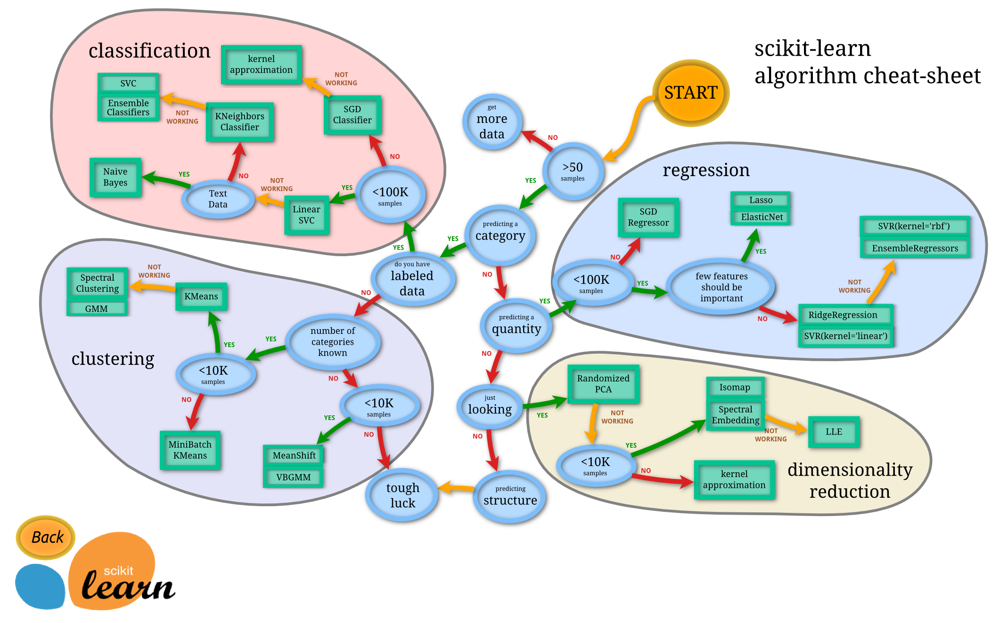

# Cuisine classifiers 2

In this second classification lesson, you will explore more ways to classify numeric data. You will also learn about the ramifications for choosing one classifier over the other.

## [Pre-lecture quiz](https://ff-quizzes.netlify.app/en/ml/)

### Prerequisite

We assume that you have completed the previous lessons and have a cleaned dataset in your `data` folder called _cleaned_cuisines.csv_ in the root of this 4-lesson folder.

### Preparation

We have loaded your _notebook.ipynb_ file with the cleaned dataset and have divided it into X and y dataframes, ready for the model building process.

## A classification map

Previously, you learned about the various options you have when classifying data using Microsoft's cheat sheet. Scikit-learn offers a similar, but more granular cheat sheet that can further help narrow down your estimators (another term for classifiers):


> Tip: [visit this map online](https://scikit-learn.org/stable/tutorial/machine_learning_map/) and click along the path to read documentation.

### The plan

This map is very helpful once you have a clear grasp of your data, as you can 'walk' along its paths to a decision:

- We have >50 samples
- We want to predict a category
- We have labeled data
- We have fewer than 100K samples
- ✨ We can choose a Linear SVC
- If that doesn't work, since we have numeric data
    - We can try a ✨ KNeighbors Classifier 
      - If that doesn't work, try ✨ SVC and ✨ Ensemble Classifiers

This is a very helpful trail to follow.

## Exercise - split the data

Following this path, we should start by importing some libraries to use.

1. Import the needed libraries:

    ```python
    from sklearn.neighbors import KNeighborsClassifier
    from sklearn.linear_model import LogisticRegression
    from sklearn.svm import SVC
    from sklearn.ensemble import RandomForestClassifier, AdaBoostClassifier
    from sklearn.model_selection import train_test_split, cross_val_score
    from sklearn.metrics import accuracy_score,precision_score,confusion_matrix,classification_report, precision_recall_curve
    import numpy as np
    ```

1. Split your training and test data:

    ```python
    from imblearn.over_sampling import SMOTE

    X_train, X_test, y_train, y_test = train_test_split(
        cuisines_features_df, cuisines_label_df, test_size=0.3,
        stratify=cuisines_label_df, random_state=42)
    X_train, y_train = SMOTE(random_state=42).fit_resample(X_train, y_train)
    ```

Keep the test set unresampled so it contains only original recipes with their natural class distribution. SMOTE must run after the split, on training data only, to avoid leaking information into evaluation. The results below are examples; scores can vary with library versions and classifier randomness.

## Linear SVC classifier

Support-Vector clustering (SVC) is a child of the Support-Vector machines family of ML techniques (learn more about these below). In this method, you can choose a 'kernel' to decide how to cluster the labels. The 'C' parameter refers to 'regularization' which regulates the influence of parameters. The kernel can be one of [several](https://scikit-learn.org/stable/modules/generated/sklearn.svm.SVC.html#sklearn.svm.SVC); here we set it to 'linear' to ensure that we leverage linear SVC. Probability defaults to 'false'; here we set it to 'true' to gather probability estimates. We set the random state to '0' to shuffle the data to get probabilities.

### Exercise - apply a linear SVC

Start by creating an array of classifiers. You will add progressively to this array as we test. 

1. Start with a Linear SVC:

    ```python
    C = 10
    # Create different classifiers.
    classifiers = {
        'Linear SVC': SVC(kernel='linear', C=C, probability=True,random_state=0)
    }
    ```

2. Train your model using the Linear SVC and print out a report:

    ```python
    n_classifiers = len(classifiers)
    
    for index, (name, classifier) in enumerate(classifiers.items()):
        classifier.fit(X_train, np.ravel(y_train))
    
        y_pred = classifier.predict(X_test)
        accuracy = accuracy_score(y_test, y_pred)
        print("Accuracy (test) for %s: %0.1f%% " % (name, accuracy * 100))
        print(classification_report(y_test,y_pred))
    ```

    The result is pretty good:

    ```output
    Accuracy (test) for Linear SVC: 74.0%
                  precision    recall  f1-score   support
    
         chinese       0.61      0.66      0.64       133
          indian       0.92      0.92      0.92       179
        japanese       0.55      0.61      0.58        96
          korean       0.81      0.72      0.76       240
            thai       0.65      0.68      0.66        87
    
        accuracy                           0.74       735
       macro avg       0.71      0.72      0.71       735
    weighted avg       0.75      0.74      0.74       735
    ```

## K-Neighbors classifier

K-Neighbors is part of the "neighbors" family of ML methods, which can be used for both supervised and unsupervised learning. In this method, a predefined number of points is created and data are gathered around these points such that generalized labels can be predicted for the data.

### Exercise - apply the K-Neighbors classifier

The previous classifier was good, and worked well with the data, but maybe we can get better accuracy. Try a K-Neighbors classifier.

1. Add a line to your classifier array (add a comma after the Linear SVC item):

    ```python
    'KNN classifier': KNeighborsClassifier(C),
    ```

    The result is a little worse:

    ```output
    Accuracy (test) for KNN classifier: 66.0%
                  precision    recall  f1-score   support
    
         chinese       0.57      0.69      0.63       133
          indian       0.86      0.82      0.84       179
        japanese       0.41      0.73      0.53        96
          korean       0.86      0.53      0.66       240
            thai       0.56      0.56      0.56        87
    
        accuracy                           0.66       735
       macro avg       0.65      0.67      0.64       735
    weighted avg       0.72      0.66      0.67       735
    ```

    ✅ Learn about [K-Neighbors](https://scikit-learn.org/stable/modules/neighbors.html#neighbors)

## Support Vector Classifier

Support-Vector classifiers are part of the [Support-Vector Machine](https://wikipedia.org/wiki/Support-vector_machine) family of ML methods that are used for classification and regression tasks. SVMs "map training examples to points in space" to maximize the distance between two categories. Subsequent data is mapped into this space so their category can be predicted.

### Exercise - apply a Support Vector Classifier

Let's try for a little better accuracy with a Support Vector Classifier.

1. Add a comma after the K-Neighbors item, and then add this line:

    ```python
    'SVC': SVC(),
    ```

    The result is quite good!

    ```output
    Accuracy (test) for SVC: 77.4%
                  precision    recall  f1-score   support
    
         chinese       0.68      0.71      0.69       133
          indian       0.91      0.93      0.92       179
        japanese       0.61      0.70      0.65        96
          korean       0.85      0.75      0.80       240
            thai       0.67      0.69      0.68        87
    
        accuracy                           0.77       735
       macro avg       0.74      0.76      0.75       735
    weighted avg       0.78      0.77      0.78       735
    ```

    ✅ Learn about [Support-Vectors](https://scikit-learn.org/stable/modules/svm.html#svm)

## Ensemble Classifiers

Let's follow the path to the very end, even though the previous test was quite good. Let's try some 'Ensemble Classifiers, specifically Random Forest and AdaBoost:

```python
  'RFST': RandomForestClassifier(n_estimators=100),
  'ADA': AdaBoostClassifier(n_estimators=100)
```

The results let us compare Random Forest and AdaBoost on the same original test recipes:

```output
Accuracy (test) for RFST: 77.3%
              precision    recall  f1-score   support

     chinese       0.69      0.65      0.67       133
      indian       0.91      0.93      0.92       179
    japanese       0.61      0.68      0.64        96
      korean       0.81      0.79      0.80       240
        thai       0.70      0.70      0.70        87

    accuracy                           0.77       735
   macro avg       0.74      0.75      0.75       735
weighted avg       0.77      0.77      0.77       735

Accuracy (test) for ADA: 70.7%
              precision    recall  f1-score   support

     chinese       0.61      0.42      0.50       133
      indian       0.92      0.88      0.90       179
    japanese       0.52      0.60      0.56        96
      korean       0.73      0.79      0.76       240
        thai       0.59      0.68      0.63        87

    accuracy                           0.71       735
   macro avg       0.67      0.67      0.67       735
weighted avg       0.71      0.71      0.70       735
```

✅ Learn about [Ensemble Classifiers](https://scikit-learn.org/stable/modules/ensemble.html)

This method of Machine Learning "combines the predictions of several base estimators" to improve the model's quality. In our example, we used Random Trees and AdaBoost. 

- [Random Forest](https://scikit-learn.org/stable/modules/ensemble.html#forest), an averaging method, builds a 'forest' of 'decision trees' infused with randomness to avoid overfitting. The n_estimators parameter is set to the number of trees.

- [AdaBoost](https://scikit-learn.org/stable/modules/generated/sklearn.ensemble.AdaBoostClassifier.html) fits a classifier to a dataset and then fits copies of that classifier to the same dataset. It focuses on the weights of incorrectly classified items and adjusts the fit for the next classifier to correct.

---

## 🚀Challenge

Each of these techniques has a large number of parameters that you can tweak. Research each one's default parameters and think about what tweaking these parameters would mean for the model's quality.

## [Post-lecture quiz](https://ff-quizzes.netlify.app/en/ml/)

## Review & Self Study

There's a lot of jargon in these lessons, so take a minute to review [this list](https://docs.microsoft.com/dotnet/machine-learning/resources/glossary?WT.mc_id=academic-77952-leestott) of useful terminology!

## Assignment 

[Parameter play](assignment.md)
