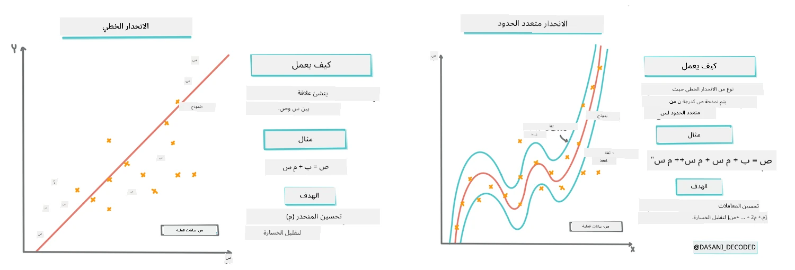
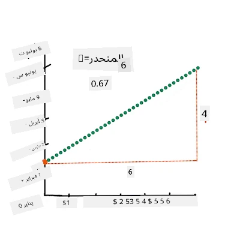
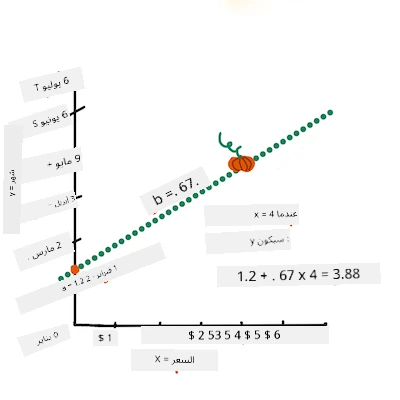
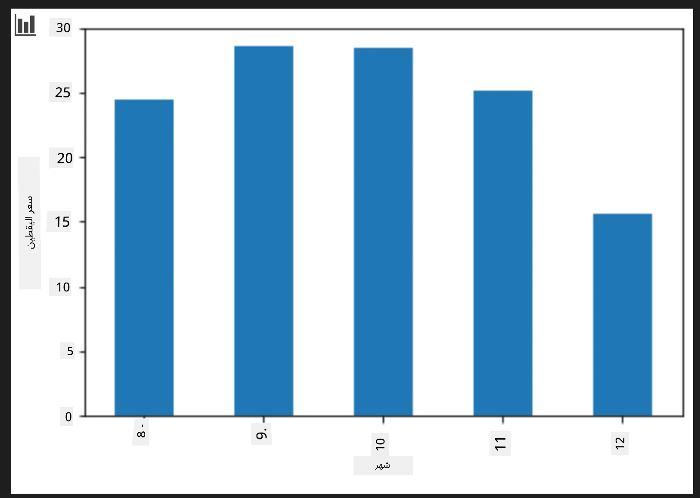
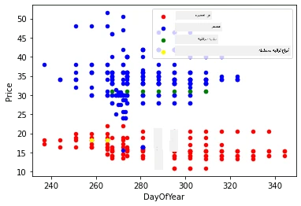

# بناء نموذج الانحدار باستخدام Scikit-learn: الانحدار بأربع طرق

## ملاحظة للمبتدئين

يُستخدم الانحدار الخطي عندما نرغب في التنبؤ بقيمة **رقمية** (على سبيل المثال، سعر المنزل، درجة الحرارة، أو المبيعات).  
يعمل عن طريق إيجاد خط مستقيم يمثل بأفضل شكل العلاقة بين ميزات الإدخال والمخرج.

في هذا الدرس، نركز على فهم المفهوم قبل استكشاف تقنيات الانحدار المتقدمة.  
  
> رسم معلومات بواسطة [Dasani Madipalli](https://twitter.com/dasani_decoded)  
## [اختبار تمهيدي للدرس](https://ff-quizzes.netlify.app/en/ml/)

> ### [هذا الدرس متاح بلغة R!](../../../../2-Regression/3-Linear/solution/R/lesson_3.html)  
### مقدمة

حتى الآن استكشفت ما هو الانحدار باستخدام بيانات عينة مأخوذة من مجموعة بيانات تسعير اليقطين التي سنستخدمها طوال هذا الدرس. وقد قمت أيضًا بتصورها باستخدام Matplotlib.

أنت الآن مستعد للتعمق أكثر في الانحدار لـ ML. بينما يسمح التصور بفهم البيانات، القوة الحقيقية لتعلم الآلة تأتي من _تدريب النماذج_. يتم تدريب النماذج على البيانات التاريخية لالتقاط تبعيات البيانات تلقائيًا، وتسمح لك بالتنبؤ بالنتائج للبيانات الجديدة التي لم يرها النموذج من قبل.

في هذا الدرس، ستتعلم المزيد عن نوعين من الانحدار: _الانحدار الخطي الأساسي_ و _الانحدار متعدد الحدود_، بالإضافة إلى بعض الرياضيات الأساسية لهذه التقنيات. ستتيح لنا هذه النماذج التنبؤ بأسعار اليقطين اعتمادًا على بيانات الإدخال المختلفة.

[](https://youtu.be/CRxFT8oTDMg "ML for beginners - Understanding Linear Regression")

> 🎥 انقر على الصورة أعلاه لمشاهدة فيديو قصير يشرح الانحدار الخطي.

> طوال هذه المنهجية، نفترض معرفة رياضية محدودة، ونسعى لجعلها متاحة للطلاب القادمين من حقول أخرى، فتابع الملاحظات، نداءات 🧮، الرسوم التوضيحية، وأدوات التعلم الأخرى للمساعدة في الاستيعاب.

### المتطلبات الأساسية

ينبغي أن تكون مألوفًا حتى الآن مع هيكل بيانات اليقطين التي نفحصها. يمكنك العثور عليها محملة مسبقًا ومنظفة مسبقًا في ملف _notebook.ipynb_ الخاص بهذا الدرس. في الملف، يُعرض سعر اليقطين لكل بوشل في إطار بيانات جديد. تأكد من قدرتك على تشغيل هذه النوتبوك في kernels في Visual Studio Code.

### التحضير

كتذكير، تقوم بتحميل هذه البيانات لطرح أسئلة حولها.

- متى أفضل وقت لشراء اليقطين؟  
- ما السعر المتوقع لعلبة من يقطين صغير الحجم؟  
- هل يجب أن أشتريها في سلال نصف بوشل أم بصندوق 1 1/9 بوشل؟  
دعنا نستمر في استكشاف هذه البيانات.

في الدرس السابق، أنشأت إطار بيانات من Pandas وملأته بجزء من مجموعة البيانات الأصلية، موحدًا الأسعار حسب البوشل. لكن بهذه الطريقة، تمكنت فقط من جمع حوالي 400 نقطة بيانات ولأشهر الخريف فقط.

ألق نظرة على البيانات التي قمنا بتحميلها مسبقًا في دفتر الملاحظات المرافق لهذا الدرس. البيانات محملة مسبقًا وتم رسم مخطط مبعثر مبدئي لعرض بيانات الأشهر. ربما يمكننا الحصول على تفاصيل أكثر عن طبيعة البيانات من خلال تنظيفها أكثر.

## خط انحدار خطي

كما تعلمت في الدرس الأول، هدف تمرين الانحدار الخطي هو القدرة على رسم خط لـ:

- **عرض العلاقات بين المتغيرات**. إظهار العلاقة بين المتغيرات  
- **عمل توقعات**. عمل توقعات دقيقة عن مكان وقوع نقطة بيانات جديدة نسبة إلى هذا الخط.

من المعتاد في **انحدار الأقل مجموع المربعات** رسم هذا النوع من الخطوط. مصطلح "الأقل مجموع المربعات" يشير إلى عملية تقليل الخطأ الكلي في نموذجنا. لكل نقطة بيانات، نقيس المسافة العمودية (المسماة بالبقايا) بين النقطة الفعلية وخط الانحدار.

نقوم بتربيع هذه المسافات لسببين رئيسيين:  

1. **المقدار أهم من الاتجاه:** نريد أن نعامل خطأ -5 مثل خطأ +5. التربيع يجعل كل القيم موجبة.  

2. **معاقبة القيم المتطرفة:** التربيع يعطي وزنًا أكبر للأخطاء الكبيرة، مما يجبر الخط على الاقتراب أكثر من النقاط البعيدة.

ثم نجمع كل هذه القيم المربعة معًا. هدفنا هو إيجاد الخط المحدد حيث تكون هذه المجموعة النهائية بأقل قيمة ممكنة—ومن هنا جاء اسم "الأقل مجموع المربعات".

> **🧮 أرني الرياضيات**  
>  
> هذا الخط، المسمى _خط أفضل ملاءمة_ يمكن التعبير عنه بواسطة [معادلة](https://en.wikipedia.org/wiki/Simple_linear_regression):  
>  
> ```
> Y = a + bX
> ```
>  
> `X` هو 'المتغير التفسيري'. `Y` هو 'المتغير التابع'. ميل الخط هو `b` و `a` هو التقاطع عند المحور Y، وهو يشير إلى قيمة `Y` عندما تكون `X = 0`.  
>  
>  
>  
> أولاً، احسب الميل `b`. رسم معلومات بواسطة [Jen Looper](https://twitter.com/jenlooper)  
>  
> بعبارة أخرى، وبالإشارة إلى سؤال بيانات اليقطين الأصلي: "تنبؤ سعر اليقطين لكل بوشل حسب الشهر"، فإن `X` تشير للسعر و `Y` تشير لشهر البيع.  
>  
>  
>  
> احسب قيمة Y. إذا كنت تدفع حوالي 4 دولارات، فلا بد أنه أبريل! رسم معلومات بواسطة [Jen Looper](https://twitter.com/jenlooper)  
>  
> يجب أن توضح الرياضيات التي تحسب الخط ميل الخط، والذي يعتمد أيضًا على التقاطع، أو المكان الذي يتواجد فيه `Y` عندما `X = 0`.  
>  
> يمكنك مشاهدة طريقة الحساب لهذه القيم في موقع [Math is Fun](https://www.mathsisfun.com/data/least-squares-regression.html). كما يمكنك زيارة [حاسبة الأقل مجموع المربعات](https://www.mathsisfun.com/data/least-squares-calculator.html) لمشاهدة كيف تؤثر قيم الأرقام على الخط.

## الارتباط

مصطلح آخر يجب فهمه هو **معامل الارتباط** بين المتغيرات X و Y المعطاة. باستخدام المخطط المبعثر، يمكنك تصور هذا المعامل بسرعة. المخطط الذي تتوزع نقاط البيانات فيه في خط مرتب لديه ارتباط عالي، لكن المخطط الذي تنتشر فيه النقاط في كل مكان بين X و Y لديه ارتباط منخفض.

نموذج الانحدار الخطي الجيد هو الذي لديه معامل ارتباط عالي (أقرب إلى 1 منه إلى 0) باستخدام طريقة انحدار الأقل مجموع المربعات مع خط الانحدار.

✅ شغّل دفتر الملاحظات المرافق لهذا الدرس وانظر إلى المخطط المبعثر بين الشهر والسعر. هل تبدو البيانات التي تربط الشهر والسعر لمبيعات اليقطين ذات ارتباط عالي أم منخفض حسب تفسيرك البصري للمخطط المبعثر؟ وهل يتغير ذلك إذا استخدمت مقياسًا أكثر دقة بدلاً من `Month`، مثل *يوم السنة* (أي عدد الأيام منذ بداية السنة)؟

في الكود أدناه، سنفترض أننا قمنا بتنظيف البيانات، وحصلنا على إطار بيانات يسمى `new_pumpkins`، يشبه الجدول التالي:

ID | Month | DayOfYear | Variety | City | Package | Low Price | High Price | Price  
---|-------|-----------|---------|------|---------|-----------|------------|-------  
70 | 9 | 267 | PIE TYPE | BALTIMORE | 1 1/9 bushel cartons | 15.0 | 15.0 | 13.636364  
71 | 9 | 267 | PIE TYPE | BALTIMORE | 1 1/9 bushel cartons | 18.0 | 18.0 | 16.363636  
72 | 10 | 274 | PIE TYPE | BALTIMORE | 1 1/9 bushel cartons | 18.0 | 18.0 | 16.363636  
73 | 10 | 274 | PIE TYPE | BALTIMORE | 1 1/9 bushel cartons | 17.0 | 17.0 | 15.454545  
74 | 10 | 281 | PIE TYPE | BALTIMORE | 1 1/9 bushel cartons | 15.0 | 15.0 | 13.636364  

> كود تنظيف البيانات متوفر في [`notebook.ipynb`](notebook.ipynb). لقد قمنا بتنفيذ نفس خطوات التنظيف كما في الدرس السابق، وحسبنا عمود `DayOfYear` باستخدام التعبير التالي:

```python
day_of_year = pd.to_datetime(pumpkins['Date']).apply(lambda dt: (dt-datetime(dt.year,1,1)).days)
```
  
الآن بعد أن فهمت الرياضيات خلف الانحدار الخطي، دعنا ننشئ نموذج الانحدار لنرى إن كنا نستطيع التنبؤ بأي حزمة من اليقطين سيكون لها أفضل الأسعار. قد يرغب من يشتري اليقطين لبقعة يقطين احتفالية بمعرفة هذه المعلومة لتحسين مشترياته من حزم اليقطين للبقعة.

## البحث عن الارتباط

[](https://youtu.be/uoRq-lW2eQo "ML for beginners - Looking for Correlation: The Key to Linear Regression")

> 🎥 انقر على الصورة أعلاه لمشاهدة فيديو قصير يشرح الارتباط.

من الدرس السابق ربما رأيت أن متوسط السعر للأشهر المختلفة يبدو كالتالي:



وهذا يشير إلى أنه يجب أن يكون هناك بعض الارتباط، ويمكننا محاولة تدريب نموذج انحدار خطي للتنبؤ بالعلاقة بين `Month` و`Price`، أو بين `DayOfYear` و`Price`. فيما يلي المخطط المبعثر الذي يظهر العلاقة الأخيرة:

 

لنرَ إذا كان هناك ارتباط باستخدام دالة `corr`:

```python
print(new_pumpkins['Month'].corr(new_pumpkins['Price']))
print(new_pumpkins['DayOfYear'].corr(new_pumpkins['Price']))
```
  
يبدو أن الارتباط صغير جدًا، -0.15 حسب `Month` و -0.17 حسب `DayOfYear`، لكن قد يكون هناك علاقة مهمة أخرى. يبدو أن هناك مجموعات مختلفة من الأسعار تتوافق مع أصناف مختلفة من اليقطين. لتأكيد هذا الافتراض، دعنا نرسم كل فئة يقطين بلون مختلف. عن طريق تمرير معلمة `ax` إلى دالة `scatter` يمكننا رسم كل النقاط على نفس الرسم البياني:

```python
ax=None
colors = ['red','blue','green','yellow']
for i,var in enumerate(new_pumpkins['Variety'].unique()):
    df = new_pumpkins[new_pumpkins['Variety']==var]
    ax = df.plot.scatter('DayOfYear','Price',ax=ax,c=colors[i],label=var)
```
  
 

تشير تحقيقاتنا إلى أن الصنف له تأثير أكبر على السعر الكلي من تاريخ البيع الفعلي. يمكننا أن نرى ذلك مع مخطط الأعمدة:

```python
new_pumpkins.groupby('Variety')['Price'].mean().plot(kind='bar')
```
  
 

دعنا نركز للحظة فقط على صنف يقطين واحد، نوع "الفطيرة"، ونرى تأثير التاريخ على السعر:

```python
pie_pumpkins = new_pumpkins[new_pumpkins['Variety']=='PIE TYPE']
pie_pumpkins.plot.scatter('DayOfYear','Price') 
```
 

إذا حسبنا الآن معامل الارتباط بين `Price` و `DayOfYear` باستخدام دالة `corr`، سنحصل على شيء مثل `-0.27` - وهذا يعني أن تدريب نموذج تنبئي له معنى.

> قبل تدريب نموذج الانحدار الخطي، من المهم التأكد من أن بياناتنا نظيفة. الانحدار الخطي لا يعمل جيدًا مع القيم المفقودة، لذا من المنطقي التخلص من كل الخلايا الفارغة:

```python
pie_pumpkins.dropna(inplace=True)
pie_pumpkins.info()
```
  
نهج آخر سيكون ملء هذه القيم الفارغة بقيم المتوسط من العمود المقابل.

## الانحدار الخطي البسيط

[](https://youtu.be/e4c_UP2fSjg "ML for beginners - Linear and Polynomial Regression using Scikit-learn")

> 🎥 انقر على الصورة أعلاه لمشاهدة فيديو قصير عن الانحدار الخطي ومتعدد الحدود.

لتدريب نموذج الانحدار الخطي، سنستخدم مكتبة **Scikit-learn**.

```python
from sklearn.linear_model import LinearRegression
from sklearn.metrics import mean_squared_error
from sklearn.model_selection import train_test_split
```
  
نبدأ بفصل القيم المدخلة (الميزات) والنتيجة المتوقعة (التسمية) في مصفوفات numpy منفصلة:

```python
X = pie_pumpkins['DayOfYear'].to_numpy().reshape(-1,1)
y = pie_pumpkins['Price']
```
  
> لاحظ أننا اضطررنا إلى إجراء `reshape` على بيانات الإدخال لكي يفهمها حزمة الانحدار الخطي بشكل صحيح. الانحدار الخطي يتوقع مصفوفة ثنائية الأبعاد كمدخلات، حيث يمثل كل صف من المصفوفة متجهًا للميزات المدخلة. في حالتنا، بما أنه لدينا ميزة واحدة فقط - نحتاج إلى مصفوفة ذات شكل N×1، حيث N هي حجم مجموعة البيانات.

بعد ذلك، نحتاج إلى تقسيم البيانات إلى مجموعات تدريب واختبار، حتى نتمكن من التحقق من صحة نموذجنا بعد التدريب:

```python
X_train, X_test, y_train, y_test = train_test_split(X, y, test_size=0.2, random_state=0)
```
  
أخيرًا، يستغرق تدريب نموذج الانحدار الخطي الفعلي سطرين فقط من الكود. نعرف كائن `LinearRegression`، ونُلائم النموذج لبياناتنا باستخدام طريقة `fit`:

```python
lin_reg = LinearRegression()
lin_reg.fit(X_train,y_train)
```

يحتوي كائن `LinearRegression` بعد عملية `fit` على جميع معاملات الانحدار، والتي يمكن الوصول إليها باستخدام خاصية `.coef_`. في حالتنا، يوجد معامل واحد فقط، والذي يجب أن يكون حوالي `-0.017`. وهذا يعني أن الأسعار يبدو أنها تنخفض قليلاً مع مرور الوقت، ولكن ليس بشكل كبير، حوالي سنتين في اليوم. يمكننا أيضًا الوصول إلى نقطة تقاطع الانحدار مع محور Y باستخدام `lin_reg.intercept_` - وستكون حوالي `21` في حالتنا، مما يشير إلى السعر في بداية العام.

لمعرفة مدى دقة نموذجنا، يمكننا التنبؤ بالأسعار على مجموعة بيانات اختبار، ثم قياس مدى قرب تنبؤاتنا من القيم المتوقعة. يمكن القيام بذلك باستخدام مقياس الجذر التربيعي للخطأ المتوسط (RMSE)، وهو الجذر لمتوسط جميع الفروق المربعة بين القيمة المتوقعة والمتنبأ بها.

```python
pred = lin_reg.predict(X_test)

rmse = np.sqrt(mean_squared_error(y_test,pred))
print(f'RMSE: {rmse:3.3} ({rmse/np.mean(pred)*100:3.3}%)')
```

يبدو أن خطأنا حوالي نقطتين، وهو ~17%. ليس جيدًا جدًا. مؤشر آخر لجودة النموذج هو **معامل التحديد**، والذي يمكن الحصول عليه هكذا:

```python
score = lin_reg.score(X_train,y_train)
print('Model determination: ', score)
```
 إذا كانت القيمة 0، فهذا يعني أن النموذج لا يأخذ بيانات الإدخال في الاعتبار، ويتصرف كـ *أسوأ متنبئ خطي*، وهو ببساطة قيمة المتوسط للنتيجة. القيمة 1 تعني أننا نستطيع التنبؤ بجميع المخرجات المتوقعة بدقة تامة. في حالتنا، معامل التحديد حوالي 0.06، وهو منخفض جدًا.

يمكننا أيضًا رسم بيانات الاختبار مع خط الانحدار لنرى بشكل أفضل كيف يعمل الانحدار في حالتنا:

```python
plt.scatter(X_test,y_test)
plt.plot(X_test,pred)
```


## الانحدار متعدد الحدود

نوع آخر من الانحدار الخطي هو الانحدار متعدد الحدود. في حين أنه أحيانًا توجد علاقة خطية بين المتغيرات - كلما زاد حجم اليقطين، زاد السعر - في بعض الأحيان لا يمكن تمثيل هذه العلاقات كمستوى أو خط مستقيم.

✅ إليك [بعض الأمثلة الإضافية](https://online.stat.psu.edu/stat501/Lesson09#polynomial-regression-examples) على بيانات يمكن استخدام الانحدار متعدد الحدود معها.

أعد النظر في العلاقة بين التاريخ والسعر. هل يبدو هذا الرسم النقطي وكأنه يجب تحليله بواسطة خط مستقيم بالضرورة؟ ألا يمكن أن تتقلب الأسعار؟ في هذه الحالة، يمكنك تجربة الانحدار متعدد الحدود.

✅ كثيرات الحدود هي تعبيرات رياضية قد تتكون من متغير واحد أو أكثر مع معاملات.

ينشئ الانحدار متعدد الحدود خطًا منحنيًا ليتناسب بشكل أفضل مع البيانات غير الخطية. في حالتنا، إذا أضفنا متغير `DayOfYear` المربّع إلى بيانات الإدخال، يجب أن نتمكن من ملائمة بياناتنا بمنحنى قطع مكافئ يحتوي على حد أدنى في نقطة معينة خلال العام.

تتضمن مكتبة Scikit-learn [واجهة برمجة تطبيقات pipeline](https://scikit-learn.org/stable/modules/generated/sklearn.pipeline.make_pipeline.html?highlight=pipeline#sklearn.pipeline.make_pipeline) مفيدة لدمج خطوات معالجة البيانات المختلفة معًا. الـ **pipeline** هو سلسلة من **المقدِّرين (estimators)**. في حالتنا، سننشئ دالة pipeline تضيف أولاً ميزات متعددة الحدود إلى نموذجنا، ثم تدرب الانحدار:

```python
from sklearn.preprocessing import PolynomialFeatures
from sklearn.pipeline import make_pipeline

pipeline = make_pipeline(PolynomialFeatures(2), LinearRegression())

pipeline.fit(X_train,y_train)
```

استخدام `PolynomialFeatures(2)` يعني أننا سنشمل كل كثيرات الحدود من الدرجة الثانية من بيانات الإدخال. في حالتنا، سيعني فقط `DayOfYear`<sup>2</sup>، لكن مع وجود متغيري مدخلات X و Y، سيضيف ذلك X<sup>2</sup>، XY و Y<sup>2</sup>. يمكننا أيضًا استخدام كثيرات حدود بدرجات أعلى إذا أردنا.

يمكن استخدام الـ Pipelines بنفس طريقة استخدام كائن `LinearRegression` الأصلي، أي يمكننا `fit` الـ pipeline، ثم استخدام `predict` للحصول على نتائج التنبؤ:

```python
pred = pipeline.predict(X_test)

rmse = np.sqrt(mean_squared_error(y_test,pred))
print(f'RMSE: {rmse:3.3} ({rmse/np.mean(pred)*100:3.3}%)')

score = pipeline.score(X_train,y_train)
print('Model determination: ', score)
```

لرسم منحنى التقريب الناعم، نستخدم `np.linspace` لإنشاء مدى متساوي من قيم الإدخال، بدلاً من الرسم مباشرة على بيانات الاختبار غير المرتبة (والتي ستنتج خطًا متعرجًا):

```python
X_range = np.linspace(X_test.min(), X_test.max(), 100).reshape(-1,1)
y_range = pipeline.predict(X_range)

plt.scatter(X_test, y_test)
plt.plot(X_range, y_range)
```

إليك الرسم الذي يُظهر بيانات الاختبار ومنحنى التقريب:


باستخدام الانحدار متعدد الحدود، يمكننا الحصول على RMSE أقل قليلاً ومعامل تحديد أعلى، لكن ليس بشكل كبير. نحتاج إلى أخذ ميزات أخرى في الاعتبار!

> يمكنك رؤية أن أسعار اليقطين الأدنى تُلاحظ في مكان ما حول عيد الهالوين. كيف تفسر ذلك؟

🎃 تهانينا، لقد أنشأت نموذجًا يمكنه المساعدة في التنبؤ بسعر يقطين الفطائر. من المحتمل أنك تستطيع تكرار نفس الإجراء لجميع أنواع اليقطين، لكن ذلك سيكون مملًا. لنتعلم الآن كيفية أخذ نوع اليقطين في الاعتبار في نموذجنا!

## الميزات الفئوية

في العالم المثالي، نريد أن نتمكن من التنبؤ بالأسعار لأنواع اليقطين المختلفة باستخدام نفس النموذج. ومع ذلك، فإن عمود `Variety` يختلف عن أعمدة مثل `Month` لأنه يحتوي على قيم غير رقمية. تسمى هذه الأعمدة **فئوية**.

[](https://youtu.be/DYGliioIAE0 "ML للمبتدئين - التنبؤات بالفئات باستخدام الانحدار الخطي")

> 🎥 انقر على الصورة أعلاه لمشاهدة فيديو قصير عن استخدام الميزات الفئوية.

هنا يمكنك رؤية كيف يعتمد متوسط السعر على النوع:


لأخذ النوع في الاعتبار، نحتاج أولاً إلى تحويله إلى صيغة رقمية، أو **ترميزه**. هناك عدة طرق يمكننا القيام بها:

* الترميز الرقمي البسيط **numeric encoding** سيبني جدولًا للأنواع المختلفة، ثم يستبدل اسم النوع برقم مؤشر في ذلك الجدول. هذه ليست فكرة جيدة للانحدار الخطي، لأن الانحدار الخطي يأخذ القيمة الرقمية الفعلية للمؤشر ويضيفها إلى النتيجة، مضروبًا في معامل ما. في حالتنا، العلاقة بين رقم المؤشر والسعر غير خطية بوضوح، حتى لو تأكدنا من ترتيب المؤشرات بطريقة معينة.
* الترميز باستخدام **One-hot encoding** سيستبدل عمود `Variety` بأربعة أعمدة مختلفة، واحدة لكل نوع. يحتوي كل عمود على `1` إذا كانت الصف المقابل من النوع المعطى، و `0` خلاف ذلك. هذا يعني أن هناك أربعة معاملات في الانحدار الخطي، واحدة لكل نوع يقطين، مسؤولة عن "سعر البداية" (أو "السعر الإضافي") لذلك النوع المعين.

يُظهر الكود أدناه كيف يمكننا ترميز النوع باستخدام one-hot:

```python
pd.get_dummies(new_pumpkins['Variety'])
```

 ID | FAIRYTALE | MINIATURE | MIXED HEIRLOOM VARIETIES | PIE TYPE
----|-----------|-----------|--------------------------|----------
70 | 0 | 0 | 0 | 1
71 | 0 | 0 | 0 | 1
... | ... | ... | ... | ...
1738 | 0 | 1 | 0 | 0
1739 | 0 | 1 | 0 | 0
1740 | 0 | 1 | 0 | 0
1741 | 0 | 1 | 0 | 0
1742 | 0 | 1 | 0 | 0

لتدريب الانحدار الخطي باستخدام النوع المشفر بطريقة one-hot كمدخل، نحتاج فقط إلى تهيئة بيانات `X` و `y` بشكل صحيح:

```python
X = pd.get_dummies(new_pumpkins['Variety'])
y = new_pumpkins['Price']
```

بقية الكود هي نفسها التي استخدمناها أعلاه لتدريب الانحدار الخطي. إذا جربتها، سترى أن متوسط الخطأ المربع تقريبًا هو نفسه، لكننا نحصل على معامل تحديد أعلى بكثير (~77%). للحصول على تنبؤات أكثر دقة، يمكننا أخذ ميزات فئوية أخرى وكذلك ميزات رقمية مثل `Month` أو `DayOfYear` في الاعتبار. للحصول على مصفوفة واحدة كبيرة من الميزات، يمكننا استخدام `join`:

```python
X = pd.get_dummies(new_pumpkins['Variety']) \
        .join(new_pumpkins['Month']) \
        .join(pd.get_dummies(new_pumpkins['City'])) \
        .join(pd.get_dummies(new_pumpkins['Package']))
y = new_pumpkins['Price']
```

هنا نأخذ أيضًا في الاعتبار `City` ونوع `Package`، مما يعطينا RMSE بقيمة 2.84 (10.5%)، ومعامل تحديد 0.94!

## جمع كل شيء معًا

لإنشاء أفضل نموذج، يمكننا استخدام البيانات المجمعة (الميزات الفئوية المرمّزة + الرقمية) من المثال أعلاه مع الانحدار متعدد الحدود. إليك الكود الكامل لراحتك:

```python
# إعداد بيانات التدريب
X = pd.get_dummies(new_pumpkins['Variety']) \
        .join(new_pumpkins['Month']) \
        .join(pd.get_dummies(new_pumpkins['City'])) \
        .join(pd.get_dummies(new_pumpkins['Package']))
y = new_pumpkins['Price']

# إجراء تقسيم التدريب والاختبار
X_train, X_test, y_train, y_test = train_test_split(X, y, test_size=0.2, random_state=0)

# إعداد وتدريب خط الأنابيب
pipeline = make_pipeline(PolynomialFeatures(2), LinearRegression())
pipeline.fit(X_train,y_train)

# التنبؤ بالنتائج لبيانات الاختبار
pred = pipeline.predict(X_test)

# حساب الجذر التربيعي لمتوسط الخطأ والتحديد
rmse = mean_squared_error(y_test, pred, squared=False)
print(f'RMSE: {rmse:3.3} ({rmse/pred.mean()*100:3.3}%)')

score = pipeline.score(X_train,y_train)
print('Model determination: ', score)
```

يجب أن يعطينا هذا أفضل معامل تحديد بنحو 97%، و RMSE=2.23 (~8% خطأ التنبؤ).

| النموذج | RMSE | معامل التحديد |
|-------|-----|---------------|
| `DayOfYear` خطي | 2.77 (17.2%) | 0.07 |
| `DayOfYear` متعدد الحدود | 2.73 (17.0%) | 0.08 |
| `Variety` خطي | 5.24 (19.7%) | 0.77 |
| جميع الميزات خطي | 2.84 (10.5%) | 0.94 |
| جميع الميزات متعدد الحدود | 2.23 (8.25%) | 0.97 |

🏆 عمل رائع! أنشأت أربعة نماذج انحدار في درس واحد، وحسّنت جودة النموذج إلى 97%. في القسم النهائي عن الانحدار، ستتعلم عن الانحدار اللوجستي لتحديد الفئات.

---
## 🚀التحدي

اختبر عدة متغيرات مختلفة في هذا الدفتر لترى كيف يتناسب الارتباط مع دقة النموذج.

## [اختبار ما بعد المحاضرة](https://ff-quizzes.netlify.app/en/ml/)

## مراجعة ودراسة ذاتية

في هذا الدرس تعرفنا على الانحدار الخطي. هناك أنواع أخرى مهمة من الانحدار. اقرأ عن تقنيات الخطوي، وريج، ولاسو، وإيلاستيك نت. دورة جيدة للدراسة والتعلم أكثر هي [دورة التعلم الإحصائي من ستانفورد](https://online.stanford.edu/courses/sohs-ystatslearning-statistical-learning)

## الواجب

[إنشاء نموذج](assignment.md)

---

<!-- CO-OP TRANSLATOR DISCLAIMER START -->
**تنويه**:
تمت ترجمة هذا الوثيقة باستخدام خدمة الترجمة الآلية [Co-op Translator](https://github.com/Azure/co-op-translator). بينما نسعى للدقة، يرجى العلم أن الترجمات الآلية قد تحتوي على أخطاء أو عدم دقة. يجب اعتبار الوثيقة الأصلية بلغتها الأصلية المصدر المعتمد. بالنسبة للمعلومات الهامة، يُنصح بالاعتماد على الترجمة المهنية البشرية. نحن غير مسؤولين عن أي سوء فهم أو تفسيرات خاطئة ناتجة عن استخدام هذه الترجمة.
<!-- CO-OP TRANSLATOR DISCLAIMER END -->