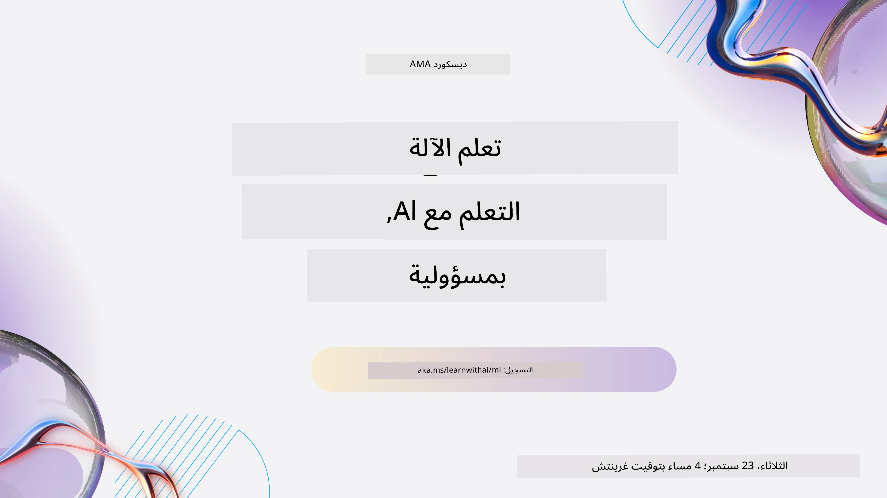
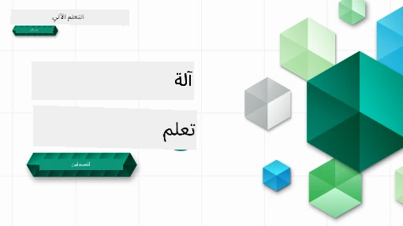

[](https://github.com/microsoft/ML-For-Beginners/blob/master/LICENSE)
[](https://GitHub.com/microsoft/ML-For-Beginners/graphs/contributors/)
[](https://GitHub.com/microsoft/ML-For-Beginners/issues/)
[](https://GitHub.com/microsoft/ML-For-Beginners/pulls/)
[](http://makeapullrequest.com)

[](https://GitHub.com/microsoft/ML-For-Beginners/watchers/)
[](https://GitHub.com/microsoft/ML-For-Beginners/network/)
[](https://GitHub.com/microsoft/ML-For-Beginners/stargazers/)

### 🌐 دعم متعدد اللغات

#### تُدار الترجمات باستخدام [Co-op Translator](https://github.com/Azure/co-op-translator)

<!-- CO-OP TRANSLATOR LANGUAGES TABLE START -->
[العربية](./README.md) | [البنغالية](../bn/README.md) | [البلغارية](../bg/README.md) | [البورمية (ميانمار)](../my/README.md) | [الصينية (المبسطة)](../zh-CN/README.md) | [الصينية (التقليدية، هونغ كونغ)](../zh-HK/README.md) | [الصينية (التقليدية، ماكاو)](../zh-MO/README.md) | [الصينية (التقليدية، تايوان)](../zh-TW/README.md) | [الكرواتية](../hr/README.md) | [التشيكية](../cs/README.md) | [الدنماركية](../da/README.md) | [الهولندية](../nl/README.md) | [الإستونية](../et/README.md) | [الفنلندية](../fi/README.md) | [الفرنسية](../fr/README.md) | [الألمانية](../de/README.md) | [اليونانية](../el/README.md) | [العبرية](../he/README.md) | [الهندية](../hi/README.md) | [الهنغارية](../hu/README.md) | [الإندونيسية](../id/README.md) | [الإيطالية](../it/README.md) | [اليابانية](../ja/README.md) | [الكانادا](../kn/README.md) | [الخميرية](../km/README.md) | [الكورية](../ko/README.md) | [الليتوانية](../lt/README.md) | [الملايو](../ms/README.md) | [المالايالامية](../ml/README.md) | [المانيپوري (ميتي مايك)](../mni/README.md) | [الماراثي](../mr/README.md) | [النيبالية](../ne/README.md) | [بيدجين النيجر](../pcm/README.md) | [النرويجية](../no/README.md) | [الفارسية (الفارسية)](../fa/README.md) | [البولندية](../pl/README.md) | [البرتغالية (البرازيل)](../pt-BR/README.md) | [البرتغالية (البرتغال)](../pt-PT/README.md) | [البنجابية (جورموخي)](../pa/README.md) | [الرومانية](../ro/README.md) | [الروسية](../ru/README.md) | [الصربية (السيريلية)](../sr/README.md) | [السلوفاكية](../sk/README.md) | [السلوفينية](../sl/README.md) | [الإسبانية](../es/README.md) | [السواحيلية](../sw/README.md) | [السويدية](../sv/README.md) | [التاغالوغ (الفلبينية)](../tl/README.md) | [التاميلية](../ta/README.md) | [التيلوجو](../te/README.md) | [التايلاندية](../th/README.md) | [التركية](../tr/README.md) | [الأوكرانية](../uk/README.md) | [الأردية](../ur/README.md) | [الفيتنامية](../vi/README.md)

> **هل تفضل الاستنساخ محلياً؟**
>
> يحتوي هذا المستودع على ترجمات لأكثر من 50 لغة مما يزيد بشكل كبير من حجم التنزيل. للاستنساخ بدون الترجمات، استخدم تفتيشًا متفرقًا:
>
> **باش / ماك أو إس / لينكس:**
> ```bash
> git clone --filter=blob:none --sparse https://github.com/microsoft/ML-For-Beginners.git
> cd ML-For-Beginners
> git sparse-checkout set --no-cone '/*' '!translations' '!translated_images'
> ```
>
> **CMD (ويندوز):**
> ```cmd
> git clone --filter=blob:none --sparse https://github.com/microsoft/ML-For-Beginners.git
> cd ML-For-Beginners
> git sparse-checkout set --no-cone "/*" "!translations" "!translated_images"
> ```
>
> هذا يوفر لك كل ما تحتاجه لإكمال الدورة مع تنزيل أسرع بكثير.
<!-- CO-OP TRANSLATOR LANGUAGES TABLE END -->

#### انضم إلى مجتمعنا

[](https://discord.gg/nTYy5BXMWG)

لدينا سلسلة تعلم مع الذكاء الاصطناعي مستمرة على ديسكورد، تعرف على المزيد وانضم إلينا في [سلسلة التعلم مع الذكاء الاصطناعي](https://aka.ms/learnwithai/discord) من 18 إلى 30 سبتمبر 2025. ستحصل على نصائح وحيل لاستخدام GitHub Copilot لعلم البيانات.



# تعلم الآلة للمبتدئين - منهج دراسي

> 🌍 سافر حول العالم بينما نستكشف تعلم الآلة من خلال ثقافات العالم 🌍

يسر دعاة السحابة في مايكروسوفت أن يقدموا منهجًا دراسيًا يتضمن 12 أسبوعًا و 26 درسًا حول **تعلم الآلة**. في هذا المنهج، ستتعلم ما يُطلق عليه أحيانًا **تعلم الآلة الكلاسيكي**، باستخدام مكتبة Scikit-learn بشكل أساسي وتجنب التعلم العميق، الذي يتم تناوله في منهجنا [الذكاء الاصطناعي للمبتدئين](https://aka.ms/ai4beginners). اجمع هذه الدروس مع منهجنا ['علم البيانات للمبتدئين'](https://aka.ms/ds4beginners) أيضًا!

سافر معنا حول العالم بينما نطبق هذه التقنيات الكلاسيكية على بيانات من مناطق عديدة في العالم. كل درس يتضمن اختبارات قبل وبعد الدرس، تعليمات مكتوبة لإكمال الدرس، الحل، واجبًا، والمزيد. تسمح منهجيتنا المبنية على المشاريع لك بالتعلم أثناء البناء، وهي طريقة مثبتة لجعل المهارات الجديدة تدوم.

**✍️ شكرًا جزيلًا لمؤلفينا** جن لوبر، ستيفن هاول، فرانسيسكا لازيري، تومومي إيمورا، كاسي بريفيو، ديمتري سوشنيكوف، كريس نورينغ، أنيربان موخرجي، أورنيلا ألتونيان، روث ياكوبو وآمي بويد

**🎨 شكر خاص أيضًا لرسامينا** تومومي إيمورا، داساني ماديبالي، وجين لوبر

**🙏 شكر خاص 🙏 لمؤلفي مراجعي ومراسلي محتوى سفراء طلاب مايكروسوفت**، وخصوصًا ريشت داغلي، محمد سكيب خان إينان، روهان راج، ألكسندرو بيتريسكو، أبهيشيك جيسوال، ناورين طباسوم، إيوان سامويلا، وسنيغدا أغاروال

**🤩 شكر إضافي لسفراء طلاب مايكروسوفت إريك وانجاو، جاسلين سوندي، وفيدوشي جوبتا لدروس R الخاصة بنا!**

# البدء

اتبع هذه الخطوات:
1. **افتح فورك للمستودع**: اضغط على زر "Fork" في الركن العلوي الأيمن من هذه الصفحة.
2. **انسخ المستودع**:   `git clone https://github.com/microsoft/ML-For-Beginners.git`

> 💡 **نصيحة للبدء السريع:** هل تريد البدء في المتصفح دون إعداد Python محليًا؟ استخدم [GitHub Codespaces](https://github.com/features/codespaces) لإنشاء بيئة تطوير سحابية لفوركك. افتح قائمة **الكود** الخضراء، اختر **Codespaces**، وأنشئ مساحة ترميز؛ قم بتثبيت تبعيات كل درس داخلها حسب الحاجة.

> [اعثر على جميع الموارد الإضافية لهذه الدورة في مجموعة Microsoft Learn الخاصة بنا](https://learn.microsoft.com/en-us/collections/qrqzamz1nn2wx3?WT.mc_id=academic-77952-bethanycheum)

> 🔧 **هل تحتاج إلى مساعدة؟** تحقق من [دليل حل المشكلات](TROUBLESHOOTING.md) لحلول المشاكل الشائعة في التثبيت والإعداد وتشغيل الدروس.


**[الطلاب](https://aka.ms/student-page)**، لاستخدام هذا المنهج، قم بفورك المستودع بأكمله إلى حساب GitHub الخاص بك وأكمل التمارين بنفسك أو مع مجموعة:

- ابدأ باختبار ما قبل المحاضرة.
- اقرأ المحاضرة وأكمل الأنشطة، توقف وفكر عند كل اختبار معرفة.
- حاول إنشاء المشاريع بفهم الدروس بدلاً من تشغيل كود الحل؛ مع ذلك، يتوفر هذا الكود في مجلدات `/solution` في كل درس موجه نحو المشاريع.
- خذ اختبار ما بعد المحاضرة.
- أكمل التحدي.
- أكمل الواجب.
- بعد إكمال مجموعة دروس، زر [لوحة النقاش](https://github.com/microsoft/ML-For-Beginners/discussions) و"تعلّم بصوتٍ عالٍ" بملء جدول تقييم PAT المناسب. 'PAT' هو أداة تقييم تقدّم تعبئها لتعزيز تعلمك. يمكنك أيضًا التفاعل مع تقييمات PAT الأخرى حتى نتعلم معًا.

> لمزيد من الدراسة، نوصي باتباع هذه الوحدات ومسارات التعلم من [Microsoft Learn](https://docs.microsoft.com/en-us/users/jenlooper-2911/collections/k7o7tg1gp306q4?WT.mc_id=academic-77952-leestott).

**المعلمون**، لقد أدرجنا [بعض الاقتراحات](for-teachers.md) حول كيفية استخدام هذا المنهج.

---

## فيديوهات توضيحية

بعض الدروس متوفرة كفيديو قصير. يمكنك العثور عليها جميعًا داخل الدروس، أو على [قائمة تشغيل ML للمبتدئين على قناة Microsoft Developer على يوتيوب](https://aka.ms/ml-beginners-videos) عبر النقر على الصورة أدناه.

[](https://aka.ms/ml-beginners-videos)

---

## التعرف على الفريق

[](https://youtu.be/Tj1XWrDSYJU)

**صورة متحركة بواسطة** [موهيت جايسال](https://linkedin.com/in/mohitjaisal)

> 🎥 انقر على الصورة أعلاه لمشاهدة فيديو عن المشروع والأشخاص الذين أنشأوه!

---

## المنهجية التعليمية

اخترنا مبدئين تربويين أثناء بناء هذا المنهج: ضمان أنه عملي **مبني على المشاريع** وأن يتضمن **اختبارات متكررة**. بالإضافة إلى ذلك، يتضمن هذا المنهج **موضوعًا** مشتركًا يعطيه تماسكًا.

من خلال ضمان توافق المحتوى مع المشاريع، يصبح العملية أكثر جذبًا للطلاب ويزداد احتفاظهم بالمفاهيم. علاوة على ذلك، يحدد اختبار خفيف قبل الدرس نية الطالب نحو تعلم موضوع، بينما يضمن اختبار ثانٍ بعد الدرس مزيدًا من الاحتفاظ. صُمم هذا المنهج ليكون مرنًا وممتعًا ويمكن أخذه بكامله أو جزئيًا. تبدأ المشاريع صغيرة وتزداد تعقيدًا بنهاية دورة الـ 12 أسبوعًا. كما يتضمن المنهج خاتمة عن تطبيقات تعلم الآلة في العالم الحقيقي، ويمكن استخدامها كاعتماد إضافي أو كأساس للنقاش.

> تجد قواعد السلوك لدينا في [مدونة السلوك](CODE_OF_CONDUCT.md)، و[المساهمة](CONTRIBUTING.md)، و[الترجمات](..)، و[حل المشكلات](TROUBLESHOOTING.md). نرحب بتعليقاتكم البناءة!

## يتضمن كل درس

- ملاحظة اختيارية
- فيديو إضافي اختياري
- شرح بالفيديو (بعض الدروس فقط)
- [اختبار إحماء قبل المحاضرة](https://ff-quizzes.netlify.app/en/ml/)
- الدرس مكتوب
- في الدروس المبنية على المشاريع، إرشادات خطوة بخطوة لكيفية بناء المشروع
- اختبارات معرفة
- تحدي
- قراءة إضافية
- واجب
- [اختبار ما بعد المحاضرة](https://ff-quizzes.netlify.app/en/ml/)

> **ملاحظة حول اللغات**: هذه الدروس مكتوبة أساسًا بلغة Python، ولكن العديد منها متوفر أيضًا بلغة R. لإكمال درس R، توجه إلى مجلد `/solution` وابحث عن دروس R. تتضمن امتداد .rmd الذي يمثل ملف **R Markdown** والذي يمكن تعريفه ببساطة على أنه تضمين `code chunks` (لـ R أو لغات أخرى) و `YAML header` (يرشد كيفية تنسيق المخرجات مثل PDF) في `Markdown document`. وبذلك، فهو إطار عمل تأليف مثالي لعلم البيانات لأنه يسمح لك بدمج الكود، ومخرجاته، وأفكارك عبر السماح بكتابتها بلغة Markdown. علاوة على ذلك، يمكن عرض ملفات R Markdown إلى تنسيقات إخراج مثل PDF، HTML، أو Word.

> **ملاحظة حول الاختبارات**: جميع الاختبارات موجودة في [مجلد تطبيق الاختبار](../../quiz-app)، بمجموع 52 اختبارًا، يحتوي كل منها على ثلاثة أسئلة. يتم ربطها من داخل الدروس لكن يمكن تشغيل تطبيق الاختبار محليًا؛ اتبع التعليمات في مجلد `quiz-app` لاستضافة محلية أو النشر على أزور.

| رقم الدرس |                              الموضوع                               |                   مجموعة الدروس                   | أهداف التعلم                                                                                                                   |                                                                الدرس المرتبط                                                                |                        المؤلف                        |
| :-----------: | :------------------------------------------------------------: | :-------------------------------------------------: | ------------------------------------------------------------------------------------------------------------------------------- | :--------------------------------------------------------------------------------------------------------------------------------------: | :--------------------------------------------------: |
|      01       |               مقدمة في تعلم الآلة                |      [مقدمة](1-Introduction/README.md)       | تعلم المفاهيم الأساسية وراء تعلم الآلة                                                                                |                                             [درس](1-Introduction/1-intro-to-ML/README.md)                                             |                       محمد                       |
|      02       |               تاريخ تعلم الآلة                 |      [مقدمة](1-Introduction/README.md)       | تعلّم التاريخ الذي يقوم عليه هذا المجال                                                                                         |                                            [درس](1-Introduction/2-history-of-ML/README.md)                                            |                     جن وآمي                      |
|      03       |                العدالة وتعلم الآلة                  |      [مقدمة](1-Introduction/README.md)       | ما هي القضايا الفلسفية المهمة حول العدالة التي يجب على الطلاب مراعاتها عند بناء وتطبيق نماذج تعلم الآلة؟ |                                              [درس](1-Introduction/3-fairness/README.md)                                               |                        تومومي                        |
|      04       |                تقنيات تعلم الآلة                 |      [مقدمة](1-Introduction/README.md)       | ما هي التقنيات التي يستخدمها الباحثون في تعلم الآلة لبناء نماذج تعلم الآلة؟                                                                       |                                          [درس](1-Introduction/4-techniques-of-ML/README.md)                                           |                    كريس وجن                     |
|      05       |                   مقدمة في الانحدار                   |        [الانحدار](2-Regression/README.md)         | ابدأ مع بايثون وScikit-learn لنماذج الانحدار                                                                  |         [بايثون](2-Regression/1-Tools/README.md) • [R](../../2-Regression/1-Tools/solution/R/lesson_1.html)         |      جن • إريك وانجاو       |
|      06       |                أسعار اليقطين في أمريكا الشمالية 🎃                |        [الانحدار](2-Regression/README.md)         | تصور وتنظيف البيانات استعدادًا لتعلم الآلة                                                                                  |          [بايثون](2-Regression/2-Data/README.md) • [R](../../2-Regression/2-Data/solution/R/lesson_2.html)          |      جن • إريك وانجاو       |
|      07       |                أسعار اليقطين في أمريكا الشمالية 🎃                |        [الانحدار](2-Regression/README.md)         | بناء نماذج الانحدار الخطي والمتعدد الحدود                                                                                   |        [بايثون](2-Regression/3-Linear/README.md) • [R](../../2-Regression/3-Linear/solution/R/lesson_3.html)        |      جن ودميتري • إريك وانجاو       |
|      08       |                أسعار اليقطين في أمريكا الشمالية 🎃                |        [الانحدار](2-Regression/README.md)         | بناء نموذج انحدار لوجستي                                                                                               |     [بايثون](2-Regression/4-Logistic/README.md) • [R](../../2-Regression/4-Logistic/solution/R/lesson_4.html)      |      جن • إريك وانجاو       |
|      09       |                          تطبيق ويب 🔌                          |           [تطبيق ويب](3-Web-App/README.md)            | بناء تطبيق ويب لاستخدام نموذجك المدرب                                                                                       |                                                 [بايثون](3-Web-App/1-Web-App/README.md)                                                  |                         جن                          |
|      10       |                 مقدمة في التصنيف                 |    [تصنيف](4-Classification/README.md)     | تنظيف والتحضير وتصور بياناتك؛ مقدمة في التصنيف                                                            | [بايثون](4-Classification/1-Introduction/README.md) • [R](../../4-Classification/1-Introduction/solution/R/lesson_10.html)  | جن وكاسي • إريك وانجاو |
|      11       |             المأكولات الآسيوية والهندية اللذيذة 🍜             |    [تصنيف](4-Classification/README.md)     | مقدمة في المصنّفات                                                                                                     | [بايثون](4-Classification/2-Classifiers-1/README.md) • [R](../../4-Classification/2-Classifiers-1/solution/R/lesson_11.html) | جن وكاسي • إريك وانجاو |
|      12       |             المأكولات الآسيوية والهندية اللذيذة 🍜             |    [تصنيف](4-Classification/README.md)     | المزيد من المصنّفات                                                                                                                | [بايثون](4-Classification/3-Classifiers-2/README.md) • [R](../../4-Classification/3-Classifiers-2/solution/R/lesson_12.html) | جن وكاسي • إريك وانجاو |
|      13       |             المأكولات الآسيوية والهندية اللذيذة 🍜             |    [تصنيف](4-Classification/README.md)     | بناء تطبيق ويب توصية باستخدام نموذجك                                                                                    |                                              [بايثون](4-Classification/4-Applied/README.md)                                              |                         جن                          |
|      14       |                   مقدمة في التجميع                   |        [تجميع](5-Clustering/README.md)         | تنظيف، تحضير، وتصوير بياناتك؛ مقدمة في التجميع                                                                |         [بايثون](5-Clustering/1-Visualize/README.md) • [R](../../5-Clustering/1-Visualize/solution/R/lesson_14.html)         |      جن • إريك وانجاو       |
|      15       |              استكشاف أذواق الموسيقى النيجيرية 🎧              |        [تجميع](5-Clustering/README.md)         | استكشاف طريقة التجميع K-Means                                                                                           |           [بايثون](5-Clustering/2-K-Means/README.md) • [R](../../5-Clustering/2-K-Means/solution/R/lesson_15.html)           |      جن • إريك وانجاو       |
|      16       |        مقدمة في معالجة اللغة الطبيعية ☕️         |   [معالجة اللغة الطبيعية](6-NLP/README.md)    | تعلم الأساسيات حول معالجة اللغة الطبيعية من خلال بناء بوت بسيط                                                                             |                                             [بايثون](6-NLP/1-Introduction-to-NLP/README.md)                                              |                       ستيفن                        |
|      17       |                      مهام معالجة اللغة الطبيعية الشائعة ☕️                      |   [معالجة اللغة الطبيعية](6-NLP/README.md)    | تعمّق في معرفتك بمعالجة اللغة الطبيعية من خلال فهم المهام الأساسية المطلوبة عند التعامل مع تراكيب اللغة                          |                                                    [بايثون](6-NLP/2-Tasks/README.md)                                                     |                       ستيفن                        |
|      18       |             الترجمة وتحليل المشاعر ♥️              |   [معالجة اللغة الطبيعية](6-NLP/README.md)    | الترجمة وتحليل المشاعر مع جين أوستن                                                                             |                                            [بايثون](6-NLP/3-Translation-Sentiment/README.md)                                             |                       ستيفن                        |
|      19       |                  الفنادق الرومانسية في أوروبا ♥️                  |   [معالجة اللغة الطبيعية](6-NLP/README.md)    | تحليل المشاعر مع مراجعات الفنادق 1                                                                                         |                                               [بايثون](6-NLP/4-Hotel-Reviews-1/README.md)                                                |                       ستيفن                        |
|      20       |                  الفنادق الرومانسية في أوروبا ♥️                  |   [معالجة اللغة الطبيعية](6-NLP/README.md)    | تحليل المشاعر مع مراجعات الفنادق 2                                                                                         |                                               [بايثون](6-NLP/5-Hotel-Reviews-2/README.md)                                                |                       ستيفن                        |
|      21       |            مقدمة في التنبؤ بالسلاسل الزمنية             |        [سلاسل زمنية](7-TimeSeries/README.md)        | مقدمة في التنبؤ بالسلاسل الزمنية                                                                                         |                                             [بايثون](7-TimeSeries/1-Introduction/README.md)                                              |                      فرانسيسكا                       |
|      22       | ⚡️ استخدام الطاقة العالمية ⚡️ - التنبؤ بالسلاسل الزمنية باستخدام ARIMA |        [سلاسل زمنية](7-TimeSeries/README.md)        | التنبؤ بالسلاسل الزمنية باستخدام ARIMA                                                                                              |                                                 [بايثون](7-TimeSeries/2-ARIMA/README.md)                                                 |                      فرانسيسكا                       |
|      23       |  ⚡️ استخدام الطاقة العالمية ⚡️ - التنبؤ بالسلاسل الزمنية باستخدام SVR  |        [سلاسل زمنية](7-TimeSeries/README.md)        | التنبؤ بالسلاسل الزمنية باستخدام مراقب الدعم المتجه                                                                           |                                                  [بايثون](7-TimeSeries/3-SVR/README.md)                                                  |                       أنيربان                        |
|      24       |             مقدمة في التعلم المعزز             | [التعلم المعزز](8-Reinforcement/README.md) | مقدمة في التعلم المعزز باستخدام التعلم Q                                                                          |                                             [بايثون](8-Reinforcement/1-QLearning/README.md)                                              |                        ديمتري                        |
|      25       |                 ساعد بيتر في تجنب الذئب! 🐺                  | [التعلم المعزز](8-Reinforcement/README.md) | صالة الألعاب للتعلم المعزز                                                                                                      |                                                [بايثون](8-Reinforcement/2-Gym/README.md)                                                 |                        ديمتري                        |
|  خاتمة   |            سيناريوهات وتطبيقات تعلم الآلة في العالم الحقيقي            |      [تعلم الآلة في الميدان](9-Real-World/README.md)       | تطبيقات حقيقية ومثيرة للاهتمام وكاشفة لتعلم الآلة الكلاسيكي                                                               |                                             [درس](9-Real-World/1-Applications/README.md)                                              |                         الفريق                         |
|  خاتمة   |            تصحيح نماذج تعلم الآلة باستخدام لوحة تحكم RAI            |      [تعلم الآلة في الميدان](9-Real-World/README.md)       | تصحيح نماذج تعلم الآلة باستخدام مكونات لوحة تحكم الذكاء الاصطناعي المسؤول                                                              |                                             [درس](9-Real-World/2-Debugging-ML-Models/README.md)                                              |                     روث ياكوبو                      |

> [اعثر على جميع الموارد الإضافية لهذه الدورة في مجموعتنا على Microsoft Learn](https://learn.microsoft.com/en-us/collections/qrqzamz1nn2wx3?WT.mc_id=academic-77952-bethanycheum)

## الوصول دون اتصال

يمكنك تشغيل هذا التوثيق دون اتصال باستخدام [Docsify](https://docsify.js.org/#/). انسخ هذا المستودع، [ثبّت Docsify](https://docsify.js.org/#/quickstart) على جهازك المحلي، ثم في المجلد الجذر لهذا المستودع، اكتب `docsify serve`. سيتم تقديم الموقع على المنفذ 3000 على المضيف المحلي لديك: `localhost:3000`.

## ملفات PDF

اعثر على ملف PDF للمناهج مع الروابط [هنا](https://microsoft.github.io/ML-For-Beginners/pdf/readme.pdf).


## 🎒 دورات أخرى

ينتج فريقنا دورات أخرى! تفقد:

<!-- CO-OP TRANSLATOR OTHER COURSES START -->
### LangChain
[](https://aka.ms/langchain4j-for-beginners)
[](https://aka.ms/langchainjs-for-beginners?WT.mc_id=m365-94501-dwahlin)
[](https://github.com/microsoft/langchain-for-beginners?WT.mc_id=m365-94501-dwahlin)
---

### Azure / Edge / MCP / Agents
[](https://github.com/microsoft/AZD-for-beginners?WT.mc_id=academic-105485-koreyst)
[](https://github.com/microsoft/edgeai-for-beginners?WT.mc_id=academic-105485-koreyst)
[](https://github.com/microsoft/mcp-for-beginners?WT.mc_id=academic-105485-koreyst)
[](https://github.com/microsoft/ai-agents-for-beginners?WT.mc_id=academic-105485-koreyst)

---
 
### سلسلة الذكاء الاصطناعي التوليدي
[](https://github.com/microsoft/generative-ai-for-beginners?WT.mc_id=academic-105485-koreyst)
[-9333EA?style=for-the-badge&labelColor=E5E7EB&color=9333EA)](https://github.com/microsoft/Generative-AI-for-beginners-dotnet?WT.mc_id=academic-105485-koreyst)
[-C084FC?style=for-the-badge&labelColor=E5E7EB&color=C084FC)](https://github.com/microsoft/generative-ai-for-beginners-java?WT.mc_id=academic-105485-koreyst)
[-E879F9?style=for-the-badge&labelColor=E5E7EB&color=E879F9)](https://github.com/microsoft/generative-ai-with-javascript?WT.mc_id=academic-105485-koreyst)

---
 
### التعليم الأساسي
[](https://aka.ms/ml-beginners?WT.mc_id=academic-105485-koreyst)
[](https://aka.ms/datascience-beginners?WT.mc_id=academic-105485-koreyst)
[](https://aka.ms/ai-beginners?WT.mc_id=academic-105485-koreyst)
[](https://github.com/microsoft/Security-101?WT.mc_id=academic-96948-sayoung)
[](https://aka.ms/webdev-beginners?WT.mc_id=academic-105485-koreyst)
[](https://aka.ms/iot-beginners?WT.mc_id=academic-105485-koreyst)
[](https://github.com/microsoft/xr-development-for-beginners?WT.mc_id=academic-105485-koreyst)

---
 
### سلسلة المساعد البرمجي
[](https://aka.ms/GitHubCopilotAI?WT.mc_id=academic-105485-koreyst)
[](https://github.com/microsoft/mastering-github-copilot-for-dotnet-csharp-developers?WT.mc_id=academic-105485-koreyst)
[](https://github.com/microsoft/CopilotAdventures?WT.mc_id=academic-105485-koreyst)
<!-- CO-OP TRANSLATOR OTHER COURSES END -->

## الحصول على المساعدة

إذا تعثرت أو كانت لديك أسئلة أثناء تعلم تعلم الآلة أو بناء تطبيقات الذكاء الاصطناعي، لا تقلق — المساعدة متاحة.

يمكنك الانضمام إلى المناقشات مع متعلمين ومطورين آخرين، طرح الأسئلة، ومشاركة أفكارك مع المجتمع.

- انضم إلى المجتمع لطرح الأسئلة والتعلم مع الآخرين
- ناقش مفاهيم وأفكار مشاريع تعلم الآلة
- احصل على الإرشاد من مطورين ذوي خبرة

المجتمع الداعم هو طريقة رائعة لتنمية مهاراتك وحل المشكلات بشكل أسرع.

[مجتمع Discord الخاص بـ Microsoft Foundry](https://discord.gg/nTYy5BXMWG)

إذا واجهت أخطاء، مشاكل برمجية، أو لديك اقتراحات للتحسين، يمكنك أيضًا فتح **مشكلة** في هذا المستودع للإبلاغ عن المشكلة.

للتعليق على المنتج أو للبحث في المشاركات الموجودة في المجتمع، قم بزيارة منتدى المطورين:

[](https://aka.ms/foundry/forum)

## نصائح إضافية للتعلم

- راجع دفاتر الملاحظات بعد كل درس لفهم أفضل.
- مارس تنفيذ الخوارزميات بنفسك.
- استكشاف مجموعات البيانات الواقعية باستخدام المفاهيم المكتسبة.

---

<!-- CO-OP TRANSLATOR DISCLAIMER START -->
**تنويه**:
تمت ترجمة هذا المستند باستخدام خدمة الترجمة بالذكاء الاصطناعي [Co-op Translator](https://github.com/Azure/co-op-translator). بينما نسعى للدقة، يرجى العلم أن الترجمات الآلية قد تحتوي على أخطاء أو عدم دقة. يجب اعتبار المستند الأصلي بلغته الأصلية المصدر الرسمي والمعتمد. للمعلومات الهامة، يُنصح بالاستعانة بترجمة بشرية محترفة. نحن غير مسؤولين عن أي سوء فهم أو تفسير ناتج عن استخدام هذه الترجمة.
<!-- CO-OP TRANSLATOR DISCLAIMER END -->