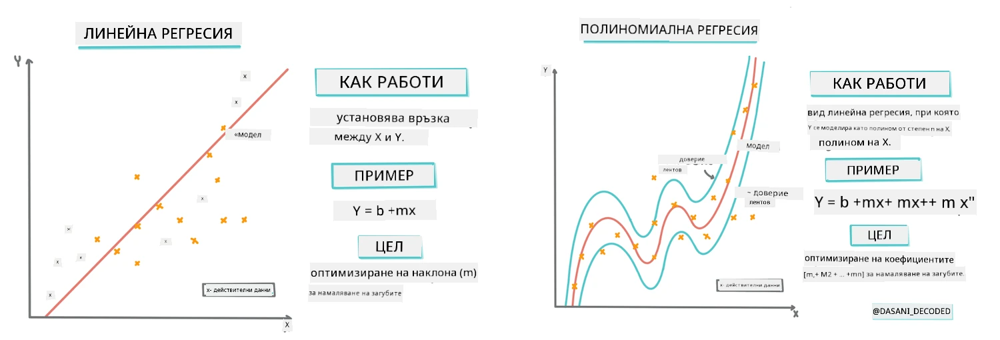
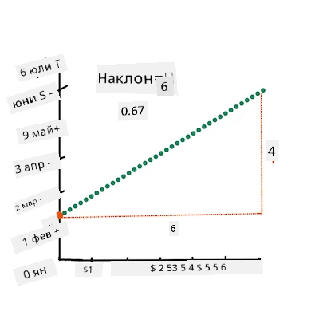
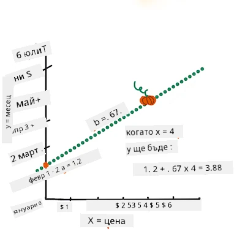
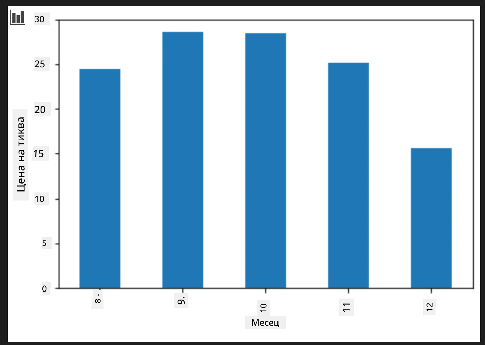
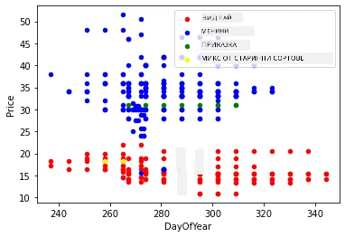

# Създаване на регресионен модел с Scikit-learn: регресия по четири начина

## Бележка за начинаещи

Линейната регресия се използва, когато искаме да предскажем **числова стойност** (например цена на къща, температура или продажби).
Тя работи чрез намиране на права линия, която най-добре представя връзката между входните признаци и изхода.

В този урок се фокусираме върху разбирането на концепцията, преди да разгледаме по-усъвършенствани регресионни техники.

> Инфографика от [Dasani Madipalli](https://twitter.com/dasani_decoded)
## [Кратък тест преди лекцията](https://ff-quizzes.netlify.app/en/ml/)

> ### [Този урок е достъпен и на R!](../../../../2-Regression/3-Linear/solution/R/lesson_3.html)
### Въведение

Досега разгледахте какво е регресия с примерни данни, събрани от набора от данни за цени на тикви, който ще използваме в целия урок. Също така ги визуализирахте с помощта на Matplotlib.

Сега сте готови да навлезете по-дълбоко в регресията за машинно обучение. Визуализацията ви позволява да разберете данните, но истинската сила на машинното обучение идва от _обучението на модели_. Моделите се обучават върху исторически данни, за да заснемат автоматично зависимостите в данните, и ви позволяват да предсказвате резултати при нови данни, които моделът не е виждал преди.

В този урок ще научите повече за два вида регресия: _основна линейна регресия_ и _полиномиална регресия_, заедно с част от математиката, лежаща в основата на тези техники. Тези модели ще ни позволят да предсказваме цените на тиквите в зависимост от различни входни данни.

[](https://youtu.be/CRxFT8oTDMg "ML за начинаещи - Разбиране на линейната регресия")

> 🎥 Кликнете върху изображението по-горе за кратко видео с обзор на линейната регресия.

> В целия този учебен курс приемаме минимални познания по математика и се стараем да го направим достъпен за студенти от други области, затова обръщайте внимание на бележките, 🧮 математическите обръщения, диаграмите и други учебни средства за улеснение на разбирането.

### Изисквания

Към момента трябва да сте запознати със структурата на данните за тиквите, които разглеждаме. Можете да ги намерите предварително заредени и почистени в _notebook.ipynb_ файла за този урок. Във файла цената на тиквите е показана на бушел в нов dataframe. Уверете се, че можете да стартирате тези ноутбуци в kernel на Visual Studio Code.

### Подготовка

Напомняме, че зареждате тези данни, за да можете да задавате въпроси към тях.

- Кога е най-доброто време за покупка на тикви?
- Каква цена мога да очаквам за кашон миниатюрни тикви?
- Трябва ли да ги купувам в полубушелен кош или в кутия от 1 1/9 бушела?
Нека продължим да разглеждаме тези данни.

В предишния урок създадохте Pandas dataframe и го попълнихте с част от оригиналния набор от данни, стандартизирайки цените според бушел. Като направихте това, обаче събрахте само около 400 точки с данни и само за есенните месеци.

Погледнете данните, които заредихме предварително в ноутбука за този урок. Данните са предварително заредени и е начертан начален scatterplot, показващ месечните данни. Може би можем да получим малко повече информация за характера на данните чрез по-добро почистване.

## Линия на линейна регресия

Както научихте в Урок 1, целта на упражнението с линейна регресия е да можем да начертаем линия, която:

- **Показва връзките между променливите**. Показва връзката между променливите
- **Прави предсказания**. Прави точни прогнози къде новата точка ще попадне спрямо тази линия. 

Обичайно за **Регресия по метод на най-малките квадрати** е да се изчертае този тип линия. Терминът „най-малки квадрати“ се отнася до процеса на минимизиране на общата грешка в нашия модел. За всяка точка измерваме вертикалното разстояние (наречено остатък) между реалната точка и нашата регресионна линия.

Квадратираме тези разстояния по две основни причини:

1. **Модул пред посока:** Искаме да третираме грешка от -5 по същия начин, както грешка от +5. Квадратирането прави всички стойности положителни.

2. **Наказване на изходящи стойности:** Квадратирането придава по-голяма тежест на по-големите грешки, принуждавайки линията да стои по-близо до отдалечените точки.

Сумираме всички тези квадратирани стойности. Целта ни е да намерим конкретната линия, при която тази крайна сума е най-малка (най-малката възможна стойност) — оттук идва името „най-малки квадрати“.

> **🧮 Покажете ми математиката** 
> 
> Тази линия, наречена _линия на най-добро приспособление_, може да се опише с [уравнение](https://en.wikipedia.org/wiki/Simple_linear_regression): 
> 
> ```
> Y = a + bX
> ```
>
> `X` е 'обяснителната променлива'. `Y` е 'зависимата променлива'. Наклонът на линията е `b`, а `a` е пресечната точка с оста Y, която означава стойността на `Y`, когато `X = 0`. 
>
>
>
> Първо, изчислете наклона `b`. Инфографика от [Jen Looper](https://twitter.com/jenlooper)
>
> С други думи, и с оглед на първоначалния въпрос за нашите тиквени данни: "предскажете цената на тиква на бушел по месеци", `X` би означавало цената, а `Y` би било месецът на продажба. 
>
>
>
> Изчислете стойността на `Y`. Ако плащате около 4 долара, значи е април! Инфографика от [Jen Looper](https://twitter.com/jenlooper)
>
> Математиката, която изчислява линията, трябва да демонстрира наклона на линията, който зависи и от пресечната точка, или къде се намира `Y` когато `X = 0`.
>
> Можете да проследите метода на изчисление за тези стойности на [Math is Fun](https://www.mathsisfun.com/data/least-squares-regression.html). Посетете и [тотова най-малки квадрати калкулатор](https://www.mathsisfun.com/data/least-squares-calculator.html), за да видите как стойностите влияят на линията.

## Корелация

Още един термин, който трябва да разберем е **коефициентът на корелация** между дадени променливи X и Y. С помощта на scatterplot можете бързо да визуализирате този коефициент. Графика с точки, разположени по красива права линия, има висока корелация, а графика с точки, разпръснати навсякъде между X и Y, има ниска корелация.

Добър модел за линейна регресия ще има висок (по-близък до 1 отколкото до 0) коефициент на корелация, използвайки метода на най-малките квадрати с регресионна линия.

✅ Стартирайте ноутбука, придружаващ този урок, и погледнете scatterplot на Месец спрямо Цена. Изглежда ли данните, свързващи Месец с Цена за продажбите на тиквите, имат висока или ниска корелация, според вашата визуална интерпретация на scatterplot? Променя ли се това, ако използвате по-фино измерване вместо `Month`, напр. *ден от годината* (т.е. брой дни отначалото на годината)?

В кода по-долу ще приемем, че сме почистили данните и сме получили data frame с име `new_pumpkins`, подобен на следния:

ID | Месец | ДенОтГодината | Вид | Град | Опаковка | Ниска Цена | Висока Цена | Цена
---|-------|-----------|---------|------|---------|-----------|------------|-------
70 | 9 | 267 | PIE TYPE | BALTIMORE | 1 1/9 бушел картонени кутии | 15.0 | 15.0 | 13.636364
71 | 9 | 267 | PIE TYPE | BALTIMORE | 1 1/9 бушел картонени кутии | 18.0 | 18.0 | 16.363636
72 | 10 | 274 | PIE TYPE | BALTIMORE | 1 1/9 бушел картонени кутии | 18.0 | 18.0 | 16.363636
73 | 10 | 274 | PIE TYPE | BALTIMORE | 1 1/9 бушел картонени кутии | 17.0 | 17.0 | 15.454545
74 | 10 | 281 | PIE TYPE | BALTIMORE | 1 1/9 бушел картонени кутии | 15.0 | 15.0 | 13.636364

> Кодът за почистване на данните е наличен в [`notebook.ipynb`](notebook.ipynb). Извършихме същите стъпки за почистване както в предишния урок и изчислихме колоната `DayOfYear` със следното изражение: 

```python
day_of_year = pd.to_datetime(pumpkins['Date']).apply(lambda dt: (dt-datetime(dt.year,1,1)).days)
```

Сега, когато разбирате математиката зад линейната регресия, нека създадем регресионен модел, за да видим дали можем да предскажем коя опаковка тикви ще има най-добра цена. Някой, който купува тикви за празнична градина с тикви, би искал тази информация, за да оптимизира покупките си на опаковки тикви.

## Търсене на корелация

[](https://youtu.be/uoRq-lW2eQo "ML за начинаещи - Търсене на корелация: ключът към линейната регресия")

> 🎥 Кликнете върху изображението по-горе за кратко видео с обзор на корелацията.

От предишния урок вероятно сте забелязали, че средната цена за различните месеци изглежда така:



Това подсказва, че има някаква корелация, и можем да опитаме да обучим линейна регресия, за да предскажем връзката между `Month` и `Price`, или между `DayOfYear` и `Price`. Ето scatterplot, който показва последната връзка:

 

Нека видим дали има корелация с функцията `corr`:

```python
print(new_pumpkins['Month'].corr(new_pumpkins['Price']))
print(new_pumpkins['DayOfYear'].corr(new_pumpkins['Price']))
```

Изглежда, че корелацията е доста малка, -0.15 за `Month` и -0.17 за `DayOfYear`, но може да има друга важна връзка. Изглежда, че има различни групи цени, съответстващи на различни видове тикви. За да потвърдим тази хипотеза, нека начертаем всяка категория тикви с различен цвят. Като подаваме параметър `ax` на функцията `scatter`, можем да начертаем всички точки на една и съща графика:

```python
ax=None
colors = ['red','blue','green','yellow']
for i,var in enumerate(new_pumpkins['Variety'].unique()):
    df = new_pumpkins[new_pumpkins['Variety']==var]
    ax = df.plot.scatter('DayOfYear','Price',ax=ax,c=colors[i],label=var)
```

 

Нашето изследване подсказва, че видът оказва по-голямо влияние върху общата цена, отколкото действителната дата на продажба. Това може да се види с помощта на бар графика:

```python
new_pumpkins.groupby('Variety')['Price'].mean().plot(kind='bar')
```

 

Нека сега се съсредоточим само върху един вид тикви, 'pie type', и видим каква е ефекта на датата върху цената:

```python
pie_pumpkins = new_pumpkins[new_pumpkins['Variety']=='PIE TYPE']
pie_pumpkins.plot.scatter('DayOfYear','Price') 
```
 

Ако изчислим корелацията между `Price` и `DayOfYear` с функцията `corr`, ще получим стойност около `-0.27` — което означава, че обучението на предсказващ модел има смисъл.

> Преди да започнете обучение на линеен регресионен модел, важно е да се уверим, че данните са чисти. Линейната регресия не работи добре с липсващи стойности, затова е добре да премахнем всички празни клетки:

```python
pie_pumpkins.dropna(inplace=True)
pie_pumpkins.info()
```

Друг подход би бил да запълним липсващите стойности със средни стойности от съответната колона.

## Проста линейна регресия

[](https://youtu.be/e4c_UP2fSjg "ML за начинаещи - Линейна и полиномиална регресия с Scikit-learn")

> 🎥 Кликнете върху изображението по-горе за кратко видео с обзор на линейната и полиномиалната регресия.

За да обучим модела за линейна регресия, ще използваме библиотеката **Scikit-learn**.

```python
from sklearn.linear_model import LinearRegression
from sklearn.metrics import mean_squared_error
from sklearn.model_selection import train_test_split
```

Започваме с отделяне на входните стойности (признаци) и очаквания изход (етикет) в отделни numpy масиви:

```python
X = pie_pumpkins['DayOfYear'].to_numpy().reshape(-1,1)
y = pie_pumpkins['Price']
```

> Забележете, че трябва да приложим `reshape` към входните данни, за да може пакетът Linear Regression да ги разбере правилно. Линейната регресия очаква 2D масив като вход, където всеки ред от масива съответства на вектор с входни признаци. В нашия случай, тъй като имаме само един вход — нуждаем се от масив с форма N&times;1, където N е размерът на набора от данни.

След това трябва да разделим данните на тренировъчни и тестови, за да можем да валидираме модела след обучението:

```python
X_train, X_test, y_train, y_test = train_test_split(X, y, test_size=0.2, random_state=0)
```

Накрая, обучението на самия линеен регресионен модел отнема само два реда код. Дефинираме обекта `LinearRegression` и го пригодяваме към нашите данни с метода `fit`:

```python
lin_reg = LinearRegression()
lin_reg.fit(X_train,y_train)
```

Обектът `LinearRegression` след като бъде обучен с `fit` съдържа всички коефициенти на регресията, които могат да бъдат достъпени чрез свойството `.coef_`. В нашия случай има само един коефициент, който трябва да бъде около `-0.017`. Това означава, че цените изглежда спадат малко с времето, но не много, около 2 цента на ден. Можем също да достъпим пресечната точка на регресията с Y-оста чрез `lin_reg.intercept_` – тя ще бъде около `21` в нашия случай, което показва цената в началото на годината.

За да видим колко точен е нашият модел, можем да предскажем цените върху тестов набор от данни и след това да измерим колко близки са прогнозите ни до очакваните стойности. Това може да се направи чрез метриката средноквадратична грешка (RMSE), която е квадратният корен на средното от всички квадратирани разлики между очакваната и предсказаната стойност.

```python
pred = lin_reg.predict(X_test)

rmse = np.sqrt(mean_squared_error(y_test,pred))
print(f'RMSE: {rmse:3.3} ({rmse/np.mean(pred)*100:3.3}%)')
```

Нашата грешка е около 2 точки, което е ~17%. Не е много добре. Друг индикатор за качеството на модела е **коефициентът на детерминация**, който може да бъде изчислен по следния начин:

```python
score = lin_reg.score(X_train,y_train)
print('Model determination: ', score)
```

Ако стойността е 0, това означава, че моделът не взема предвид входните данни и действа като *най-лошия линеен предиктор*, който просто е средната стойност на резултата. Стойността 1 означава, че можем перфектно да предскажем всички очаквани изходни стойности. В нашия случай коефициентът е около 0.06, което е доста ниско.

Можем също така да начертаем тестовите данни заедно с линията на регресия, за да видим по-добре как работи регресията в нашия случай:

```python
plt.scatter(X_test,y_test)
plt.plot(X_test,pred)
```


## Полиномиална регресия

Друг вид линейна регресия е полиномиалната регресия. Докато понякога има линейна зависимост между променливите - колкото по-голяма е тиквата по обем, толкова по-висока е цената - понякога тези връзки не могат да бъдат моделирани чрез равнина или права линия.

✅ Ето [още няколко примера](https://online.stat.psu.edu/stat501/Lesson09#polynomial-regression-examples) на данни, които могат да се използват с полиномиална регресия

Погледнете отново връзката между Дата и Цена. Изглежда ли този точков график като че трябва непременно да бъде анализиран със права линия? Не могат ли цените да се колебаят? В този случай можете да опитате полиномиална регресия.

✅ Полиномите са математически изрази, които могат да съдържат една или повече променливи и коефициенти

Полиномиалната регресия създава извита линия, за да пасне по-добре на нелинейните данни. В нашия случай, ако включим квадратната променлива `DayOfYear` в входните данни, трябва да можем да паснем данните си с параболична крива, която ще има минимум в определен момент през годината.

Scikit-learn включва полезен [pipeline API](https://scikit-learn.org/stable/modules/generated/sklearn.pipeline.make_pipeline.html?highlight=pipeline#sklearn.pipeline.make_pipeline) за комбиниране на различни стъпки от обработката на данни заедно. **Pipeline** e верига от **оценители**. В нашия случай ще създадем pipeline, който първо добавя полиномиални признаци към модела, след което обучава регресията:

```python
from sklearn.preprocessing import PolynomialFeatures
from sklearn.pipeline import make_pipeline

pipeline = make_pipeline(PolynomialFeatures(2), LinearRegression())

pipeline.fit(X_train,y_train)
```

Използването на `PolynomialFeatures(2)` означава, че ще включим всички полиноми с втора степен от входните данни. В нашия случай това просто ще означава `DayOfYear`<sup>2</sup>, но при две входни променливи X и Y, това ще добави X<sup>2</sup>, XY и Y<sup>2</sup>. Може също да използваме полиноми с по-висока степен, ако искаме.

Pipeline-ите могат да се използват по същия начин като оригиналния обект `LinearRegression`, т.е. можем да `fit`-нем pipeline, и след това да използваме `predict` за получаване на резултати от прогнозата:

```python
pred = pipeline.predict(X_test)

rmse = np.sqrt(mean_squared_error(y_test,pred))
print(f'RMSE: {rmse:3.3} ({rmse/np.mean(pred)*100:3.3}%)')

score = pipeline.score(X_train,y_train)
print('Model determination: ', score)
```

За да начертаем гладката аппроксимационна крива, използваме `np.linspace` за създаване на равномерно разпределен диапазон от входни стойности, вместо да начертаваме директно върху неупорядочените тестови данни (което би създало зигзагообразна линия):

```python
X_range = np.linspace(X_test.min(), X_test.max(), 100).reshape(-1,1)
y_range = pipeline.predict(X_range)

plt.scatter(X_test, y_test)
plt.plot(X_range, y_range)
```

Ето графика, показваща тестовите данни и аппроксимационната крива:


С помощта на полиномиалната регресия можем да получим малко по-ниска RMSE и по-висок коефициент на детерминация, но незначително. Трябва да вземем предвид и други характеристики!

> Можете да видите, че минималните цени на тиквите са наблюдавани около Хелоуин. Как бихте обяснили това?

🎃 Поздравления, току-що създадохте модел, който може да помогне за прогнозиране на цената на тикви за пай. Вероятно можете да повторите същата процедура и за всички типове тикви, но това би било досадно. Нека сега научим как да вземем разнообразието на тиквите предвид в нашия модел!

## Категориални признаци

В идеалния свят искаме да можем да прогнозираме цените за различни разновидности тикви, използвайки един и същ модел. Въпреки това, колоната `Variety` е някак различна от колони като `Month`, защото съдържа ненумерични стойности. Такива колони се наричат **категориални**.

[](https://youtu.be/DYGliioIAE0 "ML за начинаещи - Прогнози с категориални признаци и линейна регресия")

> 🎥 Кликнете върху изображението по-горе за кратко видео представяне на използването на категориални признаци.

Тук можете да видите как средната цена зависи от разновидността:


За да вземем разновидността предвид, първо трябва да я конвертираме в числова форма, или да я **кодираме**. Има няколко начина да го направим:

* Простата **числова кодировка** ще създаде таблица с различните разновидности, след което ще замени името на разновидността с индекс в тази таблица. Това не е най-добрата идея за линейна регресия, тъй като линейната регресия взема реалната числова стойност на индекса и я добавя към резултата, умножена по някакъв коефициент. В нашия случай връзката между номера на индекса и цената е ясно нелинейна, дори и да сме сигурни, че индексите са подредени по някакъв конкретен начин.
* **One-hot кодиране** ще замени колоната `Variety` с 4 различни колони, една за всяка разновидност. Всяка колона ще съдържа `1`, ако съответният ред е от дадена разновидност, и `0` в противен случай. Това означава, че в линейната регресия ще има четири коефициента, един за всяка разновидност тикви, отговорни за "начална цена" (или по-точно "допълнителна цена") за тази разновидност.

Кодът по-долу показва как можем да направим one-hot кодирането на разновидността:

```python
pd.get_dummies(new_pumpkins['Variety'])
```

 ID | FAIRYTALE | MINIATURE | MIXED HEIRLOOM VARIETIES | PIE TYPE
----|-----------|-----------|--------------------------|----------
70 | 0 | 0 | 0 | 1
71 | 0 | 0 | 0 | 1
... | ... | ... | ... | ...
1738 | 0 | 1 | 0 | 0
1739 | 0 | 1 | 0 | 0
1740 | 0 | 1 | 0 | 0
1741 | 0 | 1 | 0 | 0
1742 | 0 | 1 | 0 | 0

За да обучим линейна регресия, използвайки one-hot кодирана разновидност като вход, просто трябва да инициализираме правилно данните `X` и `y`:

```python
X = pd.get_dummies(new_pumpkins['Variety'])
y = new_pumpkins['Price']
```

Останалата част от кода е същата, която използвахме по-горе за обучение на линейна регресия. Ако опитате, ще видите, че средноквадратичната грешка е приблизително същата, но получаваме много по-висок коефициент на детерминация (~77%). За да получите още по-точни прогнози, можете да вземете предвид повече категориални признаци, както и числови признаци, като `Month` или `DayOfYear`. За да получите един масив с всички признаци, можете да използвате `join`:

```python
X = pd.get_dummies(new_pumpkins['Variety']) \
        .join(new_pumpkins['Month']) \
        .join(pd.get_dummies(new_pumpkins['City'])) \
        .join(pd.get_dummies(new_pumpkins['Package']))
y = new_pumpkins['Price']
```

Тук също вземаме предвид `City` и типа `Package`, което ни дава RMSE 2.84 (10.5%) и коефициент на детерминация 0.94!

## Всичко заедно

За да направим най-добрия модел, можем да използваме комбинирани (one-hot кодирани категориални + числови) данни от горния пример заедно с полиномиалната регресия. Ето пълния код за ваше удобство:

```python
# настройка на тренировъчните данни
X = pd.get_dummies(new_pumpkins['Variety']) \
        .join(new_pumpkins['Month']) \
        .join(pd.get_dummies(new_pumpkins['City'])) \
        .join(pd.get_dummies(new_pumpkins['Package']))
y = new_pumpkins['Price']

# направи разделяне на тренировъчни и тестови данни
X_train, X_test, y_train, y_test = train_test_split(X, y, test_size=0.2, random_state=0)

# настрой и обучи конвейера
pipeline = make_pipeline(PolynomialFeatures(2), LinearRegression())
pipeline.fit(X_train,y_train)

# предскажи резултатите за тестовите данни
pred = pipeline.predict(X_test)

# изчисли RMSE и коефициент на детерминация
rmse = mean_squared_error(y_test, pred, squared=False)
print(f'RMSE: {rmse:3.3} ({rmse/pred.mean()*100:3.3}%)')

score = pipeline.score(X_train,y_train)
print('Model determination: ', score)
```

Това би трябвало да ни даде най-добрия коефициент на детерминация от почти 97% и RMSE=2.23 (~8% грешка в прогнозата).

| Модел | RMSE | Коефициент на детерминация |
|-------|-----|----------------------------|
| `DayOfYear` Линеен | 2.77 (17.2%) | 0.07 |
| `DayOfYear` Полиномиален | 2.73 (17.0%) | 0.08 |
| `Variety` Линеен | 5.24 (19.7%) | 0.77 |
| Всички признаци Линеен | 2.84 (10.5%) | 0.94 |
| Всички признаци Полиномиален | 2.23 (8.25%) | 0.97 |

🏆 Отлична работа! Създадохте четири регресионни модела в един урок и подобрихте качеството на модела до 97%. В последната част за регресия ще научите за логистична регресия за определяне на категории.

---
## 🚀Предизвикателство

Тествайте няколко различни променливи в този бележник, за да видите как корелацията съответства на точността на модела.

## [Кратък тест след лекцията](https://ff-quizzes.netlify.app/en/ml/)

## Преглед и самостоятелно обучение

В този урок научихме за линейната регресия. Има и други важни видове регресия. Прочетете за техниките Stepwise, Ridge, Lasso и Elasticnet. Добър курс за изучаване е [Statistical Learning курс на Stanford](https://online.stanford.edu/courses/sohs-ystatslearning-statistical-learning)

## Задание

[Създаване на модел](assignment.md)

---

<!-- CO-OP TRANSLATOR DISCLAIMER START -->
**Отказ от отговорност**:  
Този документ е преведен с помощта на автоматична услуга за превод [Co-op Translator](https://github.com/Azure/co-op-translator). Въпреки че се стремим към точност, имайте предвид, че автоматичните преводи могат да съдържат грешки или неточности. Оригиналният документ на неговия роден език трябва да се счита за авторитетен източник. За критична информация се препоръчва професионален човешки превод. Ние не носим отговорност за каквито и да е недоразумения или неправилни тълкувания, произтичащи от използването на този превод.
<!-- CO-OP TRANSLATOR DISCLAIMER END -->