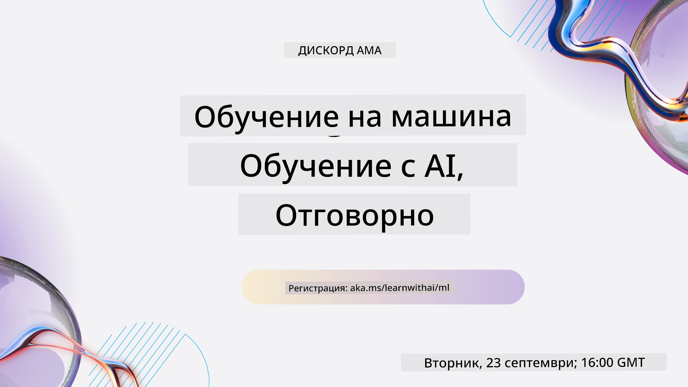
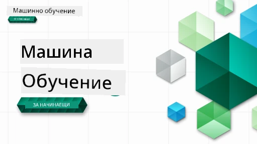

[](https://github.com/microsoft/ML-For-Beginners/blob/master/LICENSE)
[](https://GitHub.com/microsoft/ML-For-Beginners/graphs/contributors/)
[](https://GitHub.com/microsoft/ML-For-Beginners/issues/)
[](https://GitHub.com/microsoft/ML-For-Beginners/pulls/)
[](http://makeapullrequest.com)

[](https://GitHub.com/microsoft/ML-For-Beginners/watchers/)
[](https://GitHub.com/microsoft/ML-For-Beginners/network/)
[](https://GitHub.com/microsoft/ML-For-Beginners/stargazers/)

### 🌐 Поддръжка на няколко езика

#### Преводи, поддържани с [Co-op Translator](https://github.com/Azure/co-op-translator)

<!-- CO-OP TRANSLATOR LANGUAGES TABLE START -->
[Арабски](../ar/README.md) | [Бенгалски](../bn/README.md) | [Български](./README.md) | [Бирмански (Мианмар)](../my/README.md) | [Китайски (опростен)](../zh-CN/README.md) | [Китайски (традиционен, Хонконг)](../zh-HK/README.md) | [Китайски (традиционен, Макао)](../zh-MO/README.md) | [Китайски (традиционен, Тайван)](../zh-TW/README.md) | [Хърватски](../hr/README.md) | [Чешки](../cs/README.md) | [Датски](../da/README.md) | [Холандски](../nl/README.md) | [Естонски](../et/README.md) | [Финландски](../fi/README.md) | [Френски](../fr/README.md) | [Немски](../de/README.md) | [Гръцки](../el/README.md) | [Иврит](../he/README.md) | [Хинди](../hi/README.md) | [Унгарски](../hu/README.md) | [Индонезийски](../id/README.md) | [Италиански](../it/README.md) | [Японски](../ja/README.md) | [Каннада](../kn/README.md) | [Кмерски](../km/README.md) | [Корейски](../ko/README.md) | [Литовски](../lt/README.md) | [Малайски](../ms/README.md) | [Малаялам](../ml/README.md) | [Манипури (Мейтей Майек)](../mni/README.md) | [Маратхи](../mr/README.md) | [Непалски](../ne/README.md) | [Нигерийски пиджин](../pcm/README.md) | [Норвежки](../no/README.md) | [Персийски (Фарси)](../fa/README.md) | [Полски](../pl/README.md) | [Португалски (Бразилия)](../pt-BR/README.md) | [Португалски (Португалия)](../pt-PT/README.md) | [Пенджабски (Гурумухи)](../pa/README.md) | [Румънски](../ro/README.md) | [Руски](../ru/README.md) | [Сръбски (Кирилица)](../sr/README.md) | [Словашки](../sk/README.md) | [Словенски](../sl/README.md) | [Испански](../es/README.md) | [Суахили](../sw/README.md) | [Шведски](../sv/README.md) | [Тагалог (Филипински)](../tl/README.md) | [Тамилски](../ta/README.md) | [Телугу](../te/README.md) | [Тайландски](../th/README.md) | [Турски](../tr/README.md) | [Украински](../uk/README.md) | [Урду](../ur/README.md) | [Виетнамски](../vi/README.md)

> **Предпочитате да клонирате локално?**
>
> Това репо съдържа над 50 езикови превода, които значително увеличават размера на изтегляне. За да клонирате без преводи, използвайте sparse checkout:
>
> **Bash / macOS / Linux:**
> ```bash
> git clone --filter=blob:none --sparse https://github.com/microsoft/ML-For-Beginners.git
> cd ML-For-Beginners
> git sparse-checkout set --no-cone '/*' '!translations' '!translated_images'
> ```
>
> **CMD (Windows):**
> ```cmd
> git clone --filter=blob:none --sparse https://github.com/microsoft/ML-For-Beginners.git
> cd ML-For-Beginners
> git sparse-checkout set --no-cone "/*" "!translations" "!translated_images"
> ```
>
> Това ви дава всичко необходимо за завършване на курса със значително по-бързо изтегляне.
<!-- CO-OP TRANSLATOR LANGUAGES TABLE END -->

#### Присъединете се към нашата общност

[](https://discord.gg/nTYy5BXMWG)

Имаме поредица на Discord за учене с AI, научете повече и се присъединете към нас на [Learn with AI Series](https://aka.ms/learnwithai/discord) от 18 до 30 септември 2025 г. Ще получите съвети и трикове за използване на GitHub Copilot за Data Science.



# Машинно обучение за начинаещи - Учебна програма

> 🌍 Пътувайте по света, докато изследваме машинното обучение чрез световните култури 🌍

Облачните застъпници в Microsoft с радост предлагат 12-седмична учебна програма с 26 урока, изцяло посветена на **машинното обучение**. В тази програма ще научите за това, което понякога се нарича **класическо машинно обучение**, използвайки основно Scikit-learn като библиотека и избягвайки дълбокото обучение, което се разглежда в нашата [Учебна програма по AI за начинаещи](https://aka.ms/ai4beginners). Съчетавайте тези уроци и с нашата [Учебна програма “Data Science for Beginners”](https://aka.ms/ds4beginners)!

Пътувайте с нас по света, като прилагаме тези класически техники върху данни от много части на света. Всеки урок включва предварителни и последващи тестове, писмени инструкции за изпълнение на урока, решение, задача и още. Нашата проектно-ориентирана педагогика ви позволява да учите чрез създаване – доказан метод за ефективно усвояване на нови умения.

**✍️ Сърдечни благодарности на нашите автори** Джен Лупър, Стивън Хауел, Франческа Лаззери, Томоми Имура, Каси Бревиу, Дмитри Сошников, Крис Норинг, Анирбан Мукерджи, Орнела Алтунян, Рут Якубу и Ейми Бойд

**🎨 Благодаря и на нашите илюстратори** Томоми Имура, Дасани Мадипали и Джен Лупър

**🙏 Специални благодарности 🙏 на нашите автори, рецензенти и сътрудници от Microsoft Student Ambassador**, включително Ришит Дагли, Мухаммад Сакиб Хан Инан, Рохан Радж, Александру Петреску, Абхишек Джайсвал, Наврин Табасум, Йоан Самуила и Снидхя Агарвал

**🤩 Допълнителна благодарност към Microsoft Student Ambassadors Ерик Уанджау, Джаслин Сонди и Видуши Гупта за нашите уроци по R!**

# Започване

Следвайте тези стъпки:
1. **Направете форк на репозито**: Кликнете бутона "Fork" в горния десен ъгъл на тази страница.
2. **Клонирайте репозитория**:   `git clone https://github.com/microsoft/ML-For-Beginners.git`

> 💡 **Съвет за бърз старт:** Имате ли желание да започнете в браузър без локална настройка на Python? Използвайте [GitHub Codespaces](https://github.com/features/codespaces), за да създадете облачна разработваща среда за форка си. Отворете зеленото меню **Code**, изберете **Codespaces** и създайте codespace; инсталирайте необходимите зависимости за всеки урок вътре в него.

> [намерете всички допълнителни ресурси за този курс в нашата колекция Microsoft Learn](https://learn.microsoft.com/en-us/collections/qrqzamz1nn2wx3?WT.mc_id=academic-77952-bethanycheum)

> 🔧 **Нуждаете се от помощ?** Разгледайте нашето [Ръководство за отстраняване на проблеми](TROUBLESHOOTING.md) за решения на често срещани проблеми при инсталация, настройка и изпълнение на уроците.


**[Студенти](https://aka.ms/student-page)**, за да използвате тази учебна програма, направете форк на цялото репо в своя акаунт в GitHub и изпълнете упражненията сами или в група:

- Започнете с предварителен тест преди лекция.
- Прочетете лекцията и изпълнете задачите, като правите паузи и обмисляте всеки проверка на знания.
- Опитайте се да създадете проектите, разбирайки уроците, вместо просто да пускате кода с решение; обаче този код е достъпен във `/solution` папките във всеки урок, насочен към проекти.
- Направете последващ тест след лекцията.
- Изпълнете предизвикателството.
- Изпълнете задачите.
- След завършване на група уроци, посетете [Дискусионния форум](https://github.com/microsoft/ML-For-Beginners/discussions) и "учете на глас", като попълните подходящата рубрика PAT. 'PAT' е Инструмент за оценка на прогреса, това е рубрика, която попълвате, за да подобрите ученето си. Можете също така да реагирате на други PAT, за да учим заедно.

> За по-нататъшно обучение препоръчваме следните [Microsoft Learn](https://docs.microsoft.com/en-us/users/jenlooper-2911/collections/k7o7tg1gp306q4?WT.mc_id=academic-77952-leestott) модули и пътеки за учене.

**Учители**, ние сме [включили някои предложения](for-teachers.md) как да използвате тази учебна програма.

---

## Видеопрегледи

Някои от уроците са налични като кратки видеа. Можете да ги намерите вътре в уроците или в плейлистата [ML за начинаещи в канала Microsoft Developer в YouTube](https://aka.ms/ml-beginners-videos), като кликнете на изображението по-долу.

[](https://aka.ms/ml-beginners-videos)

---

## Запознайте се с екипа

[](https://youtu.be/Tj1XWrDSYJU)

**Gif от** [Mohit Jaisal](https://linkedin.com/in/mohitjaisal)

> 🎥 Кликнете снимката горе за видео за проекта и създателите му!

---

## Педагогика

Избрахме два педагогически принципа при създаването на тази учебна програма: да бъде практическа и **базирана на проекти** и да включва **чести тестове**. Освен това тази учебна програма има обща **тема**, за да ѝ придаде свързаност.

Чрез осигуряване на съдържание, свързано с проекти, процесът става по-ангажиращ за студентите и задържането на концепциите се увеличава. Също така, нискозаложен тест преди занятията настройва настроението на студента за учене на тема, а втори тест след занятията осигурява допълнително задържане. Тази учебна програма е проектирана да бъде гъвкава и забавна и може да се ползва изцяло или частично. Проектите започват малки и постепенно стават по-сложни до края на 12-седмичния цикъл. В учебната програма е включена и постскриптум за реални приложения на машинното обучение, който може да се използва като допълнителен кредит или като основа за дискусия.

> Намерете нашите правила за [Кодекс на поведение](CODE_OF_CONDUCT.md), [Принос](CONTRIBUTING.md), [Преводи](..) и [Отстраняване на проблеми](TROUBLESHOOTING.md). Очакваме вашите конструктивни отзиви!

## Всеки урок включва

- по желание скицникова бележка
- по желание допълнително видео
- видео преглед (само при някои уроци)
- [тест за затопляне преди лекция](https://ff-quizzes.netlify.app/en/ml/)
- писмен урок
- за проектно-ориентирани уроци, стъпка по стъпка ръководства за изграждане на проекта
- проверки на знанията
- предизвикателство
- допълнително четиво
- задача
- [тест след лекция](https://ff-quizzes.netlify.app/en/ml/)

> **Забележка за езиците**: Тези уроци са основно написани на Python, но много от тях са налични и на R. За да завършите урок на R, отидете в папката `/solution` и потърсете уроци по R. Те включват разширение .rmd, което представлява файл на **R Markdown**, което може просто да се дефинира като вграждане на `code chunks` (на R или други езици) и `YAML header` (който ръководи как се форматират изходите като PDF) в `Markdown document`. Като такава, това служи като примерна авторска рамка за науката за данните, тъй като позволява да съчетаете кода, изхода от него и мислите си, записвайки ги на Markdown. Освен това, R Markdown документи могат да се рендерират в изходни формати като PDF, HTML или Word.

> **Забележка за тестовете**: Всички тестове се съдържат в папка [Quiz App folder](../../quiz-app), общо 52 теста с по три въпроса всеки. Те са свързани с уроците, но приложението за тестове може да се стартира локално; следвайте инструкциите в папката `quiz-app` за локално хостване или внедряване в Azure.

| Номер на урока |                              Тема                               |                     Групиране на урока                     | Цели на обучението                                                                                                               |                                                              Свързан урок                                                               |                        Автор                        |
| :-----------: | :------------------------------------------------------------: | :---------------------------------------------------------: | ------------------------------------------------------------------------------------------------------------------------------- | :--------------------------------------------------------------------------------------------------------------------------------------: | :--------------------------------------------------: |
|      01       |               Въведение в машинното обучение                   |        [Въведение](1-Introduction/README.md)                | Научете основните концепции зад машинното обучение                                                                             |                                             [Урок](1-Introduction/1-intro-to-ML/README.md)                                             |                       Мохаммад                       |
|      02       |                  История на машинното обучение                 |        [Въведение](1-Introduction/README.md)                | Научете историята, която стои в основата на тази област                                                                        |                                            [Урок](1-Introduction/2-history-of-ML/README.md)                                            |                     Джен и Ейми                      |
|      03       |                Справедливост и машинно обучение                 |        [Въведение](1-Introduction/README.md)                | Какви са важните философски въпроси около справедливостта, които студентите трябва да обмислят при разработване и прилагане на ML модели? |                                              [Урок](1-Introduction/3-fairness/README.md)                                               |                        Томоми                        |
|      04       |                   Техники за машинно обучение                  |        [Въведение](1-Introduction/README.md)                | Кои техники използват изследователите на ML за изграждане на ML модели?                                                        |                                          [Урок](1-Introduction/4-techniques-of-ML/README.md)                                           |                    Крис и Джен                     |
|      05       |                    Въведение в регресия                         |          [Регресия](2-Regression/README.md)               | Започнете с Python и Scikit-learn за регресионни модели                                                                         |          [Python](2-Regression/1-Tools/README.md) • [R](../../2-Regression/1-Tools/solution/R/lesson_1.html)         |      Джен • Ерик Уанджау       |
|      06       |                Цени на тиквите в Северна Америка 🎃             |          [Регресия](2-Regression/README.md)               | Визуализирайте и почистете данните в подготовка за ML                                                                           |          [Python](2-Regression/2-Data/README.md) • [R](../../2-Regression/2-Data/solution/R/lesson_2.html)          |      Джен • Ерик Уанджау       |
|      07       |                Цени на тиквите в Северна Америка 🎃             |          [Регресия](2-Regression/README.md)               | Създайте линейни и полиномиални регресионни модели                                                                              |        [Python](2-Regression/3-Linear/README.md) • [R](../../2-Regression/3-Linear/solution/R/lesson_3.html)        |      Джен и Дмитрий • Ерик Уанджау       |
|      08       |                Цени на тиквите в Северна Америка 🎃             |          [Регресия](2-Regression/README.md)               | Създайте логистична регресионна модел                                                                                           |     [Python](2-Regression/4-Logistic/README.md) • [R](../../2-Regression/4-Logistic/solution/R/lesson_4.html)      |      Джен • Ерик Уанджау       |
|      09       |                          Уеб приложение 🔌                      |             [Уеб приложение](3-Web-App/README.md)        | Създайте уеб приложение за използване на обучен модел                                                                          |                                                 [Python](3-Web-App/1-Web-App/README.md)                                                  |                         Джен                          |
|      10       |                 Въведение в класификация                        |      [Класификация](4-Classification/README.md)              | Почистете, подгответе и визуализирайте данните; въведение в класификация                                                        | [Python](4-Classification/1-Introduction/README.md) • [R](../../4-Classification/1-Introduction/solution/R/lesson_10.html)  | Джен и Каси • Ерик Уанджау |
|      11       |             Вкусни азиатски и индийски кухни 🍜               |      [Класификация](4-Classification/README.md)              | Въведение в класификаторите                                                                                                     | [Python](4-Classification/2-Classifiers-1/README.md) • [R](../../4-Classification/2-Classifiers-1/solution/R/lesson_11.html) | Джен и Каси • Ерик Уанджау |
|      12       |             Вкусни азиатски и индийски кухни 🍜               |      [Класификация](4-Classification/README.md)              | Още класификатори                                                                                                               | [Python](4-Classification/3-Classifiers-2/README.md) • [R](../../4-Classification/3-Classifiers-2/solution/R/lesson_12.html) | Джен и Каси • Ерик Уанджау |
|      13       |             Вкусни азиатски и индийски кухни 🍜               |      [Класификация](4-Classification/README.md)              | Създайте препоръчващо уеб приложение, използвайки модела си                                                                     |                                              [Python](4-Classification/4-Applied/README.md)                                              |                         Джен                          |
|      14       |                   Въведение в клъстериране                     |          [Клъстериране](5-Clustering/README.md)           | Почистете, подгответе и визуализирайте данните; въведение в клъстериране                                                        |         [Python](5-Clustering/1-Visualize/README.md) • [R](../../5-Clustering/1-Visualize/solution/R/lesson_14.html)         |      Джен • Ерик Уанджау       |
|      15       |              Изследване на нигерийски музикални вкусове 🎧     |          [Клъстериране](5-Clustering/README.md)           | Изследвайте метода за клъстериране K-Means                                                                                      |           [Python](5-Clustering/2-K-Means/README.md) • [R](../../5-Clustering/2-K-Means/solution/R/lesson_15.html)           |      Джен • Ерик Уанджау       |
|      16       |        Въведение в обработката на естествен език ☕️            |    [Обработка на естествен език](6-NLP/README.md) | Научете основите за NLP чрез създаване на прост бот                                                                             |                                             [Python](6-NLP/1-Introduction-to-NLP/README.md)                                              |                       Стивън                         |
|      17       |                      Често срещани задачи в NLP ☕️              |    [Обработка на естествен език](6-NLP/README.md) | Удължете знанията си в NLP, като разберете общите задачи, необходими при работа със структури на езика                          |                                                    [Python](6-NLP/2-Tasks/README.md)                                                     |                       Стивън                         |
|      18       |             Превод и анализ на настроения ♥️                    |    [Обработка на естествен език](6-NLP/README.md) | Превод и анализ на настроения с Джейн Остин                                                                                    |                                            [Python](6-NLP/3-Translation-Sentiment/README.md)                                             |                       Стивън                         |
|      19       |                  Романтични хотели в Европа ♥️                 |    [Обработка на естествен език](6-NLP/README.md) | Анализ на настроения с ревюта на хотели 1                                                                                      |                                               [Python](6-NLP/4-Hotel-Reviews-1/README.md)                                                |                       Стивън                         |
|      20       |                  Романтични хотели в Европа ♥️                 |    [Обработка на естествен език](6-NLP/README.md) | Анализ на настроения с ревюта на хотели 2                                                                                      |                                               [Python](6-NLP/5-Hotel-Reviews-2/README.md)                                                |                       Стивън                         |
|      21       |            Въведение в прогнозиране на времеви редове          |          [Времеви редове](7-TimeSeries/README.md)         | Въведение в прогнозиране на времеви редове                                                                                      |                                             [Python](7-TimeSeries/1-Introduction/README.md)                                              |                      Франческа                       |
|      22       | ⚡️ Световна консумация на енергия ⚡️ - прогнозиране с ARIMA   |          [Времеви редове](7-TimeSeries/README.md)         | Прогнозиране на времеви редове с ARIMA                                                                                         |                                                 [Python](7-TimeSeries/2-ARIMA/README.md)                                                 |                      Франческа                       |
|      23       |  ⚡️ Световна консумация на енергия ⚡️ - прогнозиране с SVR     |          [Времеви редове](7-TimeSeries/README.md)         | Прогнозиране на времеви редове с Support Vector Regressor                                                                      |                                                  [Python](7-TimeSeries/3-SVR/README.md)                                                  |                       Анирбан                        |
|      24       |             Въведение в обучение с подсилване                   |        [Обучение с подсилване](8-Reinforcement/README.md)    | Въведение в обучение с подсилване чрез Q-Learning                                                                              |                                             [Python](8-Reinforcement/1-QLearning/README.md)                                              |                        Дмитрий                        |
|      25       |                 Помогнете на Питър да избегне вълка! 🐺        |        [Обучение с подсилване](8-Reinforcement/README.md)    | Обучение с подсилване Gym                                                                                                      |                                                [Python](8-Reinforcement/2-Gym/README.md)                                                 |                        Дмитрий                        |
|  Постскрипт   |            Сценарии и приложения на машинното обучение в реалния свят |            [ML в естествена среда](9-Real-World/README.md)          | Интересни и разкриващи реални приложения на класическо ML                                                                      |                                             [Урок](9-Real-World/1-Applications/README.md)                                              |                         Екип                         |
|  Постскрипт   |            Отстраняване на грешки в моделите с помощта на таблото RAI |            [ML в естествена среда](9-Real-World/README.md)          | Отстраняване на грешки в ML модели чрез компоненти на таблото Responsible AI                                                      |                                             [Урок](9-Real-World/2-Debugging-ML-Models/README.md)                                              |                     Рут Якобу                      |

> [намерете всички допълнителни ресурси за този курс в нашата колекция Microsoft Learn](https://learn.microsoft.com/en-us/collections/qrqzamz1nn2wx3?WT.mc_id=academic-77952-bethanycheum)

## Офлайн достъп

Можете да използвате тази документация офлайн, като използвате [Docsify](https://docsify.js.org/#/). Форкнете това хранилище, [инсталирайте Docsify](https://docsify.js.org/#/quickstart) на вашия локален компютър и след това в главната папка на това хранилище изпишете `docsify serve`. Уебсайтът ще бъде обслужван на порт 3000 на вашия localhost: `localhost:3000`.

## PDF файлове

Намерете pdf на учебната програма с връзки [тук](https://microsoft.github.io/ML-For-Beginners/pdf/readme.pdf).


## 🎒 Други курсове

Нашият екип произвежда и други курсове! Разгледайте:

<!-- CO-OP TRANSLATOR OTHER COURSES START -->
### LangChain
[](https://aka.ms/langchain4j-for-beginners)
[](https://aka.ms/langchainjs-for-beginners?WT.mc_id=m365-94501-dwahlin)
[](https://github.com/microsoft/langchain-for-beginners?WT.mc_id=m365-94501-dwahlin)
---

### Azure / Edge / MCP / Агeнти
[](https://github.com/microsoft/AZD-for-beginners?WT.mc_id=academic-105485-koreyst)
[](https://github.com/microsoft/edgeai-for-beginners?WT.mc_id=academic-105485-koreyst)
[](https://github.com/microsoft/mcp-for-beginners?WT.mc_id=academic-105485-koreyst)
[](https://github.com/microsoft/ai-agents-for-beginners?WT.mc_id=academic-105485-koreyst)

---
 
### Серия Генеративен AI
[](https://github.com/microsoft/generative-ai-for-beginners?WT.mc_id=academic-105485-koreyst)
[-9333EA?style=for-the-badge&labelColor=E5E7EB&color=9333EA)](https://github.com/microsoft/Generative-AI-for-beginners-dotnet?WT.mc_id=academic-105485-koreyst)
[-C084FC?style=for-the-badge&labelColor=E5E7EB&color=C084FC)](https://github.com/microsoft/generative-ai-for-beginners-java?WT.mc_id=academic-105485-koreyst)
[-E879F9?style=for-the-badge&labelColor=E5E7EB&color=E879F9)](https://github.com/microsoft/generative-ai-with-javascript?WT.mc_id=academic-105485-koreyst)

---
 
### Основно обучение
[](https://aka.ms/ml-beginners?WT.mc_id=academic-105485-koreyst)
[](https://aka.ms/datascience-beginners?WT.mc_id=academic-105485-koreyst)
[](https://aka.ms/ai-beginners?WT.mc_id=academic-105485-koreyst)
[](https://github.com/microsoft/Security-101?WT.mc_id=academic-96948-sayoung)
[](https://aka.ms/webdev-beginners?WT.mc_id=academic-105485-koreyst)
[](https://aka.ms/iot-beginners?WT.mc_id=academic-105485-koreyst)
[](https://github.com/microsoft/xr-development-for-beginners?WT.mc_id=academic-105485-koreyst)

---
 
### Серия Copilot
[](https://aka.ms/GitHubCopilotAI?WT.mc_id=academic-105485-koreyst)
[](https://github.com/microsoft/mastering-github-copilot-for-dotnet-csharp-developers?WT.mc_id=academic-105485-koreyst)
[](https://github.com/microsoft/CopilotAdventures?WT.mc_id=academic-105485-koreyst)
<!-- CO-OP TRANSLATOR OTHER COURSES END -->

## Получаване на помощ

Ако срещнете трудности или имате въпроси при изучаването на машинно обучение или при създаването на AI приложения, не се притеснявайте — помощта е налична.

Можете да се включите в дискусии с други обучаващи се и разработчици, да задавате въпроси и да споделяте вашите идеи с общността.

- Присъединете се към общността, за да задавате въпроси и да учите заедно с други
- Обсъждайте концепции за машинно обучение и проектни идеи
- Получете насоки от опитни разработчици

Поддържащата общност е отличен начин да развиете уменията си и да решавате проблеми по-бързо.

[Microsoft Foundry Discord Community](https://discord.gg/nTYy5BXMWG)

Ако срещнете бъгове, грешки или имате предложения за подобрения, можете също да отворите **Issue** в това хранилище, за да съобщите за проблема.

За обратна връзка относно продукта или за да търсите в съществуващи публикации в общността, посетете Форум на разработчиците:

[](https://aka.ms/foundry/forum)

## Допълнителни съвети за учене

- Преглеждайте тетрадките след всеки урок за по-добро разбиране.
- Упражнявайте се да прилагате алгоритми самостоятелно.
- Изследвайте реални набори от данни, използвайки научените концепции.

---

<!-- CO-OP TRANSLATOR DISCLAIMER START -->
**Отказ от отговорност**:
Този документ е преведен с помощта на AI преводачески услуга [Co-op Translator](https://github.com/Azure/co-op-translator). Въпреки че се стремим към точност, моля имайте предвид, че автоматизираните преводи могат да съдържат грешки или неточности. Оригиналният документ на неговия роден език трябва да се счита за авторитетен източник. За критична информация се препоръчва професионален човешки превод. Ние не носим отговорност за каквито и да е недоразумения или неправилни тълкувания, произтичащи от използването на този превод.
<!-- CO-OP TRANSLATOR DISCLAIMER END -->