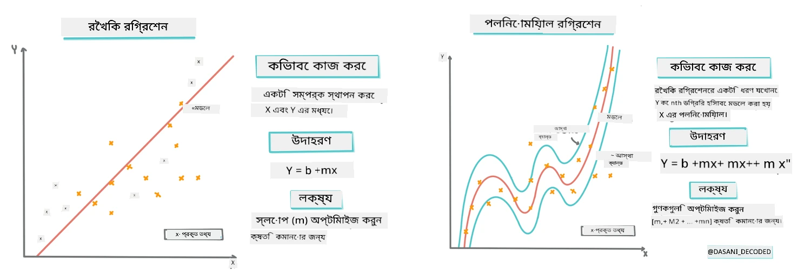
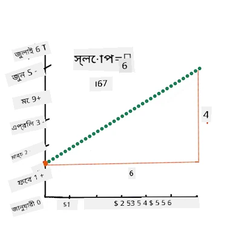
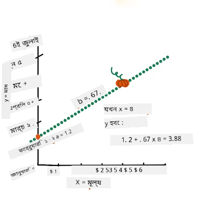
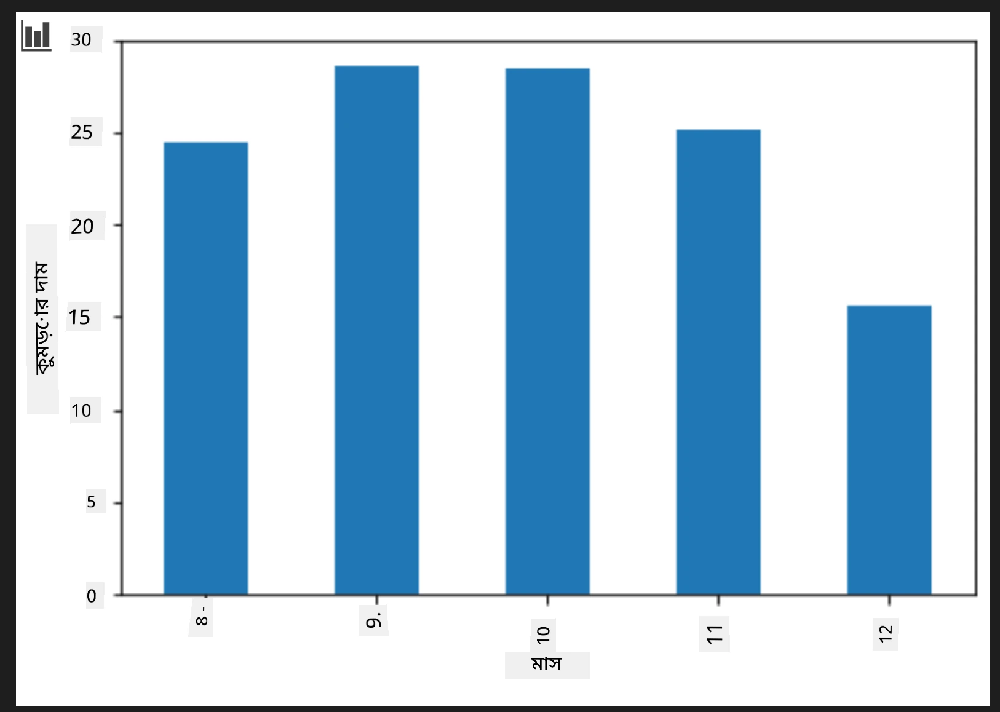
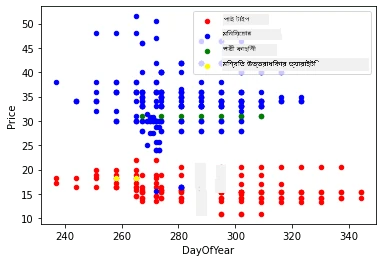

# Scikit-learn ব্যবহার করে একটি রিগ্রেশন মডেল তৈরি করুন: চারভাবে রিগ্রেশন

## শুরুকারীদের জন্য নোট

লিনিয়ার রিগ্রেশন তখন ব্যবহার করা হয় যখন আমরা একটি **সংখ্যাসূচক মান** (উদাহরণস্বরূপ, ঘরের দাম, তাপমাত্রা, বা বিক্রয়) পূর্বাভাস দিতে চাই। এটি কাজ করে এমন একটি সরলরেখা খুঁজে বের করে যা ইনপুট বৈশিষ্ট্য এবং আউটপুটের সম্পর্ককে সবচেয়ে ভালোভাবে উপস্থাপিত করে।

এই পাঠে, আমরা আরও উন্নত রিগ্রেশন কৌশলগুলি অনুসন্ধানের আগে ধারণাটি বুঝতে মনোযোগ দিচ্ছি।

> ইনফোগ্রাফিক: [দাসানি মাদিপল্লি](https://twitter.com/dasani_decoded)
## [প্রাক-লেকচার কুইজ](https://ff-quizzes.netlify.app/en/ml/)

> ### [এই পাঠটি R-এ উপলব্ধ!](../../../../2-Regression/3-Linear/solution/R/lesson_3.html)
### পরিচিতি

এখন পর্যন্ত আপনি রিগ্রেশন কি তা অনুসন্ধান করেছেন এবং আমরা পুরো পাঠে ব্যবহার করা পাম্পকিন দাম নির্ণয়ের তথ্য সংগ্রহ করা নমুনা ডেটা নিয়ে কাজ করেছেন। এছাড়াও আপনি এটি মাটপ্লটলিব দিয়ে ভিজ্যুয়ালাইজ করেছেন।

এখন আপনি এমএল-এর জন্য রিগ্রেশনে আরও গভীরে প্রবেশ করতে প্রস্তুত। ভিজ্যুয়ালাইজেশন আপনাকে ডেটা বুঝতে সাহায্য করলেও, মেশিন লার্নিংয়ের প্রকৃত শক্তি আসে _মডেল প্রশিক্ষণ থেকে_। মডেলগুলি ঐতিহাসিক ডেটায় প্রশিক্ষিত হয় যাতে তারা স্বয়ংক্রিয়ভাবে ডেটা নির্ভরতা ধারণ করে এবং মডেল পূর্বে না দেখা নতুন ডেটার জন্য ফলাফল পূর্বাভাস দেয়।

এই পাঠে, আপনি দুটি রিগ্রেশনের ধরন সম্পর্কে জানবেন: _মৌলিক লিনিয়ার রিগ্রেশন_ এবং _পলিনোমিয়াল রিগ্রেশন_, এবং এই কৌশলগুলির পেছনের কিছু গণিতের ভিত্তি। এই মডেলগুলি আমাদের বিভিন্ন ইনপুট ডেটার উপর ভিত্তি করে পাম্পকিনের দাম পূর্বানুমান করতে সাহায্য করবে।

[](https://youtu.be/CRxFT8oTDMg "ML for beginners - Understanding Linear Regression")

> 🎥 লিনিয়ার রিগ্রেশনের সংক্ষিপ্ত ভিডিও ওভারভিউ দেখতে উপরের ছবিতে ক্লিক করুন।

> এই পাঠ্যক্রম জুড়ে, আমরা গণিতের খুব কম জ্ঞান ধরে নিই এবং অন্য ক্ষেত্রে থেকে আসা শিক্ষার্থীদের জন্য সহজবোধ্য করতে চাই, তাই নোট, 🧮 কলআউট, চিত্র, এবং অন্যান্য পাঠ্য সহায়ক সরঞ্জাম লক্ষ্য করুন।

### পূর্বপ্রয়োজনীয়তা

এখন পর্যন্ত আপনি যেই পাম্পকিন ডেটার গঠন দেখেছেন তার সঙ্গে পরিচিত হওয়া উচিত। এটি এই পাঠের _notebook.ipynb_ ফাইলে আগে থেকে লোড এবং পরিষ্কার করা আছে। ফাইলে, পাম্পকিনের দাম প্রতি বাসেল প্রদর্শিত হয়েছে। নিশ্চিত করুন যে আপনি ভিজুয়াল স্টুডিও কোডে এই নোটবুকগুলি চালাতে পারবেন।

### প্রস্তুতি

আপনি এই ডেটা লোড করছেন যাতে এটি নিয়ে প্রশ্ন করতে পারেন, একটি স্মরণীয় ব্যাপার:

- কখন পাম্পকিন কেনা সবচেয়ে ভালো সময়?
- মিনি পাম্পকিনের একটি প্যাকের দাম কত হতে পারে?
- কী আমি এগুলো অর্ধেক বাসেল বাস্কেট বা ১ ১/৯ বাসেল বাক্স থেকে কিনব?
চলুন এই ডেটা আরও অনুসন্ধান করা যাক।

পূর্ববর্তী পাঠে, আপনি একটি প্যান্ডাস ডেটাফ্রেম তৈরি করেছিলেন এবং মূল ডেটাসেট থেকে একটি অংশ ব্যবহার করে প্রতি বাসেলের দাম স্ট্যান্ডার্ডাইজ করেছিলেন। এর ফলে, আপনি প্রায় ৪০০ তথ্য বিন্দু এবং শুধুমাত্র শরৎ মাসের জন্যই তথ্য সংগ্রহ করতে পেরেছিলেন।

এই পাঠের সহযোগী নোটবুকটিতে আগে থেকে লোড করা ডেটাটি দেখুন। ডেটা লোড করা আছে এবং একটি প্রাথমিক স্ক্যাটারপ্লট মাসের তথ্য প্রদর্শন করে। হয়তো ডেটা আরও পরিষ্কার করার মাধ্যমে প্রকৃত তথ্যের প্রকৃতি সম্পর্কে কিছু বেশি জানতে পারি।

## একটি লিনিয়ার রিগ্রেশন রেখা

পাঠ ১ থেকে আপনি শিখেছেন, লিনিয়ার রিগ্রেশন অনুশীলনের লক্ষ্য একটি রেখা আঁকা যাতে:

- **চলকগুলোর সম্পর্ক প্রদর্শন:** চলকগুলোর মধ্যে সম্পর্ক দেখানো
- **পূর্বাভাস তৈরি:** নতুন ডেটাপয়েন্ট কোথায় পড়বে তা সঠিকভাবে পূর্বাভাস করা

**লিস্ট-স্কয়ার রিগ্রেশন** এ ধরনের রেখা আঁকা সাধারণ। "লিস্ট-স্কয়ার" শব্দগুচ্ছ আমাদের মডেলে মোট ভুল সর্বনিম্ন করার প্রক্রিয়াকে বোঝায়। প্রতিটি ডেটাপয়েন্টের জন্য, আমরা প্রকৃত পয়েন্ট এবং আমাদের রিগ্রেশন রেখার মধ্যে উল্লম্ব দূরত্ব (যা অবশিষ্টাংশ নামে পরিচিত) পরিমাপ করি।

আমরা এই দূরত্বগুলিকে বর্গ করি দুটি প্রধান কারণে:

1. **মেরু পরিবর্তনের উপরে মানের গুরুত্ব:** আমরা -৫ এর ভুলের জন্য +৫ এর ভুলের সমান গুরুত্ব দিতে চাই। বর্গকরণের ফলে সব মান ধনাত্মক হয়ে যায়।

2. **আউটলারদের দণ্ডিত করা:** বড় ভুলগুলোকে আরও বেশি ওজন দেয়, লাইনকে দূরে থাকা পয়েন্টগুলোর কাছাকাছি রাখতে বাধ্য করে।

তারপর আমরা এই সব বর্গমূল মান যোগ করি। আমাদের লক্ষ্য এমন একটি রেখা খুঁজে বের করা যার এই যোগফল সর্বনিম্ন—এজন্য এর নাম "লিস্ট-স্কয়ারস"।

> **🧮 গণিত আমাকে দেখাও**
> 
> এই রেখাটিকে বলা হয় _সেরা ফিটের রেখা_ এবং এটি [একটি সমীকরণের মাধ্যমে প্রকাশ করা যায়](https://en.wikipedia.org/wiki/Simple_linear_regression): 
> 
> ```
> Y = a + bX
> ```
>
> `X` হলো 'ব্যাখ্যামূলক চলক'। `Y` হলো 'নির্ভরশীল চলক'। রেখার স্লোপ `b` এবং `a` হলো y-ইন্টারসেপ্ট, অর্থাৎ `X = 0` থাকলে `Y` মান। 
>
>
>
> প্রথমে স্লোপ `b` হিসাব করুন। ইনফোগ্রাফিক: [জেন লুপার](https://twitter.com/jenlooper)
>
> অন্য কথায়, আমাদের পাম্পকিন ডেটার মূল প্রশ্ন: "মাস অনুসারে প্রতি বাসেলে পাম্পকিনের দাম পূর্বানুমান", এ ক্ষেত্রে `X` হবে দাম এবং `Y` হবে বিক্রয় মাস।
>
>
>
> `Y` এর মান হিসাব করুন। আপনি যদি প্রায় ৪ ডলারের দাম দেখেন, তাহলে মাস অবশ্যই এপ্রিল! ইনফোগ্রাফিক: [জেন লুপার](https://twitter.com/jenlooper)
>
> রেখার গণিত হিসাবটি স্লোপ প্রদর্শন করে, যা ইন্টারসেপ্টের উপরে নির্ভরশীল, অর্থাৎ `X = 0` অবস্থায় `Y` কোথায় থাকবে।
>
> এই মানগুলো গণনার পদ্ধতি দেখতে [Math is Fun](https://www.mathsisfun.com/data/least-squares-regression.html) ওয়েবসাইট ভিজিট করুন। এছাড়াও দেখুন [এই লিস্ট-স্কয়ার ক্যালকুলেটর](https://www.mathsisfun.com/data/least-squares-calculator.html) যেখানে সংখ্যা মানগুলো কিভাবে রেখাকে প্রভাবিত করে তা উপলব্ধি করতে পারেন।

## সম্পর্ক

আরেকটি শব্দ যা বুঝতে হবে তা হলো দেওয়া X এবং Y চলকগুলোর মধ্যে **সম্পর্ক সহগ**। একটি স্ক্যাটারপ্লট ব্যবহার করে আপনি দ্রুত এই সহগটি ভিজ্যুয়ালাইজ করতে পারেন। যেখানে ডেটাপয়েন্টগুলো সুন্দর সারিতে ছড়িয়ে থাকে সেখানে উচ্চ সম্পর্ক থাকে, আর যেসব প্লটে ডেটা একদম ছড়িয়ে থাকে সেখানে সম্পর্ক কম।

একটি ভাল লিনিয়ার রিগ্রেশন মডেল হবে এমন একটি যা লিস্ট-স্কয়ারস রিগ্রেশন ব্যবহার করে উচ্চ (০-এর থেকে ১-এর নিকটবর্তী) সম্পর্ক সহগ রাখে।

✅ এই পাঠের সহায়ক নোটবুক রান করুন এবং মাস ও দাম স্ক্যাটারপ্লট দেখুন। আপনার দৃষ্টিতে পাম্পকিন বিক্রয়ের জন্য মাস এবং দামের ডেটা কি উচ্চ নাকি নিম্ন সম্পর্ক প্রদর্শন করে? যদি আপনি মাসের পরিবর্তে সূক্ষ্ম মেজার যেমন *বছরের দিন* (অর্থাৎ বছরের শুরু থেকে দিন সংখ্যা) ব্যবহার করেন, তাহলে কি তা পরিবর্তন হয়?

নিচের কোডে ধরে নেওয়া হয়েছে আমরা ডেটা পরিষ্কার করেছি এবং একটি ডেটাফ্রেম `new_pumpkins` পেয়েছি যা নিচের মতো:

ID | মাস | বছরের দিন | প্রকার | শহর | প্যাকেজ | সর্বনিম্ন দাম | সর্বোচ্চ দাম | দাম
---|-------|-----------|---------|------|---------|-----------|------------|-------
70 | 9 | 267 | পাই টাইপ | বাল্টিমোর | ১ ১/৯ বাসেল কার্টন | 15.0 | 15.0 | 13.636364
71 | 9 | 267 | পাই টাইপ | বাল্টিমোর | ১ ১/৯ বাসেল কার্টন | 18.0 | 18.0 | 16.363636
72 | 10 | 274 | পাই টাইপ | বাল্টিমোর | ১ ১/৯ বাসেল কার্টন | 18.0 | 18.0 | 16.363636
73 | 10 | 274 | পাই টাইপ | বাল্টিমোর | ১ ১/৯ বাসেল কার্টন | 17.0 | 17.0 | 15.454545
74 | 10 | 281 | পাই টাইপ | বাল্টিমোর | ১ ১/৯ বাসেল কার্টন | 15.0 | 15.0 | 13.636364

> ডেটা পরিষ্কারের কোড [`notebook.ipynb`](notebook.ipynb) এ পাওয়া যাবে। আমরা পূর্ববর্তী পাঠের মত একই পরিষ্কারকরণ ধাপ করেছি এবং `DayOfYear` কলাম হিসাব করেছি নিম্নলিখিত অভিব্যক্তি ব্যবহার করে:

```python
day_of_year = pd.to_datetime(pumpkins['Date']).apply(lambda dt: (dt-datetime(dt.year,1,1)).days)
```

এখন যেহেতু আপনি লিনিয়ার রিগ্রেশনের পেছনের গণিত বুঝতে পেরেছেন, চলুন একটি রিগ্রেশন মডেল তৈরি করি এবং দেখি কোন পাম্পকিন প্যাকেজে সবচেয়ে ভাল দাম হবে পূর্বানুমান করতে পারি কিনা। ছুটির দিনে পাম্পকিনের একটি প্যাচের জন্য কেউ পাম্পকিন কিনতে চাইলে এই তথ্য তাদের প্যাকেজের ক্রয় অপ্টিমাইজ করতে সাহায্য করবে।

## সম্পর্ক খোঁজা

[](https://youtu.be/uoRq-lW2eQo "ML for beginners - Looking for Correlation: The Key to Linear Regression")

> 🎥 সম্পর্কের সংক্ষিপ্ত ভিডিও ওভারভিউ দেখতে উপরের ছবিতে ক্লিক করুন।

গত লেসনে আপনি সম্ভবত দেখেছেন বিভিন্ন মাসের গড় দাম এ রকম:



এটি নির্দেশ করে যে এটার সাথে কিছু সম্পর্ক থাকতে পারে, এবং আমরা চেষ্টা করতে পারি লিনিয়ার রিগ্রেশন মডেল প্রশিক্ষণ দিতে `Month` এবং `Price` অথবা `DayOfYear` এবং `Price` এর মধ্যে সম্পর্ক পূর্বানুমান করার জন্য। নিচের স্ক্যাটারপ্লট পরবর্তী সম্পর্কটি দেখায়:

 

চলুন `corr` ফাংশন ব্যবহার করে দেখি সম্পর্ক আছে কি না:

```python
print(new_pumpkins['Month'].corr(new_pumpkins['Price']))
print(new_pumpkins['DayOfYear'].corr(new_pumpkins['Price']))
```

দেখা যাচ্ছে, সম্পর্ক ছোট, মাস অনুসারে -০.১৫ এবং বছরের দিন অনুসারে -০.১৭, কিন্তু হয়তো একটি আরেকটি গুরুত্বপূর্ণ সম্পর্ক আছে। বিভিন্ন পাম্পকিন প্রজাতির জন্য ভিন্ন দাম ক্লাস্টার লক্ষ্য করা গেছে। এই অনুমান নিশ্চিত করতে, আমরা প্রতিটি পাম্পকিন প্রকার ভিন্ন রঙে স্ক্যাটারপ্লটে দেখাবো। `scatter` প্লটিং ফাংশনে `ax` প্যারামিটার পাস করে সব পয়েন্ট একই গ্রাফে প্লট করা যায়:

```python
ax=None
colors = ['red','blue','green','yellow']
for i,var in enumerate(new_pumpkins['Variety'].unique()):
    df = new_pumpkins[new_pumpkins['Variety']==var]
    ax = df.plot.scatter('DayOfYear','Price',ax=ax,c=colors[i],label=var)
```

 

আমাদের অনুসন্ধান প্রস্তাব করে যে প্রজাতি বিক্রয় তারিখের চেয়ে দাম এর উপর বেশি প্রভাব ফেলে। আমরা এটি একটি বারের গ্রাফ দিয়ে দেখতে পারি:

```python
new_pumpkins.groupby('Variety')['Price'].mean().plot(kind='bar')
```

 

এই মুহূর্তে শুধুমাত্র একটি পাম্পকিন প্রজাতি, 'পাই টাইপ'-এ মনোযোগ দিয়া দেখি, বিক্রয় তারিখের দাম এর উপর কি প্রভাব:

```python
pie_pumpkins = new_pumpkins[new_pumpkins['Variety']=='PIE TYPE']
pie_pumpkins.plot.scatter('DayOfYear','Price') 
```
 

এখন যদি আমরা `Price` এবং `DayOfYear` এর মধ্যে `corr` ফাংশন ব্যবহার করে সম্পর্ক হিসাব করি, আমরা পাবো প্রায় `-0.27` - যার মানে একটি পূর্বাভাসমূলক মডেল প্রশিক্ষণ দেওয়া যুক্তিযুক্ত।

> লিনিয়ার রিগ্রেশন মডেল প্রশিক্ষণের আগে, নিশ্চিত করা উচিত যে ডেটা পরিষ্কার। লিনিয়ার রিগ্রেশন অনুপস্থিত মানের সাথে ভাল কাজ করে না, তাই সব খালি সেল সরিয়ে ফেলা যুক্তিযুক্ত:

```python
pie_pumpkins.dropna(inplace=True)
pie_pumpkins.info()
```

অন্য একটি পন্থা হবে খালি মানগুলোকে সংশ্লিষ্ট কলামের গড় মান দিয়ে পূরণ করা।

## সরল লিনিয়ার রিগ্রেশন

[](https://youtu.be/e4c_UP2fSjg "ML for beginners - Linear and Polynomial Regression using Scikit-learn")

> 🎥 লিনিয়ার এবং পলিনোমিয়াল রিগ্রেশনের ভিডিও ওভারভিউ দেখতে উপরের ছবিতে ক্লিক করুন।

আমাদের লিনিয়ার রিগ্রেশন মডেল প্রশিক্ষণের জন্য, আমরা **Scikit-learn** লাইব্রেরি ব্যবহার করব।

```python
from sklearn.linear_model import LinearRegression
from sklearn.metrics import mean_squared_error
from sklearn.model_selection import train_test_split
```

আমরা প্রথমে ইনপুট মান (ফিচার) এবং প্রত্যাশিত আউটপুট (লেবেল) আলাদা numpy অ্যারের মধ্যে রাখব:

```python
X = pie_pumpkins['DayOfYear'].to_numpy().reshape(-1,1)
y = pie_pumpkins['Price']
```

> খেয়াল করুন, আমরা ইনপুট ডেটায় `reshape` করেছি যাতে লিনিয়ার রিগ্রেশন প্যাকেজ সঠিকভাবে বুঝতে পারে। লিনিয়ার রিগ্রেশন ২ডি অ্যারে ইনপুট হিসেবে আশা করে, যেখানে প্রতিটি সারি ইনপুট ফিচারের একটি ভেক্টর। আমাদের ক্ষেত্রে একটি মাত্র ইনপুট হওয়ায়, এটির আকৃতি হবে N×1, যেখানে N হল ডেটাসেট আকার।

তারপর, আমরা ডেটা প্রশিক্ষণ এবং পরীক্ষার জন্য ভাগ করব, যাতে প্রশিক্ষণের পর মডেল যাচাই করা যায়:

```python
X_train, X_test, y_train, y_test = train_test_split(X, y, test_size=0.2, random_state=0)
```

অবশেষে, আসল লিনিয়ার রিগ্রেশন মডেল প্রশিক্ষণ শুধুমাত্র দুই লাইনের কোড নেয়। আমরা `LinearRegression` অবজেক্ট সংজ্ঞায়িত করি এবং `fit` পদ্ধতি ব্যবহার করে এটি ডেটাতে ফিট করি:

```python
lin_reg = LinearRegression()
lin_reg.fit(X_train,y_train)
```

`LinearRegression` অবজেক্ট `fit` করার পরে সমস্ত রিগ্রেশন সহগ রয়েছে, যা `.coef_` প্রপার্টি ব্যবহার করে অ্যাক্সেস করা যেতে পারে। আমাদের ক্ষেত্রে, কেবল একটি সহগ আছে, যা প্রায় `-0.017` হওয়া উচিত। এর অর্থ হলো মূল্যসমূহ সময়ের সাথে সামান্য হ্রাস পায়, তবে খুব বেশি নয়, প্রায় দিনে ২ সেন্টের মতো। আমরা Y-অক্ষের সাথে রিগ্রেশনের ছেদ বিন্দু `lin_reg.intercept_` ব্যবহার করেও অ্যাক্সেস করতে পারি - এটি আমাদের ক্ষেত্রে প্রায় `২১` হবে, যা বছরের শুরুতে দামের নির্দেশ করে।

আমাদের মডেল কতটা সঠিক তা দেখতে, আমরা একটি টেস্ট ডেটাসেটে দামগুলি পূর্বাভাস দিতে পারি এবং তারপর আমাদের পূর্বাভাসগুলি প্রত্যাশিত মানের কতটা কাছাকাছি তা পরিমাপ করতে পারি। এটি মূল রুট গড় বর্গ ত্রুটি (RMSE) মেট্রিক্স ব্যবহার করে করা যায়, যা প্রত্যাশিত এবং পূর্বাভাস করা মানের মধ্যে সমস্ত বর্গমূল পার্থক্যের গড়ের মূল।

```python
pred = lin_reg.predict(X_test)

rmse = np.sqrt(mean_squared_error(y_test,pred))
print(f'RMSE: {rmse:3.3} ({rmse/np.mean(pred)*100:3.3}%)')
```

আমাদের ত্রুটি প্রায় ২ পয়েন্টের মতো মনে হচ্ছে, যা ~১৭%। খুব ভাল নয়। মডেল গুণমানের আরেকটি সূচক হলো **নির্ধারণ সহগ** (coefficient of determination), যা এভাবে পাওয়া যেতে পারে:

```python
score = lin_reg.score(X_train,y_train)
print('Model determination: ', score)
```
 যদি মানটি ০ হয়, এর অর্থ মডেল ইনপুট ডেটা বিবেচনায় নেয় না, এবং *সর্বনিম্ন রৈখিক পূর্বাভাসক* হিসেবে কাজ করে, যা শুধু ফলাফলের গড় মান। ১ মানে আমরা সমস্ত প্রত্যাশিত আউটপুট নিখুঁতভাবে পূর্বাভাস দিতে পারি। আমাদের ক্ষেত্রে, সহগ প্রায় ০.০৬, যা খুব কম।

আমরা রিগ্রেশন লাইন সহ টেস্ট ডেটা প্লট করেও দেখতে পারি কিভাবে আমাদের ক্ষেত্রে রিগ্রেশন কাজ করে:

```python
plt.scatter(X_test,y_test)
plt.plot(X_test,pred)
```


## Polynomial Regression

রৈখিক রিগ্রেশনের আরেক ধরন হলো পলিনোমিয়াল রিগ্রেশন। কখনও কখনও ভেরিয়েবলগুলির মধ্যে একটি রৈখিক সম্পর্ক থাকে – যেমন ভলিউমে বড় মিষ্টি কুমড়ো, দামও বেশি – তবে কখনও কখনও এই সম্পর্কগুলি একটি সমতল বা সরল রেখা আকারে প্লট করা যায় না।

✅ এখানে [আরো কিছু উদাহরণ](https://online.stat.psu.edu/stat501/Lesson09#polynomial-regression-examples) রয়েছে এমন ডেটার যেগুলোর জন্য পলিনোমিয়াল রিগ্রেশন প্রযোজ্য হতে পারে

`Date` এবং `Price` এর মধ্যে সম্পর্ক আবার দেখুন। এই স্ক্যাটারপ্লট কি সরল রেখা দ্বারা বিশ্লেষণ করা উচিত বলে মনে হচ্ছে? দাম ওঠানামা করতে পারে না কি? এই ক্ষেত্রে, আপনি পলিনোমিয়াল রিগ্রেশন চেষ্টা করতে পারেন।

✅ পলিনোমিয়ালগুলি হল গাণিতিক এক্সপ্রেশন যা এক বা একাধিক ভেরিয়েবল এবং সহগ সম্বলিত হতে পারে

পলিনোমিয়াল রিগ্রেশন একটি বাকা রেখা তৈরি করে যা অলিনিয়ার ডেটার সাথে ভাল মানায়। আমাদের ক্ষেত্রে, যদি আমরা ইনপুট ডেটাতে একটি বর্গ `DayOfYear` ভেরিয়েবল যোগ করি, তাহলে আমরা একধরনের প্যারাবোলিক কার্ভ দিয়ে ডেটা মানাতে পারব, যার একটি নির্দিষ্ট পয়েন্টে বছরভিত্তিক ন্যূনতম থাকবে।

Scikit-learn একটি উপকারী [pipeline API](https://scikit-learn.org/stable/modules/generated/sklearn.pipeline.make_pipeline.html?highlight=pipeline#sklearn.pipeline.make_pipeline) অন্তর্ভুক্ত করেছে যা ডেটা প্রসেসিং এর বিভিন্ন ধাপ একত্রিত করতে সাহায্য করে। একটি **pipeline** হলো **estimators** এর একটি চেইন। আমাদের ক্ষেত্রে, আমরা এমন একটি pipeline তৈরি করব যা প্রথমে পলিনোমিয়াল ফিচার আমাদের মডেলে যোগ করবে, তারপর রিগ্রেশন ট্রেন করবে:

```python
from sklearn.preprocessing import PolynomialFeatures
from sklearn.pipeline import make_pipeline

pipeline = make_pipeline(PolynomialFeatures(2), LinearRegression())

pipeline.fit(X_train,y_train)
```

`PolynomialFeatures(2)` ব্যবহার মানে আমরা ইনপুট ডেটার সমস্ত দ্বিতীয়-ডিগ্রী পলিনোমিয়াল অন্তর্ভুক্ত করব। আমাদের ক্ষেত্রে এটি শুধু `DayOfYear`<sup>2</sup> বোঝাবে, কিন্তু যদি দুটি ইনপুট ভেরিয়েবল X এবং Y থাকে, তাহলে এটি X<sup>2</sup>, XY এবং Y<sup>2</sup> যোগ করবে। আমরা চাইলে উচ্চতর ডিগ্রির পলিনোমিয়ালও ব্যবহার করতে পারি।

Pipeline গুলো একইভাবে ব্যবহার করা যায় যেমন মূল `LinearRegression` অবজেক্ট, অর্থাৎ আমরা pipeline কে `fit` করতে পারি, তারপর `predict` ব্যবহার করে পূর্বাভাস পেতে পারি:

```python
pred = pipeline.predict(X_test)

rmse = np.sqrt(mean_squared_error(y_test,pred))
print(f'RMSE: {rmse:3.3} ({rmse/np.mean(pred)*100:3.3}%)')

score = pipeline.score(X_train,y_train)
print('Model determination: ', score)
```

মসৃণ অনুমান কার্ভ প্লট করতে, আমরা `np.linspace` ব্যবহার করি ইনপুট মানগুলোর একটি সুষম রেঞ্জ তৈরির জন্য, সরাসরি এলোমেলো টেস্ট ডেটায় প্লট করার পরিবর্তে (যা একটি জিগজ্যাগ লাইন তৈরি করত):

```python
X_range = np.linspace(X_test.min(), X_test.max(), 100).reshape(-1,1)
y_range = pipeline.predict(X_range)

plt.scatter(X_test, y_test)
plt.plot(X_range, y_range)
```

এখানে গ্রাফটি আছে যা টেস্ট ডেটা এবং অনুমান কার্ভ দেখায়:


পলিনোমিয়াল রিগ্রেশন ব্যবহার করে আমরা সামান্য কম RMSE এবং উচ্চতর নির্ধারণ সহগ পেতে পারি, কিন্তু তা খুব উল্লেখযোগ্য নয়। আমাদের অন্যান্য ফিচারও বিবেচনায় নিতে হবে!

> আপনি দেখতে পাচ্ছেন যে কুমড়োর দাম সর্বনিম্ন পর্যায়ে পাওয়া যায় প্রায় হ্যালোইন সময়। এটি আপনি কীভাবে ব্যাখ্যা করবেন?

🎃 অভিনন্দন, আপনি একটি মডেল তৈরি করলেন যা পাই কুমড়োর দাম পূর্বাভাস দিতে সক্ষম। সম্ভবত আপনি একই পদ্ধতি সমস্ত কুমড়োর ধরনেও অনুকরণ করতে পারেন, কিন্তু সেটা বিরক্তিকর হবে। এখন শিখুন কিভাবে আমাদের মডেলে কুমড়োর বিভিন্ন জাতকে অন্তর্ভুক্ত করা যায়!

## Categorical Features

আদর্শ জগতে, আমরা একই মডেল ব্যবহার করে বিভিন্ন কুমড়োর জাতের দাম পূর্বাভাস দিতে চাই। কিন্তু `Variety` কলাম অন্যান্য যেমন `Month` কলামের মতো নয়, কারণ এতে অ-সংখ্যাসূচক মান থাকে। এমন কলামগুলোকে **categorical** বলা হয়।

[](https://youtu.be/DYGliioIAE0 "ML for beginners - Categorical Feature Predictions with Linear Regression")

> 🎥 উপরের ছবিতে ক্লিক করলে একটি সংক্ষিপ্ত ভিডিও দেখতে পারবেন যা ক্যাটেগরিক্যাল ফিচার ব্যবহারের সারাংশ কীভাবে করবেন তা দেখায়।

এখানে আপনি দেখতে পারেন কিভাবে গড় দাম জাতের উপর নির্ভর করে:


জাতকে বিবেচনায় নিতে, প্রথমে আমাদের এটি সংখ্যাসূচক রূপান্তর করতে হবে, বা **এনকোড** করতে হবে। আমরা এটি করার কয়েকটি উপায় আছে:

* সহজ **সংখ্যাসূচক এনকোডিং** একটি টেবিল তৈরি করবে বিভিন্ন জাতের, তারপর জাতের নামটিকে ওই টেবিলের একটি সূচকে পরিবর্তন করবে। এটি রৈখিক রিগ্রেশনের জন্য ভাল ধারণা নয়, কারণ রৈখিক রিগ্রেশন সূচকের প্রকৃত সংখ্যাটি গ্রহণ করে এবং কিছু সহগ দ্বারা গুণ করে ফলাফল যোগ করে। আমাদের ক্ষেত্রে, সূচক সংখ্যা এবং দাম সম্পর্ক স্পষ্টভাবে অলিনিয়ার, যদিও আমরা নিশ্চিত করি সূচক গুলো কোনো বিশেষ ক্রম অনুসারে সাজানো হয়েছে।
* **ওয়ান-হট এনকোডিং** `Variety` কলামকে ৪টি পৃথক কলাম দ্বারা প্রতিস্থাপন করবে, প্রতিটি একটি জাতের জন্য। প্রতিটি কলামে থাকবে `১` যদি সংশ্লিষ্ট সারিটি ঐ জাতের হয়, আর না হলে `০` থাকবে। অর্থাৎ রৈখিক রিগ্রেশনে চারটি সহগ থাকবে, প্রতিটি কুমড়োর জাতের জন্য, যা ঐ জাতের "শুরুর দাম" (বা বরং "অতিরিক্ত দাম") নির্ধারণ করবে।

নিচের কোডটি দেখায় কিভাবে আমরা জাতকে ওয়ান-হট এনকোড করতে পারি:

```python
pd.get_dummies(new_pumpkins['Variety'])
```

 ID | FAIRYTALE | MINIATURE | MIXED HEIRLOOM VARIETIES | PIE TYPE
----|-----------|-----------|--------------------------|----------
70 | 0 | 0 | 0 | 1
71 | 0 | 0 | 0 | 1
... | ... | ... | ... | ...
1738 | 0 | 1 | 0 | 0
1739 | 0 | 1 | 0 | 0
1740 | 0 | 1 | 0 | 0
1741 | 0 | 1 | 0 | 0
1742 | 0 | 1 | 0 | 0

ওয়ান-হট এনকোডেড জাত ব্যবহার করে লিনিয়ার রিগ্রেশন ট্রেন করতে, আমাদের শুধু সঠিকভাবে `X` এবং `y` ডেটা ইনিশিয়ালাইজ করতে হবে:

```python
X = pd.get_dummies(new_pumpkins['Variety'])
y = new_pumpkins['Price']
```

বাকি কোড একই যা আমরা আগে `LinearRegression` ট্রেন করতে ব্যবহার করেছি। আপনি চেষ্টা করলে দেখতে পাবেন গড় বর্গ ত্রুটি একইরকম, কিন্তু আমরা অনেক বেশি নির্ধারণ সহগ (~৭৭%) পাই। আরও সঠিক পূর্বাভাস পেতে, আমরা আরো ক্যাটেগরিক্যাল ফিচার এবং সংখ্যাসূচক ফিচার, যেমন `Month` বা `DayOfYear` বিবেচনায় নিতে পারি। সমস্ত ফিচার একত্রিত করতে, আমরা `join` ব্যবহার করতে পারি:

```python
X = pd.get_dummies(new_pumpkins['Variety']) \
        .join(new_pumpkins['Month']) \
        .join(pd.get_dummies(new_pumpkins['City'])) \
        .join(pd.get_dummies(new_pumpkins['Package']))
y = new_pumpkins['Price']
```

এখানে আমরা `City` এবং `Package` টাইপও বিবেচনায় নিচ্ছি, যা আমাদের RMSE ২.৮৪ (১০.৫%) এবং নির্ধারণ সহগ ০.৯৪ দেয়!

## Putting it all together

সেরা মডেল তৈরি করতে, আমরা উপরের উদাহরণ থেকে একাধিক (ওয়ান-হট এনকোডেড ক্যাটেগরিক্যাল + সংখ্যাসূচক) ডেটা পলিনোমিয়াল রিগ্রেশনের সাথে ব্যবহার করতে পারি। নিচে আপনার সুবিধার জন্য সম্পূর্ণ কোড দেওয়া হলো:

```python
# প্রশিক্ষণ ডেটা সেট আপ করুন
X = pd.get_dummies(new_pumpkins['Variety']) \
        .join(new_pumpkins['Month']) \
        .join(pd.get_dummies(new_pumpkins['City'])) \
        .join(pd.get_dummies(new_pumpkins['Package']))
y = new_pumpkins['Price']

# ট্রেন-টেস্ট বিভাজন করুন
X_train, X_test, y_train, y_test = train_test_split(X, y, test_size=0.2, random_state=0)

# পাইপলাইন সেটআপ এবং প্রশিক্ষণ দিন
pipeline = make_pipeline(PolynomialFeatures(2), LinearRegression())
pipeline.fit(X_train,y_train)

# টেস্ট ডেটার জন্য ফলাফল অনুমান করুন
pred = pipeline.predict(X_test)

# RMSE এবং নির্ধারণ গণনা করুন
rmse = mean_squared_error(y_test, pred, squared=False)
print(f'RMSE: {rmse:3.3} ({rmse/pred.mean()*100:3.3}%)')

score = pipeline.score(X_train,y_train)
print('Model determination: ', score)
```

এটি আমাদের প্রায় ৯৭% নির্ধারণ সহগ এবং RMSE=২.২৩ (~৮% পূর্বাভাস ত্রুটি) দিবে।

| Model | RMSE | Determination |
|-------|-----|---------------|
| `DayOfYear` Linear | ২.৭৭ (১৭.২%) | ০.০৭ |
| `DayOfYear` Polynomial | ২.৭৩ (১৭.০%) | ০.০৮ |
| `Variety` Linear | ৫.২৪ (১৯.৭%) | ০.৭৭ |
| All features Linear | ২.৮৪ (১০.৫%) | ০.৯৪ |
| All features Polynomial | ২.২৩ (৮.২৫%) | ০.৯৭ |

🏆 বেশ সুন্দর! আপনি একটি পাঠে চারটি রিগ্রেশন মডেল তৈরি করলেন এবং মডেল গুণমান উন্নত করে ৯৭% এ নিলেন। রিগ্রেশনের শেষ অংশে আপনি ক্যাটেগরি নির্ধারণের জন্য লজিস্টিক রিগ্রেশন সম্পর্কে শিখবেন। 

---
## 🚀Challenge

এই নোটবুকে বিভিন্ন ভেরিয়েবল পরীক্ষা করুন এবং দেখুন সম্পর্ক এবং মডেল সঠিকতার মধ্যে কেমন সংযোগ আছে।

## [Post-lecture quiz](https://ff-quizzes.netlify.app/en/ml/)

## Review & Self Study

এই পাঠে আমরা লিনিয়ার রিগ্রেশন শিখলাম। রিগ্রেশনের অন্যান্য গুরুত্বপূর্ণ ধরণও আছে। স্টেপওয়াইজ, রিজ, লাসো এবং এলাস্টিকনেট প্রযুক্তিগুলো সম্পর্কে পড়ুন। আরও শেখার জন্য একটি ভালো কোর্স হল [Stanford Statistical Learning course](https://online.stanford.edu/courses/sohs-ystatslearning-statistical-learning)

## Assignment 

[Build a Model](assignment.md)

---

<!-- CO-OP TRANSLATOR DISCLAIMER START -->
**বিকল্প বিবৃতি**:  
এই ডকুমেন্টটি AI অনুবাদ সেবা [Co-op Translator](https://github.com/Azure/co-op-translator) ব্যবহার করে অনূদিত হয়েছে। আমরা সঠিকতার জন্য প্রচেষ্টা করি, তবে স্বয়ংক্রিয় অনুবাদে ত্রুটি বা ভুল থাকা সম্ভব। মূল নথি তার নিজস্ব ভাষায় কর্তৃত্বপূর্ণ উৎস হিসেবে বিবেচিত হওয়া উচিত। গুরুত্বপূর্ণ তথ্যের জন্য পেশাদার মানব অনুবাদের পরামর্শ দেওয়া হয়। এই অনুবাদের ব্যবহারে কোনও ভুল বোঝাবুঝি বা ভুল ব্যাখ্যার জন্য আমরা দায়বদ্ধ নই।
<!-- CO-OP TRANSLATOR DISCLAIMER END -->