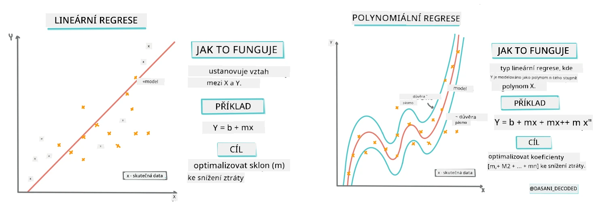
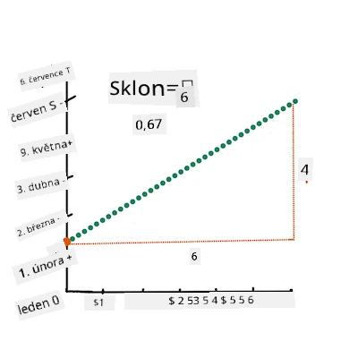
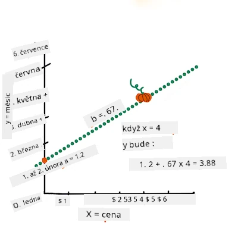
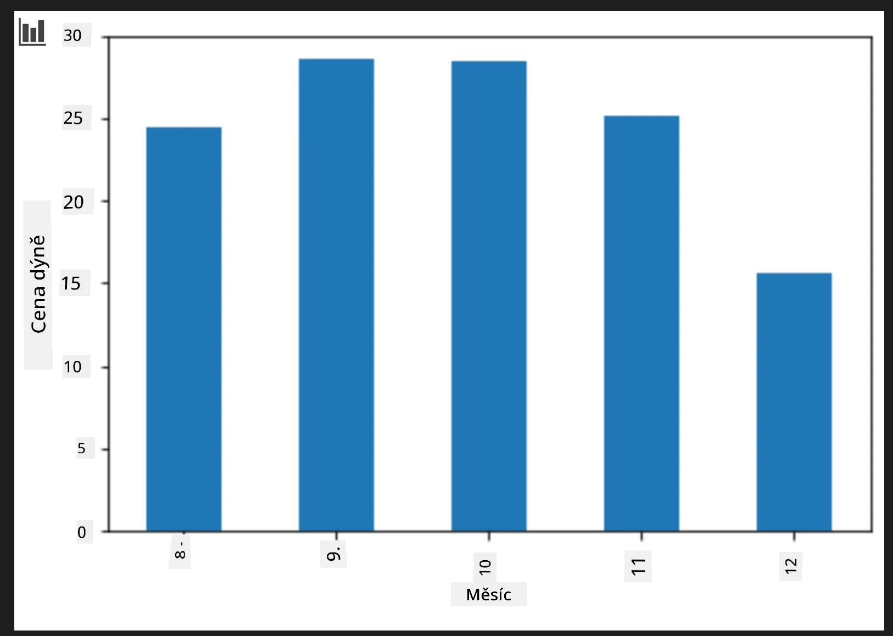
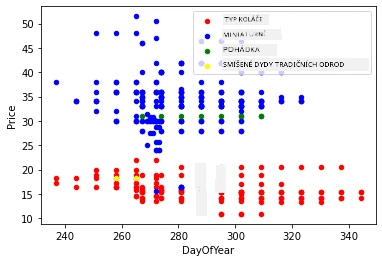

# Vytvoření regresního modelu pomocí Scikit-learn: čtyři způsoby regrese

## Poznámka pro začátečníky

Lineární regrese se používá, když chceme předpovědět **číselnou hodnotu** (například cenu domu, teplotu nebo prodej).
Funguje tak, že najde přímku, jež nejlépe reprezentuje vztah mezi vstupními rysy a výstupem.

V této lekci se zaměříme na pochopení konceptu, než prozkoumáme pokročilejší regresní techniky.

> Infografika od [Dasani Madipalli](https://twitter.com/dasani_decoded)
## [Přednáškový kvíz](https://ff-quizzes.netlify.app/en/ml/)

> ### [Tato lekce je dostupná i v R!](../../../../2-Regression/3-Linear/solution/R/lesson_3.html)
### Úvod 

Dosud jste prozkoumali, co regrese je, na ukázkových datech ze sady dat o cenách dýní, kterou budeme používat po celou tuto lekci. Také jste je vizualizovali pomocí Matplotlib.

Teď jste připraveni jít hlouběji do regrese pro strojové učení. Zatímco vizualizace vám umožňuje pochopit data, skutečná síla strojového učení spočívá v _trénování modelů_. Modely se trénují na historických datech, aby automaticky zachytily závislosti v datech, a umožňují tak předpovídat výsledky pro nová data, která model dosud neviděl.

V této lekci se dozvíte více o dvou typech regrese: _základní lineární regresi_ a _polynomiální regresi_ společně s částí matematiky, která tyto techniky podporuje. Tyto modely nám umožní předpovídat ceny dýní v závislosti na různých vstupních datech.

[](https://youtu.be/CRxFT8oTDMg "Strojové učení pro začátečníky - Pochopení lineární regrese")

> 🎥 Klikněte na obrázek výše pro krátké video shrnutí lineární regrese.

> V průběhu tohoto kurzu předpokládáme minimální znalosti matematiky a snažíme se ji zpřístupnit studentům z jiných oborů, proto sledujte poznámky, 🧮 upozornění, diagramy a další učební pomůcky pro lepší pochopení.

### Předpoklady

Měli byste již být seznámeni se strukturou dat o dýních, kterou zkoumáme. Najdete je přednačtená a předvyčištěná v souboru _notebook.ipynb_ k této lekci. V souboru je cena dýně zobrazena za koš. Ujistěte se, že dokážete spustit tyto notebooky v kernelu ve Visual Studio Code.

### Příprava

Pro připomenutí, načítáte tato data, abyste mohli klást otázky na jejich základě. 

- Kdy je nejlepší čas na koupi dýní? 
- Jakou cenu mohu očekávat za balení mini dýní?
- Měl bych je koupit v koších o půl koše, nebo v krabici o 1 1/9 koše?
Pojďme do těchto dat hlouběji.

V předchozí lekci jste vytvořili Pandas dataframe a naplnili jej částí původní sady dat, kde jste standardizovali ceny podle koše. Tím jste ale získali pouze asi 400 datových bodů a pouze pro podzimní měsíce. 

Podívejte se na data, která jsme přednačetli v notebooku připojeném k této lekci. Data jsou přednačtená a je vytvořen počáteční scatterplot pro údaje o měsících. Možná můžeme získat více detailů o povaze dat jejich dalším vyčištěním.

## Lineární regrese

Jak jste se naučili v Lekci 1, cílem úlohy lineární regrese je být schopen vykreslit přímku, která:

- **Ukáže vztahy proměnných**. Ukáže vztah mezi proměnnými.
- **Provádí předpovědi**. Udělá přesné předpovědi, kde by nový datový bod mohl ležet ve vztahu k této přímce.

Typickým přístupem pro **regresi nejmenších čtverců** je nakreslit právě takovou přímku. Termín "nejmenší čtverce" označuje proces minimalizace celkové chyby v našem modelu. Pro každý datový bod měříme svislou vzdálenost (nazývanou reziduál) mezi skutečným bodem a naší regresní přímkou.  

Tyto vzdálenosti umocňujeme na druhou ze dvou hlavních důvodů:  

1. **Velikost místo směru:** Chceme, aby chyba -5 byla považována za stejně závažnou jako chyba +5. Umocnění na druhou všechny hodnoty zanesou na kladné čísla.  

2. **Postihování odlehlých hodnot:** Umocnění na druhou dává větší váhu větším chybám, čímž nutí přímku být blíže k bodům, které jsou vzdálené.  

Poté tyto umocněné hodnoty sečteme. Naším cílem je najít přesnou přímku, kde je součet těchto hodnot co nejmenší – odtud název "nejmenších čtverců".  

> **🧮 Ukaž mi matematiku** 
> 
> Tato čára, nazývaná _čára nejlepšího přizpůsobení_, může být vyjádřena [rovnicí](https://en.wikipedia.org/wiki/Simple_linear_regression): 
> 
> ```
> Y = a + bX
> ```
>
> `X` je 'vysvětlující proměnná'. `Y` je 'závislá proměnná'. Směrnice přímky je `b` a `a` je průsečík s osou y, což označuje hodnotu `Y` když `X = 0`. 
>
>
>
> Nejprve spočítáme směrnici `b`. Infografika od [Jen Looper](https://twitter.com/jenlooper)
>
> Jinými slovy, a vzhledem k původní otázce naší dýňové datové sady: "předpovědět cenu dýně za koš podle měsíce", by `X` označovalo cenu a `Y` by odpovídalo měsíci prodeje. 
>
>
>
> Spočítejte hodnotu Y. Pokud platíte kolem 4 dolarů, musí být duben! Infografika od [Jen Looper](https://twitter.com/jenlooper)
>
> Matematika, která vypočítává čáru, musí ukázat směrnici přímky, která také závisí na průsečíku, tedy kde se `Y` nachází, když `X = 0`.
>
> Metodu výpočtu těchto hodnot můžete sledovat na webu [Math is Fun](https://www.mathsisfun.com/data/least-squares-regression.html). Navštivte také [tento kalkulátor nejmenších čtverců](https://www.mathsisfun.com/data/least-squares-calculator.html), kde můžete vidět, jak hodnoty ovlivňují přímku.

## Korelace

Ještě jeden termín k pochopení je **koeficient korelace** mezi danými proměnnými X a Y. Pomocí scatterplotu můžete rychle vizualizovat tento koeficient. Graf s body rozloženými v úhledné přímce má vysokou korelaci, ale graf s body rozptýlenými všude mezi X a Y má nízkou korelaci.

Dobrý lineární regresní model bude ten, který má vysoký (blíže k 1 než k 0) koeficient korelace, využívající metodu regrese nejmenších čtverců s regresní čarou.

✅ Spusťte notebook připojený k této lekci a podívejte se na scatterplot měsíce a ceny. Zdá se, že data spojující měsíc a cenu u prodeje dýní mají podle vašeho vizuálního vnímání scatterplotu vysokou nebo nízkou korelaci? Změní se to, pokud místo `Month` použijete jemnější měření, například *den v roce* (tj. počet dnů od začátku roku)?

V následujícím kódu budeme předpokládat, že jsme data vyčistili a získali dataframe pojmenovaný `new_pumpkins`, podobný následujícímu:

ID | Month | DayOfYear | Variety | City | Package | Low Price | High Price | Price
---|-------|-----------|---------|------|---------|-----------|------------|-------
70 | 9 | 267 | PIE TYPE | BALTIMORE | 1 1/9 bushel cartons | 15.0 | 15.0 | 13.636364
71 | 9 | 267 | PIE TYPE | BALTIMORE | 1 1/9 bushel cartons | 18.0 | 18.0 | 16.363636
72 | 10 | 274 | PIE TYPE | BALTIMORE | 1 1/9 bushel cartons | 18.0 | 18.0 | 16.363636
73 | 10 | 274 | PIE TYPE | BALTIMORE | 1 1/9 bushel cartons | 17.0 | 17.0 | 15.454545
74 | 10 | 281 | PIE TYPE | BALTIMORE | 1 1/9 bushel cartons | 15.0 | 15.0 | 13.636364

> Kód pro vyčištění dat je dostupný v [`notebook.ipynb`](notebook.ipynb). Provedli jsme stejné kroky čištění jako v předchozí lekci a vypočítali sloupec `DayOfYear` pomocí následujícího výrazu: 

```python
day_of_year = pd.to_datetime(pumpkins['Date']).apply(lambda dt: (dt-datetime(dt.year,1,1)).days)
```

Teď, když máte pochopení matematiky za lineární regresí, vytvoříme regresní model, abychom zjistili, zda dokážeme předpovědět, která balení dýní budou mít nejlepší ceny. Někdo, kdo kupuje dýně pro slavnostní záhon, by mohl tyto informace chtít pro optimalizaci nákupů dýňových balení pro záhon.

## Hledání korelace

[](https://youtu.be/uoRq-lW2eQo "Strojové učení pro začátečníky - Hledání korelace: Klíč k lineární regresi")

> 🎥 Klikněte na obrázek výše pro krátké video shrnutí korelace.

Z předchozí lekce jste asi viděli, že průměrná cena za jednotlivé měsíce vypadá takto:



To naznačuje, že by tam měla být nějaká korelace, a můžeme zkusit vytrénovat lineární regresní model, který předpovídá vztah mezi `Month` a `Price`, nebo mezi `DayOfYear` a `Price`. Zde je scatterplot ukazující druhý vztah:

 

Podíváme se, jestli korelace existuje pomocí funkce `corr`:

```python
print(new_pumpkins['Month'].corr(new_pumpkins['Price']))
print(new_pumpkins['DayOfYear'].corr(new_pumpkins['Price']))
```

Zdá se, že korelace je dost malá, -0.15 podle `Month` a -0.17 podle `DayOfYear`, ale může tu být jiný důležitý vztah. Zdá se, že existují různé shluky cen odpovídající různým odrůdám dýní. Abychom tento předpoklad potvrdili, vykreslíme každou kategorii dýní pomocí jiné barvy. Předáním parametru `ax` funkci `scatter` můžeme všechny body vykreslit do stejného grafu:

```python
ax=None
colors = ['red','blue','green','yellow']
for i,var in enumerate(new_pumpkins['Variety'].unique()):
    df = new_pumpkins[new_pumpkins['Variety']==var]
    ax = df.plot.scatter('DayOfYear','Price',ax=ax,c=colors[i],label=var)
```

 

Naše šetření naznačuje, že odrůda má na celkovou cenu větší vliv než skutečné datum prodeje. Vidíme to na sloupcovém grafu:

```python
new_pumpkins.groupby('Variety')['Price'].mean().plot(kind='bar')
```

 

Teď se zaměřme jen na jednu odrůdu dýně, 'pie type', a uvidíme, jaký vliv má datum na cenu:

```python
pie_pumpkins = new_pumpkins[new_pumpkins['Variety']=='PIE TYPE']
pie_pumpkins.plot.scatter('DayOfYear','Price') 
```
 

Pokud nyní vypočítáme korelaci mezi `Price` a `DayOfYear` pomocí funkce `corr`, dostaneme něco jako `-0.27` - což znamená, že smysl má trénovat prediktivní model.

> Před trénováním lineárního regresního modelu je důležité zajistit, že naše data jsou čistá. Lineární regrese nefunguje dobře s chybějícími hodnotami, proto je vhodné se zbavit všech prázdných buněk:

```python
pie_pumpkins.dropna(inplace=True)
pie_pumpkins.info()
```

Další přístup by byl vyplnit chybějící hodnoty průměrem odpovídajícího sloupce.

## Jednoduchá lineární regrese

[](https://youtu.be/e4c_UP2fSjg "Strojové učení pro začátečníky - Lineární a polynomiální regrese pomocí Scikit-learn")

> 🎥 Klikněte na obrázek výše pro krátké video shrnutí lineární a polynomiální regrese.

Pro trénování našeho modelu lineární regrese použijeme knihovnu **Scikit-learn**.

```python
from sklearn.linear_model import LinearRegression
from sklearn.metrics import mean_squared_error
from sklearn.model_selection import train_test_split
```

Začínáme tím, že oddělíme vstupní hodnoty (rysy) a očekávaný výstup (cílovou proměnnou) do samostatných numpy polí:

```python
X = pie_pumpkins['DayOfYear'].to_numpy().reshape(-1,1)
y = pie_pumpkins['Price']
```

> Všimněte si, že jsme museli použít `reshape` na vstupní data, aby je balíček Linear Regression správně pochopil. Lineární regrese očekává jako vstup 2D pole, kde každý řádek pole odpovídá vektoru vstupních rysů. V našem případě, protože máme pouze jeden vstup, potřebujeme pole s tvarem N×1, kde N je velikost datasetu.

Pak musíme data rozdělit na trénovací a testovací dataset, abychom mohli po trénování model ověřit:

```python
X_train, X_test, y_train, y_test = train_test_split(X, y, test_size=0.2, random_state=0)
```

Nakonec samotné trénování modelu lineární regrese zabere jen dva řádky kódu. Definujeme objekt `LinearRegression` a přizpůsobíme jej našim datům pomocí metody `fit`:

```python
lin_reg = LinearRegression()
lin_reg.fit(X_train,y_train)
```

Objekt `LinearRegression` po provedení `fit` obsahuje všechny koeficienty regrese, ke kterým lze přistupovat pomocí vlastnosti `.coef_`. V našem případě je zde pouze jeden koeficient, který by měl být kolem hodnoty `-0.017`. To znamená, že ceny se zdají mírně snižovat v čase, ale nikoliv příliš, přibližně o 2 centy za den. Můžeme také získat průsečík regrese s osou Y pomocí `lin_reg.intercept_` - v našem případě bude kolem hodnoty `21`, což indikuje cenu na začátku roku.

Abychom viděli, jak přesný náš model je, můžeme predikovat ceny na testovacích datech a pak změřit, jak blízko jsou naše predikce k očekávaným hodnotám. To lze udělat pomocí metriky střední kvadratické chyby (RMSE), což je odmocnina z průměru všech čtvercových rozdílů mezi očekávanou a predikovanou hodnotou.

```python
pred = lin_reg.predict(X_test)

rmse = np.sqrt(mean_squared_error(y_test,pred))
print(f'RMSE: {rmse:3.3} ({rmse/np.mean(pred)*100:3.3}%)')
```

Naše chyba se zdá být kolem 2 bodů, což je ~17 %. Není to moc dobré. Dalším ukazatelem kvality modelu je **koeficient determinace**, který lze získat takto:

```python
score = lin_reg.score(X_train,y_train)
print('Model determination: ', score)
```
Pokud je hodnota 0, znamená to, že model nezohledňuje vstupní data a funguje jako *nejhorší lineární prediktor*, což je jednoduše průměr výsledku. Hodnota 1 znamená, že můžeme dokonale předpovědět všechny očekávané výstupy. V našem případě je koeficient kolem 0,06, což je poměrně nízké.

Můžeme také nakreslit testovací data společně s regresní přímkou, abychom lépe viděli, jak regrese v našem případě funguje:

```python
plt.scatter(X_test,y_test)
plt.plot(X_test,pred)
```


## Polynomická regrese

Dalším typem lineární regrese je polynomická regrese. Zatímco někdy existuje lineární vztah mezi proměnnými – čím větší je dýně objemem, tím vyšší je cena – jindy tyto vztahy nelze znázornit jako rovinu nebo přímku.

✅ Zde jsou [další příklady](https://online.stat.psu.edu/stat501/Lesson09#polynomial-regression-examples) dat, která by mohla využít polynomickou regresi.

Podívejte se znovu na vztah mezi Datem a Cenou. Zdá se vám, že by tento bodový graf nutně měl být analyzován přímkou? Nemohou ceny kolísat? V takovém případě můžete zkusit polynomickou regresi.

✅ Polynomy jsou matematické výrazy, které mohou obsahovat jednu nebo více proměnných a koeficientů.

Polynomická regrese vytváří zakřivenou čáru, která lépe sedí na nelinární data. V našem případě, pokud do vstupních dat zahrneme proměnnou `DayOfYear` umocněnou na druhou, měli bychom být schopni naše data vhodně přizpůsobit parabolickou křivkou, která bude mít minimum v určitém bodě během roku.

Knihovna Scikit-learn obsahuje užitečné [pipeline API](https://scikit-learn.org/stable/modules/generated/sklearn.pipeline.make_pipeline.html?highlight=pipeline#sklearn.pipeline.make_pipeline) pro spojení různých kroků zpracování dat dohromady. **Pipeline** je řetězec **odhadovačů**. V našem případě vytvoříme pipeline, která nejprve přidá polynomické rysy do modelu a poté naučí regresi:

```python
from sklearn.preprocessing import PolynomialFeatures
from sklearn.pipeline import make_pipeline

pipeline = make_pipeline(PolynomialFeatures(2), LinearRegression())

pipeline.fit(X_train,y_train)
```

Použití `PolynomialFeatures(2)` znamená, že zahrneme všechny polynomy druhého stupně z vstupních dat. V našem případě to bude znamenat pouze `DayOfYear`<sup>2</sup>, ale pokud máme dvě vstupní proměnné X a Y, přidá to X<sup>2</sup>, XY a Y<sup>2</sup>. Můžeme použít i polynomy vyššího stupně, pokud chceme.

Pipeline lze používat stejným způsobem jako původní objekt `LinearRegression`, tj. můžeme `fit` pipeline a pak použít `predict` pro získání predikcí:

```python
pred = pipeline.predict(X_test)

rmse = np.sqrt(mean_squared_error(y_test,pred))
print(f'RMSE: {rmse:3.3} ({rmse/np.mean(pred)*100:3.3}%)')

score = pipeline.score(X_train,y_train)
print('Model determination: ', score)
```

Pro vykreslení hladké aproximační křivky použijeme `np.linspace` k vytvoření rovnoměrného rozsahu vstupních hodnot, místo přímého vykreslení na neuspořádaná testovací data (což by vedlo k zubaté linii):

```python
X_range = np.linspace(X_test.min(), X_test.max(), 100).reshape(-1,1)
y_range = pipeline.predict(X_range)

plt.scatter(X_test, y_test)
plt.plot(X_range, y_range)
```

Zde je graf zobrazující testovací data a aproximační křivku:


Použitím polynomické regrese můžeme dosáhnout mírně nižší RMSE a vyšší determinace, ale ne významně. Musíme vzít v úvahu další vlastnosti!

> Můžete vidět, že nejnižší ceny dýní jsou pozorovány někde kolem Halloweenu. Jak byste to vysvětlili?

🎃 Gratulujeme, právě jste vytvořili model, který může pomoci předpovědět cenu dýně na koláč. Pravděpodobně byste mohli stejný postup opakovat pro všechny typy dýní, ale to by bylo zdlouhavé. Naučme se nyní, jak do našeho modelu vzít v úvahu odrůdu dýně!

## Kategorie vlastností

V ideálním světě chceme být schopni předpovědět ceny pro různé odrůdy dýní pomocí stejného modelu. Nicméně sloupec `Variety` se liší od sloupců jako `Month`, protože obsahuje číslicové hodnoty. Takové sloupce se nazývají **kategoriální**.

[](https://youtu.be/DYGliioIAE0 "ML pro začátečníky - Předpovědi kategoriálních vlastností pomocí lineární regrese")

> 🎥 Klikněte na obrázek výše pro krátké video o použití kategoriálních vlastností.

Zde vidíte, jak průměrná cena závisí na odrůdě:


Abychom vzali odrůdu v úvahu, musíme ji nejprve převést do číselné formy, tedy **zakódovat**. Existuje několik způsobů, jak to udělat:

* Jednoduché **číselné kódování** vytvoří tabulku různých odrůd a pak nahradí název odrůdy indexem v této tabulce. To není nejlepší nápad pro lineární regresi, protože lineární regrese bere skutečnou numerickou hodnotu indexu a přičítá ji do výsledku vynásobenou nějakým koeficientem. V našem případě je vztah mezi číslem indexu a cenou evidentně nelineární, i když zajistíme, že indexy jsou seřazeny určitým způsobem.
* **One-hot encoding** nahradí sloupec `Variety` čtyřmi různými sloupci, jedním pro každou odrůdu. Každý sloupec bude obsahovat `1`, pokud odpovídající řádek patří dané odrůdě, a `0` jinak. To znamená, že v lineární regresi budou čtyři koeficienty, jeden pro každou odrůdu dýně, zodpovědný za „počáteční cenu“ (nebo spíše „přídavnou cenu“) pro tu která odrůdu.

Níže uvedený kód ukazuje, jak můžeme použít one-hot encoding pro odrůdu:

```python
pd.get_dummies(new_pumpkins['Variety'])
```

 ID | FAIRYTALE | MINIATURE | MIXED HEIRLOOM VARIETIES | PIE TYPE
----|-----------|-----------|--------------------------|----------
70 | 0 | 0 | 0 | 1
71 | 0 | 0 | 0 | 1
... | ... | ... | ... | ...
1738 | 0 | 1 | 0 | 0
1739 | 0 | 1 | 0 | 0
1740 | 0 | 1 | 0 | 0
1741 | 0 | 1 | 0 | 0
1742 | 0 | 1 | 0 | 0

Pro trénování lineární regrese s použitím one-hot zakódované odrůdy jako vstupu stačí správně inicializovat data `X` a `y`:

```python
X = pd.get_dummies(new_pumpkins['Variety'])
y = new_pumpkins['Price']
```

Zbytek kódu je stejný jako výše použité pro trénování lineární regrese. Pokud to vyzkoušíte, uvidíte, že střední čtvercová chyba je přibližně stejná, ale koeficient determinace je mnohem vyšší (~77 %). Pro ještě přesnější predikce můžeme vzít v potaz více kategoriálních vlastností, stejně jako numerické vlastnosti, jako `Month` nebo `DayOfYear`. Pro získání jedné velké matice vlastností můžeme použít `join`:

```python
X = pd.get_dummies(new_pumpkins['Variety']) \
        .join(new_pumpkins['Month']) \
        .join(pd.get_dummies(new_pumpkins['City'])) \
        .join(pd.get_dummies(new_pumpkins['Package']))
y = new_pumpkins['Price']
```

Zde také zahrnujeme `City` a typ `Package`, což nám dává RMSE 2.84 (10,5 %), a determinaci 0.94!

## Spojení všeho dohromady

Pro vytvoření nejlepšího modelu můžeme použít kombinovaná data (kategoriální zakódovaná + numerická) z výše uvedeného příkladu spolu s polynomickou regresí. Zde je kompletní kód pro vaši pohodlnost:

```python
# nastavte tréninková data
X = pd.get_dummies(new_pumpkins['Variety']) \
        .join(new_pumpkins['Month']) \
        .join(pd.get_dummies(new_pumpkins['City'])) \
        .join(pd.get_dummies(new_pumpkins['Package']))
y = new_pumpkins['Price']

# proveďte rozdělení na tréninkovou a testovací sadu
X_train, X_test, y_train, y_test = train_test_split(X, y, test_size=0.2, random_state=0)

# nastavte a vytrénujte pipeline
pipeline = make_pipeline(PolynomialFeatures(2), LinearRegression())
pipeline.fit(X_train,y_train)

# predikujte výsledky pro testovací data
pred = pipeline.predict(X_test)

# vypočítejte RMSE a koeficient determinace
rmse = mean_squared_error(y_test, pred, squared=False)
print(f'RMSE: {rmse:3.3} ({rmse/pred.mean()*100:3.3}%)')

score = pipeline.score(X_train,y_train)
print('Model determination: ', score)
```

To by nám mělo dát nejlepší koeficient determinace téměř 97 % a RMSE=2.23 (~8 % chyba predikce).

| Model | RMSE | Determinace |
|-------|-----|-------------|
| Lineární `DayOfYear` | 2.77 (17,2 %) | 0.07 |
| Polynomická `DayOfYear` | 2.73 (17,0 %) | 0.08 |
| Lineární `Variety` | 5.24 (19,7 %) | 0.77 |
| Všechny vlastnosti lineární | 2.84 (10,5 %) | 0.94 |
| Všechny vlastnosti polynomická | 2.23 (8,25 %) | 0.97 |

🏆 Výborně! V jedné lekci jste vytvořili čtyři regresní modely a zlepšili kvalitu modelu na 97 %. V poslední části o regresi se naučíte o logistické regresi pro určení kategorií.

---
## 🚀Výzva

Vyzkoušejte několik různých proměnných v tomto notebooku a zjistěte, jak korelace odpovídá přesnosti modelu.

## [Kvíz po lekci](https://ff-quizzes.netlify.app/en/ml/)

## Recenze & samostatné studium

V této lekci jsme se naučili o lineární regresi. Existují i další důležité typy regrese. Přečtěte si o technikách Stepwise, Ridge, Lasso a Elasticnet. Dobrým kurzem k dalšímu studiu je [Stanford Statistical Learning course](https://online.stanford.edu/courses/sohs-ystatslearning-statistical-learning)

## Zadání

[Vytvořte model](assignment.md)

---

<!-- CO-OP TRANSLATOR DISCLAIMER START -->
**Upozornění**:  
Tento dokument byl přeložen pomocí AI překladatelské služby [Co-op Translator](https://github.com/Azure/co-op-translator). I když usilujeme o přesnost, mějte prosím na paměti, že automatické překlady mohou obsahovat chyby nebo nepřesnosti. Původní dokument v jeho mateřském jazyce by měl být považován za autoritativní zdroj. Pro důležité informace se doporučuje profesionální lidský překlad. Nejsme zodpovědní za jakákoliv nedorozumění nebo mylné výklady vyplývající z použití tohoto překladu.
<!-- CO-OP TRANSLATOR DISCLAIMER END -->