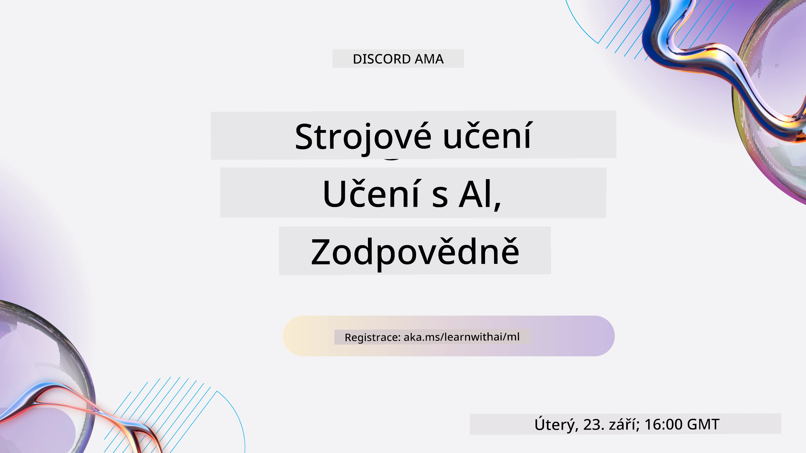
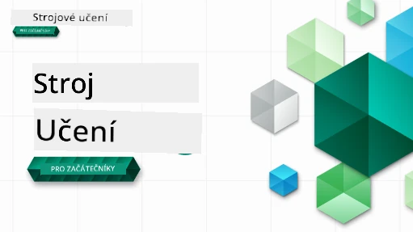

[](https://github.com/microsoft/ML-For-Beginners/blob/master/LICENSE)
[](https://GitHub.com/microsoft/ML-For-Beginners/graphs/contributors/)
[](https://GitHub.com/microsoft/ML-For-Beginners/issues/)
[](https://GitHub.com/microsoft/ML-For-Beginners/pulls/)
[](http://makeapullrequest.com)

[](https://GitHub.com/microsoft/ML-For-Beginners/watchers/)
[](https://GitHub.com/microsoft/ML-For-Beginners/network/)
[](https://GitHub.com/microsoft/ML-For-Beginners/stargazers/)

### 🌐 Podpora vícejazyčného prostředí

#### Překlady udržované pomocí [Co-op Translator](https://github.com/Azure/co-op-translator)

<!-- CO-OP TRANSLATOR LANGUAGES TABLE START -->
[Arabština](../ar/README.md) | [Bengálština](../bn/README.md) | [Bulharština](../bg/README.md) | [Barmština (Myanmar)](../my/README.md) | [Čínština (zjednodušená)](../zh-CN/README.md) | [Čínština (tradiční, Hong Kong)](../zh-HK/README.md) | [Čínština (tradiční, Macau)](../zh-MO/README.md) | [Čínština (tradiční, Taiwan)](../zh-TW/README.md) | [Chorvatština](../hr/README.md) | [Čeština](./README.md) | [Dánština](../da/README.md) | [Nizozemština](../nl/README.md) | [Estonština](../et/README.md) | [Finština](../fi/README.md) | [Francouzština](../fr/README.md) | [Němčina](../de/README.md) | [Řečtina](../el/README.md) | [Hebrejština](../he/README.md) | [Hindi](../hi/README.md) | [Maďarština](../hu/README.md) | [Indonéština](../id/README.md) | [Italština](../it/README.md) | [Japonština](../ja/README.md) | [Kannadština](../kn/README.md) | [Khmerština](../km/README.md) | [Korejština](../ko/README.md) | [Litevština](../lt/README.md) | [Malajština](../ms/README.md) | [Malayalam](../ml/README.md) | [Manipuri (Meitei Mayek)](../mni/README.md) | [Maráthština](../mr/README.md) | [Nepálština](../ne/README.md) | [Nigerijský pidžin](../pcm/README.md) | [Norština](../no/README.md) | [Perština (Farsi)](../fa/README.md) | [Polština](../pl/README.md) | [Portugalština (Brazílie)](../pt-BR/README.md) | [Portugalština (Portugalsko)](../pt-PT/README.md) | [Pandžábština (Gurmukhi)](../pa/README.md) | [Rumunština](../ro/README.md) | [Ruština](../ru/README.md) | [Srbština (Cyrilice)](../sr/README.md) | [Slovenština](../sk/README.md) | [Slovinština](../sl/README.md) | [Španělština](../es/README.md) | [Svahilština](../sw/README.md) | [Švédština](../sv/README.md) | [Tagalog (Filipínština)](../tl/README.md) | [Tamilština](../ta/README.md) | [Telugu](../te/README.md) | [Thajština](../th/README.md) | [Turečtina](../tr/README.md) | [Ukrajinština](../uk/README.md) | [Urdu](../ur/README.md) | [Vietnamština](../vi/README.md)

> **Preferujete klonovat lokálně?**
>
> Tento repozitář obsahuje přes 50 jazykových překladů, což výrazně zvětšuje velikost ke stažení. Pro klonování bez překladů použijte sparse checkout:
>
> **Bash / macOS / Linux:**
> ```bash
> git clone --filter=blob:none --sparse https://github.com/microsoft/ML-For-Beginners.git
> cd ML-For-Beginners
> git sparse-checkout set --no-cone '/*' '!translations' '!translated_images'
> ```
>
> **CMD (Windows):**
> ```cmd
> git clone --filter=blob:none --sparse https://github.com/microsoft/ML-For-Beginners.git
> cd ML-For-Beginners
> git sparse-checkout set --no-cone "/*" "!translations" "!translated_images"
> ```
>
> To vám poskytne vše potřebné k dokončení kurzu s mnohem rychlejším stažením.
<!-- CO-OP TRANSLATOR LANGUAGES TABLE END -->

#### Připojte se k naší komunitě

[](https://discord.gg/nTYy5BXMWG)

Máme probíhající Discord sérii Learn with AI, dozvíte se více a připojit se můžete na [Learn with AI Series](https://aka.ms/learnwithai/discord) od 18. do 30. září 2025. Získáte tipy a triky pro používání GitHub Copilot pro Data Science.



# Strojové učení pro začátečníky – Vzdělávací program

> 🌍 Cestujte po světě, zatímco prozkoumáváme strojové učení prostřednictvím světových kultur 🌍

Cloud Advocates ve společnosti Microsoft s potěšením představují 12týdenní program se 26 lekcemi zaměřený na **strojové učení**. V tomto kurzu se naučíte to, co se někdy nazývá **klasické strojové učení**, které využívá především knihovnu Scikit-learn a neklade důraz na hluboké učení, které je pokryto v našem [kurzu AI pro začátečníky](https://aka.ms/ai4beginners). Tyto lekce také dobře doplňují náš ['Data Science pro začátečníky' kurz](https://aka.ms/ds4beginners).

Cestujte s námi kolem světa, kde budeme aplikovat tyto klasické techniky na data z různých oblastí. Každá lekce obsahuje před a po lekční kvízy, psané pokyny k dokončení lekce, řešení, úkol a další. Naše projektově orientovaná pedagogika vám umožní učit se při tvorbě, což je osvědčený způsob, jak si nové dovednosti skutečně osvojit.

**✍️ Upřímné díky našim autorům** Jen Looper, Stephen Howell, Francesca Lazzeri, Tomomi Imura, Cassie Breviu, Dmitry Soshnikov, Chris Noring, Anirban Mukherjee, Ornella Altunyan, Ruth Yakubu a Amy Boyd

**🎨 Díky také našim ilustrátorům** Tomomi Imura, Dasani Madipalli a Jen Looper

**🙏 Zvláštní poděkování 🙏 našim Microsoft Student Ambassador autorům, recenzentům a přispěvatelům**, zvláště Rishit Dagli, Muhammad Sakib Khan Inan, Rohan Raj, Alexandru Petrescu, Abhishek Jaiswal, Nawrin Tabassum, Ioan Samuila a Snigdha Agarwal

**🤩 Extra poděkování Microsoft Student Ambassadors Eric Wanjau, Jasleen Sondhi a Vidushi Gupta za naše lekce R!**

# Začínáme

Postupujte podle těchto kroků:
1. **Vytvořte fork repozitáře**: Klikněte na tlačítko „Fork“ v pravém horním rohu této stránky.
2. **Naklonujte repozitář**: `git clone https://github.com/microsoft/ML-For-Beginners.git`

> 💡 **Tip na rychlý start:** Chcete začít v prohlížeči bez lokálního nastavování Pythonu? Použijte [GitHub Codespaces](https://github.com/features/codespaces) k vytvoření cloudového vývojového prostředí pro váš fork. Otevřete zelené menu **Code**, vyberte **Codespaces** a vytvořte codespace; nainstalujte všechny potřebné závislosti každé lekce podle potřeby.

> [najděte všechny další zdroje pro tento kurz v naší kolekci Microsoft Learn](https://learn.microsoft.com/en-us/collections/qrqzamz1nn2wx3?WT.mc_id=academic-77952-bethanycheum)

> 🔧 **Potřebujete pomoc?** Podívejte se na náš [Průvodce řešením problémů](TROUBLESHOOTING.md) pro běžné problémy s instalací, nastavením a spuštěním lekcí.


**[Studenti](https://aka.ms/student-page)**, pro použití tohoto vzdělávacího programu si vytvořte fork celého repozitáře do vlastního GitHub účtu a procvičujte úkoly sami nebo ve skupině:

- Začněte přednáškovým kvízem.
- Přečtěte si přednášku a dokončete aktivity, zastavujte se a přemýšlejte u každé kontroly znalostí.
- Snažte se projekty vytvářet na základě pochopení lekcí, místo aby jste jen spouštěli řešení kódu; tento kód je však dostupný ve složkách `/solution` v každé projektově orientované lekci.
- Udělejte po-přednáškový kvíz.
- Dokončete výzvu.
- Vyplňte úkol.
- Po dokončení skupiny lekcí navštivte [Diskusní fórum](https://github.com/microsoft/ML-For-Beginners/discussions) a „učte se nahlas“ vyplněním příslušného rubriky PAT. 'PAT' je nástroj pro hodnocení pokroku, rubrika, kterou vyplníte k dalšímu zlepšení svého učení. Můžete také reagovat na jiné PATy, abychom se mohli společně učit.

> Pro další studium doporučujeme sledovat tyto [moduly a vzdělávací cesty Microsoft Learn](https://docs.microsoft.com/en-us/users/jenlooper-2911/collections/k7o7tg1gp306q4?WT.mc_id=academic-77952-leestott).

**Učitelé**, máme [několik návrhů](for-teachers.md), jak tento vzdělávací program používat.

---

## Video průvodci

Některé lekce jsou dostupné jako krátké video. Všechny najdete přímo v lekcích nebo na [playlistu ML pro začátečníky na YouTube kanálu Microsoft Developer](https://aka.ms/ml-beginners-videos) kliknutím na obrázek níže.

[](https://aka.ms/ml-beginners-videos)

---

## Seznamte se s týmem

[](https://youtu.be/Tj1XWrDSYJU)

**Gif od** [Mohit Jaisal](https://linkedin.com/in/mohitjaisal)

> 🎥 Klikněte na obrázek výše pro video o projektu a lidech, kteří ho vytvořili!

---

## Pedagogika

Při tvorbě tohoto programu jsme zvolili dvě pedagogické zásady: zajistit jeho praktickou **projektovou** povahu a zahrnout **časté kvízy**. Navíc má tento program společné **téma**, aby byl koherentní.

Zajištěním shody obsahu s projekty je proces pro studenty zajímavější a lepší je uchování konceptů. Nízkoprahový kvíz před lekcí nastavuje záměr studenta se učit téma, zatímco druhý kvíz po lekci zajišťuje další zapamatování. Tento program byl navržen flexibilně a zábavně a lze ho absolvovat celý nebo částečně. Projekty začínají malé a do konce 12týdenního cyklu se stávají složitějšími. Program obsahuje také dodatek o reálných aplikacích ML, který může sloužit jako extra kredity nebo jako základ pro diskuzi.

> Najděte náš [Etický kodex](CODE_OF_CONDUCT.md), [Příspěvky](CONTRIBUTING.md), [Překlady](..) a [Řešení problémů](TROUBLESHOOTING.md). Vítáme vaše konstruktivní připomínky!

## Každá lekce obsahuje

- volitelnou skicu (sketchnote)
- volitelné doplňkové video
- video průvodce (pouze některé lekce)
- [přednáškový warmup kvíz](https://ff-quizzes.netlify.app/en/ml/)
- psanou lekci
- u projektově orientovaných lekcí krok za krokem průvodce stavbou projektu
- kontroly znalostí
- výzvu
- doplňující četbu
- úkol
- [popřednáškový kvíz](https://ff-quizzes.netlify.app/en/ml/)

> **Poznámka o jazycích**: Tyto lekce jsou primárně psány v Pythonu, ale mnoho z nich je také dostupných v R. Pro dokončení R lekce přejděte do složky `/solution` a hledejte R lekce. Ty obsahují příponu .rmd, která reprezentuje soubor **R Markdown**, což lze jednoduše definovat jako vložení `code chunks` (jazyka R nebo jiných) a `YAML header` (který řídí formátování výstupů jako PDF) v rámci `Markdown document`. Takže slouží jako vzorový autorský rámec pro datovou vědu, protože umožňuje spojit kód, jeho výstup a vaše myšlenky a také je zapisovat v Markdownu. Dokumenty R Markdown pak lze zobrazit do výstupních formátů jako PDF, HTML nebo Word.

> **Poznámka o kvízech**: Všechny kvízy jsou umístěny ve [složce Quiz App](../../quiz-app), celkem 52 kvízů po třech otázkách. Jsou propojeny z lekcí, ale lze spustit kvízovou aplikaci i lokálně; postupujte dle instrukcí ve složce `quiz-app` pro lokální hostování nebo nasazení na Azure.

| Číslo lekce |                              Téma                               |                   Skupina lekcí                   | Cíle učení                                                                                                                     |                                                              Propojená lekce                                                               |                        Autor                        |
| :-----------: | :------------------------------------------------------------: | :-------------------------------------------------: | ------------------------------------------------------------------------------------------------------------------------------- | :--------------------------------------------------------------------------------------------------------------------------------------: | :--------------------------------------------------: |
|      01       |                Úvod do strojového učení                       |      [Úvod](1-Introduction/README.md)       | Naučte se základní koncepty strojového učení                                                                                |                                             [Lekce](1-Introduction/1-intro-to-ML/README.md)                                             |                       Muhammad                       |
|      02       |                Historie strojového učení                      |      [Úvod](1-Introduction/README.md)       | Naučte se historii tohoto oboru                                                                                         |                                            [Lekce](1-Introduction/2-history-of-ML/README.md)                                            |                     Jen a Amy                      |
|      03       |                 Spravedlnost a strojové učení                  |      [Úvod](1-Introduction/README.md)       | Jaké jsou důležité filozofické otázky kolem spravedlnosti, které by studenti měli zvážit při tvorbě a aplikaci ML modelů? |                                              [Lekce](1-Introduction/3-fairness/README.md)                                               |                        Tomomi                        |
|      04       |                Techniky strojového učení                       |      [Úvod](1-Introduction/README.md)       | Jaké techniky používají vědci zabývající se ML k vytváření ML modelů?                                                                       |                                          [Lekce](1-Introduction/4-techniques-of-ML/README.md)                                           |                    Chris a Jen                     |
|      05       |                   Úvod do regrese                   |        [Regrese](2-Regression/README.md)         | Začněte s Pythonem a Scikit-learn pro regresní modely                                                                  |         [Python](2-Regression/1-Tools/README.md) • [R](../../2-Regression/1-Tools/solution/R/lesson_1.html)         |      Jen • Eric Wanjau       |
|      06       |                Ceny dýní v Severní Americe 🎃                |        [Regrese](2-Regression/README.md)         | Vizualizujte a vyčistěte data jako přípravu na ML                                                                                  |          [Python](2-Regression/2-Data/README.md) • [R](../../2-Regression/2-Data/solution/R/lesson_2.html)          |      Jen • Eric Wanjau       |
|      07       |                Ceny dýní v Severní Americe 🎃                |        [Regrese](2-Regression/README.md)         | Postavte lineární a polynomiální regresní modely                                                                                   |        [Python](2-Regression/3-Linear/README.md) • [R](../../2-Regression/3-Linear/solution/R/lesson_3.html)        |      Jen a Dmitry • Eric Wanjau       |
|      08       |                Ceny dýní v Severní Americe 🎃                |        [Regrese](2-Regression/README.md)         | Postavte logistický regresní model                                                                                               |     [Python](2-Regression/4-Logistic/README.md) • [R](../../2-Regression/4-Logistic/solution/R/lesson_4.html)      |      Jen • Eric Wanjau       |
|      09       |                          Webová aplikace 🔌                          |           [Webová aplikace](3-Web-App/README.md)            | Postavte webovou aplikaci pro použití vašeho natrénovaného modelu                                                                                       |                                                 [Python](3-Web-App/1-Web-App/README.md)                                                  |                         Jen                          |
|      10       |                 Úvod do klasifikace                 |    [Klasifikace](4-Classification/README.md)     | Vyčistěte, připravte a vizualizujte data; úvod do klasifikace                                                            | [Python](4-Classification/1-Introduction/README.md) • [R](../../4-Classification/1-Introduction/solution/R/lesson_10.html)  | Jen a Cassie • Eric Wanjau |
|      11       |             Lahodné ázijské a indické kuchyně 🍜             |    [Klasifikace](4-Classification/README.md)     | Úvod do klasifikátorů                                                                                                     | [Python](4-Classification/2-Classifiers-1/README.md) • [R](../../4-Classification/2-Classifiers-1/solution/R/lesson_11.html) | Jen a Cassie • Eric Wanjau |
|      12       |             Lahodné ázijské a indické kuchyně 🍜             |    [Klasifikace](4-Classification/README.md)     | Další klasifikátory                                                                                                                | [Python](4-Classification/3-Classifiers-2/README.md) • [R](../../4-Classification/3-Classifiers-2/solution/R/lesson_12.html) | Jen a Cassie • Eric Wanjau |
|      13       |             Lahodné ázijské a indické kuchyně 🍜             |    [Klasifikace](4-Classification/README.md)     | Postavte recommender webovou aplikaci pomocí vašeho modelu                                                                                    |                                              [Python](4-Classification/4-Applied/README.md)                                              |                         Jen                          |
|      14       |                   Úvod do shlukování                   |        [Shlukování](5-Clustering/README.md)         | Vyčistěte, připravte a vizualizujte data; úvod do shlukování                                                                |         [Python](5-Clustering/1-Visualize/README.md) • [R](../../5-Clustering/1-Visualize/solution/R/lesson_14.html)         |      Jen • Eric Wanjau       |
|      15       |              Zkoumání nigérijských hudebních chutí 🎧              |        [Shlukování](5-Clustering/README.md)         | Prozkoumejte metodu shlukování K-Means                                                                                           |           [Python](5-Clustering/2-K-Means/README.md) • [R](../../5-Clustering/2-K-Means/solution/R/lesson_15.html)           |      Jen • Eric Wanjau       |
|      16       |        Úvod do zpracování přirozeného jazyka ☕️         |   [Zpracování přirozeného jazyka](6-NLP/README.md)    | Naučte se základy NLP stavbou jednoduchého bota                                                                             |                                             [Python](6-NLP/1-Introduction-to-NLP/README.md)                                              |                       Stephen                        |
|      17       |                      Běžné úkoly NLP ☕️                      |   [Zpracování přirozeného jazyka](6-NLP/README.md)    | Prohlubte si znalosti NLP pochopením běžných úkolů, které jsou potřeba při práci s jazykovými strukturami                          |                                                    [Python](6-NLP/2-Tasks/README.md)                                                     |                       Stephen                        |
|      18       |             Překlad a analýza sentimentu ♥️              |   [Zpracování přirozeného jazyka](6-NLP/README.md)    | Překlad a analýza sentimentu s Jane Austen                                                                             |                                            [Python](6-NLP/3-Translation-Sentiment/README.md)                                             |                       Stephen                        |
|      19       |                  Romantické hotely Evropy ♥️                  |   [Zpracování přirozeného jazyka](6-NLP/README.md)    | Analýza sentimentu s hotelovými recenzemi 1                                                                                         |                                               [Python](6-NLP/4-Hotel-Reviews-1/README.md)                                                |                       Stephen                        |
|      20       |                  Romantické hotely Evropy ♥️                  |   [Zpracování přirozeného jazyka](6-NLP/README.md)    | Analýza sentimentu s hotelovými recenzemi 2                                                                                         |                                               [Python](6-NLP/5-Hotel-Reviews-2/README.md)                                                |                       Stephen                        |
|      21       |            Úvod do předpovídání časových řad             |        [Časové řady](7-TimeSeries/README.md)        | Úvod do předpovídání časových řad                                                                                         |                                             [Python](7-TimeSeries/1-Introduction/README.md)                                              |                      Francesca                       |
|      22       | ⚡️ Světová spotřeba elektřiny ⚡️ - předpovídání časových řad pomocí ARIMA |        [Časové řady](7-TimeSeries/README.md)        | Předpovídání časových řad pomocí ARIMA                                                                                              |                                                 [Python](7-TimeSeries/2-ARIMA/README.md)                                                 |                      Francesca                       |
|      23       |  ⚡️ Světová spotřeba elektřiny ⚡️ - předpovídání časových řad pomocí SVR  |        [Časové řady](7-TimeSeries/README.md)        | Předpovídání časových řad pomocí Support Vector Regressor                                                                           |                                                  [Python](7-TimeSeries/3-SVR/README.md)                                                  |                       Anirban                        |
|      24       |             Úvod do posilovaného učení             | [Posilované učení](8-Reinforcement/README.md) | Úvod do posilovaného učení pomocí Q-Learning                                                                          |                                             [Python](8-Reinforcement/1-QLearning/README.md)                                              |                        Dmitry                        |
|      25       |                 Pomozte Petrovi vyhnout se vlkovi! 🐺                  | [Posilované učení](8-Reinforcement/README.md) | Posilované učení v Gym                                                                                                      |                                                [Python](8-Reinforcement/2-Gym/README.md)                                                 |                        Dmitry                        |
|  Dodatek   |            Scénáře a aplikace strojového učení v reálném světě            |      [ML ve volné přírodě](9-Real-World/README.md)       | Zajímavé a odhalující aplikace klasického ML v reálném světě                                                               |                                             [Lekce](9-Real-World/1-Applications/README.md)                                              |                         Tým                         |
|  Dodatek   |            Ladění modelu ML pomocí RAI dashboardu            |      [ML ve volné přírodě](9-Real-World/README.md)       | Ladění modelu v strojovém učení pomocí komponent dashboardu Responsible AI                                                              |                                             [Lekce](9-Real-World/2-Debugging-ML-Models/README.md)                                              |                     Ruth Yakubu                      |

> [najděte všechny další zdroje k tomuto kurzu v naší kolekci Microsoft Learn](https://learn.microsoft.com/en-us/collections/qrqzamz1nn2wx3?WT.mc_id=academic-77952-bethanycheum)

## Offline přístup

Tento dokument můžete spustit offline pomocí [Docsify](https://docsify.js.org/#/). Zforkujte toto repo, [nainstalujte Docsify](https://docsify.js.org/#/quickstart) na svém lokálním počítači a poté v kořenové složce tohoto repa napište `docsify serve`. Webová stránka bude k dispozici pod portem 3000 na vašem localhost: `localhost:3000`.

## PDF

Najděte pdf osnovy s odkazy [zde](https://microsoft.github.io/ML-For-Beginners/pdf/readme.pdf).


## 🎒 Další kurzy 

Náš tým tvoří také další kurzy! Podívejte se na:

<!-- CO-OP TRANSLATOR OTHER COURSES START -->
### LangChain
[](https://aka.ms/langchain4j-for-beginners)
[](https://aka.ms/langchainjs-for-beginners?WT.mc_id=m365-94501-dwahlin)
[](https://github.com/microsoft/langchain-for-beginners?WT.mc_id=m365-94501-dwahlin)
---

### Azure / Edge / MCP / Agenti
[](https://github.com/microsoft/AZD-for-beginners?WT.mc_id=academic-105485-koreyst)
[](https://github.com/microsoft/edgeai-for-beginners?WT.mc_id=academic-105485-koreyst)
[](https://github.com/microsoft/mcp-for-beginners?WT.mc_id=academic-105485-koreyst)
[](https://github.com/microsoft/ai-agents-for-beginners?WT.mc_id=academic-105485-koreyst)

---
 
### Série Generativní AI
[](https://github.com/microsoft/generative-ai-for-beginners?WT.mc_id=academic-105485-koreyst)
[-9333EA?style=for-the-badge&labelColor=E5E7EB&color=9333EA)](https://github.com/microsoft/Generative-AI-for-beginners-dotnet?WT.mc_id=academic-105485-koreyst)
[-C084FC?style=for-the-badge&labelColor=E5E7EB&color=C084FC)](https://github.com/microsoft/generative-ai-for-beginners-java?WT.mc_id=academic-105485-koreyst)
[-E879F9?style=for-the-badge&labelColor=E5E7EB&color=E879F9)](https://github.com/microsoft/generative-ai-with-javascript?WT.mc_id=academic-105485-koreyst)

---
 
### Základní vzdělávání
[](https://aka.ms/ml-beginners?WT.mc_id=academic-105485-koreyst)
[](https://aka.ms/datascience-beginners?WT.mc_id=academic-105485-koreyst)
[](https://aka.ms/ai-beginners?WT.mc_id=academic-105485-koreyst)
[](https://github.com/microsoft/Security-101?WT.mc_id=academic-96948-sayoung)
[](https://aka.ms/webdev-beginners?WT.mc_id=academic-105485-koreyst)
[](https://aka.ms/iot-beginners?WT.mc_id=academic-105485-koreyst)
[](https://github.com/microsoft/xr-development-for-beginners?WT.mc_id=academic-105485-koreyst)

---
 
### Série Copilot
[](https://aka.ms/GitHubCopilotAI?WT.mc_id=academic-105485-koreyst)
[](https://github.com/microsoft/mastering-github-copilot-for-dotnet-csharp-developers?WT.mc_id=academic-105485-koreyst)
[](https://github.com/microsoft/CopilotAdventures?WT.mc_id=academic-105485-koreyst)
<!-- CO-OP TRANSLATOR OTHER COURSES END -->

## Získání pomoci

Pokud se zaseknete nebo budete mít otázky při učení strojového učení nebo tvorbě AI aplikací, nebojte se — pomoc je k dispozici.

Můžete se připojit k diskuzím s dalšími studenty a vývojáři, ptát se na otázky a sdílet své nápady s komunitou.

- Připojte se ke komunitě, abyste mohli klást otázky a učit se s ostatními
- Diskutujte o konceptech strojového učení a nápadech na projekty
- Získejte rady od zkušených vývojářů

Podpůrná komunita je skvělý způsob, jak rozvíjet své dovednosti a rychleji řešit problémy.

[Microsoft Foundry Discord komunita](https://discord.gg/nTYy5BXMWG)

Pokud narazíte na chyby, problémy nebo máte návrhy na vylepšení, můžete také otevřít **Issue** v tomto repozitáři a nahlásit problém.

Pro zpětnou vazbu k produktu nebo vyhledávání již existujících příspěvků komunity navštivte Vývojářské fórum:

[](https://aka.ms/foundry/forum)

## Další tipy pro učení

- Po každé lekci si projděte poznámkové bloky pro lepší pochopení.
- Procvičujte si implementaci algoritmů sami.
- Prozkoumejte reálné datové sady pomocí naučených konceptů.

---

<!-- CO-OP TRANSLATOR DISCLAIMER START -->
**Prohlášení o omezení odpovědnosti**:
Tento dokument byl přeložen pomocí AI překladatelské služby [Co-op Translator](https://github.com/Azure/co-op-translator). Přestože usilujeme o co největší přesnost, mějte prosím na paměti, že automatizované překlady mohou obsahovat chyby nebo nepřesnosti. Originální dokument v jeho mateřském jazyce by měl být považován za autoritativní zdroj. Pro kritické informace se doporučuje profesionální lidský překlad. Nejsme odpovědní za jakékoli nedorozumění nebo nesprávné interpretace vzniklé použitím tohoto překladu.
<!-- CO-OP TRANSLATOR DISCLAIMER END -->