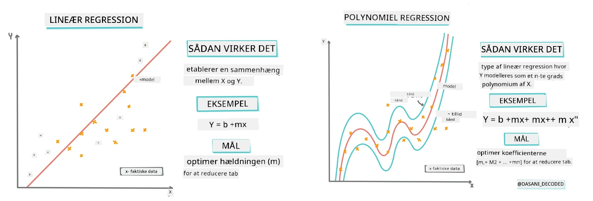
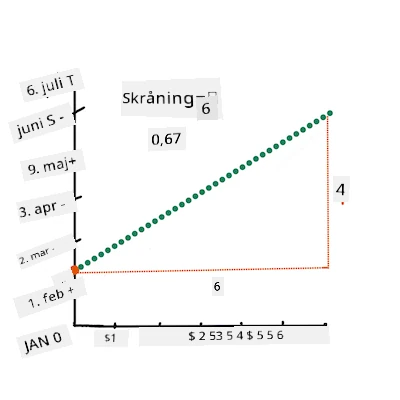
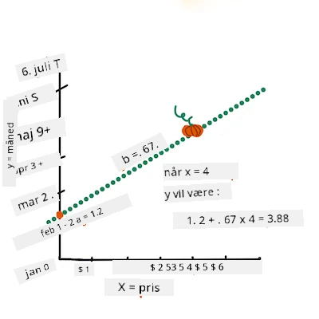
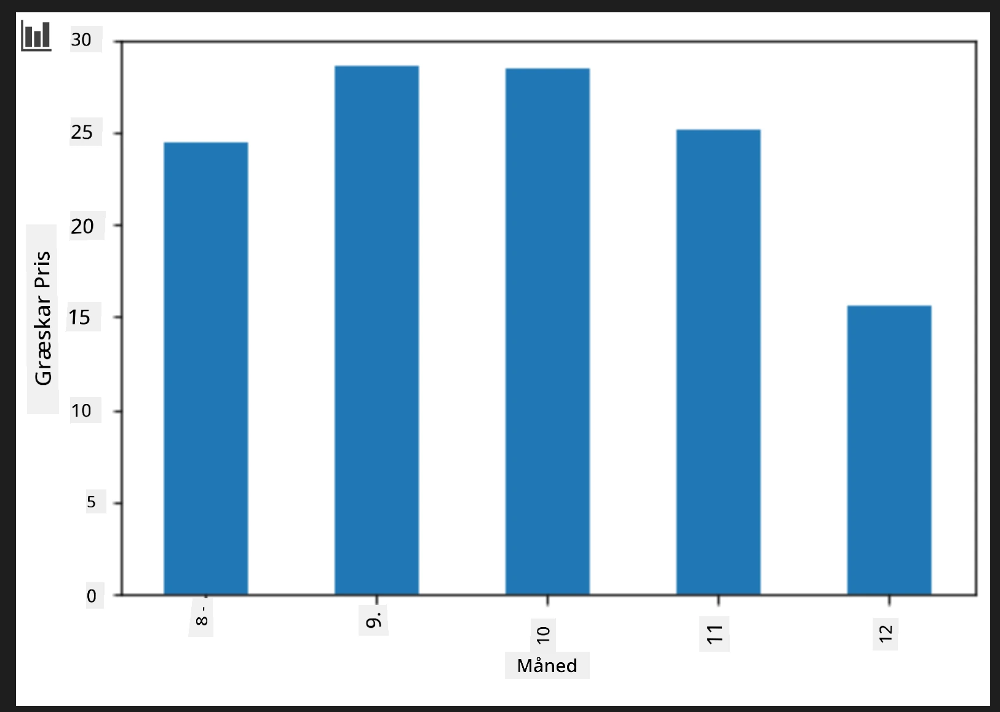
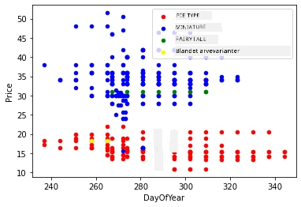

# Byg en regressionsmodel ved hjælp af Scikit-learn: regression på fire måder

## Begynder-note

Lineær regression bruges, når vi ønsker at forudsige en **numerisk værdi** (for eksempel huspris, temperatur eller salg).
Det fungerer ved at finde en ret linje, der bedst repræsenterer forholdet mellem input-funktioner og output.

I denne lektion fokuserer vi på at forstå konceptet, før vi udforsker mere avancerede regressionsteknikker.

> Infografik af [Dasani Madipalli](https://twitter.com/dasani_decoded)
## [For-forelæsning quiz](https://ff-quizzes.netlify.app/en/ml/)

> ### [Denne lektion findes også på R!](../../../../2-Regression/3-Linear/solution/R/lesson_3.html)
### Introduktion

Indtil nu har du udforsket, hvad regression er med eksempeldata fra græskarforsyningsdatasættet, som vi vil bruge gennem hele lektionen. Du har også visualiseret det ved hjælp af Matplotlib.

Nu er du klar til at dykke dybere ned i regression for ML. Mens visualisering gør det muligt at forstå data, kommer den reelle kraft i Maskinlæring fra _at træne modeller_. Modeller trænes på historiske data for automatisk at fange datadkan afhængigheder, og de gør det muligt at forudsige resultater for nye data, som modellen ikke har set før.

I denne lektion vil du lære mere om to typer regression: _grundlæggende lineær regression_ og _polynomiel regression_, sammen med noget af den matematik, der ligger til grund for disse teknikker. Disse modeller vil tillade os at forudsige græskarpriser afhængigt af forskellige inputdata.

[](https://youtu.be/CRxFT8oTDMg "ML for beginners - Understanding Linear Regression")

> 🎥 Klik på billedet ovenfor for en kort videooversigt over lineær regression.

> Gennem hele dette læseplan antager vi minimal matematisk viden og søger at gøre det tilgængeligt for studerende fra andre fagområder, så hold øje med noter, 🧮 fremhævelser, diagrammer og andre læringsværktøjer for at hjælpe med forståelsen.

### Forudsætninger

Du bør nu være fortrolig med strukturen på græskardataene, som vi undersøger. Du kan finde dem forudindlæst og forudrenset i denne lektions _notebook.ipynb_-fil. I filen vises græskarprisen pr. bushel i en ny data frame. Sørg for, at du kan køre disse notebooks i kerner i Visual Studio Code.

### Forberedelse

Som en påmindelse indlæser du disse data for at kunne stille spørgsmål til dem.

- Hvornår er det bedste tidspunkt at købe græskar på?
- Hvilken pris kan jeg forvente for en kasse miniaturegræskar?
- Skal jeg købe dem i halvbussch kurve eller i 1 1/9 bushel-kasser?
Lad os fortsætte med at grave i disse data.

I den forrige lektion oprettede du en Pandas data frame og udfyldte den med en del af det oprindelige datasæt, hvor prisen blev standardiseret efter bushelen. Ved at gøre dette formåede du dog kun at indsamle omkring 400 datapunkter og kun for efterårsmånederne.

Se på de data, vi har forudindlæst i denne lektions ledsagende notebook. Dataene er forudindlæst, og et første scatterplot er tegnet for at vise månedernes data. Måske kan vi få lidt flere detaljer om datanaturen ved at rense det mere.

## En lineær regressionslinje

Som du lærte i Lektion 1, er målet med en lineær regressionsøvelse at kunne plotte en linje for at:

- **Vise variable forhold**. Vise forholdet mellem variable
- **Foretage forudsigelser**. Foretage præcise forudsigelser om, hvor et nyt datapunkt ville falde i forhold til linjen.

Det er typisk for **mindste kvadraters regression** at tegne denne type linje. Udtrykket "mindste kvadraters metode" henviser til processen med at minimere den samlede fejl i vores model. For hvert datapunkt måler vi den lodrette afstand (kaldet residual) mellem det faktiske punkt og vores regressionslinje.

Vi kvadrerer disse afstande af to hovedårsager:

1. **Størrelse frem for retning:** Vi ønsker at behandle en fejl på -5 på samme måde som en fejl på +5. Kvadrering gør alle værdier positive.

2. **Straffe for outliers:** Kvadrering giver større vægt til større fejl og tvinger linjen til at holde sig tættere på punkter, der er langt væk.

Derefter lægger vi alle disse kvadrerede værdier sammen. Vores mål er at finde den specifikke linje, hvor denne endelige sum er mindst (den mindste mulige værdi) — deraf navnet "mindste kvadraters metode".

> **🧮 Vis mig matematikken**
> 
> Denne linje, kaldet _den bedste fit-linje_, kan udtrykkes med [en ligning](https://en.wikipedia.org/wiki/Simple_linear_regression):
> 
> ```
> Y = a + bX
> ```
>
> `X` er den 'forklarende variabel'. `Y` er den 'afhængige variabel'. Linjens hældning er `b` og `a` er skæringspunktet med y-aksen, hvilket henviser til værdien af `Y`, når `X = 0`.
>
>
>
> Først beregnes hældningen `b`. Infografik af [Jen Looper](https://twitter.com/jenlooper)
>
> Med andre ord, og med henvisning til det oprindelige spørgsmål om vores græskardata: "forudsig prisen på et græskar pr. bushel efter måned", ville `X` referere til prisen og `Y` ville referere til salgs-måneden.
>
>
>
> Beregn værdien af Y. Hvis du betaler omkring $4, må det være april! Infografik af [Jen Looper](https://twitter.com/jenlooper)
>
> Den matematik, der beregner linjen, skal demonstrere linjens hældning, som også afhænger af skæringspunktet, altså hvor `Y` ligger, når `X = 0`.
>
> Du kan se metoden til beregning af disse værdier på webstedet [Math is Fun](https://www.mathsisfun.com/data/least-squares-regression.html). Besøg også [denne mindste kvadraters lommeregner](https://www.mathsisfun.com/data/least-squares-calculator.html) for at se, hvordan tallene påvirker linjen.

## Korrelation

Et sidste udtryk at forstå er **korrelationskoefficienten** mellem givne X- og Y-variable. Ved hjælp af et scatterplot kan du hurtigt visualisere denne koefficient. Et plot med datapunkter spredt i en pæn linje har høj korrelation, men et plot med datapunkter spredt overalt mellem X og Y har lav korrelation.

En god lineær regressionsmodel vil være en, der har en høj (tættere på 1 end 0) korrelationskoefficient ved anvendelse af mindste kvadraters metode med en regressionslinje.

✅ Kør notebook’en, der følger med denne lektion, og se på scatterplottet fra måned til pris. Ser dataene, der forbinder måned til pris for græskar salg, ud til at have høj eller lav korrelation ifølge din visuelle fortolkning af scatterplottet? Ændres det, hvis du bruger mere finmasket mål i stedet for `Month`, f.eks. *dag i året* (dvs. antal dage siden årets begyndelse)?

I nedenstående kode antager vi, at vi har renset dataene og opnået en data frame kaldet `new_pumpkins`, som ligner følgende:

ID | Month | DayOfYear | Variety | City | Package | Low Price | High Price | Price
---|-------|-----------|---------|------|---------|-----------|------------|-------
70 | 9 | 267 | PIE TYPE | BALTIMORE | 1 1/9 bushel cartons | 15.0 | 15.0 | 13.636364
71 | 9 | 267 | PIE TYPE | BALTIMORE | 1 1/9 bushel cartons | 18.0 | 18.0 | 16.363636
72 | 10 | 274 | PIE TYPE | BALTIMORE | 1 1/9 bushel cartons | 18.0 | 18.0 | 16.363636
73 | 10 | 274 | PIE TYPE | BALTIMORE | 1 1/9 bushel cartons | 17.0 | 17.0 | 15.454545
74 | 10 | 281 | PIE TYPE | BALTIMORE | 1 1/9 bushel cartons | 15.0 | 15.0 | 13.636364

> Koden til at rense dataene findes i [`notebook.ipynb`](notebook.ipynb). Vi har udført de samme rensetrin som i den forrige lektion og har beregnet `DayOfYear`-kolonnen ved hjælp af følgende udtryk: 

```python
day_of_year = pd.to_datetime(pumpkins['Date']).apply(lambda dt: (dt-datetime(dt.year,1,1)).days)
```

Nu hvor du har en forståelse for matematikken bag lineær regression, lad os oprette en regressionsmodel for at se, om vi kan forudsige, hvilken pakke med græskar der vil have de bedste græskarpriser. En person, der køber græskar til en halloween-græskarfest, vil måske have disse oplysninger for at kunne optimere deres køb af græskarpakker til festen.

## Søger efter korrelation

[](https://youtu.be/uoRq-lW2eQo "ML for beginners - Looking for Correlation: The Key to Linear Regression")

> 🎥 Klik på billedet ovenfor for en kort videooversigt over korrelation.

Fra forrige lektion har du sandsynligvis set, at gennemsnitsprisen for forskellige måneder ser sådan ud:



Dette antyder, at der burde være en form for korrelation, og vi kan prøve at træne en lineær regressionsmodel til at forudsige forholdet mellem `Month` og `Price` eller mellem `DayOfYear` og `Price`. Her er scatterplottet, der viser sidstnævnte forhold:

 

Lad os se, om der er korrelation ved hjælp af `corr` funktionen:

```python
print(new_pumpkins['Month'].corr(new_pumpkins['Price']))
print(new_pumpkins['DayOfYear'].corr(new_pumpkins['Price']))
```

Det ser ud til, at korrelationen er temmelig lille, -0.15 med `Month` og -0.17 med `DayOfYear`, men der kan være en anden vigtig sammenhæng. Det ser ud til, at der er forskellige klynger af priser, der svarer til forskellige slags græskar. For at bekræfte denne hypotese lader vi hvert græskar-kategori plotte med en forskellig farve. Ved at give en `ax` parameter til `scatter` plotting-funktionen kan vi plotte alle punkter på samme diagram:

```python
ax=None
colors = ['red','blue','green','yellow']
for i,var in enumerate(new_pumpkins['Variety'].unique()):
    df = new_pumpkins[new_pumpkins['Variety']==var]
    ax = df.plot.scatter('DayOfYear','Price',ax=ax,c=colors[i],label=var)
```

 

Vores undersøgelse antyder, at sorten har mere indflydelse på den samlede pris end den faktiske salgsdato. Vi kan se dette med et søjlediagram:

```python
new_pumpkins.groupby('Variety')['Price'].mean().plot(kind='bar')
```

 

Lad os i øjeblikket fokusere kun på en græskartype, 'pie type', og se, hvilken effekt datoen har på prisen:

```python
pie_pumpkins = new_pumpkins[new_pumpkins['Variety']=='PIE TYPE']
pie_pumpkins.plot.scatter('DayOfYear','Price') 
```
 

Hvis vi nu beregner korrelationen mellem `Price` og `DayOfYear` ved hjælp af `corr` funktionen, får vi noget i stil med `-0.27` - hvilket betyder, at det giver mening at træne en prædiktiv model.

> Før vi træner en lineær regressionsmodel, er det vigtigt at sikre, at vores data er rene. Lineær regression fungerer ikke godt med manglende værdier, så det giver mening at fjerne alle tomme celler:

```python
pie_pumpkins.dropna(inplace=True)
pie_pumpkins.info()
```

En anden tilgang kunne være at udfylde disse tomme værdier med gennemsnitsværdier fra den tilsvarende kolonne.

## Enkel lineær regression

[](https://youtu.be/e4c_UP2fSjg "ML for beginners - Linear and Polynomial Regression using Scikit-learn")

> 🎥 Klik på billedet ovenfor for en kort videooversigt over lineær og polynomiel regression.

For at træne vores lineære regressionsmodel bruger vi **Scikit-learn**-biblioteket.

```python
from sklearn.linear_model import LinearRegression
from sklearn.metrics import mean_squared_error
from sklearn.model_selection import train_test_split
```

Vi starter med at adskille inputværdier (features) og den forventede output (label) i separate numpy-arrays:

```python
X = pie_pumpkins['DayOfYear'].to_numpy().reshape(-1,1)
y = pie_pumpkins['Price']
```

> Bemærk, at vi var nødt til at udføre `reshape` på inputdataene, for at Linear Regression-pakken kunne forstå dem korrekt. Lineær regression forventer et 2D-array som input, hvor hver række i arrayet svarer til en vektor af inputfunktioner. I vores tilfælde, da vi kun har én input, har vi brug for et array med formen N&times;1, hvor N er datamængdens størrelse.

Derefter skal vi opdele dataene i trænings- og testdatasæt, så vi kan validere vores model efter træning:

```python
X_train, X_test, y_train, y_test = train_test_split(X, y, test_size=0.2, random_state=0)
```

Endelig tager selve træningen af den lineære regressionsmodel kun to kodelinjer. Vi definerer `LinearRegression`-objektet og tilpasser det til vores data ved hjælp af `fit`-metoden:

```python
lin_reg = LinearRegression()
lin_reg.fit(X_train,y_train)
```

`LinearRegression`-objektet efter at have `fit`-tet indeholder alle koefficienterne for regressionen, som kan tilgås via `.coef_`-egenskaben. I vores tilfælde er der kun én koefficient, som burde være omkring `-0.017`. Det betyder, at priserne ser ud til at falde lidt med tiden, men ikke for meget, omkring 2 cent om dagen. Vi kan også tilgå skæringspunktet for regressionen med Y-aksen ved hjælp af `lin_reg.intercept_` - det vil være omkring `21` i vores tilfælde, hvilket indikerer prisen i begyndelsen af året.

For at se hvor præcis vores model er, kan vi forudsige priser på et testdatasæt, og derefter måle hvor tæt vores forudsigelser er på de forventede værdier. Dette kan gøres ved hjælp af root mean square error (RMSE) metrikken, som er kvadratrodstegnet af gennemsnittet af alle kvadrerede forskelle mellem forventet og forudsagt værdi.

```python
pred = lin_reg.predict(X_test)

rmse = np.sqrt(mean_squared_error(y_test,pred))
print(f'RMSE: {rmse:3.3} ({rmse/np.mean(pred)*100:3.3}%)')
```

Vores fejl ser ud til at være omkring 2 point, hvilket svarer til ~17%. Ikke så godt. En anden indikator for modellens kvalitet er **determinationskoefficienten**, som kan opnås sådan her:

```python
score = lin_reg.score(X_train,y_train)
print('Model determination: ', score)
```
Hvis værdien er 0, betyder det, at modellen ikke tager inputdata i betragtning, og fungerer som den *værste lineære forudsigelse*, som simpelthen er gennemsnitsværdien af resultatet. Værdien 1 betyder, at vi kan forudsige alle forventede output perfekt. I vores tilfælde er koefficienten omkring 0.06, hvilket er ret lavt.

Vi kan også plotte testdata sammen med regressionslinjen for bedre at se, hvordan regressionen fungerer i vores tilfælde:

```python
plt.scatter(X_test,y_test)
plt.plot(X_test,pred)
```


## Polynomiel Regression

En anden type af Lineær Regression er Polynomiel Regression. Mens der nogle gange er et lineært forhold mellem variable – jo større græskar i volumen, desto højere pris – kan disse forhold nogle gange ikke vises som et plan eller en lige linje.

✅ Her er [flere eksempler](https://online.stat.psu.edu/stat501/Lesson09#polynomial-regression-examples) på data, der kunne bruge Polynomiel Regression.

Tag et nyt kig på forholdet mellem Dato og Pris. Virker denne spredningsgraf som om den nødvendigvis skal analyseres med en lige linje? Kan priser ikke svinge? I dette tilfælde kan du prøve polynomiel regression.

✅ Polynomier er matematiske udtryk, der kan bestå af en eller flere variable og koefficienter.

Polynomiel regression skaber en buet linje for bedre at passe ikke-lineære data. I vores tilfælde, hvis vi inkluderer en kvadreret `DayOfYear`-variabel i inputdataene, burde vi kunne tilpasse vores data med en parabolsk kurve, som vil have et minimum på et bestemt tidspunkt i løbet af året.

Scikit-learn inkluderer en nyttig [pipeline API](https://scikit-learn.org/stable/modules/generated/sklearn.pipeline.make_pipeline.html?highlight=pipeline#sklearn.pipeline.make_pipeline) til at kombinere forskellige trin i databehandling. En **pipeline** er en kæde af **estimators**. I vores tilfælde vil vi lave en pipeline, som først tilføjer polynomielle funktioner til vores model, og derefter træner regressionen:

```python
from sklearn.preprocessing import PolynomialFeatures
from sklearn.pipeline import make_pipeline

pipeline = make_pipeline(PolynomialFeatures(2), LinearRegression())

pipeline.fit(X_train,y_train)
```

At bruge `PolynomialFeatures(2)` betyder, at vi vil inkludere alle andet-gradspolynomier fra inputdataene. I vores tilfælde betyder det bare `DayOfYear`<sup>2</sup>, men givet to inputvariabler X og Y, vil dette tilføje X<sup>2</sup>, XY og Y<sup>2</sup>. Vi kan også bruge højere gradspolynomier, hvis vi vil.

Pipelines kan bruges på samme måde som det oprindelige `LinearRegression`-objekt, dvs. vi kan `fit` pipelinen, og derefter bruge `predict` til at få forudsigelsesresultaterne:

```python
pred = pipeline.predict(X_test)

rmse = np.sqrt(mean_squared_error(y_test,pred))
print(f'RMSE: {rmse:3.3} ({rmse/np.mean(pred)*100:3.3}%)')

score = pipeline.score(X_train,y_train)
print('Model determination: ', score)
```

For at plotte den glatte tilnærmelseskurve bruger vi `np.linspace` til at skabe et ensartet interval af inputværdier, i stedet for at plotte direkte på de uordnede testdata (som ville producere en zigzag-linje):

```python
X_range = np.linspace(X_test.min(), X_test.max(), 100).reshape(-1,1)
y_range = pipeline.predict(X_range)

plt.scatter(X_test, y_test)
plt.plot(X_range, y_range)
```

Her er grafen, der viser testdata samt tilnærmelseskurven:


Ved at bruge Polynomiel Regression kan vi få lidt lavere RMSE og højere determinationskoefficient, men ikke dramatisk. Vi skal tage andre features i betragtning!

> Du kan se, at de minimale græskarspriser observeres omkring Halloween. Hvordan kan du forklare det? 

🎃 Tillykke, du har netop lavet en model, som kan hjælpe med at forudsige prisen på tærtegræskar. Du kan sikkert gentage samme procedure for alle græskartyper, men det ville være træls. Lad os nu lære, hvordan man tager græskarvarieteter i betragtning i vores model!

## Kategoriske Features

I en ideel verden vil vi kunne forudsige priser for forskellige græskarvarianter ved hjælp af den samme model. `Variety`-kolonnen er dog lidt anderledes end kolonner som `Month`, fordi den indeholder ikke-numeriske værdier. Sådanne kolonner kaldes **kategoriske**.

[](https://youtu.be/DYGliioIAE0 "ML for beginners - Categorical Feature Predictions with Linear Regression")

> 🎥 Klik på billedet ovenfor for en kort videooversigt over brug af kategoriske features.

Her kan du se, hvordan gennemsnitsprisen afhænger af varianten:


For at tage variant i betragtning skal vi først konvertere den til numerisk form, eller **kode** den. Der er flere måder, vi kan gøre det på:

* Simpel **numerisk kodning** vil bygge en tabel over forskellige varianter og derefter erstatte variantnavnet med et indeks i den tabel. Dette er ikke den bedste idé for lineær regression, fordi lineær regression tager den faktiske numeriske værdi af indekset og lægger den til resultatet, multipliceret med en koefficient. I vores tilfælde er forholdet mellem indeksnummer og pris tydeligt ikke-lineært, selv hvis vi sørger for, at indekserne er ordnet på en bestemt måde.
* **One-hot encoding** vil erstatte `Variety`-kolonnen med 4 forskellige kolonner, en for hver variant. Hver kolonne vil indeholde `1`, hvis den tilsvarende række er af den givne variant, og `0` ellers. Det betyder, at der vil være fire koefficienter i lineær regression, en for hver græskarvariant, som er ansvarlig for "startpris" (eller rettere "ekstra pris") for netop den variant.

Koden nedenfor viser, hvordan vi kan one-hot kode en variant:

```python
pd.get_dummies(new_pumpkins['Variety'])
```

 ID | FAIRYTALE | MINIATURE | MIXED HEIRLOOM VARIETIES | PIE TYPE
----|-----------|-----------|--------------------------|----------
70 | 0 | 0 | 0 | 1
71 | 0 | 0 | 0 | 1
... | ... | ... | ... | ...
1738 | 0 | 1 | 0 | 0
1739 | 0 | 1 | 0 | 0
1740 | 0 | 1 | 0 | 0
1741 | 0 | 1 | 0 | 0
1742 | 0 | 1 | 0 | 0

For at træne lineær regression ved brug af one-hot kodet variant som input skal vi blot initialisere `X` og `y` data korrekt:

```python
X = pd.get_dummies(new_pumpkins['Variety'])
y = new_pumpkins['Price']
```

Resten af koden er den samme som vi brugte tidligere for at træne Lineær Regression. Hvis du prøver det, vil du se, at mean squared error er cirka den samme, men vi får en meget højere determinationskoefficient (~77%). For at få endnu mere præcise forudsigelser kan vi tage flere kategoriske features i betragtning samt numeriske features som `Month` eller `DayOfYear`. For at få en stor samlet feature-array kan vi bruge `join`:

```python
X = pd.get_dummies(new_pumpkins['Variety']) \
        .join(new_pumpkins['Month']) \
        .join(pd.get_dummies(new_pumpkins['City'])) \
        .join(pd.get_dummies(new_pumpkins['Package']))
y = new_pumpkins['Price']
```

Her tager vi også `City` og `Package` type i betragtning, hvilket giver os RMSE 2.84 (10.5%) og determination 0.94!

## Samlet model

For at lave den bedste model kan vi bruge kombinerede (one-hot kodede kategoriske + numeriske) data fra ovenstående eksempel sammen med Polynomiel Regression. Her er den komplette kode for nemheds skyld:

```python
# opsæt træningsdata
X = pd.get_dummies(new_pumpkins['Variety']) \
        .join(new_pumpkins['Month']) \
        .join(pd.get_dummies(new_pumpkins['City'])) \
        .join(pd.get_dummies(new_pumpkins['Package']))
y = new_pumpkins['Price']

# lav trænings-test opdeling
X_train, X_test, y_train, y_test = train_test_split(X, y, test_size=0.2, random_state=0)

# opsæt og træn pipelinen
pipeline = make_pipeline(PolynomialFeatures(2), LinearRegression())
pipeline.fit(X_train,y_train)

# forudsig resultater for testdata
pred = pipeline.predict(X_test)

# beregn RMSE og bestemmelse
rmse = mean_squared_error(y_test, pred, squared=False)
print(f'RMSE: {rmse:3.3} ({rmse/pred.mean()*100:3.3}%)')

score = pipeline.score(X_train,y_train)
print('Model determination: ', score)
```

Dette burde give os den bedste determinationskoefficient på næsten 97% og RMSE=2.23 (~8% fejl i forudsigelsen).

| Model | RMSE | Determination |
|-------|-----|---------------|
| `DayOfYear` Lineær | 2.77 (17.2%) | 0.07 |
| `DayOfYear` Polynomiel | 2.73 (17.0%) | 0.08 |
| `Variety` Lineær | 5.24 (19.7%) | 0.77 |
| Alle features Lineær | 2.84 (10.5%) | 0.94 |
| Alle features Polynomiel | 2.23 (8.25%) | 0.97 |

🏆 Godt klaret! Du har skabt fire regressionsmodeller på én lektion og forbedret modellens kvalitet til 97%. I det afsluttende afsnit om Regression vil du lære om Logistisk Regression til kategoribestemmelse.

---
## 🚀Udfordring

Test flere forskellige variable i denne notesbog for at se, hvordan korrelation svarer til modelnøjagtighed.

## [Quiz efter forelæsning](https://ff-quizzes.netlify.app/en/ml/)

## Opsummering og Selvstudium

I denne lektion lærte vi om Lineær Regression. Der findes andre vigtige typer af Regression. Læs om Stepwise, Ridge, Lasso og Elasticnet teknikker. Et godt kursus at studere for at lære mere er [Stanford Statistical Learning kurset](https://online.stanford.edu/courses/sohs-ystatslearning-statistical-learning)

## Opgave 

[Byg en Model](assignment.md)

---

<!-- CO-OP TRANSLATOR DISCLAIMER START -->
**Ansvarsfraskrivelse**:  
Dette dokument er oversat ved hjælp af AI-oversættelsestjenesten [Co-op Translator](https://github.com/Azure/co-op-translator). Selvom vi stræber efter nøjagtighed, bedes du være opmærksom på, at automatiserede oversættelser kan indeholde fejl eller unøjagtigheder. Det originale dokument på dets modersmål bør betragtes som den autoritative kilde. For kritisk information anbefales professionel menneskelig oversættelse. Vi påtager os intet ansvar for misforståelser eller fejltolkninger som følge af brugen af denne oversættelse.
<!-- CO-OP TRANSLATOR DISCLAIMER END -->