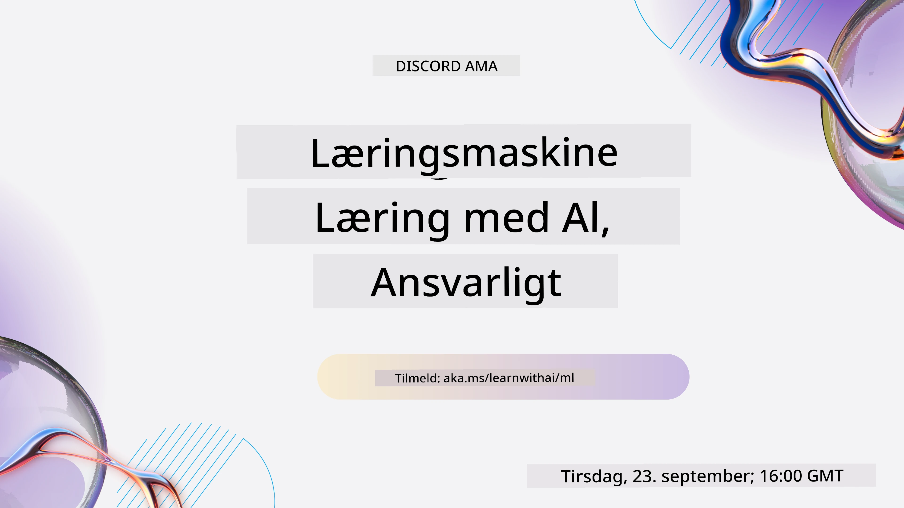
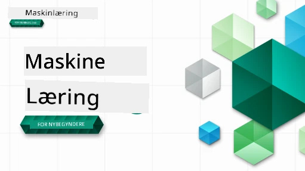

[](https://github.com/microsoft/ML-For-Beginners/blob/master/LICENSE)
[](https://GitHub.com/microsoft/ML-For-Beginners/graphs/contributors/)
[](https://GitHub.com/microsoft/ML-For-Beginners/issues/)
[](https://GitHub.com/microsoft/ML-For-Beginners/pulls/)
[](http://makeapullrequest.com)

[](https://GitHub.com/microsoft/ML-For-Beginners/watchers/)
[](https://GitHub.com/microsoft/ML-For-Beginners/network/)
[](https://GitHub.com/microsoft/ML-For-Beginners/stargazers/)

### 🌐 Multisprogunderstøttelse

#### Oversættelser vedligeholdes med [Co-op Translator](https://github.com/Azure/co-op-translator)

<!-- CO-OP TRANSLATOR LANGUAGES TABLE START -->
[Arabisk](../ar/README.md) | [Bengali](../bn/README.md) | [Bulgarsk](../bg/README.md) | [Burmesisk (Myanmar)](../my/README.md) | [Kinesisk (forenklet)](../zh-CN/README.md) | [Kinesisk (traditionelt, Hong Kong)](../zh-HK/README.md) | [Kinesisk (traditionelt, Macau)](../zh-MO/README.md) | [Kinesisk (traditionelt, Taiwan)](../zh-TW/README.md) | [Kroatisk](../hr/README.md) | [Tjekkisk](../cs/README.md) | [Dansk](./README.md) | [Hollandsk](../nl/README.md) | [Estisk](../et/README.md) | [Finsk](../fi/README.md) | [Fransk](../fr/README.md) | [Tysk](../de/README.md) | [Græsk](../el/README.md) | [Hebraisk](../he/README.md) | [Hindi](../hi/README.md) | [Ungarsk](../hu/README.md) | [Indonesisk](../id/README.md) | [Italiensk](../it/README.md) | [Japansk](../ja/README.md) | [Kannada](../kn/README.md) | [Khmer](../km/README.md) | [Koreansk](../ko/README.md) | [Litauisk](../lt/README.md) | [Malayisk](../ms/README.md) | [Malayalam](../ml/README.md) | [Manipuri (Meitei Mayek)](../mni/README.md) | [Marathi](../mr/README.md) | [Nepalesisk](../ne/README.md) | [Nigeriansk Pidgin](../pcm/README.md) | [Norsk](../no/README.md) | [Persisk (Farsi)](../fa/README.md) | [Polsk](../pl/README.md) | [Portugisisk (Brasilien)](../pt-BR/README.md) | [Portugisisk (Portugal)](../pt-PT/README.md) | [Punjabi (Gurmukhi)](../pa/README.md) | [Rumænsk](../ro/README.md) | [Russisk](../ru/README.md) | [Serbisk (Cyrillisk)](../sr/README.md) | [Slovakisk](../sk/README.md) | [Slovensk](../sl/README.md) | [Spansk](../es/README.md) | [Swahili](../sw/README.md) | [Svensk](../sv/README.md) | [Tagalog (Filippinsk)](../tl/README.md) | [Tamil](../ta/README.md) | [Telugu](../te/README.md) | [Thai](../th/README.md) | [Tyrkisk](../tr/README.md) | [Ukrainsk](../uk/README.md) | [Urdu](../ur/README.md) | [Vietnamesisk](../vi/README.md)

> **Foretrækker du at klone lokalt?**
>
> Dette repository inkluderer 50+ sprogoversættelser, hvilket væsentligt øger downloadstørrelsen. For at klone uden oversættelser, brug sparse checkout:
>
> **Bash / macOS / Linux:**
> ```bash
> git clone --filter=blob:none --sparse https://github.com/microsoft/ML-For-Beginners.git
> cd ML-For-Beginners
> git sparse-checkout set --no-cone '/*' '!translations' '!translated_images'
> ```
>
> **CMD (Windows):**
> ```cmd
> git clone --filter=blob:none --sparse https://github.com/microsoft/ML-For-Beginners.git
> cd ML-For-Beginners
> git sparse-checkout set --no-cone "/*" "!translations" "!translated_images"
> ```
>
> Dette giver dig alt hvad du behøver for at gennemføre kurset med en meget hurtigere download.
<!-- CO-OP TRANSLATOR LANGUAGES TABLE END -->

#### Deltag i vores fællesskab

[](https://discord.gg/nTYy5BXMWG)

Vi har en Discord lær med AI serie i gang, lær mere og deltag hos [Learn with AI Series](https://aka.ms/learnwithai/discord) fra 18. - 30. september 2025. Du vil få tips og tricks til brug af GitHub Copilot til Data Science.



# Maskinlæring for begyndere – En læseplan

> 🌍 Rejs verden rundt mens vi udforsker maskinlæring gennem verdens kulturer 🌍

Cloud Advocates hos Microsoft er glade for at kunne tilbyde en 12-ugers, 26-lektioners læseplan, der handler om **maskinlæring**. I denne læseplan lærer du om det, der nogle gange kaldes **klassisk maskinlæring**, primært ved brug af Scikit-learn som bibliotek og undgår dyb læring, som dækkes i vores [AI for Beginners-læseplan](https://aka.ms/ai4beginners). Kombiner disse lektioner med vores ['Data Science for Beginners'-læseplan](https://aka.ms/ds4beginners) også!

Rejs med os rundt i verden, mens vi anvender disse klassiske teknikker på data fra mange områder i verden. Hver lektion inkluderer før- og efter-lektionsquizzer, skriftlige instruktioner for at fuldføre lektionen, en løsning, en opgave og mere. Vores projektbaserede pædagogik tillader dig at lære ved at bygge, en dokumenteret metode til at få nye færdigheder til at 'sætte sig fast'.

**✍️ Hjertelig tak til vores forfattere** Jen Looper, Stephen Howell, Francesca Lazzeri, Tomomi Imura, Cassie Breviu, Dmitry Soshnikov, Chris Noring, Anirban Mukherjee, Ornella Altunyan, Ruth Yakubu og Amy Boyd

**🎨 Tak også til vores illustratorer** Tomomi Imura, Dasani Madipalli og Jen Looper

**🙏 Særlige tak 🙏 til vores Microsoft Student Ambassador forfattere, anmeldere og indholdsleverandører**, især Rishit Dagli, Muhammad Sakib Khan Inan, Rohan Raj, Alexandru Petrescu, Abhishek Jaiswal, Nawrin Tabassum, Ioan Samuila og Snigdha Agarwal

**🤩 Ekstra tak til Microsoft Student Ambassadors Eric Wanjau, Jasleen Sondhi og Vidushi Gupta for vores R-lektioner!**

# Kom godt i gang

Følg disse trin:
1. **Fork repositoriet**: Klik på "Fork" knappen øverst til højre på denne side.
2. **Klon repositoriet**:   `git clone https://github.com/microsoft/ML-For-Beginners.git`

> 💡 **Hurtig start-tip:** Vil du starte i en browser uden at sætte Python op lokalt? Brug [GitHub Codespaces](https://github.com/features/codespaces) til at oprette et cloud-udviklingsmiljø for din fork. Åbn den grønne **Code** menu, vælg **Codespaces**, og opret et codespace; installer hver lektions nødvendige afhængigheder indeni efter behov.

> [find alle yderligere ressourcer til dette kursus i vores Microsoft Learn samling](https://learn.microsoft.com/en-us/collections/qrqzamz1nn2wx3?WT.mc_id=academic-77952-bethanycheum)

> 🔧 **Brug for hjælp?** Tjek vores [Fejlfinding Guide](TROUBLESHOOTING.md) for løsninger på almindelige problemer med installation, opsætning og afvikling af lektioner.


**[Studerende](https://aka.ms/student-page)**, for at bruge denne læseplan, fork hele repoet til din egen GitHub-konto og gennemfør øvelserne alene eller i en gruppe:

- Start med en quiz før lektionen.
- Læs lektionen og udfør aktiviteterne, pause og reflekter ved hvert videnstjek.
- Prøv at skabe projekterne ved at forstå lektionerne i stedet for at køre løsningskoden; dog er koden tilgængelig i `/solution` mapperne i hver projektorienteret lektion.
- Tag quizzen efter lektionen.
- Gennemfør udfordringen.
- Gennemfør opgaven.
- Efter at have gennemført en lektion-gruppe, besøg [Diskussionsforum](https://github.com/microsoft/ML-For-Beginners/discussions) og "lær højt" ved at udfylde den relevante PAT rubrik. En 'PAT' er et Progressionsvurderingsværktøj, som du udfylder for at fremme din læring. Du kan også reagere på andre PAT’er, så vi kan lære sammen.

> Til videre studier anbefaler vi at følge disse [Microsoft Learn](https://docs.microsoft.com/en-us/users/jenlooper-2911/collections/k7o7tg1gp306q4?WT.mc_id=academic-77952-leestott) moduler og læringsstier.

**Lærere**, vi har [inkluderet nogle forslag](for-teachers.md) til, hvordan man bruger denne læseplan.

---

## Videogennemgange

Nogle af lektionerne findes som korte videoer. Du kan finde dem alle inline i lektionerne, eller på [ML for Beginners playliste på Microsoft Developer YouTube-kanalen](https://aka.ms/ml-beginners-videos) ved at klikke på billedet nedenfor.

[](https://aka.ms/ml-beginners-videos)

---

## Mød teamet

[](https://youtu.be/Tj1XWrDSYJU)

**Gif af** [Mohit Jaisal](https://linkedin.com/in/mohitjaisal)

> 🎥 Klik på billedet ovenfor for en video om projektet og folkene, der skabte det!

---

## Pædagogik

Vi har valgt to pædagogiske principper ved opbygningen af denne læseplan: at sikre, at den er praktisk **projektbaseret** og at den inkluderer **hyppige quizzer**. Derudover har denne læseplan et fælles **tema** for sammenhæng.

Ved at sikre at indholdet er tilknyttet projekter, gøres processen mere engagerende for studerende, og fastholdelsen af koncepter vil blive øget. Derudover sætter en lavrisiko quiz før en klasse elevens intention mod at lære et emne, mens en anden quiz efter klassen sikrer yderligere fastholdelse. Denne læseplan er designet til at være fleksibel og sjov og kan tages i helhed eller delvist. Projekterne starter småt og bliver gradvist mere komplekse ved slutningen af 12-ugers cyklussen. Denne læseplan inkluderer også en efterskrift om virkelige anvendelser af ML, som kan bruges som ekstra kredit eller som grundlag for diskussion.

> Find vores [Adfærdskodeks](CODE_OF_CONDUCT.md), [Bidrag](CONTRIBUTING.md), [Oversættelser](..) og [Fejlfinding](TROUBLESHOOTING.md) retningslinjer. Vi byder din konstruktive feedback velkommen!

## Hver lektion inkluderer

- valgfri sketchnote
- valgfri supplerende video
- videogennemgang (kun nogle lektioner)
- [quiz før lektionen](https://ff-quizzes.netlify.app/en/ml/)
- skriftlig lektion
- for projektbaserede lektioner, trin-for-trin vejledninger til at bygge projektet
- videnstjek
- en udfordring
- supplerende læsning
- opgave
- [quiz efter lektionen](https://ff-quizzes.netlify.app/en/ml/)

> **En note om sprog**: Disse lektioner er primært skrevet i Python, men mange findes også på R. For at fuldføre en R-lektion, gå til `/solution` mappen og find R-lektionerne. De inkluderer en .rmd-filendelse, der repræsenterer en **R Markdown**-fil, som kort kan defineres som en indlejring af `code chunks` (af R eller andre sprog) og en `YAML header` (der guider hvordan man formaterer output som PDF) i en `Markdown document`. Den fungerer således som en eksemplarisk forfatterramme for data science, da den tillader dig at kombinere din kode, dens output og dine tanker ved at skrive dem ned i Markdown. Desuden kan R Markdown-dokumenter gengives til outputformater som PDF, HTML eller Word.

> **En note om quizzer**: Alle quizzer findes i [Quiz App mappen](../../quiz-app), i alt 52 quizzer med tre spørgsmål hver. De er linket til fra lektionerne, men quiz-appen kan også køre lokalt; følg instruktionen i `quiz-app` mappen for at hoste eller implementere til Azure lokalt.

| Lesson Number |                             Topic                              |                   Lesson Grouping                   | Learning Objectives                                                                                                             |                                                              Linked Lesson                                                               |                        Author                        |
| :-----------: | :------------------------------------------------------------: | :-------------------------------------------------: | ------------------------------------------------------------------------------------------------------------------------------- | :--------------------------------------------------------------------------------------------------------------------------------------: | :--------------------------------------------------: |
|      01       |                Introduktion til maskinlæring                  |      [Introduction](1-Introduction/README.md)       | Lær de grundlæggende begreber bag maskinlæring                                                                                   |                                             [Lesson](1-Introduction/1-intro-to-ML/README.md)                                             |                       Muhammad                       |
|      02       |                Maskinlæringens historie                        |      [Introduction](1-Introduction/README.md)       | Lær historien bag dette felt                                                                                                     |                                            [Lesson](1-Introduction/2-history-of-ML/README.md)                                            |                     Jen og Amy                        |
|      03       |                 Retfærdighed og maskinlæring                   |      [Introduction](1-Introduction/README.md)       | Hvad er de vigtige filosofiske problemstillinger omkring retfærdighed, som studerende bør overveje, når de bygger og anvender ML-modeller? |                                              [Lesson](1-Introduction/3-fairness/README.md)                                               |                        Tomomi                        |
|      04       |                Teknikker til maskinlæring                      |      [Introduction](1-Introduction/README.md)       | Hvilke teknikker bruger ML-forskere til at opbygge ML-modeller?                                                                   |                                          [Lesson](1-Introduction/4-techniques-of-ML/README.md)                                           |                    Chris og Jen                      |
|      05       |                   Introduktion til regression                   |        [Regression](2-Regression/README.md)         | Kom i gang med Python og Scikit-learn til regressionsmodeller                                                                    |         [Python](2-Regression/1-Tools/README.md) • [R](../../2-Regression/1-Tools/solution/R/lesson_1.html)         |      Jen • Eric Wanjau       |
|      06       |                Nordamerikanske græskarpriser 🎃                |        [Regression](2-Regression/README.md)         | Visualiser og rens data som forberedelse til ML                                                                                  |          [Python](2-Regression/2-Data/README.md) • [R](../../2-Regression/2-Data/solution/R/lesson_2.html)          |      Jen • Eric Wanjau       |
|      07       |                Nordamerikanske græskarpriser 🎃                |        [Regression](2-Regression/README.md)         | Byg lineære og polynomiske regressionsmodeller                                                                                   |        [Python](2-Regression/3-Linear/README.md) • [R](../../2-Regression/3-Linear/solution/R/lesson_3.html)        |      Jen og Dmitry • Eric Wanjau       |
|      08       |                Nordamerikanske græskarpriser 🎃                |        [Regression](2-Regression/README.md)         | Byg en logistisk regressionsmodel                                                                                                |     [Python](2-Regression/4-Logistic/README.md) • [R](../../2-Regression/4-Logistic/solution/R/lesson_4.html)      |      Jen • Eric Wanjau       |
|      09       |                          En webapp 🔌                           |           [Web App](3-Web-App/README.md)            | Byg en webapp til at bruge din trænede model                                                                                     |                                                 [Python](3-Web-App/1-Web-App/README.md)                                                  |                         Jen                          |
|      10       |                 Introduktion til klassificering                |    [Classification](4-Classification/README.md)     | Rens, forbered og visualiser dine data; introduktion til klassificering                                                           | [Python](4-Classification/1-Introduction/README.md) • [R](../../4-Classification/1-Introduction/solution/R/lesson_10.html)  | Jen og Cassie • Eric Wanjau |
|      11       |             Lækre asiatiske og indiske køkkener 🍜             |    [Classification](4-Classification/README.md)     | Introduktion til klassifikatorer                                                                                                 | [Python](4-Classification/2-Classifiers-1/README.md) • [R](../../4-Classification/2-Classifiers-1/solution/R/lesson_11.html) | Jen og Cassie • Eric Wanjau |
|      12       |             Lækre asiatiske og indiske køkkener 🍜             |    [Classification](4-Classification/README.md)     | Flere klassifikatorer                                                                                                            | [Python](4-Classification/3-Classifiers-2/README.md) • [R](../../4-Classification/3-Classifiers-2/solution/R/lesson_12.html) | Jen og Cassie • Eric Wanjau |
|      13       |             Lækre asiatiske og indiske køkkener 🍜             |    [Classification](4-Classification/README.md)     | Byg en anbefalings-webapp ved hjælp af din model                                                                                 |                                              [Python](4-Classification/4-Applied/README.md)                                              |                         Jen                          |
|      14       |                   Introduktion til klyngedannelse              |        [Clustering](5-Clustering/README.md)         | Rens, forbered og visualiser dine data; introduktion til klyngedannelse                                                         |         [Python](5-Clustering/1-Visualize/README.md) • [R](../../5-Clustering/1-Visualize/solution/R/lesson_14.html)         |      Jen • Eric Wanjau       |
|      15       |              Udforskning af nigerianske musiksmag 🎧            |        [Clustering](5-Clustering/README.md)         | Udforsk K-Means klyngemetoden                                                                                                   |           [Python](5-Clustering/2-K-Means/README.md) • [R](../../5-Clustering/2-K-Means/solution/R/lesson_15.html)           |      Jen • Eric Wanjau       |
|      16       |        Introduktion til naturlig sprogbehandling ☕️            |   [Natural language processing](6-NLP/README.md)    | Lær det grundlæggende om NLP ved at bygge en simpel bot                                                                         |                                             [Python](6-NLP/1-Introduction-to-NLP/README.md)                                              |                       Stephen                        |
|      17       |                      Almindelige NLP-opgaver ☕️                |   [Natural language processing](6-NLP/README.md)    | Forøg din NLP viden ved at forstå almindelige opgaver, som kræves, når man arbejder med sprogstrukturer                          |                                                    [Python](6-NLP/2-Tasks/README.md)                                                     |                       Stephen                        |
|      18       |             Oversættelse og sentimentanalyse ♥️                 |   [Natural language processing](6-NLP/README.md)    | Oversættelse og sentimentanalyse med Jane Austen                                                                                |                                            [Python](6-NLP/3-Translation-Sentiment/README.md)                                             |                       Stephen                        |
|      19       |                  Romantiske hoteller i Europa ♥️                |   [Natural language processing](6-NLP/README.md)    | Sentimentanalyse med hotelanmeldelser 1                                                                                        |                                               [Python](6-NLP/4-Hotel-Reviews-1/README.md)                                                |                       Stephen                        |
|      20       |                  Romantiske hoteller i Europa ♥️                |   [Natural language processing](6-NLP/README.md)    | Sentimentanalyse med hotelanmeldelser 2                                                                                        |                                               [Python](6-NLP/5-Hotel-Reviews-2/README.md)                                                |                       Stephen                        |
|      21       |            Introduktion til tidsserieprognose                   |        [Time series](7-TimeSeries/README.md)        | Introduktion til tidsserieprognose                                                                                              |                                             [Python](7-TimeSeries/1-Introduction/README.md)                                              |                      Francesca                       |
|      22       | ⚡️ Verdens energiforbrug ⚡️ - tidsserieprognose med ARIMA       |        [Time series](7-TimeSeries/README.md)        | Tidsserieprognose med ARIMA                                                                                                     |                                                 [Python](7-TimeSeries/2-ARIMA/README.md)                                                 |                      Francesca                       |
|      23       |  ⚡️ Verdens energiforbrug ⚡️ - tidsserieprognose med SVR        |        [Time series](7-TimeSeries/README.md)        | Tidsserieprognose med Support Vector Regressor                                                                                  |                                                  [Python](7-TimeSeries/3-SVR/README.md)                                                  |                       Anirban                        |
|      24       |             Introduktion til forstærkningslæring                | [Reinforcement learning](8-Reinforcement/README.md) | Introduktion til forstærkningslæring med Q-Learning                                                                             |                                             [Python](8-Reinforcement/1-QLearning/README.md)                                              |                        Dmitry                        |
|      25       |                 Hjælp Peter med at undgå ulven! 🐺             | [Reinforcement learning](8-Reinforcement/README.md) | Forstærkningslæring Gym                                                                                                        |                                                [Python](8-Reinforcement/2-Gym/README.md)                                                 |                        Dmitry                        |
|  Postscript   |            Virkelige ML-scenarier og anvendelser                |      [ML in the Wild](9-Real-World/README.md)       | Interessante og opsigtsvækkende virkelige anvendelser af klassisk ML                                                            |                                             [Lesson](9-Real-World/1-Applications/README.md)                                              |                         Team                         |
|  Postscript   |            Modeldebugging i ML ved brug af RAI-dashboard        |      [ML in the Wild](9-Real-World/README.md)       | Modeldebugging i maskinlæring ved hjælp af Responsible AI-dashboardkomponenter                                                  |                                             [Lesson](9-Real-World/2-Debugging-ML-Models/README.md)                                              |                     Ruth Yakubu                      |

> [find alle yderligere ressourcer til dette kursus i vores Microsoft Learn-samling](https://learn.microsoft.com/en-us/collections/qrqzamz1nn2wx3?WT.mc_id=academic-77952-bethanycheum)

## Offline adgang

Du kan køre denne dokumentation offline ved at bruge [Docsify](https://docsify.js.org/#/). Fork dette repo, [installer Docsify](https://docsify.js.org/#/quickstart) på din lokale maskine, og skriv derefter i rodmappen for dette repo `docsify serve`. Websitet vil blive serveret på port 3000 på din localhost: `localhost:3000`.

## PDF'er

Find en pdf af pensum med links [her](https://microsoft.github.io/ML-For-Beginners/pdf/readme.pdf).


## 🎒 Andre kurser 

Vores team producerer også andre kurser! Tjek:

<!-- CO-OP TRANSLATOR OTHER COURSES START -->
### LangChain
[](https://aka.ms/langchain4j-for-beginners)
[](https://aka.ms/langchainjs-for-beginners?WT.mc_id=m365-94501-dwahlin)
[](https://github.com/microsoft/langchain-for-beginners?WT.mc_id=m365-94501-dwahlin)
---

### Azure / Edge / MCP / Agenter
[](https://github.com/microsoft/AZD-for-beginners?WT.mc_id=academic-105485-koreyst)
[](https://github.com/microsoft/edgeai-for-beginners?WT.mc_id=academic-105485-koreyst)
[](https://github.com/microsoft/mcp-for-beginners?WT.mc_id=academic-105485-koreyst)
[](https://github.com/microsoft/ai-agents-for-beginners?WT.mc_id=academic-105485-koreyst)

---
 
### Generativ AI-serie
[](https://github.com/microsoft/generative-ai-for-beginners?WT.mc_id=academic-105485-koreyst)
[-9333EA?style=for-the-badge&labelColor=E5E7EB&color=9333EA)](https://github.com/microsoft/Generative-AI-for-beginners-dotnet?WT.mc_id=academic-105485-koreyst)
[-C084FC?style=for-the-badge&labelColor=E5E7EB&color=C084FC)](https://github.com/microsoft/generative-ai-for-beginners-java?WT.mc_id=academic-105485-koreyst)
[-E879F9?style=for-the-badge&labelColor=E5E7EB&color=E879F9)](https://github.com/microsoft/generative-ai-with-javascript?WT.mc_id=academic-105485-koreyst)

---
 
### Kerne-læring
[](https://aka.ms/ml-beginners?WT.mc_id=academic-105485-koreyst)
[](https://aka.ms/datascience-beginners?WT.mc_id=academic-105485-koreyst)
[](https://aka.ms/ai-beginners?WT.mc_id=academic-105485-koreyst)
[](https://github.com/microsoft/Security-101?WT.mc_id=academic-96948-sayoung)
[](https://aka.ms/webdev-beginners?WT.mc_id=academic-105485-koreyst)
[](https://aka.ms/iot-beginners?WT.mc_id=academic-105485-koreyst)
[](https://github.com/microsoft/xr-development-for-beginners?WT.mc_id=academic-105485-koreyst)

---
 
### Copilot-serien
[](https://aka.ms/GitHubCopilotAI?WT.mc_id=academic-105485-koreyst)
[](https://github.com/microsoft/mastering-github-copilot-for-dotnet-csharp-developers?WT.mc_id=academic-105485-koreyst)
[](https://github.com/microsoft/CopilotAdventures?WT.mc_id=academic-105485-koreyst)
<!-- CO-OP TRANSLATOR OTHER COURSES END -->

## Få hjælp

Hvis du sidder fast eller har spørgsmål, mens du lærer maskinlæring eller bygger AI-applikationer, skal du ikke bekymre dig — hjælp er tilgængelig.

Du kan deltage i diskussioner med andre elever og udviklere, stille spørgsmål og dele dine idéer med fællesskabet.

- Deltag i fællesskabet for at stille spørgsmål og lære sammen med andre
- Diskuter maskinlæringskoncepter og projektidéer
- Få vejledning fra erfarne udviklere

Et støttende fællesskab er en god måde at udvikle dine færdigheder og løse problemer hurtigere på.

[Microsoft Foundry Discord Community](https://discord.gg/nTYy5BXMWG)

Hvis du støder på fejl, problemer eller har forslag til forbedringer, kan du også oprette en **Issue** i dette repositori for at rapportere problemet.

Til produktfeedback eller for at søge i eksisterende fællesskabsindlæg, besøg Developer Forum:

[](https://aka.ms/foundry/forum)

## Yderligere læringstips

- Gennemgå notesbøger efter hver lektion for bedre forståelse.
- Øv dig i at implementere algoritmer på egen hånd.
- Udforsk virkelige datasæt ved hjælp af indlærte koncepter.

---

<!-- CO-OP TRANSLATOR DISCLAIMER START -->
**Ansvarsfraskrivelse**:
Dette dokument er blevet oversat ved hjælp af AI-oversættelsestjenesten [Co-op Translator](https://github.com/Azure/co-op-translator). Selvom vi bestræber os på nøjagtighed, skal du være opmærksom på, at automatiserede oversættelser kan indeholde fejl eller unøjagtigheder. Det originale dokument på dets oprindelige sprog bør betragtes som den autoritative kilde. For kritisk information anbefales professionel menneskelig oversættelse. Vi påtager os intet ansvar for misforståelser eller fejltolkninger, der opstår som følge af brugen af denne oversættelse.
<!-- CO-OP TRANSLATOR DISCLAIMER END -->