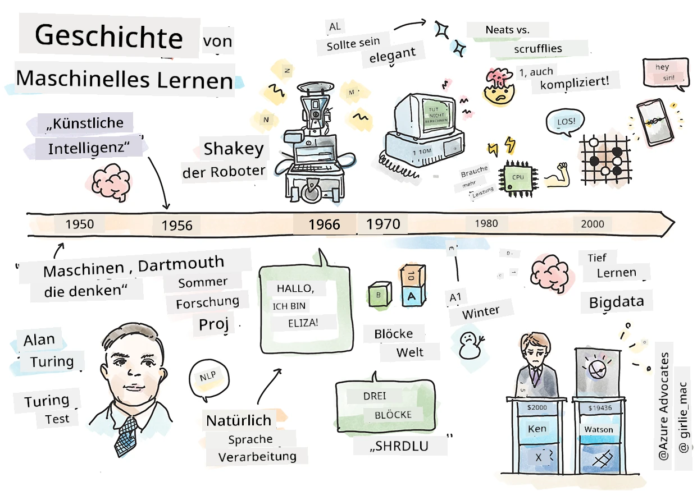
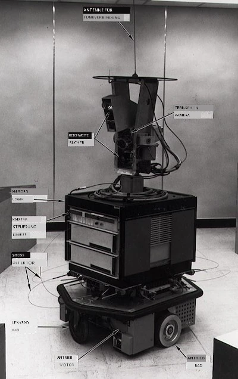
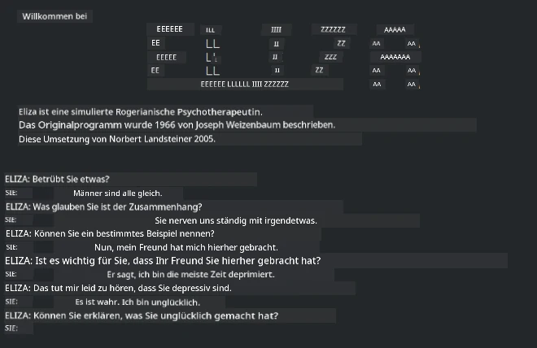

# Geschichte des maschinellen Lernens

> Sketchnote von [Tomomi Imura](https://www.twitter.com/girlie_mac)

## [Vorlesungs-Quiz](https://ff-quizzes.netlify.app/en/ml/)

---

> 🎥 Klicke auf das Bild oben für ein kurzes Video, das diese Lektion durchgeht.

In dieser Lektion durchlaufen wir die wichtigsten Meilensteine in der Geschichte des maschinellen Lernens und der künstlichen Intelligenz.

Die Geschichte der künstlichen Intelligenz (KI) als Fachgebiet ist eng verbunden mit der Geschichte des maschinellen Lernens, da die Algorithmen und Rechenfortschritte, die das ML untermauern, in die Entwicklung der KI eingeflossen sind. Es ist hilfreich, sich daran zu erinnern, dass, obwohl diese Felder als eigenständige Forschungsbereiche in den 1950er Jahren begannen sich zu kristallisieren, wichtige [algorithmische, statistische, mathematische, rechnerische und technische Entdeckungen](https://wikipedia.org/wiki/Timeline_of_machine_learning) dieser Ära vorausgingen und sich überschneiden. Tatsächlich denken Menschen schon seit [hunderten von Jahren](https://wikipedia.org/wiki/History_of_artificial_intelligence) über diese Fragen nach: Dieser Artikel behandelt die historischen intellektuellen Grundlagen der Idee einer „denkenden Maschine“.

---
## Bedeutende Entdeckungen

- 1763, 1812 [Satz von Bayes](https://wikipedia.org/wiki/Bayes%27_theorem) und seine Vorgänger. Dieser Satz und seine Anwendungen bilden die Grundlage der Inferenz und beschreiben die Wahrscheinlichkeit eines Ereignisses basierend auf Vorwissen.
- 1805 [Methode der kleinsten Quadrate](https://wikipedia.org/wiki/Least_squares) des französischen Mathematikers Adrien-Marie Legendre. Diese Methode, die du in unserer Regressionseinheit kennenlernen wirst, hilft bei der Datenanpassung.
- 1913 [Markow-Ketten](https://wikipedia.org/wiki/Markov_chain), benannt nach dem russischen Mathematiker Andrey Markov, wird verwendet, um eine Folge möglicher Ereignisse basierend auf einem vorherigen Zustand zu beschreiben.
- 1957 [Perzeptron](https://wikipedia.org/wiki/Perceptron) ist eine Art linearer Klassifikator, erfunden vom amerikanischen Psychologen Frank Rosenblatt, der die Fortschritte im Deep Learning untermauerte.

---

- 1967 [Nächster Nachbar](https://wikipedia.org/wiki/Nearest_neighbor) ist ein Algorithmus, der ursprünglich zur Routenplanung entwickelt wurde. Im Kontext des ML wird er verwendet, um Muster zu erkennen.
- 1970 [Backpropagation](https://wikipedia.org/wiki/Backpropagation) wird verwendet, um [Feedforward-Neuronale Netze](https://wikipedia.org/wiki/Feedforward_neural_network) zu trainieren.
- 1982 [Rekurrente neuronale Netze](https://wikipedia.org/wiki/Recurrent_neural_network) sind künstliche neuronale Netze, die von Feedforward-Neuronalen Netzen abgeleitet sind und zeitliche Graphen erzeugen.

✅ Recherchiere ein wenig. Welche anderen Daten fallen dir als entscheidend in der Geschichte von ML und KI auf?

---
## 1950: Denkende Maschinen

Alan Turing, eine wirklich bemerkenswerte Person, die [2019 von der Öffentlichkeit](https://wikipedia.org/wiki/Icons:_The_Greatest_Person_of_the_20th_Century) zum größten Wissenschaftler des 20. Jahrhunderts gewählt wurde, wird zugeschrieben, die Grundlage für das Konzept einer „denkenden Maschine“ gelegt zu haben. Er setzte sich mit Skeptikern und seinem eigenen Bedarf an empirischen Beweisen für dieses Konzept auseinander, zum Teil durch die Schaffung des [Turing-Tests](https://www.bbc.com/news/technology-18475646), den du in unseren NLP-Lektionen erkunden wirst.

---
## 1956: Dartmouth Sommerforschungsprojekt

"Das Dartmouth Sommerforschungsprojekt zur künstlichen Intelligenz war ein wegweisendes Ereignis für künstliche Intelligenz als Fachgebiet", und hier wurde der Begriff „künstliche Intelligenz“ geprägt ([Quelle](https://250.dartmouth.edu/highlights/artificial-intelligence-ai-coined-dartmouth)).

> Jeder Aspekt des Lernens oder einer anderen Eigenschaft der Intelligenz kann prinzipiell so präzise beschrieben werden, dass eine Maschine simuliert werden kann.

---

Der leitende Forscher, Mathematikprofessor John McCarthy, hoffte „auf Grundlage der Vermutung vorzugehen, dass jeder Aspekt des Lernens oder einer anderen Eigenschaft der Intelligenz prinzipiell so präzise beschrieben werden kann, dass eine Maschine simuliert werden kann.“ Zu den Teilnehmern gehörte eine weitere Koryphäe auf dem Gebiet, Marvin Minsky.

Dem Workshop wird zugeschrieben, mehrere Diskussionen initiiert und gefördert zu haben, darunter „den Aufstieg symbolischer Methoden, Systeme, die sich auf begrenzte Bereiche konzentrieren (frühe Expertensysteme), und deduktive versus induktive Systeme.“ ([Quelle](https://wikipedia.org/wiki/Dartmouth_workshop)).

---
## 1956 - 1974: „Die goldenen Jahre“

Von den 1950ern bis Mitte der 1970er Jahre herrschte großer Optimismus, dass KI viele Probleme lösen könnte. 1967 erklärte Marvin Minsky zuversichtlich, dass „innerhalb einer Generation ... das Problem, ‚künstliche Intelligenz‘ zu schaffen, im Wesentlichen gelöst sein wird.“ (Minsky, Marvin (1967), Computation: Finite and Infinite Machines, Englewood Cliffs, N.J.: Prentice-Hall)

Die Forschung zur Verarbeitung natürlicher Sprache florierte, die Suche wurde verfeinert und leistungsfähiger gemacht, und das Konzept der „Mikrowelten“ entstand, in denen einfache Aufgaben mit klaren Sprachbefehlen erledigt wurden.

---

Die Forschung wurde von staatlichen Behörden gut finanziert, es gab Fortschritte in der Berechnung und bei Algorithmen, und Prototypen intelligenter Maschinen wurden gebaut. Einige dieser Maschinen umfassen:

* [Shakey der Roboter](https://wikipedia.org/wiki/Shakey_the_robot), der sich bewegen und entscheiden konnte, wie Aufgaben „intelligent“ ausgeführt werden.

    
    > Shakey 1972

---

* Eliza, ein früher „Chatterbot“, konnte mit Menschen sprechen und als primitiver „Therapeut“ fungieren. Du wirst mehr über Eliza in den NLP-Lektionen erfahren.

    
    > Eine Version von Eliza, einem Chatbot

---

* „Blocks World“ war ein Beispiel für eine Mikrowelt, in der Blöcke gestapelt und sortiert werden konnten, und Experimente zum Lehren von Maschinen, Entscheidungen zu treffen, konnten getestet werden. Fortschritte, die mit Bibliotheken wie [SHRDLU](https://wikipedia.org/wiki/SHRDLU) gemacht wurden, halfen, die Sprachverarbeitung voranzutreiben.

    

    > 🎥 Klicke auf das Bild oben für ein Video: Blocks World mit SHRDLU

---
## 1974 - 1980: „KI-Winter“

Mitte der 1970er Jahre wurde deutlich, dass der Aufwand, „intelligente Maschinen“ zu bauen, unterschätzt worden war und das Versprechen angesichts der verfügbaren Rechenleistung überbewertet wurde. Die Finanzierung versiegte und das Vertrauen in das Fachgebiet ging zurück. Einige Probleme, die das Vertrauen beeinträchtigten, waren:
---
- **Begrenzungen**. Die Rechenleistung war zu gering.
- **Kombinatorische Explosion**. Die Anzahl der zu trainierenden Parameter wuchs exponentiell, je mehr von Computern verlangt wurde, ohne dass die Rechenleistung und Fähigkeit parallel dazu zunahmen.
- **Datenknappheit**. Es mangelte an Daten, was den Prozess des Testens, Entwickelns und Verfeinerns von Algorithmen erschwerte.
- **Stellen wir die richtigen Fragen?**. Die eigentlichen Fragestellungen wurden zunehmend in Frage gestellt. Forscher sahen sich mit Kritik an ihren Ansätzen konfrontiert:
  - Der Turing-Test wurde u. a. durch die „Chinesisches-Zimmer-Theorie“ in Frage gestellt, die besagt, dass „die Programmierung eines digitalen Rechners ihn zwar so erscheinen lassen kann, als verstehe er Sprache, aber kein echtes Verständnis erzeugen kann.“ ([Quelle](https://plato.stanford.edu/entries/chinese-room/))
  - Die Ethik bei der Einführung künstlicher Intelligenzen wie dem „Therapeuten“ ELIZA in die Gesellschaft wurde angezweifelt.

---

Gleichzeitig begannen sich verschiedene Denkschulen der KI zu bilden. Es entstand eine Dichotomie zwischen ["schlampigen" und "ordentlichen KI"](https://wikipedia.org/wiki/Neats_and_scruffies)-Praktiken. _Schlampige_ Labore optimierten Programme stundenlang, bis die gewünschten Ergebnisse vorlagen. _Ordentliche_ Labore „konzentrierten sich auf Logik und formale Problemlösung“. ELIZA und SHRDLU waren bekannte _schlampige_ Systeme. In den 1980er Jahren, als die Nachfrage aufkam, ML-Systeme reproduzierbar zu machen, gewann der _ordentliche_ Ansatz zunehmend die Oberhand, da seine Ergebnisse besser erklärbar sind.

---
## 1980er Expertensysteme

Als das Feld wuchs, wurde sein Nutzen für Unternehmen klarer, und in den 1980er Jahren nahm auch die Verbreitung von „Expertensystemen“ zu. „Expertensysteme gehörten zu den ersten wirklich erfolgreichen Formen von Software für künstliche Intelligenz (KI).“ ([Quelle](https://wikipedia.org/wiki/Expert_system)).

Diese Art von System ist tatsächlich _hybrid_, bestehend teilweise aus einer Regel-Engine, die Geschäftsanforderungen definiert, und einer Inferenz-Engine, die das Regelsystem nutzt, um neue Fakten abzuleiten.

In dieser Ära wurde auch dem neuronalen Netz mehr Aufmerksamkeit geschenkt.

---
## 1987 - 1993: KI-„Abkühlung“

Die Verbreitung spezialisierter Hardware für Expertensysteme führte leider dazu, dass diese zu spezialisiert wurden. Der Aufstieg der Personal Computer konkurrierte zudem mit diesen großen, spezialisierten, zentralisierten Systemen. Die Demokratisierung des Rechnens hatte begonnen und ebnete schließlich den Weg für die moderne Explosion von Big Data.

---
## 1993 - 2011

Diese Epoche brachte eine neue Ära für ML und KI, in der einige der früheren Probleme durch Datenmangel und Rechenleistung gelöst werden konnten. Die Menge an Daten begann schnell zu wachsen und wurde breiter verfügbar, zum Guten und zum Schlechten, insbesondere mit dem Aufkommen des Smartphones um 2007. Die Rechenleistung wuchs exponentiell und die Algorithmen entwickelten sich parallel dazu. Das Gebiet gewann an Reife, während die freizügigen Tage der Vergangenheit sich zu einer echten Disziplin kristallisierten.

---
## Jetzt

Heute berühren maschinelles Lernen und KI fast jeden Lebensbereich. Diese Ära erfordert ein sorgfältiges Verständnis der Risiken und potentiellen Auswirkungen dieser Algorithmen auf das menschliche Leben. Wie Brad Smith von Microsoft sagte: „Informationstechnologie wirft Fragen auf, die zum Kern fundamentaler Menschenrechtsschutzaspekte wie Datenschutz und Meinungsfreiheit gehören. Diese Fragen erhöhen die Verantwortung von Technologieunternehmen, die diese Produkte schaffen. Unserer Ansicht nach verlangen sie auch durchdachte staatliche Regulierung und die Entwicklung von Normen für akzeptable Nutzungen“ ([Quelle](https://www.technologyreview.com/2019/12/18/102365/the-future-of-ais-impact-on-society/)).

---

Es bleibt abzuwarten, was die Zukunft bringt, aber es ist wichtig, diese Computersysteme sowie die Software und Algorithmen, die sie ausführen, zu verstehen. Wir hoffen, dass dieses Curriculum dir hilft, ein besseres Verständnis zu gewinnen, sodass du selbst entscheiden kannst.

> 🎥 Klicke auf das Bild oben für ein Video: Yann LeCun diskutiert in dieser Vorlesung die Geschichte des Deep Learning

---
## 🚀Herausforderung

Tauche in einen dieser historischen Momente ein und erfahre mehr über die Menschen dahinter. Es gibt faszinierende Persönlichkeiten, und keine wissenschaftliche Entdeckung wurde jemals in einem kulturellen Vakuum geschaffen. Was entdeckst du?

## [Nachvorlesungs-Quiz](https://ff-quizzes.netlify.app/en/ml/)

---
## Wiederholung & Selbststudium

Hier sind Dinge, die du ansehen und anhören kannst:

[Dieser Podcast, in dem Amy Boyd die Entwicklung der KI bespricht](http://runasradio.com/Shows/Show/739)

---

## Aufgabe

[Erstelle eine Zeitleiste](assignment.md)

---

<!-- CO-OP TRANSLATOR DISCLAIMER START -->
**Haftungsausschluss**:
Dieses Dokument wurde mit dem KI-Übersetzungsdienst [Co-op Translator](https://github.com/Azure/co-op-translator) übersetzt. Obwohl wir uns um Genauigkeit bemühen, beachten Sie bitte, dass automatisierte Übersetzungen Fehler oder Ungenauigkeiten enthalten können. Das Originaldokument in seiner Ursprungssprache gilt als maßgebliche Quelle. Bei kritischen Informationen wird eine professionelle menschliche Übersetzung empfohlen. Wir übernehmen keine Haftung für Missverständnisse oder Fehlinterpretationen, die aus der Verwendung dieser Übersetzung entstehen.
<!-- CO-OP TRANSLATOR DISCLAIMER END -->