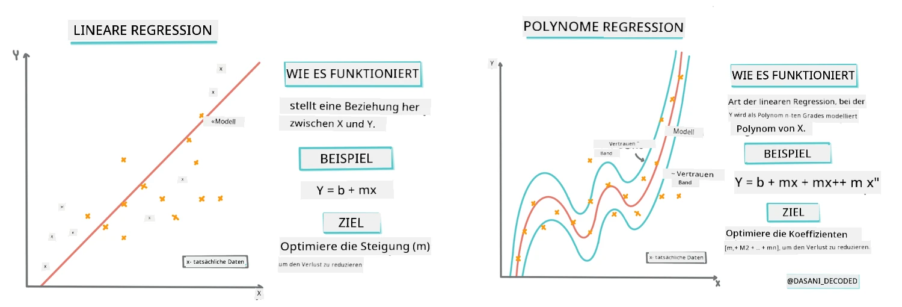
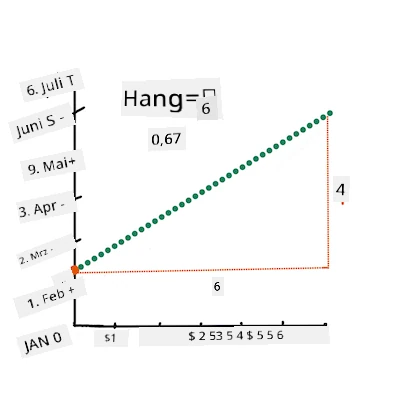
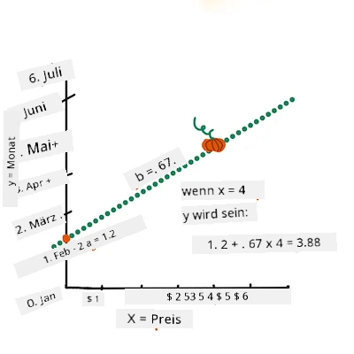
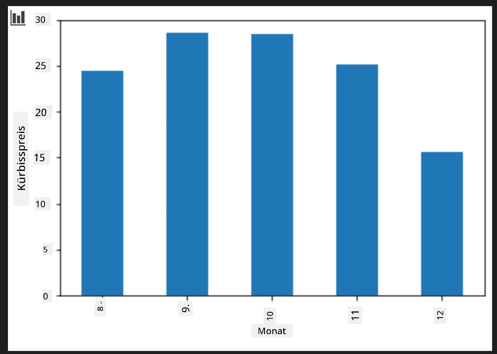
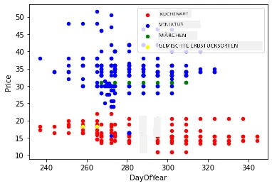

# Erstelle ein Regressionsmodell mit Scikit-learn: Regression auf vier Arten

## Anmerkung für Anfänger

Lineare Regression wird verwendet, wenn wir einen **numerischen Wert** vorhersagen möchten (zum Beispiel Hauspreis, Temperatur oder Umsatz).
Sie funktioniert, indem sie eine Gerade findet, die die Beziehung zwischen Eingabemerkmalen und Ausgabe bestmöglich darstellt.

In dieser Lektion konzentrieren wir uns darauf, das Konzept zu verstehen, bevor wir fortgeschrittenere Regressionstechniken erkunden.

> Infografik von [Dasani Madipalli](https://twitter.com/dasani_decoded)
## [Vorlesungsquiz](https://ff-quizzes.netlify.app/en/ml/)

> ### [Diese Lektion ist auch in R verfügbar!](../../../../2-Regression/3-Linear/solution/R/lesson_3.html)
### Einführung 

Bis jetzt hast du erkundet, was Regression ist, anhand von Beispieldaten aus dem Kürbis-Preis-Datensatz, den wir in dieser Lektion verwenden werden. Du hast ihn auch mit Matplotlib visualisiert.

Jetzt bist du bereit, tiefer in Regression für ML einzutauchen. Während die Visualisierung dabei hilft, die Daten zu verstehen, liegt die wahre Stärke von Machine Learning im _Trainieren von Modellen_. Modelle werden auf historischen Daten trainiert, um Datenabhängigkeiten automatisch zu erfassen, und ermöglichen es, Vorhersagen für neue Daten zu machen, die das Modell vorher nicht gesehen hat.

In dieser Lektion lernst du mehr über zwei Arten der Regression: _einfache lineare Regression_ und _polynomiale Regression_ sowie einige der Mathematik, die diesen Techniken zugrunde liegt. Diese Modelle werden uns erlauben, Kürbisse je nach unterschiedlichen Eingabedaten vorherzusagen.

[](https://youtu.be/CRxFT8oTDMg "ML for beginners - Understanding Linear Regression")

> 🎥 Klicke auf das Bild oben für eine kurze Videoübersicht zur linearen Regression.

> Im gesamten Lehrplan gehen wir von minimalen mathematischen Vorkenntnissen aus und möchten es für Studierende aus anderen Fachrichtungen zugänglich machen. Achte also auf Anmerkungen, 🧮 Hervorhebungen, Diagramme und andere Lernhilfen zur Unterstützung des Verständnisses.

### Voraussetzungen

Du solltest jetzt mit der Struktur der Kürbisdaten vertraut sein, die wir untersuchen. Du findest sie vorab geladen und bereinigt in der Datei _notebook.ipynb_ dieser Lektion. Dort wird der Kürbisp steht pro Bushel in einem neuen DataFrame angezeigt. Stelle sicher, dass du diese Notebooks in Visual Studio Code in passenden Umgebungen ausführen kannst.

### Vorbereitung

Zur Erinnerung: Du lädst diese Daten, um Fragen an sie stellen zu können.

- Wann ist die beste Zeit, Kürbisse zu kaufen?
- Welchen Preis kann ich für eine Kiste mit Mini-Kürbissen erwarten?
- Sollte ich sie in halben Bushel-Körben oder im 1 1/9 Bushel-Karton kaufen?
Lass uns weiter in diese Daten eintauchen.

In der vorherigen Lektion hast du ein Pandas DataFrame erstellt und mit einem Teil des ursprünglichen Datensatzes gefüllt, wobei die Preise pro Bushel standardisiert wurden. Dadurch konntest du jedoch nur etwa 400 Datenpunkte und nur für die Herbstmonate erfassen.

Betrachte die Daten, die wir in dem Notebook dieser Lektion vorab geladen haben. Die Daten sind vorab geladen und ein erster Streudiagramm wird gezeichnet, um Monatsdaten zu zeigen. Vielleicht können wir mehr Details über die Natur der Daten erhalten, wenn wir sie weiter bereinigen.

## Eine Linie der linearen Regression

Wie du in Lektion 1 gelernt hast, ist das Ziel einer linearen Regression, eine Linie zu zeichnen, um:

- **Variablenbeziehungen zu zeigen**. Die Beziehung zwischen Variablen darstellen
- **Vorhersagen zu machen**. Genau vorhersagen, wo ein neuer Datenpunkt in Bezug auf diese Linie liegen würde.
 
Typisch für die **Methode der kleinsten Quadrate** ist es, diese Art von Linie zu zeichnen. Der Begriff "Methode der kleinsten Quadrate" bezieht sich auf den Prozess, den Gesamtfehler in unserem Modell zu minimieren. Für jeden Datenpunkt messen wir den vertikalen Abstand (genannt Residuum) zwischen dem tatsächlichen Punkt und unserer Regressionslinie.

Wir quadrieren diese Abstände aus zwei Hauptgründen:

1. **Betrag statt Richtung:** Wir möchten einen Fehler von -5 genauso behandeln wie einen Fehler von +5. Das Quadrieren macht alle Werte positiv.

2. **Bestrafung von Ausreißern:** Das Quadrieren gibt größeren Fehlern mehr Gewicht, wodurch die Linie gezwungen wird, näher an weit entfernten Punkten zu bleiben.

Dann addieren wir alle quadrierten Werte zusammen. Unser Ziel ist es, genau die Linie zu finden, bei der diese Summe am geringsten ist – daher der Name "Methode der kleinsten Quadrate".

> **🧮 Zeig mir die Mathematik** 
> 
> Diese Linie, genannt _Line of Best Fit_, kann durch [eine Gleichung](https://en.wikipedia.org/wiki/Simple_linear_regression) ausgedrückt werden: 
> 
> ```
> Y = a + bX
> ```
>
> `X` ist die „erklärende Variable“. `Y` ist die „abhängige Variable“. Die Steigung der Linie ist `b` und `a` ist der y-Achsenabschnitt, also der Wert von `Y`, wenn `X = 0` ist.
>
>
>
> Zuerst berechne die Steigung `b`. Infografik von [Jen Looper](https://twitter.com/jenlooper)
>
> Anders ausgedrückt, und bezogen auf die ursprüngliche Frage unserer Kürbisdaten: "Vorhersage des Preises eines Kürbisses pro Bushel nach Monat", würde `X` den Preis darstellen und `Y` den Verkaufsmonat.
>
>
>
> Berechne den Wert von Y. Wenn du etwa $4 zahlst, muss es April sein! Infografik von [Jen Looper](https://twitter.com/jenlooper)
>
> Die Rechnung, die die Linie berechnet, muss die Steigung der Linie zeigen, die auch vom Achsenabschnitt abhängt, also von dem Punkt, an dem `Y` liegt, wenn `X = 0` ist.
>
> Du kannst die Berechnungsmethode für diese Werte auf der Website [Math is Fun](https://www.mathsisfun.com/data/least-squares-regression.html) nachlesen. Besuche auch [diesen Least-Squares-Rechner](https://www.mathsisfun.com/data/least-squares-calculator.html), um zu sehen, wie die Werte die Linie beeinflussen.

## Korrelation

Ein weiterer Begriff, den du verstehen solltest, ist der **Korrelationskoeffizient** zwischen bestimmten X- und Y-Variablen. Mit einem Streudiagramm kannst du diesen Koeffizienten schnell visualisieren. Ein Diagramm mit Datenpunkten, die sich in einer geordneten Linie anordnen, hat eine hohe Korrelation, während ein Diagramm mit verstreuten Punkten zwischen X und Y eine niedrige Korrelation aufweist.

Ein gutes lineares Regressionsmodell hat einen hohen (näher bei 1 als bei 0) Korrelationskoeffizienten, wenn die Methode der kleinsten Quadrate mit einer Regressionslinie verwendet wird.

✅ Führe das zu dieser Lektion gehörende Notebook aus und sieh dir das Streudiagramm Monat zu Preis an. Hat die Datenzuordnung von Monat zu Preis für Kürbisverkäufe deiner visuellen Interpretation nach eine hohe oder niedrige Korrelation? Ändert sich das, wenn du statt `Monat` eine feinere Maßeinheit wie *Tag des Jahres* (z.B. Anzahl der Tage seit Jahresbeginn) verwendest?

Im folgenden Code gehen wir davon aus, dass wir die Daten bereinigt und einen DataFrame mit dem Namen `new_pumpkins` erhalten haben, ähnlich dem Folgenden:

ID | Monat | TagDesJahres | Sorte | Stadt | Verpackung | Niedriger Preis | Hoher Preis | Preis
---|-------|--------------|-------|-------|------------|----------------|-------------|-------
70 | 9 | 267 | PIE TYPE | BALTIMORE | 1 1/9 Bushel Kartons | 15.0 | 15.0 | 13.636364
71 | 9 | 267 | PIE TYPE | BALTIMORE | 1 1/9 Bushel Kartons | 18.0 | 18.0 | 16.363636
72 | 10 | 274 | PIE TYPE | BALTIMORE | 1 1/9 Bushel Kartons | 18.0 | 18.0 | 16.363636
73 | 10 | 274 | PIE TYPE | BALTIMORE | 1 1/9 Bushel Kartons | 17.0 | 17.0 | 15.454545
74 | 10 | 281 | PIE TYPE | BALTIMORE | 1 1/9 Bushel Kartons | 15.0 | 15.0 | 13.636364

> Der Code zum Bereinigen der Daten ist in [`notebook.ipynb`](notebook.ipynb) verfügbar. Wir haben die gleichen Bereinigungsschritte wie in der vorherigen Lektion durchgeführt und die Spalte `DayOfYear` mit folgendem Ausdruck berechnet:

```python
day_of_year = pd.to_datetime(pumpkins['Date']).apply(lambda dt: (dt-datetime(dt.year,1,1)).days)
```

Nachdem du die Mathematik hinter der linearen Regression verstanden hast, erstellen wir nun ein Regressionsmodell, um zu sehen, ob wir vorhersagen können, welches Kürbis-Paket die besten Preise hat. Jemand, der Kürbisse für einen Feiertag-Kürbisgarten kauft, möchte diese Information möglicherweise nutzen, um seine Kürbiskäufe zu optimieren.

## Suche nach Korrelation

[](https://youtu.be/uoRq-lW2eQo "ML for beginners - Looking for Correlation: The Key to Linear Regression")

> 🎥 Klicke auf das Bild oben für eine kurze Videoübersicht über Korrelation.

Aus der vorherigen Lektion hast du wahrscheinlich gesehen, dass der Durchschnittspreis für verschiedene Monate so aussieht:



Das deutet darauf hin, dass es eine Korrelation geben sollte, und wir können versuchen, ein lineares Regressionsmodell zu trainieren, um die Beziehung zwischen `Monat` und `Preis` oder zwischen `DayOfYear` und `Preis` vorherzusagen. Hier ist das Streudiagramm, das die letztere Beziehung zeigt:

 

Sehen wir uns die Korrelation mit der `corr` Funktion an:

```python
print(new_pumpkins['Month'].corr(new_pumpkins['Price']))
print(new_pumpkins['DayOfYear'].corr(new_pumpkins['Price']))
```

Es scheint, dass die Korrelation ziemlich gering ist, -0,15 bei `Monat` und -0,17 bei `DayOfYear`, aber es könnte eine andere wichtige Beziehung geben. Es sieht so aus, als gäbe es verschiedene Preiscluster, die unterschiedlichen Kürbissorten entsprechen. Um diese Hypothese zu bestätigen, zeichnen wir jede Kürbiskategorie mit einer anderen Farbe. Indem wir der `scatter` Funktion einen `ax` Parameter übergeben, können wir alle Punkte im gleichen Diagramm darstellen:

```python
ax=None
colors = ['red','blue','green','yellow']
for i,var in enumerate(new_pumpkins['Variety'].unique()):
    df = new_pumpkins[new_pumpkins['Variety']==var]
    ax = df.plot.scatter('DayOfYear','Price',ax=ax,c=colors[i],label=var)
```

 

Unsere Untersuchung legt nahe, dass die Sorte mehr Einfluss auf den Gesamtpreis hat als das tatsächliche Verkaufsdatum. Das können wir mit einem Balkendiagramm sehen:

```python
new_pumpkins.groupby('Variety')['Price'].mean().plot(kind='bar')
```

 

Konzentrieren wir uns nun nur auf eine Kürbissorte, den 'Pie Type', und sehen uns den Einfluss des Datums auf den Preis an:

```python
pie_pumpkins = new_pumpkins[new_pumpkins['Variety']=='PIE TYPE']
pie_pumpkins.plot.scatter('DayOfYear','Price') 
```
 

Wenn wir jetzt die Korrelation zwischen `Preis` und `DayOfYear` mit der `corr` Funktion berechnen, erhalten wir ungefähr `-0,27` – was bedeutet, dass es sinnvoll ist, ein Vorhersagemodell zu trainieren.

> Bevor du ein lineares Regressionsmodell trainierst, ist es wichtig sicherzustellen, dass unsere Daten sauber sind. Lineare Regression funktioniert schlecht mit fehlenden Werten, daher ist es sinnvoll, leere Zellen zu entfernen:

```python
pie_pumpkins.dropna(inplace=True)
pie_pumpkins.info()
```

Eine andere Möglichkeit wäre, diese leeren Werte mit Mittelwerten der jeweiligen Spalte zu füllen.

## Einfache lineare Regression

[](https://youtu.be/e4c_UP2fSjg "ML for beginners - Linear and Polynomial Regression using Scikit-learn")

> 🎥 Klicke auf das Bild oben für eine kurze Videoübersicht zu linearer und polynomialer Regression.

Um unser Modell der linearen Regression zu trainieren, verwenden wir die **Scikit-learn**-Bibliothek.

```python
from sklearn.linear_model import LinearRegression
from sklearn.metrics import mean_squared_error
from sklearn.model_selection import train_test_split
```

Wir beginnen, indem wir Eingabewerte (Features) und die erwartete Ausgabe (Label) in getrennte Numpy-Arrays aufteilen:

```python
X = pie_pumpkins['DayOfYear'].to_numpy().reshape(-1,1)
y = pie_pumpkins['Price']
```

> Beachte, dass wir die Eingabedaten mittels `reshape` umformen mussten, damit das Linear Regression-Paket sie korrekt versteht. Lineare Regression erwartet ein 2D-Array als Eingabe, wobei jede Zeile des Arrays einem Vektor von Eingabewerten entspricht. In unserem Fall, da wir nur ein Eingabewert haben, brauchen wir ein Array mit der Form N&times;1, wobei N die Größe des Datensatzes ist.

Dann müssen wir die Daten in Trainings- und Testdatensätze aufteilen, damit wir unser Modell nach dem Training validieren können:

```python
X_train, X_test, y_train, y_test = train_test_split(X, y, test_size=0.2, random_state=0)
```

Schließlich dauert das eigentliche Training des linearen Regressionsmodells nur zwei Codezeilen. Wir definieren das `LinearRegression`-Objekt und passen es mit der `fit`-Methode an unsere Daten an:

```python
lin_reg = LinearRegression()
lin_reg.fit(X_train,y_train)
```

Das `LinearRegression`-Objekt enthält nach dem `fit`-ten alle Koeffizienten der Regression, auf die über die Eigenschaft `.coef_` zugegriffen werden kann. In unserem Fall gibt es nur einen Koeffizienten, der ungefähr `-0,017` betragen sollte. Das bedeutet, dass die Preise mit der Zeit etwas zu sinken scheinen, aber nicht zu stark, ungefähr 2 Cent pro Tag. Wir können auch den Schnittpunkt der Regression mit der Y-Achse mithilfe von `lin_reg.intercept_` abrufen – dieser wird in unserem Fall etwa `21` betragen und zeigt den Preis am Anfang des Jahres an.

Um zu sehen, wie genau unser Modell ist, können wir Preise in einem Testdatensatz vorhersagen und dann messen, wie nah unsere Vorhersagen an den erwarteten Werten sind. Dies kann mittels Root Mean Square Error (RMSE) geschehen, das die Wurzel aus dem Mittelwert aller quadrierten Differenzen zwischen erwartetem und vorhergesagtem Wert ist.

```python
pred = lin_reg.predict(X_test)

rmse = np.sqrt(mean_squared_error(y_test,pred))
print(f'RMSE: {rmse:3.3} ({rmse/np.mean(pred)*100:3.3}%)')
```
  
Unser Fehler scheint bei etwa 2 Punkten zu liegen, was ca. 17 % entspricht. Nicht allzu gut. Ein weiterer Indikator für die Modellqualität ist der **Bestimmtheitsmaß**, der folgendermaßen ermittelt werden kann:

```python
score = lin_reg.score(X_train,y_train)
print('Model determination: ', score)
```
  
Wenn der Wert 0 ist, bedeutet dies, dass das Modell die Eingabedaten nicht berücksichtigt und als *schlechtester linearer Prädiktor* fungiert, was einfach dem Mittelwert des Ergebnisses entspricht. Ein Wert von 1 bedeutet, dass wir alle erwarteten Ausgaben perfekt vorhersagen können. In unserem Fall liegt der Koeffizient bei etwa 0,06, was recht niedrig ist.

Wir können auch die Testdaten zusammen mit der Regressionslinie plotten, um besser zu sehen, wie die Regression in unserem Fall funktioniert:

```python
plt.scatter(X_test,y_test)
plt.plot(X_test,pred)
```
  


## Polynomiale Regression

Eine andere Art der linearen Regression ist die Polynomiale Regression. Während es manchmal eine lineare Beziehung zwischen Variablen gibt – je größer der Kürbis im Volumen, desto höher der Preis – können diese Beziehungen manchmal nicht als Ebene oder Gerade dargestellt werden.

✅ Hier sind [weitere Beispiele](https://online.stat.psu.edu/stat501/Lesson09#polynomial-regression-examples) für Daten, die eine polynomiale Regression benötigen könnten.

Schauen Sie sich die Beziehung zwischen Datum und Preis noch einmal an. Sollte dieses Streudiagramm zwangsläufig durch eine Gerade analysiert werden? Können die Preise nicht schwanken? In solchen Fällen kann man polynomiale Regression versuchen.

✅ Polynome sind mathematische Ausdrücke, die aus einer oder mehreren Variablen und Koeffizienten bestehen können.

Die polynomiale Regression erstellt eine gekrümmte Linie, um besser zu nichtlinearen Daten zu passen. In unserem Fall sollten wir durch Einbeziehung einer quadrierten `DayOfYear`-Variable in die Eingabedaten in der Lage sein, unsere Daten mit einer parabolischen Kurve anzupassen, die an einem bestimmten Punkt innerhalb des Jahres ein Minimum hat.

Scikit-learn bietet eine hilfreiche [Pipeline-API](https://scikit-learn.org/stable/modules/generated/sklearn.pipeline.make_pipeline.html?highlight=pipeline#sklearn.pipeline.make_pipeline), um verschiedene Verarbeitungsschritte zusammenzuführen. Eine **Pipeline** ist eine Kette von **Estimatoren**. In unserem Fall erstellen wir eine Pipeline, die zuerst polynomiale Merkmale zum Modell hinzufügt und dann die Regression trainiert:

```python
from sklearn.preprocessing import PolynomialFeatures
from sklearn.pipeline import make_pipeline

pipeline = make_pipeline(PolynomialFeatures(2), LinearRegression())

pipeline.fit(X_train,y_train)
```
  
Die Verwendung von `PolynomialFeatures(2)` bedeutet, dass wir alle Polynome zweiten Grades aus den Eingabedaten einschließen. In unserem Fall bedeutet das nur `DayOfYear`<sup>2</sup>, aber bei zwei Eingabevariablen X und Y werden zusätzlich X<sup>2</sup>, XY und Y<sup>2</sup> hinzugefügt. Wir können auch Polynome höheren Grades verwenden, wenn wir möchten.

Pipelines können auf die gleiche Weise wie das ursprüngliche `LinearRegression`-Objekt verwendet werden, d.h. wir können die Pipeline `fit`-ten und dann `predict` aufrufen, um Vorhersagen zu erhalten:

```python
pred = pipeline.predict(X_test)

rmse = np.sqrt(mean_squared_error(y_test,pred))
print(f'RMSE: {rmse:3.3} ({rmse/np.mean(pred)*100:3.3}%)')

score = pipeline.score(X_train,y_train)
print('Model determination: ', score)
```
  
Um die glatte Annäherungskurve zu zeichnen, verwenden wir `np.linspace`, um einen gleichmäßigen Bereich von Eingabewerten zu erzeugen, anstatt direkt die ungeordneten Testdaten zu verwenden (was eine Zickzacklinie ergeben würde):

```python
X_range = np.linspace(X_test.min(), X_test.max(), 100).reshape(-1,1)
y_range = pipeline.predict(X_range)

plt.scatter(X_test, y_test)
plt.plot(X_range, y_range)
```
  
Hier ist der Graph, der Testdaten und die Annäherungskurve zeigt:


Mit polynomieller Regression können wir etwas geringeren RMSE und höhere Bestimmtheitsmaße erzielen, aber nicht signifikant. Wir müssen weitere Merkmale berücksichtigen!

> Sie können sehen, dass die minimalen Kürbiskurse irgendwo um Halloween beobachtet werden. Wie können Sie das erklären?

🎃 Herzlichen Glückwunsch, Sie haben gerade ein Modell erstellt, das dabei helfen kann, den Preis von Backkürbissen vorherzusagen. Wahrscheinlich können Sie dasselbe Verfahren für alle Kürbissorten wiederholen, aber das wäre mühsam. Lernen wir nun, wie wir die Kürbissorte in unser Modell einbeziehen!

## Kategorische Merkmale

In der idealen Welt wollen wir Preise für verschiedene Kürbissorten mit demselben Modell vorhersagen können. Die Spalte `Variety` unterscheidet sich jedoch etwas von Spalten wie `Month`, da sie nicht-numerische Werte enthält. Solche Spalten nennt man **kategorisch**.

[](https://youtu.be/DYGliioIAE0 "ML für Anfänger – Kategorische Merkmalsvorhersagen mit Linearer Regression")

> 🎥 Klicken Sie auf das Bild oben für eine kurze Videoübersicht zum Umgang mit kategorialen Merkmalen.

Hier sehen Sie, wie der Durchschnittspreis von der Sorte abhängt:


Um die Sorte zu berücksichtigen, müssen wir sie zunächst in numerische Form umwandeln oder **kodieren**. Es gibt verschiedene Vorgehensweisen:

* Eine einfache **numerische Kodierung** erstellt eine Tabelle der verschiedenen Sorten und ersetzt dann den Sortennamen durch einen Index in dieser Tabelle. Das ist keine gute Idee für lineare Regression, weil das Modell den tatsächlichen numerischen Wert des Index nimmt und mit einem Koeffizienten multipliziert zum Ergebnis hinzufügt. In unserem Fall ist die Beziehung zwischen dem Index und dem Preis eindeutig nicht-linear, selbst wenn wir sicherstellen, dass die Indizes in einer bestimmten Reihenfolge angeordnet sind.
* **One-Hot-Kodierung** ersetzt die Spalte `Variety` durch 4 verschiedene Spalten, je eine für jede Sorte. Jede Spalte enthält `1`, wenn die entsprechende Zeile diese Sorte hat, und `0` sonst. Das bedeutet, dass es vier Koeffizienten in der linearen Regression gibt, einen für jede Kürbissorte, der für den „Startpreis“ (bzw. „zusätzlichen Preis“) für diese Sorte verantwortlich ist.

Der folgende Code zeigt, wie wir eine Sorte als One-Hot kodieren können:

```python
pd.get_dummies(new_pumpkins['Variety'])
```
  
 ID | FAIRYTALE | MINIATURE | MIXED HEIRLOOM VARIETIES | PIE TYPE  
----|-----------|-----------|--------------------------|----------  
70 | 0 | 0 | 0 | 1  
71 | 0 | 0 | 0 | 1  
... | ... | ... | ... | ...  
1738 | 0 | 1 | 0 | 0  
1739 | 0 | 1 | 0 | 0  
1740 | 0 | 1 | 0 | 0  
1741 | 0 | 1 | 0 | 0  
1742 | 0 | 1 | 0 | 0  

Um lineare Regression mit der One-Hot-kodierten Sorte als Eingabe zu trainieren, müssen wir nur die Daten in `X` und `y` richtig initialisieren:

```python
X = pd.get_dummies(new_pumpkins['Variety'])
y = new_pumpkins['Price']
```
  
Der Rest des Codes ist derselbe wie oben für das Training der linearen Regression. Wenn Sie es ausprobieren, werden Sie sehen, dass der mittlere quadratische Fehler ungefähr gleich bleibt, wir aber eine deutlich höhere Bestimmtheitsmaßzahl (~77 %) erhalten. Für noch genauere Vorhersagen können wir weitere kategoriale Merkmale sowie numerische Merkmale wie `Month` oder `DayOfYear` einbeziehen. Um ein großes Merkmal-Array zu erhalten, können wir `join` verwenden:

```python
X = pd.get_dummies(new_pumpkins['Variety']) \
        .join(new_pumpkins['Month']) \
        .join(pd.get_dummies(new_pumpkins['City'])) \
        .join(pd.get_dummies(new_pumpkins['Package']))
y = new_pumpkins['Price']
```
  
Hier berücksichtigen wir auch `City` und `Package`-Typ, was uns einen RMSE von 2,84 (10,5 %) und eine Bestimmtheitsmaßzahl von 0,94 gibt!

## Alles zusammenführen

Um das beste Modell zu erstellen, können wir kombinierte (one-hot-kodierte kategoriale + numerische) Daten aus dem obigen Beispiel zusammen mit Polynomialer Regression verwenden. Hier ist der vollständige Code zu Ihrer Bequemlichkeit:

```python
# Trainingsdaten einrichten
X = pd.get_dummies(new_pumpkins['Variety']) \
        .join(new_pumpkins['Month']) \
        .join(pd.get_dummies(new_pumpkins['City'])) \
        .join(pd.get_dummies(new_pumpkins['Package']))
y = new_pumpkins['Price']

# Trainings- und Testdaten aufteilen
X_train, X_test, y_train, y_test = train_test_split(X, y, test_size=0.2, random_state=0)

# Pipeline einrichten und trainieren
pipeline = make_pipeline(PolynomialFeatures(2), LinearRegression())
pipeline.fit(X_train,y_train)

# Ergebnisse für Testdaten vorhersagen
pred = pipeline.predict(X_test)

# RMSE und Bestimmtheitsmaß berechnen
rmse = mean_squared_error(y_test, pred, squared=False)
print(f'RMSE: {rmse:3.3} ({rmse/pred.mean()*100:3.3}%)')

score = pipeline.score(X_train,y_train)
print('Model determination: ', score)
```
  
Damit sollten wir den besten Bestimmtheitsmaß von fast 97 % und RMSE = 2,23 (~8 % Vorhersagefehler) erhalten.

| Modell | RMSE | Bestimmtheitsmaß |
|-------|-----|---------------|
| `DayOfYear` Linear | 2,77 (17,2 %) | 0,07 |
| `DayOfYear` Polynomial | 2,73 (17,0 %) | 0,08 |
| `Variety` Linear | 5,24 (19,7 %) | 0,77 |
| Alle Merkmale Linear | 2,84 (10,5 %) | 0,94 |
| Alle Merkmale Polynomial | 2,23 (8,25 %) | 0,97 |

🏆 Gut gemacht! Sie haben in einer Lektion vier Regressionsmodelle erstellt und die Modellqualität auf 97 % verbessert. Im abschließenden Abschnitt über Regression lernen Sie logistische Regression kennen, um Kategorien zu bestimmen.

---
## 🚀Herausforderung

Testen Sie in diesem Notebook verschiedene Variablen, um zu sehen, wie Korrelation mit der Modellgenauigkeit zusammenhängt.

## [Quiz nach der Vorlesung](https://ff-quizzes.netlify.app/en/ml/)

## Wiederholung & Selbststudium

In dieser Lektion haben wir über Lineare Regression gelernt. Es gibt noch andere wichtige Regressionstypen. Lesen Sie über Stepwise-, Ridge-, Lasso- und Elasticnet-Techniken. Ein guter Kurs zum Weiterlernen ist der [Stanford Statistical Learning Course](https://online.stanford.edu/courses/sohs-ystatslearning-statistical-learning)

## Aufgabe

[Ein Modell erstellen](assignment.md)

---

<!-- CO-OP TRANSLATOR DISCLAIMER START -->
**Haftungsausschluss**:  
Dieses Dokument wurde mit dem KI-Übersetzungsdienst [Co-op Translator](https://github.com/Azure/co-op-translator) übersetzt. Obwohl wir uns um Genauigkeit bemühen, beachten Sie bitte, dass automatisierte Übersetzungen Fehler oder Ungenauigkeiten enthalten können. Das Originaldokument in seiner ursprünglichen Sprache ist als maßgebliche Quelle anzusehen. Für wichtige Informationen wird eine professionelle menschliche Übersetzung empfohlen. Wir übernehmen keine Haftung für Missverständnisse oder Fehlinterpretationen, die durch die Nutzung dieser Übersetzung entstehen.
<!-- CO-OP TRANSLATOR DISCLAIMER END -->