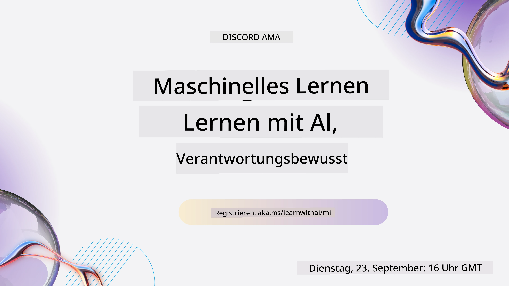
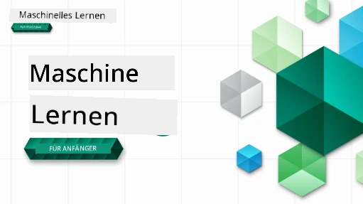

[](https://github.com/microsoft/ML-For-Beginners/blob/master/LICENSE)
[](https://GitHub.com/microsoft/ML-For-Beginners/graphs/contributors/)
[](https://GitHub.com/microsoft/ML-For-Beginners/issues/)
[](https://GitHub.com/microsoft/ML-For-Beginners/pulls/)
[](http://makeapullrequest.com)

[](https://GitHub.com/microsoft/ML-For-Beginners/watchers/)
[](https://GitHub.com/microsoft/ML-For-Beginners/network/)
[](https://GitHub.com/microsoft/ML-For-Beginners/stargazers/)

### 🌐 Mehrsprachige Unterstützung

#### Übersetzungen gepflegt mit [Co-op Translator](https://github.com/Azure/co-op-translator)

<!-- CO-OP TRANSLATOR LANGUAGES TABLE START -->
[Arabisch](../ar/README.md) | [Bengalisch](../bn/README.md) | [Bulgarisch](../bg/README.md) | [Birmanisch (Myanmar)](../my/README.md) | [Chinesisch (vereinfacht)](../zh-CN/README.md) | [Chinesisch (traditionell, Hongkong)](../zh-HK/README.md) | [Chinesisch (traditionell, Macau)](../zh-MO/README.md) | [Chinesisch (traditionell, Taiwan)](../zh-TW/README.md) | [Kroatisch](../hr/README.md) | [Tschechisch](../cs/README.md) | [Dänisch](../da/README.md) | [Niederländisch](../nl/README.md) | [Estnisch](../et/README.md) | [Finnisch](../fi/README.md) | [Französisch](../fr/README.md) | [Deutsch](./README.md) | [Griechisch](../el/README.md) | [Hebräisch](../he/README.md) | [Hindi](../hi/README.md) | [Ungarisch](../hu/README.md) | [Indonesisch](../id/README.md) | [Italienisch](../it/README.md) | [Japanisch](../ja/README.md) | [Kannada](../kn/README.md) | [Khmer](../km/README.md) | [Koreanisch](../ko/README.md) | [Litauisch](../lt/README.md) | [Malaiisch](../ms/README.md) | [Malayalam](../ml/README.md) | [Manipuri (Meitei Mayek)](../mni/README.md) | [Marathi](../mr/README.md) | [Nepalesisch](../ne/README.md) | [Nigerianisches Pidgin](../pcm/README.md) | [Norwegisch](../no/README.md) | [Persisch (Farsi)](../fa/README.md) | [Polnisch](../pl/README.md) | [Portugiesisch (Brasilien)](../pt-BR/README.md) | [Portugiesisch (Portugal)](../pt-PT/README.md) | [Punjabi (Gurmukhi)](../pa/README.md) | [Rumänisch](../ro/README.md) | [Russisch](../ru/README.md) | [Serbisch (Kyrillisch)](../sr/README.md) | [Slowakisch](../sk/README.md) | [Slowenisch](../sl/README.md) | [Spanisch](../es/README.md) | [Suaheli](../sw/README.md) | [Schwedisch](../sv/README.md) | [Tagalog (Filipino)](../tl/README.md) | [Tamil](../ta/README.md) | [Telugu](../te/README.md) | [Thailändisch](../th/README.md) | [Türkisch](../tr/README.md) | [Ukrainisch](../uk/README.md) | [Urdu](../ur/README.md) | [Vietnamesisch](../vi/README.md)

> **Bevorzugen Sie das lokale Klonen?**
>
> Dieses Repository enthält Übersetzungen in über 50 Sprachen, was die Downloadgröße erheblich erhöht. Um ohne Übersetzungen zu klonen, verwenden Sie Sparse Checkout:
>
> **Bash / macOS / Linux:**
> ```bash
> git clone --filter=blob:none --sparse https://github.com/microsoft/ML-For-Beginners.git
> cd ML-For-Beginners
> git sparse-checkout set --no-cone '/*' '!translations' '!translated_images'
> ```
>
> **CMD (Windows):**
> ```cmd
> git clone --filter=blob:none --sparse https://github.com/microsoft/ML-For-Beginners.git
> cd ML-For-Beginners
> git sparse-checkout set --no-cone "/*" "!translations" "!translated_images"
> ```
>
> Dies gibt Ihnen alles, was Sie benötigen, um den Kurs mit einem viel schnelleren Download abzuschließen.
<!-- CO-OP TRANSLATOR LANGUAGES TABLE END -->

#### Treten Sie unserer Gemeinschaft bei

[](https://discord.gg/nTYy5BXMWG)

Wir haben eine laufende Discord-Reihe zum Lernen mit KI, erfahren Sie mehr und machen Sie mit bei [Learn with AI Series](https://aka.ms/learnwithai/discord) vom 18. bis 30. September 2025. Sie erhalten Tipps und Tricks zur Nutzung von GitHub Copilot für Data Science.



# Maschinelles Lernen für Anfänger - Ein Lehrplan

> 🌍 Reisen Sie um die Welt, während wir Maschinelles Lernen anhand von Weltkulturen erforschen 🌍

Die Cloud Advocates bei Microsoft freuen sich, einen 12-wöchigen Lehrplan mit 26 Lektionen rund um **Maschinelles Lernen** anzubieten. In diesem Lehrplan lernen Sie, was manchmal als **klassisches maschinelles Lernen** bezeichnet wird, wobei hauptsächlich Scikit-learn als Bibliothek verwendet wird und Deep Learning vermieden wird, das in unserem [AI for Beginners' curriculum](https://aka.ms/ai4beginners) behandelt wird. Kombinieren Sie diese Lektionen auch mit unserem ['Data Science for Beginners' curriculum](https://aka.ms/ds4beginners)!

Reisen Sie mit uns um die Welt, während wir diese klassischen Techniken auf Daten aus vielen Regionen der Welt anwenden. Jede Lektion enthält Vor- und Nachtests, schriftliche Anweisungen zur Durchführung der Lektion, eine Lösung, eine Aufgabe und mehr. Unsere projektbasierte Pädagogik ermöglicht es Ihnen, beim Bauen zu lernen – eine bewährte Methode, damit neue Fähigkeiten haften bleiben.

**✍️ Herzlichen Dank an unsere Autoren** Jen Looper, Stephen Howell, Francesca Lazzeri, Tomomi Imura, Cassie Breviu, Dmitry Soshnikov, Chris Noring, Anirban Mukherjee, Ornella Altunyan, Ruth Yakubu und Amy Boyd

**🎨 Ebenso vielen Dank an unsere Illustratoren** Tomomi Imura, Dasani Madipalli und Jen Looper

**🙏 Besonderer Dank 🙏 an unsere Microsoft Student Ambassador Autoren, Gutachter und Inhaltspartner**, insbesondere Rishit Dagli, Muhammad Sakib Khan Inan, Rohan Raj, Alexandru Petrescu, Abhishek Jaiswal, Nawrin Tabassum, Ioan Samuila und Snigdha Agarwal

**🤩 Extra Dank an die Microsoft Student Ambassadors Eric Wanjau, Jasleen Sondhi und Vidushi Gupta für unsere R-Lektionen!**

# Erste Schritte

Folgen Sie diesen Schritten:
1. **Forken Sie das Repository**: Klicken Sie auf die Schaltfläche "Fork" oben rechts auf dieser Seite.
2. **Klonen Sie das Repository**:   `git clone https://github.com/microsoft/ML-For-Beginners.git`

> 💡 **Schneller Start-Tipp:** Möchten Sie im Browser starten, ohne Python lokal einzurichten? Verwenden Sie [GitHub Codespaces](https://github.com/features/codespaces) zum Erstellen einer Cloud-Entwicklungsumgebung für Ihren Fork. Öffnen Sie das grüne **Code**-Menü, wählen Sie **Codespaces** und erstellen Sie einen Codespace; installieren Sie jeweils die erforderlichen Abhängigkeiten der Lektion.

> [finden Sie alle zusätzlichen Ressourcen für diesen Kurs in unserer Microsoft Learn Sammlung](https://learn.microsoft.com/en-us/collections/qrqzamz1nn2wx3?WT.mc_id=academic-77952-bethanycheum)

> 🔧 **Brauchen Sie Hilfe?** Schauen Sie in unseren [Fehlerbehebungsleitfaden](TROUBLESHOOTING.md) für Lösungen bei häufigen Problemen mit Installation, Einrichtung und Ausführung der Lektionen.


**[Studenten](https://aka.ms/student-page)**, um diesen Lehrplan zu nutzen, forken Sie das gesamte Repository in Ihr eigenes GitHub-Konto und bearbeiten Sie die Übungen alleine oder in einer Gruppe:

- Beginnen Sie mit einem Vor-Lektions-Quiz.
- Lesen Sie die Lektion und erledigen Sie die Aktivitäten, pausieren und reflektieren Sie bei jedem Wissenscheck.
- Versuchen Sie, die Projekte durch Verstehen der Lektionen zu erstellen, anstatt den Lösungscode auszuführen; dieser Code ist jedoch in den `/solution`-Ordnern jeder projektorientierten Lektion verfügbar.
- Machen Sie den Nach-Lektions-Quiz.
- Erledigen Sie die Herausforderung.
- Erledigen Sie die Aufgabe.
- Nach Abschluss einer Lektionengruppe besuchen Sie das [Diskussionsforum](https://github.com/microsoft/ML-For-Beginners/discussions) und "lernen laut", indem Sie das entsprechende PAT-Rubrik ausfüllen. Ein 'PAT' ist ein Fortschrittsbewertungstool, das Sie ausfüllen, um Ihr Lernen zu vertiefen. Sie können auch auf andere PATs reagieren, damit wir gemeinsam lernen können.

> Für weiteres Studium empfehlen wir diese [Microsoft Learn](https://docs.microsoft.com/en-us/users/jenlooper-2911/collections/k7o7tg1gp306q4?WT.mc_id=academic-77952-leestott) Module und Lernpfade.

**Lehrer**, wir haben [einige Vorschläge](for-teachers.md) zur Nutzung dieses Lehrplans hinzugefügt.

---

## Videoanleitungen

Einige Lektionen sind als Kurzvideos verfügbar. Sie finden diese sowohl inline in den Lektionen als auch auf der [ML for Beginners Playlist auf dem Microsoft Developer YouTube-Kanal](https://aka.ms/ml-beginners-videos) durch Klicken auf das untenstehende Bild.

[](https://aka.ms/ml-beginners-videos)

---

## Treffen Sie das Team

[](https://youtu.be/Tj1XWrDSYJU)

**Gif von** [Mohit Jaisal](https://linkedin.com/in/mohitjaisal)

> 🎥 Klicken Sie auf das obige Bild für ein Video über das Projekt und die Personen, die es erstellt haben!

---

## Pädagogik

Wir haben zwei pädagogische Grundsätze bei der Erstellung dieses Lehrplans gewählt: Sicherstellen, dass er praxisorientiert **projektbasiert** ist und dass er **häufige Quizze** beinhaltet. Außerdem hat dieser Lehrplan ein gemeinsames **Thema**, das ihm Kohärenz verleiht.

Indem sichergestellt wird, dass die Inhalte zu Projekten passen, wird der Prozess für Studierende ansprechender gestaltet und das Behalten der Konzepte wird verbessert. Ein leistungsfreier Quiz vor der Unterrichtsstunde setzt die Lernabsicht des Studierenden, während ein zweiter Quiz nach der Stunde weiteren Lerneffekt sichert. Dieser Lehrplan wurde flexibel und unterhaltsam gestaltet und kann vollständig oder teilweise genutzt werden. Die Projekte beginnen klein und werden bis zum Ende des 12-wöchigen Zyklus zunehmend komplexer. Der Lehrplan enthält außerdem ein Nachwort zu realweltlichen Anwendungen des ML, das als Zusatzpunkt oder Diskussionsbasis verwendet werden kann.

> Finden Sie unsere [Verhaltensregeln](CODE_OF_CONDUCT.md), [Beitragsrichtlinien](CONTRIBUTING.md), [Übersetzungen](..) und [Fehlerbehebung](TROUBLESHOOTING.md). Wir freuen uns auf Ihr konstruktives Feedback!

## Jede Lektion enthält

- optionale Sketchnote
- optionales ergänzendes Video
- Videoanleitung (nur einige Lektionen)
- [Vorbereitungs-Quiz vor der Lektion](https://ff-quizzes.netlify.app/en/ml/)
- schriftliche Lektion
- bei projektbasierten Lektionen Schritt-für-Schritt-Anleitungen zum Bau des Projekts
- Wissensprüfungen
- eine Herausforderung
- ergänzende Lektüre
- Aufgabe
- [Post-Lektions-Quiz](https://ff-quizzes.netlify.app/en/ml/)

> **Eine Anmerkung zu den Sprachen**: Diese Lektionen sind hauptsächlich in Python geschrieben, aber viele sind auch in R verfügbar. Um eine R-Lektion abzuschließen, wechseln Sie in den `/solution`-Ordner und suchen Sie nach R-Lektionen. Diese enthalten eine .rmd-Erweiterung, die für eine **R Markdown**-Datei steht, welche einfach als Einbettung von `code chunks` (R oder andere Sprachen) und `YAML header` (für Formatierungen von Ausgaben wie PDF) in einem `Markdown document` definiert werden kann. Damit dient sie als beispielhaftes Autorensystem für Data Science, da es Ihnen ermöglicht, Ihren Code, dessen Ausgabe und Ihre Gedanken zu kombinieren, indem Sie diese in Markdown niederschreiben. Außerdem können R Markdown-Dokumente in Ausgabeformate wie PDF, HTML oder Word gerendert werden.

> **Eine Anmerkung zu Quizzen**: Alle Quizze befinden sich im [Quiz App Ordner](../../quiz-app), insgesamt 52 Quizze mit je drei Fragen. Sie sind in den Lektionen verlinkt, aber die Quiz-App kann lokal ausgeführt werden; folgen Sie den Anweisungen im `quiz-app`-Ordner, um sie lokal oder auf Azure zu hosten.

| Lektion Nummer |                             Thema                              |                   Lernbereich                   | Lernziele                                                                                                             |                                                              Verlinkte Lektion                                                               |                        Autor                        |
| :-----------: | :------------------------------------------------------------: | :---------------------------------------------: | -------------------------------------------------------------------------------------------------------------------- | :-----------------------------------------------------------------------------------------------------------------------------------------: | :------------------------------------------------: |
|      01       |                Einführung in das maschinelle Lernen                |      [Einführung](1-Introduction/README.md)       | Lernen Sie die Grundkonzepte des maschinellen Lernens                                                                 |                                             [Lektion](1-Introduction/1-intro-to-ML/README.md)                                             |                       Muhammad                       |
|      02       |                Die Geschichte des maschinellen Lernens                 |      [Einführung](1-Introduction/README.md)       | Lernen Sie die Geschichte dieses Fachgebiets                                                                         |                                            [Lektion](1-Introduction/2-history-of-ML/README.md)                                            |                     Jen und Amy                      |
|      03       |                 Fairness und maschinelles Lernen                  |      [Einführung](1-Introduction/README.md)       | Was sind die wichtigen philosophischen Fragen zur Fairness, die Studenten bei der Entwicklung und Anwendung von ML-Modellen berücksichtigen sollten? |                                              [Lektion](1-Introduction/3-fairness/README.md)                                               |                        Tomomi                        |
|      04       |                Techniken für maschinelles Lernen                 |      [Einführung](1-Introduction/README.md)       | Welche Techniken verwenden ML-Forscher, um ML-Modelle zu erstellen?                                                 |                                          [Lektion](1-Introduction/4-techniques-of-ML/README.md)                                           |                    Chris und Jen                     |
|      05       |                   Einführung in die Regression                   |        [Regression](2-Regression/README.md)         | Einstieg mit Python und Scikit-learn für Regressionsmodelle                                                        |         [Python](2-Regression/1-Tools/README.md) • [R](../../2-Regression/1-Tools/solution/R/lesson_1.html)         |      Jen • Eric Wanjau       |
|      06       |                Nordamerikanische Kürbisspreise 🎃                |        [Regression](2-Regression/README.md)         | Visualisieren und bereinigen von Daten zur Vorbereitung auf ML                                                      |          [Python](2-Regression/2-Data/README.md) • [R](../../2-Regression/2-Data/solution/R/lesson_2.html)          |      Jen • Eric Wanjau       |
|      07       |                Nordamerikanische Kürbisspreise 🎃                |        [Regression](2-Regression/README.md)         | Erstellen linearer und polynomialer Regressionsmodelle                                                             |        [Python](2-Regression/3-Linear/README.md) • [R](../../2-Regression/3-Linear/solution/R/lesson_3.html)        |      Jen und Dmitry • Eric Wanjau       |
|      08       |                Nordamerikanische Kürbisspreise 🎃                |        [Regression](2-Regression/README.md)         | Erstellen eines logistischen Regressionsmodells                                                                     |     [Python](2-Regression/4-Logistic/README.md) • [R](../../2-Regression/4-Logistic/solution/R/lesson_4.html)      |      Jen • Eric Wanjau       |
|      09       |                          Eine Web-App 🔌                          |           [Web-App](3-Web-App/README.md)            | Erstellen einer Web-App zur Verwendung Ihres trainierten Modells                                                    |                                                 [Python](3-Web-App/1-Web-App/README.md)                                                  |                         Jen                          |
|      10       |                 Einführung in die Klassifikation                 |    [Klassifikation](4-Classification/README.md)     | Bereinigen, vorbereiten und visualisieren Ihrer Daten; Einführung in die Klassifikation                            | [Python](4-Classification/1-Introduction/README.md) • [R](../../4-Classification/1-Introduction/solution/R/lesson_10.html)  | Jen und Cassie • Eric Wanjau |
|      11       |             Köstliche asiatische und indische Küchen 🍜             |    [Klassifikation](4-Classification/README.md)     | Einführung in Klassifikatoren                                                                                         | [Python](4-Classification/2-Classifiers-1/README.md) • [R](../../4-Classification/2-Classifiers-1/solution/R/lesson_11.html) | Jen und Cassie • Eric Wanjau |
|      12       |             Köstliche asiatische und indische Küchen 🍜             |    [Klassifikation](4-Classification/README.md)     | Mehr Klassifikatoren                                                                                                  | [Python](4-Classification/3-Classifiers-2/README.md) • [R](../../4-Classification/3-Classifiers-2/solution/R/lesson_12.html) | Jen und Cassie • Eric Wanjau |
|      13       |             Köstliche asiatische und indische Küchen 🍜             |    [Klassifikation](4-Classification/README.md)     | Erstellen einer Empfehlungs-Web-App mit Ihrem Modell                                                                 |                                              [Python](4-Classification/4-Applied/README.md)                                              |                         Jen                          |
|      14       |                   Einführung in das Clustering                   |        [Clustering](5-Clustering/README.md)         | Bereinigen, vorbereiten und visualisieren Ihrer Daten; Einführung in das Clustering                                  |         [Python](5-Clustering/1-Visualize/README.md) • [R](../../5-Clustering/1-Visualize/solution/R/lesson_14.html)         |      Jen • Eric Wanjau       |
|      15       |              Erkundung nigerianischer Musikgeschmäcker 🎧              |        [Clustering](5-Clustering/README.md)         | Erforschen der K-Means-Clustering-Methode                                                                            |           [Python](5-Clustering/2-K-Means/README.md) • [R](../../5-Clustering/2-K-Means/solution/R/lesson_15.html)           |      Jen • Eric Wanjau       |
|      16       |        Einführung in die Verarbeitung natürlicher Sprache ☕️         |   [Verarbeitung natürlicher Sprache](6-NLP/README.md)    | Lernen Sie die Grundlagen über NLP durch den Bau eines einfachen Bots                                               |                                             [Python](6-NLP/1-Introduction-to-NLP/README.md)                                              |                       Stephen                        |
|      17       |                      Gängige NLP-Aufgaben ☕️                      |   [Verarbeitung natürlicher Sprache](6-NLP/README.md)    | Vertiefen Sie Ihr NLP-Wissen, indem Sie gängige Aufgaben verstehen, die beim Umgang mit Sprachstrukturen erforderlich sind |                                                    [Python](6-NLP/2-Tasks/README.md)                                                     |                       Stephen                        |
|      18       |             Übersetzung und Sentiment-Analyse ♥️              |   [Verarbeitung natürlicher Sprache](6-NLP/README.md)    | Übersetzung und Sentiment-Analyse mit Jane Austen                                                                    |                                            [Python](6-NLP/3-Translation-Sentiment/README.md)                                             |                       Stephen                        |
|      19       |                  Romantische Hotels in Europa ♥️                  |   [Verarbeitung natürlicher Sprache](6-NLP/README.md)    | Sentiment-Analyse mit Hotelbewertungen 1                                                                              |                                               [Python](6-NLP/4-Hotel-Reviews-1/README.md)                                                |                       Stephen                        |
|      20       |                  Romantische Hotels in Europa ♥️                  |   [Verarbeitung natürlicher Sprache](6-NLP/README.md)    | Sentiment-Analyse mit Hotelbewertungen 2                                                                              |                                               [Python](6-NLP/5-Hotel-Reviews-2/README.md)                                                |                       Stephen                        |
|      21       |            Einführung in die Zeitreihenprognose             |        [Zeitreihen](7-TimeSeries/README.md)        | Einführung in Zeitreihenprognosen                                                                                      |                                             [Python](7-TimeSeries/1-Introduction/README.md)                                              |                      Francesca                       |
|      22       | ⚡️ Weltstromverbrauch ⚡️ - Zeitreihenprognose mit ARIMA |        [Zeitreihen](7-TimeSeries/README.md)        | Zeitreihenprognose mit ARIMA                                                                                           |                                                 [Python](7-TimeSeries/2-ARIMA/README.md)                                                 |                      Francesca                       |
|      23       |  ⚡️ Weltstromverbrauch ⚡️ - Zeitreihenprognose mit SVR  |        [Zeitreihen](7-TimeSeries/README.md)        | Zeitreihenprognose mit Support Vector Regressor                                                                       |                                                  [Python](7-TimeSeries/3-SVR/README.md)                                                  |                       Anirban                        |
|      24       |             Einführung in das Reinforcement Learning             | [Reinforcement Learning](8-Reinforcement/README.md) | Einführung in Reinforcement Learning mit Q-Learning                                                                    |                                             [Python](8-Reinforcement/1-QLearning/README.md)                                              |                        Dmitry                        |
|      25       |                 Hilf Peter, dem Wolf zu entkommen! 🐺                  | [Reinforcement Learning](8-Reinforcement/README.md) | Reinforcement Learning Gym                                                                                            |                                                [Python](8-Reinforcement/2-Gym/README.md)                                                 |                        Dmitry                        |
|  Nachwort   |            Reale ML-Szenarien und Anwendungen            |      [ML in der Wildnis](9-Real-World/README.md)       | Interessante und aufschlussreiche reale Anwendungen klassischer ML                                                    |                                             [Lektion](9-Real-World/1-Applications/README.md)                                              |                         Team                         |
|  Nachwort   |            Modell-Debugging in ML mit RAI-Dashboard            |      [ML in der Wildnis](9-Real-World/README.md)       | Modell-Debugging im maschinellen Lernen mit Responsible AI Dashboard-Komponenten                                    |                                             [Lektion](9-Real-World/2-Debugging-ML-Models/README.md)                                              |                     Ruth Yakubu                      |

> [Finden Sie alle zusätzlichen Ressourcen für diesen Kurs in unserer Microsoft Learn-Sammlung](https://learn.microsoft.com/en-us/collections/qrqzamz1nn2wx3?WT.mc_id=academic-77952-bethanycheum)

## Offline-Zugriff

Sie können diese Dokumentation offline mit [Docsify](https://docsify.js.org/#/) ausführen. Forken Sie dieses Repo, [installieren Sie Docsify](https://docsify.js.org/#/quickstart) auf Ihrer lokalen Maschine und geben Sie dann im Stammordner dieses Repos `docsify serve` ein. Die Website wird auf Port 3000 auf Ihrem localhost unter `localhost:3000` bereitgestellt.

## PDFs

Finden Sie ein PDF des Lehrplans mit Links [hier](https://microsoft.github.io/ML-For-Beginners/pdf/readme.pdf).


## 🎒 Andere Kurse 

Unser Team produziert weitere Kurse! Schauen Sie sich an:

<!-- CO-OP TRANSLATOR OTHER COURSES START -->
### LangChain
[](https://aka.ms/langchain4j-for-beginners)
[](https://aka.ms/langchainjs-for-beginners?WT.mc_id=m365-94501-dwahlin)
[](https://github.com/microsoft/langchain-for-beginners?WT.mc_id=m365-94501-dwahlin)
---

### Azure / Edge / MCP / Agents
[](https://github.com/microsoft/AZD-for-beginners?WT.mc_id=academic-105485-koreyst)
[](https://github.com/microsoft/edgeai-for-beginners?WT.mc_id=academic-105485-koreyst)
[](https://github.com/microsoft/mcp-for-beginners?WT.mc_id=academic-105485-koreyst)
[](https://github.com/microsoft/ai-agents-for-beginners?WT.mc_id=academic-105485-koreyst)

---
 
### Serie Generative KI
[](https://github.com/microsoft/generative-ai-for-beginners?WT.mc_id=academic-105485-koreyst)
[-9333EA?style=for-the-badge&labelColor=E5E7EB&color=9333EA)](https://github.com/microsoft/Generative-AI-for-beginners-dotnet?WT.mc_id=academic-105485-koreyst)
[-C084FC?style=for-the-badge&labelColor=E5E7EB&color=C084FC)](https://github.com/microsoft/generative-ai-for-beginners-java?WT.mc_id=academic-105485-koreyst)
[-E879F9?style=for-the-badge&labelColor=E5E7EB&color=E879F9)](https://github.com/microsoft/generative-ai-with-javascript?WT.mc_id=academic-105485-koreyst)

---
 
### Kernlernprogramme
[](https://aka.ms/ml-beginners?WT.mc_id=academic-105485-koreyst)
[](https://aka.ms/datascience-beginners?WT.mc_id=academic-105485-koreyst)
[](https://aka.ms/ai-beginners?WT.mc_id=academic-105485-koreyst)
[](https://github.com/microsoft/Security-101?WT.mc_id=academic-96948-sayoung)
[](https://aka.ms/webdev-beginners?WT.mc_id=academic-105485-koreyst)
[](https://aka.ms/iot-beginners?WT.mc_id=academic-105485-koreyst)
[](https://github.com/microsoft/xr-development-for-beginners?WT.mc_id=academic-105485-koreyst)

---
 
### Copilot-Serie
[](https://aka.ms/GitHubCopilotAI?WT.mc_id=academic-105485-koreyst)
[](https://github.com/microsoft/mastering-github-copilot-for-dotnet-csharp-developers?WT.mc_id=academic-105485-koreyst)
[](https://github.com/microsoft/CopilotAdventures?WT.mc_id=academic-105485-koreyst)
<!-- CO-OP TRANSLATOR OTHER COURSES END -->

## Hilfe erhalten

Wenn Sie beim Lernen des maschinellen Lernens oder beim Erstellen von KI-Anwendungen auf Schwierigkeiten stoßen oder Fragen haben, keine Sorge — es gibt Hilfe.

Sie können an Diskussionen mit anderen Lernenden und Entwicklern teilnehmen, Fragen stellen und Ihre Ideen mit der Community teilen.

- Treten Sie der Community bei, um Fragen zu stellen und mit anderen zu lernen
- Diskutieren Sie Konzepte des maschinellen Lernens und Projektideen
- Erhalten Sie Hinweise von erfahrenen Entwicklern

Eine unterstützende Community ist eine großartige Möglichkeit, Ihre Fähigkeiten zu erweitern und Probleme schneller zu lösen.

[Microsoft Foundry Discord Community](https://discord.gg/nTYy5BXMWG)

Wenn Sie auf Fehler oder Bugs stoßen oder Verbesserungsvorschläge haben, können Sie auch ein **Issue** in diesem Repository eröffnen, um das Problem zu melden.

Für Produktfeedback oder zum Durchsuchen vorhandener Community-Beiträge besuchen Sie das Entwicklerforum:

[](https://aka.ms/foundry/forum)

## Weitere Lerntipps

- Überprüfen Sie die Notebooks nach jeder Lektion für ein besseres Verständnis.
- Üben Sie, Algorithmen selbst umzusetzen.
- Erkunden Sie reale Datensätze mit erlernten Konzepten.

---

<!-- CO-OP TRANSLATOR DISCLAIMER START -->
**Haftungsausschluss**:
Dieses Dokument wurde mit dem KI-Übersetzungsdienst [Co-op Translator](https://github.com/Azure/co-op-translator) übersetzt. Obwohl wir uns um Genauigkeit bemühen, beachten Sie bitte, dass automatisierte Übersetzungen Fehler oder Ungenauigkeiten enthalten können. Das Originaldokument in seiner Ursprungssprache gilt als maßgebliche Quelle. Bei kritischen Informationen wird eine professionelle menschliche Übersetzung empfohlen. Wir übernehmen keine Haftung für Missverständnisse oder Fehlinterpretationen, die aus der Verwendung dieser Übersetzung entstehen.
<!-- CO-OP TRANSLATOR DISCLAIMER END -->