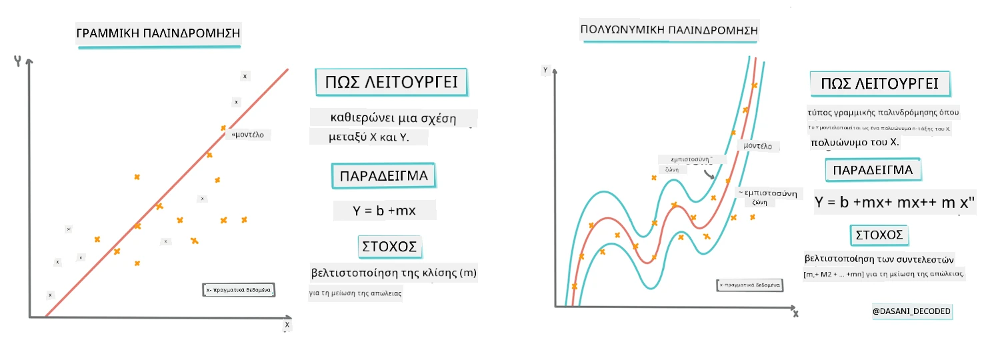
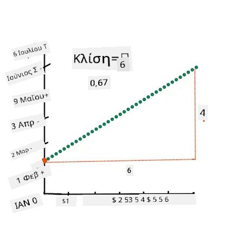
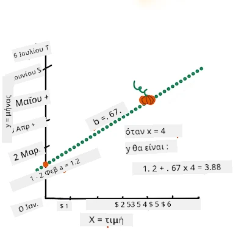
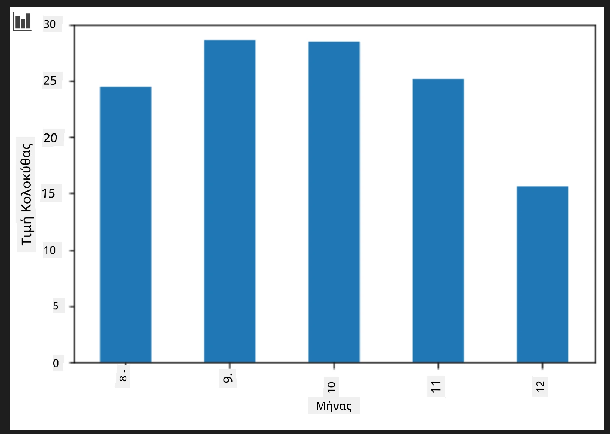
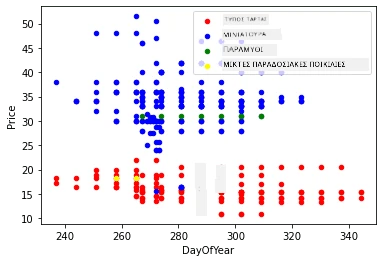

# Κατασκευή μοντέλου παλινδρόμησης με χρήση Scikit-learn: τέσσερις τρόποι παλινδρόμησης

## Σημείωση για αρχάριους

Η γραμμική παλινδρόμηση χρησιμοποιείται όταν θέλουμε να προβλέψουμε μια **ποσοτική τιμή** (για παράδειγμα, τιμή σπιτιού, θερμοκρασία ή πωλήσεις).
Λειτουργεί βρίσκοντας μια ευθεία γραμμή που αναπαριστά καλύτερα τη σχέση μεταξύ των εισαγόμενων χαρακτηριστικών και της εξόδου.

Σε αυτό το μάθημα, εστιάζουμε στην κατανόηση της έννοιας πριν εξερευνήσουμε πιο προχωρημένες τεχνικές παλινδρόμησης.

> Infographic από τον/την [Dasani Madipalli](https://twitter.com/dasani_decoded)
## [Προ-διάλεξη κουίζ](https://ff-quizzes.netlify.app/en/ml/)

> ### [Αυτό το μάθημα είναι διαθέσιμο και σε R!](../../../../2-Regression/3-Linear/solution/R/lesson_3.html)
### Εισαγωγή

Μέχρι στιγμής έχετε εξερευνήσει τι είναι η παλινδρόμηση με δείγμα δεδομένων από το σύνολο δεδομένων τιμών κολοκύθας που θα χρησιμοποιήσουμε σε όλο το μάθημα. Επίσης, το έχετε απεικονίσει χρησιμοποιώντας τη Matplotlib.

Τώρα είστε έτοιμοι να εμβαθύνετε στην παλινδρόμηση για Μηχανική Μάθηση. Ενώ η οπτικοποίηση σας επιτρέπει να κατανοήσετε τα δεδομένα, η πραγματική δύναμη της Μηχανικής Μάθησης προέρχεται από την _εκπαίδευση μοντέλων_. Τα μοντέλα εκπαιδεύονται σε ιστορικά δεδομένα για να συλλάβουν αυτόματα τις εξαρτήσεις δεδομένων, και σας επιτρέπουν να προβλέπετε αποτελέσματα για νέα δεδομένα, που το μοντέλο δεν έχει δει ποτέ πριν.

Σε αυτό το μάθημα, θα μάθετε περισσότερα για δύο τύπους παλινδρόμησης: _βασική γραμμική παλινδρόμηση_ και _πολυωνυμική παλινδρόμηση_, μαζί με μερικά από τα μαθηματικά που βασίζουν αυτές τις τεχνικές. Αυτά τα μοντέλα θα μας επιτρέψουν να προβλέψουμε τις τιμές της κολοκύθας ανάλογα με διαφορετικά εισαγόμενα δεδομένα.

[](https://youtu.be/CRxFT8oTDMg "ML for beginners - Understanding Linear Regression")

> 🎥 Κάντε κλικ στην εικόνα παραπάνω για μια σύντομη επισκόπηση της γραμμικής παλινδρόμησης.

> Σε όλη τη διδακτέα ύλη υποθέτουμε ελάχιστη γνώση μαθηματικών και προσπαθούμε να την κάνουμε προσιτή για φοιτητές από άλλους τομείς, αναζητώντας σημειώσεις, 🧮 υπενθυμίσεις, διαγράμματα και άλλα εργαλεία μάθησης για να βοηθήσουμε στην κατανόηση.

### Προαπαιτούμενα

Πρέπει να είστε πλέον εξοικειωμένοι με τη δομή των δεδομένων κολοκύθας που εξετάζουμε. Μπορείτε να τα βρείτε προφορτωμένα και προ-καθαρισμένα στο αρχείο _notebook.ipynb_ αυτού του μαθήματος. Στο αρχείο, η τιμή της κολοκύθας εμφανίζεται ανά μπουσέλ. Φροντίστε να μπορείτε να τρέχετε αυτά τα notebook σε kernels στο Visual Studio Code.

### Προετοιμασία

Ως υπενθύμιση, φορτώνετε αυτά τα δεδομένα ώστε να μπορείτε να κάνετε ερωτήσεις γι' αυτά.

- Πότε είναι η καλύτερη εποχή για να αγοράσω κολοκύθες;  
- Τι τιμή να περιμένω για μια συσκευασία από μικρές κολοκύθες;  
- Πρέπει να τις αγοράσω σε καλάθια μισού μπουσέλ ή σε κουτί 1 1/9 μπουσέλ;  
Ας συνεχίσουμε να ανακαλύπτουμε αυτά τα δεδομένα.

Στο προηγούμενο μάθημα, δημιουργήσατε ένα Pandas data frame και το γεμίσατε με μέρος του αρχικού συνόλου δεδομένων, τυποποιώντας τις τιμές ανά μπουσέλ. Κάνοντας αυτό, ωστόσο, μαζέψατε περίπου 400 δεδομένα μόνο για τους φθινοπωρινούς μήνες.

Ρίξτε μια ματιά στα δεδομένα που προφορτώσαμε στο συνοδευτικό notebook αυτού του μαθήματος. Τα δεδομένα είναι προφορτωμένα και ένα αρχικό scatterplot σχεδιάστηκε για να δείξει τα δεδομένα ανά μήνα. Ίσως μπορέσουμε να πάρουμε περισσότερες λεπτομέρειες για τη φύση των δεδομένων καθαρίζοντάς τα περαιτέρω.

## Μια γραμμή γραμμικής παλινδρόμησης

Όπως μάθατε στο Μάθημα 1, ο στόχος μιας άσκησης γραμμικής παλινδρόμησης είναι να σχεδιάσουμε μια γραμμή που:

- **Να δείχνει τις σχέσεις των μεταβλητών**. Να δείχνει τη σχέση μεταξύ των μεταβλητών  
- **Να κάνει προβλέψεις**. Να κάνει ακριβείς προβλέψεις για το πού θα εμφανιστεί ένα νέο σημείο σε σχέση με αυτή τη γραμμή.

Είναι σύνηθες στην **Παλινδρόμηση Ελαχίστων Τετραγώνων (Least-Squares Regression)** να σχεδιάζουμε αυτό το είδος γραμμής. Ο όρος "Ελαχίστων Τετραγώνων" αναφέρεται στη διαδικασία ελαχιστοποίησης του συνολικού σφάλματος στο μοντέλο μας. Για κάθε σημείο δεδομένων, μετράμε την κάθετη απόσταση (που καλείται υπολειπόμενο, residual) μεταξύ του πραγματικού σημείου και της γραμμής παλινδρόμησης.

Τετραγωνίζουμε αυτές τις αποστάσεις για δύο βασικούς λόγους:

1. **Μέγεθος αντί για Διεύθυνση:** Θέλουμε να αντιμετωπίσουμε το σφάλμα -5 το ίδιο με το σφάλμα +5. Με το τετράγωνο όλα τα μεγέθη γίνονται θετικά.

2. **Τιμωρία των Απομακρυσμένων Τιμών:** Το τετράγωνο δίνει μεγαλύτερο βάρος στα μεγαλύτερα σφάλματα, αναγκάζοντας τη γραμμή να παραμένει πιο κοντά στα σημεία που απέχουν πολύ.

Στη συνέχεια, προσθέτουμε όλα αυτά τα τετραγωνισμένα σφάλματα μαζί. Στόχος μας είναι να βρούμε τη συγκεκριμένη γραμμή όπου το τελικό άθροισμα είναι ελάχιστο (η μικρότερη δυνατή τιμή)—γι’ αυτό ονομάζεται "Ελαχίστων Τετραγώνων".

> **🧮 Δείξε μου τα μαθηματικά**  
>  
> Αυτή η γραμμή, που ονομάζεται _γραμμή καλύτερης προσαρμογής_, μπορεί να εκφραστεί με [μια εξίσωση](https://en.wikipedia.org/wiki/Simple_linear_regression):  
>  
> ```
> Y = a + bX
> ```
>
> `X` είναι η 'εξελικτική μεταβλητή'. `Y` είναι η 'εξαρτημένη μεταβλητή'. Η κλίση της γραμμής είναι `b` και `a` είναι το y-τομή, που αναφέρεται στην τιμή του `Y` όταν `X = 0`.  
>
>
>
> Αρχικά, υπολογίζουμε την κλίση `b`. Infographic από τον/την [Jen Looper](https://twitter.com/jenlooper)
>
> Με άλλα λόγια, και αναφερόμενοι στην αρχική ερώτηση για το σύνολο δεδομένων κολοκύθας: "πρόβλεψε την τιμή μιας κολοκύθας ανά μπουσέλ ανά μήνα", το `X` θα αναφερόταν στην τιμή και το `Y` στον μήνα της πώλησης.
>
>
>
> Υπολογίστε την τιμή του Y. Αν πληρώνετε περίπου 4 δολάρια, πρέπει να είναι Απρίλιος! Infographic από τον/την [Jen Looper](https://twitter.com/jenlooper)
>
> Τα μαθηματικά που υπολογίζουν τη γραμμή πρέπει να δείξουν την κλίση της γραμμής, η οποία επίσης εξαρτάται από τη τομή, ή όπου βρίσκεται το `Y` όταν `X = 0`.
>
> Μπορείτε να δείτε τη μέθοδο υπολογισμού αυτών των τιμών στην ιστοσελίδα [Math is Fun](https://www.mathsisfun.com/data/least-squares-regression.html). Επίσης επισκεφθείτε [αυτόν τον υπολογιστή ελαχίστων τετραγώνων](https://www.mathsisfun.com/data/least-squares-calculator.html) για να δείτε πώς οι τιμές των αριθμών επηρεάζουν τη γραμμή.

## Συσχέτιση

Ένας ακόμη όρος που πρέπει να κατανοήσουμε είναι ο **Συντελεστής Συσχέτισης** μεταξύ των δεδομένων μεταβλητών X και Y. Χρησιμοποιώντας ένα scatterplot, μπορείτε γρήγορα να οπτικοποιήσετε αυτόν τον συντελεστή. Ένα γράφημα με σημεία δεδομένων διασκορπισμένα σε έναν καλοστρωμένο άξονα έχει υψηλή συσχέτιση, ενώ ένα γράφημα με τα σημεία να είναι σκορπισμένα παντού ανάμεσα σε X και Y έχει χαμηλή συσχέτιση.

Ένα καλό μοντέλο γραμμικής παλινδρόμησης θα έχει υψηλό (πλησιέστερα στο 1 παρά στο 0) Συντελεστή Συσχέτισης χρησιμοποιώντας τη μέθοδο Ελαχίστων Τετραγώνων με γραμμή παλινδρόμησης.

✅ Τρέξτε το notebook που συνοδεύει αυτό το μάθημα και δείτε το scatterplot Μήνα προς Τιμή. Φαίνεται να υπάρχει υψηλή ή χαμηλή συσχέτιση μεταξύ Μήνα και Τιμής για τις πωλήσεις κολοκύθας, σύμφωνα με την οπτική σας ερμηνεία του scatterplot; Αλλάζει κάτι αν χρησιμοποιήσετε πιο λεπτομερή μέτρηση αντί για `Μήνα`, π.χ. *ημέρα του έτους* (δηλαδή, αριθμός ημερών από την αρχή του έτους);

Στον παρακάτω κώδικα, θα υποθέσουμε ότι έχουμε καθαρίσει τα δεδομένα και έχουμε ένα data frame που ονομάζεται `new_pumpkins`, παρόμοιο με το ακόλουθο:

ID | Μήνας | ΗμέρατουΈτους | Ποικιλία | Πόλη | Συσκευασία | Χαμηλή Τιμή | Υψηλή Τιμή | Τιμή
---|-------|-----------|---------|------|---------|-----------|------------|-------
70 | 9 | 267 | ΤΥΠΟΥ ΚΕΙΚ | BALTIMORE | 1 1/9 μπουσέλ κουτιά | 15.0 | 15.0 | 13.636364
71 | 9 | 267 | ΤΥΠΟΥ ΚΕΙΚ | BALTIMORE | 1 1/9 μπουσέλ κουτιά | 18.0 | 18.0 | 16.363636
72 | 10 | 274 | ΤΥΠΟΥ ΚΕΙΚ | BALTIMORE | 1 1/9 μπουσέλ κουτιά | 18.0 | 18.0 | 16.363636
73 | 10 | 274 | ΤΥΠΟΥ ΚΕΙΚ | BALTIMORE | 1 1/9 μπουσέλ κουτιά | 17.0 | 17.0 | 15.454545
74 | 10 | 281 | ΤΥΠΟΥ ΚΕΙΚ | BALTIMORE | 1 1/9 μπουσέλ κουτιά | 15.0 | 15.0 | 13.636364

> Ο κώδικας για τον καθαρισμό των δεδομένων είναι διαθέσιμος στο [`notebook.ipynb`](notebook.ipynb). Έχουμε εκτελέσει τα ίδια βήματα καθαρισμού όπως στο προηγούμενο μάθημα και έχουμε υπολογίσει την στήλη `DayOfYear` με την ακόλουθη έκφραση:

```python
day_of_year = pd.to_datetime(pumpkins['Date']).apply(lambda dt: (dt-datetime(dt.year,1,1)).days)
```
  
Τώρα που έχετε κατανοήσει τα μαθηματικά πίσω από τη γραμμική παλινδρόμηση, ας δημιουργήσουμε ένα μοντέλο παλινδρόμησης για να δούμε αν μπορούμε να προβλέψουμε ποια συσκευασία κολοκύθας θα έχει τις καλύτερες τιμές. Κάποιος που αγοράζει κολοκύθες για ένα παρτέρι διακοπών μπορεί να θέλει αυτή την πληροφορία για να βελτιστοποιήσει τις αγορές του.

## Αναζήτηση συσχέτισης

[](https://youtu.be/uoRq-lW2eQo "ML for beginners - Looking for Correlation: The Key to Linear Regression")

> 🎥 Κάντε κλικ στην εικόνα παραπάνω για μια σύντομη επισκόπηση της συσχέτισης.

Από το προηγούμενο μάθημα πιθανώς έχετε δει ότι η μέση τιμή για διαφορετικούς μήνες έχει ως εξής:



Αυτό υποδηλώνει ότι υπάρχει κάποια συσχέτιση και μπορούμε να προσπαθήσουμε να εκπαιδεύσουμε ένα γραμμικό μοντέλο παλινδρόμησης για να προβλέψουμε τη σχέση ανάμεσα στον `Μήνα` και την `Τιμή`, ή ανάμεσα στην `ΗμέρατουΈτους` και την `Τιμή`. Εδώ είναι το scatter plot που δείχνει τη δεύτερη σχέση:

 

Ας δούμε αν υπάρχει συσχέτιση χρησιμοποιώντας τη λειτουργία `corr`:

```python
print(new_pumpkins['Month'].corr(new_pumpkins['Price']))
print(new_pumpkins['DayOfYear'].corr(new_pumpkins['Price']))
```
  
Φαίνεται ότι η συσχέτιση είναι αρκετά μικρή, -0.15 για τον `Μήνα` και -0.17 για την `ΗμέρατουΈτους`, αλλά πιθανόν να υπάρχει άλλη σημαντική σχέση. Φαίνεται ότι υπάρχουν διαφορετικές ομάδες τιμών που αντιστοιχούν σε διαφορετικές ποικιλίες κολοκύθας. Για να επιβεβαιώσουμε αυτή την υπόθεση, ας σχεδιάσουμε κάθε κατηγορία κολοκύθας με διαφορετικό χρώμα. Με τη χρήση της παραμέτρου `ax` στη συνάρτηση σχεδίασης `scatter` μπορούμε να σχεδιάσουμε όλα τα σημεία στο ίδιο γράφημα:

```python
ax=None
colors = ['red','blue','green','yellow']
for i,var in enumerate(new_pumpkins['Variety'].unique()):
    df = new_pumpkins[new_pumpkins['Variety']==var]
    ax = df.plot.scatter('DayOfYear','Price',ax=ax,c=colors[i],label=var)
```
  
 

Η έρευνά μας υποδεικνύει ότι η ποικιλία επηρεάζει περισσότερο την τιμή από την ημερομηνία πώλησης. Αυτό φαίνεται και σε ένα ραβδογράφημα:

```python
new_pumpkins.groupby('Variety')['Price'].mean().plot(kind='bar')
```
  
 

Ας εστιάσουμε προς το παρόν μόνο στην ποικιλία 'pie type' και να δούμε τι επίδραση έχει η ημερομηνία στην τιμή:

```python
pie_pumpkins = new_pumpkins[new_pumpkins['Variety']=='PIE TYPE']
pie_pumpkins.plot.scatter('DayOfYear','Price') 
```
 

Αν τώρα υπολογίσουμε τη συσχέτιση μεταξύ `Τιμής` και `ΗμέραςτουΈτους` χρησιμοποιώντας τη συνάρτηση `corr`, θα πάρουμε κάτι σαν `-0.27` – που σημαίνει ότι η εκπαίδευση ενός προγνωστικού μοντέλου έχει νόημα.

> Πριν εκπαιδεύσουμε ένα μοντέλο γραμμικής παλινδρόμησης, είναι σημαντικό να βεβαιωθούμε ότι τα δεδομένα μας είναι καθαρά. Η γραμμική παλινδρόμηση δεν λειτουργεί καλά με κενές τιμές, άρα έχει νόημα να αφαιρέσουμε όλα τα κενά κελιά:

```python
pie_pumpkins.dropna(inplace=True)
pie_pumpkins.info()
```
  
Μια άλλη προσέγγιση θα ήταν να συμπληρώσουμε τις κενές τιμές με τις μέσες τιμές της αντίστοιχης στήλης.

## Απλή γραμμική παλινδρόμηση

[](https://youtu.be/e4c_UP2fSjg "ML for beginners - Linear and Polynomial Regression using Scikit-learn")

> 🎥 Κάντε κλικ στην εικόνα παραπάνω για μια σύντομη επισκόπηση της γραμμικής και πολυωνυμικής παλινδρόμησης.

Για να εκπαιδεύσουμε το μοντέλο Γραμμικής Παλινδρόμησης, θα χρησιμοποιήσουμε τη βιβλιοθήκη **Scikit-learn**.

```python
from sklearn.linear_model import LinearRegression
from sklearn.metrics import mean_squared_error
from sklearn.model_selection import train_test_split
```
  
Ξεκινάμε διαχωρίζοντας τις εισερχόμενες τιμές (χαρακτηριστικά) και την αναμενόμενη έξοδο (ετικέτα) σε ξεχωριστά numpy arrays:

```python
X = pie_pumpkins['DayOfYear'].to_numpy().reshape(-1,1)
y = pie_pumpkins['Price']
```
  
> Σημειώστε ότι έπρεπε να πραγματοποιήσουμε `reshape` στα δεδομένα εισόδου ώστε το πακέτο γραμμικής παλινδρόμησης να τα κατανοήσει σωστά. Η γραμμική παλινδρόμηση περιμένει έναν πίνακα 2 διαστάσεων ως είσοδο, όπου κάθε γραμμή του πίνακα αντιστοιχεί σε έναν διανυσματικό πίνακα χαρακτηριστικών. Στη περίπτωση μας, αφού έχουμε μόνο ένα χαρακτηριστικό, χρειαζόμαστε έναν πίνακα σχήματος N&times;1, όπου N είναι το μέγεθος του συνόλου δεδομένων.

Έπειτα, πρέπει να χωρίσουμε τα δεδομένα σε σύνολα εκπαίδευσης και δοκιμής, ώστε να μπορούμε να επικυρώσουμε το μοντέλο μας μετά την εκπαίδευση:

```python
X_train, X_test, y_train, y_test = train_test_split(X, y, test_size=0.2, random_state=0)
```
  
Τέλος, η εκπαίδευση του πραγματικού μοντέλου γραμμικής παλινδρόμησης γίνεται με μόνο δύο γραμμές κώδικα. Ορίζουμε το αντικείμενο `LinearRegression` και το προσαρμόζουμε στα δεδομένα μας με τη μέθοδο `fit`:

```python
lin_reg = LinearRegression()
lin_reg.fit(X_train,y_train)
```

Το αντικείμενο `LinearRegression` μετά το `fit`-άρισμα περιέχει όλους τους συντελεστές της παλινδρόμησης, στους οποίους μπορούμε να έχουμε πρόσβαση χρησιμοποιώντας την ιδιότητα `.coef_`. Στη δική μας περίπτωση, υπάρχει μόνο ένας συντελεστής, ο οποίος θα πρέπει να είναι περίπου `-0.017`. Αυτό σημαίνει ότι οι τιμές φαίνεται να πέφτουν λίγο με τον χρόνο, αλλά όχι πολύ, περίπου 2 λεπτά της μονάδας ανά ημέρα. Μπορούμε επίσης να έχουμε πρόσβαση στο σημείο τομής της παλινδρόμησης με τον άξονα Υ χρησιμοποιώντας το `lin_reg.intercept_` - θα είναι περίπου `21` στην περίπτωσή μας, δείχνοντας την τιμή στην αρχή του έτους.

Για να δούμε πόσο ακριβές είναι το μοντέλο μας, μπορούμε να προβλέψουμε τιμές σε ένα σύνολο δεδομένων δοκιμής και μετά να μετρήσουμε πόσο κοντά είναι οι προβλέψεις μας στις αναμενόμενες τιμές. Αυτό μπορεί να γίνει χρησιμοποιώντας το μέτρο του ριζικού μέσου τετραγωνικού σφάλματος (RMSE), που είναι η ρίζα του μέσου όλων των τετραγωνικών διαφορών μεταξύ αναμενόμενης και προβλεπόμενης τιμής.

```python
pred = lin_reg.predict(X_test)

rmse = np.sqrt(mean_squared_error(y_test,pred))
print(f'RMSE: {rmse:3.3} ({rmse/np.mean(pred)*100:3.3}%)')
```

Το σφάλμα μας φαίνεται να είναι περίπου 2 μονάδες, που είναι ~17%. Όχι πολύ καλό. Ένας άλλος δείκτης της ποιότητας του μοντέλου είναι ο **συντελεστής προσδιορισμού**, που μπορεί να ληφθεί ως εξής:

```python
score = lin_reg.score(X_train,y_train)
print('Model determination: ', score)
```

Αν η τιμή είναι 0, σημαίνει ότι το μοντέλο δεν λαμβάνει υπόψη τα εισαγόμενα δεδομένα και λειτουργεί ως ο *χειρότερος γραμμικός προβλέπων*, ο οποίος είναι απλά μια μέση τιμή του αποτελέσματος. Η τιμή 1 σημαίνει ότι μπορούμε να προβλέψουμε τέλεια όλες τις αναμενόμενες εξόδους. Στη δική μας περίπτωση, ο συντελεστής είναι περίπου 0.06, που είναι αρκετά χαμηλός.

Μπορούμε επίσης να σχεδιάσουμε τα δεδομένα δοκιμής μαζί με τη γραμμή παλινδρόμησης για να δούμε καλύτερα πώς λειτουργεί η παλινδρόμηση στην περίπτωσή μας:

```python
plt.scatter(X_test,y_test)
plt.plot(X_test,pred)
```


## Πολυωνυμική Παλινδρόμηση

Ένας άλλος τύπος γραμμικής παλινδρόμησης είναι η Πολυωνυμική Παλινδρόμηση. Ενώ μερικές φορές υπάρχει γραμμική συσχέτιση μεταξύ μεταβλητών - όσο μεγαλύτερη η κολοκύθα σε όγκο, τόσο υψηλότερη η τιμή - μερικές φορές αυτές οι σχέσεις δεν μπορούν να απεικονιστούν ως επίπεδο ή ευθεία γραμμή.

✅ Εδώ είναι [μερικά ακόμη παραδείγματα](https://online.stat.psu.edu/stat501/Lesson09#polynomial-regression-examples) δεδομένων που θα μπορούσαν να χρησιμοποιήσουν Πολυωνυμική Παλινδρόμηση.

Ρίξε μια ακόμα ματιά στη σχέση μεταξύ Ημερομηνίας και Τιμής. Φαίνεται αυτό το scatterplot να πρέπει απαραίτητα να αναλυθεί με μια ευθεία γραμμή; Δεν μπορούν οι τιμές να κυμαίνονται; Σε αυτή την περίπτωση, μπορείς να δοκιμάσεις την πολυωνυμική παλινδρόμηση.

✅ Οι πολυώνυμοι είναι μαθηματικές εκφράσεις που μπορεί να αποτελούνται από μία ή περισσότερες μεταβλητές και συντελεστές.

Η πολυωνυμική παλινδρόμηση δημιουργεί μια καμπύλη γραμμή για να ταιριάξει καλύτερα σε μη-γραμμικά δεδομένα. Στη δική μας περίπτωση, αν συμπεριλάβουμε μια τετράγωνη μεταβλητή `DayOfYear` στα εισαγόμενα δεδομένα, θα πρέπει να μπορέσουμε να προσαρμόσουμε τα δεδομένα μας με μια παραβολική καμπύλη, που θα έχει ένα ελάχιστο σε κάποιο σημείο μέσα στο έτος.

Το Scikit-learn περιλαμβάνει ένα χρήσιμο [pipeline API](https://scikit-learn.org/stable/modules/generated/sklearn.pipeline.make_pipeline.html?highlight=pipeline#sklearn.pipeline.make_pipeline) για να συνδυάζει διαφορετικά βήματα επεξεργασίας δεδομένων μαζί. Ένα **pipeline** είναι μια αλυσίδα **εκτιμητών**. Στη δική μας περίπτωση, θα δημιουργήσουμε ένα pipeline που πρώτα προσθέτει πολυωνυμικά χαρακτηριστικά στο μοντέλο μας, και μετά εκπαιδεύει την παλινδρόμηση:

```python
from sklearn.preprocessing import PolynomialFeatures
from sklearn.pipeline import make_pipeline

pipeline = make_pipeline(PolynomialFeatures(2), LinearRegression())

pipeline.fit(X_train,y_train)
```

Η χρήση του `PolynomialFeatures(2)` σημαίνει ότι θα συμπεριλάβουμε όλους τους πολυώνυμους δεύτερου βαθμού από τα εισαγόμενα δεδομένα. Στη δική μας περίπτωση αυτό σημαίνει απλά `DayOfYear`<sup>2</sup>, αλλά δεδομένων δύο εισερχόμενων μεταβλητών X και Y, αυτό θα προσθέσει X<sup>2</sup>, XY και Y<sup>2</sup>. Μπορούμε επίσης να χρησιμοποιήσουμε πολυώνυμα υψηλότερου βαθμού αν το θέλουμε.

Τα pipelines μπορούν να χρησιμοποιηθούν με τον ίδιο τρόπο όπως το αρχικό αντικείμενο `LinearRegression`, δηλαδή μπορούμε να κάνουμε `fit` το pipeline και μετά να χρησιμοποιήσουμε `predict` για να πάρουμε τα αποτελέσματα της πρόβλεψης:

```python
pred = pipeline.predict(X_test)

rmse = np.sqrt(mean_squared_error(y_test,pred))
print(f'RMSE: {rmse:3.3} ({rmse/np.mean(pred)*100:3.3}%)')

score = pipeline.score(X_train,y_train)
print('Model determination: ', score)
```

Για να σχεδιάσουμε την ομαλή καμπύλη προσέγγισης, χρησιμοποιούμε το `np.linspace` για να δημιουργήσουμε ένα ομοιόμορφο φάσμα τιμών εισόδου, αντί να σχεδιάσουμε άμεσα πάνω στα μη διατεταγμένα δεδομένα δοκιμής (που θα παρήγαγε μια ζιγκ-ζαγκ γραμμή):

```python
X_range = np.linspace(X_test.min(), X_test.max(), 100).reshape(-1,1)
y_range = pipeline.predict(X_range)

plt.scatter(X_test, y_test)
plt.plot(X_range, y_range)
```

Εδώ είναι το διάγραμμα που δείχνει τα δεδομένα δοκιμής και την καμπύλη προσέγγισης:


Χρησιμοποιώντας την Πολυωνυμική Παλινδρόμηση, μπορούμε να πετύχουμε ελαφρώς χαμηλότερο RMSE και υψηλότερο συντελεστή προσδιορισμού, αλλά όχι σημαντικά. Πρέπει να λάβουμε υπόψη και άλλα χαρακτηριστικά!

> Μπορείς να δεις ότι οι ελάχιστες τιμές κολοκύθας παρατηρούνται κάπου γύρω από το Halloween. Πώς μπορείς να το εξηγήσεις;

🎃 Συγχαρητήρια, μόλις δημιούργησες ένα μοντέλο που μπορεί να βοηθήσει στην πρόβλεψη της τιμής των πίτων κολοκύθας. Πιθανώς να μπορείς να επαναλάβεις την ίδια διαδικασία για όλους τους τύπους κολοκύθας, αλλά αυτό θα ήταν κουραστικό. Ας μάθουμε τώρα πώς να λαμβάνουμε υπόψη την ποικιλία κολοκύθας στο μοντέλο μας!

## Κατηγορικά Χαρακτηριστικά

Σε έναν ιδανικό κόσμο, θέλουμε να μπορούμε να προβλέπουμε τιμές για διαφορετικές ποικιλίες κολοκύθας χρησιμοποιώντας το ίδιο μοντέλο. Ωστόσο, η στήλη `Variety` διαφέρει κάπως από στήλες όπως το `Month`, επειδή περιέχει μη αριθμητικές τιμές. Τέτοιες στήλες ονομάζονται **κατηγορικές**.

[](https://youtu.be/DYGliioIAE0 "Μηχανική Μάθηση για αρχάριους - Προβλέψεις με κατηγορικά χαρακτηριστικά χρησιμοποιώντας γραμμική παλινδρόμηση")

> 🎥 Κάνε κλικ στην παραπάνω εικόνα για μια σύντομη επισκόπηση βίντεο σχετικά με τη χρήση κατηγορικών χαρακτηριστικών.

Εδώ βλέπεις πως η μέση τιμή εξαρτάται από την ποικιλία:


Για να λάβουμε υπόψη την ποικιλία, πρώτα πρέπει να τη μετατρέψουμε σε αριθμητική μορφή, ή να την **κωδικοποιήσουμε**. Υπάρχουν διάφοροι τρόποι που μπορούμε να το κάνουμε:

* Η απλή **αριθμητική κωδικοποίηση** θα δημιουργήσει έναν πίνακα με τις διαφορετικές ποικιλίες, και μετά θα αντικαταστήσει το όνομα της ποικιλίας με ένα δείκτη σε αυτόν τον πίνακα. Αυτό δεν είναι η καλύτερη ιδέα για την γραμμική παλινδρόμηση, γιατί η γραμμική παλινδρόμηση λαμβάνει την πραγματική αριθμητική τιμή του δείκτη και την προσθέτει στο αποτέλεσμα, πολλαπλασιάζοντας με κάποιο συντελεστή. Στη δική μας περίπτωση, η σχέση μεταξύ του αριθμού δείκτη και της τιμής είναι σαφώς μη γραμμική, ακόμα κι αν φροντίσουμε να τακτοποιήσουμε τους δείκτες με κάποιο συγκεκριμένο τρόπο.
* Η **one-hot κωδικοποίηση** θα αντικαταστήσει τη στήλη `Variety` με 4 διαφορετικές στήλες, μία για κάθε ποικιλία. Κάθε στήλη θα περιέχει `1` αν η αντίστοιχη γραμμή είναι της συγκεκριμένης ποικιλίας, και `0` διαφορετικά. Αυτό σημαίνει ότι θα υπάρχουν τέσσερις συντελεστές στη γραμμική παλινδρόμηση, ένας για κάθε ποικιλία κολοκύθας, υπεύθυνος για την «αρχική τιμή» (ή μάλλον την «πρόσθετη τιμή») για αυτή την ποικιλία.

Ο κώδικας παρακάτω δείχνει πώς μπορούμε να κάνουμε one-hot κωδικοποίηση μιας ποικιλίας:

```python
pd.get_dummies(new_pumpkins['Variety'])
```

 ID | FAIRYTALE | MINIATURE | MIXED HEIRLOOM VARIETIES | PIE TYPE
----|-----------|-----------|--------------------------|----------
70 | 0 | 0 | 0 | 1
71 | 0 | 0 | 0 | 1
... | ... | ... | ... | ...
1738 | 0 | 1 | 0 | 0
1739 | 0 | 1 | 0 | 0
1740 | 0 | 1 | 0 | 0
1741 | 0 | 1 | 0 | 0
1742 | 0 | 1 | 0 | 0

Για να εκπαιδεύσουμε γραμμική παλινδρόμηση χρησιμοποιώντας την one-hot κωδικοποίηση ποικιλίας ως είσοδο, απλώς πρέπει να αρχικοποιήσουμε σωστά τα δεδομένα `X` και `y`:

```python
X = pd.get_dummies(new_pumpkins['Variety'])
y = new_pumpkins['Price']
```

Ο υπόλοιπος κώδικας είναι ο ίδιος με τον παραπάνω που χρησιμοποιήσαμε για να εκπαιδεύσουμε τη γραμμική παλινδρόμηση. Αν το δοκιμάσεις, θα δεις ότι το μέσο τετραγωνικό σφάλμα είναι περίπου το ίδιο, αλλά λαμβάνουμε πολύ υψηλότερο συντελεστή προσδιορισμού (~77%). Για να κάνουμε τις προβλέψεις ακόμα πιο ακριβείς, μπορούμε να λάβουμε υπόψη περισσότερα κατηγορικά χαρακτηριστικά, καθώς και αριθμητικά χαρακτηριστικά, όπως το `Month` ή το `DayOfYear`. Για να πάρουμε έναν μεγάλο πίνακα χαρακτηριστικών, μπορούμε να χρησιμοποιήσουμε το `join`:

```python
X = pd.get_dummies(new_pumpkins['Variety']) \
        .join(new_pumpkins['Month']) \
        .join(pd.get_dummies(new_pumpkins['City'])) \
        .join(pd.get_dummies(new_pumpkins['Package']))
y = new_pumpkins['Price']
```

Εδώ επίσης λαμβάνουμε υπόψη `City` και τύπο `Package`, που μας δίνει RMSE 2.84 (10.5%) και συντελεστή προσδιορισμού 0.94!

## Ταυτόχρονη χρήση όλων τους

Για να φτιάξουμε το καλύτερο μοντέλο, μπορούμε να χρησιμοποιήσουμε συνδυασμένα (one-hot κωδικοποιημένα κατηγορικά + αριθμητικά) δεδομένα από το παραπάνω παράδειγμα μαζί με την πολυωνυμική παλινδρόμηση. Εδώ είναι ο πλήρης κώδικας για τη διευκόλυνσή σου:

```python
# ορίστε τα δεδομένα εκπαίδευσης
X = pd.get_dummies(new_pumpkins['Variety']) \
        .join(new_pumpkins['Month']) \
        .join(pd.get_dummies(new_pumpkins['City'])) \
        .join(pd.get_dummies(new_pumpkins['Package']))
y = new_pumpkins['Price']

# κάντε διαχωρισμό εκπαίδευσης-δοκιμής
X_train, X_test, y_train, y_test = train_test_split(X, y, test_size=0.2, random_state=0)

# ρυθμίστε και εκπαιδεύστε τη ροή εργασίας
pipeline = make_pipeline(PolynomialFeatures(2), LinearRegression())
pipeline.fit(X_train,y_train)

# προβλέψτε τα αποτελέσματα για τα δεδομένα δοκιμής
pred = pipeline.predict(X_test)

# υπολογίστε το RMSE και τον συντελεστή προσδιορισμού
rmse = mean_squared_error(y_test, pred, squared=False)
print(f'RMSE: {rmse:3.3} ({rmse/pred.mean()*100:3.3}%)')

score = pipeline.score(X_train,y_train)
print('Model determination: ', score)
```

Αυτό θα μας δώσει τον καλύτερο συντελεστή προσδιορισμού σχεδόν 97%, και RMSE=2.23 (~8% σφάλμα πρόβλεψης).

| Μοντέλο | RMSE | Συντελεστής προσδιορισμού |
|-------|-----|---------------|
| Γραμμικό `DayOfYear` | 2.77 (17.2%) | 0.07 |
| Πολυωνυμικό `DayOfYear` | 2.73 (17.0%) | 0.08 |
| Γραμμικό `Variety` | 5.24 (19.7%) | 0.77 |
| Όλα τα χαρακτηριστικά Γραμμικό | 2.84 (10.5%) | 0.94 |
| Όλα τα χαρακτηριστικά Πολυωνυμικό | 2.23 (8.25%) | 0.97 |

🏆 Μπράβο! Δημιούργησες τέσσερα μοντέλα Παλινδρόμησης σε ένα μάθημα και βελτίωσες την ποιότητα του μοντέλου στο 97%. Στην τελική ενότητα για την παλινδρόμηση, θα μάθεις για την Λογιστική Παλινδρόμηση για τον καθορισμό κατηγοριών.

---
## 🚀Πρόκληση

Δοκίμασε διάφορες μεταβλητές σε αυτό το σημειωματάριο για να δεις πώς η συσχέτιση αντιστοιχεί στην ακρίβεια του μοντέλου.

## [Κουίζ μετά το μάθημα](https://ff-quizzes.netlify.app/en/ml/)

## Ανασκόπηση & Αυτοδιδασκαλία

Σε αυτό το μάθημα μάθαμε για τη Γραμμική Παλινδρόμηση. Υπάρχουν και άλλοι σημαντικοί τύποι παλινδρόμησης. Διάβασε για τις τεχνικές Stepwise, Ridge, Lasso και Elasticnet. Ένα καλό μάθημα για να μελετήσεις περισσότερα είναι το [Stanford Statistical Learning course](https://online.stanford.edu/courses/sohs-ystatslearning-statistical-learning)

## Άσκηση

[Δημιούργησε ένα μοντέλο](assignment.md)

---

<!-- CO-OP TRANSLATOR DISCLAIMER START -->
**Αποποίηση ευθυνών**:  
Αυτό το έγγραφο έχει μεταφραστεί χρησιμοποιώντας την υπηρεσία μετάφρασης AI [Co-op Translator](https://github.com/Azure/co-op-translator). Ενώ προσπαθούμε για ακρίβεια, παρακαλούμε να έχετε υπόψη ότι οι αυτόματες μεταφράσεις ενδέχεται να περιέχουν σφάλματα ή ανακρίβειες. Το αρχικό έγγραφο στη μητρική του γλώσσα πρέπει να θεωρείται η αυθεντική πηγή. Για κρίσιμες πληροφορίες, συνιστάται επαγγελματική ανθρώπινη μετάφραση. Δεν φέρουμε καμία ευθύνη για τυχόν παρεξηγήσεις ή λανθασμένες ερμηνείες που προκύπτουν από τη χρήση αυτής της μετάφρασης.
<!-- CO-OP TRANSLATOR DISCLAIMER END -->