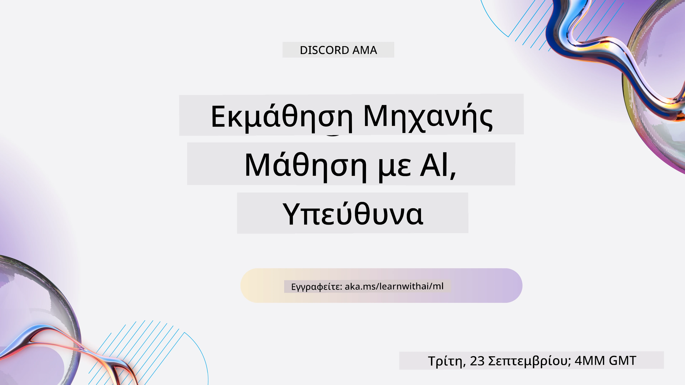
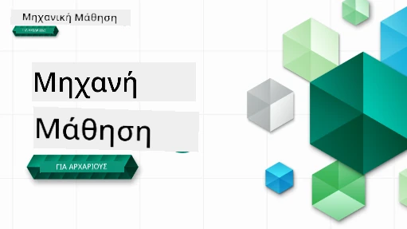

[](https://github.com/microsoft/ML-For-Beginners/blob/master/LICENSE)
[](https://GitHub.com/microsoft/ML-For-Beginners/graphs/contributors/)
[](https://GitHub.com/microsoft/ML-For-Beginners/issues/)
[](https://GitHub.com/microsoft/ML-For-Beginners/pulls/)
[](http://makeapullrequest.com)

[](https://GitHub.com/microsoft/ML-For-Beginners/watchers/)
[](https://GitHub.com/microsoft/ML-For-Beginners/network/)
[](https://GitHub.com/microsoft/ML-For-Beginners/stargazers/)

### 🌐 Υποστήριξη Πολλαπλών Γλωσσών

#### Μεταφράσεις διατηρούνται με [Co-op Translator](https://github.com/Azure/co-op-translator)

<!-- CO-OP TRANSLATOR LANGUAGES TABLE START -->
[Αραβικά](../ar/README.md) | [Μπενγκάλι](../bn/README.md) | [Βουλγαρικά](../bg/README.md) | [Βιρμανικά (Μυανμάρ)](../my/README.md) | [Κινέζικα (Απλοποιημένα)](../zh-CN/README.md) | [Κινέζικα (Παραδοσιακά, Χονγκ Κονγκ)](../zh-HK/README.md) | [Κινέζικα (Παραδοσιακά, Μακάο)](../zh-MO/README.md) | [Κινέζικα (Παραδοσιακά, Ταϊβάν)](../zh-TW/README.md) | [Κροατικά](../hr/README.md) | [Τσεχικά](../cs/README.md) | [Δανικά](../da/README.md) | [Ολλανδικά](../nl/README.md) | [Εσθονικά](../et/README.md) | [Φινλανδικά](../fi/README.md) | [Γαλλικά](../fr/README.md) | [Γερμανικά](../de/README.md) | [Ελληνικά](./README.md) | [Εβραϊκά](../he/README.md) | [Χίντι](../hi/README.md) | [Ουγγρικά](../hu/README.md) | [Ινδονησιακά](../id/README.md) | [Ιταλικά](../it/README.md) | [Ιαπωνικά](../ja/README.md) | [Κανάντα](../kn/README.md) | [Χμερ](../km/README.md) | [Κορεατικά](../ko/README.md) | [Λιθουανικά](../lt/README.md) | [Μαλαισιανά](../ms/README.md) | [Μαλαγιαλάμ](../ml/README.md) | [Μανιπούρι (Μεϊτέι Μαγεκ)](../mni/README.md) | [Μαράθι](../mr/README.md) | [Νεπάλι](../ne/README.md) | [Νιγηριανό Πίνγκιν](../pcm/README.md) | [Νορβηγικά](../no/README.md) | [Περσικά (Φαρσί)](../fa/README.md) | [Πολωνικά](../pl/README.md) | [Πορτογαλικά (Βραζιλία)](../pt-BR/README.md) | [Πορτογαλικά (Πορτογαλία)](../pt-PT/README.md) | [Πουντζάμπι (Γκουρμούκι)](../pa/README.md) | [Ρουμανικά](../ro/README.md) | [Ρωσικά](../ru/README.md) | [Σερβικά (Κυριλλικά)](../sr/README.md) | [Σλοβακικά](../sk/README.md) | [Σλοβενικά](../sl/README.md) | [Ισπανικά](../es/README.md) | [Σουαχίλι](../sw/README.md) | [Σουηδικά](../sv/README.md) | [Ταγκαλόγκ (Φιλιππινέζικα)](../tl/README.md) | [Ταμίλ](../ta/README.md) | [Τελούγκου](../te/README.md) | [Ταϊλανδέζικα](../th/README.md) | [Τουρκικά](../tr/README.md) | [Ουκρανικά](../uk/README.md) | [Ουρντού](../ur/README.md) | [Βιετναμέζικα](../vi/README.md)

> **Προτιμάτε τοπικό κλώνο;**
>
> Αυτό το αποθετήριο περιλαμβάνει πάνω από 50 μεταφράσεις γλωσσών οι οποίες αυξάνουν σημαντικά το μέγεθος λήψης. Για να κλωνοποιήσετε χωρίς μεταφράσεις, χρησιμοποιήστε το sparse checkout:
>
> **Bash / macOS / Linux:**
> ```bash
> git clone --filter=blob:none --sparse https://github.com/microsoft/ML-For-Beginners.git
> cd ML-For-Beginners
> git sparse-checkout set --no-cone '/*' '!translations' '!translated_images'
> ```
>
> **CMD (Windows):**
> ```cmd
> git clone --filter=blob:none --sparse https://github.com/microsoft/ML-For-Beginners.git
> cd ML-For-Beginners
> git sparse-checkout set --no-cone "/*" "!translations" "!translated_images"
> ```
>
> Αυτό σας παρέχει ό,τι χρειάζεστε για να ολοκληρώσετε το μάθημα με πολύ πιο γρήγορη λήψη.
<!-- CO-OP TRANSLATOR LANGUAGES TABLE END -->

#### Ενταχθείτε στην Κοινότητά μας

[](https://discord.gg/nTYy5BXMWG)

Έχουμε σε εξέλιξη μία σειρά Discord "μαθαίνω με AI", μάθετε περισσότερα και ενταχθείτε σε εμάς στο [Learn with AI Series](https://aka.ms/learnwithai/discord) από 18 έως 30 Σεπτεμβρίου 2025. Θα λάβετε συμβουλές και κόλπα για τη χρήση του GitHub Copilot για Data Science.



# Μηχανική Μάθηση για Αρχάριους - Ένα Πρόγραμμα Σπουδών

> 🌍 Ταξιδέψτε σε όλον τον κόσμο καθώς εξερευνούμε τη Μηχανική Μάθηση μέσα από πολιτισμούς του κόσμου 🌍

Οι Cloud Advocates στη Microsoft προσφέρουν ένα πρόγραμμα σπουδών 12 εβδομάδων με 26 μαθήματα που αφορά αποκλειστικά τη **Μηχανική Μάθηση**. Σε αυτό το πρόγραμμα, θα μάθετε για τη λεγόμενη **κλασική μηχανική μάθηση**, χρησιμοποιώντας πρωτίστως τη βιβλιοθήκη Scikit-learn και αποφεύγοντας το deep learning, που καλύπτεται στο [AI for Beginners' curriculum](https://aka.ms/ai4beginners). Συνδυάστε τα μαθήματα αυτά και με το ['Data Science for Beginners' curriculum](https://aka.ms/ds4beginners)!

Ταξιδέψτε μαζί μας σε όλον τον κόσμο εφαρμόζοντας αυτές τις κλασικές τεχνικές σε δεδομένα από πολλές περιοχές του κόσμου. Κάθε μάθημα περιλαμβάνει κουίζ πριν και μετά το μάθημα, γραπτές οδηγίες για την ολοκλήρωση του μαθήματος, λύση, άσκηση, και άλλα. Η παιδαγωγική μας με βάση έργα σας επιτρέπει να μαθαίνετε ενώ δημιουργείτε, μια αποδεδειγμένη μέθοδο για να "εγκαθίστανται" νέες δεξιότητες.

**✍️ Θερμές ευχαριστίες στους συγγραφείς μας** Jen Looper, Stephen Howell, Francesca Lazzeri, Tomomi Imura, Cassie Breviu, Dmitry Soshnikov, Chris Noring, Anirban Mukherjee, Ornella Altunyan, Ruth Yakubu και Amy Boyd

**🎨 Ευχαριστίες επίσης στους εικονογράφους μας** Tomomi Imura, Dasani Madipalli, και Jen Looper

**🙏 Ειδικές ευχαριστίες 🙏 στους Microsoft Student Ambassador συγγραφείς, κριτές και συνεισφέροντες περιεχομένου**, ιδιαίτερα στους Rishit Dagli, Muhammad Sakib Khan Inan, Rohan Raj, Alexandru Petrescu, Abhishek Jaiswal, Nawrin Tabassum, Ioan Samuila, και Snigdha Agarwal

**🤩 Επιπλέον ευγνωμοσύνη στους Microsoft Student Ambassadors Eric Wanjau, Jasleen Sondhi, και Vidushi Gupta για τα μαθήματα R μας!**

# Ξεκινώντας

Ακολουθήστε αυτά τα βήματα:
1. **Κλωνοποιήστε το Αποθετήριο**: Κάντε κλικ στο κουμπί "Fork" επάνω δεξιά σε αυτήν τη σελίδα.
2. **Κατεβάστε το Αποθετήριο**: `git clone https://github.com/microsoft/ML-For-Beginners.git`

> 💡 **Γρήγορη Συμβουλή Έναρξης:** Θέλετε να ξεκινήσετε σε περιηγητή χωρίς να ρυθμίσετε python τοπικά; Χρησιμοποιήστε το [GitHub Codespaces](https://github.com/features/codespaces) για να δημιουργήσετε ένα περιβάλλον ανάπτυξης στο cloud για το fork σας. Ανοίξτε το πράσινο μενού **Code**, επιλέξτε **Codespaces**, και δημιουργήστε έναν codespace· εγκαταστήστε τις απαιτούμενες εξαρτήσεις κάθε μαθήματος μέσα σε αυτόν όσο χρειάζεται.

> [βρείτε όλα τα επιπλέον υλικά για αυτό το μάθημα στη συλλογή Microsoft Learn μας](https://learn.microsoft.com/en-us/collections/qrqzamz1nn2wx3?WT.mc_id=academic-77952-bethanycheum)

> 🔧 **Χρειάζεστε βοήθεια;** Δείτε τον [Οδηγό Αντιμετώπισης Προβλημάτων](TROUBLESHOOTING.md) για λύσεις σε συνηθισμένα θέματα με την εγκατάσταση, τη ρύθμιση και την εκτέλεση μαθημάτων.


**[Φοιτητές](https://aka.ms/student-page)**, για να χρησιμοποιήσετε αυτό το πρόγραμμα σπουδών, αντιγράψτε όλο το αποθετήριο στον δικό σας λογαριασμό GitHub και ολοκληρώστε τις ασκήσεις μόνοι σας ή με μια ομάδα:

- Ξεκινήστε με ένα προ-διάλεξη κουίζ.
- Διαβάστε τη διάλεξη και ολοκληρώστε τις δραστηριότητες, σταματώντας και σκεπτόμενοι σε κάθε έλεγχο γνώσης.
- Προσπαθήστε να δημιουργήσετε τα έργα κατανοώντας τα μαθήματα αντί να τρέχετε τον κώδικα λύσης· ωστόσο, ο κώδικας είναι διαθέσιμος μέσα στους φακέλους `/solution` σε κάθε μάθημα προσανατολισμένο σε έργα.
- Πραγματοποιήστε το μετα-διάλεξη κουίζ.
- Ολοκληρώστε την πρόκληση.
- Ολοκληρώστε την εργασία.
- Μετά την ολοκλήρωση μιας ομάδας μαθημάτων, επισκεφθείτε το [Discussion Board](https://github.com/microsoft/ML-For-Beginners/discussions) και "εκφραστείτε φωναχτά" συμπληρώνοντας το κατάλληλο πρότυπο PAT. Το 'PAT' είναι ένα Εργαλείο Αξιολόγησης Προόδου που είναι ένα πρότυπο που συμπληρώνετε για να προωθήσετε τη μάθησή σας. Μπορείτε επίσης να αντιδράσετε σε άλλα PAT ώστε να μαθαίνουμε μαζί.

> Για περαιτέρω μελέτη, προτείνουμε να ακολουθήσετε αυτά τα [Microsoft Learn](https://docs.microsoft.com/en-us/users/jenlooper-2911/collections/k7o7tg1gp306q4?WT.mc_id=academic-77952-leestott) μαθήματα και διαδρομές μάθησης.

**Καθηγητές**, έχουμε [συμπεριλάβει μερικές προτάσεις](for-teachers.md) για το πώς να χρησιμοποιήσετε αυτό το πρόγραμμα σπουδών.

---

## Βίντεο με βήματα

Μερικά από τα μαθήματα είναι διαθέσιμα ως σύντομα βίντεο. Μπορείτε να βρείτε όλα αυτά μέσα στα μαθήματα ή στη [playlist ML for Beginners στο κανάλι Microsoft Developer στο YouTube](https://aka.ms/ml-beginners-videos) πατώντας την εικόνα παρακάτω.

[](https://aka.ms/ml-beginners-videos)

---

## Γνωρίστε την Ομάδα

[](https://youtu.be/Tj1XWrDSYJU)

**Gif από** [Mohit Jaisal](https://linkedin.com/in/mohitjaisal)

> 🎥 Κάντε κλικ στην εικόνα παραπάνω για ένα βίντεο σχετικά με το έργο και τους ανθρώπους που το δημιούργησαν!

---

## Παιδαγωγική

Επιλέξαμε δύο παιδαγωγικές αρχές κατά την κατασκευή αυτού του προγράμματος: να είναι πρακτικό και **βασισμένο σε έργα** και να περιλαμβάνει **συχνά κουίζ**. Επιπλέον, το πρόγραμμα έχει ένα κοινό **θέμα** για συνεκτικότητα.

Διασφαλίζοντας ότι το περιεχόμενο ευθυγραμμίζεται με έργα, η διαδικασία γίνεται πιο ελκυστική για τους φοιτητές και η διατήρηση ενισχύεται. Επιπλέον, ένα χαμηλού ρίσκου κουίζ πριν τη τάξη θέτει την πρόθεση του φοιτητή να μάθει το θέμα, ενώ ένα δεύτερο μετά τη τάξη εξασφαλίζει περαιτέρω διατήρηση. Αυτό το πρόγραμμα σχεδιάστηκε για να είναι ευέλικτο και διασκεδαστικό και μπορεί να ληφθεί ολόκληρο ή μεμονωμένα μέρη. Τα έργα ξεκινούν μικρά και γίνονται ολοένα πιο πολύπλοκα μέχρι το τέλος του 12-εβδομαδιαίου κύκλου. Το πρόγραμμα περιλαμβάνει επίσης ένα επίμετρο για πραγματικές εφαρμογές της ML, που μπορεί να χρησιμοποιηθεί ως επιπλέον βαθμός ή ως βάση για συζήτηση.

> Βρείτε τον [Κώδικα Συμπεριφοράς μας](CODE_OF_CONDUCT.md), τους [Οδηγούς Συνεισφοράς](CONTRIBUTING.md), [Μεταφράσεις](..), και [Οδηγό Αντιμετώπισης Προβλημάτων](TROUBLESHOOTING.md). Καλωσορίζουμε τα εποικοδομητικά σχόλιά σας!

## Κάθε μάθημα περιλαμβάνει

- προαιρετικό σκίτσο
- προαιρετικό συμπληρωματικό βίντεο
- βίντεο με βήματα (μόνο σε μερικά μαθήματα)
- [προ-διάλεξη ζέσταμα κουίζ](https://ff-quizzes.netlify.app/en/ml/)
- γραπτό μάθημα
- για μαθήματα με έργα, οδηγίες βήμα προς βήμα για το πώς να φτιάξετε το έργο
- έλεγχοι γνώσης
- πρόκληση
- συμπληρωματική ανάγνωση
- εργασία
- [μετα-διάλεξη κουίζ](https://ff-quizzes.netlify.app/en/ml/)

> **Σημείωση για τις γλώσσες**: Αυτά τα μαθήματα είναι κυρίως γραμμένα σε Python, αλλά πολλά είναι διαθέσιμα και σε R. Για να ολοκληρώσετε ένα μάθημα R, πηγαίνετε στον φάκελο `/solution` και αναζητήστε μαθήματα R. Περιλαμβάνουν επέκταση .rmd που αντιπροσωπεύει ένα αρχείο **R Markdown**, το οποίο μπορεί να οριστεί ως ενσωμάτωση `code chunks` (R ή άλλων γλωσσών) και ενός `YAML header` (που καθοδηγεί τον τρόπο μορφοποίησης εξόδων όπως PDF) σε ένα `Markdown document`. Ως εκ τούτου, λειτουργεί ως υποδειγματικό πλαίσιο συγγραφής για data science, αφού σας επιτρέπει να συνδυάζετε τον κώδικά σας, την έξοδο και τις σκέψεις σας γράφοντάς τες σε Markdown. Επιπλέον, τα έγγραφα R Markdown μπορούν να μετατραπούν σε μορφές εξόδου όπως PDF, HTML ή Word.

> **Σημείωση για τα κουίζ**: Όλα τα κουίζ περιέχονται στον [φάκελο Quiz App](../../quiz-app), για συνολικά 52 κουίζ με τρεις ερωτήσεις το καθένα. Συνδέονται από τα μαθήματα αλλά η εφαρμογή κουίζ μπορεί να τρέξει τοπικά· ακολουθήστε τις οδηγίες στον φάκελο `quiz-app` για τοπική φιλοξενία ή ανάπτυξη στο Azure.

| Αριθμός Μαθήματος |                             Θέμα                              |                   Ομαδοποίηση Μαθήματος                   | Στόχοι Μάθησης                                                                                                                 |                                                              Συνδεδεμένο Μάθημα                                                               |                        Συγγραφέας                        |
| :-----------: | :------------------------------------------------------------: | :-------------------------------------------------: | ------------------------------------------------------------------------------------------------------------------------------- | :--------------------------------------------------------------------------------------------------------------------------------------: | :--------------------------------------------------: |
|      01       |                Εισαγωγή στη μηχανική μάθηση                  |      [Εισαγωγή](1-Introduction/README.md)       | Μάθετε τις βασικές έννοιες πίσω από τη μηχανική μάθηση                                                                        |                                             [Μάθημα](1-Introduction/1-intro-to-ML/README.md)                                             |                       Muhammad                       |
|      02       |                Η Ιστορία της μηχανικής μάθησης               |      [Εισαγωγή](1-Introduction/README.md)       | Μάθετε την ιστορία που βρίσκεται πίσω από αυτόν τον τομέα                                                                     |                                            [Μάθημα](1-Introduction/2-history-of-ML/README.md)                                            |                     Jen and Amy                      |
|      03       |                 Ισότητα και μηχανική μάθηση                  |      [Εισαγωγή](1-Introduction/README.md)       | Ποια είναι τα σημαντικά φιλοσοφικά ζητήματα γύρω από την ισότητα που οι μαθητές πρέπει να εξετάσουν κατά την κατασκευή και εφαρμογή μοντέλων ΜΜ; |                                              [Μάθημα](1-Introduction/3-fairness/README.md)                                               |                        Tomomi                        |
|      04       |                Τεχνικές για τη μηχανική μάθηση               |      [Εισαγωγή](1-Introduction/README.md)       | Ποιες τεχνικές χρησιμοποιούν οι ερευνητές ΜΜ για να κατασκευάσουν μοντέλα ΜΜ;                                                |                                          [Μάθημα](1-Introduction/4-techniques-of-ML/README.md)                                           |                    Chris and Jen                     |
|      05       |                   Εισαγωγή στην παλινδρόμηση                 |        [Παλινδρόμηση](2-Regression/README.md)         | Ξεκινήστε με Python και Scikit-learn για μοντέλα παλινδρόμησης                                                                |         [Python](2-Regression/1-Tools/README.md) • [R](../../2-Regression/1-Tools/solution/R/lesson_1.html)         |      Jen • Eric Wanjau       |
|      06       |                Τιμές κολοκύθας στη Βόρεια Αμερική 🎃           |        [Παλινδρόμηση](2-Regression/README.md)         | Οπτικοποιήστε και καθαρίστε δεδομένα για προετοιμασία για ΜΜ                                                                    |          [Python](2-Regression/2-Data/README.md) • [R](../../2-Regression/2-Data/solution/R/lesson_2.html)          |      Jen • Eric Wanjau       |
|      07       |                Τιμές κολοκύθας στη Βόρεια Αμερική 🎃           |        [Παλινδρόμηση](2-Regression/README.md)         | Δημιουργήστε γραμμικά και πολυωνυμικά μοντέλα παλινδρόμησης                                                                    |        [Python](2-Regression/3-Linear/README.md) • [R](../../2-Regression/3-Linear/solution/R/lesson_3.html)        |      Jen and Dmitry • Eric Wanjau       |
|      08       |                Τιμές κολοκύθας στη Βόρεια Αμερική 🎃           |        [Παλινδρόμηση](2-Regression/README.md)         | Δημιουργήστε ένα μοντέλο λογιστικής παλινδρόμησης                                                                              |     [Python](2-Regression/4-Logistic/README.md) • [R](../../2-Regression/4-Logistic/solution/R/lesson_4.html)      |      Jen • Eric Wanjau       |
|      09       |                          Μια Web Εφαρμογή 🔌                    |           [Web Εφαρμογή](3-Web-App/README.md)            | Δημιουργήστε μια web εφαρμογή για να χρησιμοποιήσετε το εκπαιδευμένο σας μοντέλο                                               |                                                 [Python](3-Web-App/1-Web-App/README.md)                                                  |                         Jen                          |
|      10       |                 Εισαγωγή στην ταξινόμηση                      |    [Ταξινόμηση](4-Classification/README.md)     | Καθαρίστε, προετοιμάστε και οπτικοποιήστε τα δεδομένα σας· εισαγωγή στην ταξινόμηση                                            | [Python](4-Classification/1-Introduction/README.md) • [R](../../4-Classification/1-Introduction/solution/R/lesson_10.html)  | Jen and Cassie • Eric Wanjau |
|      11       |             Νόστιμες Ασιατικές και Ινδικές κουζίνες 🍜        |    [Ταξινόμηση](4-Classification/README.md)     | Εισαγωγή στους ταξινομητές                                                                                                     | [Python](4-Classification/2-Classifiers-1/README.md) • [R](../../4-Classification/2-Classifiers-1/solution/R/lesson_11.html) | Jen and Cassie • Eric Wanjau |
|      12       |             Νόστιμες Ασιατικές και Ινδικές κουζίνες 🍜        |    [Ταξινόμηση](4-Classification/README.md)     | Περισσότεροι ταξινομητές                                                                                                       | [Python](4-Classification/3-Classifiers-2/README.md) • [R](../../4-Classification/3-Classifiers-2/solution/R/lesson_12.html) | Jen and Cassie • Eric Wanjau |
|      13       |             Νόστιμες Ασιατικές και Ινδικές κουζίνες 🍜        |    [Ταξινόμηση](4-Classification/README.md)     | Δημιουργήστε μια συστημική web εφαρμογή χρησιμοποιώντας το μοντέλο σας                                                        |                                              [Python](4-Classification/4-Applied/README.md)                                              |                         Jen                          |
|      14       |                   Εισαγωγή στη συσταδοποίηση                   |        [Συσταδοποίηση](5-Clustering/README.md)         | Καθαρίστε, προετοιμάστε και οπτικοποιήστε τα δεδομένα σας· Εισαγωγή στη συσταδοποίηση                                         |         [Python](5-Clustering/1-Visualize/README.md) • [R](../../5-Clustering/1-Visualize/solution/R/lesson_14.html)         |      Jen • Eric Wanjau       |
|      15       |              Εξερεύνηση Νιγηριανών Μουσικών Γούστων 🎧         |        [Συσταδοποίηση](5-Clustering/README.md)         | Εξερευνήστε τη μέθοδο συσταδοποίησης K-Means                                                                                  |           [Python](5-Clustering/2-K-Means/README.md) • [R](../../5-Clustering/2-K-Means/solution/R/lesson_15.html)           |      Jen • Eric Wanjau       |
|      16       |        Εισαγωγή στην επεξεργασία φυσικής γλώσσας ☕️           |   [Επεξεργασία φυσικής γλώσσας](6-NLP/README.md)    | Μάθετε τα βασικά για την ΕΦΓ δημιουργώντας ένα απλό bot                                                                       |                                             [Python](6-NLP/1-Introduction-to-NLP/README.md)                                              |                       Stephen                        |
|      17       |                      Συνηθισμένα καθήκοντα ΕΦΓ ☕️              |   [Επεξεργασία φυσικής γλώσσας](6-NLP/README.md)    | Εμβαθύνετε τις γνώσεις σας στην ΕΦΓ κατανοώντας κοινά καθήκοντα που απαιτούνται όταν δουλεύετε με δομές γλώσσας                |                                                    [Python](6-NLP/2-Tasks/README.md)                                                     |                       Stephen                        |
|      18       |             Μετάφραση και ανάλυση συναισθήματος ♥️             |   [Επεξεργασία φυσικής γλώσσας](6-NLP/README.md)    | Μετάφραση και ανάλυση συναισθήματος με την Jane Austen                                                                        |                                            [Python](6-NLP/3-Translation-Sentiment/README.md)                                             |                       Stephen                        |
|      19       |                  Ρομαντικά ξενοδοχεία της Ευρώπης ♥️           |   [Επεξεργασία φυσικής γλώσσας](6-NLP/README.md)    | Ανάλυση συναισθήματος με κριτικές ξενοδοχείων 1                                                                              |                                               [Python](6-NLP/4-Hotel-Reviews-1/README.md)                                                |                       Stephen                        |
|      20       |                  Ρομαντικά ξενοδοχεία της Ευρώπης ♥️           |   [Επεξεργασία φυσικής γλώσσας](6-NLP/README.md)    | Ανάλυση συναισθήματος με κριτικές ξενοδοχείων 2                                                                              |                                               [Python](6-NLP/5-Hotel-Reviews-2/README.md)                                                |                       Stephen                        |
|      21       |            Εισαγωγή στην πρόβλεψη χρονοσειρών                 |        [Χρονοσειρές](7-TimeSeries/README.md)        | Εισαγωγή στην πρόβλεψη χρονοσειρών                                                                                            |                                             [Python](7-TimeSeries/1-Introduction/README.md)                                              |                      Francesca                       |
|      22       | ⚡️ Παγκόσμια Αξιοποίηση Ενέργειας ⚡️ - πρόβλεψη χρονοσειρών με ARIMA |        [Χρονοσειρές](7-TimeSeries/README.md)        | Πρόβλεψη χρονοσειρών με ARIMA                                                                                                 |                                                 [Python](7-TimeSeries/2-ARIMA/README.md)                                                 |                      Francesca                       |
|      23       |  ⚡️ Παγκόσμια Αξιοποίηση Ενέργειας ⚡️ - πρόβλεψη χρονοσειρών με SVR  |        [Χρονοσειρές](7-TimeSeries/README.md)        | Πρόβλεψη χρονοσειρών με Support Vector Regressor                                                                              |                                                  [Python](7-TimeSeries/3-SVR/README.md)                                                  |                       Anirban                        |
|      24       |             Εισαγωγή στην ενισχυτική μάθηση                   | [Ενισχυτική μάθηση](8-Reinforcement/README.md) | Εισαγωγή στην ενισχυτική μάθηση με Q-Learning                                                                                  |                                             [Python](8-Reinforcement/1-QLearning/README.md)                                              |                        Dmitry                        |
|      25       |                 Βοηθήστε τον Πέτρο να αποφύγει τον λύκο! 🐺    | [Ενισχυτική μάθηση](8-Reinforcement/README.md) | Ενισχυτική μάθηση στο Gym                                                                                                     |                                                [Python](8-Reinforcement/2-Gym/README.md)                                                 |                        Dmitry                        |
|  Υστερόγραφο  |            Πραγματικά σενάρια και εφαρμογές ΜΜ                |      [ML στο Άγριο](9-Real-World/README.md)       | Ενδιαφέροντα και αποκαλυπτικά πραγματικά παραδείγματα χρήσης της κλασικής ΜΜ                                                 |                                             [Μάθημα](9-Real-World/1-Applications/README.md)                                              |                         Team                         |
|  Υστερόγραφο  |            Εντοπισμός σφαλμάτων σε μοντέλα ΜΜ χρησιμοποιώντας τον πίνακα ελέγχου RAI |      [ML στο Άγριο](9-Real-World/README.md)       | Εντοπισμός σφαλμάτων σε μηχανική μάθηση χρησιμοποιώντας τα στοιχεία του πίνακα ελέγχου Responsible AI                         |                                             [Μάθημα](9-Real-World/2-Debugging-ML-Models/README.md)                                              |                     Ruth Yakubu                      |

> [βρείτε όλους τους επιπλέον πόρους για αυτό το μάθημα στη συλλογή μας στο Microsoft Learn](https://learn.microsoft.com/en-us/collections/qrqzamz1nn2wx3?WT.mc_id=academic-77952-bethanycheum)

## Πρόσβαση εκτός σύνδεσης

Μπορείτε να εκτελέσετε αυτήν την τεκμηρίωση εκτός σύνδεσης χρησιμοποιώντας το [Docsify](https://docsify.js.org/#/). Κάντε fork σε αυτό το αποθετήριο, [εγκαταστήστε το Docsify](https://docsify.js.org/#/quickstart) στη τοπική σας μηχανή και έπειτα στον ριζικό φάκελο αυτού του αποθετηρίου πληκτρολογήστε `docsify serve`. Η ιστοσελίδα θα σερβίρεται στη θύρα 3000 στον localhost σας: `localhost:3000`.

## PDF

Βρείτε ένα pdf του προγράμματος σπουδών με συνδέσμους [εδώ](https://microsoft.github.io/ML-For-Beginners/pdf/readme.pdf).


## 🎒 Άλλα Μαθήματα 

Η ομάδα μας παράγει και άλλα μαθήματα! Ρίξτε μια ματιά:

<!-- CO-OP TRANSLATOR OTHER COURSES START -->
### LangChain
[](https://aka.ms/langchain4j-for-beginners)
[](https://aka.ms/langchainjs-for-beginners?WT.mc_id=m365-94501-dwahlin)
[](https://github.com/microsoft/langchain-for-beginners?WT.mc_id=m365-94501-dwahlin)
---

### Azure / Edge / MCP / Agents
[](https://github.com/microsoft/AZD-for-beginners?WT.mc_id=academic-105485-koreyst)
[](https://github.com/microsoft/edgeai-for-beginners?WT.mc_id=academic-105485-koreyst)
[](https://github.com/microsoft/mcp-for-beginners?WT.mc_id=academic-105485-koreyst)
[](https://github.com/microsoft/ai-agents-for-beginners?WT.mc_id=academic-105485-koreyst)

---
 
### Σειρά Generative AI
[](https://github.com/microsoft/generative-ai-for-beginners?WT.mc_id=academic-105485-koreyst)
[-9333EA?style=for-the-badge&labelColor=E5E7EB&color=9333EA)](https://github.com/microsoft/Generative-AI-for-beginners-dotnet?WT.mc_id=academic-105485-koreyst)
[-C084FC?style=for-the-badge&labelColor=E5E7EB&color=C084FC)](https://github.com/microsoft/generative-ai-for-beginners-java?WT.mc_id=academic-105485-koreyst)
[-E879F9?style=for-the-badge&labelColor=E5E7EB&color=E879F9)](https://github.com/microsoft/generative-ai-with-javascript?WT.mc_id=academic-105485-koreyst)

---
 
### Βασική Μάθηση
[](https://aka.ms/ml-beginners?WT.mc_id=academic-105485-koreyst)
[](https://aka.ms/datascience-beginners?WT.mc_id=academic-105485-koreyst)
[](https://aka.ms/ai-beginners?WT.mc_id=academic-105485-koreyst)
[](https://github.com/microsoft/Security-101?WT.mc_id=academic-96948-sayoung)
[](https://aka.ms/webdev-beginners?WT.mc_id=academic-105485-koreyst)
[](https://aka.ms/iot-beginners?WT.mc_id=academic-105485-koreyst)
[](https://github.com/microsoft/xr-development-for-beginners?WT.mc_id=academic-105485-koreyst)

---
 
### Σειρά Copilot
[](https://aka.ms/GitHubCopilotAI?WT.mc_id=academic-105485-koreyst)
[](https://github.com/microsoft/mastering-github-copilot-for-dotnet-csharp-developers?WT.mc_id=academic-105485-koreyst)
[](https://github.com/microsoft/CopilotAdventures?WT.mc_id=academic-105485-koreyst)
<!-- CO-OP TRANSLATOR OTHER COURSES END -->

## Πώς να ζητήσετε βοήθεια

Εάν κολλήσετε ή έχετε ερωτήσεις ενώ μαθαίνετε Μηχανική Μάθηση ή δημιουργείτε εφαρμογές AI, μην αγχώνεστε — υπάρχει διαθέσιμη βοήθεια.

Μπορείτε να συμμετάσχετε σε συζητήσεις με άλλους μαθητές και προγραμματιστές, να κάνετε ερωτήσεις και να μοιραστείτε τις ιδέες σας με την κοινότητα.

- Γίνετε μέλος της κοινότητας για να κάνετε ερωτήσεις και να μάθετε με άλλους
- Συζητήστε έννοιες Μηχανικής Μάθησης και ιδέες έργων
- Λάβετε καθοδήγηση από έμπειρους προγραμματιστές

Μια υποστηρικτική κοινότητα είναι ένας εξαιρετικός τρόπος για να αναπτύξετε τις δεξιότητές σας και να λύσετε προβλήματα ταχύτερα.

[Κοινότητα Discord Microsoft Foundry](https://discord.gg/nTYy5BXMWG)

Εάν αντιμετωπίσετε σφάλματα, λάθη ή έχετε προτάσεις για βελτιώσεις, μπορείτε επίσης να ανοίξετε ένα **Issue** σε αυτό το αποθετήριο για να αναφέρετε το πρόβλημα.

Για ανατροφοδότηση προϊόντος ή για να αναζητήσετε υπάρχουσες αναρτήσεις κοινότητας, επισκεφτείτε το Developer Forum:

[](https://aka.ms/foundry/forum)

## Πρόσθετες Συμβουλές Μάθησης

- Επανεξετάστε τα τετράδια μετά από κάθε μάθημα για καλύτερη κατανόηση.
- Εξασκηθείτε στην εφαρμογή αλγορίθμων μόνοι σας.
- Εξερευνήστε σύνολα δεδομένων πραγματικού κόσμου χρησιμοποιώντας διδαγμένες έννοιες.

---

<!-- CO-OP TRANSLATOR DISCLAIMER START -->
**Αποποίηση ευθυνών**:
Αυτό το έγγραφο έχει μεταφραστεί χρησιμοποιώντας την υπηρεσία μετάφρασης με τεχνητή νοημοσύνη [Co-op Translator](https://github.com/Azure/co-op-translator). Ενώ επιδιώκουμε την ακρίβεια, παρακαλούμε να έχετε υπόψη ότι οι αυτοματοποιημένες μεταφράσεις ενδέχεται να περιέχουν λάθη ή ανακρίβειες. Το πρωτότυπο έγγραφο στη μητρική του γλώσσα πρέπει να θεωρείται η αυθεντική πηγή. Για κρίσιμες πληροφορίες, συνιστάται επαγγελματική ανθρώπινη μετάφραση. Δεν φέρουμε ευθύνη για τυχόν παρεξηγήσεις ή λανθασμένες ερμηνείες που προκύπτουν από τη χρήση αυτής της μετάφρασης.
<!-- CO-OP TRANSLATOR DISCLAIMER END -->