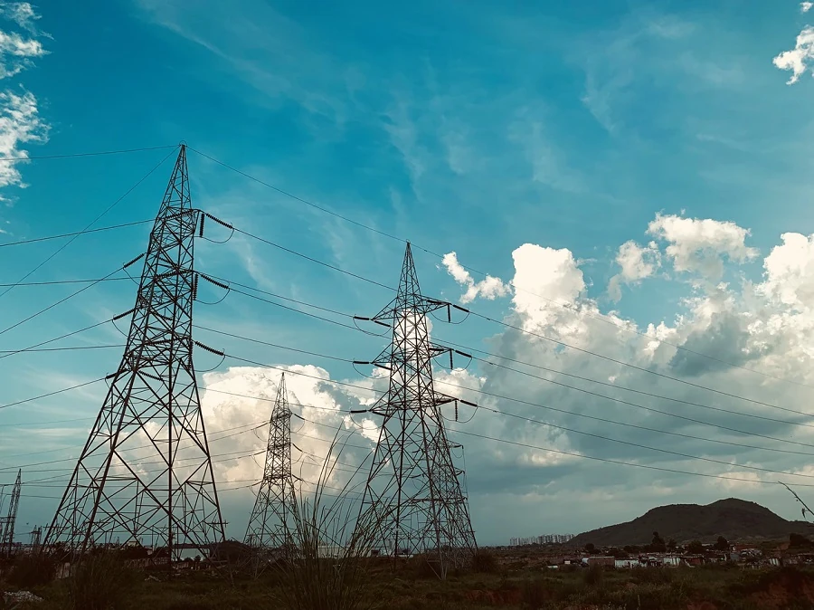

# Introduction to time series forecasting

What is time series forecasting? It's about predicting future events by analyzing trends of the past.

## Regional topic: worldwide electricity usage ✨

In these two lessons, you will be introduced to time series forecasting, a somewhat lesser known area of machine learning that is nevertheless extremely valuable for industry and business applications, among other fields. While neural networks can be used to enhance the utility of these models, we will study them in the context of classical machine learning as models help predict future performance based on the past.

Our regional focus is electrical usage in the world, an interesting dataset to learn about forecasting future power usage based on patterns of past load. You can see how this kind of forecasting can be extremely helpful in a business environment.

Photo by [Peddi Sai hrithik](https://unsplash.com/@shutter_log?utm_source=unsplash&utm_medium=referral&utm_content=creditCopyText) of electrical towers on a road in Rajasthan on [Unsplash](https://unsplash.com/s/photos/electric-india?utm_source=unsplash&utm_medium=referral&utm_content=creditCopyText)

## Lessons

1. [Introduction to time series forecasting](1-Introduction/README.md)
2. [Building ARIMA time series models](2-ARIMA/README.md)
3. [Building Support Vector Regressor for time series forecasting](3-SVR/README.md)

## Credits

"Introduction to time series forecasting" was written with ⚡️ by [Francesca Lazzeri](https://twitter.com/frlazzeri) and [Jen Looper](https://twitter.com/jenlooper). The notebooks first appeared online in the [Azure "Deep Learning For Time Series" repo](https://github.com/Azure/DeepLearningForTimeSeriesForecasting) originally written by Francesca Lazzeri. The SVR lesson was written by [Anirban Mukherjee](https://github.com/AnirbanMukherjeeXD)

---

<!-- CO-OP TRANSLATOR DISCLAIMER START -->
**Disclaimer**:
This document has been translated using AI translation service [Co-op Translator](https://github.com/Azure/co-op-translator). While we strive for accuracy, please be aware that automated translations may contain errors or inaccuracies. The original document in its native language should be considered the authoritative source. For critical information, professional human translation is recommended. We are not liable for any misunderstandings or misinterpretations arising from the use of this translation.
<!-- CO-OP TRANSLATOR DISCLAIMER END -->