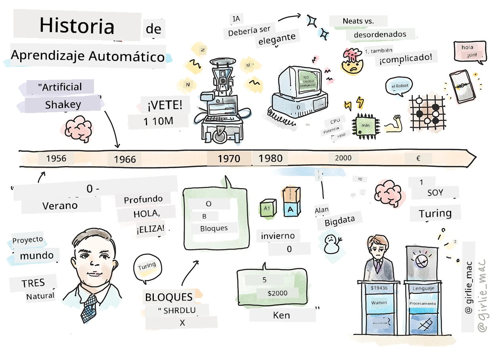
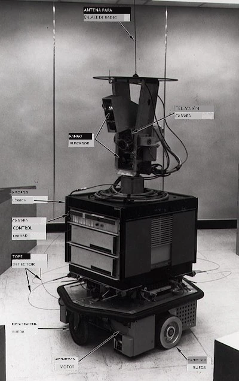
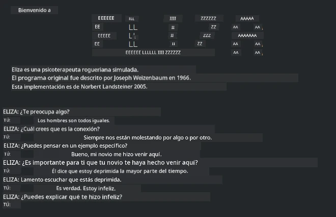

# Historia del aprendizaje automático

> Sketchnote por [Tomomi Imura](https://www.twitter.com/girlie_mac)

## [Cuestionario previo a la clase](https://ff-quizzes.netlify.app/en/ml/)

---

> 🎥 Haz clic en la imagen de arriba para un video corto que recorre esta lección.

En esta lección, repasaremos los hitos más importantes en la historia del aprendizaje automático e inteligencia artificial.

La historia de la inteligencia artificial (IA) como campo está entrelazada con la historia del aprendizaje automático, ya que los algoritmos y avances computacionales que sostienen el ML contribuyeron al desarrollo de la IA. Es útil recordar que, aunque estos campos como áreas distintivas comenzaron a cristalizarse en los años 50, importantes [descubrimientos algorítmicos, estadísticos, matemáticos, computacionales y técnicos](https://wikipedia.org/wiki/Timeline_of_machine_learning) precedieron y se superpusieron a esta era. De hecho, las personas han estado pensando en estas cuestiones durante [cientos de años](https://wikipedia.org/wiki/History_of_artificial_intelligence): este artículo analiza las bases intelectuales históricas de la idea de una 'máquina pensante'.

---
## Descubrimientos notables

- 1763, 1812 [Teorema de Bayes](https://wikipedia.org/wiki/Bayes%27_theorem) y sus predecesores. Este teorema y sus aplicaciones sustentan la inferencia, describiendo la probabilidad de que ocurra un evento basándose en conocimientos previos.
- 1805 [Teoría de mínimos cuadrados](https://wikipedia.org/wiki/Least_squares) por el matemático francés Adrien-Marie Legendre. Esta teoría, que aprenderás en nuestra unidad de Regresión, ayuda en el ajuste de datos.
- 1913 [Cadenas de Markov](https://wikipedia.org/wiki/Markov_chain), nombradas así por el matemático ruso Andrey Markov, se utilizan para describir una secuencia de eventos posibles basados en un estado previo.
- 1957 [Perceptrón](https://wikipedia.org/wiki/Perceptron) es un tipo de clasificador lineal inventado por el psicólogo estadounidense Frank Rosenblatt que fundamenta los avances en el aprendizaje profundo.

---

- 1967 [Vecino más cercano](https://wikipedia.org/wiki/Nearest_neighbor) es un algoritmo originalmente diseñado para trazar rutas. En un contexto de ML se usa para detectar patrones.
- 1970 [Retropropagación](https://wikipedia.org/wiki/Backpropagation) se usa para entrenar [redes neuronales feedforward](https://wikipedia.org/wiki/Feedforward_neural_network).
- 1982 [Redes Neuronales Recurrentes](https://wikipedia.org/wiki/Recurrent_neural_network) son redes neuronales artificiales derivadas de las feedforward que crean gráficos temporales.

✅ Investiga un poco. ¿Qué otras fechas destacan como fundamentales en la historia del ML y la IA?

---
## 1950: Máquinas que piensan

Alan Turing, una persona verdaderamente notable que fue votado [por el público en 2019](https://wikipedia.org/wiki/Icons:_The_Greatest_Person_of_the_20th_Century) como el mayor científico del siglo XX, es acreditado por ayudar a sentar las bases del concepto de una 'máquina que puede pensar'. Se enfrentó a escépticos y a su propia necesidad de evidencia empírica de este concepto en parte creando el [Test de Turing](https://www.bbc.com/news/technology-18475646), que explorarás en nuestras lecciones de PLN.

---
## 1956: Proyecto de investigación de verano de Dartmouth

"El Proyecto de Investigación de Verano de Dartmouth sobre inteligencia artificial fue un evento seminal para la inteligencia artificial como campo," y fue aquí donde se acuñó el término 'inteligencia artificial' ([fuente](https://250.dartmouth.edu/highlights/artificial-intelligence-ai-coined-dartmouth)).

> Cada aspecto del aprendizaje o cualquier otra característica de la inteligencia puede en principio describirse con tal precisión que una máquina pueda simularlo.

---

El investigador principal, el profesor de matemáticas John McCarthy, esperaba "proceder sobre la base de la conjetura de que cada aspecto del aprendizaje o cualquier otra característica de la inteligencia puede en principio describirse con tal precisión que una máquina pueda simularlo." Los participantes incluyeron a otra luminaria en el campo, Marvin Minsky.

El taller es reconocido por haber iniciado y fomentado varias discusiones incluyendo "el auge de métodos simbólicos, sistemas enfocados en dominios limitados (sistemas expertos tempranos), y sistemas deductivos versus sistemas inductivos." ([fuente](https://wikipedia.org/wiki/Dartmouth_workshop)).

---
## 1956 - 1974: "Los años dorados"

Desde los años 50 hasta mediados de los 70, el optimismo fue alto con la esperanza de que la IA pudiera resolver muchos problemas. En 1967, Marvin Minsky declaró con confianza que "Dentro de una generación... el problema de crear 'inteligencia artificial' será sustancialmente resuelto." (Minsky, Marvin (1967), Computation: Finite and Infinite Machines, Englewood Cliffs, N.J.: Prentice-Hall)

La investigación en procesamiento de lenguaje natural floreció, la búsqueda se refinó y potenció, y se creó el concepto de 'micro-mundos', donde tareas simples se completaban usando instrucciones en lenguaje sencillo.

---

La investigación fue bien financiada por agencias gubernamentales, se lograron avances en computación y algoritmos, y se construyeron prototipos de máquinas inteligentes. Algunas de estas máquinas incluyen:

* [Shakey el robot](https://wikipedia.org/wiki/Shakey_the_robot), que podía maniobrar y decidir cómo realizar tareas de manera 'inteligente'.

    
    > Shakey en 1972

---

* Eliza, un 'chatterbot' temprano, podía conversar con personas y actuar como un 'terapeuta' primitivo. Aprenderás más sobre Eliza en las lecciones de PLN.

    
    > Una versión de Eliza, un chatbot

---

* "Mundo de bloques" fue un ejemplo de micro-mundo donde se podían apilar y clasificar bloques, y se podían probar experimentos para enseñar a las máquinas a tomar decisiones. Los avances construidos con bibliotecas como [SHRDLU](https://wikipedia.org/wiki/SHRDLU) ayudaron a impulsar el procesamiento del lenguaje.

    

    > 🎥 Haz clic en la imagen de arriba para un video: Mundo de bloques con SHRDLU

---
## 1974 - 1980: "Invierno de la IA"

A mediados de los años 70, se hizo evidente que la complejidad de crear 'máquinas inteligentes' había sido subestimada y que su promesa, dada la potencia computacional disponible, había sido exagerada. Los fondos desaparecieron y la confianza en el campo disminuyó. Algunos problemas que impactaron la confianza incluyeron:
---
- **Limitaciones**. La potencia computacional era demasiado limitada.
- **Explosión combinatoria**. La cantidad de parámetros que necesitaban ser entrenados creció exponencialmente a medida que se le pedía más a los ordenadores, sin una evolución paralela de la potencia y capacidad de cómputo.
- **Escasez de datos**. Hubo escasez de datos que dificultó el proceso de prueba, desarrollo y refinamiento de algoritmos.
- **¿Estamos haciendo las preguntas correctas?**. Las mismas preguntas que se hacían comenzaron a ser cuestionadas. Los investigadores recibieron críticas sobre sus enfoques:
  - Los tests de Turing fueron cuestionados mediante, entre otras ideas, la 'teoría de la habitación china' que postulaba que "programar un ordenador digital puede hacer que parezca entender el lenguaje, pero no podría producir una verdadera comprensión." ([fuente](https://plato.stanford.edu/entries/chinese-room/))
  - Se cuestionó la ética de introducir inteligencias artificiales como la "terapeuta" ELIZA en la sociedad.

---

Al mismo tiempo, comenzaron a formarse diversas escuelas de pensamiento en IA. Se estableció una dicotomía entre las prácticas de IA ["desordenada" vs. "ordenada"](https://wikipedia.org/wiki/Neats_and_scruffies). Los laboratorios _desordenados_ ajustaban programas durante horas hasta obtener los resultados deseados. Los laboratorios _ordenados_ "se centraban en la lógica y la resolución formal de problemas". ELIZA y SHRDLU fueron sistemas _desordenados_ muy conocidos. En los años 80, a medida que surgió la demanda de hacer los sistemas de ML reproducibles, el enfoque _ordenado_ gradualmente tomó protagonismo pues sus resultados son más explicables.

---
## Años 80 Sistemas expertos

A medida que el campo creció, su beneficio para los negocios se hizo más claro, y en los años 80 también se prolíferaron los 'sistemas expertos'. "Los sistemas expertos fueron una de las primeras formas verdaderamente exitosas de software de inteligencia artificial (IA)." ([fuente](https://wikipedia.org/wiki/Expert_system)).

Este tipo de sistema es en realidad _híbrido_, consistente parcialmente en un motor de reglas que define requerimientos de negocio, y un motor de inferencia que aprovechaba el sistema de reglas para deducir nuevos hechos.

Esta era también vio un aumento en la atención a las redes neuronales.

---
## 1987 - 1993: "Enfriamiento" de la IA

La proliferación de hardware especializado para sistemas expertos tuvo el efecto desafortunado de volverse demasiado especializado. El auge de las computadoras personales también compitió con estos sistemas grandes, especializados y centralizados. La democratización de la computación había comenzado, y eventualmente allanó el camino para la explosión moderna del big data.

---
## 1993 - 2011

Esta época vio una nueva era para que el ML y la IA pudieran resolver algunos de los problemas causados anteriormente por la falta de datos y potencia de cálculo. La cantidad de datos comenzó a aumentar rápidamente y a estar más disponible, para bien o para mal, especialmente con la llegada del smartphone alrededor de 2007. La potencia de cómputo se expandió exponencialmente, y los algoritmos evolucionaron junto a ella. El campo comenzó a madurar a medida que los días despreocupados del pasado empezaron a cristalizarse en una disciplina verdadera.

---
## Ahora

Hoy el aprendizaje automático y la IA tocan casi todos los aspectos de nuestras vidas. Esta era requiere un entendimiento cuidadoso de los riesgos y potenciales efectos de estos algoritmos en las vidas humanas. Como ha declarado Brad Smith de Microsoft: "La tecnología de la información plantea cuestiones que van al corazón de protecciones fundamentales de los derechos humanos como la privacidad y la libertad de expresión. Estas cuestiones aumentan la responsabilidad de las empresas tecnológicas que crean estos productos. En nuestra opinión, también requieren una regulación gubernamental reflexiva y el desarrollo de normas sobre usos aceptables" ([fuente](https://www.technologyreview.com/2019/12/18/102365/the-future-of-ais-impact-on-society/)).

---

Aún está por verse qué deparará el futuro, pero es importante entender estos sistemas informáticos y el software y algoritmos que ejecutan. Esperamos que este currículo te ayude a obtener una mejor comprensión para que puedas decidir por ti mismo.

> 🎥 Haz clic en la imagen de arriba para un video: Yann LeCun discute la historia del aprendizaje profundo en esta conferencia

---
## 🚀Desafío

Profundiza en uno de estos momentos históricos y aprende más sobre las personas detrás de ellos. Hay personajes fascinantes, y ningún descubrimiento científico jamás se creó en un vacío cultural. ¿Qué descubres?

## [Cuestionario posterior a la clase](https://ff-quizzes.netlify.app/en/ml/)

---
## Revisión & Autoestudio

Aquí tienes algunos elementos para ver y escuchar:

[Este podcast donde Amy Boyd discute la evolución de la IA](http://runasradio.com/Shows/Show/739)

---

## Tarea

[Crear una línea de tiempo](assignment.md)

---

<!-- CO-OP TRANSLATOR DISCLAIMER START -->
**Descargo de responsabilidad**:
Este documento ha sido traducido utilizando el servicio de traducción automática [Co-op Translator](https://github.com/Azure/co-op-translator). Aunque nos esforzamos por la precisión, tenga en cuenta que las traducciones automatizadas pueden contener errores o inexactitudes. El documento original en su idioma nativo debe considerarse la fuente autorizada. Para información crítica, se recomienda una traducción profesional humana. No somos responsables de cualquier malentendido o interpretación errónea que surja del uso de esta traducción.
<!-- CO-OP TRANSLATOR DISCLAIMER END -->