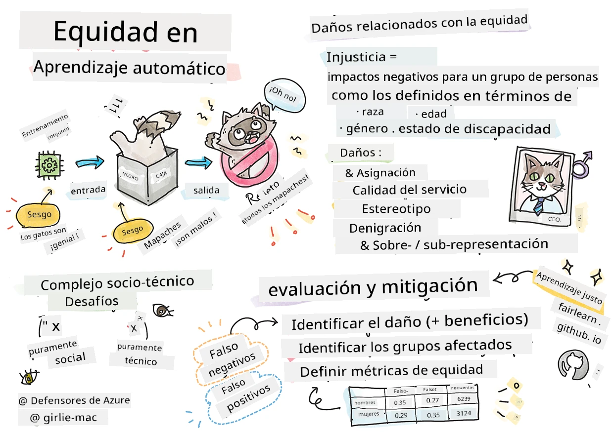

# Construyendo soluciones de Machine Learning con IA responsable
 

> Sketchnote por [Tomomi Imura](https://www.twitter.com/girlie_mac)

## [Cuestionario previo a la lección](https://ff-quizzes.netlify.app/en/ml/)
 
## Introducción

En este currículo, comenzarás a descubrir cómo el aprendizaje automático puede y está impactando nuestras vidas diarias. Incluso ahora, sistemas y modelos participan en tareas diarias de toma de decisiones, como diagnósticos médicos, aprobaciones de préstamos o detección de fraudes. Por eso es importante que estos modelos funcionen bien para proporcionar resultados confiables. Al igual que cualquier aplicación de software, los sistemas de IA pueden no cumplir las expectativas o tener un resultado indeseable. Por eso es esencial poder entender y explicar el comportamiento de un modelo de IA.

Imagina qué puede pasar cuando los datos que usas para construir estos modelos carecen de ciertos demográficos, como raza, género, opinión política, religión, o representan desproporcionadamente dichos demográficos. ¿Qué sucede cuando la salida del modelo se interpreta para favorecer a algún demográfico? ¿Cuál es la consecuencia para la aplicación? Además, ¿qué ocurre cuando el modelo tiene un resultado adverso y es dañino para las personas? ¿Quién es responsable del comportamiento del sistema de IA? Estas son algunas preguntas que exploraremos en este currículo.

En esta lección, tú:

- Aumentarás tu conciencia sobre la importancia de la equidad en el aprendizaje automático y los daños relacionados con la equidad.
- Te familiarizarás con la práctica de explorar valores atípicos y escenarios inusuales para asegurar la confiabilidad y seguridad.
- Comprenderás la necesidad de empoderar a todos mediante el diseño de sistemas inclusivos.
- Explorarás lo vital que es proteger la privacidad y seguridad de los datos y las personas.
- Verás la importancia de tener un enfoque de caja transparente para explicar el comportamiento de los modelos de IA.
- Serás consciente de cómo la responsabilidad es esencial para construir confianza en los sistemas de IA.

## Prerrequisito

Como prerrequisito, por favor toma el "Camino de aprendizaje de Principios de IA Responsable" y mira el video a continuación sobre el tema:

Aprende más sobre IA Responsable siguiendo este [Camino de aprendizaje](https://docs.microsoft.com/learn/modules/responsible-ai-principles/?WT.mc_id=academic-77952-leestott)

> 🎥 Haz clic en la imagen de arriba para un video: Enfoque de Microsoft hacia la IA Responsable

## Equidad

Los sistemas de IA deben tratar a todos por igual y evitar afectar a grupos similares de personas de manera diferente. Por ejemplo, cuando los sistemas de IA ofrecen orientación sobre tratamientos médicos, solicitudes de préstamo o empleo, deben hacer las mismas recomendaciones a todos con síntomas, circunstancias financieras o calificaciones profesionales similares. Cada uno de nosotros como humanos llevamos sesgos heredados que afectan nuestras decisiones y acciones. Estos sesgos pueden estar evidentes en los datos que usamos para entrenar sistemas de IA. Esta manipulación a veces ocurre involuntariamente. A menudo es difícil saber conscientemente cuándo se está introduciendo un sesgo en los datos.

**“Injusticia”** abarca impactos negativos, o “daños”, para un grupo de personas, como aquellos definidos en términos de raza, género, edad o discapacidad. Los principales daños relacionados con la equidad se pueden clasificar como:

- **Asignación**, si un género o etnia, por ejemplo, es favorecido sobre otro.
- **Calidad del servicio**. Si entrenas los datos para un escenario específico pero la realidad es mucho más compleja, conduce a un servicio de bajo rendimiento. Por ejemplo, un dispensador de jabón para manos que parecía no poder detectar personas con piel oscura. [Referencia](https://gizmodo.com/why-cant-this-soap-dispenser-identify-dark-skin-1797931773)
- **Denigración**. Criticar y etiquetar injustamente algo o a alguien. Por ejemplo, una tecnología de etiquetado de imágenes que infamemente etiquetó mal imágenes de personas de piel oscura como gorilas.
- **Sobre- o subrepresentación**. La idea es que cierto grupo no es visible en una profesión determinada, y cualquier servicio o función que siga promoviendo eso contribuye al daño.
- **Estereotipos**. Asociar un grupo dado con atributos preasignados. Por ejemplo, un sistema de traducción entre inglés y turco puede tener inexactitudes debido a palabras con asociaciones estereotípicas de género.

> traducción al turco

> traducción de nuevo al inglés

Al diseñar y probar sistemas de IA, necesitamos asegurar que la IA sea justa y no esté programada para tomar decisiones sesgadas o discriminatorias, lo que también está prohibido para los seres humanos. Garantizar la equidad en IA y aprendizaje automático sigue siendo un desafío sociotécnico complejo.

### Confiabilidad y seguridad

Para generar confianza, los sistemas de IA deben ser confiables, seguros y consistentes en condiciones normales e inesperadas. Es importante saber cómo se comportarán los sistemas de IA en diversas situaciones, especialmente cuando son casos atípicos. Al construir soluciones de IA, se debe enfocar considerablemente cómo manejar una amplia variedad de circunstancias que las soluciones de IA podrían encontrar. Por ejemplo, un coche autónomo debe poner la seguridad de las personas como prioridad máxima. Como resultado, la IA que impulsa el coche debe considerar todos los posibles escenarios que el vehículo podría enfrentar, como la noche, tormentas o ventiscas, niños cruzando la calle, mascotas, construcciones viales, etc. Qué tan bien un sistema de IA puede manejar una amplia gama de condiciones de forma fiable y segura refleja el nivel de anticipación que el científico de datos o desarrollador de IA consideró durante el diseño o prueba del sistema.

> [🎥 Haz clic aquí para un video: Confiabilidad y seguridad en IA](https://www.microsoft.com/videoplayer/embed/RE4vvIl)

### Inclusión

Los sistemas de IA deben diseñarse para involucrar y empoderar a todos. Al diseñar e implementar sistemas de IA, los científicos de datos y desarrolladores de IA identifican y abordan posibles barreras en el sistema que podrían excluir a personas involuntariamente. Por ejemplo, hay 1 billón de personas con discapacidades en todo el mundo. Con el avance de la IA, pueden acceder a una amplia gama de información y oportunidades más fácilmente en su vida diaria. Al abordar las barreras, se crean oportunidades para innovar y desarrollar productos de IA con mejores experiencias que beneficien a todos.

> [🎥 Haz clic aquí para un video: Inclusión en IA](https://www.microsoft.com/videoplayer/embed/RE4vl9v)

### Seguridad y privacidad

Los sistemas de IA deben ser seguros y respetar la privacidad de las personas. Las personas confían menos en sistemas que ponen en riesgo su privacidad, información o vidas. Al entrenar modelos de aprendizaje automático, confiamos en los datos para producir los mejores resultados. Al hacerlo, se debe considerar el origen y la integridad de los datos. Por ejemplo, ¿los datos los envió un usuario o están disponibles públicamente? Luego, al trabajar con los datos, es crucial desarrollar sistemas de IA que puedan proteger información confidencial y resistir ataques. A medida que la IA se vuelve más común, proteger la privacidad y asegurar información personal y empresarial importante es cada vez más crítico y complejo. Los problemas de privacidad y seguridad de datos requieren especial atención para IA porque el acceso a los datos es esencial para que los sistemas de IA realicen predicciones y decisiones precisas e informadas sobre las personas.

> [🎥 Haz clic aquí para un video: Seguridad en IA](https://www.microsoft.com/videoplayer/embed/RE4voJF)

- Como industria hemos logrado avances significativos en privacidad y seguridad, impulsados significativamente por regulaciones como el GDPR (Reglamento General de Protección de Datos).
- Sin embargo, con los sistemas de IA debemos reconocer la tensión entre la necesidad de más datos personales para hacer los sistemas más personales y efectivos – y la privacidad.
- Al igual que con el nacimiento de los computadores conectados con internet, también estamos viendo un enorme aumento en la cantidad de problemas de seguridad relacionados con IA.
- Al mismo tiempo, hemos visto que la IA se usa para mejorar la seguridad. Por ejemplo, la mayoría de los escáneres antivirus modernos hoy en día funcionan con heurísticas de IA.
- Necesitamos asegurar que nuestros procesos de Ciencia de Datos se integren armoniosamente con las últimas prácticas de privacidad y seguridad.

### Transparencia
Los sistemas de IA deben ser comprensibles. Una parte crucial de la transparencia es explicar el comportamiento de los sistemas de IA y sus componentes. Mejorar la comprensión de los sistemas de IA requiere que los interesados entiendan cómo y por qué funcionan para que puedan identificar posibles problemas de desempeño, preocupaciones de seguridad y privacidad, sesgos, prácticas excluyentes o resultados no deseados. También creemos que quienes usan sistemas de IA deben ser honestos y transparentes sobre cuándo, por qué y cómo deciden desplegarlos, así como las limitaciones de los sistemas que usan. Por ejemplo, si un banco usa un sistema de IA para apoyar sus decisiones de préstamo a consumidores, es importante examinar los resultados y entender qué datos influyen en las recomendaciones del sistema. Los gobiernos están empezando a regular la IA en todas las industrias, por lo que los científicos de datos y organizaciones deben explicar si un sistema de IA cumple con los requisitos regulatorios, especialmente cuando hay un resultado indeseable.

> [🎥 Haz clic aquí para un video: Transparencia en IA](https://www.microsoft.com/videoplayer/embed/RE4voJF)

- Debido a que los sistemas de IA son tan complejos, es difícil entender cómo funcionan e interpretar los resultados.
- Esta falta de comprensión afecta la forma en que estos sistemas se gestionan, operan y documentan.
- Esta falta de comprensión afecta aún más las decisiones tomadas usando los resultados que estos sistemas producen.

### Responsabilidad
 
Las personas que diseñan y despliegan sistemas de IA deben ser responsables de cómo operan sus sistemas. La necesidad de responsabilidad es particularmente crucial con tecnologías de uso sensible como el reconocimiento facial. Recientemente, ha habido una creciente demanda de tecnología de reconocimiento facial, especialmente de organizaciones policiales que ven el potencial de la tecnología en usos como encontrar niños desaparecidos. Sin embargo, estas tecnologías podrían potencialmente ser usadas por un gobierno para poner en riesgo las libertades fundamentales de sus ciudadanos, por ejemplo, permitiendo la vigilancia continua de individuos específicos. Por ello, los científicos de datos y las organizaciones necesitan ser responsables del impacto de su sistema de IA en los individuos o en la sociedad.

> 🎥 Haz clic en la imagen de arriba para un video: Advertencias sobre vigilancia masiva mediante reconocimiento facial

En última instancia, una de las mayores preguntas para nuestra generación, como la primera generación que está trayendo la IA a la sociedad, es cómo asegurar que las computadoras seguirán siendo responsables ante las personas y cómo asegurar que las personas que diseñan computadoras sigan siendo responsables ante todos los demás.

## Evaluación de impacto

Antes de entrenar un modelo de aprendizaje automático, es importante realizar una evaluación de impacto para entender el propósito del sistema de IA; cuál es su uso previsto; dónde será desplegado; y quién interactuará con el sistema. Esto es útil para los evaluadores o testers que analizan el sistema para saber qué factores considerar al identificar riesgos potenciales y consecuencias esperadas.

Las siguientes son áreas de enfoque al realizar una evaluación de impacto:

* **Impacto adverso en individuos**. Estar al tanto de cualquier restricción o requisito, uso no soportado o limitaciones conocidas que obstaculicen el rendimiento del sistema es vital para asegurar que el sistema no se use de forma que cause daño a las personas.
* **Requisitos de datos**. Entender cómo y dónde el sistema usará los datos permite a los evaluadores explorar cualquier requisito de datos que deban considerar (ej. regulaciones de datos GDPR o HIPAA). Además, examinar si la fuente o cantidad de datos es suficiente para el entrenamiento.
* **Resumen del impacto**. Recopilar una lista de posibles daños que podrían surgir del uso del sistema. A lo largo del ciclo de vida del ML, revisar si los problemas identificados son mitigados o abordados.
* **Objetivos aplicables** para cada uno de los seis principios fundamentales. Evaluar si se cumplen los objetivos de cada principio y si hay alguna brecha.

## Depuración con IA responsable  

Similar a depurar una aplicación de software, depurar un sistema de IA es un proceso necesario para identificar y resolver problemas en el sistema. Hay muchos factores que pueden afectar que un modelo no funcione como se espera o de forma responsable. La mayoría de las métricas tradicionales de rendimiento del modelo son agregados cuantitativos del desempeño del modelo, los cuales no son suficientes para analizar cómo un modelo viola los principios de IA responsable. Además, un modelo de aprendizaje automático es una caja negra que dificulta entender qué impulsa su resultado o dar explicación cuando comete un error. Más adelante en este curso, aprenderemos a usar el panel de IA Responsable para ayudar a depurar sistemas de IA. El panel proporciona una herramienta integral para que científicos de datos y desarrolladores de IA realicen:

* **Análisis de errores**. Para identificar la distribución de errores del modelo que pueden afectar la equidad o confiabilidad del sistema.
* **Visión general del modelo**. Para descubrir dónde hay disparidades en el rendimiento del modelo entre diferentes cohortes de datos.
* **Análisis de datos**. Para entender la distribución de los datos e identificar posibles sesgos en los datos que podrían causar problemas de equidad, inclusión y confiabilidad.
* **Interpretabilidad del modelo**. Para entender qué afecta o influye en las predicciones del modelo. Esto ayuda a explicar el comportamiento del modelo, lo cual es importante para la transparencia y la responsabilidad.

## 🚀 Desafío 
 
Para prevenir que se introduzcan daños desde el principio, deberíamos:

- tener diversidad de antecedentes y perspectivas entre las personas que trabajan en los sistemas
- invertir en conjuntos de datos que reflejen la diversidad de nuestra sociedad
- desarrollar mejores métodos a lo largo del ciclo de vida del aprendizaje automático para detectar y corregir IA irresponsable cuando ocurra

Piensa en escenarios de la vida real donde la falta de confianza en un modelo sea evidente en la construcción y uso del modelo. ¿Qué más deberíamos considerar?

## [Cuestionario posterior a la lección](https://ff-quizzes.netlify.app/en/ml/)

## Revisión y estudio autónomo
 
En esta lección, has aprendido algunos conceptos básicos sobre equidad e inequidad en aprendizaje automático.  
 
Mira este taller para profundizar en los temas:

- En busca de IA responsable: aplicando principios a la práctica por Besmira Nushi, Mehrnoosh Sameki y Amit Sharma

> 🎥 Haz clic en la imagen de arriba para un video: Caja de herramientas RAI: Un marco de trabajo de código abierto para construir IA responsable por Besmira Nushi, Mehrnoosh Sameki y Amit Sharma

También, lee: 

- Centro de recursos RAI de Microsoft: [Recursos de IA Responsable – Microsoft AI](https://www.microsoft.com/ai/responsible-ai-resources?activetab=pivot1%3aprimaryr4) 

- Grupo de investigación FATE de Microsoft: [FATE: Equidad, Responsabilidad, Transparencia y Ética en IA - Microsoft Research](https://www.microsoft.com/research/theme/fate/) 

Caja de herramientas RAI: 

- [Repositorio GitHub de la Caja de herramientas de IA Responsable](https://github.com/microsoft/responsible-ai-toolbox)

Lee sobre las herramientas de Azure Machine Learning para asegurar la equidad:

- [Azure Machine Learning](https://docs.microsoft.com/azure/machine-learning/concept-fairness-ml?WT.mc_id=academic-77952-leestott) 

## Tarea

[Explora la Caja de herramientas RAI](assignment.md)

---

<!-- CO-OP TRANSLATOR DISCLAIMER START -->
**Descargo de responsabilidad**:
Este documento ha sido traducido utilizando el servicio de traducción automática [Co-op Translator](https://github.com/Azure/co-op-translator). Aunque nos esforzamos por la precisión, tenga en cuenta que las traducciones automatizadas pueden contener errores o inexactitudes. El documento original en su idioma nativo debe considerarse la fuente autorizada. Para información crítica, se recomienda una traducción profesional humana. No somos responsables de cualquier malentendido o interpretación errónea que surja del uso de esta traducción.
<!-- CO-OP TRANSLATOR DISCLAIMER END -->