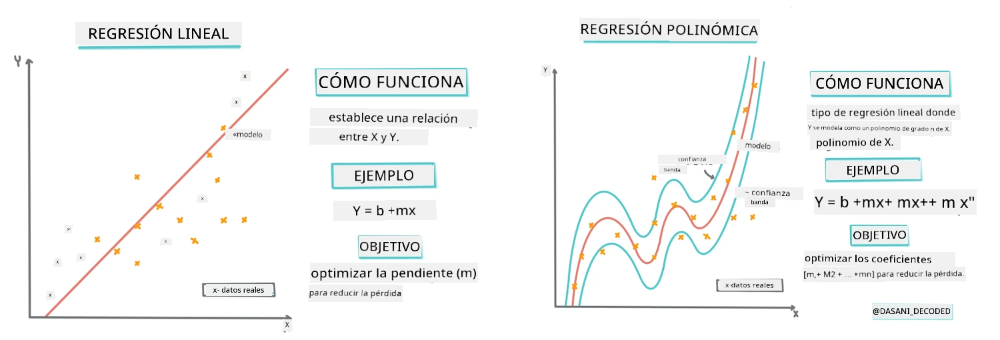
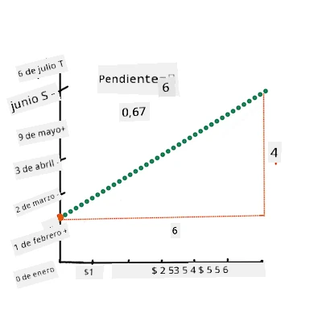
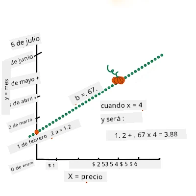
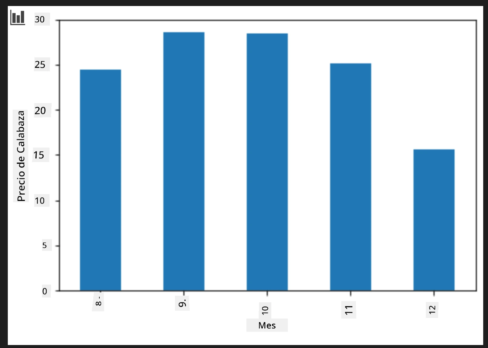
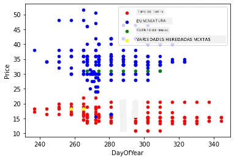

# Construir un modelo de regresión usando Scikit-learn: regresión de cuatro maneras

## Nota para principiantes

La regresión lineal se utiliza cuando queremos predecir un **valor numérico** (por ejemplo, precio de una casa, temperatura o ventas). Funciona encontrando una línea recta que mejor representa la relación entre las características de entrada y la salida.

En esta lección, nos enfocamos en entender el concepto antes de explorar técnicas de regresión más avanzadas.

> Infografía por [Dasani Madipalli](https://twitter.com/dasani_decoded)
## [Cuestionario previo a la lección](https://ff-quizzes.netlify.app/en/ml/)

> ### [¡Esta lección está disponible en R!](../../../../2-Regression/3-Linear/solution/R/lesson_3.html)
### Introducción 

Hasta ahora has explorado qué es la regresión con datos de ejemplo obtenidos del conjunto de datos de precios de calabazas que usaremos durante toda esta lección. También lo has visualizado usando Matplotlib.

Ahora estás listo para profundizar más en la regresión para ML. Mientras que la visualización te permite comprender los datos, el verdadero poder del Aprendizaje Automático proviene de _entrenar modelos_. Los modelos se entrenan con datos históricos para capturar automáticamente las dependencias de los datos, y te permiten predecir resultados para nuevos datos que el modelo no ha visto antes.

En esta lección, aprenderás más sobre dos tipos de regresión: _regresión lineal básica_ y _regresión polinómica_, junto con algo de la matemática subyacente a estas técnicas. Estos modelos nos permitirán predecir precios de calabazas dependiendo de diferentes datos de entrada.

[](https://youtu.be/CRxFT8oTDMg "ML para principiantes - Entendiendo la regresión lineal")

> 🎥 Haz clic en la imagen de arriba para un breve video introductorio de regresión lineal.

> A lo largo de este currículo, asumimos conocimientos mínimos de matemáticas y buscamos hacerlo accesible para estudiantes provenientes de otros campos, así que presta atención a notas, 🧮 llamadas a la acción, diagramas y otras herramientas de aprendizaje para facilitar la comprensión.

### Prerrequisitos

Deberías estar familiarizado ya con la estructura de los datos de calabaza que estamos examinando. Puedes encontrarlo precargado y pre-limpiado en el archivo _notebook.ipynb_ de esta lección. En el archivo, el precio de la calabaza se muestra por bushel en un nuevo marco de datos. Asegúrate de que puedas ejecutar estos notebooks en kernels en Visual Studio Code.

### Preparación

Como recordatorio, estás cargando estos datos para poder hacer preguntas sobre ellos.

- ¿Cuándo es el mejor momento para comprar calabazas?
- ¿Qué precio puedo esperar por una caja de calabazas miniatura?
- ¿Debo comprarlas en cestas de medio bushel o por la caja de 1 1/9 bushel?
Sigamos profundizando en estos datos.

En la lección anterior, creaste un DataFrame de Pandas y lo llenaste con parte del conjunto de datos original, estandarizando los precios por bushel. Al hacer eso, sin embargo, solo pudiste obtener aproximadamente 400 puntos de datos y solo para los meses de otoño.

Echa un vistazo a los datos que pre-cargamos en el notebook adjunto a esta lección. Los datos están previamente cargados y se ha graficado un diagrama de dispersión inicial para mostrar los datos por mes. Quizás podamos obtener un poco más de detalle sobre la naturaleza de los datos limpiándolos más.

## Una línea de regresión lineal

Como aprendiste en la Lección 1, el objetivo de un ejercicio de regresión lineal es poder trazar una línea para:

- **Mostrar relaciones entre variables**. Mostrar la relación entre variables.
- **Hacer predicciones**. Hacer predicciones precisas sobre dónde caería un nuevo punto de datos en relación con esa línea.

Es típico de la **regresión de mínimos cuadrados** trazar este tipo de línea. El término "Mínimos Cuadrados" se refiere al proceso de minimizar el error total en nuestro modelo. Para cada punto de datos, medimos la distancia vertical (llamada residuo) entre el punto real y nuestra línea de regresión.

Elevamos al cuadrado estas distancias por dos razones principales:

1. **Magnitud sobre dirección:** Queremos tratar un error de -5 igual que un error de +5. Elevar al cuadrado convierte todos los valores en positivos.

2. **Penalizar valores atípicos:** Elevar al cuadrado da más peso a errores mayores, forzando a la línea a estar más cerca de puntos que están lejos.

Luego sumamos todos estos valores al cuadrado. Nuestro objetivo es encontrar la línea específica donde esta suma final sea la menor (el valor posible más pequeño), de ahí el nombre de "Mínimos Cuadrados".

> **🧮 Muéstrame las matemáticas** 
> 
> Esta línea, llamada _línea de mejor ajuste_, puede expresarse mediante [una ecuación](https://en.wikipedia.org/wiki/Simple_linear_regression): 
> 
> ```
> Y = a + bX
> ```
>
> `X` es la 'variable explicativa'. `Y` es la 'variable dependiente'. La pendiente de la línea es `b` y `a` es la intersección en y, que se refiere al valor de `Y` cuando `X = 0`. 
>
>
>
> Primero, calcula la pendiente `b`. Infografía por [Jen Looper](https://twitter.com/jenlooper)
>
> En otras palabras, y refiriéndonos a la pregunta original de nuestros datos de calabazas: "predecir el precio de una calabaza por bushel según el mes", `X` se referiría al precio y `Y` al mes de venta.
>
>
>
> Calcula el valor de Y. Si estás pagando alrededor de $4, ¡debe ser abril! Infografía por [Jen Looper](https://twitter.com/jenlooper)
>
> La matemática que calcula la línea debe demostrar la pendiente de la línea, que también depende de la intersección, o dónde se sitúa `Y` cuando `X = 0`.
>
> Puedes observar el método de cálculo para estos valores en el sitio web [Math is Fun](https://www.mathsisfun.com/data/least-squares-regression.html). También visita [esta calculadora de mínimos cuadrados](https://www.mathsisfun.com/data/least-squares-calculator.html) para ver cómo los valores numéricos impactan la línea.

## Correlación

Un término más que debe entenderse es el **Coeficiente de Correlación** entre las variables X y Y dadas. Usando un diagrama de dispersión, puedes visualizar rápidamente este coeficiente. Un gráfico con puntos dispersos en una línea ordenada tiene alta correlación, pero un gráfico con puntos dispersos por todas partes en X y Y tiene baja correlación.

Un buen modelo de regresión lineal será aquel que tenga un Coeficiente de Correlación alto (más cercano a 1 que a 0) usando el método de regresión de mínimos cuadrados con una línea de regresión.

✅ Ejecuta el notebook que acompaña esta lección y observa el diagrama de dispersión Mes vs Precio. ¿Parece que los datos relacionando Mes y Precio para las ventas de calabazas tienen una correlación alta o baja, según tu interpretación visual del diagrama de dispersión? ¿Cambia eso si usas una medida más fina en lugar de `Mes`, p. ej. *día del año* (es decir, número de días desde el inicio del año)?

En el código a continuación, asumiremos que hemos limpiado los datos y obtenido un DataFrame llamado `new_pumpkins`, similar al siguiente:

ID | Mes | DíaDelAño | Variedad | Ciudad | Empaque | Precio Bajo | Precio Alto | Precio
---|-------|-----------|---------|------|---------|-----------|------------|-------
70 | 9 | 267 | TIPO PASTEL | BALTIMORE | Cartones de 1 1/9 bushel | 15.0 | 15.0 | 13.636364
71 | 9 | 267 | TIPO PASTEL | BALTIMORE | Cartones de 1 1/9 bushel | 18.0 | 18.0 | 16.363636
72 | 10 | 274 | TIPO PASTEL | BALTIMORE | Cartones de 1 1/9 bushel | 18.0 | 18.0 | 16.363636
73 | 10 | 274 | TIPO PASTEL | BALTIMORE | Cartones de 1 1/9 bushel | 17.0 | 17.0 | 15.454545
74 | 10 | 281 | TIPO PASTEL | BALTIMORE | Cartones de 1 1/9 bushel | 15.0 | 15.0 | 13.636364

> El código para limpiar los datos está disponible en [`notebook.ipynb`](notebook.ipynb). Hemos realizado los mismos pasos de limpieza que en la lección anterior, y calculamos la columna `DíaDelAño` utilizando la siguiente expresión:

```python
day_of_year = pd.to_datetime(pumpkins['Date']).apply(lambda dt: (dt-datetime(dt.year,1,1)).days)
```

Ahora que entiendes la matemática detrás de la regresión lineal, crearemos un modelo de regresión para ver si podemos predecir qué paquete de calabazas tendrá los mejores precios. Alguien que compre calabazas para una parcela de calabazas en una festividad podría querer esta información para optimizar sus compras de paquetes de calabazas para la parcela.

## Buscando correlación

[](https://youtu.be/uoRq-lW2eQo "ML para principiantes - Buscando correlación: La clave de la regresión lineal")

> 🎥 Haz clic en la imagen de arriba para un breve video introductorio sobre correlación.

Probablemente ya has visto en la lección anterior que el precio promedio para diferentes meses se ve así:



Esto sugiere que debería existir cierta correlación, y podemos intentar entrenar un modelo de regresión lineal para predecir la relación entre `Mes` y `Precio`, o entre `DíaDelAño` y `Precio`. Aquí está el diagrama de dispersión que muestra esta última relación:

 

Veamos si hay correlación usando la función `corr`:

```python
print(new_pumpkins['Month'].corr(new_pumpkins['Price']))
print(new_pumpkins['DayOfYear'].corr(new_pumpkins['Price']))
```

Parece que la correlación es bastante pequeña, -0.15 para `Mes` y -0.17 para `DíaDelAño`, pero podría haber otra relación importante. Parece que hay diferentes grupos de precios correspondientes a diferentes variedades de calabazas. Para confirmar esta hipótesis, grafiquemos cada categoría de calabaza usando un color diferente. Pasando el parámetro `ax` a la función de grafico `scatter` podemos graficar todos los puntos en el mismo gráfico:

```python
ax=None
colors = ['red','blue','green','yellow']
for i,var in enumerate(new_pumpkins['Variety'].unique()):
    df = new_pumpkins[new_pumpkins['Variety']==var]
    ax = df.plot.scatter('DayOfYear','Price',ax=ax,c=colors[i],label=var)
```

 

Nuestra investigación sugiere que la variedad tiene más efecto sobre el precio total que la fecha real de venta. Podemos ver esto con un gráfico de barras:

```python
new_pumpkins.groupby('Variety')['Price'].mean().plot(kind='bar')
```

 

Centrémonos por el momento en una variedad de calabaza, el 'tipo pastel', y veamos qué efecto tiene la fecha en el precio:

```python
pie_pumpkins = new_pumpkins[new_pumpkins['Variety']=='PIE TYPE']
pie_pumpkins.plot.scatter('DayOfYear','Price') 
```
 

Si ahora calculamos la correlación entre `Precio` y `DíaDelAño` usando la función `corr`, obtendremos algo como `-0.27`, lo que significa que tiene sentido entrenar un modelo predictivo.

> Antes de entrenar un modelo de regresión lineal, es importante asegurarse de que nuestros datos estén limpios. La regresión lineal no funciona bien con valores faltantes, por lo que tiene sentido eliminar todas las celdas vacías:

```python
pie_pumpkins.dropna(inplace=True)
pie_pumpkins.info()
```

Otra opción sería llenar esos valores vacíos con valores promedio de la columna correspondiente.

## Regresión lineal simple

[](https://youtu.be/e4c_UP2fSjg "ML para principiantes - Regresión lineal y polinómica usando Scikit-learn")

> 🎥 Haz clic en la imagen de arriba para un breve video introductorio sobre regresión lineal y polinómica.

Para entrenar nuestro modelo de regresión lineal, usaremos la biblioteca **Scikit-learn**.

```python
from sklearn.linear_model import LinearRegression
from sklearn.metrics import mean_squared_error
from sklearn.model_selection import train_test_split
```

Comenzamos separando los valores de entrada (características) y la salida esperada (etiqueta) en arreglos numpy separados:

```python
X = pie_pumpkins['DayOfYear'].to_numpy().reshape(-1,1)
y = pie_pumpkins['Price']
```

> Ten en cuenta que tuvimos que aplicar `reshape` a los datos de entrada para que el paquete de regresión lineal lo entienda correctamente. La regresión lineal espera un arreglo 2D como entrada, donde cada fila del arreglo corresponde a un vector de características de entrada. En nuestro caso, como solo tenemos una entrada, necesitamos un arreglo con forma N&times;1, donde N es el tamaño del conjunto de datos.

Luego, necesitamos dividir los datos en conjuntos de entrenamiento y prueba para poder validar nuestro modelo después del entrenamiento:

```python
X_train, X_test, y_train, y_test = train_test_split(X, y, test_size=0.2, random_state=0)
```

Finalmente, entrenar el modelo real de regresión lineal toma solo dos líneas de código. Definimos el objeto `LinearRegression` y lo ajustamos a nuestros datos usando el método `fit`:

```python
lin_reg = LinearRegression()
lin_reg.fit(X_train,y_train)
```

El objeto `LinearRegression` después de haber hecho `fit` contiene todos los coeficientes de la regresión, a los cuales se puede acceder usando la propiedad `.coef_`. En nuestro caso, hay solo un coeficiente, que debería estar alrededor de `-0.017`. Esto significa que los precios parecen disminuir un poco con el tiempo, pero no demasiado, alrededor de 2 centavos por día. También podemos acceder al punto de intersección de la regresión con el eje Y usando `lin_reg.intercept_` — que estará alrededor de `21` en nuestro caso, indicando el precio al inicio del año.

Para ver qué tan preciso es nuestro modelo, podemos predecir precios en un conjunto de datos de prueba y luego medir qué tan cercanas están nuestras predicciones a los valores esperados. Esto puede hacerse utilizando la métrica root mean square error (RMSE), que es la raíz de la media de todas las diferencias al cuadrado entre los valores esperados y predichos.

```python
pred = lin_reg.predict(X_test)

rmse = np.sqrt(mean_squared_error(y_test,pred))
print(f'RMSE: {rmse:3.3} ({rmse/np.mean(pred)*100:3.3}%)')
```

Nuestro error parece estar alrededor de 2 puntos, que es ~17%. No es muy bueno. Otro indicador de la calidad del modelo es el **coeficiente de determinación**, que puede obtenerse así:

```python
score = lin_reg.score(X_train,y_train)
print('Model determination: ', score)
```
Si el valor es 0, significa que el modelo no tiene en cuenta los datos de entrada y actúa como el *peor predictor lineal*, que es simplemente el valor promedio del resultado. Un valor de 1 significa que podemos predecir perfectamente todas las salidas esperadas. En nuestro caso, el coeficiente es alrededor de 0.06, lo cual es bastante bajo.

También podemos graficar los datos de prueba junto con la línea de regresión para ver mejor cómo funciona la regresión en nuestro caso:

```python
plt.scatter(X_test,y_test)
plt.plot(X_test,pred)
```


## Regresión polinómica

Otro tipo de Regresión Lineal es la Regresión Polinómica. Aunque a veces existe una relación lineal entre variables — cuanto mayor el volumen de la calabaza, mayor el precio — a veces estas relaciones no pueden representarse como un plano o línea recta.

✅ Aquí hay [algunos ejemplos más](https://online.stat.psu.edu/stat501/Lesson09#polynomial-regression-examples) de datos que podrían usar Regresión Polinómica

Observa de nuevo la relación entre Fecha y Precio. ¿Parece que este diagrama de dispersión deba necesariamente analizarse con una línea recta? ¿No pueden fluctuar los precios? En este caso, puedes probar regresión polinómica.

✅ Los polinomios son expresiones matemáticas que pueden consistir de una o más variables y coeficientes.

La regresión polinómica crea una curva para ajustarse mejor a datos no lineales. En nuestro caso, si incluimos una variable `DayOfYear` al cuadrado en los datos de entrada, deberíamos poder ajustar nuestros datos con una curva parabólica, que tendrá un mínimo en cierto punto dentro del año.

Scikit-learn incluye una útil [API de pipeline](https://scikit-learn.org/stable/modules/generated/sklearn.pipeline.make_pipeline.html?highlight=pipeline#sklearn.pipeline.make_pipeline) para combinar diferentes pasos de procesamiento de datos. Un **pipeline** es una cadena de **estimadores**. En nuestro caso, crearemos un pipeline que primero añade características polinómicas a nuestro modelo y luego entrena la regresión:

```python
from sklearn.preprocessing import PolynomialFeatures
from sklearn.pipeline import make_pipeline

pipeline = make_pipeline(PolynomialFeatures(2), LinearRegression())

pipeline.fit(X_train,y_train)
```

Usar `PolynomialFeatures(2)` significa que incluiremos todos los polinomios de segundo grado de los datos de entrada. En nuestro caso solo significará `DayOfYear`<sup>2</sup>, pero dado que tengamos dos variables de entrada X y Y, se añadirá X<sup>2</sup>, XY y Y<sup>2</sup>. También podemos usar polinomios de grado superior si queremos.

Los pipelines se pueden usar de la misma manera que el objeto original `LinearRegression`, es decir, podemos hacerle `fit` al pipeline y luego usar `predict` para obtener los resultados de la predicción:

```python
pred = pipeline.predict(X_test)

rmse = np.sqrt(mean_squared_error(y_test,pred))
print(f'RMSE: {rmse:3.3} ({rmse/np.mean(pred)*100:3.3}%)')

score = pipeline.score(X_train,y_train)
print('Model determination: ', score)
```

Para graficar la curva de aproximación suave, usamos `np.linspace` para crear un rango uniforme de valores de entrada, en lugar de graficar directamente los datos de prueba desordenados (lo que produciría una línea zigzagueante):

```python
X_range = np.linspace(X_test.min(), X_test.max(), 100).reshape(-1,1)
y_range = pipeline.predict(X_range)

plt.scatter(X_test, y_test)
plt.plot(X_range, y_range)
```

Aquí está el gráfico que muestra los datos de prueba y la curva de aproximación:


Usando Regresión Polinómica, podemos obtener un RMSE un poco más bajo y un coeficiente de determinación más alto, pero no significativamente. ¡Necesitamos tener en cuenta otras características!

> Puedes ver que los precios mínimos de las calabazas se observan alrededor de Halloween. ¿Cómo podrías explicar esto?

🎃 ¡Felicidades, acabas de crear un modelo que puede predecir el precio de calabazas para pastel! Probablemente puedas repetir el mismo procedimiento para todos los tipos de calabaza, pero eso sería tedioso. ¡Aprendamos ahora cómo tener en cuenta la variedad de calabaza en nuestro modelo!

## Características categóricas

En un mundo ideal, queremos poder predecir precios para diferentes variedades de calabaza usando el mismo modelo. Sin embargo, la columna `Variety` es algo diferente de columnas como `Month`, porque contiene valores no numéricos. Tales columnas se llaman **categóricas**.

[](https://youtu.be/DYGliioIAE0 "ML para principiantes - Predicciones con características categóricas y regresión lineal")

> 🎥 Haz clic en la imagen arriba para un breve video sobre el uso de características categóricas.

Aquí puedes ver cómo el precio promedio depende de la variedad:


Para tener en cuenta la variedad, primero necesitamos convertirla a forma numérica, o **codificarla**. Hay varias formas de hacerlo:

* La simple **codificación numérica** construirá una tabla de diferentes variedades y luego reemplazará el nombre de la variedad por un índice en esa tabla. Esto no es la mejor idea para regresión lineal, porque la regresión lineal toma el valor numérico real del índice y lo añade al resultado, multiplicado por algún coeficiente. En nuestro caso, la relación entre el número del índice y el precio es claramente no lineal, incluso si nos aseguramos de que los índices estén ordenados de cierta manera.
* La **codificación one-hot** reemplazará la columna `Variety` por 4 columnas diferentes, una para cada variedad. Cada columna contendrá `1` si la fila correspondiente es de esa variedad, y `0` en caso contrario. Esto significa que habrá cuatro coeficientes en la regresión lineal, uno para cada variedad de calabaza, responsable del "precio base" (o más bien "precio adicional") para esa variedad en particular.

El código abajo muestra cómo podemos codificar one-hot una variedad:

```python
pd.get_dummies(new_pumpkins['Variety'])
```

 ID | FAIRYTALE | MINIATURE | MIXED HEIRLOOM VARIETIES | PIE TYPE
----|-----------|-----------|--------------------------|----------
70 | 0 | 0 | 0 | 1
71 | 0 | 0 | 0 | 1
... | ... | ... | ... | ...
1738 | 0 | 1 | 0 | 0
1739 | 0 | 1 | 0 | 0
1740 | 0 | 1 | 0 | 0
1741 | 0 | 1 | 0 | 0
1742 | 0 | 1 | 0 | 0

Para entrenar la regresión lineal usando la variedad codificada one-hot como entrada, solo necesitamos inicializar los datos `X` y `y` correctamente:

```python
X = pd.get_dummies(new_pumpkins['Variety'])
y = new_pumpkins['Price']
```

El resto del código es el mismo que usamos arriba para entrenar la Regresión Lineal. Si lo pruebas, verás que el error cuadrático medio es similar, pero obtenemos un coeficiente de determinación mucho mayor (~77%). Para obtener predicciones aún más precisas, podemos tener en cuenta más características categóricas, así como características numéricas, como `Month` o `DayOfYear`. Para obtener un gran arreglo de características, podemos usar `join`:

```python
X = pd.get_dummies(new_pumpkins['Variety']) \
        .join(new_pumpkins['Month']) \
        .join(pd.get_dummies(new_pumpkins['City'])) \
        .join(pd.get_dummies(new_pumpkins['Package']))
y = new_pumpkins['Price']
```

Aquí también tomamos en cuenta `City` y tipo de `Package`, lo que nos da un RMSE 2.84 (10.5%) y un coeficiente de determinación de 0.94.

## Juntándolo todo

Para hacer el mejor modelo, podemos usar datos combinados (categóricos codificados one-hot + numéricos) del ejemplo anterior junto con Regresión Polinómica. Aquí está el código completo para tu conveniencia:

```python
# preparar datos de entrenamiento
X = pd.get_dummies(new_pumpkins['Variety']) \
        .join(new_pumpkins['Month']) \
        .join(pd.get_dummies(new_pumpkins['City'])) \
        .join(pd.get_dummies(new_pumpkins['Package']))
y = new_pumpkins['Price']

# hacer división de entrenamiento y prueba
X_train, X_test, y_train, y_test = train_test_split(X, y, test_size=0.2, random_state=0)

# configurar y entrenar la tubería
pipeline = make_pipeline(PolynomialFeatures(2), LinearRegression())
pipeline.fit(X_train,y_train)

# predecir resultados para los datos de prueba
pred = pipeline.predict(X_test)

# calcular RMSE y determinación
rmse = mean_squared_error(y_test, pred, squared=False)
print(f'RMSE: {rmse:3.3} ({rmse/pred.mean()*100:3.3}%)')

score = pipeline.score(X_train,y_train)
print('Model determination: ', score)
```

Esto debería darnos el mejor coeficiente de determinación de casi 97% y RMSE=2.23 (~8% de error de predicción).

| Modelo | RMSE | Determinación |
|-------|-----|---------------|
| Lineal con `DayOfYear` | 2.77 (17.2%) | 0.07 |
| Polinómica con `DayOfYear` | 2.73 (17.0%) | 0.08 |
| Lineal con `Variety` | 5.24 (19.7%) | 0.77 |
| Lineal con todas las características | 2.84 (10.5%) | 0.94 |
| Polinómica con todas las características | 2.23 (8.25%) | 0.97 |

🏆 ¡Muy bien! Creaste cuatro modelos de regresión en una lección y mejoraste la calidad del modelo a 97%. En la sección final sobre regresión, aprenderás sobre regresión logística para determinar categorías.

---
## 🚀Desafío

Prueba con varias variables diferentes en este cuaderno para ver cómo la correlación se corresponde con la precisión del modelo.

## [Cuestionario posterior a la clase](https://ff-quizzes.netlify.app/en/ml/)

## Repaso y Autoestudio

En esta lección aprendimos sobre Regresión Lineal. Hay otros tipos importantes de Regresión. Lee sobre las técnicas Stepwise, Ridge, Lasso y Elasticnet. Un buen curso para estudiar y aprender más es el [curso de Aprendizaje Estadístico de Stanford](https://online.stanford.edu/courses/sohs-ystatslearning-statistical-learning)

## Tarea

[Construye un modelo](assignment.md)

---

<!-- CO-OP TRANSLATOR DISCLAIMER START -->
**Descargo de responsabilidad**:  
Este documento ha sido traducido utilizando el servicio de traducción automática [Co-op Translator](https://github.com/Azure/co-op-translator). Aunque nos esforzamos por la exactitud, tenga en cuenta que las traducciones automáticas pueden contener errores o inexactitudes. El documento original en su idioma nativo debe considerarse la fuente autorizada. Para información crítica, se recomienda una traducción profesional realizada por humanos. No nos responsabilizamos por ningún malentendido o interpretación errónea que surja del uso de esta traducción.
<!-- CO-OP TRANSLATOR DISCLAIMER END -->