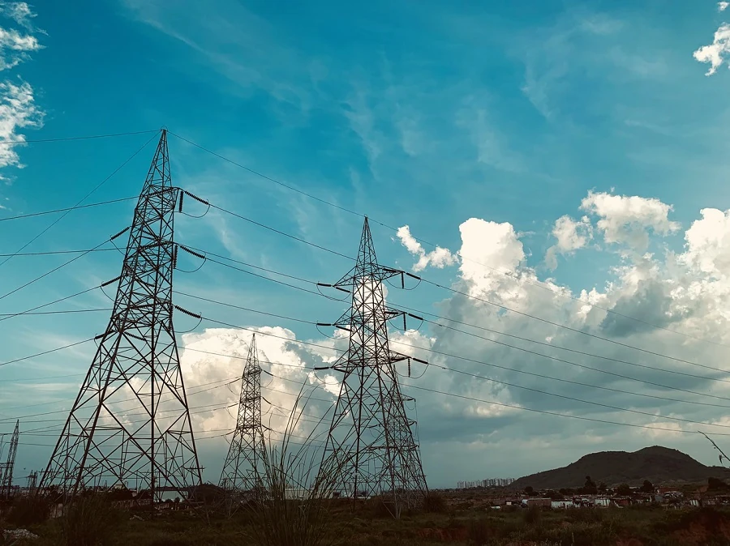

# Introducción a la predicción de series temporales

¿Qué es la predicción de series temporales? Se trata de predecir eventos futuros analizando las tendencias del pasado.

## Tema regional: uso mundial de electricidad ✨

En estas dos lecciones, se le presentará la predicción de series temporales, un área algo menos conocida del aprendizaje automático que, sin embargo, es extremadamente valiosa para aplicaciones industriales y comerciales, entre otros campos. Aunque las redes neuronales pueden usarse para mejorar la utilidad de estos modelos, los estudiaremos en el contexto del aprendizaje automático clásico, ya que los modelos ayudan a predecir el rendimiento futuro basado en el pasado.

Nuestro enfoque regional es el uso eléctrico en el mundo, un conjunto de datos interesante para aprender a pronosticar el consumo futuro de energía basado en patrones de carga pasada. Puede ver cómo este tipo de predicción puede ser extremadamente útil en un entorno empresarial.

Foto de [Peddi Sai hrithik](https://unsplash.com/@shutter_log?utm_source=unsplash&utm_medium=referral&utm_content=creditCopyText) de torres eléctricas en una carretera en Rajasthan en [Unsplash](https://unsplash.com/s/photos/electric-india?utm_source=unsplash&utm_medium=referral&utm_content=creditCopyText)

## Lecciones

1. [Introducción a la predicción de series temporales](1-Introduction/README.md)
2. [Construcción de modelos ARIMA para series temporales](2-ARIMA/README.md)
3. [Construcción de un regresor con Support Vector para la predicción de series temporales](3-SVR/README.md)

## Créditos

"Introducción a la predicción de series temporales" fue escrito con ⚡️ por [Francesca Lazzeri](https://twitter.com/frlazzeri) y [Jen Looper](https://twitter.com/jenlooper). Los cuadernos aparecieron por primera vez en línea en el [repositorio "Deep Learning For Time Series" de Azure](https://github.com/Azure/DeepLearningForTimeSeriesForecasting) escrito originalmente por Francesca Lazzeri. La lección de SVR fue escrita por [Anirban Mukherjee](https://github.com/AnirbanMukherjeeXD)

---

<!-- CO-OP TRANSLATOR DISCLAIMER START -->
**Descargo de responsabilidad**:
Este documento ha sido traducido utilizando el servicio de traducción automática [Co-op Translator](https://github.com/Azure/co-op-translator). Aunque nos esforzamos por la precisión, tenga en cuenta que las traducciones automatizadas pueden contener errores o inexactitudes. El documento original en su idioma nativo debe considerarse la fuente autorizada. Para información crítica, se recomienda una traducción profesional humana. No somos responsables de cualquier malentendido o interpretación errónea que surja del uso de esta traducción.
<!-- CO-OP TRANSLATOR DISCLAIMER END -->