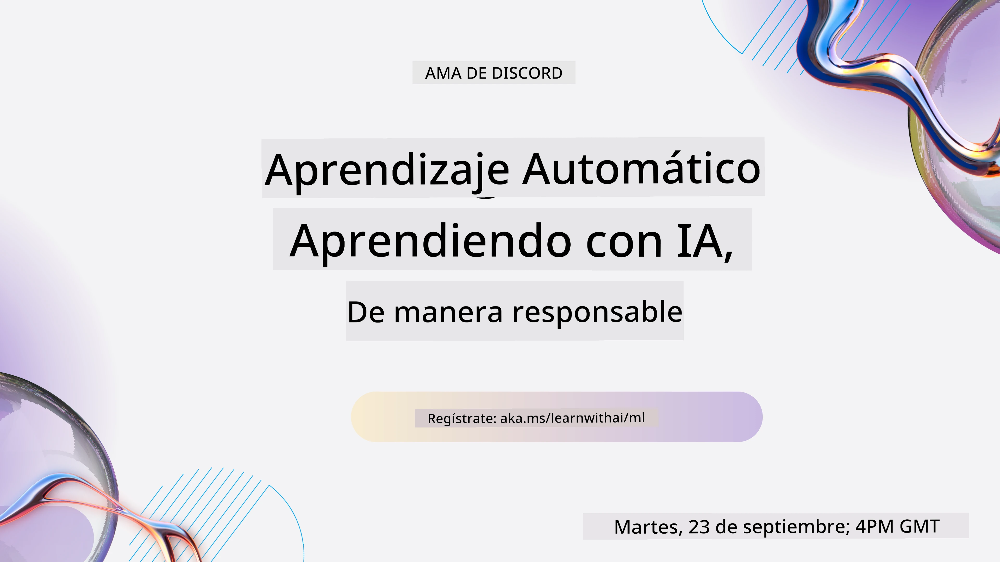
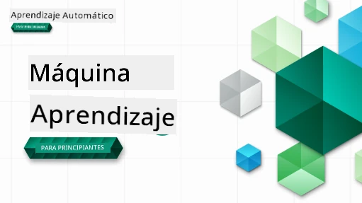

[](https://github.com/microsoft/ML-For-Beginners/blob/master/LICENSE)
[](https://GitHub.com/microsoft/ML-For-Beginners/graphs/contributors/)
[](https://GitHub.com/microsoft/ML-For-Beginners/issues/)
[](https://GitHub.com/microsoft/ML-For-Beginners/pulls/)
[](http://makeapullrequest.com)

[](https://GitHub.com/microsoft/ML-For-Beginners/watchers/)
[](https://GitHub.com/microsoft/ML-For-Beginners/network/)
[](https://GitHub.com/microsoft/ML-For-Beginners/stargazers/)

### 🌐 Soporte multilingüe

#### Traducciones mantenidas con [Co-op Translator](https://github.com/Azure/co-op-translator)

<!-- CO-OP TRANSLATOR LANGUAGES TABLE START -->
[Árabe](../ar/README.md) | [Bengalí](../bn/README.md) | [Búlgaro](../bg/README.md) | [Birmano (Myanmar)](../my/README.md) | [Chino (Simplificado)](../zh-CN/README.md) | [Chino (Tradicional, Hong Kong)](../zh-HK/README.md) | [Chino (Tradicional, Macao)](../zh-MO/README.md) | [Chino (Tradicional, Taiwán)](../zh-TW/README.md) | [Croata](../hr/README.md) | [Checo](../cs/README.md) | [Danés](../da/README.md) | [Neerlandés](../nl/README.md) | [Estonio](../et/README.md) | [Finlandés](../fi/README.md) | [Francés](../fr/README.md) | [Alemán](../de/README.md) | [Griego](../el/README.md) | [Hebreo](../he/README.md) | [Hindi](../hi/README.md) | [Húngaro](../hu/README.md) | [Indonesio](../id/README.md) | [Italiano](../it/README.md) | [Japonés](../ja/README.md) | [Canarés](../kn/README.md) | [Jemer](../km/README.md) | [Coreano](../ko/README.md) | [Lituano](../lt/README.md) | [Malayo](../ms/README.md) | [Malabar](../ml/README.md) | [Manipuri (Meitei Mayek)](../mni/README.md) | [Maratí](../mr/README.md) | [Nepalí](../ne/README.md) | [Pidgin nigeriano](../pcm/README.md) | [Noruego](../no/README.md) | [Persa (Farsi)](../fa/README.md) | [Polaco](../pl/README.md) | [Portugués (Brasil)](../pt-BR/README.md) | [Portugués (Portugal)](../pt-PT/README.md) | [Punjabi (Gurmukhi)](../pa/README.md) | [Rumano](../ro/README.md) | [Ruso](../ru/README.md) | [Serbio (Cirílico)](../sr/README.md) | [Eslovaco](../sk/README.md) | [Esloveno](../sl/README.md) | [Español](./README.md) | [Swahili](../sw/README.md) | [Sueco](../sv/README.md) | [Tagalo (Filipino)](../tl/README.md) | [Tamil](../ta/README.md) | [Telugu](../te/README.md) | [Tailandés](../th/README.md) | [Turco](../tr/README.md) | [Ucraniano](../uk/README.md) | [Urdu](../ur/README.md) | [Vietnamita](../vi/README.md)

> **¿Prefieres clonar localmente?**
>
> Este repositorio incluye más de 50 traducciones que aumentan significativamente el tamaño de la descarga. Para clonar sin traducciones, usa la descarga selectiva (sparse checkout):
>
> **Bash / macOS / Linux:**
> ```bash
> git clone --filter=blob:none --sparse https://github.com/microsoft/ML-For-Beginners.git
> cd ML-For-Beginners
> git sparse-checkout set --no-cone '/*' '!translations' '!translated_images'
> ```
>
> **CMD (Windows):**
> ```cmd
> git clone --filter=blob:none --sparse https://github.com/microsoft/ML-For-Beginners.git
> cd ML-For-Beginners
> git sparse-checkout set --no-cone "/*" "!translations" "!translated_images"
> ```
>
> Esto te da todo lo necesario para completar el curso con una descarga mucho más rápida.
<!-- CO-OP TRANSLATOR LANGUAGES TABLE END -->

#### Únete a nuestra comunidad

[](https://discord.gg/nTYy5BXMWG)

Tenemos una serie en Discord para aprender con AI, conoce más y únete en [Serie Aprende con AI](https://aka.ms/learnwithai/discord) del 18 al 30 de septiembre de 2025. Obtendrás consejos y trucos para usar GitHub Copilot en Ciencia de Datos.



# Aprendizaje Automático para Principiantes - Un Currículo

> 🌍 Viaja por el mundo mientras exploramos el Aprendizaje Automático a través de culturas mundiales 🌍

Los Cloud Advocates de Microsoft se complacen en ofrecer un currículo de 12 semanas y 26 lecciones sobre **Aprendizaje Automático**. En este currículo, aprenderás sobre lo que a veces se llama **aprendizaje automático clásico**, utilizando principalmente Scikit-learn como biblioteca y evitando el aprendizaje profundo, que se cubre en nuestro [currículo AI para Principiantes](https://aka.ms/ai4beginners). Combina estas lecciones con nuestro [currículo 'Ciencia de Datos para Principiantes'](https://aka.ms/ds4beginners), también.

Viaja con nosotros por el mundo aplicando estas técnicas clásicas a datos de muchas áreas. Cada lección incluye cuestionarios antes y después, instrucciones escritas para completar la lección, una solución, una tarea y más. Nuestra pedagogía basada en proyectos te permite aprender construyendo, una forma comprobada para que las nuevas habilidades se afiancen.

**✍️ Muchas gracias a nuestros autores** Jen Looper, Stephen Howell, Francesca Lazzeri, Tomomi Imura, Cassie Breviu, Dmitry Soshnikov, Chris Noring, Anirban Mukherjee, Ornella Altunyan, Ruth Yakubu y Amy Boyd

**🎨 Gracias también a nuestras ilustradoras** Tomomi Imura, Dasani Madipalli y Jen Looper

**🙏 Agradecimientos especiales 🙏 a nuestros autores, revisores y colaboradores embajadores estudiantiles de Microsoft**, en particular Rishit Dagli, Muhammad Sakib Khan Inan, Rohan Raj, Alexandru Petrescu, Abhishek Jaiswal, Nawrin Tabassum, Ioan Samuila y Snigdha Agarwal

**🤩 Gratitud extra a los Embajadores Estudiantiles de Microsoft Eric Wanjau, Jasleen Sondhi y Vidushi Gupta por nuestras lecciones en R!**

# Primeros pasos

Sigue estos pasos:
1. **Haz un fork del repositorio**: Haz clic en el botón "Fork" en la esquina superior derecha de esta página.
2. **Clona el repositorio**:   `git clone https://github.com/microsoft/ML-For-Beginners.git`

> 💡 **Consejo rápido:** ¿Quieres empezar en un navegador sin configurar Python localmente? Usa [GitHub Codespaces](https://github.com/features/codespaces) para crear un entorno de desarrollo en la nube para tu fork. Abre el menú verde **Code**, selecciona **Codespaces** y crea un codespace; instala las dependencias necesarias para cada lección según se necesite.

> [Encuentra todos los recursos adicionales para este curso en nuestra colección Microsoft Learn](https://learn.microsoft.com/en-us/collections/qrqzamz1nn2wx3?WT.mc_id=academic-77952-bethanycheum)

> 🔧 **¿Necesitas ayuda?** Consulta nuestra [Guía de resolución de problemas](TROUBLESHOOTING.md) para las soluciones a los problemas comunes de instalación, configuración y ejecución de lecciones.


**[Estudiantes](https://aka.ms/student-page)**, para usar este currículo, haz un fork del repositorio completo a tu cuenta de GitHub y completa los ejercicios por tu cuenta o en grupo:

- Comienza con un cuestionario previo a la lección.
- Lee la lección y completa las actividades, deteniéndote a reflexionar en cada verificación de conocimiento.
- Intenta crear los proyectos comprendiendo las lecciones en lugar de ejecutar el código solución; sin embargo, ese código está disponible en las carpetas `/solution` en cada lección orientada a proyectos.
- Realiza el cuestionario posterior a la lección.
- Completa el desafío.
- Completa la tarea.
- Tras completar un grupo de lecciones, visita el [Foro de discusión](https://github.com/microsoft/ML-For-Beginners/discussions) y "aprende en voz alta" llenando la rúbrica PAT correspondiente. Un 'PAT' es una herramienta de evaluación de progreso que completas para avanzar en tu aprendizaje. También puedes interactuar con otros PAT para aprender juntos.

> Para un estudio adicional, recomendamos seguir estos módulos y rutas de aprendizaje de [Microsoft Learn](https://docs.microsoft.com/en-us/users/jenlooper-2911/collections/k7o7tg1gp306q4?WT.mc_id=academic-77952-leestott).

**Docentes**, hemos [incluido algunas sugerencias](for-teachers.md) sobre cómo usar este currículo.

---

## Videos explicativos

Algunas lecciones están disponibles en formato video corto. Puedes encontrarlos en línea dentro de las lecciones o en la [lista de reproducción ML para Principiantes en el canal de Microsoft Developer en YouTube](https://aka.ms/ml-beginners-videos) haciendo clic en la imagen a continuación.

[](https://aka.ms/ml-beginners-videos)

---

## Conoce al equipo

[](https://youtu.be/Tj1XWrDSYJU)

**Gif por** [Mohit Jaisal](https://linkedin.com/in/mohitjaisal)

> 🎥 ¡Haz clic en la imagen de arriba para ver un video sobre el proyecto y las personas que lo crearon!

---

## Pedagogía

Hemos elegido dos principios pedagógicos al desarrollar este currículo: asegurar que sea práctico y **basado en proyectos** y que incluya **cuestionarios frecuentes**. Además, este currículo tiene un **tema común** para darle cohesión.

Asegurando que el contenido esté alineado con proyectos, el proceso se vuelve más atractivo para los estudiantes y la retención de conceptos se incrementa. Además, un cuestionario de baja presión antes de una clase fija la intención del estudiante para aprender un tema, mientras que un segundo cuestionario después de la clase asegura retención adicional. Este currículo fue diseñado para ser flexible y divertido y se puede tomar en su totalidad o en partes. Los proyectos comienzan pequeños y se vuelven progresivamente más complejos al final del ciclo de 12 semanas. Este currículo también incluye un postscriptum sobre aplicaciones reales del ML, que puede usarse como crédito extra o como base para discusión.

> Encuentra nuestras pautas de [Código de conducta](CODE_OF_CONDUCT.md), [Contribuciones](CONTRIBUTING.md), [Traducciones](..) y [Solución de problemas](TROUBLESHOOTING.md). ¡Agradecemos tu retroalimentación constructiva!

## Cada lección incluye

- boceto opcional
- video complementario opcional
- video explicativo (solo algunas lecciones)
- [cuestionario de calentamiento previo a la lección](https://ff-quizzes.netlify.app/en/ml/)
- lección escrita
- para lecciones basadas en proyectos, guías paso a paso para construir el proyecto
- verificaciones de conocimiento
- un desafío
- lectura complementaria
- tarea
- [cuestionario posterior a la lección](https://ff-quizzes.netlify.app/en/ml/)

> **Una nota sobre los idiomas**: Estas lecciones están principalmente escritas en Python, pero muchas también están disponibles en R. Para completar una lección en R, ve a la carpeta `/solution` y busca lecciones en R. Incluyen una extensión .rmd que representa un archivo **R Markdown** que puede definirse simplemente como una incrustación de `code chunks` (de R u otros lenguajes) y un `YAML header` (que guía cómo formatear salidas como PDF) en un `Markdown document`. Por lo tanto, sirve como un marco ejemplar de autoría para ciencia de datos ya que te permite combinar tu código, su salida y tus pensamientos permitiéndote escribirlos en Markdown. Además, los documentos R Markdown pueden renderizarse a formatos de salida como PDF, HTML o Word.

> **Una nota sobre cuestionarios**: Todos los cuestionarios están contenidos en la carpeta [Quiz App](../../quiz-app), con un total de 52 cuestionarios de tres preguntas cada uno. Están enlazados desde dentro de las lecciones pero la aplicación del cuestionario puede ejecutarse localmente; sigue las instrucciones en la carpeta `quiz-app` para alojar localmente o desplegar en Azure.

| Número de Lección |                             Tema                              |                   Agrupación de Lecciones                   | Objetivos de Aprendizaje                                                                                                             |                                                              Lección Vinculada                                                               |                        Autor                        |
| :-----------: | :------------------------------------------------------------: | :-------------------------------------------------: | ------------------------------------------------------------------------------------------------------------------------------- | :--------------------------------------------------------------------------------------------------------------------------------------: | :--------------------------------------------------: |
|      01       |                Introducción al aprendizaje automático                |      [Introducción](1-Introduction/README.md)       | Aprender los conceptos básicos detrás del aprendizaje automático                                                                                |                                             [Lección](1-Introduction/1-intro-to-ML/README.md)                                             |                       Muhammad                       |
|      02       |                La Historia del aprendizaje automático                 |      [Introducción](1-Introduction/README.md)       | Conocer la historia que subyace en este campo                                                                                         |                                            [Lección](1-Introduction/2-history-of-ML/README.md)                                            |                     Jen y Amy                      |
|      03       |                 Equidad y aprendizaje automático                  |      [Introducción](1-Introduction/README.md)       | ¿Cuáles son los temas filosóficos importantes sobre equidad que los estudiantes deberían considerar al construir y aplicar modelos de AA? |                                              [Lección](1-Introduction/3-fairness/README.md)                                               |                        Tomomi                        |
|      04       |                Técnicas para el aprendizaje automático                 |      [Introducción](1-Introduction/README.md)       | ¿Qué técnicas usan los investigadores de AA para construir modelos?                                                                       |                                          [Lección](1-Introduction/4-techniques-of-ML/README.md)                                           |                    Chris y Jen                     |
|      05       |                   Introducción a la regresión                   |        [Regresión](2-Regression/README.md)         | Comenzar con Python y Scikit-learn para modelos de regresión                                                                  |         [Python](2-Regression/1-Tools/README.md) • [R](../../2-Regression/1-Tools/solution/R/lesson_1.html)         |      Jen • Eric Wanjau       |
|      06       |                Precios de calabaza en Norteamérica 🎃                |        [Regresión](2-Regression/README.md)         | Visualizar y limpiar datos en preparación para AA                                                                                  |          [Python](2-Regression/2-Data/README.md) • [R](../../2-Regression/2-Data/solution/R/lesson_2.html)          |      Jen • Eric Wanjau       |
|      07       |                Precios de calabaza en Norteamérica 🎃                |        [Regresión](2-Regression/README.md)         | Construir modelos de regresión lineal y polinómica                                                                                   |        [Python](2-Regression/3-Linear/README.md) • [R](../../2-Regression/3-Linear/solution/R/lesson_3.html)        |      Jen y Dmitry • Eric Wanjau       |
|      08       |                Precios de calabaza en Norteamérica 🎃                |        [Regresión](2-Regression/README.md)         | Construir un modelo de regresión logística                                                                                               |     [Python](2-Regression/4-Logistic/README.md) • [R](../../2-Regression/4-Logistic/solution/R/lesson_4.html)      |      Jen • Eric Wanjau       |
|      09       |                          Una Aplicación Web 🔌                          |           [Aplicación Web](3-Web-App/README.md)            | Construir una aplicación web para usar tu modelo entrenado                                                                                       |                                                 [Python](3-Web-App/1-Web-App/README.md)                                                  |                         Jen                          |
|      10       |                 Introducción a la clasificación                 |    [Clasificación](4-Classification/README.md)     | Limpiar, preparar y visualizar tus datos; introducción a la clasificación                                                            | [Python](4-Classification/1-Introduction/README.md) • [R](../../4-Classification/1-Introduction/solution/R/lesson_10.html)  | Jen y Cassie • Eric Wanjau |
|      11       |             Deliciosas cocinas asiáticas e indias 🍜             |    [Clasificación](4-Classification/README.md)     | Introducción a los clasificadores                                                                                                     | [Python](4-Classification/2-Classifiers-1/README.md) • [R](../../4-Classification/2-Classifiers-1/solution/R/lesson_11.html) | Jen y Cassie • Eric Wanjau |
|      12       |             Deliciosas cocinas asiáticas e indias 🍜             |    [Clasificación](4-Classification/README.md)     | Más clasificadores                                                                                                                | [Python](4-Classification/3-Classifiers-2/README.md) • [R](../../4-Classification/3-Classifiers-2/solution/R/lesson_12.html) | Jen y Cassie • Eric Wanjau |
|      13       |             Deliciosas cocinas asiáticas e indias 🍜             |    [Clasificación](4-Classification/README.md)     | Construir una aplicación web de recomendación usando tu modelo                                                                                    |                                              [Python](4-Classification/4-Applied/README.md)                                              |                         Jen                          |
|      14       |                   Introducción al agrupamiento                   |        [Agrupamiento](5-Clustering/README.md)         | Limpiar, preparar y visualizar tus datos; introducción al agrupamiento                                                                |         [Python](5-Clustering/1-Visualize/README.md) • [R](../../5-Clustering/1-Visualize/solution/R/lesson_14.html)         |      Jen • Eric Wanjau       |
|      15       |              Explorando gustos musicales nigerianos 🎧              |        [Agrupamiento](5-Clustering/README.md)         | Explorar el método de agrupamiento K-Means                                                                                           |           [Python](5-Clustering/2-K-Means/README.md) • [R](../../5-Clustering/2-K-Means/solution/R/lesson_15.html)           |      Jen • Eric Wanjau       |
|      16       |        Introducción al procesamiento de lenguaje natural ☕️         |   [Procesamiento de lenguaje natural](6-NLP/README.md)    | Aprender lo básico sobre PLN construyendo un bot simple                                                                             |                                             [Python](6-NLP/1-Introduction-to-NLP/README.md)                                              |                       Stephen                        |
|      17       |                      Tareas comunes de PLN ☕️                      |   [Procesamiento de lenguaje natural](6-NLP/README.md)    | Profundizar el conocimiento de PLN comprendiendo tareas comunes requeridas al tratar con estructuras de lenguaje                          |                                                    [Python](6-NLP/2-Tasks/README.md)                                                     |                       Stephen                        |
|      18       |             Traducción y análisis de sentimientos ♥️              |   [Procesamiento de lenguaje natural](6-NLP/README.md)    | Traducción y análisis de sentimientos con Jane Austen                                                                             |                                            [Python](6-NLP/3-Translation-Sentiment/README.md)                                             |                       Stephen                        |
|      19       |                  Hoteles románticos de Europa ♥️                  |   [Procesamiento de lenguaje natural](6-NLP/README.md)    | Análisis de sentimientos con opiniones de hoteles 1                                                                                         |                                               [Python](6-NLP/4-Hotel-Reviews-1/README.md)                                                |                       Stephen                        |
|      20       |                  Hoteles románticos de Europa ♥️                  |   [Procesamiento de lenguaje natural](6-NLP/README.md)    | Análisis de sentimientos con opiniones de hoteles 2                                                                                         |                                               [Python](6-NLP/5-Hotel-Reviews-2/README.md)                                                |                       Stephen                        |
|      21       |            Introducción a la predicción de series temporales             |        [Series temporales](7-TimeSeries/README.md)        | Introducción a la predicción de series temporales                                                                                         |                                             [Python](7-TimeSeries/1-Introduction/README.md)                                              |                      Francesca                       |
|      22       | ⚡️ Uso mundial de energía ⚡️ - predicción de series temporales con ARIMA |        [Series temporales](7-TimeSeries/README.md)        | Predicción de series temporales con ARIMA                                                                                              |                                                 [Python](7-TimeSeries/2-ARIMA/README.md)                                                 |                      Francesca                       |
|      23       |  ⚡️ Uso mundial de energía ⚡️ - predicción de series temporales con SVR  |        [Series temporales](7-TimeSeries/README.md)        | Predicción de series temporales con Regresor de Vectores de Soporte                                                                           |                                                  [Python](7-TimeSeries/3-SVR/README.md)                                                  |                       Anirban                        |
|      24       |             Introducción al aprendizaje por refuerzo             | [Aprendizaje por refuerzo](8-Reinforcement/README.md) | Introducción al aprendizaje por refuerzo con Q-Learning                                                                          |                                             [Python](8-Reinforcement/1-QLearning/README.md)                                              |                        Dmitry                        |
|      25       |                 ¡Ayuda a Peter a evitar el lobo! 🐺                  | [Aprendizaje por refuerzo](8-Reinforcement/README.md) | Aprendizaje por refuerzo Gym                                                                                                      |                                                [Python](8-Reinforcement/2-Gym/README.md)                                                 |                        Dmitry                        |
|  Posdata   |            Escenarios y aplicaciones reales de ML            |      [ML en la naturaleza](9-Real-World/README.md)       | Aplicaciones interesantes y reveladoras del ML clásico                                                               |                                             [Lección](9-Real-World/1-Applications/README.md)                                              |                         Equipo                         |
|  Posdata   |            Depuración de modelos en ML usando el panel RAI            |      [ML en la naturaleza](9-Real-World/README.md)       | Depuración de modelos en aprendizaje automático usando componentes de panel Responsible AI                                                              |                                             [Lección](9-Real-World/2-Debugging-ML-Models/README.md)                                              |                     Ruth Yakubu                      |

> [encuentra todos los recursos adicionales para este curso en nuestra colección Microsoft Learn](https://learn.microsoft.com/en-us/collections/qrqzamz1nn2wx3?WT.mc_id=academic-77952-bethanycheum)

## Acceso sin conexión

Puedes ejecutar esta documentación sin conexión usando [Docsify](https://docsify.js.org/#/). Haz un fork de este repositorio, [instala Docsify](https://docsify.js.org/#/quickstart) en tu máquina local y luego en la carpeta raíz de este repositorio, escribe `docsify serve`. El sitio web se servirá en el puerto 3000 en tu localhost: `localhost:3000`.

## PDFs

Encuentra un pdf del plan de estudios con enlaces [aquí](https://microsoft.github.io/ML-For-Beginners/pdf/readme.pdf).


## 🎒 Otros Cursos 

¡Nuestro equipo produce otros cursos! Mira:

<!-- CO-OP TRANSLATOR OTHER COURSES START -->
### LangChain
[](https://aka.ms/langchain4j-for-beginners)
[](https://aka.ms/langchainjs-for-beginners?WT.mc_id=m365-94501-dwahlin)
[](https://github.com/microsoft/langchain-for-beginners?WT.mc_id=m365-94501-dwahlin)
---

### Azure / Edge / MCP / Agentes
[](https://github.com/microsoft/AZD-for-beginners?WT.mc_id=academic-105485-koreyst)
[](https://github.com/microsoft/edgeai-for-beginners?WT.mc_id=academic-105485-koreyst)
[](https://github.com/microsoft/mcp-for-beginners?WT.mc_id=academic-105485-koreyst)
[](https://github.com/microsoft/ai-agents-for-beginners?WT.mc_id=academic-105485-koreyst)

---
 
### Serie de IA Generativa
[](https://github.com/microsoft/generative-ai-for-beginners?WT.mc_id=academic-105485-koreyst)
[-9333EA?style=for-the-badge&labelColor=E5E7EB&color=9333EA)](https://github.com/microsoft/Generative-AI-for-beginners-dotnet?WT.mc_id=academic-105485-koreyst)
[-C084FC?style=for-the-badge&labelColor=E5E7EB&color=C084FC)](https://github.com/microsoft/generative-ai-for-beginners-java?WT.mc_id=academic-105485-koreyst)
[-E879F9?style=for-the-badge&labelColor=E5E7EB&color=E879F9)](https://github.com/microsoft/generative-ai-with-javascript?WT.mc_id=academic-105485-koreyst)

---
 
### Aprendizaje Básico
[](https://aka.ms/ml-beginners?WT.mc_id=academic-105485-koreyst)
[](https://aka.ms/datascience-beginners?WT.mc_id=academic-105485-koreyst)
[](https://aka.ms/ai-beginners?WT.mc_id=academic-105485-koreyst)
[](https://github.com/microsoft/Security-101?WT.mc_id=academic-96948-sayoung)
[](https://aka.ms/webdev-beginners?WT.mc_id=academic-105485-koreyst)
[](https://aka.ms/iot-beginners?WT.mc_id=academic-105485-koreyst)
[](https://github.com/microsoft/xr-development-for-beginners?WT.mc_id=academic-105485-koreyst)

---
 
### Serie Copilot
[](https://aka.ms/GitHubCopilotAI?WT.mc_id=academic-105485-koreyst)
[](https://github.com/microsoft/mastering-github-copilot-for-dotnet-csharp-developers?WT.mc_id=academic-105485-koreyst)
[](https://github.com/microsoft/CopilotAdventures?WT.mc_id=academic-105485-koreyst)
<!-- CO-OP TRANSLATOR OTHER COURSES END -->

## Obtener ayuda

Si te atascas o tienes preguntas mientras aprendes Aprendizaje Automático o construyes aplicaciones de IA, no te preocupes — hay ayuda disponible.

Puedes unirte a discusiones con otros estudiantes y desarrolladores, hacer preguntas y compartir tus ideas con la comunidad.

- Únete a la comunidad para hacer preguntas y aprender con otros
- Discute conceptos de Aprendizaje Automático e ideas de proyectos
- Obtén orientación de desarrolladores experimentados

Una comunidad solidaria es una excelente manera de crecer tus habilidades y resolver problemas más rápido.

[Comunidad de Discord de Microsoft Foundry](https://discord.gg/nTYy5BXMWG)

Si encuentras errores, fallas o tienes sugerencias para mejoras, también puedes abrir un **Issue** en este repositorio para reportar el problema.

Para comentarios sobre el producto o para buscar publicaciones existentes en la comunidad, visita el Foro de Desarrolladores:

[](https://aka.ms/foundry/forum)

## Consejos adicionales para el aprendizaje

- Revisa los notebooks después de cada lección para una mejor comprensión.
- Practica implementando algoritmos por tu cuenta.
- Explora conjuntos de datos del mundo real usando conceptos aprendidos.

---

<!-- CO-OP TRANSLATOR DISCLAIMER START -->
**Descargo de responsabilidad**:
Este documento ha sido traducido utilizando el servicio de traducción automática [Co-op Translator](https://github.com/Azure/co-op-translator). Aunque nos esforzamos por la precisión, tenga en cuenta que las traducciones automatizadas pueden contener errores o inexactitudes. El documento original en su idioma nativo debe considerarse la fuente autorizada. Para información crítica, se recomienda una traducción profesional humana. No somos responsables de cualquier malentendido o interpretación errónea que surja del uso de esta traducción.
<!-- CO-OP TRANSLATOR DISCLAIMER END -->