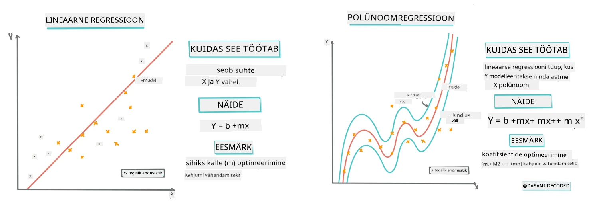
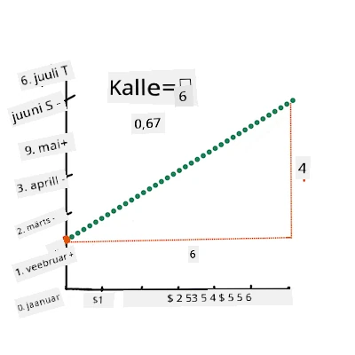
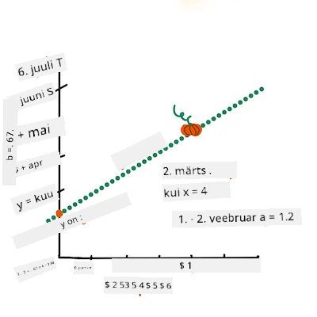
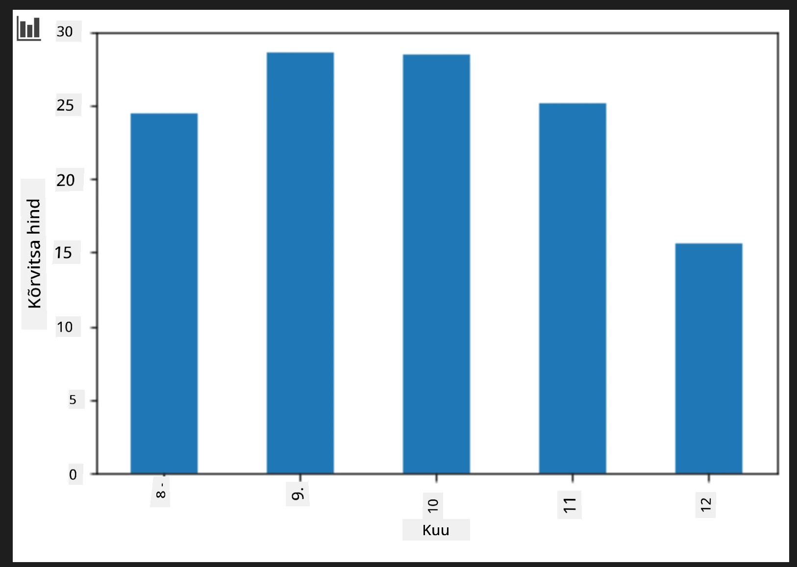
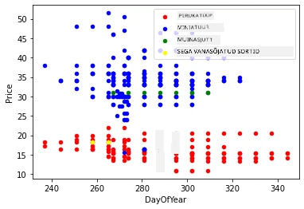

# Regresseerimudeli loomine Scikit-learni abil: regressioon neli moodi

## Algaja märkus

Lineaarset regressiooni kasutatakse siis, kui soovime ennustada **numbrilist väärtust** (näiteks maja hind, temperatuur või müük).  
See töötab, leides sirgjoone, mis kõige paremini kirjeldab seost sisendiomaduste ja väljundi vahel.

Selles õppetükis keskendume esmalt mõiste mõistmisele, enne kui uurime edasijõudnutele mõeldud regressioonitehnikaid.  
  
> Infograafiku autor on [Dasani Madipalli](https://twitter.com/dasani_decoded)  
## [Loengu-eelne viktoriin](https://ff-quizzes.netlify.app/en/ml/)

> ### [See õppetükk on saadaval ka R-is!](../../../../2-Regression/3-Linear/solution/R/lesson_3.html)  
### Sissejuhatus  

Nii kaugele oled uurinud, mis on regressioon, lähtudes kõrvitsate hindade andmekogumist, mida kasutame kogu selle õppetüki vältel. Oled ka visualiseerinud seda Matplotlibiga.

Nüüd oled valmis regressiooni sügavamalt uurima masinõppes. Kuigi visualiseerimine võimaldab sul andmeid mõista, tuleb masinõppe tõeline võimsus mudelite _treenimisest_. Mudelid treenitakse ajalooliste andmete peal, et automaatselt tabada andmete sõltuvusi, ja need lubavad ennustada tulemusi uue andme kohta, mida mudel varem ei näinud.

Selles õppetükis õpid rohkem kahest regressiooni tüübist: _lihtne lineaarne regressioon_ ja _polünoomne regressioon_, koos mõne matemaatikaga, mis neid tehnikaid aluseks on. Need mudelid lubavad ennustada kõrvitsate hinda sõltuvalt erinevatest sisendandmetest.

[](https://youtu.be/CRxFT8oTDMg "Masinõpe algajatele - Lineaarse regressiooni mõistmine")

> 🎥 Vajuta ülalolevale pildile, et vaadata lühike video lineaarse regressiooni ülevaatest.

> Selle õppekava vältel eeldame matemaatikast vähest või üldse mitteoskust ning püüdleme selle poole, et see oleks ligipääsetav ka teiste alade tudengitele, seega hoia silm peal märkmetel, 🧮 arvutustel, diagrammidel ja muudel õppematerjalidel, mis aitavad mõistmist.

### Eelteadmised

Nüüd peaksid olema tuttavaks saanud kõrvitsate andmete struktuuriga, mida uurime. Selle leiad eelnevalt laadituna ja puhastatuna selle õppetüki _notebook.ipynb_ failist. Seal on kõrvitsa hind toodud ühe busheli kohta uues andmekaadris. Veendu, et suudad käivitada neid märkmeid Visual Studio Code'i kerneli sees.

### Ettevalmistus

Nagu meelde tuletuseks, laadid seda andmestikku, et saaksid selle kohta küsimusi esitada.

- Millal on parim aeg kõrvitsaid osta?  
- Millist hinda võin oodata väikeste kõrvitsate kaubaaluse kohta?  
- Kas peaksin ostma neid poolbusheli korvides või 1 1/9 busheli kastides?  
Vaatleme seda andmestikku edasi.

Eelnevas õppetükis lõid Pandase andmekaarvi ja täitsid selle originaalandmekogumi osaga, standardiseerides hinna busheli järgi. Nii toimides kogusid aga vaid umbes 400 andmepunkti ja ainult sügiskuude kohta.

Vaata andmeid, mis on eelnevalt laetud selle õppetüki kaasaegse märkme menüüsse. Andmed on eelnevalt laetud ja esialgne hajusdiagramm kuupäevade kohta joonistatud. Võib-olla saame andmete olemuse kohta rohkem detaili, kui need veelgi puhastada.

## Lineaarne regressioonijoon

Nagu õppisid 1. õppetükis, on lineaarse regressiooni eesmärk:

- **Näidata muutujate seoseid.** Näidata seost muutujate vahel  
- **Tee ennustusi.** Teha täpseid ennustusi, kuhu uus andmepunkt selle joone suhtes langeks

Tüüpiline on joonistada sellist joont **Vähimruutude regressioon** meetodiga. Mõiste "Least-Squares" viitab meetodile, kus minimeeritakse kogu mudeli viga. Iga andmepunkti kohta mõõdame vertikaalset kaugust (jäänukit) tegeliku punkti ja regressioonijoone vahel.

Need kaugused ruudutatakse kahe põhjusel:

1. **Suuru üle suuna:** Soovime, et viga -5 oleks sama kui +5. Ruudutamine muudab kõik väärtused positiivseks.  

2. **Hukkamõistmine väljud:** Suurematel vigadel on suurem kaal, mis sunnib joont jääma kaugete punktide lähedale.

Seejärel liidame kõik ruutväärtused kokku. Meie eesmärk on leida joon, mille kõigi jäänukruutude summa on minimaalne — seepärast nimetatakse seda "Least-Squares".

> **🧮 Näita mulle matemaatikat**  
>  
> Seda joont, mida kutsutakse _parima sobivuse jooneks_, saab väljendada [valemiga](https://en.wikipedia.org/wiki/Simple_linear_regression):  
>  
> ```
> Y = a + bX
> ```
>  
> `X` on 'selgitav muutuja'. `Y` on 'sõltuv muutuja'. Joonet tähistab kalle `b` ja y-lõikepunkt `a`, mis näitab väärtust `Y`, kui `X = 0`.  
>  
>  
>  
> Esiteks arvuta kalle `b`. Infograafiku autor on [Jen Looper](https://twitter.com/jenlooper)  
>  
> Teisisõnu, ja viidates meie kõrvitsate andmestiku algsele küsimusele: "ennusta kõrvitsa hind busheli kohta kuu järgi", tähendab `X` hinda ja `Y` müügikuud.  
>  
>  
>  
> Arvuta `Y` väärtus. Kui maksad umbes 4 dollarit, peab olema aprill! Infograafiku autor on [Jen Looper](https://twitter.com/jenlooper)  
>  
> Jooni arvutav matemaatika peab näitama kallet, mis sõltub ka lõikepunktist ehk sellest, kus `Y` asub, kui `X = 0`.  
>  
> Võid vaadata arvutusmeetodit [Math is Fun](https://www.mathsisfun.com/data/least-squares-regression.html) veebisaidilt. Samuti külasta [Vähimruutude kalkulaatorit](https://www.mathsisfun.com/data/least-squares-calculator.html), et näha, kuidas arvude väärtused joont mõjutavad.

## Korrelatsioon

Veel üks termin, mida tuleb mõista, on **korrelatsioonikordaja** antud `X` ja `Y` muutujate vahel. Hajusdiagrammiga saab selle kordaja kiiresti visualiseerida. Punktide laialivalgumine sirgjoonel näitab kõrget korrelatsiooni, aga kui punktid on kogu `X` ja `Y` vahel laiali, on korrelatsioon madal.

Hea lineaarne regressioonimudel on selline, millel on suur (lähemal 1 kui 0) korrelatsioonikordaja, kasutades vähimruutude regressioonimeetodit ja regressioonijoont.

✅ Käivita selle õppetüki kaasasolev märkmik ja vaata kuupäeva ja hinna hajusdiagrammi. Kas sinu visuaalse hinnangu järgi on kõrvitsamüükude puhul kuu ja hinna seos pigem tugev või nõrk? Kas see muutub, kui kasutad kuupäeva asemel graniitsemat mõõdet, nt *päeva aastas* (päevade arv aasta algusest)?

Järgnevas koodis eeldame, et andmed on puhastatud ja meil on andmekaader nimega `new_pumpkins`, mis sarnaneb sellise tabeliga:

ID | Month | DayOfYear | Variety | City | Package | Low Price | High Price | Price  
---|-------|-----------|---------|------|---------|-----------|------------|-------  
70 | 9 | 267 | PIE TYPE | BALTIMORE | 1 1/9 bushel cartons | 15.0 | 15.0 | 13.636364  
71 | 9 | 267 | PIE TYPE | BALTIMORE | 1 1/9 bushel cartons | 18.0 | 18.0 | 16.363636  
72 | 10 | 274 | PIE TYPE | BALTIMORE | 1 1/9 bushel cartons | 18.0 | 18.0 | 16.363636  
73 | 10 | 274 | PIE TYPE | BALTIMORE | 1 1/9 bushel cartons | 17.0 | 17.0 | 15.454545  
74 | 10 | 281 | PIE TYPE | BALTIMORE | 1 1/9 bushel cartons | 15.0 | 15.0 | 13.636364

> Andmete puhastamise kood on saadaval failis [`notebook.ipynb`](notebook.ipynb). Oleme teinud samad puhastusastmed nagu eelnevas õppetükis ning arvutanud `DayOfYear` veeru järgmiselt:  

```python
day_of_year = pd.to_datetime(pumpkins['Date']).apply(lambda dt: (dt-datetime(dt.year,1,1)).days)
```
  
Nüüd, kui mõistad lineaarse regressiooni matemaatikat, loome regressioonimudeli, et näha, kas suudame ennustada, milline kõrvitsapakend annab parima hinna. Mõni, kes ostab kõrvitsaid püha kõrvitsapeenra jaoks, võiks seda infot kasutada, et optimeerida kõrvitsaostu.

## Korrelatsiooni otsimine

[](https://youtu.be/uoRq-lW2eQo "Masinõpe algajatele - Korrelatsiooni otsimine: lineaarse regressiooni võti")

> 🎥 Vajuta ülalolevale pildile, et vaadata lühike video korrelatsioonist.

Eelmisest õppetükist oled ilmselt näinud, et kuude keskmine hind näeb välja selline:



See viitab sellele, et peaks olema mingi korrelatsioon ning me võime proovida treenida lineaarset regressioonimudelit, et ennustada seost `Month` ja `Price` vahel või `DayOfYear` ja `Price` vahel. Alljärgnev hajusdiagramm näitab viimast seost:

 

Vaatame, kas korrelatsioon eksisteerib, kasutades `corr` funktsiooni:

```python
print(new_pumpkins['Month'].corr(new_pumpkins['Price']))
print(new_pumpkins['DayOfYear'].corr(new_pumpkins['Price']))
```
  
Näib, et korrelatsioon on üsna väike: -0.15 kuu korral ja -0.17 aasta päeva korral, kuid võib olla veel mõni oluline seos. Tundub, et erinevatel kõrvitsatüüpidel on erinevad hinnaklastrid. Selle hüpoteesi kinnitamiseks joonistame iga kõrvitsatüübi erineva värviga. Edastades `ax` parameetri `scatter` funktsioonile, saame joonistada kõik punktid samale diagrammile:

```python
ax=None
colors = ['red','blue','green','yellow']
for i,var in enumerate(new_pumpkins['Variety'].unique()):
    df = new_pumpkins[new_pumpkins['Variety']==var]
    ax = df.plot.scatter('DayOfYear','Price',ax=ax,c=colors[i],label=var)
```
  
 

Meie uurimus viitab, et sort mõjub hinna üldisele käitumisele rohkem kui müügikuupäev. Seda näitab mugavalt ka tulpdiagramm:

```python
new_pumpkins.groupby('Variety')['Price'].mean().plot(kind='bar')
```
  
 

Keskendume praegu ühele kõrvitsatüübile, 'pie type', ja vaatame, millist mõju kuupäev hindadele avaldab:

```python
pie_pumpkins = new_pumpkins[new_pumpkins['Variety']=='PIE TYPE']
pie_pumpkins.plot.scatter('DayOfYear','Price') 
```
 

Kui nüüd arvutada korrelatsioon `Price` ja `DayOfYear` vahel `corr` funktsiooniga, saame tulemuseks umbes `-0.27`, mis näitab, et mudeli treenimine ennustamiseks on mõistlik.

> Enne lineaarse regressioonimudeli treenimist on oluline veenduda, et andmestik on puhas. Lineaarne regressioon ei toimi hästi puuduva väärtusega, seega on mõistlik need tühjad lahtrid eemaldada:

```python
pie_pumpkins.dropna(inplace=True)
pie_pumpkins.info()
```
  
Teine variant oleks need tühjad väärtused asendada veeru keskmiste väärtustega.

## Lihtne lineaarne regressioon

[](https://youtu.be/e4c_UP2fSjg "Masinõpe algajatele - Lineaarne ja polünoomne regressioon Scikit-learniga")

> 🎥 Vajuta ülalolevale pildile, et vaadata lühike video lineaarse ja polünoomse regressiooni teemal.

Lineaarse regressioonimudeli treenimiseks kasutame **Scikit-learn** teeki.

```python
from sklearn.linear_model import LinearRegression
from sklearn.metrics import mean_squared_error
from sklearn.model_selection import train_test_split
```
  
Alustame sisendi (omaduste) ja väljundi (sildi) eraldamisega eraldi numpy massiividesse:

```python
X = pie_pumpkins['DayOfYear'].to_numpy().reshape(-1,1)
y = pie_pumpkins['Price']
```
  
> Pane tähele, et pidime tegema `reshape` sisendandmetele, et lineaarse regressiooni pakett mõistaks neid õigesti. Lineaarne regressioon eeldab 2D-massiivi sisendit, kus iga rida vastab sisendomaduste vektorile. Meie juhul, kui meil on ainult üks sisend, vajame massiivi kujuga N×1, kus N on andmekogu suurus.

Seejärel peame jagama andmed treening- ja testandmeteks, et saaksime mudelit treeningu järel testida:

```python
X_train, X_test, y_train, y_test = train_test_split(X, y, test_size=0.2, random_state=0)
```
  
Lõpuks võtab maaline lineaarse regressioonimudeli treenimine vaid kaks kodeerimisrida. Definieren `LinearRegression` objekti ja sobitame selle andmetega `fit` meetodiga:

```python
lin_reg = LinearRegression()
lin_reg.fit(X_train,y_train)
```

`LinearRegression` objekt pärast sobitamist (`fit`) sisaldab kõiki regressiooni koefitsiente, millele pääseb ligi omaduse `.coef_` kaudu. Meie puhul on ainult üks koefitsient, mis peaks olema umbes `-0.017`. See tähendab, et hinnad näivad aja jooksul veidi langemas, aga mitte liiga palju, umbes 2 senti päevas. Saame ka regressioonijoonise lõikepunkti Y-teljega vaadata, kasutades `lin_reg.intercept_` - see on meie puhul umbes `21`, mis näitab hinna taset aasta alguses.

Selleks, et näha, kui täpne meie mudel on, võime prognoosida testandmete põhjal hindu ja seejärel mõõta, kui lähedal on meie prognoosid oodatud väärtustele. Seda saab teha ruutkeskmise vea (RMSE) meetrika abil, mis on kõigi ootuspäraste ja prognoositud väärtuste ruutude keskmise ruutjuur.

```python
pred = lin_reg.predict(X_test)

rmse = np.sqrt(mean_squared_error(y_test,pred))
print(f'RMSE: {rmse:3.3} ({rmse/np.mean(pred)*100:3.3}%)')
```

Meie viga näib olevat umbes 2 punkti ringis, mis on ~17%. Mitte väga hea. Teine mudeli kvaliteedi näitaja on **määramiskordaja**, mida saab arvutada järgnevalt:

```python
score = lin_reg.score(X_train,y_train)
print('Model determination: ', score)
```

Kui väärtus on 0, tähendab see, et mudel ei võta sisendandmeid arvesse ja toimib nagu *halvim lineaarne prognoosija*, mis on lihtsalt tulemi keskmine väärtus. Väärtus 1 tähendab, et suudame ideaalselt prognoosida kõiki oodatud väljundeid. Meie puhul on kordaja umbes 0.06, mis on üsna madal.

Saame ka testandmed koos regressioonijoonisega joonistada, et paremini näha, kuidas regressioon meie puhul toimib:

```python
plt.scatter(X_test,y_test)
plt.plot(X_test,pred)
```


## Polünoomne regressioon

Teine lineaarse regressiooni tüüp on polünoomne regressioon. Kuigi mõnikord on muutujate vahel lineaarne seos — suurem kõrvits mahu poolest tähendab kõrgemat hinda — siis mõnikord ei saa neid seoseid joonistada tasapinnana ega sirgel joonel.

✅ Siin on [mõned muud näited](https://online.stat.psu.edu/stat501/Lesson09#polynomial-regression-examples) andmetest, mille puhul võiks kasutada polünoomset regressiooni

Vaatame uuesti kuupäeva ja hinna suhet. Kas see hajuvusdiagramm tundub tingimata sobivat sirgel joonel analüüsimiseks? Kas hinnad ei võiks kõikuda? Sellisel juhul võite proovida polünoomset regressiooni.

✅ Polünoomid on matemaatilised avaldised, mis võivad koosneda ühest või mitmest muutujast ja koefitsientidest

Polünoomne regressioon loob kõverjoone, et paremini sobitada mittelineaarseid andmeid. Meie puhul, kui lisada sisendandmetesse ruuduline `DayOfYear` muutuja, peaksime suutma sobitada andmed parabolic kõveraga, millel on aasta jooksul mingi miinimum.

Scikit-learn sisaldab abistavat [pipeline API-d](https://scikit-learn.org/stable/modules/generated/sklearn.pipeline.make_pipeline.html?highlight=pipeline#sklearn.pipeline.make_pipeline), millega saab ühendada erinevad andmetöötluse etapid. **Pipeline** on **hinnangute** ahel. Meie puhul loome pipeline‘i, mis esmalt lisab mudelile polünoomsed tunnused ja seejärel treenib regressiooni:

```python
from sklearn.preprocessing import PolynomialFeatures
from sklearn.pipeline import make_pipeline

pipeline = make_pipeline(PolynomialFeatures(2), LinearRegression())

pipeline.fit(X_train,y_train)
```

`PolynomialFeatures(2)` tähendab, et kaasatakse kõik teise astme polünoomid sisendandmetest. Meie puhul tähendab see ainult `DayOfYear`<sup>2</sup>, aga kahe sisendmuutuja X ja Y puhul lisab see X<sup>2</sup>, XY ja Y<sup>2</sup>. Võime kasutada ka kõrgema astme polünoome, kui soovime.

Pipelines saab kasutada samamoodi nagu algset `LinearRegression` objekti, st me saame pipeline‘i `fit`-ida ja seejärel kasutada `predict` prognooside saamiseks:

```python
pred = pipeline.predict(X_test)

rmse = np.sqrt(mean_squared_error(y_test,pred))
print(f'RMSE: {rmse:3.3} ({rmse/np.mean(pred)*100:3.3}%)')

score = pipeline.score(X_train,y_train)
print('Model determination: ', score)
```

Sujuva ligikaudse kõvera joonistamiseks kasutame `np.linspace`, et luua sisendväärtuste ühtlane vahemik, mitte joonistada otse järjestamata testandmete peal (mis annaks kõvera siksakiliselt):

```python
X_range = np.linspace(X_test.min(), X_test.max(), 100).reshape(-1,1)
y_range = pipeline.predict(X_range)

plt.scatter(X_test, y_test)
plt.plot(X_range, y_range)
```

Siin on graafik, mis näitab testandmeid ja ligikaudset kõverat:


Polünoomse regressiooni kasutades saame veidi madalama RMSE ja kõrgema määramiskordaja, kuid mitte oluliselt. Peame arvesse võtma ka muid tunnuseid!

> Näete, et madalaimad kõrvitsa hinnad esinevad kuskil ümber Halloween’i. Kuidas seda seletada?

🎃 Palju õnne, sa just lõid mudeli, mis aitab ennustada pirukakõrvitsa hinda. Tõenäoliselt saad sama protseduuri korrata ka teiste kõrvitsatüüpide jaoks, kuid see oleks tülikas. Õpime nüüd, kuidas mudelis arvesse võtta kõrvitsatüüpi!

## Kategoorilised tunnused

Ideaalmaailmas tahame ennustada hindu erinevate kõrvitsatüüpide jaoks sama mudeli abil. Kuid veerg `Variety` erineb veergudest nagu `Month`, kuna see sisaldab mittesisulisi (mittearvulisi) väärtusi. Neid veerge nimetatakse **kategoorilisteks**.

[](https://youtu.be/DYGliioIAE0 "Algajatele masinõppes - Kategooriliste tunnuste prognoos lineaarse regressiooniga")

> 🎥 Klõpsa ülaloleval pildil, et vaadata lühikest videot kategooriliste tunnuste kasutamisest.

Siin näed, kuidas keskmine hind sõltub tüvest:


Tüübi arvestamiseks peame esmalt selle ümber kodeerima numbriliseks ehk **kodeerima**. Selleks on mitu võimalust:

* Lihtne **numbriline kodeerimine** koostab tabeli erinevatest tüvedest ja asendab tüve nime indeksiga selles tabelis. See pole lineaarse regressiooni jaoks parim, sest lineaarne regressioon võtab indeksnumbrilise väärtuse ja lisab selle tulemi koefitsiendi korrutisena. Meie puhul seos indeksi numbri ja hinna vahel on selgelt mittelineaarne, isegi kui järjekord on mingil viisil korrektselt määratud.
* **One-hot kodeerimine** asendab veeru `Variety` nelja erineva veeruga, ühe iga tüve jaoks. Igas veerus on `1`, kui vastaval real on see tüüp, ja `0` muul juhul. See tähendab, et lineaarse regressiooni jaoks on neli koefitsienti, üks iga kõrvitsatüübi kohta, mis määravad selle tüve "algse hinna" (või pigem "lisahinna").

Alljärgnev kood näitab, kuidas saame tüve one-hot kodeerida:

```python
pd.get_dummies(new_pumpkins['Variety'])
```

 ID | FAIRYTALE | MINIATURE | MIXED HEIRLOOM VARIETIES | PIE TYPE
----|-----------|-----------|--------------------------|----------
70 | 0 | 0 | 0 | 1
71 | 0 | 0 | 0 | 1
... | ... | ... | ... | ...
1738 | 0 | 1 | 0 | 0
1739 | 0 | 1 | 0 | 0
1740 | 0 | 1 | 0 | 0
1741 | 0 | 1 | 0 | 0
1742 | 0 | 1 | 0 | 0

Et treenida lineaarset regressiooni one-hot kodeeritud tüvega sisendina, peame lihtsalt õigesti algatama andmed `X` ja `y`:

```python
X = pd.get_dummies(new_pumpkins['Variety'])
y = new_pumpkins['Price']
```

Ülejäänud kood on sama, mida kasutasime ülal LinearRegression treenimiseks. Kui proovite seda, näete, et ruutkeskmine viga on umbes sama, kuid määramiskordaja on palju kõrgem (~77%). Veelgi täpsemate prognooside saamiseks võime lisaks käsitleda veel kategoorilisi tunnuseid ning ka numbrilisi tunnuseid, nagu `Month` või `DayOfYear`. Et saada üks suur tunnuste massiiv, võime kasutada `join`:

```python
X = pd.get_dummies(new_pumpkins['Variety']) \
        .join(new_pumpkins['Month']) \
        .join(pd.get_dummies(new_pumpkins['City'])) \
        .join(pd.get_dummies(new_pumpkins['Package']))
y = new_pumpkins['Price']
```

Siin arvestame ka `City` ja `Package` tüüpi, mis annab meile RMSE 2.84 (10.5%) ja määramiskordaja 0.94!

## Kõik kokku

Parima mudeli tegemiseks võime kasutada kombineeritud (one-hot kodeeritud kategoorilised + numbrilised) andmeid eelnevast näitest koos polünoomse regressiooniga. Siin on mugav täiskood:

```python
# seadista treeningandmed
X = pd.get_dummies(new_pumpkins['Variety']) \
        .join(new_pumpkins['Month']) \
        .join(pd.get_dummies(new_pumpkins['City'])) \
        .join(pd.get_dummies(new_pumpkins['Package']))
y = new_pumpkins['Price']

# tee treening- ja testandmete jagamine
X_train, X_test, y_train, y_test = train_test_split(X, y, test_size=0.2, random_state=0)

# seadista ja treeni torujuhe
pipeline = make_pipeline(PolynomialFeatures(2), LinearRegression())
pipeline.fit(X_train,y_train)

# ennusta testandmete tulemusi
pred = pipeline.predict(X_test)

# arvuta RMSE ja määramise kordaja
rmse = mean_squared_error(y_test, pred, squared=False)
print(f'RMSE: {rmse:3.3} ({rmse/pred.mean()*100:3.3}%)')

score = pipeline.score(X_train,y_train)
print('Model determination: ', score)
```

See peaks andma parima määramiskordaja ligikaudu 97% ja RMSE=2.23 (~8% prognoosiviga).

| Mudel | RMSE | Määramiskordaja |
|-------|-----|-----------------|
| `DayOfYear` lineaarne | 2.77 (17.2%) | 0.07 |
| `DayOfYear` polünoomne | 2.73 (17.0%) | 0.08 |
| `Variety` lineaarne | 5.24 (19.7%) | 0.77 |
| Kõik tunnused lineaarne | 2.84 (10.5%) | 0.94 |
| Kõik tunnused polünoomne | 2.23 (8.25%) | 0.97 |

🏆 Väga hästi! Sa lõid ühe õppetunni jooksul neli regressioonimudelit ja parandasid mudeli kvaliteedi 97%-ni. Lõpuks regressiooni osas õpime logistilise regressiooni, et kategooriaid määrata.

---
## 🚀 Väljakutse

Testi selles märkmikus mitut erinevat muutujat, et näha, kuidas korrelatsioon mõjutab mudeli täpsust.

## [Loengu järel test](https://ff-quizzes.netlify.app/en/ml/)

## Kordamine ja iseseisev õppimine

Selles õppetükis õppisime lineaarset regressiooni. On ka teisi olulisi regressioonitüüpe. Loe Stepwise, Ridge, Lasso ja Elasticnet meetodite kohta. Hea kursus lisatud teadmise saamiseks on [Stanfordi statistilise õppimise kursus](https://online.stanford.edu/courses/sohs-ystatslearning-statistical-learning)

## Kodune ülesanne

[Loo mudel](assignment.md)

---

<!-- CO-OP TRANSLATOR DISCLAIMER START -->
**Lahtiütlus**:  
See dokument on tõlgitud kasutades tehisintellekti tõlketeenust [Co-op Translator](https://github.com/Azure/co-op-translator). Kuigi püüame tagada täpsust, palun pidage meeles, et automaatsed tõlked võivad sisaldada vigu või ebatäpsusi. Originaaldokument selle algkeeles tuleks pidada autoriteetseks allikaks. Olulise info puhul soovitatakse kasutada professionaalset inimtõlget. Me ei vastuta selle tõlke kasutamisest tingitud arusaamatuste või väärtõlgenduste eest.
<!-- CO-OP TRANSLATOR DISCLAIMER END -->