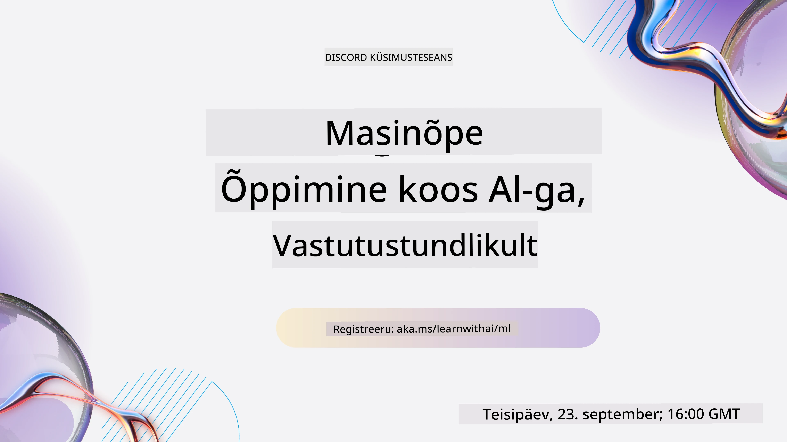
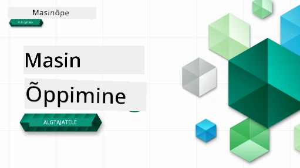

[](https://github.com/microsoft/ML-For-Beginners/blob/master/LICENSE)
[](https://GitHub.com/microsoft/ML-For-Beginners/graphs/contributors/)
[](https://GitHub.com/microsoft/ML-For-Beginners/issues/)
[](https://GitHub.com/microsoft/ML-For-Beginners/pulls/)
[](http://makeapullrequest.com)

[](https://GitHub.com/microsoft/ML-For-Beginners/watchers/)
[](https://GitHub.com/microsoft/ML-For-Beginners/network/)
[](https://GitHub.com/microsoft/ML-For-Beginners/stargazers/)

### 🌐 Mitmekeelne tugi

#### Tõlked haldab [Co-op Translator](https://github.com/Azure/co-op-translator)

<!-- CO-OP TRANSLATOR LANGUAGES TABLE START -->
[Araabia](../ar/README.md) | [Bengali](../bn/README.md) | [Bulgaaria](../bg/README.md) | [Birma (Myanmar)](../my/README.md) | [Hiina (lihtsustatud)](../zh-CN/README.md) | [Hiina (traditsiooniline, Hongkong)](../zh-HK/README.md) | [Hiina (traditsiooniline, Macau)](../zh-MO/README.md) | [Hiina (traditsiooniline, Taiwan)](../zh-TW/README.md) | [Horvaadi](../hr/README.md) | [Tšehhi](../cs/README.md) | [Taani](../da/README.md) | [Hollandi](../nl/README.md) | [Eesti](./README.md) | [Soome](../fi/README.md) | [Prantsuse](../fr/README.md) | [Saksa](../de/README.md) | [Kreeka](../el/README.md) | [Heebrea](../he/README.md) | [Hindi](../hi/README.md) | [Ungari](../hu/README.md) | [Indoneesia](../id/README.md) | [Itaalia](../it/README.md) | [Jaapani](../ja/README.md) | [Kannada](../kn/README.md) | [Khmeri](../km/README.md) | [Korea](../ko/README.md) | [Leedu](../lt/README.md) | [Malai](../ms/README.md) | [Malajalami](../ml/README.md) | [Manipuri (Meitei Mayek)](../mni/README.md) | [Marathi](../mr/README.md) | [Nepali](../ne/README.md) | [Nigeeria pidžin](../pcm/README.md) | [Norra](../no/README.md) | [Pärsia (Farsi)](../fa/README.md) | [Poola](../pl/README.md) | [Portugali (Brasiilia)](../pt-BR/README.md) | [Portugali (Portugal)](../pt-PT/README.md) | [Pandžabi (Gurmukhi)](../pa/README.md) | [Rumeenia](../ro/README.md) | [Vene](../ru/README.md) | [Serbia (kirillitsa)](../sr/README.md) | [Slovaki](../sk/README.md) | [Sloveeni](../sl/README.md) | [Hispaania](../es/README.md) | [Suahiili](../sw/README.md) | [Rootsi](../sv/README.md) | [Tagalogi (Filipino)](../tl/README.md) | [Tamili](../ta/README.md) | [Telugu](../te/README.md) | [Tai](../th/README.md) | [Türgi](../tr/README.md) | [Ukraina](../uk/README.md) | [Urdu](../ur/README.md) | [Vietnami](../vi/README.md)

> **Eelistad kloonimist kohapeal?**
>
> See hoidla sisaldab üle 50 keele tõlkeid, mis suurendavad oluliselt allalaadimise mahtu. Tõlgeteta kloonimiseks kasuta sparsis kontrolli:
>
> **Bash / macOS / Linux:**
> ```bash
> git clone --filter=blob:none --sparse https://github.com/microsoft/ML-For-Beginners.git
> cd ML-For-Beginners
> git sparse-checkout set --no-cone '/*' '!translations' '!translated_images'
> ```
>
> **CMD (Windows):**
> ```cmd
> git clone --filter=blob:none --sparse https://github.com/microsoft/ML-For-Beginners.git
> cd ML-For-Beginners
> git sparse-checkout set --no-cone "/*" "!translations" "!translated_images"
> ```
>
> See annab sulle kõik vajaliku kursuse lõpuleviimiseks palju kiiremalt.
<!-- CO-OP TRANSLATOR LANGUAGES TABLE END -->

#### Liitu meie kogukonnaga

[](https://discord.gg/nTYy5BXMWG)

Meil on käimas Discordi "Learn with AI" sari, kus saad rohkem teada ja liituda [Learn with AI Series](https://aka.ms/learnwithai/discord) alates 18. kuni 30. septembrini 2025. Saad nippe ja trikke GitHub Copiloti kasutamiseks andmeteaduses.



# Masinõpe algajatele - Õppekava

> 🌍 Reisime ümber maailma uurides masinõpet erinevate kultuuride kaudu 🌍

Microsofti pilveteenuste esindajad pakuvad 12-nädalast, 26-õpetuse õppekava, mis keskendub **masinõppele**. Selles õppekavas õpid nn **klassikalist masinõpet**, kasutades peamiselt Scikit-learn'i teeki ja vältides süvitsüva õpet, mis on käsitletud meie [AI for Beginners'i õppekavas](https://aka.ms/ai4beginners). Sellest õppekavast saad õppetunde ühendada meie ['Data Science for Beginners' õppekavaga](https://aka.ms/ds4beginners)!

Reisime koos ümber maailma rakendades klassikalisi tehnikaid andmetele paljudest piirkondadest. Igas õppetükis on eelsimulik ja järelsimulik viktoriin, kirjutusjuhised, lahendus, ülesanne ja muud. Meie projektipõhine pedagoogika võimaldab õppida ehitamise kaudu — see on tõestatud meetod uute oskuste kinnistamiseks.

**✍️ Suur tänu meie autoritele** Jen Looper, Stephen Howell, Francesca Lazzeri, Tomomi Imura, Cassie Breviu, Dmitry Soshnikov, Chris Noring, Anirban Mukherjee, Ornella Altunyan, Ruth Yakubu ja Amy Boyd

**🎨 Tänud ka illustraatoritele** Tomomi Imura, Dasani Madipalli ja Jen Looper

**🙏 Suur tänu meie Microsoft Student Ambassador autoritele, arvustajatele ja sisuloojatele**, eriti Rishit Dagli, Muhammad Sakib Khan Inan, Rohan Raj, Alexandru Petrescu, Abhishek Jaiswal, Nawrin Tabassum, Ioan Samuila ja Snigdha Agarwal

**🤩 Täiendav tänu Microsoft Student Ambassadoridele Eric Wanjau, Jasleen Sondhi ja Vidushi Gupta meie R õppetundide eest!**

# Alustamine

Järgi neid samme:
1. **Forki hoidla**: Klõpsa selle lehe paremas ülanurgas nuppu "Fork".
2. **Klooni hoidla**:   `git clone https://github.com/microsoft/ML-For-Beginners.git`

> 💡 **Kiire algus**: Soovid alustada brauseris ilma Pythonit kohapeal seadistamata? Kasuta [GitHub Codespaces](https://github.com/features/codespaces), et luua pilvepõhine arenduskeskkond oma forkile. Ava roheline **Code** menüü, vali **Codespaces** ja loo codespace; paigalda vajadusel igas õppetükis vajalikud sõltuvused.

> [Leia kõik lisavarad sellele kursusele meie Microsoft Learni kollektsioonist](https://learn.microsoft.com/en-us/collections/qrqzamz1nn2wx3?WT.mc_id=academic-77952-bethanycheum)

> 🔧 **Vaja abi?** Vaata meie [Veaotsingu juhendit](TROUBLESHOOTING.md) levinud probleemide lahendamiseks paigalduse, seadistuse ja õppetundide käivitamisega.


**[Õpilased](https://aka.ms/student-page)**, selle õppekava kasutamiseks tee kogu repo fork enda GitHubi kontole ja soorita ülesanded iseseisvalt või grupis:

- Alusta eellooriga.
- Loe loengut ja soorita tegevusi, peatudes ja järele mõeldes igal teadmiskontrollil.
- Püüa projekte luua omanäoliselt tuginedes loengule, mitte lahenduskoodi käivitades; see kood on aga olemas `/solution` kaustades igas projektipõhises õppetükis.
- Võta järelloorn.
- Täida väljakutse.
- Tee ülesanne.
- Pärast õppetükkide grupi lõpetamist külasta [Aruteluplatvormi](https://github.com/microsoft/ML-For-Beginners/discussions) ja "õpi valjusti" täites sobiva PAT rubriigi. PAT on edusammude hindamise tööriist, mille abiga saad oma õppimist edendada. Võid ka teiste PAT-idele reageerida, et koos õppida.

> Täiendavaks õppeks soovitame järgmisi [Microsoft Learni](https://docs.microsoft.com/en-us/users/jenlooper-2911/collections/k7o7tg1gp306q4?WT.mc_id=academic-77952-leestott) mooduleid ja õppeteid.

**Õpetajad**, oleme lisanud [soovitusi](for-teachers.md) selle õppekava kasutamiseks.

---

## Videokäigud

Mõned õppetükid on saadaval lühikeste videodena. Leiad need kas õppetükkide sees või [ML for Beginners esitusloendist Microsoft Developer YouTube kanalil](https://aka.ms/ml-beginners-videos) pildi alt klõpsates.

[](https://aka.ms/ml-beginners-videos)

---

## TUTVU MEESKONNAGA

[](https://youtu.be/Tj1XWrDSYJU)

**GIF autor:** [Mohit Jaisal](https://linkedin.com/in/mohitjaisal)

> 🎥 Klõpsa ülal oleval pildil, et vaadata videot projektist ja inimestest, kes selle lõid!

---

## Pedagoogika

Selle õppekava koostamisel valisime kaks pedagoogilist põhimõtet: tagada käed-külge **projektipõhisus** ja **sagedased viktoriinid**. Lisaks on õppekaval ühine **teema**, mis annab terviklikkuse.

Sisu sidumine projektidega muudab protsessi õpilastele haaravamaks ja tugevdab kontseptsioonide meeldejäämist. Madala pingega viktoriin enne loengut seab õppija kavatsuse teemasse süveneda, teine viktoriin loengu lõpus suurendab kinnistamist. Õppekava on loodud paindlikuks ja lõbusaks ning seda saab läbida tervikuna või osadena. Projektid algavad väikestena ja muutuvad 12-nädalase tsükli lõpuks järjest keerukamaks. Õppekava sisaldab ka tagasivaadet masinõppe reaalse maailma rakendustesse, mida saab kasutada lisaainena või arutelu lähtepunktina.

> Leia meie [käitumisjuhend](CODE_OF_CONDUCT.md), [panustamise juhised](CONTRIBUTING.md), [tõlked](..) ja [veaotsingu](TROUBLESHOOTING.md) juhised. Ootame konstruktiivset tagasisidet!

## Igas õppetükis on

- vabatahtlik visandimärkme
- vabatahtlik abivideo
- video samm-sammult juhis (ainult mõnes õppetükis)
- [eesloengu soojendusviktoriin](https://ff-quizzes.netlify.app/en/ml/)
- kirjalik õppetükk
- projektipõhistes õppetükkides samm-sammult juhendid projekti ülesehitamiseks
- teadmiskontrollid
- väljakutse
- lisalugemine
- ülesanne
- [pärastloengu viktoriin](https://ff-quizzes.netlify.app/en/ml/)

> **Märkus keeltest**: Need õppetükid on peamiselt kirjutatud Pythonis, kuid paljud on saadaval ka R-is. R-õppetüki lõpuleviimiseks mine `/solution` kausta ja otsi R õppetükke. Need sisaldavad .rmd laiendit, mis tähistab **R Markdowni** faili, mida saab lihtsalt määratleda kui `code chunks` (R-i või teiste keelte) ja `YAML header` (mis juhib väljundite vormindamist nagu PDF) manustamist `Markdown document`-s. See on andmeteaduses hea raamistik, kuna lubab kombineerida koodi, selle väljundit ja mõtteid Markdownis kirjutatuna. Lisaks saab R Markdown dokumente ümber vormindada vormingutesse nagu PDF, HTML või Word.

> **Märkus viktoriinide kohta**: Kõik viktoriinid on paigutatud [Quiz App kausta](../../quiz-app), kokku 52 viktoriini, igaüks kolme küsimusega. Need on linkitud õppetükkidest, kuid viktoriinirakendust saab käivitada kohapeal; juhised on `quiz-app` kaustas, kuidas seda kohalikult majutada või Azure'i levitada.

| Õppetükkide number |                             Teema                              |                   Õppetükkide rühmitamine                   | Õpieesmärgid                                                                                                             |                                                              Seotud õppetükk                                                               |                        Autor                        |
| :-----------: | :------------------------------------------------------------: | :-------------------------------------------------: | ------------------------------------------------------------------------------------------------------------------------------- | :--------------------------------------------------------------------------------------------------------------------------------------: | :--------------------------------------------------: |
|      01       |                Masinõppe tutvustus                |      [Tutvustus](1-Introduction/README.md)       | Õpi masinõppe põhikontseptsioone                                                                                |                                             [Õppetükk](1-Introduction/1-intro-to-ML/README.md)                                             |                       Muhammad                       |
|      02       |                Masinõppe ajalugu                 |      [Tutvustus](1-Introduction/README.md)       | Õpi selle valdkonna ajalugu                                                                                         |                                            [Õppetükk](1-Introduction/2-history-of-ML/README.md)                                            |                     Jen ja Amy                      |
|      03       |                 Õiglus ja masinõpe                  |      [Tutvustus](1-Introduction/README.md)       | Millised on olulised filosoofilised küsimused seoses õiglusega, mida õpilased peaksid masinõppemudelite loomisel ja rakendamisel kaaluma? |                                              [Õppetükk](1-Introduction/3-fairness/README.md)                                               |                        Tomomi                        |
|      04       |                Masinõppe tehnikad                 |      [Tutvustus](1-Introduction/README.md)       | Milliseid tehnikaid kasutavad ML uurijad masinõppemudelite loomiseks?                                                                       |                                          [Õppetükk](1-Introduction/4-techniques-of-ML/README.md)                                           |                    Chris ja Jen                     |
|      05       |                   Regresseerimise tutvustus                   |        [Regressioon](2-Regression/README.md)         | Alusta Pythoni ja Scikit-learniga regressioonimudelite jaoks                                                                  |         [Python](2-Regression/1-Tools/README.md) • [R](../../2-Regression/1-Tools/solution/R/lesson_1.html)         |      Jen • Eric Wanjau       |
|      06       |                Põhja-Ameerika kõrvitsahinnad 🎃                |        [Regressioon](2-Regression/README.md)         | Visualiseeri ja puhasta andmeid masinõppeks valmistumiseks                                                                                  |          [Python](2-Regression/2-Data/README.md) • [R](../../2-Regression/2-Data/solution/R/lesson_2.html)          |      Jen • Eric Wanjau       |
|      07       |                Põhja-Ameerika kõrvitsahinnad 🎃                |        [Regressioon](2-Regression/README.md)         | Ehita lineaarseid ja polünoomseid regressioonimudeleid                                                                                   |        [Python](2-Regression/3-Linear/README.md) • [R](../../2-Regression/3-Linear/solution/R/lesson_3.html)        |      Jen ja Dmitry • Eric Wanjau       |
|      08       |                Põhja-Ameerika kõrvitsahinnad 🎃                |        [Regressioon](2-Regression/README.md)         | Ehita logistikaregressioonimudel                                                                                               |     [Python](2-Regression/4-Logistic/README.md) • [R](../../2-Regression/4-Logistic/solution/R/lesson_4.html)      |      Jen • Eric Wanjau       |
|      09       |                          Veebirakendus 🔌                          |           [Veebirakendus](3-Web-App/README.md)            | Ehita veebirakendus oma treenitud mudeli kasutamiseks                                                                                       |                                                 [Python](3-Web-App/1-Web-App/README.md)                                                  |                         Jen                          |
|      10       |                 Klassifitseerimise tutvustus                 |    [Klassifitseerimine](4-Classification/README.md)     | Puhasta, valmista ette ja visualiseeri andmeid; klassifitseerimise tutvustus                                                            | [Python](4-Classification/1-Introduction/README.md) • [R](../../4-Classification/1-Introduction/solution/R/lesson_10.html)  | Jen ja Cassie • Eric Wanjau |
|      11       |             Maitsvad Aasia ja India köögid 🍜             |    [Klassifitseerimine](4-Classification/README.md)     | Tutvustus klassifikaatoritele                                                                                                     | [Python](4-Classification/2-Classifiers-1/README.md) • [R](../../4-Classification/2-Classifiers-1/solution/R/lesson_11.html) | Jen ja Cassie • Eric Wanjau |
|      12       |             Maitsvad Aasia ja India köögid 🍜             |    [Klassifitseerimine](4-Classification/README.md)     | Veel klassifikaatoreid                                                                                                                | [Python](4-Classification/3-Classifiers-2/README.md) • [R](../../4-Classification/3-Classifiers-2/solution/R/lesson_12.html) | Jen ja Cassie • Eric Wanjau |
|      13       |             Maitsvad Aasia ja India köögid 🍜             |    [Klassifitseerimine](4-Classification/README.md)     | Ehita soovitusveebirakendus, kasutades oma mudelit                                                                                    |                                              [Python](4-Classification/4-Applied/README.md)                                              |                         Jen                          |
|      14       |                   Klastrite puhul tutvustus                   |        [Klastrid](5-Clustering/README.md)         | Puhasta, valmista ette ja visualiseeri andmeid; tutvustus klastrite kohta                                                                |         [Python](5-Clustering/1-Visualize/README.md) • [R](../../5-Clustering/1-Visualize/solution/R/lesson_14.html)         |      Jen • Eric Wanjau       |
|      15       |              Nigeeria muusikaliste eelistuste uurimine 🎧              |        [Klastrid](5-Clustering/README.md)         | Uuri K-keskmiste klastrimeetodit                                                                                           |           [Python](5-Clustering/2-K-Means/README.md) • [R](../../5-Clustering/2-K-Means/solution/R/lesson_15.html)           |      Jen • Eric Wanjau       |
|      16       |        Loodusliku keele töötlemise tutvustus ☕️         |   [Loodusliku keele töötlemine](6-NLP/README.md)    | Õpi NLP põhialuseid, luues lihtsa botti                                                                             |                                             [Python](6-NLP/1-Introduction-to-NLP/README.md)                                              |                       Stephen                        |
|      17       |                      Levinumad NLP ülesanded ☕️                      |   [Loodusliku keele töötlemine](6-NLP/README.md)    | Süvenda oma NLP teadmisi, mõistes keele struktuuriga seotud levinud ülesandeid                          |                                                    [Python](6-NLP/2-Tasks/README.md)                                                     |                       Stephen                        |
|      18       |             Tõlkimine ja sentimentide analüüs ♥️              |   [Loodusliku keele töötlemine](6-NLP/README.md)    | Tõlkimine ja sentimentide analüüs Jane Austeni tekstide põhjal                                                                             |                                            [Python](6-NLP/3-Translation-Sentiment/README.md)                                             |                       Stephen                        |
|      19       |                  Euroopa romantilised hotellid ♥️                  |   [Loodusliku keele töötlemine](6-NLP/README.md)    | Sentimentide analüüs hotellite arvustustega 1                                                                                         |                                               [Python](6-NLP/4-Hotel-Reviews-1/README.md)                                                |                       Stephen                        |
|      20       |                  Euroopa romantilised hotellid ♥️                  |   [Loodusliku keele töötlemine](6-NLP/README.md)    | Sentimentide analüüs hotellite arvustustega 2                                                                                         |                                               [Python](6-NLP/5-Hotel-Reviews-2/README.md)                                                |                       Stephen                        |
|      21       |            Ajaseeriate prognoosimise tutvustus             |        [Ajaseeriad](7-TimeSeries/README.md)        | Tutvustus ajaseeriate prognoosimisele                                                                                         |                                             [Python](7-TimeSeries/1-Introduction/README.md)                                              |                      Francesca                       |
|      22       | ⚡️ Maailma energiatarbimine ⚡️ -ajaseeriate prognoosimine ARIMA-ga |        [Ajaseeriad](7-TimeSeries/README.md)        | Ajaseeriate prognoosimine ARIMA mudeliga                                                                                              |                                                 [Python](7-TimeSeries/2-ARIMA/README.md)                                                 |                      Francesca                       |
|      23       |  ⚡️ Maailma energiatarbimine ⚡️ -ajaseeriate prognoosimine SVR-ga  |        [Ajaseeriad](7-TimeSeries/README.md)        | Ajaseeriate prognoosimine toetusvektorite regressori abil                                                                           |                                                  [Python](7-TimeSeries/3-SVR/README.md)                                                  |                       Anirban                        |
|      24       |             Tugevdusõppe tutvustus             | [Tugevdusõpe](8-Reinforcement/README.md) | Tugevdusõppe tutvustus Q-õppe abil                                                                          |                                             [Python](8-Reinforcement/1-QLearning/README.md)                                              |                        Dmitry                        |
|      25       |                 Aita Peteril hunti vältida! 🐺                  | [Tugevdusõpe](8-Reinforcement/README.md) | Tugevdusõppe harjutus Gym keskkonnas                                                                                                      |                                                [Python](8-Reinforcement/2-Gym/README.md)                                                 |                        Dmitry                        |
|  Järelsõna   |            Masinõppe reaalmaailma stsenaariumid ja rakendused            |      [Masinõpe looduses](9-Real-World/README.md)       | Huvitavad ja valgustavad klassikalise masinõppe reaalmaailma rakendused                                                               |                                             [Õppetükk](9-Real-World/1-Applications/README.md)                                              |                         Meeskond                         |
|  Järelsõna   |            Masinõppe mudelite silumine RAI armatuurlaua abil            |      [Masinõpe looduses](9-Real-World/README.md)       | Masinõppe mudelite silumine Responsible AI armatuurlaua komponentide abil                                                              |                                             [Õppetükk](9-Real-World/2-Debugging-ML-Models/README.md)                                              |                     Ruth Yakubu                      |

> [Leia kõik selle kursuse lisamaterjalid meie Microsoft Learn kogu kaudu](https://learn.microsoft.com/en-us/collections/qrqzamz1nn2wx3?WT.mc_id=academic-77952-bethanycheum)

## Võimalus kasutada võrguühenduseta

Saate seda dokumentatsiooni võrguühenduseta käitada, kasutades [Docsify](https://docsify.js.org/#/). Forkige see repositsioon, [installi Docsify](https://docsify.js.org/#/quickstart) oma kohalikusse masinasse ja seejärel selle repo juurkataloogis kirjuta `docsify serve`. Veebisait töötab pordil 3000 sinu localhost’is: `localhost:3000`.

## PDF-id

Leia õppekava pdf koos linkidega [siit](https://microsoft.github.io/ML-For-Beginners/pdf/readme.pdf).


## 🎒 Muud kursused 

Meie meeskond toodab ka teisi kursuseid! Vaata:

<!-- CO-OP TRANSLATOR OTHER COURSES START -->
### LangChain
[](https://aka.ms/langchain4j-for-beginners)
[](https://aka.ms/langchainjs-for-beginners?WT.mc_id=m365-94501-dwahlin)
[](https://github.com/microsoft/langchain-for-beginners?WT.mc_id=m365-94501-dwahlin)
---

### Azure / Edge / MCP / Agendid
[](https://github.com/microsoft/AZD-for-beginners?WT.mc_id=academic-105485-koreyst)
[](https://github.com/microsoft/edgeai-for-beginners?WT.mc_id=academic-105485-koreyst)
[](https://github.com/microsoft/mcp-for-beginners?WT.mc_id=academic-105485-koreyst)
[](https://github.com/microsoft/ai-agents-for-beginners?WT.mc_id=academic-105485-koreyst)

---
 
### Generatiivse tehisintellekti sari
[](https://github.com/microsoft/generative-ai-for-beginners?WT.mc_id=academic-105485-koreyst)
[-9333EA?style=for-the-badge&labelColor=E5E7EB&color=9333EA)](https://github.com/microsoft/Generative-AI-for-beginners-dotnet?WT.mc_id=academic-105485-koreyst)
[-C084FC?style=for-the-badge&labelColor=E5E7EB&color=C084FC)](https://github.com/microsoft/generative-ai-for-beginners-java?WT.mc_id=academic-105485-koreyst)
[-E879F9?style=for-the-badge&labelColor=E5E7EB&color=E879F9)](https://github.com/microsoft/generative-ai-with-javascript?WT.mc_id=academic-105485-koreyst)

---
 
### Tuumikõpe
[](https://aka.ms/ml-beginners?WT.mc_id=academic-105485-koreyst)
[](https://aka.ms/datascience-beginners?WT.mc_id=academic-105485-koreyst)
[](https://aka.ms/ai-beginners?WT.mc_id=academic-105485-koreyst)
[](https://github.com/microsoft/Security-101?WT.mc_id=academic-96948-sayoung)
[](https://aka.ms/webdev-beginners?WT.mc_id=academic-105485-koreyst)
[](https://aka.ms/iot-beginners?WT.mc_id=academic-105485-koreyst)
[](https://github.com/microsoft/xr-development-for-beginners?WT.mc_id=academic-105485-koreyst)

---
 
### Copiloti sari
[](https://aka.ms/GitHubCopilotAI?WT.mc_id=academic-105485-koreyst)
[](https://github.com/microsoft/mastering-github-copilot-for-dotnet-csharp-developers?WT.mc_id=academic-105485-koreyst)
[](https://github.com/microsoft/CopilotAdventures?WT.mc_id=academic-105485-koreyst)
<!-- CO-OP TRANSLATOR OTHER COURSES END -->

## Abi saamine

Kui õppides Masinõpet või AI rakenduste loomisel kinni jääd või küsimusi tekib, siis ära muretse — abi on olemas.

Saad liituda aruteludega teiste õppijate ja arendajatega, esitada küsimusi ning jagada oma ideid kogukonnaga.

- Liitu kogukonnaga, et küsida küsimusi ja koos õppida
- Arutle masinõppe kontseptsioonide ja projektide ideede üle
- Saa juhendamist kogenud arendajatelt

Tugikogukond on suurepärane viis oma oskuste arendamiseks ja probleemide kiireks lahendamiseks.

[Microsoft Foundry Discord kogukond](https://discord.gg/nTYy5BXMWG)

Kui leiad vigu, tõrkeid või soovid teha täiustusi, võid ka selle hoidla avada **Probleemi** arvestamaks seda.

Toote tagasiside saamiseks või olemasolevate kogukonna postituste otsimiseks külasta Arendajate Foorumit:

[](https://aka.ms/foundry/forum)

## Lisasoovitused õppimiseks

- Vaata üle märkmikud pärast iga õppetükki parema arusaamise saamiseks.
- Harjuta algoritmide iseseisvat rakendamist.
- Uuri tegelikku andmekogumit, kasutades õpitud kontseptsioone.

---

<!-- CO-OP TRANSLATOR DISCLAIMER START -->
**Lahtiütlus**:
See dokument on tõlgitud kasutades AI tõlketeenust [Co-op Translator](https://github.com/Azure/co-op-translator). Kuigi me püüdleme täpsuse poole, palun pange tähele, et automatiseeritud tõlgetes võib esineda vigu või ebatäpsusi. Originaaldokument selle emakeeles tuleks pidada autoriteetseks allikaks. Olulise teabe puhul soovitatakse kasutada professionaalset inimtõlget. Me ei vastuta selle tõlkega seotud eksimustest või valesti mõistmistest.
<!-- CO-OP TRANSLATOR DISCLAIMER END -->