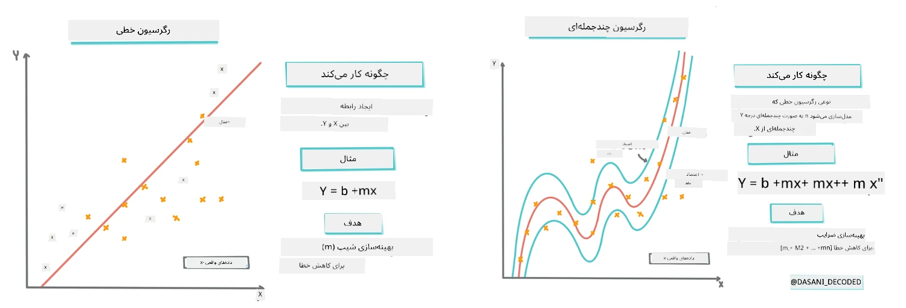
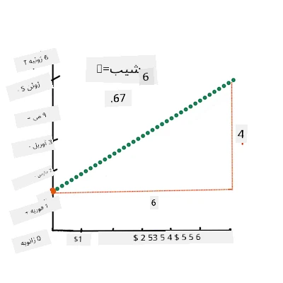
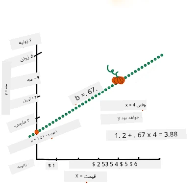
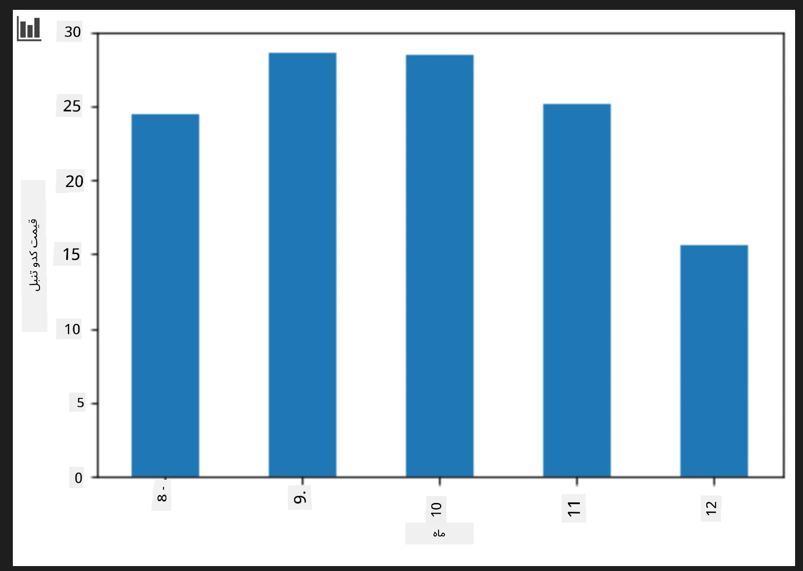
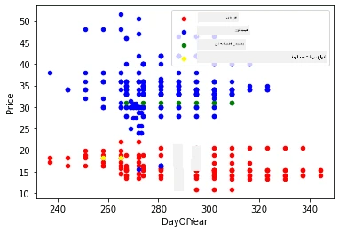

# ساخت مدل رگرسیون با استفاده از Scikit-learn: رگرسیون از چهار دیدگاه مختلف

## نکته برای مبتدیان

رگرسیون خطی زمانی استفاده می‌شود که بخواهیم یک **مقدار عددی** پیش‌بینی کنیم (برای مثال، قیمت خانه، دما یا فروش).
این روش با یافتن یک خط مستقیم که بهترین نمایش‌دهنده رابطه بین ویژگی‌های ورودی و خروجی است، کار می‌کند.

در این درس، تمرکز ما بر درک مفهوم قبل از بررسی تکنیک‌های پیشرفته‌تر رگرسیون است.

> اینفوگرافیک توسط [داسانی مادایپالی](https://twitter.com/dasani_decoded)
## [آزمون قبل از درس](https://ff-quizzes.netlify.app/en/ml/)

> ### [این درس به زبان R نیز در دسترس است!](../../../../2-Regression/3-Linear/solution/R/lesson_3.html)
### معرفی

تا به حال بررسی کرده‌اید که رگرسیون چیست با داده‌های نمونه‌ای که از مجموعه داده قیمت کدو تنبل جمع‌آوری شده و در این درس از آن استفاده خواهیم کرد. همچنین آن را با استفاده از Matplotlib تجسم کرده‌اید.

اکنون آماده‌اید تا عمیق‌تر به رگرسیون برای یادگیری ماشین بپردازید. در حالی که تجسم به شما کمک می‌کند داده‌ها را درک کنید، قدرت واقعی یادگیری ماشین از _آموزش مدل‌ها_ ناشی می‌شود. مدل‌ها روی داده‌های تاریخی آموزش داده می‌شوند تا به طور خودکار وابستگی‌های داده را شناسایی کنند و به شما امکان پیش‌بینی نتایج برای داده‌های جدید که مدل قبلاً ندیده است را می‌دهند.

در این درس، شما با دو نوع رگرسیون بیشتر آشنا خواهید شد: _رگرسیون خطی پایه_ و _رگرسیون چندجمله‌ای_ به همراه بخشی از ریاضی پشت این تکنیک‌ها. این مدل‌ها به ما امکان می‌دهند قیمت کدو تنبل را بر اساس داده‌های ورودی مختلف پیش‌بینی کنیم.

[](https://youtu.be/CRxFT8oTDMg "یادگیری ماشین برای مبتدیان - درک رگرسیون خطی")

> 🎥 روی تصویر بالا کلیک کنید تا ویدیوی کوتاهی درباره رگرسیون خطی ببینید.

> در سراسر این دوره فرض بر دانش حداقلی ریاضی است و تلاش شده است آن را برای دانشجویانی که از رشته‌های دیگر می‌آیند قابل دسترس کنیم، پس به نکات، 🧮 یادداشت‌ها، نمودارها و دیگر ابزارهای آموزشی دقت کنید.

### پیش‌نیاز

حال باید با ساختار داده‌های کدو تنبل که بررسی می‌کنیم آشنا باشید. می‌توانید آن را از پیش بارگذاری شده و پاک‌سازی شده در فایل _notebook.ipynb_ این درس بیابید. در این فایل، قیمت کدو تنبل به ازای هر بشِل (bushel) در یک دیتافریم جدید نمایش داده شده است. اطمینان حاصل کنید می‌توانید این نوت‌بوک‌ها را در هسته‌های Visual Studio Code اجرا کنید.

### آماده‌سازی

برای یادآوری، شما این داده‌ها را بارگذاری می‌کنید تا بتوانید سوالاتی درباره آن مطرح کنید.

- بهترین زمان خرید کدو تنبل کی هست؟
- قیمت مورد انتظار برای یک بسته کوچک کدو تنبل چقدر است؟
- باید آنها را در سبدهای نیم‌بشل یا در جعبه‌های 1 و 1/9 بشل بخرم؟
بیایید بیشتر به عمق این داده‌ها بپردازیم.

در درس قبلی، یک دیتافریم Pandas ایجاد کردید و آن را با بخشی از داده‌های اصلی پر کردید، قیمت‌گذاری را بر اساس بشِل استاندارد کردید. اما با این کار تنها توانستید حدود ۴۰۰ داده جمع‌آوری کنید و فقط برای ماه‌های پاییز.

نگاهی به داده‌های از پیش بارگذاری شده در نوت‌بوک همراه این درس بیندازید. داده‌ها بارگذاری شده و یک نمودار پراکندگی اولیه کشیده شده که داده‌های ماه را نشان می‌دهد. شاید بتوانیم با پاک‌سازی بیشتر جزئیات بیشتری درباره طبیعت داده‌ها به دست آوریم.

## خط رگرسیون خطی

همان‌طور که در درس اول یاد گرفتید، هدف تمرین رگرسیون خطی این است که بتوانید خطی ترسیم کنید تا:

- **نشان دادن روابط متغیرها**. رابطه بین متغیرها را نشان دهد
- **ساخت پیش‌بینی‌ها**. پیش‌بینی دقیق درباره محل قرارگیری یک داده جدید نسبت به آن خط انجام دهد.

معمولاً **رگرسیون کمترین مربعات** این نوع خط را رسم می‌کند. اصطلاح "کمترین مربعات" به فرآیند کمینه کردن مجموع خطاهای مدل اشاره دارد. برای هر نقطه داده، فاصله عمودی (که باقیمانده نامیده می‌شود) بین نقطه واقعی و خط رگرسیون اندازه‌گیری می‌شود.

این فاصله‌ها به دو دلیل مربع می‌شوند:

1. **اندازه به جای جهت:** می‌خواهیم خطای -۵ را مانند خطای +۵ حساب کنیم. مربع گرفتن همه مقادیر را مثبت می‌کند.

2. **تنبیه نقاط پرت:** مربع گرفتن به خطاهای بزرگتر وزن بیشتری می‌دهد و خط را مجبور می‌کند که به نقاط دورتر نزدیک‌تر بماند.

سپس همه مقادیر مربعی را جمع می‌کنیم. هدف ما یافتن خط خاصی است که این مجموع نهایی حداقل (کمترین مقدار ممکن) باشد — از این رو نام "کمترین مربعات".

> **🧮 ریاضی را به من نشان بده**  
>  
> این خط، که _خط بهترین برازش_ نامیده می‌شود، می‌تواند با [یک معادله](https://en.wikipedia.org/wiki/Simple_linear_regression) بیان شود:  
>  
> ```
> Y = a + bX
> ```
>
> `X` متغیر «توضیح‌دهنده» است. `Y` متغیر «وابسته» است. شیب خط `b` است و `a` عرض از مبدا y است، که به مقدار `Y` هنگام `X = 0` اشاره دارد.
>
>
>
> ابتدا شیب `b` را محاسبه کنید. اینفوگرافیک توسط [جن لوپر](https://twitter.com/jenlooper)
>
> به عبارت دیگر، و با اشاره به سوال اصلی داده‌های کدو تنبل ما: "پیش‌بینی قیمت کدو تنبل به ازای هر بشِل بر اساس ماه"، `X` به قیمت اشاره می‌کند و `Y` به ماه فروش.
>
>
>
> مقدار Y را محاسبه کنید. اگر دارید حدود ۴ دلار می‌پردازید، باید ماه آوریل باشد! اینفوگرافیک توسط [جن لوپر](https://twitter.com/jenlooper)
>
> ریاضی که خط را حساب می‌کند باید شیب خط را نشان دهد، که همچنین به عرض از مبدا وابسته است، یا جایی که `Y` قرار دارد وقتی `X = 0`.
>
> می‌توانید روش محاسبه این مقادیر را در سایت [Math is Fun](https://www.mathsisfun.com/data/least-squares-regression.html) مشاهده کنید. همچنین از [ماشین حساب کمترین مربعات](https://www.mathsisfun.com/data/least-squares-calculator.html) دیدن کنید تا ببینید چگونه مقادیر عددی روی خط تاثیر می‌گذارند.

## همبستگی

یک اصطلاح دیگر که باید بدانید ضریب **همبستگی** بین متغیرهای X و Y است. با استفاده از نمودار پراکندگی، می‌توانید این ضریب را سریعاً مشاهده کنید. نموداری که نقاط داده روی یک خط مرتب قرار گرفته‌اند همبستگی بالایی دارد، اما اگر نقاط داده در همه جا پخش شده باشند، همبستگی پایین است.

مدل رگرسیون خطی خوب مدلی است که ضریب همبستگی بالایی داشته باشد (نزدیک به ۱ بیشتر از ۰) با استفاده از روش رگرسیون کمترین مربعات با خط رگرسیون.

✅ نوت‌بوک همراه این درس را اجرا کنید و به نمودار پراکندگی ماه به قیمت نگاه کنید. آیا داده‌های ارتباط ماه و قیمت برای فروش کدو تنبل به نظر همبستگی بالا یا پایینی دارند، بر اساس تفسیر بصری شما از نمودار پراکندگی؟ آیا اگر به جای `ماه` از مقیاس دقیق‌تری مانند *روز سال* (مثل تعداد روزهای از ابتدای سال) استفاده کنید، این تغییر می‌کند؟

در کد زیر، فرض می‌کنیم داده‌ها پاک‌سازی شده‌اند، و یک دیتافریم به نام `new_pumpkins` بدست آورده‌ایم، مشابه داده‌های زیر:

ID | Month | DayOfYear | Variety | City | Package | Low Price | High Price | Price
---|-------|-----------|---------|------|---------|-----------|------------|-------
70 | 9 | 267 | PIE TYPE | BALTIMORE | 1 1/9 bushel cartons | 15.0 | 15.0 | 13.636364
71 | 9 | 267 | PIE TYPE | BALTIMORE | 1 1/9 bushel cartons | 18.0 | 18.0 | 16.363636
72 | 10 | 274 | PIE TYPE | BALTIMORE | 1 1/9 bushel cartons | 18.0 | 18.0 | 16.363636
73 | 10 | 274 | PIE TYPE | BALTIMORE | 1 1/9 bushel cartons | 17.0 | 17.0 | 15.454545
74 | 10 | 281 | PIE TYPE | BALTIMORE | 1 1/9 bushel cartons | 15.0 | 15.0 | 13.636364

> کد پاک‌سازی داده‌ها در [`notebook.ipynb`](notebook.ipynb) موجود است. ما همان مراحل پاک‌سازی درس قبلی را انجام داده‌ایم و ستون `DayOfYear` را با استفاده از عبارت زیر محاسبه کرده‌ایم:

```python
day_of_year = pd.to_datetime(pumpkins['Date']).apply(lambda dt: (dt-datetime(dt.year,1,1)).days)
```

حالا که درک ریاضی پشت رگرسیون خطی دارید، بیایید یک مدل رگرسیون ایجاد کنیم تا ببینیم آیا می‌توانیم پیش‌بینی کنیم کدام بسته کدو تنبل بهترین قیمت‌ها را خواهد داشت. کسی که کدو تنبل برای باغچه جشن خریداری می‌کند ممکن است بخواهد این اطلاعات را برای بهینه‌سازی خریدهایش داشته باشد.

## جستجوی همبستگی

[](https://youtu.be/uoRq-lW2eQo "یادگیری ماشین برای مبتدیان - جستجوی همبستگی: کلید رگرسیون خطی")

> 🎥 روی تصویر بالا کلیک کنید برای ویدیوی کوتاهی درباره همبستگی.

احتمالاً در درس قبلی دیده‌اید که میانگین قیمت‌ها برای ماه‌های مختلف اینگونه است:



این نشان می‌دهد باید همبستگی وجود داشته باشد و می‌توانیم مدل رگرسیون خطی آموزش دهیم تا رابطه بین `Month` و `Price`، یا بین `DayOfYear` و `Price` را پیش‌بینی کند. این نمودار پراکندگی رابطه اخیر را نشان می‌دهد:

 

بیایید بررسی کنیم همبستگی با استفاده از تابع `corr` چگونه است:

```python
print(new_pumpkins['Month'].corr(new_pumpkins['Price']))
print(new_pumpkins['DayOfYear'].corr(new_pumpkins['Price']))
```

به نظر می‌رسد همبستگی بسیار کم است، -۰.۱۵ بر اساس `Month` و -۰.۱۷ بر اساس `DayOfYear`، ولی ممکن است رابطه مهم دیگری وجود داشته باشد. به نظر می‌رسد خوشه‌های مختلفی از قیمت‌ها متعلق به انواع مختلف کدو تنبل باشد. برای تایید این فرضیه، هر دسته کدو را با رنگ متفاوت رسم کنیم. با دادن پارامتر `ax` به تابع رسم پراکندگی، می‌توانیم همه نقاط را روی یک نمودار رسم کنیم:

```python
ax=None
colors = ['red','blue','green','yellow']
for i,var in enumerate(new_pumpkins['Variety'].unique()):
    df = new_pumpkins[new_pumpkins['Variety']==var]
    ax = df.plot.scatter('DayOfYear','Price',ax=ax,c=colors[i],label=var)
```

 

تحقیق ما نشان می‌دهد که نوع کدو بر قیمت کلی تاثیر بیشتری از تاریخ فروش دارد. این را می‌توانیم با نمودار میله‌ای مشاهده کنیم:

```python
new_pumpkins.groupby('Variety')['Price'].mean().plot(kind='bar')
```

 

فعلاً فقط روی یک نوع کدو، یعنی 'نوع پای (pie)', تمرکز کنیم و ببینیم تاریخ چه اثری روی قیمت دارد:

```python
pie_pumpkins = new_pumpkins[new_pumpkins['Variety']=='PIE TYPE']
pie_pumpkins.plot.scatter('DayOfYear','Price') 
```
 

اگر حالا همبستگی بین `Price` و `DayOfYear` را با تابع `corr` محاسبه کنیم، چیزی حدود `-0.27` دریافت می‌کنیم — یعنی آموزش یک مدل پیش‌بینی منطقی به نظر می‌رسد.

> قبل از آموزش مدل رگرسیون خطی، مهم است اطمینان حاصل کنیم که داده‌های ما تمیز هستند. رگرسیون خطی با مقادیر گمشده خوب کار نمی‌کند، پس بهتر است همه خانه‌های خالی را حذف کنیم:

```python
pie_pumpkins.dropna(inplace=True)
pie_pumpkins.info()
```

رویکرد دیگر پر کردن خانه‌های خالی با مقادیر میانگین ستون مربوطه است.

## رگرسیون خطی ساده

[](https://youtu.be/e4c_UP2fSjg "یادگیری ماشین برای مبتدیان - رگرسیون خطی و چندجمله‌ای با Scikit-learn")

> 🎥 روی تصویر بالا کلیک کنید تا ویدیوی کوتاهی درباره رگرسیون خطی و چندجمله‌ای ببینید.

برای آموزش مدل رگرسیون خطی‌مان، از کتابخانه **Scikit-learn** استفاده خواهیم کرد.

```python
from sklearn.linear_model import LinearRegression
from sklearn.metrics import mean_squared_error
from sklearn.model_selection import train_test_split
```

ابتدا ورودی‌ها (ویژگی‌ها) و خروجی مورد انتظار (برچسب) را به آرایه‌های numpy جداگانه تقسیم می‌کنیم:

```python
X = pie_pumpkins['DayOfYear'].to_numpy().reshape(-1,1)
y = pie_pumpkins['Price']
```

> توجه کنید که مجبور بودیم ورودی را با `reshape` تغییر دهیم تا پکیج رگرسیون خطی بتواند به درستی آن را بفهمد. رگرسیون خطی انتظار آرایه دو بعدی به عنوان ورودی دارد که هر سطر آن یک بردار از ویژگی‌های ورودی است. در مورد ما، چون تنها یک ورودی داریم، به آرایه‌ای با شکل N×1 نیاز است، که N اندازه داده‌ها است.

سپس باید داده‌ها را به مجموعه‌های آموزش و آزمون تفکیک کنیم تا پس از آموزش مدل آن را اعتبارسنجی کنیم:

```python
X_train, X_test, y_train, y_test = train_test_split(X, y, test_size=0.2, random_state=0)
```

در نهایت، آموزش مدل رگرسیون خطی با تنها دو خط کد انجام می‌شود. ابتدا شیء `LinearRegression` را تعریف می‌کنیم، سپس آن را با استفاده از متد `fit` روی داده‌ها می‌خواهیم:

```python
lin_reg = LinearRegression()
lin_reg.fit(X_train,y_train)
```

شیء `LinearRegression` بعد از آموزش (`fit`) شامل تمام ضرایب رگرسیون است که می‌توان با استفاده از ویژگی `.coef_` به آنها دسترسی پیدا کرد. در مورد ما، فقط یک ضریب وجود دارد که تقریباً باید حدود `-0.017` باشد. این یعنی قیمت‌ها به نظر می‌رسد که کمی با گذر زمان کاهش می‌یابند، اما خیلی زیاد نیست، حدود ۲ سنت در روز. همچنین می‌توان نقطه تقاطع رگرسیون با محور Y را با استفاده از `lin_reg.intercept_` مشاهده کرد - در مورد ما این مقدار حدود `21` خواهد بود که نشان‌دهنده قیمت در آغاز سال است.

برای دیدن میزان دقت مدل‌مان، می‌توانیم قیمت‌ها را روی یک مجموعه داده آزمایشی پیش‌بینی کنیم و سپس میزان نزدیکی پیش‌بینی‌های ما به مقادیر انتظار رفته را اندازه‌گیری کنیم. این کار با استفاده از معیار خطای ریشه میانگین مربعات خطا (RMSE) انجام می‌شود، که جذر میانگین تمام اختلافات مربعی میان مقدار مورد انتظار و پیش‌بینی شده است.

```python
pred = lin_reg.predict(X_test)

rmse = np.sqrt(mean_squared_error(y_test,pred))
print(f'RMSE: {rmse:3.3} ({rmse/np.mean(pred)*100:3.3}%)')
```

خطای ما به نظر می‌رسد حدود ۲ واحد باشد که تقریباً ~۱۷٪ است. زیاد خوب نیست. شاخص دیگر کیفیت مدل، **ضریب تعیین** است که می‌توان آن را به این صورت به دست آورد:

```python
score = lin_reg.score(X_train,y_train)
print('Model determination: ', score)
```
اگر مقدار آن صفر باشد، به این معنا است که مدل داده‌های ورودی را در نظر نمی‌گیرد و به عنوان *بدترین پیش‌بینی‌کننده خطی* عمل می‌کند، که صرفاً مقدار میانگین نتیجه است. مقدار 1 به این معنا است که ما می‌توانیم تمام خروجی‌های مورد انتظار را به طور کامل پیش‌بینی کنیم. در مورد ما، ضریب حدود 0.06 است که نسبتاً کم است.

ما همچنین می‌توانیم داده‌های آزمایشی را همراه با خط رگرسیون رسم کنیم تا بهتر ببینیم رگرسیون در مورد ما چگونه عمل می‌کند:

```python
plt.scatter(X_test,y_test)
plt.plot(X_test,pred)
```


## رگرسیون چندجمله‌ای

نوع دیگری از رگرسیون خطی، رگرسیون چندجمله‌ای است. در حالی که گاهی رابطه خطی بین متغیرها وجود دارد - مثلاً هرچه حجم کدو حلوایی بیشتر باشد، قیمت بالاتر است - اما گاهی این روابط را نمی‌توان به صورت یک صفحه یا خط مستقیم رسم کرد.

✅ در اینجا [چند مثال بیشتر](https://online.stat.psu.edu/stat501/Lesson09#polynomial-regression-examples) از داده‌ها وجود دارد که می‌توانند از رگرسیون چندجمله‌ای استفاده کنند.

یک بار دیگر به رابطه بین تاریخ و قیمت نگاه کنید. آیا این نمودار پراکندگی حتماً باید با یک خط مستقیم تحلیل شود؟ آیا قیمت‌ها نمی‌توانند نوسان داشته باشند؟ در این صورت، می‌توانید از رگرسیون چندجمله‌ای استفاده کنید.

✅ چندجمله‌ای‌ها عبارات ریاضی هستند که ممکن است از یک یا چند متغیر و ضرایب تشکیل شده باشند.

رگرسیون چندجمله‌ای یک منحنی ایجاد می‌کند تا بهتر به داده‌های غیرخطی بپیوندد. در مورد ما، اگر متغیر `DayOfYear` به توان دو را در داده‌های ورودی وارد کنیم، باید بتوانیم داده‌های خود را با یک منحنی سهمی شکل که حداقل در یک نقطه خاص در طول سال دارد، برازش کنیم.

کتابخانه Scikit-learn شامل یک API مفید به نام [pipeline](https://scikit-learn.org/stable/modules/generated/sklearn.pipeline.make_pipeline.html?highlight=pipeline#sklearn.pipeline.make_pipeline) است که به ما اجازه می‌دهد مراحل مختلف پردازش داده را ترکیب کنیم. یک **pipeline** زنجیره‌ای از **برآوردگرها** است. در مورد ما، ما یک pipeline می‌سازیم که ابتدا ویژگی‌های چندجمله‌ای را به مدل اضافه می‌کند و سپس رگرسیون را آموزش می‌دهد:

```python
from sklearn.preprocessing import PolynomialFeatures
from sklearn.pipeline import make_pipeline

pipeline = make_pipeline(PolynomialFeatures(2), LinearRegression())

pipeline.fit(X_train,y_train)
```

استفاده از `PolynomialFeatures(2)` یعنی اینکه همه چندجمله‌ای‌های درجه دوم از داده‌های ورودی را شامل می‌شود. در مورد ما فقط `DayOfYear` به توان دو خواهد بود، اما با داشتن دو متغیر ورودی X و Y، این شامل X به توان ۲، حاصلضرب XY و Y به توان ۲ خواهد بود. اگر بخواهیم می‌توانیم چندجمله‌ای‌های درجه بالاتر هم استفاده کنیم.

پایپلاین‌ها را می‌توان دقیقا به همان روشی که شیء `LinearRegression` اصلی استفاده می‌شود، بکار برد، یعنی می‌توانیم pipeline را `fit` کنیم و سپس از `predict` برای دریافت نتایج پیش‌بینی استفاده کنیم:

```python
pred = pipeline.predict(X_test)

rmse = np.sqrt(mean_squared_error(y_test,pred))
print(f'RMSE: {rmse:3.3} ({rmse/np.mean(pred)*100:3.3}%)')

score = pipeline.score(X_train,y_train)
print('Model determination: ', score)
```

برای رسم منحنی تقریب نرم، از `np.linspace` استفاده می‌کنیم تا یک بازه یکنواخت از مقادیر ورودی ایجاد کنیم، به جای اینکه مستقیماً روی داده‌های نامرتب آزمایشی رسم کنیم (که خطوط زیگزاگی ایجاد می‌کرد):

```python
X_range = np.linspace(X_test.min(), X_test.max(), 100).reshape(-1,1)
y_range = pipeline.predict(X_range)

plt.scatter(X_test, y_test)
plt.plot(X_range, y_range)
```

در اینجا نموداری است که داده‌های آزمایشی و منحنی تقریب را نشان می‌دهد:


با استفاده از رگرسیون چندجمله‌ای، می‌توانیم RMSE کمی پایین‌تر و ضریب تعیین بالاتری به دست آوریم، اما نه به صورت قابل توجه. باید ویژگی‌های دیگر را هم در نظر بگیریم!

> می‌توانید ببینید که کمترین قیمت کدو حلوایی تقریباً در اطراف هالووین مشاهده می‌شود. چگونه می‌توانید این را توضیح دهید؟

🎃 تبریک! شما به تازگی مدل‌هایی ساختید که می‌تواند به پیش‌بینی قیمت کدو حلوایی پای کمک کند. احتمالا می‌توانید همین رویه را برای تمام انواع کدو تکرار کنید، اما این کار خسته‌کننده است. حالا بیایید یاد بگیریم چگونه تنوع کدو را در مدل خود در نظر بگیریم!

## ویژگی‌های دسته‌ای

در دنیای ایده‌آل، می‌خواهیم قادر باشیم قیمت‌ها را برای گونه‌های مختلف کدو با استفاده از یک مدل پیش‌بینی کنیم. با این حال، ستون `Variety` کمی متفاوت از ستون‌هایی مانند `Month` است، زیرا شامل مقادیر غیرعددی است. چنین ستون‌هایی را **دسته‌ای** می‌نامند.

[](https://youtu.be/DYGliioIAE0 "ML for beginners - Categorical Feature Predictions with Linear Regression")

> 🎥 برای دیدن ویدیو کوتاه درباره استفاده از ویژگی‌های دسته‌ای، روی تصویر بالا کلیک کنید.

در اینجا می‌بینید که قیمت متوسط چطور به تنوع بستگی دارد:


برای درنظر گرفتن تنوع، ابتدا باید آن را به فرم عددی تبدیل کنیم، یا آن را **کدگذاری** کنیم. چند روش مختلف برای این کار وجود دارد:

* **کدگذاری عددی ساده** جدولی از انواع مختلف ایجاد می‌کند و سپس نام تنوع را با یک اندیس در آن جدول جایگزین می‌کند. این ایده خوبی برای رگرسیون خطی نیست، چون رگرسیون خطی مقدار عددی واقعی اندیس را گرفته و آن را ضرب در ضریبی به نتیجه اضافه می‌کند. در مورد ما، رابطه بین شماره اندیس و قیمت واضحاً غیرخطی است، حتی اگر مطمئن شویم که اندیس‌ها به روشی خاص مرتب شده‌اند.
* **کدگذاری یک داغ (one-hot encoding)** ستون `Variety` را با ۴ ستون مختلف جایگزین می‌کند، یکی برای هر تنوع. هر ستون شامل `1` خواهد بود اگر سطر مربوطه متعلق به آن تنوع باشد و در غیر این صورت `0` قرار می‌دهد. این بدان معناست که در رگرسیون خطی چهار ضریب وجود خواهد داشت، یکی برای هر نوع کدو، که مسئول "قیمت شروع" (یا بهتر است بگوییم "قیمت اضافی") برای آن نوع خاص است.

کد زیر نشان می‌دهد چگونه می‌توان تنوع را به صورت one-hot کدگذاری کرد:

```python
pd.get_dummies(new_pumpkins['Variety'])
```

 ID | FAIRYTALE | MINIATURE | MIXED HEIRLOOM VARIETIES | PIE TYPE
----|-----------|-----------|--------------------------|----------
70 | 0 | 0 | 0 | 1
71 | 0 | 0 | 0 | 1
... | ... | ... | ... | ...
1738 | 0 | 1 | 0 | 0
1739 | 0 | 1 | 0 | 0
1740 | 0 | 1 | 0 | 0
1741 | 0 | 1 | 0 | 0
1742 | 0 | 1 | 0 | 0

برای آموزش رگرسیون خطی با استفاده از تنوع کدگذاری شده‌ی یک داغ به عنوان ورودی، فقط کافی است داده‌های `X` و `y` را به درستی مقداردهی کنیم:

```python
X = pd.get_dummies(new_pumpkins['Variety'])
y = new_pumpkins['Price']
```

باقی کد همان است که برای آموزش رگرسیون خطی در بالا استفاده کردیم. اگر آن را امتحان کنید، می‌بینید که میانگین مربعات خطا تقریباً همان است، اما ضریب تعیین بسیار بالاتر (~۷۷٪) می‌شود. برای دقت بیشتر پیش‌بینی‌ها، می‌توانیم ویژگی‌های دسته‌ای بیشتری را در نظر بگیریم و همچنین ویژگی‌های عددی مانند `Month` یا `DayOfYear`. برای بدست آوردن یک آرایه بزرگ ویژگی‌ها، می‌توانیم از `join` استفاده کنیم:

```python
X = pd.get_dummies(new_pumpkins['Variety']) \
        .join(new_pumpkins['Month']) \
        .join(pd.get_dummies(new_pumpkins['City'])) \
        .join(pd.get_dummies(new_pumpkins['Package']))
y = new_pumpkins['Price']
```

در اینجا همچنین شهر (`City`) و نوع بسته‌بندی (`Package`) را در نظر می‌گیریم که با این کار RMSE برابر ۲.۸۴ (۱۰.۵٪) و ضریب تعیین ۰.۹۴ به دست می‌آید!

## جمع‌بندی همه چیز

برای ساخت بهترین مدل، می‌توانیم داده‌های ترکیبی (کدگذاری یک داغ دسته‌ای + عددی) از مثال بالا را با رگرسیون چندجمله‌ای ترکیب کنیم. در اینجا کد کامل برای راحتی شما قرار دارد:

```python
# تنظیم داده‌های آموزش
X = pd.get_dummies(new_pumpkins['Variety']) \
        .join(new_pumpkins['Month']) \
        .join(pd.get_dummies(new_pumpkins['City'])) \
        .join(pd.get_dummies(new_pumpkins['Package']))
y = new_pumpkins['Price']

# تقسیم‌بندی داده‌ها به آموزش و تست
X_train, X_test, y_train, y_test = train_test_split(X, y, test_size=0.2, random_state=0)

# راه‌اندازی و آموزش خط لوله
pipeline = make_pipeline(PolynomialFeatures(2), LinearRegression())
pipeline.fit(X_train,y_train)

# پیش‌بینی نتایج برای داده‌های تست
pred = pipeline.predict(X_test)

# محاسبه RMSE و ضریب تعیین
rmse = mean_squared_error(y_test, pred, squared=False)
print(f'RMSE: {rmse:3.3} ({rmse/pred.mean()*100:3.3}%)')

score = pipeline.score(X_train,y_train)
print('Model determination: ', score)
```

این باید بهترین ضریب تعیین، حدود ۹۷٪، و RMSE برابر ۲.۲۳ (~۸٪ خطای پیش‌بینی) به ما بدهد.

| مدل | RMSE | ضریب تعیین |
|-------|-----|---------------|
| `DayOfYear` خطی | 2.77 (17.2%) | 0.07 |
| `DayOfYear` چندجمله‌ای | 2.73 (17.0%) | 0.08 |
| `Variety` خطی | 5.24 (19.7%) | 0.77 |
| همه ویژگی‌ها خطی | 2.84 (10.5%) | 0.94 |
| همه ویژگی‌ها چندجمله‌ای | 2.23 (8.25%) | 0.97 |

🏆 آفرین! شما چهار مدل رگرسیون را در یک درس ایجاد کردید و کیفیت مدل را تا ۹۷٪ بهبود بخشیدید. در بخش نهایی درباره رگرسیون، درباره رگرسیون لجستیک برای تعیین دسته‌ها خواهید آموخت.

---
## 🚀چالش

چند متغیر مختلف را در این دفترچه امتحان کنید تا ببینید چطور همبستگی به دقت مدل مربوط می‌شود.

## [آزمون پس از درس](https://ff-quizzes.netlify.app/en/ml/)

## مرور و خودآموزی

در این درس درباره رگرسیون خطی یاد گرفتیم. انواع مهم دیگری از رگرسیون وجود دارد. در مورد تکنیک‌های Stepwise، Ridge، Lasso و Elasticnet مطالعه کنید. یک دوره خوبی برای یادگیری بیشتر، [دوره آموزش یادگیری آماری دانشگاه استنفورد](https://online.stanford.edu/courses/sohs-ystatslearning-statistical-learning) است.

## تمرین

[ساخت یک مدل](assignment.md)

---

<!-- CO-OP TRANSLATOR DISCLAIMER START -->
**سلب مسئولیت**:  
این سند با استفاده از سرویس ترجمه هوش مصنوعی [Co-op Translator](https://github.com/Azure/co-op-translator) ترجمه شده است. هرچند ما در تلاش برای دقت هستیم، لطفاً توجه داشته باشید که ترجمه‌های خودکار ممکن است شامل خطاها یا نواقصی باشند. سند اصلی به زبان اصلی خود باید به عنوان منبع معتبر در نظر گرفته شود. برای اطلاعات حیاتی، ترجمه حرفه‌ای انسانی توصیه می‌شود. ما مسئول هیچ گونه سوءتفاهم یا برداشت نادرست ناشی از استفاده از این ترجمه نیستیم.
<!-- CO-OP TRANSLATOR DISCLAIMER END -->