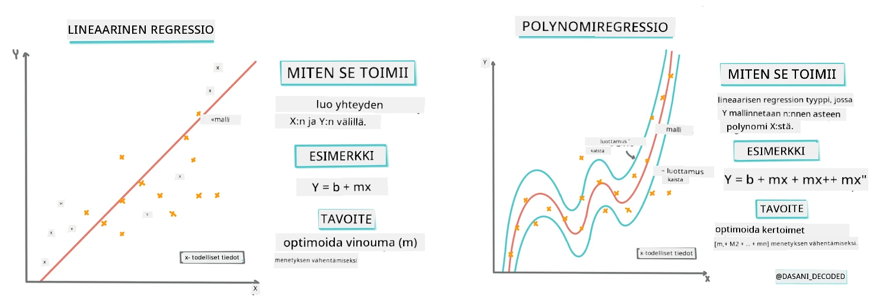
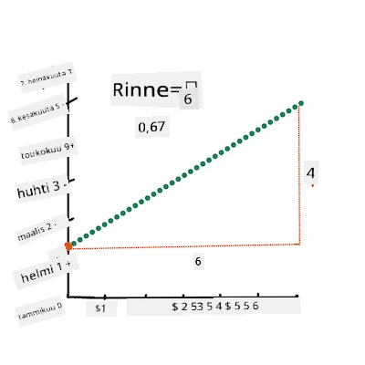
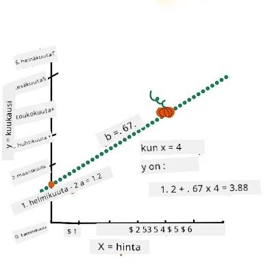
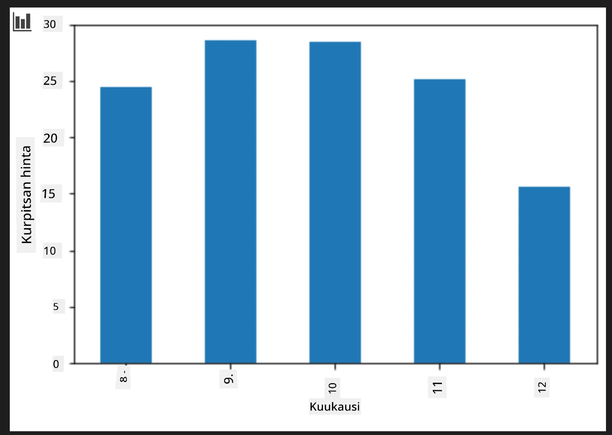
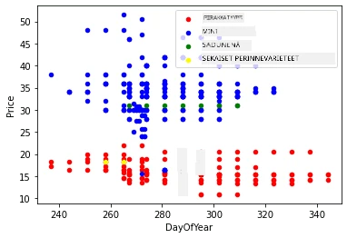

# Rakennetaan regressiomalli Scikit-learnillä: neljä regressiotapaa

## Aloittelijan huomautus

Lineaarista regressiota käytetään, kun haluamme ennustaa **numeerista arvoa** (esimerkiksi talon hinta, lämpötila tai myynti).  
Se toimii löytämällä suoran linjan, joka parhaiten kuvaa syöteominaisuuksien ja tuloksen välistä suhdetta.

Tässä oppitunnissa keskitymme käsitteen ymmärtämiseen ennen edistyneempien regressiotekniikoiden tutkimista.  
  
> Infografiikka: [Dasani Madipalli](https://twitter.com/dasani_decoded)
## [Esiluentokysely](https://ff-quizzes.netlify.app/en/ml/)

> ### [Tämä oppitunti on saatavilla myös R-kielellä!](../../../../2-Regression/3-Linear/solution/R/lesson_3.html)
### Johdanto

Tähän mennessä olet tutustunut siihen, mitä regressio tarkoittaa kurpitsahintojen otosaineiston avulla, jota käytämme läpi tämän oppitunnin. Olet myös visualisoinut sitä Matplotlibilla.

Nyt olet valmis sukeltamaan syvemmälle koneoppimisen regressioon. Vaikka visualisointi auttaa ymmärtämään dataa, koneoppimisen todellinen voima tulee _mallien kouluttamisesta_. Mallit koulutetaan historiallisella datalla automaattisesti kaappaamaan datariippuvuuksia, ja ne antavat sinun ennustaa tuloksia uudelle datalle, jota malli ei ole nähnyt aiemmin.

Tässä oppitunnissa opit lisää kahdesta regressiotyypistä: _peruslineaarisesta regressiosta_ ja _polynomiregressiosta_, sekä joitakin näiden tekniikoiden taustalla olevia matematiikkaan liittyviä asioita. Nämä mallit mahdollistavat kurpitsahintojen ennustamisen eri syötedatan perusteella.

[](https://youtu.be/CRxFT8oTDMg "ML for beginners - Understanding Linear Regression")

> 🎥 Klikkaa yllä olevaa kuvaa katsellaksesi lyhyen videon lineaarisesta regressiosta.

> Koko tämän opetussuunnitelman ajan oletamme matemaattisen osaamisen olevan perustasoa, ja pyrimme tekemään aiheesta helposti lähestyttävän opiskelijoille eri aloilta, joten pidä silmällä huomautuksia, 🧮 laskelmakohtia, kaavioita ja muita oppimistyökaluja ymmärtämisen tueksi.

### Esitiedot

Sinun tulisi nyt olla perehtynyt tässä tarkasteltavan kurpitsadatan rakenteeseen. Se on valmiiksi ladattu ja esipuhdistettu tämän oppitunnin _notebook.ipynb_-tiedostossa. Tiedostossa kurpitsan hinta näytetään tynnyriltä uudessa aineistokehikossa. Varmista, että voit ajaa näitä muistikirjoja Visual Studio Codessa.

### Valmistelut

Muistutuksena: lataat tämän datan voidaksesi esittää sille kysymyksiä.

- Milloin on paras aika ostaa kurpitsoja?  
- Millaisen hinnan voin odottaa pienempien kurpitsojen myyntierästä?  
- Kannattaako ne ostaa puolikkaan tynnyrin koreissa vai 1 1/9 tynnyrin laatikossa?  

Jatketaan tämän datan tutkimista.

Edellisessä oppitunnissa loit Pandas-aineistokehyksen ja täytit sen osalla alkuperäistä aineistoa, jolla hinnat vakioitiin tynnyrin mukaan. Näin kuitenkin sait kerättyä vain noin 400 tietopistettä, ja vain syksyn kuukausilta.

Katso läpi tämän oppitunnin mukana tulevan muistikirjan ladattu data. Data on ladattu esiin, ja pohjakuva hajontakaaviosta näyttää kuukausidatan. Ehkä voimme saada lisätietoa datan luonteesta puhdistamalla sitä lisää.

## Lineaarinen regressioviiva

Kuten opit Oppitunnissa 1, lineaarisen regressioharjoituksen tavoite on pystyä piirtämään viiva, jolla voi:

- **Näyttää muuttujien väliset suhteet**. Esittää muuttujien suhde.  
- **Tehdä ennusteita**. Tehdä tarkkoja ennusteita, mihin uusi tietopiste sijoittuu suhteessa tuohon viivaan.

Yleensä **Vähimmän neliösumman regressiossa** piirretään juuri tällainen viiva. Termi "vähimmän neliösumma" tarkoittaa sitä, että pyritään minimoimaan mallin kokonaisvirhe. Jokaiselle datapisteelle mitataan pystysuora etäisyys (jota kutsutaan residuaaliksi) varsinaisen pisteen ja regressioviivan välillä.

Nämä etäisyydet korotetaan toiseen potenssiin kahdesta syystä:

1. **Suuruus verrattuna suuntaan:** Haluamme käsitellä virheen -5 samankaltaisena kuin virheen +5. Neliöinti tekee kaikki arvot positiivisiksi.  

2. **Poikkeamien rankaiseminen:** Neliöinti antaa suurempaa painoarvoa isommille virheille, pakottaen viivan pysymään lähempänä kaukana olevia pisteitä.

Sitten lasketaan kaikkien näiden neliöityjen lukujen summa. Tavoitteena on löytää juuri sellainen viiva, jolla tämä summa on pienin mahdollinen – siitä termi "vähimmän neliösumman" johdettu nimi.

> **🧮 Näytä minulle matematiikka**  
>  
> Tämä viiva, jota kutsutaan _paras sovitusviiva_, voidaan ilmaista [kaavalla](https://en.wikipedia.org/wiki/Simple_linear_regression):  
>  
> ```
> Y = a + bX
> ```
>  
> `X` on 'selittävä muuttuja'. `Y` on 'riippuva muuttuja'. Viivan kulmakerroin on `b` ja `a` on y-leikkaus, joka tarkoittaa `Y`-arvoa, kun `X = 0`.  
>  
>  
>  
> Ensiksi lasketaan kulmakerroin `b`. Infografiikka: [Jen Looper](https://twitter.com/jenlooper)  
>  
> Toisin sanoen, viitaten kurpitsadatan alkuperäiseen kysymykseen: "ennustetaan kurpitsan hinta tynnyriltä kuukauden mukaan", `X` tarkoittaisi hintaa ja `Y` myyntikuukautta.  
>  
>  
>  
> Lasketaan `Y` arvo. Jos maksat noin 4 dollaria, silloin on huhtikuu! Infografiikka: [Jen Looper](https://twitter.com/jenlooper)  
>  
> Viivan laskemiseen liittyvä matematiikka osoittaa viivan kulman, joka riippuu myös leikkauspisteestä eli missä kohtaa `Y` sijaitsee, kun `X = 0`.
>  
> Voit tarkastella näiden arvojen laskentatapaa sivustolla [Math is Fun](https://www.mathsisfun.com/data/least-squares-regression.html). Katso myös [tämä vähimmän neliösumman laskuri](https://www.mathsisfun.com/data/least-squares-calculator.html) nähdäksesi, miten lukujen arvot vaikuttavat viivaan.

## Korrelaatio

Yksi tärkeä termi on vielä ymmärtää: **Korrelaatiokerroin** annettujen X- ja Y-muuttujien välillä. Hajontakaaviolla (scatterplot) voi nopeasti havainnoida tätä kerrointa. Kaavio, jossa datapisteet sijoittuvat siististi yhdelle linjalle, on korkea korrelaatio, kun taas pisteet ovat hajallaan X:n ja Y:n välillä, korrelaatio on matala.

Hyvä lineaarinen regressiomalli on sellainen, jolla on korkea (lähempänä kuin 0:aa olevan 1:n suuruinen) korrelaatiokerroin vähimmän neliösumman regressiomenetelmällä piirrettynä.

✅ Aja oppituntiin liittyvä muistikirja ja tarkastele kuukausi-hinta hajontakaaviota. Vaikuttaako kurpitsamyynnin kuukausin ja hinnan data korreloivan tiiviisti vai heikosti sen mukaan, miten visualisoit hajontakaavion? Muuttuuko se, jos käytät hienojakoisempaa mittaria kuin `Month`, esim. *vuoden päivää* (päivien määrää vuoden alusta)?

Alla oletamme, että olemme puhdistaneet datan ja saaneet `new_pumpkins`-aineistokehyksen, joka on lähellä seuraavaa:

ID | Month | DayOfYear | Variety | City | Package | Low Price | High Price | Price  
---|-------|-----------|---------|------|---------|-----------|------------|--------  
70 | 9 | 267 | PIE TYPE | BALTIMORE | 1 1/9 bushel cartons | 15.0 | 15.0 | 13.636364  
71 | 9 | 267 | PIE TYPE | BALTIMORE | 1 1/9 bushel cartons | 18.0 | 18.0 | 16.363636  
72 | 10 | 274 | PIE TYPE | BALTIMORE | 1 1/9 bushel cartons | 18.0 | 18.0 | 16.363636  
73 | 10 | 274 | PIE TYPE | BALTIMORE | 1 1/9 bushel cartons | 17.0 | 17.0 | 15.454545  
74 | 10 | 281 | PIE TYPE | BALTIMORE | 1 1/9 bushel cartons | 15.0 | 15.0 | 13.636364

> Data on puhdistettu ja se löytyy [`notebook.ipynb`](notebook.ipynb)-tiedostosta. Olemme suorittaneet samat puhdistustoimet kuin edellisessä oppitunnissa, ja laskeneet `DayOfYear`-sarakkeen seuraavalla lausekkeella:

```python
day_of_year = pd.to_datetime(pumpkins['Date']).apply(lambda dt: (dt-datetime(dt.year,1,1)).days)
```
  
Nyt kun ymmärrät lineaarisen regression taustalla olevan matematiikan, luodaan regressiomalli nähdäksesi, voimmeko ennustaa, millainen kurpitsapakkaus antaa parhaat kurpitsahinnat. Joku, joka ostaa kurpitsoja juhlapyhän koristeeksi, haluaisi tietää tämän optimoidakseen ostoksensa.

## Korrelaation etsiminen

[](https://youtu.be/uoRq-lW2eQo "ML for beginners - Looking for Correlation: The Key to Linear Regression")

> 🎥 Klikkaa yllä olevaa kuvaa lyhyen videon katsomiseksi korrelaatiosta.

Edellisessä oppitunnissa olet varmaankin nähnyt, että eri kuukausien keskimääräinen hinta näyttää tältä:



Tämä viittaa siihen, että korrelaatiota pitäisi löytyä, ja voimme kokeilla lineaarisen regression mallia ennustamaan suhdetta `Month` ja `Price` välillä tai `DayOfYear` ja `Price` välillä. Tässä on hajontakaavio, joka näyttää jälkimmäisen suhteen:


Tutkitaan korrelaatiota `corr`-funktiolla:

```python
print(new_pumpkins['Month'].corr(new_pumpkins['Price']))
print(new_pumpkins['DayOfYear'].corr(new_pumpkins['Price']))
```
  
Näyttää siltä, että korrelaatio on melko pieni, noin -0.15 kuukausittain ja -0.17 vuoden päivä -sarakkeen mukaan, mutta saattaa olla toinen tärkeä suhde. Näyttää siltä, että eri kurpitsalajikkeiden hinnat muodostavat erilaisia klustereita. Vahvistaaksesi tämän, piirretään kukin kurpitsaluokka eri värillä. Kun annamme `ax`-parametrin `scatter`-funktiolle, voimme piirtää kaikki pisteet samaan kuvaajaan:

```python
ax=None
colors = ['red','blue','green','yellow']
for i,var in enumerate(new_pumpkins['Variety'].unique()):
    df = new_pumpkins[new_pumpkins['Variety']==var]
    ax = df.plot.scatter('DayOfYear','Price',ax=ax,c=colors[i],label=var)
```
  
 

Tutkimuksemme viittaa siihen, että lajike vaikuttaa kokonaishintaan enemmän kuin todellinen myyntipäivä. Näemme tämän myös palkkikaaviolla:

```python
new_pumpkins.groupby('Variety')['Price'].mean().plot(kind='bar')
```
  


Keskitytään hetkeksi vain yhteen kurpitsalajikkeeseen, piirakkatyyppeihin, ja katsotaan, miten myyntipäivä vaikuttaa hintaan:

```python
pie_pumpkins = new_pumpkins[new_pumpkins['Variety']=='PIE TYPE']
pie_pumpkins.plot.scatter('DayOfYear','Price') 
```


Jos nyt lasketaan korrelaatio `Price` ja `DayOfYear` välillä käyttäen `corr`-funktiota, saamme noin `-0.27` – mikä tarkoittaa, että ennustavan mallin kouluttaminen on perusteltua.

> Ennen lineaarisen regressiomallin kouluttamista on tärkeää varmistaa, että datamme on puhdasta. Lineaarinen regressio ei toimi hyvin puuttuvien arvojen kanssa, joten on järkevää poistaa kaikki tyhjät solut:

```python
pie_pumpkins.dropna(inplace=True)
pie_pumpkins.info()
```
  
Toinen tapa voisi olla täyttää nämä tyhjät arvot sarakkeen keskiarvolla.

## Yksinkertainen lineaarinen regressio

[](https://youtu.be/e4c_UP2fSjg "ML for beginners - Linear and Polynomial Regression using Scikit-learn")

> 🎥 Klikkaa yllä olevaa kuvaa lyhyen videon katsomiseksi lineaarisesta ja polynomiregressiosta.

Kouluttaaksemme lineaarisen regressiomallimme käytämme **Scikit-learn**-kirjastoa.

```python
from sklearn.linear_model import LinearRegression
from sklearn.metrics import mean_squared_error
from sklearn.model_selection import train_test_split
```
  
Aloitamme erottamalla syötearvot (ominaisuudet) ja odotetun tuloksen (tunniste) erillisiin numpy-taulukoihin:

```python
X = pie_pumpkins['DayOfYear'].to_numpy().reshape(-1,1)
y = pie_pumpkins['Price']
```
  
> Huomaa, että meidän oli tehtävä `reshape` syötedatalle, jotta Linear Regression -paketti ymmärtäisi sen oikein. Lineaarinen regressio odottaa 2-ulotteista taulukkoa syötteenä, jossa jokainen rivin alkio vastaa syöteominaisuuksien vektoria. Meidän tapauksessamme, koska syötteitä on vain yksi, tarvitsemme N&times;1-ulotteisen taulukon, missä N on datasetin koko.

Seuraavaksi meidän tulee jakaa data opetus- ja testiaineistoihin, jotta voimme validoida mallin kouluttamisen jälkeen:

```python
X_train, X_test, y_train, y_test = train_test_split(X, y, test_size=0.2, random_state=0)
```
  
Lopuksi varsinainen lineaarisen regression kouluttaminen vaatii vain kaksi koodiriviä. Määrittelemme `LinearRegression`-objektin ja koulutamme sen datalla `fit`-metodilla:

```python
lin_reg = LinearRegression()
lin_reg.fit(X_train,y_train)
```

`LinearRegression`-olio `fit`-metodin suorittamisen jälkeen sisältää kaikki regressiokertoimet, joihin pääsee käsiksi `.coef_`-ominaisuudella. Tapauksessamme on vain yksi kerroin, jonka pitäisi olla noin `-0.017`. Tämä tarkoittaa, että hinnat näyttävät laskevan hieman ajan myötä, mutta eivät liian paljon, noin 2 senttiä päivässä. Voimme myös päästä käsiksi regressiolinjan leikkauspisteeseen Y-akselin kanssa käyttämällä `lin_reg.intercept_`-arvoa – se on tapauksessamme noin `21`, mikä osoittaa hinnan vuoden alussa.

Näyttääksemme, kuinka tarkka mallimme on, voimme ennustaa hintoja testidatalla ja mitata sitten, kuinka lähellä ennusteemme ovat odotettuja arvoja. Tämä voidaan tehdä juurikin neliöllisten virheiden keskiarvon neliöjuuren (RMSE) avulla, joka on kaikkien odotettujen ja ennustettujen arvojen neliöllisten erojen keskiarvon neliöjuuri.

```python
pred = lin_reg.predict(X_test)

rmse = np.sqrt(mean_squared_error(y_test,pred))
print(f'RMSE: {rmse:3.3} ({rmse/np.mean(pred)*100:3.3}%)')
```

Virheemme näyttää olevan noin 2 pistettä, mikä on ~17%. Ei kovin hyvä. Toinen mallin laadun mittari on **määrityskerroin**, jonka saamme näin:

```python
score = lin_reg.score(X_train,y_train)
print('Model determination: ', score)
```
Jos arvo on 0, se tarkoittaa, että malli ei ota syötedataa huomioon ja toimii *huonona lineaarisena ennustajana*, joka on yksinkertaisesti tuloksen keskiarvo. Arvo 1 tarkoittaa, että voimme täydellisesti ennustaa kaikki odotetut tulokset. Tapauksessamme kerroin on noin 0.06, mikä on melko matala.

Voimme myös piirtää testidatan yhdessä regressioviivan kanssa nähdäksesi paremmin, miten regressio toimii tapauksessamme:

```python
plt.scatter(X_test,y_test)
plt.plot(X_test,pred)
```


## Polynominen regressio

Toinen lineaarisen regression muoto on polynominen regressio. Vaikka joskus muuttujien välillä on lineaarinen suhde – mitä suurempi kurpitsa tilavuudeltaan, sitä korkeampi hinta – joskus nämä suhteet eivät ole suoraan tasossa tai suoralla viivalla esitettävissä.

✅ Tässä on [jotakin lisää esimerkkejä](https://online.stat.psu.edu/stat501/Lesson09#polynomial-regression-examples) datasta, jossa polynomista regressiota voisi käyttää.

Katso vielä uudestaan suhdetta Päivämäärä ja Hinta. Näyttääkö tämä hajontakaavio siltä, että se pitäisi välttämättä analysoida suoralla viivalla? Eikö hinta voi vaihdella? Tässä tapauksessa voit kokeilla polynomista regressiota.

✅ Polynomit ovat matemaattisia lausekkeita, jotka voivat sisältää yhden tai useamman muuttujan ja kertoimen.

Polynominen regressio luo kaarevan viivan sopimaan paremmin ei-lineaariseen dataan. Tapauksessamme, jos lisätään syötteeksi neliöity `DayOfYear`-muuttuja, voimme sovittaa datan paraabelikäyrällä, jolla on minimi tietyn vuodenhetken kohdalla.

Scikit-learn sisältää hyödyllisen [pipeline-rajapinnan](https://scikit-learn.org/stable/modules/generated/sklearn.pipeline.make_pipeline.html?highlight=pipeline#sklearn.pipeline.make_pipeline) erilaisten datankäsittelyvaiheiden yhdistämiseksi. **Pipeline** on ketju **estimaattoreita**. Tapauksessamme luomme pipeline:n, joka ensin lisää polynomiset piirteet malliin ja sen jälkeen opettaa regression:

```python
from sklearn.preprocessing import PolynomialFeatures
from sklearn.pipeline import make_pipeline

pipeline = make_pipeline(PolynomialFeatures(2), LinearRegression())

pipeline.fit(X_train,y_train)
```

Käyttäminen `PolynomialFeatures(2)` tarkoittaa, että otamme mukaan kaikki toisen asteen polynomit syötedatasta. Meidän tapauksessamme se tarkoittaa vain `DayOfYear`<sup>2</sup>, mutta jos olisi kaksi syötemuuttujaa X ja Y, se lisäisi termit X<sup>2</sup>, XY ja Y<sup>2</sup>. Voimme myös käyttää korkeampia asteen polynomeja, jos haluamme.

Pipelineja voidaan käyttää samalla tavalla kuin alkuperäistä `LinearRegression`-oliota, eli voimme `fit`-kutsua pipelineen ja käyttää sitten `predict` ennusteiden saamiseksi:

```python
pred = pipeline.predict(X_test)

rmse = np.sqrt(mean_squared_error(y_test,pred))
print(f'RMSE: {rmse:3.3} ({rmse/np.mean(pred)*100:3.3}%)')

score = pipeline.score(X_train,y_train)
print('Model determination: ', score)
```

Piirtääksemme sujuvan likimääräiskäyrän käytämme `np.linspace`-funktiota luomaan tasaisesti jakautuneen syötealueen, sen sijaan että piirrämme suoraan järjestämättömälle testidatalle (joka tuottaisi siksak-viivan):

```python
X_range = np.linspace(X_test.min(), X_test.max(), 100).reshape(-1,1)
y_range = pipeline.predict(X_range)

plt.scatter(X_test, y_test)
plt.plot(X_range, y_range)
```

Tässä on kuvaaja, jossa näkyy testidata ja likimääräiskäyrä:


Polynomista regressiota käyttämällä saamme hieman alhaisemman RMSE:n ja korkeamman määrityskertoimen, mutta ei merkittävästi. Meidän on otettava huomioon myös muita piirteitä!

> Voit nähdä, että kurpitsojen hinnat ovat alhaisimmillaan jossain Halloweeniin aikaan. Miten selität tämän?

🎃 Onneksi olkoon, juuri loit mallin, joka voi auttaa ennustamaan kurpitsapiirakan hintoja. Voit luultavasti toistaa saman prosessin kaikille kurpistyyppien lajikkeille, mutta se olisi työlästä. Opitaan nyt, miten otamme kurpitsalajikkeet mukaan malliin!

## Kategoriset piirteet

Ihanteellisessa maailmassa haluamme pystyä ennustamaan hintoja eri kurpitsalajikkeille samalla mallilla. Kuitenkin `Variety`-sarake poikkeaa hieman esimerkiksi `Month`-sarakkeesta, koska se sisältää ei-numeerisia arvoja. Tällaisia sarakkeita kutsutaan **kategorisiksi**.

[](https://youtu.be/DYGliioIAE0 "ML aloittelijoille - Kategoristen piirteiden ennusteet lineaarisella regressiolla")

> 🎥 Klikkaa yllä olevaa kuvaa nähdäksesi lyhyen opetusvideon kategoristen piirteiden käytöstä.

Tässä näkyy, miten keskihinta riippuu kurpitsalajikkeesta:


Ottamaan lajikkeet huomioon meidän täytyy ensin muuntaa ne numeeriseen muotoon eli **enkoodata**. On olemassa useita tapoja tehdä se:

* Yksinkertainen **numeerinen enkoodaus** luo taulukon eri lajikkeista ja korvaa lajikenimen indeksillä taulukossa. Tämä ei ole paras ratkaisu lineaariselle regressiolle, koska lineaarinen regressio käyttää indeksin numeerista arvoa ja lisää sen tulokseen kerrottuna jollakin kertoimella. Tapauksessamme indeksin numeron ja hinnan suhde ei ole lineaarinen, vaikka indeksit olisi järjestetty jollain tavalla.
* **One-hot-enkoodaus** korvaa `Variety`-sarakkeen neljällä eri sarakkeella, yksi kullekin lajikkeelle. Kukin sarake sisältää `1` jos rivi on kyseistä lajiketta, ja `0` muuten. Tämä tarkoittaa, että lineaarisessa regressiossa on neljä kerrointa, yksi kullekin kurpitsalajikkeelle, jotka vastaavat "aloitushintaa" (tai oikeammin "lisähintaa") kyseiselle lajikkeelle.

Alla oleva koodi näyttää, miten lajikkeen voi one-hot-enkoodata:

```python
pd.get_dummies(new_pumpkins['Variety'])
```

 ID | FAIRYTALE | MINIATURE | MIXED HEIRLOOM VARIETIES | PIE TYPE
----|-----------|-----------|--------------------------|----------
70 | 0 | 0 | 0 | 1
71 | 0 | 0 | 0 | 1
... | ... | ... | ... | ...
1738 | 0 | 1 | 0 | 0
1739 | 0 | 1 | 0 | 0
1740 | 0 | 1 | 0 | 0
1741 | 0 | 1 | 0 | 0
1742 | 0 | 1 | 0 | 0

Lineaarisen regression kouluttamiseksi one-hot-enkoodatulla lajikkeella syötteenä, meidän tarvitsee vain laittaa `X` ja `y` oikein:

```python
X = pd.get_dummies(new_pumpkins['Variety'])
y = new_pumpkins['Price']
```

Muuten koodi on sama kuin yllä käyttämämme lineaarisen regression opettamiseen. Kun kokeilet tätä, huomaat, että neliöllinen virhe on noin sama, mutta määrityskerroin kohoaa noin 77 %:iin. Vielä tarkempia ennusteita varten voimme ottaa huomioon useampia kategorisia piirteitä sekä numeerisia piirteitä, kuten `Month` tai `DayOfYear`. Saadaksemme yhden suuren piirrejoukon voimme käyttää `join`-metodia:

```python
X = pd.get_dummies(new_pumpkins['Variety']) \
        .join(new_pumpkins['Month']) \
        .join(pd.get_dummies(new_pumpkins['City'])) \
        .join(pd.get_dummies(new_pumpkins['Package']))
y = new_pumpkins['Price']
```

Tässä otamme myös huomioon `City` ja `Package`-tyypin, mikä antaa RMSE-arvoksi 2.84 (10.5%) ja määrityskertoimeksi 0.94!

## Kaiken yhdistäminen

Parhaan mallin tekemiseksi voimme käyttää yhdistettyä (one-hot-enkoodattua kategorista + numeerista) dataa yllä olevasta esimerkistä yhdessä polynomisen regression kanssa. Tässä on valmiiksi koottu koodi:

```python
# aseta koulutusdata
X = pd.get_dummies(new_pumpkins['Variety']) \
        .join(new_pumpkins['Month']) \
        .join(pd.get_dummies(new_pumpkins['City'])) \
        .join(pd.get_dummies(new_pumpkins['Package']))
y = new_pumpkins['Price']

# tee koulutus- ja testijakauma
X_train, X_test, y_train, y_test = train_test_split(X, y, test_size=0.2, random_state=0)

# asenna ja kouluta putkisto
pipeline = make_pipeline(PolynomialFeatures(2), LinearRegression())
pipeline.fit(X_train,y_train)

# ennusta tulokset testidatalle
pred = pipeline.predict(X_test)

# laske RMSE ja selitysaste
rmse = mean_squared_error(y_test, pred, squared=False)
print(f'RMSE: {rmse:3.3} ({rmse/pred.mean()*100:3.3}%)')

score = pipeline.score(X_train,y_train)
print('Model determination: ', score)
```

Tämän pitäisi antaa meille paras määrityskerroin lähes 97% ja RMSE-arvo 2.23 (~8% ennustetarkkuus).

| Malli | RMSE | Määritys |
|-------|-----|---------|
| `DayOfYear` Lineaarinen | 2.77 (17.2%) | 0.07 |
| `DayOfYear` Polynominen | 2.73 (17.0%) | 0.08 |
| `Variety` Lineaarinen | 5.24 (19.7%) | 0.77 |
| Kaikki piirteet Lineaarinen | 2.84 (10.5%) | 0.94 |
| Kaikki piirteet Polynominen | 2.23 (8.25%) | 0.97 |

🏆 Hienoa työtä! Loit neljä regressiomallia yhdessä oppitunnissa ja paransit mallin laatua 97 %:iin. Regressio-opin lopussa opit logistisesta regressiosta, jolla voidaan luokitella kategoriat.

---
## 🚀Haaste

Testaa tässä muistikirjassa useita eri muuttujia nähdäksesi, miten korrelaatio vaikuttaa mallin tarkkuuteen.

## [Luentokerran testi](https://ff-quizzes.netlify.app/en/ml/)

## Kertaus ja itsenäinen opiskelu

Tässä oppitunnissa opimme lineaarisesta regressiosta. On myös muita tärkeitä regressiotyyppejä. Lue stepwise-, ridge-, lasso- ja elasticnet-menetelmistä. Hyvä kurssi oppimiseen on [Stanfordin tilastollisen oppimisen kurssi](https://online.stanford.edu/courses/sohs-ystatslearning-statistical-learning).

## Tehtävä

[Laadi malli](assignment.md)

---

<!-- CO-OP TRANSLATOR DISCLAIMER START -->
**Vastuuvapauslauseke**:  
Tämä asiakirja on käännetty käyttämällä tekoälypohjaista käännöspalvelua [Co-op Translator](https://github.com/Azure/co-op-translator). Pyrimme tarkkuuteen, mutta ole hyvä ja huomioi, että automaattiset käännökset saattavat sisältää virheitä tai epätarkkuuksia. Alkuperäistä asiakirjaa sen alkuperäisellä kielellä pidetään virallisena lähteenä. Tärkeissä asioissa suositellaan ammattimaista ihmiskäännöstä. Emme ole vastuussa tästä käännöksestä johtuvista väärinkäsityksistä tai virhetulkinnoista.
<!-- CO-OP TRANSLATOR DISCLAIMER END -->