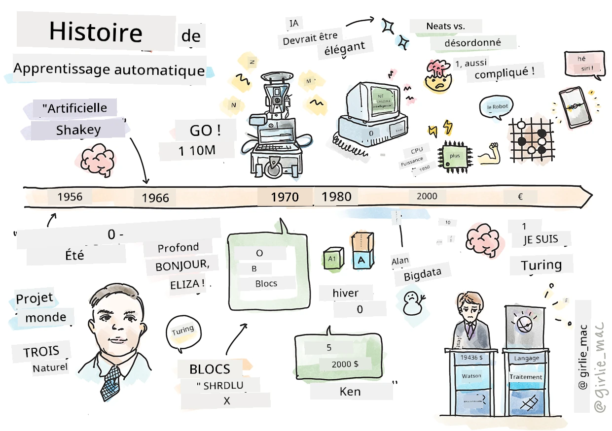
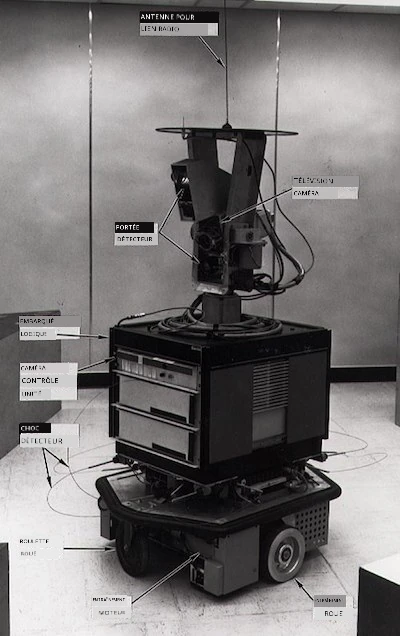
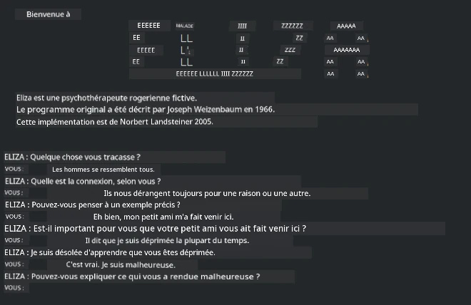

# Histoire de l'apprentissage automatique

> Sketchnote par [Tomomi Imura](https://www.twitter.com/girlie_mac)

## [Quiz pré-lecture](https://ff-quizzes.netlify.app/en/ml/)

---

> 🎥 Cliquez sur l'image ci-dessus pour une courte vidéo expliquant cette leçon.

Dans cette leçon, nous passerons en revue les grandes étapes de l'histoire de l'apprentissage automatique et de l'intelligence artificielle.

L'histoire de l'intelligence artificielle (IA) en tant que domaine est liée à celle de l'apprentissage automatique, car les algorithmes et progrès computationnels qui sous-tendent l'apprentissage automatique ont nourri le développement de l'IA. Il est utile de se rappeler que, bien que ces domaines en tant que champs distincts aient commencé à se cristalliser dans les années 1950, des [découvertes algorithmiques, statistiques, mathématiques, computationnelles et techniques importantes](https://wikipedia.org/wiki/Timeline_of_machine_learning) les précédaient et recouvraient cette époque. En fait, les gens réfléchissent à ces questions depuis [des centaines d'années](https://wikipedia.org/wiki/History_of_artificial_intelligence) : cet article traite des fondements intellectuels historiques de l'idée d'une « machine pensante ».

---
## Découvertes notables

- 1763, 1812 [Théorème de Bayes](https://wikipedia.org/wiki/Bayes%27_theorem) et ses prédécesseurs. Ce théorème et ses applications sous-tendent l'inférence, décrivant la probabilité qu'un événement se produise en fonction des connaissances préalables.
- 1805 [Théorie des moindres carrés](https://wikipedia.org/wiki/Least_squares) par le mathématicien français Adrien-Marie Legendre. Cette théorie, que vous étudierez dans notre unité sur la régression, aide à l'ajustement des données.
- 1913 [Chaînes de Markov](https://wikipedia.org/wiki/Markov_chain), nommées d'après le mathématicien russe Andrey Markov, sont utilisées pour décrire une séquence d'événements possibles basée sur un état précédent.
- 1957 [Perceptron](https://wikipedia.org/wiki/Perceptron) est un type de classificateur linéaire inventé par le psychologue américain Frank Rosenblatt qui sous-tend les avancées en apprentissage profond.

---

- 1967 [Plus proche voisin](https://wikipedia.org/wiki/Nearest_neighbor) est un algorithme initialement conçu pour tracer des itinéraires. Dans un contexte d'apprentissage automatique, il est utilisé pour détecter des motifs.
- 1970 [Rétropropagation](https://wikipedia.org/wiki/Backpropagation) est utilisée pour entraîner les [réseaux neuronaux feedforward](https://wikipedia.org/wiki/Feedforward_neural_network).
- 1982 [Réseaux de neurones récurrents](https://wikipedia.org/wiki/Recurrent_neural_network) sont des réseaux neuronaux artificiels issus des réseaux feedforward qui créent des graphes temporels.

✅ Faites un peu de recherche. Quelles autres dates ressortent comme cruciales dans l'histoire de l'AA et de l'IA ?

---
## 1950 : Machines qui pensent

Alan Turing, une personne vraiment remarquable élue [par le public en 2019](https://wikipedia.org/wiki/Icons:_The_Greatest_Person_of_the_20th_Century) comme le plus grand scientifique du 20e siècle, est crédité d'avoir contribué à poser les bases du concept d’« machine capable de penser ». Il a affronté les sceptiques et sa propre nécessité de preuves empiriques de ce concept en créant en partie le [Test de Turing](https://www.bbc.com/news/technology-18475646), que vous explorerez dans nos leçons de TAL.

---
## 1956 : Projet de recherche d'été de Dartmouth

« Le projet de recherche d'été de Dartmouth sur l'intelligence artificielle fut un événement fondamental pour l'intelligence artificielle en tant que domaine », et c’est là que le terme « intelligence artificielle » a été inventé ([source](https://250.dartmouth.edu/highlights/artificial-intelligence-ai-coined-dartmouth)).

> Tout aspect de l’apprentissage ou toute autre caractéristique de l’intelligence peut en principe être décrit avec une telle précision qu’une machine peut être conçue pour le simuler.

---

Le chercheur principal, le professeur de mathématiques John McCarthy, espérait « progresser sur la base de la conjecture que tout aspect de l’apprentissage ou toute autre caractéristique de l’intelligence peut en principe être décrit avec suffisamment de précision pour qu’une machine puisse le simuler. » Les participants comprenaient une autre sommité du domaine, Marvin Minsky.

L’atelier est crédité d’avoir initié et encouragé plusieurs discussions incluant « l’essor des méthodes symboliques, des systèmes focalisés sur des domaines limités (systèmes experts précoces), et des systèmes déductifs versus inductifs. » ([source](https://wikipedia.org/wiki/Dartmouth_workshop)).

---
## 1956 - 1974 : « Les années dorées »

Des années 1950 jusqu’au milieu des années 70, l’optimisme était grand face à l’espoir que l’IA pourrait résoudre de nombreux problèmes. En 1967, Marvin Minsky déclara avec confiance que « dans une génération... le problème de créer une ‘intelligence artificielle’ sera largement résolu. » (Minsky, Marvin (1967), Computation: Finite and Infinite Machines, Englewood Cliffs, N.J. : Prentice-Hall)

La recherche en traitement du langage naturel prospérait, la recherche était affinée et rendue plus puissante, et le concept de « micro-mondes » fut créé, où des tâches simples étaient réalisées grâce à des instructions en langage clair.

---

La recherche était bien financée par des agences gouvernementales, des progrès furent faits en calcul et algorithmes, et des prototypes de machines intelligentes furent construits. Parmi ces machines figurent :

* [Shakey le robot](https://wikipedia.org/wiki/Shakey_the_robot), capable de se déplacer et décider comment réaliser des tâches de manière « intelligente ».

    
    > Shakey en 1972

---

* Eliza, un premier « chatterbot », pouvait converser avec les gens et jouer le rôle d’un « thérapeute » primitif. Vous en apprendrez davantage sur Eliza dans les leçons de TAL.

    
    > Une version d’Eliza, un chatbot

---

* « Blocks world » était un exemple de micro-monde où des blocs pouvaient être empilés et triés, et des expériences pour apprendre aux machines à prendre des décisions pouvaient être testées. Les avancées développées avec des bibliothèques telles que [SHRDLU](https://wikipedia.org/wiki/SHRDLU) ont aidé à faire progresser le traitement du langage.

    

    > 🎥 Cliquez sur l’image ci-dessus pour une vidéo : Blocks world avec SHRDLU

---
## 1974 - 1980 : « Hiver de l’IA »

Vers le milieu des années 1970, il était devenu évident que la complexité de la fabrication de « machines intelligentes » avait été sous-estimée et que ses promesses, compte tenu de la puissance de calcul disponible, avaient été exagérées. Les financements se tarirent et la confiance dans le domaine ralentit. Certains problèmes qui impactèrent la confiance comprenaient :
---
- **Limitations**. La puissance de calcul était trop limitée.
- **Explosion combinatoire**. La quantité de paramètres à entraîner croissait exponentiellement au fur et à mesure que l’on demandait plus aux ordinateurs, sans évolution parallèle de la puissance et des capacités de calcul.
- **Pénurie de données**. Le manque de données entravait le processus de test, de développement et de perfectionnement des algorithmes.
- **Posons-nous les bonnes questions ?**. Les questions mêmes posées commencèrent à être remises en question. Les chercheurs commencèrent à recevoir des critiques sur leurs approches :
  - Les tests de Turing furent remis en question notamment par la « théorie de la chambre chinoise » qui avançait que « programmer un ordinateur numérique peut le faire sembler comprendre le langage mais ne peut produire une vraie compréhension. » ([source](https://plato.stanford.edu/entries/chinese-room/))
  - L’éthique d’introduire des intelligences artificielles telles que le « thérapeute » ELIZA dans la société fut contestée.

---

En même temps, diverses écoles de pensée en IA ont commencé à se former. Une dichotomie s'est établie entre les pratiques ["brouillonnes" vs. "propres" en IA](https://wikipedia.org/wiki/Neats_and_scruffies). Les laboratoires _brouillons_ retouchaient les programmes pendant des heures jusqu'à obtenir les résultats souhaités. Les laboratoires _propres_ "se concentraient sur la logique et la résolution formelle de problèmes". ELIZA et SHRDLU étaient des systèmes bien connus _brouillons_. Dans les années 1980, avec l'émergence de la demande pour rendre les systèmes d'apprentissage automatique reproductibles, l'approche _propre_ a progressivement pris le devant de la scène car ses résultats sont plus explicables.

---
## Systèmes experts des années 1980

À mesure que le domaine grandissait, ses bénéfices pour les entreprises devenaient plus évidents, et dans les années 1980, la prolifération des « systèmes experts » aussi. "Les systèmes experts figuraient parmi les premières formes véritablement réussies de logiciels d'intelligence artificielle (IA)." ([source](https://wikipedia.org/wiki/Expert_system)).

Ce type de système est en réalité _hybride_, comprenant en partie un moteur de règles définissant les exigences métier, et un moteur d'inférence qui utilisait le système de règles pour déduire de nouveaux faits.

Cette époque a également vu une attention croissante portée aux réseaux de neurones.

---
## 1987 - 1993 : « Pause » en IA

La prolifération du matériel spécialisé pour systèmes experts a eu pour effet fâcheux de devenir trop spécialisé. L'essor des ordinateurs personnels faisait également concurrence à ces systèmes centralisés, grands et spécialisés. La démocratisation de l'informatique avait commencé, et elle a finalement ouvert la voie à l'explosion moderne du big data.

---
## 1993 - 2011

Cette époque a vu une nouvelle ère pour l'apprentissage automatique et l'IA, capables de résoudre certains des problèmes précédemment causés par le manque de données et de puissance de calcul. La quantité de données a rapidement augmenté et est devenue plus largement disponible, pour le meilleur et pour le pire, surtout avec l'avènement du smartphone autour de 2007. La puissance de calcul s'est développée exponentiellement, et les algorithmes ont évolué en parallèle. Le domaine a commencé à mûrir alors que les jours sans contraintes du passé commençaient à se cristalliser en une vraie discipline.

---
## Aujourd’hui

Aujourd'hui, l'apprentissage automatique et l'IA touchent presque tous les aspects de nos vies. Cette ère exige une compréhension attentive des risques et des effets potentiels de ces algorithmes sur la vie humaine. Comme l’a déclaré Brad Smith de Microsoft, "La technologie de l'information soulève des questions qui vont au cœur des protections fondamentales des droits humains comme la vie privée et la liberté d'expression. Ces questions accroissent la responsabilité des entreprises technologiques qui créent ces produits. Selon nous, elles nécessitent également une régulation gouvernementale réfléchie et le développement de normes autour des usages acceptables" ([source](https://www.technologyreview.com/2019/12/18/102365/the-future-of-ais-impact-on-society/)).

---

L'avenir reste à écrire, mais il est important de comprendre ces systèmes informatiques ainsi que les logiciels et algorithmes qu'ils utilisent. Nous espérons que ce programme vous aidera à mieux comprendre afin que vous puissiez décider par vous-même.

> 🎥 Cliquez sur l'image ci-dessus pour une vidéo : Yann LeCun discute de l'histoire de l'apprentissage profond dans cette conférence

---
## 🚀Défi

Plongez dans un de ces moments historiques et découvrez-en plus sur les personnes qui les ont marqués. Il y a des personnages fascinants, et aucune découverte scientifique n’a jamais été créée dans un vide culturel. Que découvrez-vous ?

## [Quiz post-conférence](https://ff-quizzes.netlify.app/en/ml/)

---
## Révision & Auto-apprentissage

Voici des contenus à regarder et écouter :

[Ce podcast où Amy Boyd discute de l'évolution de l'IA](http://runasradio.com/Shows/Show/739)

---

## Devoir

[Créer une chronologie](assignment.md)

---

<!-- CO-OP TRANSLATOR DISCLAIMER START -->
**Avertissement** :
Ce document a été traduit à l'aide du service de traduction automatique [Co-op Translator](https://github.com/Azure/co-op-translator). Bien que nous nous efforçions d'assurer l'exactitude, veuillez noter que les traductions automatisées peuvent contenir des erreurs ou des inexactitudes. Le document original dans sa langue native doit être considéré comme la source faisant autorité. Pour les informations critiques, il est recommandé de recourir à une traduction professionnelle réalisée par un humain. Nous ne saurions être tenus responsables des malentendus ou erreurs d'interprétation découlant de l'utilisation de cette traduction.
<!-- CO-OP TRANSLATOR DISCLAIMER END -->