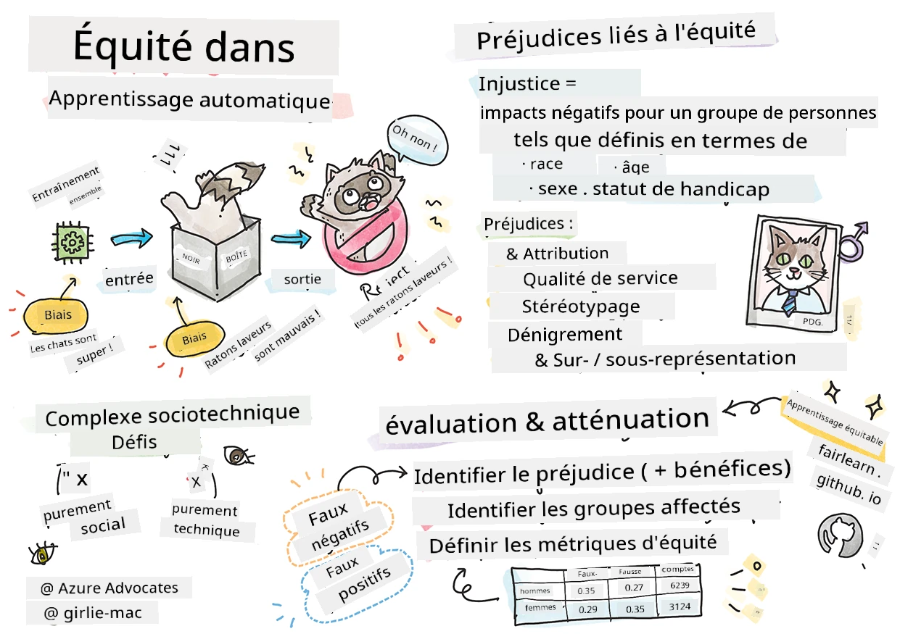

# Construire des solutions d'apprentissage automatique avec une IA responsable
 

> Sketchnote par [Tomomi Imura](https://www.twitter.com/girlie_mac)

## [Quiz avant la leçon](https://ff-quizzes.netlify.app/en/ml/)
 
## Introduction

Dans ce programme, vous commencerez à découvrir comment l'apprentissage automatique peut et impacte notre vie quotidienne. Même aujourd'hui, des systèmes et modèles participent à des tâches décisionnelles quotidiennes, telles que les diagnostics médicaux, les approbations de prêts ou la détection de fraudes. Il est donc important que ces modèles fonctionnent bien pour fournir des résultats dignes de confiance. Comme toute application logicielle, les systèmes d'IA peuvent ne pas répondre aux attentes ou avoir des résultats indésirables. C'est pourquoi il est essentiel de pouvoir comprendre et expliquer le comportement d'un modèle d'IA.

Imaginez ce qui peut arriver lorsque les données utilisées pour construire ces modèles manquent certains groupes démographiques, comme la race, le genre, l'opinion politique, la religion, ou représentent de manière disproportionnée ces groupes démographiques. Que se passe-t-il lorsque la sortie du modèle est interprétée pour favoriser un certain groupe démographique ? Quelle en est la conséquence pour l'application ? De plus, que se passe-t-il quand le modèle engendre un résultat défavorable et nuit aux personnes ? Qui est responsable du comportement des systèmes d'IA ? Ce sont quelques-unes des questions que nous explorerons dans ce programme.

Dans cette leçon, vous allez :

- Prendre conscience de l'importance de l'équité en apprentissage automatique et des préjudices liés à l'équité.
- Vous familiariser avec la pratique d'explorer les valeurs aberrantes et les scénarios inhabituels pour assurer fiabilité et sécurité.
- Comprendre la nécessité d'autonomiser tout le monde en concevant des systèmes inclusifs.
- Explorer l'importance cruciale de protéger la vie privée et la sécurité des données et des personnes.
- Voir l'importance d'avoir une approche en boîte transparente pour expliquer le comportement des modèles d'IA.
- Être conscient de l'importance de la responsabilité pour instaurer la confiance dans les systèmes d'IA.

## Prérequis

Comme prérequis, veuillez suivre le parcours d'apprentissage "Principes d'IA responsable" et regarder la vidéo ci-dessous sur le sujet :

En savoir plus sur l'IA responsable en suivant ce [parcours d'apprentissage](https://docs.microsoft.com/learn/modules/responsible-ai-principles/?WT.mc_id=academic-77952-leestott)

> 🎥 Cliquez sur l'image ci-dessus pour une vidéo : Approche de Microsoft sur l'IA responsable

## Équité

Les systèmes d'IA doivent traiter tout le monde de manière équitable et éviter d'affecter différemment des groupes similaires de personnes. Par exemple, lorsque les systèmes d'IA fournissent des conseils sur les traitements médicaux, les demandes de prêts ou l'emploi, ils doivent faire les mêmes recommandations à tous ceux qui ont des symptômes, des circonstances financières ou des qualifications professionnelles similaires. Chacun de nous, en tant qu'humain, porte des biais hérités qui affectent nos décisions et actions. Ces biais peuvent être évidents dans les données utilisées pour entraîner les systèmes d'IA. Une telle manipulation peut parfois se produire involontairement. Il est souvent difficile de savoir consciemment quand on introduit un biais dans les données.

**« Injustice »** englobe les impacts négatifs, ou « préjudices », pour un groupe de personnes, tels que ceux définis par la race, le genre, l'âge ou le statut de handicap. Les principaux préjudices liés à l'équité peuvent être classés comme :

- **Allocation**, si un genre ou une origine ethnique par exemple est favorisé par rapport à un autre.
- **Qualité de service**. Si vous entraînez les données pour un scénario spécifique mais que la réalité est beaucoup plus complexe, cela mène à un service peu performant. Par exemple, un distributeur de savon qui ne semble pas détecter les personnes à la peau foncée. [Référence](https://gizmodo.com/why-cant-this-soap-dispenser-identify-dark-skin-1797931773)
- **Dénigrement**. Critiquer injustement et étiqueter quelque chose ou quelqu'un. Par exemple, une technologie d'étiquetage d'images a tristement mal étiqueté des images de personnes à peau foncée comme des gorilles.
- **Sur- ou sous-représentation**. L'idée est qu'un certain groupe n'est pas visible dans une certaine profession, et tout service ou fonction qui continue à promouvoir cela contribue au préjudice.
- **Stéréotypage**. Associer un groupe donné à des attributs préassignés. Par exemple, un système de traduction linguistique entre l'anglais et le turc peut avoir des inexactitudes dues à des mots aux associations stéréotypées de genre.

> traduction vers le turc

> retraduit en anglais

Lors de la conception et du test des systèmes d'IA, nous devons nous assurer que l'IA est équitable et qu'elle n'est pas programmée pour prendre des décisions biaisées ou discriminatoires, ce que les êtres humains sont également interdits de faire. Garantir l'équité dans l'IA et l'apprentissage automatique demeure un défi sociotechnique complexe.

### Fiabilité et sécurité

Pour instaurer la confiance, les systèmes d'IA doivent être fiables, sûrs et cohérents dans des conditions normales et imprévues. Il est important de savoir comment les systèmes d'IA se comporteront dans une variété de situations, en particulier lorsqu'il s'agit de valeurs aberrantes. Lors de la construction de solutions d'IA, il est nécessaire de concentrer une part importante de l'attention sur la gestion de la diversité des circonstances auxquelles les solutions d'IA seraient confrontées. Par exemple, une voiture autonome doit prioriser la sécurité des personnes. En conséquence, l'IA qui alimente la voiture doit prendre en compte tous les scénarios possibles que la voiture pourrait rencontrer, tels que la nuit, les orages ou blizzards, des enfants traversant la rue, des animaux de compagnie, des chantiers routiers, etc. La manière dont un système d'IA peut gérer de manière fiable et sûre une large gamme de conditions reflète le niveau d'anticipation qu'un data scientist ou un développeur AI a considéré lors de la conception ou des tests du système.

> [🎥 Cliquez ici pour une vidéo : Fiabilité et sécurité en IA](https://www.microsoft.com/videoplayer/embed/RE4vvIl)

### Inclusion

Les systèmes d'IA doivent être conçus pour engager et autonomiser tout le monde. Lors de la conception et de la mise en œuvre des systèmes d'IA, les data scientists et développeurs AI identifient et traitent les barrières potentielles dans le système qui pourraient exclure des personnes de manière non intentionnelle. Par exemple, il y a 1 milliard de personnes en situation de handicap dans le monde. Avec l'avancement de l'IA, elles peuvent accéder plus facilement à une large gamme d'informations et d'opportunités dans leur vie quotidienne. En traitant ces barrières, cela crée des opportunités pour innover et développer des produits d'IA avec de meilleures expériences qui profitent à tous.

> [🎥 Cliquez ici pour une vidéo : Inclusion en IA](https://www.microsoft.com/videoplayer/embed/RE4vl9v)

### Sécurité et vie privée

Les systèmes d'IA doivent être sûrs et respecter la vie privée des personnes. Les gens ont moins confiance dans les systèmes qui mettent leur vie privée, leurs informations ou leur vie en danger. Lors de l'entraînement des modèles d'apprentissage automatique, nous nous appuyons sur les données pour produire les meilleurs résultats. Ce faisant, l'origine des données et leur intégrité doivent être prises en compte. Par exemple, les données ont-elles été soumises par les utilisateurs ou sont-elles publiquement disponibles ? Ensuite, lors du travail avec les données, il est crucial de développer des systèmes d'IA capables de protéger les informations confidentielles et de résister aux attaques. À mesure que l'IA devient plus répandue, protéger la vie privée et sécuriser les informations personnelles et commerciales importantes devient plus critique et complexe. Les questions de vie privée et de sécurité des données requièrent une attention particulière pour l'IA car l'accès aux données est essentiel pour que les systèmes d'IA fassent des prédictions et des décisions exactes et éclairées à propos des personnes.

> [🎥 Cliquez ici pour une vidéo : Sécurité en IA](https://www.microsoft.com/videoplayer/embed/RE4voJF)

- En tant que secteur, nous avons réalisé des avancées significatives en matière de vie privée et de sécurité, largement alimentées par des réglementations comme le RGPD (Règlement Général sur la Protection des Données).
- Pourtant, avec les systèmes d'IA, nous devons reconnaître la tension entre le besoin de plus de données personnelles pour rendre les systèmes plus personnels et efficaces – et la vie privée.
- Tout comme avec la naissance des ordinateurs connectés à Internet, nous assistons également à une forte augmentation du nombre de problèmes de sécurité liés à l'IA.
- En même temps, nous avons vu l'IA utilisée pour améliorer la sécurité. Par exemple, la plupart des scanners anti-virus modernes sont aujourd'hui animés par des heuristiques d'IA.
- Nous devons veiller à ce que nos processus de Data Science s'harmonisent avec les dernières pratiques en matière de vie privée et de sécurité.

### Transparence
Les systèmes d'IA doivent être compréhensibles. Une partie cruciale de la transparence est d'expliquer le comportement des systèmes d'IA et de leurs composants. Améliorer la compréhension des systèmes d'IA nécessite que les parties prenantes comprennent comment et pourquoi ils fonctionnent afin de pouvoir identifier les problèmes potentiels de performance, de sécurité et de vie privée, les biais, les pratiques d'exclusion ou les résultats non désirés. Nous croyons aussi que ceux qui utilisent les systèmes d'IA devraient être honnêtes et transparents sur le moment, la raison et la manière dont ils choisissent de les déployer, ainsi que sur les limites des systèmes qu'ils utilisent. Par exemple, si une banque utilise un système d'IA pour appuyer ses décisions de prêt à la consommation, il est important d'examiner les résultats et comprendre quelles données influencent les recommandations du système. Les gouvernements commencent à réglementer l'IA dans tous les secteurs, donc les data scientists et organisations doivent expliquer si un système d'IA respecte les exigences réglementaires, surtout lorsqu'il y a un résultat indésirable.

> [🎥 Cliquez ici pour une vidéo : Transparence en IA](https://www.microsoft.com/videoplayer/embed/RE4voJF)

- Parce que les systèmes d'IA sont si complexes, il est difficile de comprendre leur fonctionnement et d'interpréter les résultats.
- Ce manque de compréhension affecte la manière dont ces systèmes sont gérés, opérationnalisés et documentés.
- Ce manque de compréhension affecte surtout les décisions prises à partir des résultats produits par ces systèmes.

### Responsabilité
 
Les personnes qui conçoivent et déploient les systèmes d'IA doivent être responsables du fonctionnement de leurs systèmes. La nécessité de responsabilité est particulièrement cruciale pour les technologies sensibles comme la reconnaissance faciale. Récemment, il y a eu une demande croissante pour la technologie de reconnaissance faciale, notamment de la part des forces de l'ordre qui voient le potentiel de la technologie dans des usages comme la recherche d'enfants disparus. Cependant, ces technologies pourraient potentiellement être utilisées par un gouvernement pour mettre en danger les libertés fondamentales de ses citoyens, par exemple en permettant une surveillance continue de certaines personnes. Par conséquent, les data scientists et les organisations doivent être responsables de l'impact de leur système d'IA sur les individus ou la société.

> 🎥 Cliquez sur l'image ci-dessus pour une vidéo : Avertissements sur la surveillance de masse via la reconnaissance faciale

En fin de compte, l'une des plus grandes questions pour notre génération, en tant que première génération à introduire l'IA dans la société, est de savoir comment garantir que les ordinateurs resteront responsables devant les personnes et comment garantir que ceux qui conçoivent les ordinateurs restent responsables devant tout le monde.

## Évaluation d'impact

Avant d'entraîner un modèle d'apprentissage automatique, il est important de réaliser une évaluation d'impact pour comprendre le but du système d'IA ; quel est l'usage prévu ; où il sera déployé ; et qui interagira avec le système. Cela aide les réviseurs ou testeurs évaluant le système à savoir quels facteurs prendre en compte lorsqu'ils identifient les risques potentiels et les conséquences attendues.

Les domaines d'attention lors de la réalisation d'une évaluation d'impact sont les suivants :

* **Impact négatif sur les individus**. Être conscient de toute restriction ou exigence, usage non supporté ou toute limitation connue entravant les performances du système est vital pour s'assurer que le système n'est pas utilisé d'une manière pouvant causer du tort aux individus.
* **Exigences en matière de données**. Comprendre comment et où le système utilisera des données permet aux réviseurs d'explorer toutes exigences en matière de données dont il faudrait tenir compte (par exemple, règlementations RGPD ou HIPAA). De plus, examiner si la source ou la quantité de données est suffisante pour l'entraînement.
* **Résumé d'impact**. Rassembler une liste des préjudices potentiels pouvant découler de l'utilisation du système. Tout au long du cycle de vie du ML, vérifier si les problèmes identifiés ont été atténués ou traités.
* **Objectifs applicables** pour chacun des six principes fondamentaux. Évaluer si les objectifs de chacun des principes sont atteints et s'il y a des lacunes.

## Débogage avec l'IA responsable

Comme pour le débogage d'une application logicielle, le débogage d'un système d'IA est un processus nécessaire d'identification et de résolution des problèmes du système. De nombreux facteurs peuvent influencer la performance d'un modèle qui ne répond pas aux attentes ou de manière responsable. La plupart des métriques traditionnelles de performance des modèles sont des agrégats quantitatifs des performances d'un modèle, ce qui n'est pas suffisant pour analyser comment un modèle viole les principes d'IA responsable. De plus, un modèle d'apprentissage automatique est une boîte noire rendant difficile la compréhension des facteurs qui déterminent son résultat ou l'explication d'une erreur. Plus tard dans ce cours, nous apprendrons comment utiliser le tableau de bord Responsible AI pour aider à déboguer les systèmes d'IA. Ce tableau de bord offre un outil holistique pour les data scientists et développeurs IA pour :

* **Analyse d'erreur**. Identifier la distribution des erreurs du modèle pouvant affecter l'équité ou la fiabilité du système.
* **Vue d'ensemble du modèle**. Découvrir où il existe des disparités dans les performances du modèle à travers différents groupes de données.
* **Analyse des données**. Comprendre la distribution des données et identifier tout biais potentiel dans les données qui pourrait mener à des problèmes d'équité, d'inclusion et de fiabilité.
* **Interprétabilité du modèle**. Comprendre ce qui affecte ou influence les prédictions du modèle. Cela aide à expliquer le comportement du modèle, ce qui est important pour la transparence et la responsabilité.

## 🚀 Défi
 
Pour prévenir l'apparition de préjudices dès le départ, nous devrions :

- avoir une diversité d'origines et de perspectives parmi les personnes travaillant sur les systèmes
- investir dans des ensembles de données qui reflètent la diversité de notre société
- développer de meilleures méthodes tout au long du cycle de vie de l'apprentissage automatique pour détecter et corriger l'IA irresponsable lorsqu'elle se produit

Pensez à des scénarios réels où l'inauthenticité d'un modèle est évidente dans la construction et l'utilisation du modèle. Que devrions-nous considérer d'autre ?

## [Quiz post-leçon](https://ff-quizzes.netlify.app/en/ml/)

## Révision & Auto-apprentissage
 
Dans cette leçon, vous avez appris quelques bases des concepts d'équité et d'injustice en apprentissage automatique.
 
Regardez cet atelier pour approfondir les sujets :

- À la poursuite de l'IA responsable : Appliquer les principes à la pratique par Besmira Nushi, Mehrnoosh Sameki et Amit Sharma

> 🎥 Cliquez sur l'image ci-dessus pour une vidéo : Boîte à outils RAI : Un cadre open-source pour construire une IA responsable par Besmira Nushi, Mehrnoosh Sameki, et Amit Sharma

Lisez aussi : 

- Centre de ressources RAI de Microsoft : [Ressources IA Responsable – Microsoft AI](https://www.microsoft.com/ai/responsible-ai-resources?activetab=pivot1%3aprimaryr4) 

- Groupe de recherche FATE de Microsoft : [FATE : Équité, Responsabilité, Transparence et Éthique en IA - Microsoft Research](https://www.microsoft.com/research/theme/fate/) 

Boîte à outils RAI : 

- [Dépôt GitHub de la boîte à outils IA Responsable](https://github.com/microsoft/responsible-ai-toolbox)

Découvrez les outils d'Azure Machine Learning pour garantir l'équité :

- [Azure Machine Learning](https://docs.microsoft.com/azure/machine-learning/concept-fairness-ml?WT.mc_id=academic-77952-leestott) 

## Exercices

[Explorez la boîte à outils RAI](assignment.md)

---

<!-- CO-OP TRANSLATOR DISCLAIMER START -->
**Avertissement** :
Ce document a été traduit à l'aide du service de traduction automatique [Co-op Translator](https://github.com/Azure/co-op-translator). Bien que nous nous efforçions d'assurer l'exactitude, veuillez noter que les traductions automatisées peuvent contenir des erreurs ou des inexactitudes. Le document original dans sa langue native doit être considéré comme la source faisant autorité. Pour les informations critiques, il est recommandé de recourir à une traduction professionnelle réalisée par un humain. Nous ne saurions être tenus responsables des malentendus ou erreurs d'interprétation découlant de l'utilisation de cette traduction.
<!-- CO-OP TRANSLATOR DISCLAIMER END -->