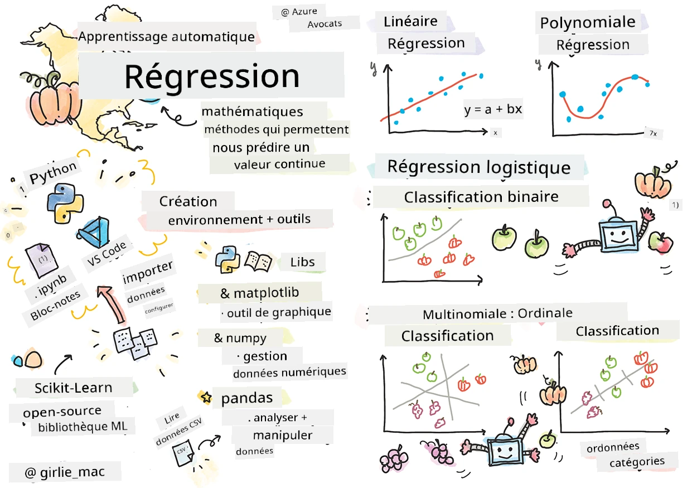
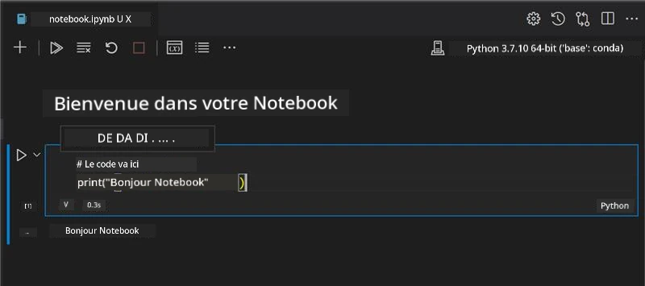
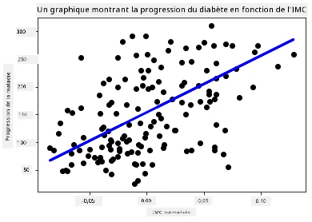

# Commencez avec Python et Scikit-learn pour les modèles de régression



> Sketchnote par [Tomomi Imura](https://www.twitter.com/girlie_mac)

## [Quiz avant la leçon](https://ff-quizzes.netlify.app/en/ml/)

> ### [Cette leçon est disponible en R !](../../../../2-Regression/1-Tools/solution/R/lesson_1.html)

## Introduction

Dans ces quatre leçons, vous allez découvrir comment construire des modèles de régression. Nous discuterons brièvement de leur utilité. Mais avant de commencer, assurez-vous d’avoir les bons outils en place pour démarrer le processus !

Dans cette leçon, vous apprendrez à :

- Configurer votre ordinateur pour les tâches d’apprentissage automatique locales.
- Travailler avec les Jupyter Notebooks.
- Utiliser Scikit-learn, y compris l’installation.
- Explorer la régression linéaire avec un exercice pratique.

## Installations et configurations

[](https://youtu.be/-DfeD2k2Kj0 "ML pour débutants - Configurez vos outils pour construire des modèles d'Apprentissage Automatique")

> 🎥 Cliquez sur l’image ci-dessus pour une courte vidéo expliquant la configuration de votre ordinateur pour le ML.

1. **Installer Python**. Assurez-vous que [Python](https://www.python.org/downloads/) est installé sur votre ordinateur. Vous utiliserez Python pour de nombreuses tâches de science des données et d’apprentissage automatique. La plupart des systèmes informatiques incluent déjà une installation de Python. Il existe également des [pack de codage Python](https://code.visualstudio.com/learn/educators/installers?WT.mc_id=academic-77952-leestott) utiles pour faciliter la configuration pour certains utilisateurs.

Certaines utilisations de Python nécessitent toutefois une version du logiciel, tandis que d’autres en requièrent une différente. Pour cette raison, il est utile de travailler dans un [environnement virtuel](https://docs.python.org/3/library/venv.html).

2. **Installer Visual Studio Code**. Assurez-vous que Visual Studio Code est installé sur votre ordinateur. Suivez ces instructions pour [installer Visual Studio Code](https://code.visualstudio.com/) pour une installation de base. Vous allez utiliser Python dans Visual Studio Code dans ce cours, donc vous voudrez peut-être revoir comment [configurer Visual Studio Code](https://docs.microsoft.com/learn/modules/python-install-vscode?WT.mc_id=academic-77952-leestott) pour le développement Python.

> Familiarisez-vous avec Python en parcourant cette collection de [modules Learn](https://docs.microsoft.com/users/jenlooper-2911/collections/mp1pagggd5qrq7?WT.mc_id=academic-77952-leestott)
>
> [](https://youtu.be/yyQM70vi7V8 "Configurer Python avec Visual Studio Code")
>
> 🎥 Cliquez sur l’image ci-dessus pour une vidéo : utiliser Python dans VS Code.

3. **Installer Scikit-learn**, en suivant [ces instructions](https://scikit-learn.org/stable/install.html). Puisque vous devez vous assurer d’utiliser Python 3, il est recommandé d’employer un environnement virtuel. Notez que si vous installez cette bibliothèque sur un Mac M1, il existe des instructions spéciales sur la page liée ci-dessus.

1. **Installer Jupyter Notebook**. Vous devrez [installer le package Jupyter](https://pypi.org/project/jupyter/).

## Votre environnement de création ML

Vous allez utiliser des **notebooks** pour développer votre code Python et créer des modèles d’apprentissage automatique. Ce type de fichier est un outil courant pour les data scientists, et ils peuvent être identifiés par leur suffixe ou extension `.ipynb`.

Les notebooks sont un environnement interactif qui permet au développeur à la fois de coder et d’ajouter des notes ainsi que d’écrire de la documentation autour du code, ce qui est très utile pour les projets expérimentaux ou à visée de recherche.

[](https://youtu.be/7E-jC8FLA2E "ML pour débutants - Configurez les Jupyter Notebooks pour commencer à construire des modèles de régression")

> 🎥 Cliquez sur l’image ci-dessus pour une courte vidéo réalisant cet exercice.

### Exercice - travaillez avec un notebook

Dans ce dossier, vous trouverez le fichier _notebook.ipynb_.

1. Ouvrez _notebook.ipynb_ dans Visual Studio Code.

Un serveur Jupyter va démarrer avec Python 3+ lancé. Vous trouverez des zones du notebook qui peuvent être `run`, des morceaux de code. Vous pouvez exécuter un bloc de code, en sélectionnant l’icône qui ressemble à un bouton lecture.

1. Sélectionnez l’icône `md` et ajoutez un peu de markdown, avec le texte suivant **# Bienvenue dans votre notebook**.

Ensuite, ajoutez du code Python.

1. Tapez **print('hello notebook')** dans le bloc de code.
1. Sélectionnez la flèche pour exécuter le code.

Vous devriez voir la phrase affichée :

    ```output
    hello notebook
    ```



Vous pouvez intercaler votre code avec des commentaires pour auto-documenter le notebook.

✅ Réfléchissez un instant à la différence entre l’environnement de travail d’un développeur web et celui d’un data scientist.

## Prêt à utiliser Scikit-learn

Maintenant que Python est configuré dans votre environnement local, et que vous êtes à l’aise avec les Jupyter Notebooks, familiarisons-nous de la même manière avec Scikit-learn (prononcez-le `sci` comme dans `science`). Scikit-learn fournit une [API étendue](https://scikit-learn.org/stable/modules/classes.html#api-ref) pour vous aider à effectuer des tâches de ML.

Selon leur [site web](https://scikit-learn.org/stable/getting_started.html), « Scikit-learn est une bibliothèque d’apprentissage automatique open source qui prend en charge l’apprentissage supervisé et non supervisé. Elle fournit également divers outils pour l’ajustement des modèles, le prétraitement des données, la sélection et l’évaluation des modèles, et de nombreuses autres utilités. »

Dans ce cours, vous utiliserez Scikit-learn et d’autres outils pour construire des modèles d’apprentissage automatique afin de réaliser ce que nous appelons les tâches « traditionnelles » en machine learning. Nous avons délibérément évité les réseaux neuronaux et l’apprentissage profond, car ils sont mieux couverts dans notre futur cursus « IA pour débutants ».

Scikit-learn facilite la construction de modèles et leur évaluation en vue d’une utilisation. Il est principalement centré sur l’utilisation de données numériques et contient plusieurs jeux de données prêts à l’emploi pour servir d’outils d’apprentissage. Il comprend aussi des modèles préconstruits à essayer pour les étudiants. Explorons le processus de chargement de données préemballées et l’utilisation d’un estimateur intégré pour créer votre premier modèle de ML avec Scikit-learn à partir de données basiques.

## Exercice - votre premier notebook Scikit-learn

> Ce tutoriel s’inspire de [l’exemple de régression linéaire](https://scikit-learn.org/stable/auto_examples/linear_model/plot_ols.html#sphx-glr-auto-examples-linear-model-plot-ols-py) sur le site web de Scikit-learn.


[](https://youtu.be/2xkXL5EUpS0 "ML pour débutants - Votre Premier Projet de Régression Linéaire en Python")

> 🎥 Cliquez sur l’image ci-dessus pour une courte vidéo réalisant cet exercice.

Dans le fichier _notebook.ipynb_ associé à cette leçon, videz toutes les cellules en appuyant sur l’icône « poubelle ».

Dans cette section, vous allez travailler avec un petit jeu de données sur le diabète qui est intégré à Scikit-learn pour des fins d’apprentissage. Imaginez que vous vouliez tester un traitement pour les patients diabétiques. Les modèles de Machine Learning pourraient vous aider à déterminer quels patients répondraient mieux au traitement, en fonction des combinaisons de variables. Même un modèle de régression basique, une fois visualisé, peut montrer des informations sur des variables qui vous aideraient à organiser vos essais cliniques théoriques.

✅ Il existe plusieurs types de méthodes de régression, et celle que vous choisissez dépend de la réponse que vous cherchez. Si vous voulez prédire la hauteur probable d’une personne d’un certain âge, vous utiliseriez la régression linéaire, car vous cherchez une **valeur numérique**. Si vous souhaitez découvrir si un type de cuisine doit être considéré comme vegan ou non, vous cherchez une **attribution de catégorie**, donc vous utiliseriez la régression logistique. Vous en apprendrez davantage sur la régression logistique plus tard. Réfléchissez un peu aux questions que vous pouvez poser aux données, et laquelle de ces méthodes serait la plus appropriée.

Commençons cette tâche.

### Importer les bibliothèques

Pour cette tâche, nous allons importer quelques bibliothèques :

- **matplotlib**. C’est un [outil de graphisme](https://matplotlib.org/) utile que nous utiliserons pour créer un graphique en ligne.
- **numpy**. [numpy](https://numpy.org/doc/stable/user/whatisnumpy.html) est une bibliothèque utile pour manipuler des données numériques en Python.
- **sklearn**. C’est la bibliothèque [Scikit-learn](https://scikit-learn.org/stable/user_guide.html).

Importez quelques bibliothèques pour vous aider dans vos tâches.

1. Ajoutez les imports en tapant le code suivant :

   ```python
   import matplotlib.pyplot as plt
   import numpy as np
   from sklearn import datasets, linear_model, model_selection
   ```

Au-dessus, vous importez `matplotlib`, `numpy` et vous importez `datasets`, `linear_model` et `model_selection` depuis `sklearn`. `model_selection` est utilisé pour diviser les données en ensembles d’entraînement et de test.

### Le jeu de données diabète

Le [jeu de données diabète](https://scikit-learn.org/stable/datasets/toy_dataset.html#diabetes-dataset) intégré comprend 442 échantillons de données autour du diabète, avec 10 variables caractéristiques, dont certaines comprennent :

- age : âge en années
- bmi : indice de masse corporelle
- bp : tension artérielle moyenne
- s1 tc : cellules T (un type de globules blancs)

✅ Ce jeu de données inclut le concept de « sexe » comme variable caractéristique importante pour la recherche sur le diabète. Beaucoup de jeux de données médicaux incluent ce type de classification binaire. Réfléchissez un peu à comment ce type de catégorisations pourrait exclure certaines parties d’une population des traitements.

Maintenant, chargez les données X et y.

> 🎓 Rappelez-vous, il s’agit d’un apprentissage supervisé, et nous avons besoin d’une cible nommée « y ».

Dans une nouvelle cellule de code, chargez le jeu de données diabète en appelant `load_diabetes()`. L’entrée `return_X_y=True` indique que `X` sera une matrice de données, et `y` sera la cible de la régression.

1. Ajoutez quelques commandes print pour afficher la forme de la matrice de données et son premier élément :

    ```python
    X, y = datasets.load_diabetes(return_X_y=True)
    print(X.shape)
    print(X[0])
    ```

Ce que vous obtenez en réponse est un tuple. Ce que vous faites est d’assigner les deux premières valeurs du tuple à `X` et `y` respectivement. En savoir plus [sur les tuples](https://wikipedia.org/wiki/Tuple).

Vous pouvez voir que ces données contiennent 442 éléments formés en tableaux de 10 éléments :

    ```text
    (442, 10)
    [ 0.03807591  0.05068012  0.06169621  0.02187235 -0.0442235  -0.03482076
    -0.04340085 -0.00259226  0.01990842 -0.01764613]
    ```

✅ Réfléchissez un peu à la relation entre les données et la cible de la régression. La régression linéaire prédit les relations entre la caractéristique X et la variable cible y. Pouvez-vous trouver la [cible](https://scikit-learn.org/stable/datasets/toy_dataset.html#diabetes-dataset) pour le jeu de données diabète dans la documentation ? Que démontre ce jeu de données, étant donné cette cible ?

2. Ensuite, sélectionnez une partie de ce jeu de données à tracer en sélectionnant la 3e colonne du jeu. Vous pouvez le faire en utilisant l’opérateur `:` pour sélectionner toutes les lignes, puis en sélectionnant la 3e colonne utilisant l’index (2). Vous pouvez aussi remodeler les données pour qu’elles soient en tableau 2D — comme nécessaire pour le tracé — en utilisant `reshape(n_rows, n_columns)`. Si l’un des paramètres est -1, la dimension correspondante est calculée automatiquement.

   ```python
   X = X[:, 2]
   X = X.reshape((-1,1))
   ```

✅ À tout moment, affichez les données pour vérifier leur forme.

3. Maintenant que vous avez des données prêtes à être tracées, voyez si une machine peut aider à déterminer une séparation logique entre les chiffres de ce jeu de données. Pour cela, vous devez diviser à la fois les données (X) et la cible (y) en ensembles de test et d’entraînement. Scikit-learn propose une méthode simple pour cela ; vous pouvez diviser vos données de test à un point donné.

   ```python
   X_train, X_test, y_train, y_test = model_selection.train_test_split(X, y, test_size=0.33)
   ```

4. Vous êtes maintenant prêt à entraîner votre modèle ! Chargez le modèle de régression linéaire et entraînez-le avec vos ensembles d’entraînement X et y en utilisant `model.fit()` :

    ```python
    model = linear_model.LinearRegression()
    model.fit(X_train, y_train)
    ```

✅ `model.fit()` est une fonction que vous verrez dans de nombreuses bibliothèques ML telles que TensorFlow

5. Ensuite, créez une prédiction en utilisant les données de test, avec la fonction `predict()`. Elle sera utilisée pour tracer la ligne entre les groupes de données

    ```python
    y_pred = model.predict(X_test)
    ```

6. Il est maintenant temps d’afficher les données dans un graphique. Matplotlib est un outil très utile pour cette tâche. Créez un nuage de points de toutes les données X et y de test, et utilisez la prédiction pour tracer une ligne à l’endroit le plus approprié, entre les regroupements de données du modèle.

    ```python
    plt.scatter(X_test, y_test,  color='black')
    plt.plot(X_test, y_pred, color='blue', linewidth=3)
    plt.xlabel('Scaled BMIs')
    plt.ylabel('Disease Progression')
    plt.title('A Graph Plot Showing Diabetes Progression Against BMI')
    plt.show()
    ```



✅ Réfléchissez un peu à ce qui se passe ici. Une ligne droite traverse beaucoup de petits points de données, mais que fait-elle exactement ? Pouvez-vous voir comment vous devriez être capable d’utiliser cette ligne pour prédire où un nouveau point de données, jamais vu auparavant, devrait se situer par rapport à l’axe y du graphique ? Essayez d’exprimer en mots l’usage pratique de ce modèle.

Félicitations, vous avez construit votre premier modèle de régression linéaire, créé une prédiction avec, et l’avez affiché dans un graphique !

---
## 🚀Défi

Tracez une variable différente de ce jeu de données. Conseil : modifiez cette ligne : `X = X[:,2]`. Étant donné la cible de ce jeu de données, que pouvez-vous découvrir sur la progression du diabète en tant que maladie ?
## [Quiz après la leçon](https://ff-quizzes.netlify.app/en/ml/)

## Revue & Auto-apprentissage

Dans ce tutoriel, vous avez travaillé avec une régression linéaire simple, plutôt que des régressions linéaires univariées ou multiples. Lisez un peu sur les différences entre ces méthodes, ou regardez [cette vidéo](https://www.coursera.org/lecture/quantifying-relationships-regression-models/linear-vs-nonlinear-categorical-variables-ai2Ef)

En savoir plus sur le concept de régression et réfléchissez aux types de questions auxquelles cette technique peut répondre. Suivez ce [tutoriel](https://docs.microsoft.com/learn/modules/train-evaluate-regression-models?WT.mc_id=academic-77952-leestott) pour approfondir votre compréhension.

## Exercice

[Un ensemble de données différent](assignment.md)

---

<!-- CO-OP TRANSLATOR DISCLAIMER START -->
**Avertissement** :
Ce document a été traduit à l'aide du service de traduction automatique [Co-op Translator](https://github.com/Azure/co-op-translator). Bien que nous nous efforçions d'assurer l'exactitude, veuillez noter que les traductions automatisées peuvent contenir des erreurs ou des inexactitudes. Le document original dans sa langue native doit être considéré comme la source faisant autorité. Pour les informations critiques, il est recommandé de recourir à une traduction professionnelle réalisée par un humain. Nous ne saurions être tenus responsables des malentendus ou erreurs d'interprétation découlant de l'utilisation de cette traduction.
<!-- CO-OP TRANSLATOR DISCLAIMER END -->