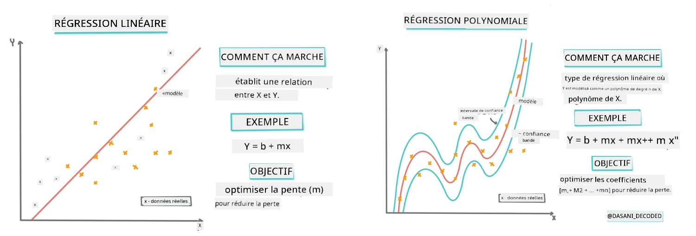
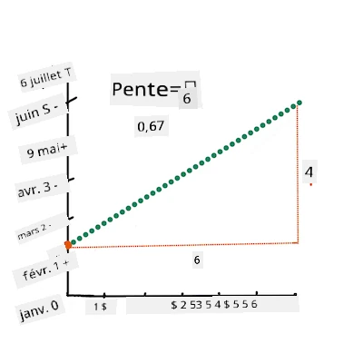
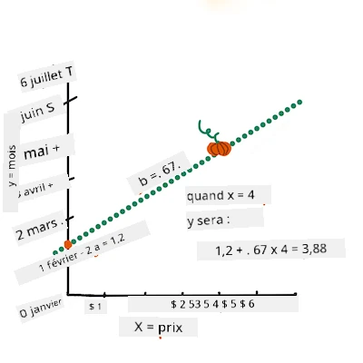
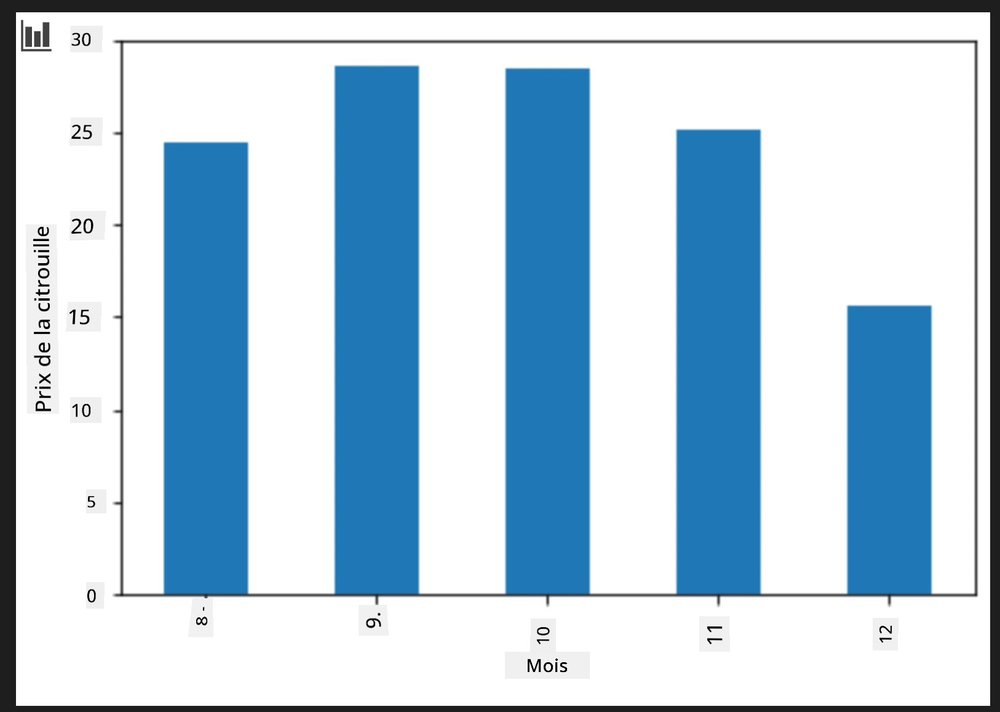
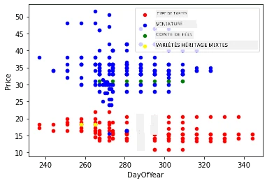

# Construire un modèle de régression avec Scikit-learn : régression de quatre manières

## Note pour débutants

La régression linéaire est utilisée lorsque nous voulons prédire une **valeur numérique** (par exemple, le prix d'une maison, la température ou les ventes).
Elle fonctionne en trouvant une droite qui représente au mieux la relation entre les caractéristiques d'entrée et la sortie.

Dans cette leçon, nous nous concentrons sur la compréhension du concept avant d'explorer des techniques de régression plus avancées.

> Infographie par [Dasani Madipalli](https://twitter.com/dasani_decoded)
## [Quiz pré-conférence](https://ff-quizzes.netlify.app/en/ml/)

> ### [Cette leçon est disponible en R !](../../../../2-Regression/3-Linear/solution/R/lesson_3.html)
### Introduction 

Jusqu'à présent, vous avez exploré ce qu'est la régression avec des données d'exemple extraites du jeu de données sur les prix des citrouilles que nous utiliserons tout au long de cette leçon. Vous l'avez également visualisée avec Matplotlib.

Vous êtes maintenant prêt à approfondir la régression pour le ML. Alors que la visualisation vous permet de comprendre les données, la vraie puissance de l'apprentissage automatique vient de _l'entraînement des modèles_. Les modèles sont entraînés sur des données historiques pour capturer automatiquement les dépendances des données, ce qui permet de prédire les résultats pour de nouvelles données que le modèle n'a pas vues auparavant.

Dans cette leçon, vous apprendrez davantage sur deux types de régression : la _régression linéaire basique_ et la _régression polynomiale_, ainsi que sur certaines mathématiques sous-jacentes à ces techniques. Ces modèles nous permettront de prédire les prix des citrouilles en fonction de différentes données d'entrée.

[](https://youtu.be/CRxFT8oTDMg "ML pour débutants - Comprendre la régression linéaire")

> 🎥 Cliquez sur l'image ci-dessus pour une courte vidéo de présentation de la régression linéaire.

> Tout au long de ce programme, nous supposons des connaissances minimales en mathématiques, et cherchons à rendre cela accessible aux étudiants venant d'autres domaines. Soyez attentifs aux notes, 🧮 encadrés, diagrammes et autres outils pédagogiques pour faciliter la compréhension.

### Prérequis

Vous devriez maintenant être familiarisé avec la structure des données sur les citrouilles que nous examinons. Vous pouvez les trouver préchargées et pré-nettoyées dans le fichier _notebook.ipynb_ accompagnant cette leçon. Dans ce fichier, le prix des citrouilles est affiché par boisseau dans un nouveau DataFrame. Assurez-vous de pouvoir exécuter ces notebooks dans les kernels de Visual Studio Code.

### Préparation

Pour rappel, vous chargez ces données afin de pouvoir leur poser des questions.

- Quel est le meilleur moment pour acheter des citrouilles ?
- Quel prix puis-je attendre pour une caisse de mini citrouilles ?
- Dois-je les acheter en paniers demi-boisseau ou en boîtes de 1 1/9 boisseau ?
Continuons à creuser ces données.

Dans la leçon précédente, vous avez créé un DataFrame Pandas et l'avez rempli avec une partie du jeu de données original, standardisant les prix par boisseau. Cependant, vous n'avez pu récupérer qu'environ 400 points de données et uniquement pour les mois d'automne.

Jetez un œil aux données que nous avons préchargées dans le notebook accompagnant cette leçon. Les données sont préchargées et un nuage de points initial est tracé pour montrer les données par mois. Nous pourrions obtenir un peu plus de détails sur la nature des données en les nettoyant davantage.

## Une droite de régression linéaire

Comme vous l'avez appris dans la Leçon 1, l'objectif d'un exercice de régression linéaire est de pouvoir tracer une droite pour :

- **Montrer les relations entre variables**. Montrer la relation entre les variables
- **Faire des prédictions**. Faire des prédictions précises sur la position d'un nouveau point de données par rapport à cette droite.

Il est typique de la **régression aux moindres carrés** de tracer ce type de droite. Le terme « moindres carrés » fait référence au processus de minimisation de l'erreur totale dans notre modèle. Pour chaque point de données, nous mesurons la distance verticale (appelée résidu) entre le point réel et notre droite de régression.

Nous élevons ces distances au carré pour deux raisons principales :

1. **Importance de la grandeur plutôt que du sens** : Nous voulons traiter une erreur de -5 de la même façon qu'une erreur de +5. Le carré transforme toutes les valeurs en positives.

2. **Sanction des valeurs aberrantes** : Le carré donne plus de poids aux grandes erreurs, obligeant la droite à rester plus proche des points éloignés.

Nous additionnons alors toutes ces valeurs au carré. Notre objectif est de trouver la droite spécifique où cette somme finale est la plus faible (la plus petite valeur possible) — d'où le nom « moindres carrés ».

> **🧮 Montrez-moi les maths** 
> 
> Cette droite, appelée _droite d'ajustement_, peut s'exprimer par [une équation](https://fr.wikipedia.org/wiki/R%C3%A9gression_lin%C3%A9aire_simple) : 
> 
> ```
> Y = a + bX
> ```

> `X` est la 'variable explicative'. `Y` est la 'variable dépendante'. La pente de la droite est `b` et `a` est l'ordonnée à l'origine, qui correspond à la valeur de `Y` lorsque `X = 0`.
>
>
>
> D'abord, calculez la pente `b`. Infographie par [Jen Looper](https://twitter.com/jenlooper)
>
> En d'autres termes, et en se référant à la question originale de nos données sur les citrouilles : « prédire le prix d'une citrouille par boisseau selon le mois », `X` correspondrait au prix et `Y` au mois de vente.
>
>
>
> Calculez la valeur de Y. Si vous payez environ 4 $, cela doit être en avril ! Infographie par [Jen Looper](https://twitter.com/jenlooper)
>
> Les calculs qui déterminent la droite doivent montrer la pente de celle-ci, qui dépend aussi de l'ordonnée à l'origine, soit où se situe `Y` quand `X = 0`.
>
> Vous pouvez consulter la méthode de calcul de ces valeurs sur le site [Math is Fun](https://www.mathsisfun.com/data/least-squares-regression.html). Visitez également [ce calculateur de moindres carrés](https://www.mathsisfun.com/data/least-squares-calculator.html) pour voir comment les valeurs influent sur la droite.

## Corrélation

Un autre terme à comprendre est le **coefficient de corrélation** entre deux variables X et Y données. Avec un diagramme de dispersion, vous pouvez rapidement visualiser ce coefficient. Un diagramme avec des points alignés proprement manifeste une forte corrélation, tandis qu'un nuage de points dispersé partout entre X et Y indique une faible corrélation.

Un bon modèle de régression linéaire possède un coefficient de corrélation élevé (proche de 1 plutôt que de 0) en utilisant la méthode des moindres carrés avec une droite de régression.

✅ Exécutez le notebook accompagné de cette leçon et regardez le nuage de points du mois par rapport au prix. Les données associant le mois au prix pour les ventes de citrouilles semblent-elles présenter une forte ou faible corrélation, selon votre interprétation visuelle du nuage de points ? Cela change-t-il si vous utilisez une mesure plus fine que `Month`, par exemple *jour de l'année* (le nombre de jours depuis le début de l'année) ?

Dans le code ci-dessous, nous supposerons que les données ont été nettoyées, et que nous avons obtenu un DataFrame nommé `new_pumpkins`, similaire à celui-ci :

ID | Month | DayOfYear | Variety | City | Package | Low Price | High Price | Price
---|-------|-----------|---------|------|---------|-----------|------------|-------
70 | 9 | 267 | PIE TYPE | BALTIMORE | 1 1/9 bushel cartons | 15.0 | 15.0 | 13.636364
71 | 9 | 267 | PIE TYPE | BALTIMORE | 1 1/9 bushel cartons | 18.0 | 18.0 | 16.363636
72 | 10 | 274 | PIE TYPE | BALTIMORE | 1 1/9 bushel cartons | 18.0 | 18.0 | 16.363636
73 | 10 | 274 | PIE TYPE | BALTIMORE | 1 1/9 bushel cartons | 17.0 | 17.0 | 15.454545
74 | 10 | 281 | PIE TYPE | BALTIMORE | 1 1/9 bushel cartons | 15.0 | 15.0 | 13.636364

> Le code pour nettoyer les données est disponible dans [`notebook.ipynb`](notebook.ipynb). Nous avons effectué les mêmes étapes de nettoyage que dans la leçon précédente et calculé la colonne `DayOfYear` selon l'expression suivante :

```python
day_of_year = pd.to_datetime(pumpkins['Date']).apply(lambda dt: (dt-datetime(dt.year,1,1)).days)
```

Maintenant que vous comprenez les maths derrière la régression linéaire, créons un modèle de régression pour voir si nous pouvons prédire quel conditionnement de citrouilles aura les meilleurs prix. Quelqu'un achetant des citrouilles pour une fête pourrait vouloir cette information pour optimiser ses achats de lots de citrouilles.

## Recherche de corrélation

[](https://youtu.be/uoRq-lW2eQo "ML pour débutants - Recherche de corrélation : clé de la régression linéaire")

> 🎥 Cliquez sur l'image ci-dessus pour une courte vidéo de présentation de la corrélation.

Depuis la leçon précédente, vous avez probablement vu que le prix moyen par mois ressemble à ceci :



Cela suggère qu'il y a une corrélation, et nous pouvons essayer d'entraîner un modèle de régression linéaire pour prédire la relation entre `Month` et `Price`, ou entre `DayOfYear` et `Price`. Voici le nuage de points montrant cette dernière relation :

 

Voyons s'il existe une corrélation avec la fonction `corr` :

```python
print(new_pumpkins['Month'].corr(new_pumpkins['Price']))
print(new_pumpkins['DayOfYear'].corr(new_pumpkins['Price']))
```

La corrélation semble assez faible, -0,15 selon `Month` et -0,17 selon `DayOfYear`, mais il pourrait y avoir une autre relation importante. Il semble y avoir différents groupes de prix correspondant à différentes variétés de citrouilles. Pour confirmer cette hypothèse, traçons chaque catégorie de citrouilles avec une couleur différente. En passant un paramètre `ax` à la fonction de tracé `scatter` nous pouvons tracer tous les points sur le même graphique :

```python
ax=None
colors = ['red','blue','green','yellow']
for i,var in enumerate(new_pumpkins['Variety'].unique()):
    df = new_pumpkins[new_pumpkins['Variety']==var]
    ax = df.plot.scatter('DayOfYear','Price',ax=ax,c=colors[i],label=var)
```

 

Notre enquête suggère que la variété influence davantage le prix global que la date de vente. Nous pouvons le voir avec un graphique à barres :

```python
new_pumpkins.groupby('Variety')['Price'].mean().plot(kind='bar')
```

 

Concentrons-nous pour le moment sur une seule variété de citrouilles, le 'pie type', et voyons l'effet de la date sur le prix :

```python
pie_pumpkins = new_pumpkins[new_pumpkins['Variety']=='PIE TYPE']
pie_pumpkins.plot.scatter('DayOfYear','Price') 
```
 

En calculant la corrélation entre `Price` et `DayOfYear` avec la fonction `corr`, on obtient environ `-0.27` — ce qui indique qu'entraîner un modèle prédictif a du sens.

> Avant d'entraîner un modèle de régression linéaire, il est important de s'assurer que nos données sont propres. La régression linéaire ne fonctionne pas bien avec des valeurs manquantes, il est donc logique de supprimer toutes les cellules vides :

```python
pie_pumpkins.dropna(inplace=True)
pie_pumpkins.info()
```

Une autre approche serait de remplir ces valeurs manquantes avec la moyenne de la colonne correspondante.

## Régression linéaire simple

[](https://youtu.be/e4c_UP2fSjg "ML pour débutants - Régression linéaire et polynomiale avec Scikit-learn")

> 🎥 Cliquez sur l'image ci-dessus pour une courte vidéo de présentation de la régression linéaire et polynomiale.

Pour entraîner notre modèle de régression linéaire, nous allons utiliser la bibliothèque **Scikit-learn**.

```python
from sklearn.linear_model import LinearRegression
from sklearn.metrics import mean_squared_error
from sklearn.model_selection import train_test_split
```

Nous commençons par séparer les valeurs d'entrée (caractéristiques) et la sortie attendue (étiquette) en tableaux numpy distincts :

```python
X = pie_pumpkins['DayOfYear'].to_numpy().reshape(-1,1)
y = pie_pumpkins['Price']
```

> Notez que nous avons dû appliquer un `reshape` aux données d'entrée pour que le package de régression linéaire les comprenne correctement. La régression linéaire attend un tableau 2D en entrée, où chaque ligne correspond à un vecteur de caractéristiques. Dans notre cas, n'ayant qu'une seule entrée, nous avons besoin d'un tableau de forme N&times;1, où N est la taille du jeu de données.

Ensuite, nous devons diviser les données en ensembles d'entraînement et de test, afin de pouvoir valider notre modèle après l'entraînement :

```python
X_train, X_test, y_train, y_test = train_test_split(X, y, test_size=0.2, random_state=0)
```

Enfin, l'entraînement du modèle de régression linéaire effectif ne prend que deux lignes de code. Nous définissons l'objet `LinearRegression`, puis l'ajustons à nos données avec la méthode `fit` :

```python
lin_reg = LinearRegression()
lin_reg.fit(X_train,y_train)
```

L'objet `LinearRegression` après l'entraînement (`fit`) contient tous les coefficients de la régression, auxquels on peut accéder grâce à la propriété `.coef_`. Dans notre cas, il n'y a qu'un seul coefficient, qui devrait être autour de `-0.017`. Cela signifie que les prix semblent baisser un peu avec le temps, mais pas trop, d'environ 2 centimes par jour. Nous pouvons également accéder au point d'intersection de la régression avec l'axe des Y en utilisant `lin_reg.intercept_` - il sera d'environ `21` dans notre cas, indiquant le prix au début de l'année.

Pour voir à quel point notre modèle est précis, nous pouvons prédire les prix sur un jeu de données de test, puis mesurer à quel point nos prédictions sont proches des valeurs attendues. Cela peut être fait en utilisant la métrique de l'erreur quadratique moyenne (RMSE), qui est la racine de la moyenne de toutes les différences au carré entre la valeur attendue et la valeur prédite.

```python
pred = lin_reg.predict(X_test)

rmse = np.sqrt(mean_squared_error(y_test,pred))
print(f'RMSE: {rmse:3.3} ({rmse/np.mean(pred)*100:3.3}%)')
```

Notre erreur semble être autour de 2 points, ce qui représente environ 17 %. Pas très bon. Un autre indicateur de la qualité du modèle est le **coefficient de détermination**, qui peut être obtenu comme ceci :

```python
score = lin_reg.score(X_train,y_train)
print('Model determination: ', score)
```
 Si la valeur est 0, cela signifie que le modèle ne prend pas en compte les données d'entrée, et agit comme le *pire prédicteur linéaire*, qui est simplement la moyenne des résultats. La valeur de 1 signifie que nous pouvons parfaitement prédire toutes les sorties attendues. Dans notre cas, le coefficient est d'environ 0,06, ce qui est assez faible.

Nous pouvons aussi tracer les données de test avec la ligne de régression pour mieux voir comment fonctionne la régression dans notre cas :

```python
plt.scatter(X_test,y_test)
plt.plot(X_test,pred)
```


## Régression Polynomiale

Un autre type de régression linéaire est la régression polynomiale. Parfois, il existe une relation linéaire entre les variables - plus la citrouille est volumineuse, plus son prix est élevé - mais parfois ces relations ne peuvent pas être représentées par un plan ou une droite.

✅ Voici [quelques exemples supplémentaires](https://online.stat.psu.edu/stat501/Lesson09#polynomial-regression-examples) de données qui pourraient bénéficier d'une régression polynomiale.

Regardez à nouveau la relation entre la Date et le Prix. Est-ce que ce nuage de points semble devoir être nécessairement analysé par une droite ? Les prix ne peuvent-ils pas fluctuer ? Dans ce cas, vous pouvez essayer la régression polynomiale.

✅ Les polynômes sont des expressions mathématiques qui peuvent contenir une ou plusieurs variables et coefficients.

La régression polynomiale crée une courbe pour mieux ajuster des données non linéaires. Dans notre cas, si nous incluons une variable `DayOfYear` au carré dans les données d’entrée, nous devrions pouvoir ajuster nos données avec une courbe parabolique, qui aura un minimum à un certain point de l’année.

Scikit-learn inclut une API [pipeline](https://scikit-learn.org/stable/modules/generated/sklearn.pipeline.make_pipeline.html?highlight=pipeline#sklearn.pipeline.make_pipeline) utile pour combiner différentes étapes de traitement des données. Un **pipeline** est une chaîne d'**estimateurs**. Dans notre cas, nous allons créer un pipeline qui ajoute d'abord des caractéristiques polynomiales à notre modèle, puis entraîne la régression :

```python
from sklearn.preprocessing import PolynomialFeatures
from sklearn.pipeline import make_pipeline

pipeline = make_pipeline(PolynomialFeatures(2), LinearRegression())

pipeline.fit(X_train,y_train)
```

Utiliser `PolynomialFeatures(2)` signifie que nous incluons tous les polynômes de degré 2 issus des données d’entrée. Dans notre cas cela signifie juste `DayOfYear`<sup>2</sup>, mais avec deux variables X et Y, cela ajouterait X<sup>2</sup>, XY et Y<sup>2</sup>. On peut aussi utiliser des polynômes de degré supérieur si on le souhaite.

Les pipelines peuvent être utilisés de la même manière que l'objet `LinearRegression` d'origine, c’est-à-dire que nous pouvons `fit` le pipeline, puis utiliser `predict` pour obtenir les résultats de la prédiction :

```python
pred = pipeline.predict(X_test)

rmse = np.sqrt(mean_squared_error(y_test,pred))
print(f'RMSE: {rmse:3.3} ({rmse/np.mean(pred)*100:3.3}%)')

score = pipeline.score(X_train,y_train)
print('Model determination: ', score)
```

Pour tracer la courbe d'approximation lisse, nous utilisons `np.linspace` pour créer une plage uniforme de valeurs d'entrée, plutôt que de tracer directement sur des données de test non ordonnées (ce qui produirait une ligne en zigzag) :

```python
X_range = np.linspace(X_test.min(), X_test.max(), 100).reshape(-1,1)
y_range = pipeline.predict(X_range)

plt.scatter(X_test, y_test)
plt.plot(X_range, y_range)
```

Voici le graphique montrant les données de test ainsi que la courbe d'approximation :


Avec la régression polynomiale, on obtient un RMSE légèrement plus bas et un coefficient de détermination plus élevé, mais pas de manière significative. Il faut prendre en compte d’autres caractéristiques !

> Vous pouvez voir que les prix minimums des citrouilles sont observés autour d'Halloween. Comment pouvez-vous expliquer cela ?

🎃 Félicitations, vous venez de créer un modèle qui peut aider à prédire le prix des citrouilles à pâtisserie. Vous pouvez probablement répéter la même procédure pour tous les types de citrouilles, mais ce serait fastidieux. Apprenons maintenant comment prendre en compte la variété de citrouille dans notre modèle !

## Caractéristiques Catégorielles

Dans un monde idéal, nous voulons pouvoir prédire les prix pour différentes variétés de citrouilles en utilisant le même modèle. Cependant, la colonne `Variety` est quelque peu différente des colonnes comme `Month`, car elle contient des valeurs non numériques. Ces colonnes sont appelées **catégoriques**.

[](https://youtu.be/DYGliioIAE0 "ML for beginners - Categorical Feature Predictions with Linear Regression")

> 🎥 Cliquez sur l’image ci-dessus pour une courte vidéo présentant l’utilisation des caractéristiques catégorielles.

Ici, vous pouvez voir comment le prix moyen dépend de la variété :


Pour prendre la variété en compte, il faut d’abord la convertir en forme numérique, ou **l’encoder**. Il y a plusieurs façons de faire :

* Un simple **encodage numérique** construira un tableau des différentes variétés, puis remplacera le nom de la variété par un indice dans ce tableau. Ce n’est pas une bonne idée pour la régression linéaire, car la régression linéaire prend la valeur numérique réelle de l’indice et l’ajoute au résultat en la multipliant par un coefficient. Dans notre cas, la relation entre le numéro d’indice et le prix est clairement non linéaire, même si nous nous assurons que les indices sont ordonnés d’une certaine façon spécifique.
* L’**encodage one-hot** remplacera la colonne `Variety` par 4 colonnes différentes, une pour chaque variété. Chaque colonne contiendra `1` si la ligne correspondante est de cette variété, et `0` sinon. Cela signifie qu’il y aura quatre coefficients dans la régression linéaire, un pour chaque variété de citrouille, responsable du "prix de départ" (ou plutôt "prix supplémentaire") pour cette variété particulière.

Le code suivant montre comment encoder une variété en one-hot :

```python
pd.get_dummies(new_pumpkins['Variety'])
```

 ID | FAIRYTALE | MINIATURE | MIXED HEIRLOOM VARIETIES | PIE TYPE
----|-----------|-----------|--------------------------|----------
70 | 0 | 0 | 0 | 1
71 | 0 | 0 | 0 | 1
... | ... | ... | ... | ...
1738 | 0 | 1 | 0 | 0
1739 | 0 | 1 | 0 | 0
1740 | 0 | 1 | 0 | 0
1741 | 0 | 1 | 0 | 0
1742 | 0 | 1 | 0 | 0

Pour entraîner la régression linéaire en utilisant la variété codée en one-hot comme entrée, il suffit d’initialiser correctement les données `X` et `y` :

```python
X = pd.get_dummies(new_pumpkins['Variety'])
y = new_pumpkins['Price']
```

Le reste du code est le même que celui que nous avons utilisé précédemment pour entraîner la régression linéaire. Si vous essayez, vous verrez que l’erreur quadratique moyenne est à peu près la même, mais que le coefficient de détermination est beaucoup plus élevé (~77 %). Pour obtenir des prédictions encore plus précises, nous pouvons prendre en compte d’autres caractéristiques catégorielles, ainsi que des caractéristiques numériques, telles que `Month` ou `DayOfYear`. Pour obtenir un grand tableau de caractéristiques, on peut utiliser `join` :

```python
X = pd.get_dummies(new_pumpkins['Variety']) \
        .join(new_pumpkins['Month']) \
        .join(pd.get_dummies(new_pumpkins['City'])) \
        .join(pd.get_dummies(new_pumpkins['Package']))
y = new_pumpkins['Price']
```

Ici, nous prenons également en compte `City` et le type de `Package`, ce qui nous donne un RMSE de 2.84 (10.5 %) et un coefficient de détermination de 0.94 !

## Tout regrouper

Pour faire le meilleur modèle, nous pouvons utiliser les données combinées (catégoriques encodées en one-hot + numériques) de l’exemple précédent avec la régression polynomiale. Voici le code complet pour votre commodité :

```python
# configurer les données d'entraînement
X = pd.get_dummies(new_pumpkins['Variety']) \
        .join(new_pumpkins['Month']) \
        .join(pd.get_dummies(new_pumpkins['City'])) \
        .join(pd.get_dummies(new_pumpkins['Package']))
y = new_pumpkins['Price']

# faire la séparation train-test
X_train, X_test, y_train, y_test = train_test_split(X, y, test_size=0.2, random_state=0)

# configurer et entraîner la pipeline
pipeline = make_pipeline(PolynomialFeatures(2), LinearRegression())
pipeline.fit(X_train,y_train)

# prédire les résultats pour les données de test
pred = pipeline.predict(X_test)

# calculer la RMSE et la détermination
rmse = mean_squared_error(y_test, pred, squared=False)
print(f'RMSE: {rmse:3.3} ({rmse/pred.mean()*100:3.3}%)')

score = pipeline.score(X_train,y_train)
print('Model determination: ', score)
```

Cela devrait nous donner le meilleur coefficient de détermination d’environ 97 %, et un RMSE=2.23 (~8 % d’erreur de prédiction).

| Modèle | RMSE | Détermination |
|-------|-----|---------------|
| Linéaire `DayOfYear` | 2.77 (17.2 %) | 0.07 |
| Polynômiale `DayOfYear` | 2.73 (17.0 %) | 0.08 |
| Linéaire `Variety` | 5.24 (19.7 %) | 0.77 |
| Linéaire toutes caractéristiques | 2.84 (10.5 %) | 0.94 |
| Polynômiale toutes caractéristiques | 2.23 (8.25 %) | 0.97 |

🏆 Bravo ! Vous avez créé quatre modèles de régression en une leçon, et amélioré la qualité de modèle à 97 %. Dans la section finale sur la régression, vous apprendrez la régression logistique pour déterminer des catégories.

---
## 🚀Défi

Testez plusieurs variables différentes dans ce carnet pour voir comment la corrélation correspond à la précision du modèle.

## [Quiz post-cours](https://ff-quizzes.netlify.app/en/ml/)

## Revue & Autoapprentissage

Dans cette leçon nous avons appris la régression linéaire. Il existe d'autres types importants de régression. Lisez sur les techniques Stepwise, Ridge, Lasso et Elasticnet. Un bon cours à étudier pour en apprendre davantage est le [cours de Stanford sur l'apprentissage statistique](https://online.stanford.edu/courses/sohs-ystatslearning-statistical-learning)

## Devoir

[Construire un modèle](assignment.md)

---

<!-- CO-OP TRANSLATOR DISCLAIMER START -->
**Avertissement** :  
Ce document a été traduit à l’aide du service de traduction automatisée [Co-op Translator](https://github.com/Azure/co-op-translator). Bien que nous nous efforcions d’assurer l’exactitude, veuillez noter que les traductions automatiques peuvent contenir des erreurs ou des inexactitudes. Le document original dans sa langue native doit être considéré comme la source faisant autorité. Pour les informations critiques, une traduction professionnelle humaine est recommandée. Nous ne saurions être tenus responsables des malentendus ou des interprétations erronées résultant de l’utilisation de cette traduction.
<!-- CO-OP TRANSLATOR DISCLAIMER END -->