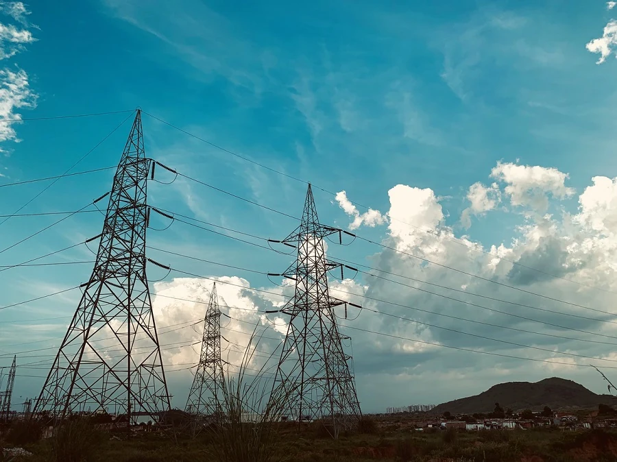

# Introduction à la prévision des séries temporelles

Qu'est-ce que la prévision des séries temporelles ? Il s'agit de prédire des événements futurs en analysant les tendances du passé.

## Sujet régional : consommation mondiale d'électricité ✨

Dans ces deux leçons, vous serez introduit à la prévision des séries temporelles, un domaine quelque peu moins connu de l'apprentissage automatique mais néanmoins extrêmement précieux pour l'industrie et les applications commerciales, parmi d'autres domaines. Bien que les réseaux de neurones puissent être utilisés pour améliorer l'utilité de ces modèles, nous les étudierons dans le contexte de l'apprentissage automatique classique, car les modèles aident à prédire la performance future en se basant sur le passé.

Notre focus régional est la consommation électrique dans le monde, un ensemble de données intéressant pour apprendre à prévoir la consommation future d'électricité en se basant sur les schémas de charge passés. Vous pouvez voir comment ce type de prévision peut être extrêmement utile dans un environnement commercial.

Photo par [Peddi Sai hrithik](https://unsplash.com/@shutter_log?utm_source=unsplash&utm_medium=referral&utm_content=creditCopyText) de tours électriques sur une route au Rajasthan sur [Unsplash](https://unsplash.com/s/photos/electric-india?utm_source=unsplash&utm_medium=referral&utm_content=creditCopyText)

## Leçons

1. [Introduction à la prévision des séries temporelles](1-Introduction/README.md)
2. [Construction de modèles ARIMA pour séries temporelles](2-ARIMA/README.md)
3. [Construction d’un régresseur à vecteurs de support pour la prévision des séries temporelles](3-SVR/README.md)

## Crédits

"Introduction à la prévision des séries temporelles" a été écrit avec ⚡️ par [Francesca Lazzeri](https://twitter.com/frlazzeri) et [Jen Looper](https://twitter.com/jenlooper). Les notebooks sont apparus en ligne pour la première fois dans le [dépôt Azure "Deep Learning For Time Series"](https://github.com/Azure/DeepLearningForTimeSeriesForecasting) initialement écrit par Francesca Lazzeri. La leçon SVR a été écrite par [Anirban Mukherjee](https://github.com/AnirbanMukherjeeXD)

---

<!-- CO-OP TRANSLATOR DISCLAIMER START -->
**Avertissement** :
Ce document a été traduit à l'aide du service de traduction automatique [Co-op Translator](https://github.com/Azure/co-op-translator). Bien que nous nous efforçions d'assurer l'exactitude, veuillez noter que les traductions automatisées peuvent contenir des erreurs ou des inexactitudes. Le document original dans sa langue native doit être considéré comme la source faisant autorité. Pour les informations critiques, il est recommandé de recourir à une traduction professionnelle réalisée par un humain. Nous ne saurions être tenus responsables des malentendus ou erreurs d'interprétation découlant de l'utilisation de cette traduction.
<!-- CO-OP TRANSLATOR DISCLAIMER END -->