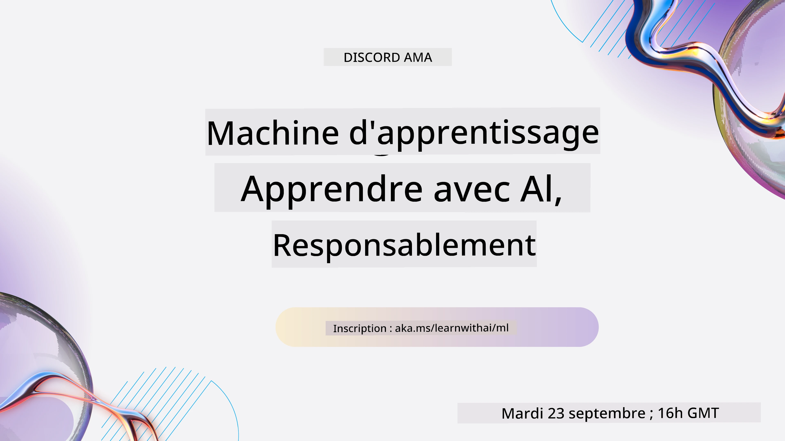
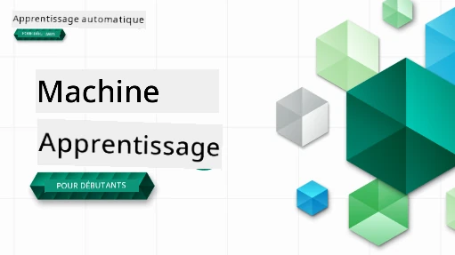

[](https://github.com/microsoft/ML-For-Beginners/blob/master/LICENSE)
[](https://GitHub.com/microsoft/ML-For-Beginners/graphs/contributors/)
[](https://GitHub.com/microsoft/ML-For-Beginners/issues/)
[](https://GitHub.com/microsoft/ML-For-Beginners/pulls/)
[](http://makeapullrequest.com)

[](https://GitHub.com/microsoft/ML-For-Beginners/watchers/)
[](https://GitHub.com/microsoft/ML-For-Beginners/network/)
[](https://GitHub.com/microsoft/ML-For-Beginners/stargazers/)

### 🌐 Support Multilingue

#### Traductions maintenues avec [Co-op Translator](https://github.com/Azure/co-op-translator)

<!-- CO-OP TRANSLATOR LANGUAGES TABLE START -->
[Arabe](../ar/README.md) | [Bengali](../bn/README.md) | [Bulgare](../bg/README.md) | [Birmane (Myanmar)](../my/README.md) | [Chinois (Simplifié)](../zh-CN/README.md) | [Chinois (Traditionnel, Hong Kong)](../zh-HK/README.md) | [Chinois (Traditionnel, Macao)](../zh-MO/README.md) | [Chinois (Traditionnel, Taïwan)](../zh-TW/README.md) | [Croate](../hr/README.md) | [Tchèque](../cs/README.md) | [Danois](../da/README.md) | [Néerlandais](../nl/README.md) | [Estonien](../et/README.md) | [Finnois](../fi/README.md) | [Français](./README.md) | [Allemand](../de/README.md) | [Grec](../el/README.md) | [Hébreu](../he/README.md) | [Hindi](../hi/README.md) | [Hongrois](../hu/README.md) | [Indonésien](../id/README.md) | [Italien](../it/README.md) | [Japonais](../ja/README.md) | [Kannada](../kn/README.md) | [Khmer](../km/README.md) | [Coréen](../ko/README.md) | [Lituanien](../lt/README.md) | [Malais](../ms/README.md) | [Malayalam](../ml/README.md) | [Manipuri (Meitei Mayek)](../mni/README.md) | [Marathi](../mr/README.md) | [Népalais](../ne/README.md) | [Pidgin Nigérian](../pcm/README.md) | [Norvégien](../no/README.md) | [Persan (Farsi)](../fa/README.md) | [Polonais](../pl/README.md) | [Portugais (Brésil)](../pt-BR/README.md) | [Portugais (Portugal)](../pt-PT/README.md) | [Pendjabi (Gurmukhi)](../pa/README.md) | [Roumain](../ro/README.md) | [Russe](../ru/README.md) | [Serbe (Cyrillique)](../sr/README.md) | [Slovaque](../sk/README.md) | [Slovène](../sl/README.md) | [Espagnol](../es/README.md) | [Swahili](../sw/README.md) | [Suédois](../sv/README.md) | [Tagalog (Philippin)](../tl/README.md) | [Tamoul](../ta/README.md) | [Télougou](../te/README.md) | [Thaï](../th/README.md) | [Turc](../tr/README.md) | [Ukrainien](../uk/README.md) | [Ourdou](../ur/README.md) | [Vietnamien](../vi/README.md)

> **Préférez cloner localement ?**
>
> Ce dépôt comprend plus de 50 traductions de langues, ce qui augmente significativement la taille du téléchargement. Pour cloner sans les traductions, utilisez le checkout spatial :
>
> **Bash / macOS / Linux :**
> ```bash
> git clone --filter=blob:none --sparse https://github.com/microsoft/ML-For-Beginners.git
> cd ML-For-Beginners
> git sparse-checkout set --no-cone '/*' '!translations' '!translated_images'
> ```
>
> **CMD (Windows) :**
> ```cmd
> git clone --filter=blob:none --sparse https://github.com/microsoft/ML-For-Beginners.git
> cd ML-For-Beginners
> git sparse-checkout set --no-cone "/*" "!translations" "!translated_images"
> ```
>
> Cela vous donne tout ce dont vous avez besoin pour compléter le cours avec un téléchargement beaucoup plus rapide.
<!-- CO-OP TRANSLATOR LANGUAGES TABLE END -->

#### Rejoignez Notre Communauté

[](https://discord.gg/nTYy5BXMWG)

Nous avons une série Discord d'apprentissage avec l'IA en cours, apprenez-en plus et rejoignez-nous sur [Série d'apprentissage avec l'IA](https://aka.ms/learnwithai/discord) du 18 au 30 septembre 2025. Vous recevrez des conseils et astuces pour utiliser GitHub Copilot pour la science des données.



# Apprentissage Automatique pour Débutants - Un Programme

> 🌍 Voyagez autour du monde en explorant l'apprentissage automatique à travers les cultures du monde 🌍

Les Cloud Advocates de Microsoft ont le plaisir de proposer un programme de 12 semaines, 26 leçons, entièrement dédié à **l'apprentissage automatique**. Dans ce programme, vous apprendrez ce que l'on appelle parfois **l'apprentissage automatique classique**, utilisant principalement Scikit-learn comme bibliothèque et évitant l'apprentissage profond, qui est abordé dans notre [programme IA pour débutants](https://aka.ms/ai4beginners). Associez ces leçons à notre [programme 'Science des données pour débutants'](https://aka.ms/ds4beginners) également !

Parcourez le monde avec nous en appliquant ces techniques classiques à des données de nombreuses régions du monde. Chaque leçon inclut des quiz avant et après la leçon, des instructions écrites pour compléter la leçon, une solution, un devoir, et plus encore. Notre pédagogie basée sur des projets permet d’apprendre en construisant, une méthode éprouvée pour que les nouvelles compétences « collent ».

**✍️ Un grand merci à nos auteurs** Jen Looper, Stephen Howell, Francesca Lazzeri, Tomomi Imura, Cassie Breviu, Dmitry Soshnikov, Chris Noring, Anirban Mukherjee, Ornella Altunyan, Ruth Yakubu et Amy Boyd

**🎨 Merci également à nos illustrateurs** Tomomi Imura, Dasani Madipalli, et Jen Looper

**🙏 Remerciements spéciaux 🙏 à nos auteurs, réviseurs et contributeurs Microsoft Student Ambassador**, notamment Rishit Dagli, Muhammad Sakib Khan Inan, Rohan Raj, Alexandru Petrescu, Abhishek Jaiswal, Nawrin Tabassum, Ioan Samuila et Snigdha Agarwal

**🤩 Remerciements supplémentaires aux Microsoft Student Ambassadors Eric Wanjau, Jasleen Sondhi, et Vidushi Gupta pour nos leçons R !**

# Pour Bien Commencer

Suivez ces étapes :
1. **Forkez le Dépôt** : Cliquez sur le bouton « Fork » en haut à droite de cette page.
2. **Clonez le Dépôt** :  `git clone https://github.com/microsoft/ML-For-Beginners.git`

> 💡 **Astuce de démarrage rapide :** Vous voulez commencer dans un navigateur sans configurer Python localement ? Utilisez [GitHub Codespaces](https://github.com/features/codespaces) pour créer un environnement de développement cloud pour votre fork. Ouvrez le menu vert **Code**, sélectionnez **Codespaces**, et créez un codespace ; installez à l'intérieur les dépendances requises pour chaque leçon au besoin.

> [trouvez toutes les ressources supplémentaires pour ce cours dans notre collection Microsoft Learn](https://learn.microsoft.com/en-us/collections/qrqzamz1nn2wx3?WT.mc_id=academic-77952-bethanycheum)

> 🔧 **Besoin d’aide ?** Consultez notre [Guide de dépannage](TROUBLESHOOTING.md) pour des solutions aux problèmes courants d’installation, configuration et exécution des leçons.


**[Étudiants](https://aka.ms/student-page)**, pour utiliser ce programme, forkez l’ensemble du repo dans votre propre compte GitHub et réalisez les exercices seuls ou en groupe :

- Commencez par un quiz pré-conférence.
- Lisez la conférence et complétez les activités, en faisant des pauses pour réfléchir à chaque vérification des connaissances.
- Essayez de créer les projets en comprenant les leçons plutôt qu’en exécutant le code solution ; cependant ce code est disponible dans les dossiers `/solution` pour chaque leçon orientée projet.
- Faites le quiz post-conférence.
- Réalisez le défi.
- Complétez le devoir.
- Après avoir terminé un groupe de leçons, visitez le [Forum de discussion](https://github.com/microsoft/ML-For-Beginners/discussions) et « apprenez à voix haute » en remplissant la grille PAT appropriée. Un 'PAT' est un Outil d’évaluation des progrès que vous remplissez pour approfondir votre apprentissage. Vous pouvez aussi réagir aux autres PAT afin que nous apprenions ensemble.

> Pour approfondir, nous recommandons de suivre ces modules et parcours d’apprentissage [Microsoft Learn](https://docs.microsoft.com/en-us/users/jenlooper-2911/collections/k7o7tg1gp306q4?WT.mc_id=academic-77952-leestott).

**Professeurs**, nous avons [inclus quelques suggestions](for-teachers.md) sur la façon d’utiliser ce programme.

---

## Vidéos de démonstration

Certaines leçons sont disponibles en vidéo courte. Vous pouvez toutes les trouver intégrées aux leçons, ou dans la [playlist ML pour débutants sur la chaîne YouTube Microsoft Developer](https://aka.ms/ml-beginners-videos) en cliquant sur l’image ci-dessous.

[](https://aka.ms/ml-beginners-videos)

---

## Rencontrez l’Équipe

[](https://youtu.be/Tj1XWrDSYJU)

**Gif par** [Mohit Jaisal](https://linkedin.com/in/mohitjaisal)

> 🎥 Cliquez sur l’image ci-dessus pour une vidéo sur le projet et les personnes qui l’ont créé !

---

## Pédagogie

Nous avons choisi deux principes pédagogiques lors de la construction de ce programme : veiller à ce qu’il soit pratique et **basé sur des projets** et qu’il inclue des **quiz fréquents**. De plus, ce programme a un **thème** commun pour lui donner de la cohésion.

En assurant que le contenu est aligné avec les projets, le processus devient plus engageant pour les étudiants et la rétention des concepts est augmentée. De plus, un quiz sans enjeu avant une classe fixe l’intention de l’étudiant vers l’apprentissage d’un sujet, tandis qu’un second quiz après la classe assure une rétention supplémentaire. Ce programme a été conçu pour être flexible et ludique et peut être suivi en totalité ou partiellement. Les projets commencent petits et deviennent progressivement plus complexes à la fin du cycle de 12 semaines. Ce programme inclut également un post-scriptum sur les applications réelles de ML, qui peut être utilisé comme crédit supplémentaire ou comme base de discussion.

> Trouvez nos directives [Code de Conduite](CODE_OF_CONDUCT.md), [Contribution](CONTRIBUTING.md), [Traductions](..), et [Dépannage](TROUBLESHOOTING.md). Nous accueillons vos retours constructifs !

## Chaque leçon comprend

- un sketchnote optionnel
- une vidéo complémentaire optionnelle
- une vidéo de démonstration (certaines leçons seulement)
- [quiz d’échauffement avant la leçon](https://ff-quizzes.netlify.app/en/ml/)
- une leçon écrite
- pour les leçons basées sur les projets, des guides étape par étape sur comment construire le projet
- des vérifications de connaissances
- un défi
- une lecture complémentaire
- un devoir
- [quiz post-leçon](https://ff-quizzes.netlify.app/en/ml/)

> **Une note sur les langues** : Ces leçons sont principalement écrites en Python, mais beaucoup sont aussi disponibles en R. Pour compléter une leçon R, rendez-vous dans le dossier `/solution` et cherchez les leçons R. Elles incluent une extension .rmd qui représente un fichier **R Markdown** qui peut être simplement défini comme une intégration de `code chunks` (de R ou autres langages) et un `YAML header` (qui guide comment formater les sorties comme PDF) dans un `Markdown document`. En tant que tel, il sert de cadre exemplaire d’écriture pour la science des données puisqu’il permet de combiner votre code, ses résultats, et vos pensées en les écrivant en Markdown. De plus, les documents R Markdown peuvent être rendus vers des formats de sortie comme PDF, HTML, ou Word.

> **Une note sur les quiz** : Tous les quiz sont contenus dans le [dossier Quiz App](../../quiz-app), pour un total de 52 quiz de trois questions chacun. Ils sont liés depuis les leçons mais l’application de quiz peut être exécutée localement ; suivez les instructions dans le dossier `quiz-app` pour héberger localement ou déployer sur Azure.

| Numéro de leçon |                             Sujet                              |                   Regroupement des leçons                   | Objectifs d’apprentissage                                                                                                             |                                                              Leçon liée                                                               |                        Auteur                        |
| :-----------: | :------------------------------------------------------------: | :-------------------------------------------------: | ------------------------------------------------------------------------------------------------------------------------------- | :--------------------------------------------------------------------------------------------------------------------------------------: | :--------------------------------------------------: |
|      01       |                Introduction à l’apprentissage automatique                |      [Introduction](1-Introduction/README.md)       | Apprenez les concepts de base de l’apprentissage automatique                                                                                |                                             [Leçon](1-Introduction/1-intro-to-ML/README.md)                                             |                       Muhammad                       |
|      02       |                L’histoire de l’apprentissage automatique                 |      [Introduction](1-Introduction/README.md)       | Apprenez l’histoire qui sous-tend ce domaine                                                                                         |                                            [Leçon](1-Introduction/2-history-of-ML/README.md)                                            |                     Jen et Amy                      |
|      03       |                 Équité et apprentissage automatique                  |      [Introduction](1-Introduction/README.md)       | Quelles sont les questions philosophiques importantes autour de l’équité que les étudiants doivent considérer lorsqu’ils créent et appliquent des modèles ML ? |                                              [Leçon](1-Introduction/3-fairness/README.md)                                               |                        Tomomi                        |
|      04       |                Techniques pour l’apprentissage automatique                 |      [Introduction](1-Introduction/README.md)       | Quelles techniques les chercheurs en ML utilisent-ils pour construire des modèles ML ?                                                                       |                                          [Leçon](1-Introduction/4-techniques-of-ML/README.md)                                           |                    Chris et Jen                     |
|      05       |                   Introduction à la régression                   |        [Regression](2-Regression/README.md)         | Commencez avec Python et Scikit-learn pour les modèles de régression                                                                  |         [Python](2-Regression/1-Tools/README.md) • [R](../../2-Regression/1-Tools/solution/R/lesson_1.html)         |      Jen • Eric Wanjau       |
|      06       |                Prix de la citrouille en Amérique du Nord 🎃                |        [Regression](2-Regression/README.md)         | Visualisez et nettoyez les données en préparation pour le ML                                                                                  |          [Python](2-Regression/2-Data/README.md) • [R](../../2-Regression/2-Data/solution/R/lesson_2.html)          |      Jen • Eric Wanjau       |
|      07       |                Prix de la citrouille en Amérique du Nord 🎃                |        [Regression](2-Regression/README.md)         | Construisez des modèles de régression linéaire et polynomiale                                                                                   |        [Python](2-Regression/3-Linear/README.md) • [R](../../2-Regression/3-Linear/solution/R/lesson_3.html)        |      Jen et Dmitry • Eric Wanjau       |
|      08       |                Prix de la citrouille en Amérique du Nord 🎃                |        [Regression](2-Regression/README.md)         | Construisez un modèle de régression logistique                                                                                               |     [Python](2-Regression/4-Logistic/README.md) • [R](../../2-Regression/4-Logistic/solution/R/lesson_4.html)      |      Jen • Eric Wanjau       |
|      09       |                          Une application Web 🔌                          |           [Web App](3-Web-App/README.md)            | Construisez une application web pour utiliser votre modèle entraîné                                                                                       |                                                 [Python](3-Web-App/1-Web-App/README.md)                                                  |                         Jen                          |
|      10       |                 Introduction à la classification                 |    [Classification](4-Classification/README.md)     | Nettoyez, préparez et visualisez vos données ; introduction à la classification                                                            | [Python](4-Classification/1-Introduction/README.md) • [R](../../4-Classification/1-Introduction/solution/R/lesson_10.html)  | Jen et Cassie • Eric Wanjau |
|      11       |             Délicieuses cuisines asiatiques et indiennes 🍜             |    [Classification](4-Classification/README.md)     | Introduction aux classificateurs                                                                                                     | [Python](4-Classification/2-Classifiers-1/README.md) • [R](../../4-Classification/2-Classifiers-1/solution/R/lesson_11.html) | Jen et Cassie • Eric Wanjau |
|      12       |             Délicieuses cuisines asiatiques et indiennes 🍜             |    [Classification](4-Classification/README.md)     | Plus de classificateurs                                                                                                                | [Python](4-Classification/3-Classifiers-2/README.md) • [R](../../4-Classification/3-Classifiers-2/solution/R/lesson_12.html) | Jen et Cassie • Eric Wanjau |
|      13       |             Délicieuses cuisines asiatiques et indiennes 🍜             |    [Classification](4-Classification/README.md)     | Construisez une application web de recommandation en utilisant votre modèle                                                                                    |                                              [Python](4-Classification/4-Applied/README.md)                                              |                         Jen                          |
|      14       |                   Introduction au clustering                   |        [Clustering](5-Clustering/README.md)         | Nettoyez, préparez et visualisez vos données ; Introduction au clustering                                                                |         [Python](5-Clustering/1-Visualize/README.md) • [R](../../5-Clustering/1-Visualize/solution/R/lesson_14.html)         |      Jen • Eric Wanjau       |
|      15       |              Exploration des goûts musicaux nigérians 🎧              |        [Clustering](5-Clustering/README.md)         | Explorez la méthode de clustering K-Means                                                                                           |           [Python](5-Clustering/2-K-Means/README.md) • [R](../../5-Clustering/2-K-Means/solution/R/lesson_15.html)           |      Jen • Eric Wanjau       |
|      16       |        Introduction au traitement du langage naturel ☕️         |   [Natural language processing](6-NLP/README.md)    | Apprenez les bases du NLP en construisant un simple bot                                                                             |                                             [Python](6-NLP/1-Introduction-to-NLP/README.md)                                              |                       Stephen                        |
|      17       |                      Tâches courantes en NLP ☕️                      |   [Natural language processing](6-NLP/README.md)    | Approfondissez vos connaissances en NLP en comprenant les tâches courantes requises pour traiter les structures linguistiques                          |                                                    [Python](6-NLP/2-Tasks/README.md)                                                     |                       Stephen                        |
|      18       |             Traduction et analyse de sentiment ♥️              |   [Natural language processing](6-NLP/README.md)    | Traduction et analyse de sentiment avec Jane Austen                                                                             |                                            [Python](6-NLP/3-Translation-Sentiment/README.md)                                             |                       Stephen                        |
|      19       |                  Hôtels romantiques d’Europe ♥️                  |   [Natural language processing](6-NLP/README.md)    | Analyse de sentiment avec avis d’hôtels 1                                                                                         |                                               [Python](6-NLP/4-Hotel-Reviews-1/README.md)                                                |                       Stephen                        |
|      20       |                  Hôtels romantiques d’Europe ♥️                  |   [Natural language processing](6-NLP/README.md)    | Analyse de sentiment avec avis d’hôtels 2                                                                                         |                                               [Python](6-NLP/5-Hotel-Reviews-2/README.md)                                                |                       Stephen                        |
|      21       |            Introduction à la prévision des séries temporelles             |        [Time series](7-TimeSeries/README.md)        | Introduction à la prévision des séries temporelles                                                                                         |                                             [Python](7-TimeSeries/1-Introduction/README.md)                                              |                      Francesca                       |
|      22       | ⚡️ Consommation d’énergie mondiale ⚡️ – prévision des séries temporelles avec ARIMA |        [Time series](7-TimeSeries/README.md)        | Prévision des séries temporelles avec ARIMA                                                                                              |                                                 [Python](7-TimeSeries/2-ARIMA/README.md)                                                 |                      Francesca                       |
|      23       |  ⚡️ Consommation d’énergie mondiale ⚡️ – prévision des séries temporelles avec SVR  |        [Time series](7-TimeSeries/README.md)        | Prévision des séries temporelles avec régression à vecteurs de support                                                                           |                                                  [Python](7-TimeSeries/3-SVR/README.md)                                                  |                       Anirban                        |
|      24       |             Introduction à l’apprentissage par renforcement             | [Reinforcement learning](8-Reinforcement/README.md) | Introduction à l’apprentissage par renforcement avec Q-Learning                                                                          |                                             [Python](8-Reinforcement/1-QLearning/README.md)                                              |                        Dmitry                        |
|      25       |                 Aidez Peter à éviter le loup ! 🐺                  | [Reinforcement learning](8-Reinforcement/README.md) | Entraînement par renforcement Gym                                                                                                      |                                                [Python](8-Reinforcement/2-Gym/README.md)                                                 |                        Dmitry                        |
|  Post-scriptum   |            Scénarios et applications réels du ML            |      [ML in the Wild](9-Real-World/README.md)       | Applications réelles intéressantes et révélatrices du ML classique                                                               |                                             [Leçon](9-Real-World/1-Applications/README.md)                                              |                         Équipe                         |
|  Post-scriptum   |            Débogage de modèle en ML avec le tableau de bord RAI            |      [ML in the Wild](9-Real-World/README.md)       | Débogage de modèle en apprentissage automatique avec les composants du tableau de bord Responsible AI                                                              |                                             [Leçon](9-Real-World/2-Debugging-ML-Models/README.md)                                              |                     Ruth Yakubu                      |

> [trouvez toutes les ressources supplémentaires pour ce cours dans notre collection Microsoft Learn](https://learn.microsoft.com/en-us/collections/qrqzamz1nn2wx3?WT.mc_id=academic-77952-bethanycheum)

## Accès hors ligne

Vous pouvez exécuter cette documentation hors ligne en utilisant [Docsify](https://docsify.js.org/#/). Clonez ce dépôt, [installez Docsify](https://docsify.js.org/#/quickstart) sur votre machine locale, puis dans le dossier racine de ce dépôt, tapez `docsify serve`. Le site sera servi sur le port 3000 sur votre localhost : `localhost:3000`.

## PDFs

Trouvez un pdf du programme avec des liens [ici](https://microsoft.github.io/ML-For-Beginners/pdf/readme.pdf).


## 🎒 Autres cours 

Notre équipe produit d’autres cours ! Découvrez :

<!-- CO-OP TRANSLATOR OTHER COURSES START -->
### LangChain
[](https://aka.ms/langchain4j-for-beginners)
[](https://aka.ms/langchainjs-for-beginners?WT.mc_id=m365-94501-dwahlin)
[](https://github.com/microsoft/langchain-for-beginners?WT.mc_id=m365-94501-dwahlin)
---

### Azure / Edge / MCP / Agents
[](https://github.com/microsoft/AZD-for-beginners?WT.mc_id=academic-105485-koreyst)
[](https://github.com/microsoft/edgeai-for-beginners?WT.mc_id=academic-105485-koreyst)
[](https://github.com/microsoft/mcp-for-beginners?WT.mc_id=academic-105485-koreyst)
[](https://github.com/microsoft/ai-agents-for-beginners?WT.mc_id=academic-105485-koreyst)

---
 
### Série d'IA générative
[](https://github.com/microsoft/generative-ai-for-beginners?WT.mc_id=academic-105485-koreyst)
[-9333EA?style=for-the-badge&labelColor=E5E7EB&color=9333EA)](https://github.com/microsoft/Generative-AI-for-beginners-dotnet?WT.mc_id=academic-105485-koreyst)
[-C084FC?style=for-the-badge&labelColor=E5E7EB&color=C084FC)](https://github.com/microsoft/generative-ai-for-beginners-java?WT.mc_id=academic-105485-koreyst)
[-E879F9?style=for-the-badge&labelColor=E5E7EB&color=E879F9)](https://github.com/microsoft/generative-ai-with-javascript?WT.mc_id=academic-105485-koreyst)

---
 
### Apprentissage fondamental
[](https://aka.ms/ml-beginners?WT.mc_id=academic-105485-koreyst)
[](https://aka.ms/datascience-beginners?WT.mc_id=academic-105485-koreyst)
[](https://aka.ms/ai-beginners?WT.mc_id=academic-105485-koreyst)
[](https://github.com/microsoft/Security-101?WT.mc_id=academic-96948-sayoung)
[](https://aka.ms/webdev-beginners?WT.mc_id=academic-105485-koreyst)
[](https://aka.ms/iot-beginners?WT.mc_id=academic-105485-koreyst)
[](https://github.com/microsoft/xr-development-for-beginners?WT.mc_id=academic-105485-koreyst)

---
 
### Série Copilot
[](https://aka.ms/GitHubCopilotAI?WT.mc_id=academic-105485-koreyst)
[](https://github.com/microsoft/mastering-github-copilot-for-dotnet-csharp-developers?WT.mc_id=academic-105485-koreyst)
[](https://github.com/microsoft/CopilotAdventures?WT.mc_id=academic-105485-koreyst)
<!-- CO-OP TRANSLATOR OTHER COURSES END -->

## Obtenir de l’aide

Si vous êtes bloqué ou avez des questions en apprenant le Machine Learning ou en construisant des applications IA, ne vous inquiétez pas — de l’aide est disponible.

Vous pouvez rejoindre des discussions avec d’autres apprenants et développeurs, poser des questions, et partager vos idées avec la communauté.

- Rejoignez la communauté pour poser des questions et apprendre avec d’autres
- Discutez des concepts de Machine Learning et des idées de projets
- Obtenez des conseils d’experts développeurs

Une communauté bienveillante est un excellent moyen d’améliorer vos compétences et de résoudre les problèmes plus rapidement.

[Communauté Discord Microsoft Foundry](https://discord.gg/nTYy5BXMWG)

Si vous rencontrez des bugs, erreurs, ou avez des suggestions d’amélioration, vous pouvez aussi ouvrir un **Issue** dans ce dépôt pour signaler le problème.

Pour des retours produits ou pour rechercher des publications existantes dans la communauté, visitez le Forum des développeurs :

[](https://aka.ms/foundry/forum)

## Conseils supplémentaires pour l’apprentissage

- Revoyez les notebooks après chaque leçon pour mieux comprendre.
- Entraînez-vous à implémenter les algorithmes par vous-même.
- Explorer des ensembles de données réels en utilisant les concepts appris.

---

<!-- CO-OP TRANSLATOR DISCLAIMER START -->
**Avertissement** :
Ce document a été traduit à l'aide du service de traduction automatique [Co-op Translator](https://github.com/Azure/co-op-translator). Bien que nous nous efforçions d'assurer l'exactitude, veuillez noter que les traductions automatisées peuvent contenir des erreurs ou des inexactitudes. Le document original dans sa langue native doit être considéré comme la source faisant autorité. Pour les informations critiques, il est recommandé de recourir à une traduction professionnelle réalisée par un humain. Nous ne saurions être tenus responsables des malentendus ou erreurs d'interprétation découlant de l'utilisation de cette traduction.
<!-- CO-OP TRANSLATOR DISCLAIMER END -->