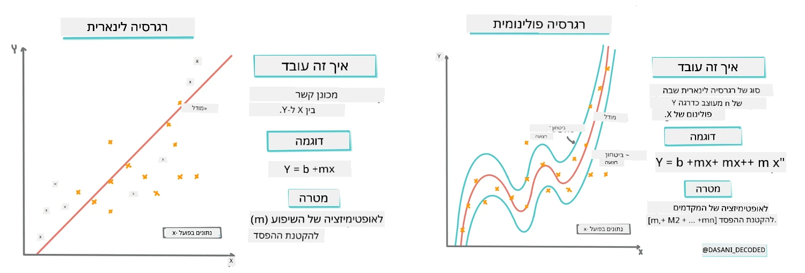
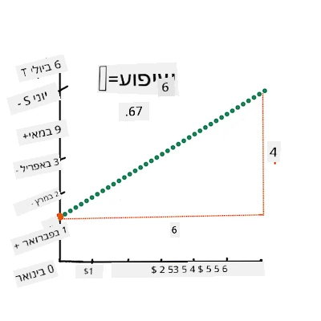
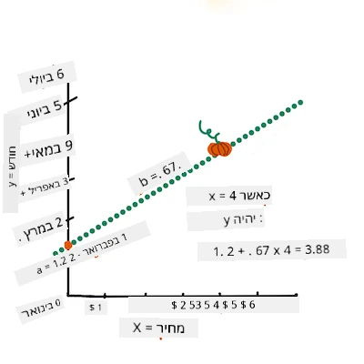
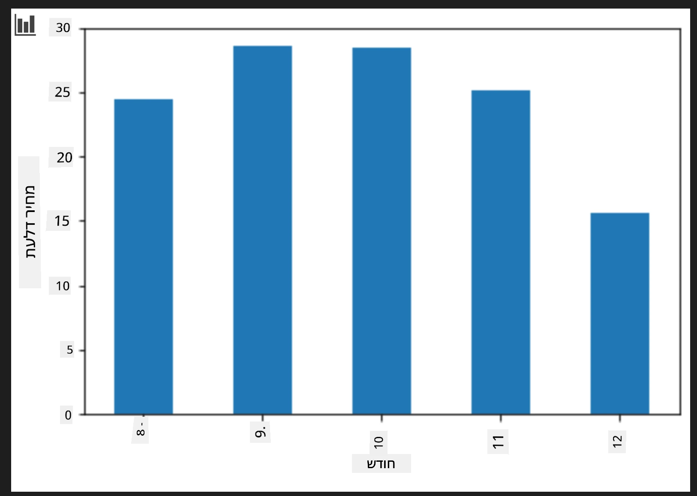
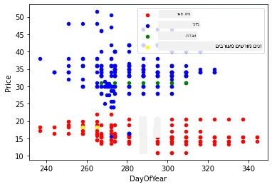

# לבנות מודל רגרסיה בעזרת Scikit-learn: רגרסיה בארבע דרכים

## הערת מתחילים

רגרסיה ליניארית משמשת כאשר רוצים לחזות **ערך מספרי** (למשל, מחיר דירה, טמפרטורה, או מכירות).  
היא פועלת על ידי מציאת קו ישר המייצג בצורה הטובה ביותר את הקשר בין תכונות קלט לפלט.

בשיעור זה נתמקד בהבנת המושג לפני שנחקור טכניקות רגרסיה מתקדמות יותר.  
  
> אינפוגרפיקה מאת [Dasani Madipalli](https://twitter.com/dasani_decoded)  
## [מבחן טרום-הרצאה](https://ff-quizzes.netlify.app/en/ml/)

> ### [השיעור זמין גם ב-R!](../../../../2-Regression/3-Linear/solution/R/lesson_3.html)  
### מבוא

עד כה חקרתם מהי רגרסיה עם דוגמת נתונים שנאספה ממאגר מחירי דלעות שבו נשתמש לאורך כל השיעור. גם ויזואליתם זאת בעזרת Matplotlib.

עכשיו אתם מוכנים לעומק נוסף לגבי רגרסיה בלמידת מכונה. בעוד שויזואליזציה מאפשרת להבין את הנתונים, הכוח האמיתי בלמידת מכונה מגיע מ_הכשרת מודלים_. מודלים מאומנים על נתונים היסטוריים כדי ללכוד אוטומטית תלות בנתונים, ומאפשרים לחזות תוצאות עבור נתונים חדשים שהמודל לא ראה בעבר.

בשיעור זה תלמדו עוד על שני סוגי רגרסיה: _רגרסיה ליניארית בסיסית_ ו_רגרסיה פולינומית_, יחד עם מתמטיקה בסיסית מאחורי הטכניקות האלו. מודלים אלה יאפשרו לנו לחזות מחירי דלעות בהתאם לנתוני קלט שונים.

[](https://youtu.be/CRxFT8oTDMg "ML for beginners - Understanding Linear Regression")

> 🎥 לחצו על התמונה למעלה לסרטון קצר על רגרסיה ליניארית.

> לאורך כל התכנית אנו מניחים ידע מתמטי מינימלי, ומנסים להפוך את החומר לזמין לסטודנטים מתחומים אחרים, לכן שימו לב להערות, 🧮 קריאות, דיאגרמות וכלי לימוד נוספים המסייעים בהבנה.

### דרישות מוקדמות

כעת אתם אמורים להיות מכירים את מבנה נתוני הדלעות אותם אנו בוחנים. ניתן למצוא אותם טעונים ומנוקים מראש בקובץ ה_ notebook.ipynb_ של השיעור. בקובץ, מחיר הדלעות מוצג לאשכול בדף נתונים חדש.  
ודאו שאתם יכולים להריץ מחברות אלה בסביבות בקוד של Visual Studio.

### הכנה

כתזכורת, אתם טוענים את הנתונים כדי שתוכלו לשאול שאלות לגביהם.

- מתי הזמן הטוב ביותר לקנות דלעות?  
- איזה מחיר אוכל לצפות עבור קרטון דלעות מיניאטוריות?  
- האם כדאי לקנות בסלי חצי אשכול או בקרטון 1 1/9 אשכול?  
נמשיך לחפש תשובות בנתונים אלו.

בשיעור הקודם יצרתם DataFrame ב-Pandas ומילאתם אותו בחלק מנתוני המקור תוך סטנדרטיזציה של המחיר לפי אשכול. עם זאת, עשיתם זאת רק ל-400 נקודות נתונים בלבד ולחודשים של הסתיו.

עיינו בנתונים שנטענו מראש במחברת הנלווית לשיעור זה. הנתונים נטענים מראש וגרף פיזור ראשוני מוצג להראות נתוני חודשים. אולי נוכל לקבל פרטים מדויקים יותר על טיב הנתונים על ידי ניקוי נוסף.

## קו רגרסיה ליניארי

כפי שלמדתם בשיעור 1, המטרה של תרגיל רגרסיה ליניארית היא להיות מסוגלים לצייר קו ש:

- **מראה יחסים בין משתנים**. מציג את הקשר בין משתנים  
- **מבצע תחזיות**. מבצע תחזיות מדויקות לגבי היכן תפול נקודת נתונים חדשה ביחס לקו.

זה טיפוסי ל**רגרסיה בריבועי המינימום** לשרטט קו כזה. המונח "ריבועי המינימום" מתייחס לתהליך המיזעור של השגיאה הכוללת במודל שלנו. עבור כל נקודת נתונים, אנו מודדים את המרחק האנכי (נקרא שארית) בין הנקודה בפועל לקו הרגרסיה שלנו.

אנו מרובעים את המרחקים הללו משני סיבות עיקריות:  

1. **גודל במקום כיוון:** אנו רוצים להתייחס לשגיאה של -5 באותה צורה כמו לשגיאה של +5. ריבוע הופך את כל הערכים לחיוביים.  

2. **עונש לאאוטליירים:** ריבוע נותן משקל גדול יותר לשגיאות גדולות, מה שמאלץ את הקו להתקרב לנקודות המרוחקות יותר.

לאחר מכן נסכום את כל הערכים המרובעים יחד. המטרה היא למצוא את הקו הספציפי שבו הסכום הזה מינימלי (הערך הקטן ביותר האפשרי) - hence השם "ריבועי המינימום".

> **🧮 תציג לי את המתמטיקה**  
>  
> הקו הזה, הנקרא _קו ההתאמה הטובה ביותר_, ניתן לביטוי ב[משוואה](https://en.wikipedia.org/wiki/Simple_linear_regression):  
>  
> ```
> Y = a + bX
> ```
>  
> `X` הוא ה'משתנה המסביר'. `Y` הוא ה'משתנה התלוי'. השיפוע של הקו הוא `b` ו-`a` הוא החיתוך ב-y, שמתייחס לערך של `Y` כאשר `X = 0`.  
>  
>  
>  
> ראשית, חשבו את השיפוע `b`. אינפוגרפיקה מאת [Jen Looper](https://twitter.com/jenlooper)  
>  
> במילים אחרות, ובהתייחס לשאלת נתוני הדלעות שלנו: "לחזות את מחיר דלעת לאשכול לפי חודש", `X` יהיה המחיר ו-`Y` יהיה חודש המכירה.  
>  
>  
>  
> חשבו את ערך Y. אם אתם משלמים סביב 4$, זה בטח אפריל! אינפוגרפיקה מאת [Jen Looper](https://twitter.com/jenlooper)  
>  
> המתמטיקה שמחשבת את הקו חייבת להראות את שיפוע הקו, שהוא גם תלוי בחתך, כלומר היכן ש-`Y` ממוקם כאשר `X = 0`.  
>  
> ניתן לצפות בשיטת החישוב בערכים אלו באתר [Math is Fun](https://www.mathsisfun.com/data/least-squares-regression.html). בקרו גם ב[מחשבון ריבועי המינימום](https://www.mathsisfun.com/data/least-squares-calculator.html) כדי לראות כיצד ערכי המספרים משפיעים על הקו.

## קורלציה

מונח נוסף שיש להבין הוא **מקדם הקורלציה** בין משתני X ו-Y נתונים. בעזרת גרף פיזור ניתן לראות במהרה את המקדם הזה. גרף עם נקודות מפוזרות על קו מסודר מראה קורלציה גבוהה, וגרף עם נקודות מפוזרות בכל מקום בין X ו-Y מראה קורלציה נמוכה.

מודל רגרסיה ליניארית טוב יהיה כזה שמקדם הקורלציה שלו גבוה (קרוב יותר ל-1 ולא ל-0) בשיטת ריבועי המינימום עם קו רגרסיה.

✅ הרץ את המחברת המצורפת לשיעור זה והסתכל על גרף פיזור של חודש מול מחיר. האם הנתונים המקשרים בין חודש למחיר למכירת דלעות נראים עם קורלציה גבוהה או נמוכה, לפי הפרשנות הויזואלית שלך לגרף הפיזור? האם זה משתנה אם תשתמש במדידה מדויקת יותר במקום `חודש`, למשל *יום בשנה* (כלומר מספר הימים מאז תחילת השנה)?

בקוד למטה, נניח שניקינו את הנתונים וקיבלנו את ה-DataFrame בשם `new_pumpkins`, דומה לטבלה הבאה:

| ID | Month | DayOfYear | Variety | City | Package | Low Price | High Price | Price |
|---|---|---|---|---|---|---|---|---|
| 70 | 9 | 267 | PIE TYPE | BALTIMORE | 1 1/9 bushel cartons | 15.0 | 15.0 | 13.636364 |
| 71 | 9 | 267 | PIE TYPE | BALTIMORE | 1 1/9 bushel cartons | 18.0 | 18.0 | 16.363636 |
| 72 | 10 | 274 | PIE TYPE | BALTIMORE | 1 1/9 bushel cartons | 18.0 | 18.0 | 16.363636 |
| 73 | 10 | 274 | PIE TYPE | BALTIMORE | 1 1/9 bushel cartons | 17.0 | 17.0 | 15.454545 |
| 74 | 10 | 281 | PIE TYPE | BALTIMORE | 1 1/9 bushel cartons | 15.0 | 15.0 | 13.636364 |

> הקוד לניקוי הנתונים זמין ב-[`notebook.ipynb`](notebook.ipynb). ביצענו את אותם שלבי ניקוי כפי בשיעור הקודם, וחישבנו את עמודת `DayOfYear` בעזרת הביטוי הבא:

```python
day_of_year = pd.to_datetime(pumpkins['Date']).apply(lambda dt: (dt-datetime(dt.year,1,1)).days)
```
  
כעת כשיש לכם הבנה של המתמטיקה מאחורי רגרסיה ליניארית, נבנה מודל רגרסיה כדי לבדוק האם נוכל לחזות איזו חבילת דלעות תציע את המחירים הטובים ביותר. מישהו שרוכש דלעות לפעילות של חג עשוי לרצות מידע זה כדי לייעל את רכישות הפריטים לחג.

## מחפשים קורלציה

[](https://youtu.be/uoRq-lW2eQo "ML for beginners - Looking for Correlation: The Key to Linear Regression")

> 🎥 לחצו על התמונה למעלה לסרטון קצר על קורלציה.

מהשיעור הקודם כנראה ראיתם שמחיר ממוצע לפי חודשים נראה כך:



זה מרמז שבעצם יש קורלציה מסוימת, וניתן לנסות לאמן מודל רגרסיה ליניארית כדי לחזות את הקשר בין `Month` ל-`Price`, או בין `DayOfYear` ל-`Price`. להלן גרף פיזור שמראה את הקשר האחרון:

 

נראה אם יש קורלציה באמצעות פונקציית `corr`:

```python
print(new_pumpkins['Month'].corr(new_pumpkins['Price']))
print(new_pumpkins['DayOfYear'].corr(new_pumpkins['Price']))
```
  
נראה שהקורלציה יחסית קטנה, -0.15 לפי `Month` ו- -0.17 לפי `DayOfYear`, אבל יכול להיות שיש קשר חשוב אחר. נראה שיש אשכולות שונים של מחירים בהתאם לסוגים שונים של דלעות. לאישור השערה זו, נשרטט כל קטגוריה בצבע שונה. כאשר מעבירים פרמטר `ax` לפונקציית ה-`scatter` ניתן להציג את כל הנקודות באותו הגרף:

```python
ax=None
colors = ['red','blue','green','yellow']
for i,var in enumerate(new_pumpkins['Variety'].unique()):
    df = new_pumpkins[new_pumpkins['Variety']==var]
    ax = df.plot.scatter('DayOfYear','Price',ax=ax,c=colors[i],label=var)
```
  
 

החקירה שלנו מרמזת שלזן יש יותר השפעה על המחיר הכולל מאשר תאריך המכירה בפועל. ניתן לראות זאת בעזרת גרף עמודות:

```python
new_pumpkins.groupby('Variety')['Price'].mean().plot(kind='bar')
```
  
 

נתמקד כעת רק בסוג דלעת אחד, 'pie type', ונראה מה ההשפעה של התאריך על המחיר:

```python
pie_pumpkins = new_pumpkins[new_pumpkins['Variety']=='PIE TYPE']
pie_pumpkins.plot.scatter('DayOfYear','Price') 
```
  
 

אם נחשב כעת את הקורלציה בין `Price` ל-`DayOfYear` בעזרת פונקציית `corr`, נקבל משהו בסביבות `-0.27` - מה שאומר שאימון מודל תחזית הגיוני.

> לפני אימון מודל רגרסיה ליניארית, חשוב לוודא שהנתונים שלנו נקיים. רגרסיה ליניארית לא פועלת טוב עם ערכים חסרים, ולכן כדאי להיפטר מכל התאים הריקים:

```python
pie_pumpkins.dropna(inplace=True)
pie_pumpkins.info()
```
  
גישה נוספת תהיה למלא ערכים ריקים אלו בערך הממוצע מהעמודה המתאימה.

## רגרסיה ליניארית פשוטה

[](https://youtu.be/e4c_UP2fSjg "ML for beginners - Linear and Polynomial Regression using Scikit-learn")

> 🎥 לחצו על התמונה למעלה לסרטון קצר על רגרסיה ליניארית ופולינומית.

לאימון מודל הרגרסיה הליניארית שלנו, נשתמש בספריית **Scikit-learn**.

```python
from sklearn.linear_model import LinearRegression
from sklearn.metrics import mean_squared_error
from sklearn.model_selection import train_test_split
```
  
נתחיל מלהפריד את ערכי הקלט (התכונות) ואת הפלט הצפוי (התיוג) למערכי numpy נפרדים:

```python
X = pie_pumpkins['DayOfYear'].to_numpy().reshape(-1,1)
y = pie_pumpkins['Price']
```
  
> שימו לב שנאלצנו לבצע `reshape` על נתוני הקלט כדי שחבילת הרגרסיה הליניארית תבין אותם נכון. רגרסיה ליניארית מצפה לקבל מערך דו-ממדי כקלט, שבו כל שורה היא וקטור של תכונות קלט. במקרה שלנו, שכן יש לנו רק תכונה אחת, אנו זקוקים למערך בצורת N×1, כאשר N הוא גודל המערך.

לאחר מכן, נחלק את הנתונים למערכי אימון ובדיקה, כדי שנוכל לאמת את המודל לאחר האימון:

```python
X_train, X_test, y_train, y_test = train_test_split(X, y, test_size=0.2, random_state=0)
```
  
לבסוף, אימון מודל הרגרסיה הליניארית בפועל דורש רק שתי שורות קוד. נכין את האובייקט `LinearRegression`, ונאמן אותו על הנתונים בעזרת המתודה `fit`:

```python
lin_reg = LinearRegression()
lin_reg.fit(X_train,y_train)
```

אובייקט `LinearRegression` לאחר ביצוע `fit` מכיל את כל המקדמים של הרגרסיה, אליהם ניתן לגשת באמצעות הפרופרטי `.coef_`. במקרה שלנו, יש רק מקדם אחד, אשר אמור להיות בערך `-0.017`. משמעות הדבר היא שהמחירים נראים כמי שמצטמצמים קצת עם הזמן, אבל לא הרבה, בערך 2 סנט ליום. ניתן גם לגשת לנקודת החיתוך של הרגרסיה עם ציר Y בעזרת `lin_reg.intercept_` - היא תהיה בסביבות `21` במקרה שלנו, מציינת את המחיר בתחילת השנה.

כדי לראות עד כמה המודל מדויק, נוכל לנבא מחירים על קבוצת בדיקה, ואז למדוד כמה קרובות ההתפלגויות שלנו לערכים הצפויים. זאת ניתן לעשות באמצעות מדד שורש ממוצע הריבועים (RMSE), שהוא השורש של ממוצע כל ההבדלים המרובעים בין הערך הצפוי לערך החזוי.

```python
pred = lin_reg.predict(X_test)

rmse = np.sqrt(mean_squared_error(y_test,pred))
print(f'RMSE: {rmse:3.3} ({rmse/np.mean(pred)*100:3.3}%)')
```

שגיאתנו נראית בסביבות 2 נקודות, שזה ~17%. לא טוב מדי. אינדיקטור נוסף לאיכות המודל הוא **מקדם הקביעה**, אותו ניתן לקבל כך:

```python
score = lin_reg.score(X_train,y_train)
print('Model determination: ', score)
```
אם הערך הוא 0, זה אומר שהמודל לא לוקח את נתוני הקלט בחשבון, ופועל כ-*התחזית הקווית הגרועה ביותר*, שהיא פשוט ממוצע הערכים. הערך 1 אומר שניתן לנבא בצורה מושלמת את כל הפלטים הצפויים. במקרה שלנו, המקדם הוא בסביבות 0.06, שזה די נמוך.

ניתן גם לשרטט את נתוני הבדיקה יחד עם קו הרגרסיה כדי לראות טוב יותר איך הרגרסיה פועלת אצלנו:

```python
plt.scatter(X_test,y_test)
plt.plot(X_test,pred)
```


## רגרסיה פולינומיאלית

סוג נוסף של רגרסיה קווית הוא רגרסיה פולינומיאלית. בעוד שלפעמים יש קשר לינארי בין משתנים - ככל שהדלעת גדולה יותר בנפח, כך המחיר גבוה יותר - לעיתים קשרים אלו לא ניתנים לשרטוט כמישור או קו ישר.

✅ הנה [כמה דוגמאות נוספות](https://online.stat.psu.edu/stat501/Lesson09#polynomial-regression-examples) של נתונים שיכולים להשתמש ברגרסיה פולינומיאלית.

תסתכל שוב על הקשר בין תאריך למחיר. האם נראה שהתפלגות הנקודות הזו חייבת להיות מנותחת על ידי קו ישר? האם המחירים לא יכולים להשתנות? במקרה כזה, ניתן לנסות רגרסיה פולינומיאלית.

✅ פולינומים הם ביטויים מתמטיים שעשויים לכלול אחד או יותר משתנים ומקדמים.

רגרסיה פולינומיאלית יוצרת קו מעוקל כדי להתאים טוב יותר לנתונים לא לינאריים. במקרה שלנו, אם נכלול משתנה `DayOfYear` בריבוע בתור נתון, נוכל להתאים את הנתונים שלנו בעזרת עקומה פרבולית, שתהיה לה מינימום בנקודה מסוימת בתוך השנה.

ספריית Scikit-learn כוללת [API של צינור](https://scikit-learn.org/stable/modules/generated/sklearn.pipeline.make_pipeline.html?highlight=pipeline#sklearn.pipeline.make_pipeline) מועיל לשילוב שלבים שונים בעיבוד הנתונים יחד. **צינור** הוא שרשרת של **מנחשים (Estimators)**. במקרה שלנו, ניצור צינור שמוסיף תחילה תכונות פולינומיאליות למודל, ואז מאמן את הרגרסיה:

```python
from sklearn.preprocessing import PolynomialFeatures
from sklearn.pipeline import make_pipeline

pipeline = make_pipeline(PolynomialFeatures(2), LinearRegression())

pipeline.fit(X_train,y_train)
```

השימוש ב-`PolynomialFeatures(2)` פירושו שנכליל את כל הפולינומים מדרגה שנייה מהנתונים. במקרה שלנו זה פשוט אומר `DayOfYear`<sup>2</sup>, אך אם יהיו שני משתנים קלט X ו-Y, זה יוסיף X<sup>2</sup>, XY ו-Y<sup>2</sup>. נוכל גם להשתמש בפולינומים מדרגות גבוהות יותר אם נרצה.

ניתן להשתמש בצינורות באותה צורה כמו האובייקט המקורי `LinearRegression`, כלומר ניתן לבצע `fit` על הצינור, ואז להשתמש ב-`predict` לקבלת תוצאות החיזוי:

```python
pred = pipeline.predict(X_test)

rmse = np.sqrt(mean_squared_error(y_test,pred))
print(f'RMSE: {rmse:3.3} ({rmse/np.mean(pred)*100:3.3}%)')

score = pipeline.score(X_train,y_train)
print('Model determination: ', score)
```

כדי לשרטט את העקומה החלקה, אנו משתמשים ב-`np.linspace` כדי ליצור טווח אחיד של ערכי קלט, במקום לשרטט ישירות על נתוני הבדיקה הלא מסודרים (מה שהיה מייצר קו זיגזג):

```python
X_range = np.linspace(X_test.min(), X_test.max(), 100).reshape(-1,1)
y_range = pipeline.predict(X_range)

plt.scatter(X_test, y_test)
plt.plot(X_range, y_range)
```

הנה הגרף שמציג את נתוני הבדיקה ואת עקומת האפרוקסימציה:


באמצעות רגרסיה פולינומיאלית, ניתן לקבל RMSE נמוך יותר במעט וקביעות גבוהה יותר, אך לא משמעותית. צריך לקחת בחשבון תכונות נוספות!

> ניתן לראות שהמחירים המינימליים לדלעות מתרחשים בערך סביב ליל כל הקדושים. איך תסבירו זאת?

🎃 כל הכבוד, יצרתם זה עתה מודל שיכול לעזור לנבא את מחיר דלעות הפאי. כנראה תוכלו לחזור על אותה פעולה עבור כל סוגי הדלעות, אך זה יהיה מייגע. בואו עכשיו נלמד כיצד לקחת בחשבון את זני הדלעת במודל שלנו!

## תכונות קטגוריאליות

בעולם האידיאלי, נרצה להיות מסוגלים לנבא מחירים של זני דלעות שונים באמצעות אותו מודל. עם זאת, עמודת `Variety` שונה במקצת מעמודות כמו `Month`, כי היא מכילה ערכים לא נומריים. עמודות כאלה נקראות **קטגוריאליות**.

[](https://youtu.be/DYGliioIAE0 "ML למתחילים - תחזיות עם תכונה קטגוריאלית ברגרסיה ליניארית")

> 🎥 לחצו על התמונה למעלה לסרטון קצר שמסביר את השימוש בתכונות קטגוריאליות.

כאן ניתן לראות איך המחיר הממוצע משתנה בהתאם לזן:


כדי לקחת את הזן בחשבון, עלינו תחילה להמיר אותו לצורת מספרית, או **לקודד** אותו. יש מספר דרכים לעשות זאת:

* **קידוד מספרי** פשוט יבנה טבלה של זנים שונים, ואז יחליף את שם הזן באינדקס בטבלה. זו לא הרעיון הטוב ביותר לרגרסיה קווית, כי הרגרסיה הקווית לוקחת את הערך המספרי של האינדקס ומוסיפה אותו לתוצאה, מכפילה במקדם כלשהו. במקרה שלנו, הקשר בין מספר האינדקס למחיר ברור שאיננו לינארי, אפילו אם נוודא שהאינדקסים מסודרים בדרך מסוימת.
* **קידוד One-hot** יחליף את עמודת `Variety` ב-4 עמודות שונות, אחת לכל זן. כל עמודה תכיל `1` אם השורה המתאימה היא מהזן הזה, ו-`0` אחרת. משמעות הדבר היא שיהיו ארבעה מקדמים ברגרסיה קווית, אחד לכל זן דלעת, שאחראים על "מחיר התחלתי" (או יותר נכון "מחיר נוסף") לאותו זן מסוים.

הקוד הבא מראה איך ניתן לקודד זן בקידוד One-hot:

```python
pd.get_dummies(new_pumpkins['Variety'])
```

 ID | FAIRYTALE | MINIATURE | MIXED HEIRLOOM VARIETIES | PIE TYPE
----|-----------|-----------|--------------------------|----------
70 | 0 | 0 | 0 | 1
71 | 0 | 0 | 0 | 1
... | ... | ... | ... | ...
1738 | 0 | 1 | 0 | 0
1739 | 0 | 1 | 0 | 0
1740 | 0 | 1 | 0 | 0
1741 | 0 | 1 | 0 | 0
1742 | 0 | 1 | 0 | 0

כדי לאמן רגרסיה לינארית באמצעות זן שנקודד בתכונת one-hot, פשוט צריך לאתחל את נתוני `X` ו-`y` נכון:

```python
X = pd.get_dummies(new_pumpkins['Variety'])
y = new_pumpkins['Price']
```

שאר הקוד זהה למה שהשתמשנו למעלה לאימון רגרסיה לינארית. אם תנסו זאת, תראו ששגיאת הריבועים הממוצעת כמעט זהה, אך מקדם הקביעה גבוה בהרבה (~77%). כדי לקבל תחזיות מדויקות עוד יותר, ניתן לקחת בחשבון יותר תכונות קטגוריאליות, כמו גם תכונות מספריות, כגון `Month` או `DayOfYear`. כדי לקבל מערך תכונות אחד גדול אפשר להשתמש ב-`join`:

```python
X = pd.get_dummies(new_pumpkins['Variety']) \
        .join(new_pumpkins['Month']) \
        .join(pd.get_dummies(new_pumpkins['City'])) \
        .join(pd.get_dummies(new_pumpkins['Package']))
y = new_pumpkins['Price']
```

כאן אנחנו גם לוקחים בחשבון את `City` וסוג `Package`, מה שמביא ל-RMSE של 2.84 (10.5%), וקביעות של 0.94!

## לשלב את הכל ביחד

כדי ליצור את המודל הטוב ביותר, נוכל להשתמש בנתוני משולבים (קטגוריאליים בקידוד one-hot + מספריים) מהדוגמה למעלה יחד עם רגרסיה פולינומיאלית. הנה הקוד המלא לנוחיותכם:

```python
# להגדיר את נתוני האימון
X = pd.get_dummies(new_pumpkins['Variety']) \
        .join(new_pumpkins['Month']) \
        .join(pd.get_dummies(new_pumpkins['City'])) \
        .join(pd.get_dummies(new_pumpkins['Package']))
y = new_pumpkins['Price']

# לבצע פיצול של אימון-בדיקה
X_train, X_test, y_train, y_test = train_test_split(X, y, test_size=0.2, random_state=0)

# להגדיר ולאמן את צינור העיבוד
pipeline = make_pipeline(PolynomialFeatures(2), LinearRegression())
pipeline.fit(X_train,y_train)

# לחזות תוצאות עבור נתוני הבדיקה
pred = pipeline.predict(X_test)

# לחשב שגיאת שורש ממוצעת והחלטה
rmse = mean_squared_error(y_test, pred, squared=False)
print(f'RMSE: {rmse:3.3} ({rmse/pred.mean()*100:3.3}%)')

score = pipeline.score(X_train,y_train)
print('Model determination: ', score)
```

זה אמור לתת לנו את מקדם הקביעה הטוב ביותר של כמעט 97%, ו-RMSE=2.23 (~8% שגיאת חיזוי).

| מודל | RMSE | מקדם קביעה |
|-------|-----|---------------|
| `DayOfYear` לינארי | 2.77 (17.2%) | 0.07 |
| `DayOfYear` פולינומיאלי | 2.73 (17.0%) | 0.08 |
| `Variety` לינארי | 5.24 (19.7%) | 0.77 |
| כל התכונות לינארי | 2.84 (10.5%) | 0.94 |
| כל התכונות פולינומיאלי | 2.23 (8.25%) | 0.97 |

🏆 כל הכבוד! יצרתם ארבעה מודלי רגרסיה בשיעור אחד, ושיפרתם את איכות המודל ל-97%. בקטע הסופי על רגרסיות, תלמדו על רגרסיה לוגיסטית לקביעת קטגוריות.

---
## 🚀אתגר

בדקו מספר משתנים שונים במחברת הזו כדי לראות כיצד מתאם מתייחס לדיוק המודל.

## [מבחן לאחר ההרצאה](https://ff-quizzes.netlify.app/en/ml/)

## סקירה ולמידה עצמית

בשיעור זה למדנו על רגרסיה לינארית. קיימים סוגים חשובים נוספים של רגרסיות. קראו על טכניקות Stepwise, Ridge, Lasso ו-Elasticnet. קורס טוב ללמוד בו עוד הוא קורס הסטטיסטיקה באוניברסיטת סטנפורד [Stanford Statistical Learning course](https://online.stanford.edu/courses/sohs-ystatslearning-statistical-learning)

## מטלה 

[לבנות מודל](assignment.md)

---

<!-- CO-OP TRANSLATOR DISCLAIMER START -->
**הצהרת אחריות**:
מסמך זה תורגם באמצעות שירות תרגום מבוסס AI [Co-op Translator](https://github.com/Azure/co-op-translator). למרות שאנו שואפים לדיוק, יש להיות מודעים לכך שתרגומים אוטומטיים עשויים להכיל טעויות או אי-דיוקים. המסמך המקורי בשפה המקורית שלו צריך להיחשב כמקור האוטוריטטיבי. למידע קריטי מומלץ להשתמש בתרגום אנושי מקצועי. איננו אחראים לכל אי הבנה או פרשנות שגויה הנובעת משימוש בתרגום זה.
<!-- CO-OP TRANSLATOR DISCLAIMER END -->