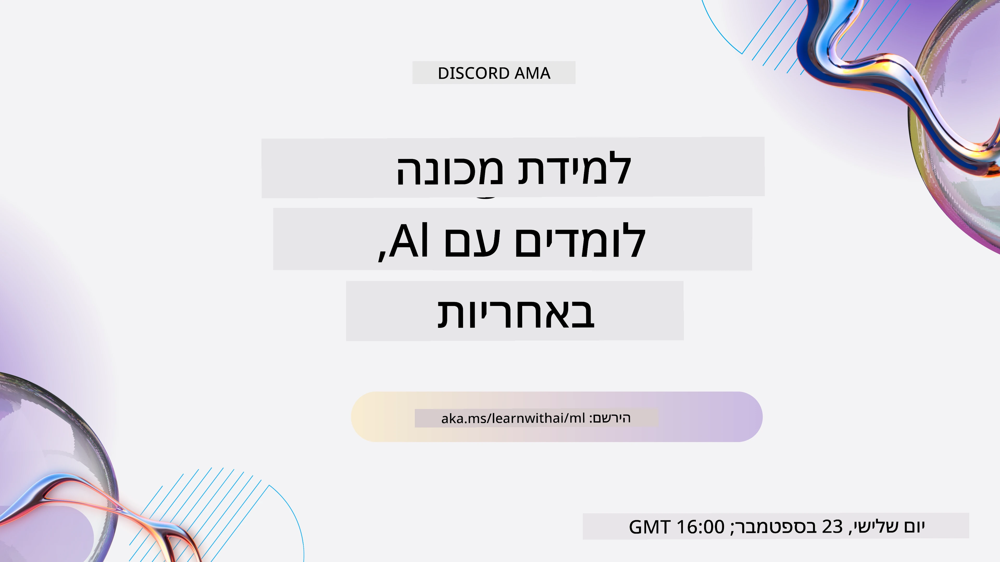
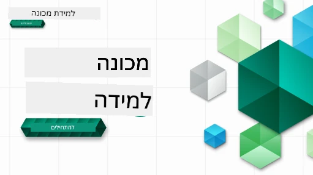

[](https://github.com/microsoft/ML-For-Beginners/blob/master/LICENSE)
[](https://GitHub.com/microsoft/ML-For-Beginners/graphs/contributors/)
[](https://GitHub.com/microsoft/ML-For-Beginners/issues/)
[](https://GitHub.com/microsoft/ML-For-Beginners/pulls/)
[](http://makeapullrequest.com)

[](https://GitHub.com/microsoft/ML-For-Beginners/watchers/)
[](https://GitHub.com/microsoft/ML-For-Beginners/network/)
[](https://GitHub.com/microsoft/ML-For-Beginners/stargazers/)

### 🌐 תמיכה רב-שפתית

#### תרגומים שנשמרים באמצעות [Co-op Translator](https://github.com/Azure/co-op-translator)

<!-- CO-OP TRANSLATOR LANGUAGES TABLE START -->
[ערבית](../ar/README.md) | [בנגלית](../bn/README.md) | [בולגרית](../bg/README.md) | [בורמזית (מיאנמר)](../my/README.md) | [סינית (מפושטת)](../zh-CN/README.md) | [סינית (מסורתית, הונג קונג)](../zh-HK/README.md) | [סינית (מסורתית, מקאו)](../zh-MO/README.md) | [סינית (מסורתית, טאיוואן)](../zh-TW/README.md) | [קרואטית](../hr/README.md) | [צ'כית](../cs/README.md) | [דנית](../da/README.md) | [הולנדית](../nl/README.md) | [אסטונית](../et/README.md) | [פינית](../fi/README.md) | [צרפתית](../fr/README.md) | [גרמנית](../de/README.md) | [יוונית](../el/README.md) | [עברית](./README.md) | [הינדי](../hi/README.md) | [הונגרית](../hu/README.md) | [אינדונזית](../id/README.md) | [איטלקית](../it/README.md) | [יפנית](../ja/README.md) | [קנאדה](../kn/README.md) | [חמר](../km/README.md) | [קוריאנית](../ko/README.md) | [ליטאית](../lt/README.md) | [מלאית](../ms/README.md) | [מלאיאלאם](../ml/README.md) | [מניפורי (מיטאי מאייק)](../mni/README.md) | [מרטהי](../mr/README.md) | [נפאלית](../ne/README.md) | [פיג'ין ניגרי](../pcm/README.md) | [נורווגית](../no/README.md) | [פרסית (פרסי)](../fa/README.md) | [פולנית](../pl/README.md) | [פורטוגזית (ברזיל)](../pt-BR/README.md) | [פורטוגזית (פורטוגל)](../pt-PT/README.md) | [פונג'אבית (גורמוכי)](../pa/README.md) | [רומנית](../ro/README.md) | [רוסית](../ru/README.md) | [סרבית (קירילית)](../sr/README.md) | [סלובקית](../sk/README.md) | [סלובנית](../sl/README.md) | [ספרדית](../es/README.md) | [סווהיליל](../sw/README.md) | [שבדית](../sv/README.md) | [טגלוג (פיליפינית)](../tl/README.md) | [טמלית](../ta/README.md) | [טלוגו](../te/README.md) | [תאית](../th/README.md) | [טורקית](../tr/README.md) | [אוקראינית](../uk/README.md) | [אורדו](../ur/README.md) | [וייטנאמית](../vi/README.md)

> **מעדיפים לשכפל מקומית?**
>
> מאגר זה כולל יותר מ-50 תרגומים לשפות שונות, מה שמגדיל משמעותית את גודל ההורדה. כדי לשכפל ללא התרגומים, השתמשו ב-sparse checkout:
>
> **באַש / macOS / לינוקס:**
> ```bash
> git clone --filter=blob:none --sparse https://github.com/microsoft/ML-For-Beginners.git
> cd ML-For-Beginners
> git sparse-checkout set --no-cone '/*' '!translations' '!translated_images'
> ```
>
> **CMD (חלונות):**
> ```cmd
> git clone --filter=blob:none --sparse https://github.com/microsoft/ML-For-Beginners.git
> cd ML-For-Beginners
> git sparse-checkout set --no-cone "/*" "!translations" "!translated_images"
> ```
>
> זה נותן לכם את כל מה שצריך לסיים את הקורס עם הורדה הרבה יותר מהירה.
<!-- CO-OP TRANSLATOR LANGUAGES TABLE END -->

#### הצטרפו לקהילה שלנו

[](https://discord.gg/nTYy5BXMWG)

יש לנו סדרת לימוד ב-Discord עם AI שמתנהלת כרגע, למדו עוד והצטרפו אלינו ב[סדרת לימוד עם AI](https://aka.ms/learnwithai/discord) בין 18 ל-30 בספטמבר, 2025. תקבלו טיפים וטריקים לשימוש ב-GitHub Copilot במדעי הנתונים.



# למידת מכונה למתחילים - תכנית לימודים

> 🌍 טיילו בעולם תוך כדי חקר למידת מכונה באמצעות תרבויות העולם 🌍

סנגורי ענן במיקרוסופט שמחים להציע תכנית לימודים בת 12 שבועות, 26 שיעורים, הכוללת את הנושא **למידת מכונה**. בתכנית זו תלמדו על מה שלפעמים נקרא **למידת מכונה קלאסית**, בעיקר באמצעות ספריית Scikit-learn ותמנעתם מלמידה עמוקה, הנלמדת בתכנית [AI למתחילים](https://aka.ms/ai4beginners) שלנו. ניתן גם לשלב שיעורים אלו עם תכנית ['מדעי הנתונים למתחילים'](https://aka.ms/ds4beginners)!

טיילו איתנו בעולם בזמן שאנו מיישמים את הטכניקות הקלאסיות הללו על נתונים מאזורים שונים בעולם. בכל שיעור יש חידונים לפני ואחרי השיעור, הוראות כתובות להשלמת השיעור, פתרון, מטלה, ועוד. הגישה המתמקדת בפרויקטים שלנו מאפשרת ללמוד תוך כדי בנייה, שיטה מוכחת ללמידת מיומנויות חדשות.

**✍️ תודה רבה למחברינו** ג'ן לופר, סטיבן האואל, פרנססקה לזזרי, טומומי אימורה, קסי ברוויו, דמיטרי סושניקוב, כריס נורינג, אנירבן מוכרג'י, אורנלה אלטוניאן, רות יאקובו ואיימי בוייד

**🎨 תודה גם למאיירים שלנו** טומומי אימורה, דסאני מדיפאלי, וג'ן לופר

**🙏 תודה מיוחדת 🙏 למחברי שגרירי הסטודנטים במיקרוסופט, לסוקרים ולתורמים לתוכן**, במיוחד לרישיט דגלי, מוחמד סאקיב חאן אינאן, רוהאן ראג', אלכסנדרו פטרסקו, אבישק ג'ייסוואל, נאוורין טבאסום, יואן סמויאלה, וסניגדה אגרוואל

**🤩 תודה נוספת לשגרירי הסטודנטים של מיקרוסופט אריק ואנג'או, ג'אסלין סונדהי, ווידושי גופטה על שיעורי R שלנו!**

# התחלה

עקבו אחרי הצעדים הבאים:
1. **צרו Fork למאגר**: לחצו על כפתור "Fork" בפינה הימנית העליונה של העמוד הזה.
2. **שכפלו את המאגר**:   `git clone https://github.com/microsoft/ML-For-Beginners.git`

> 💡 **טיפ התחלה מהירה:** רוצים להתחיל בדפדפן בלי להגדיר Python מקומית? השתמשו ב-[GitHub Codespaces](https://github.com/features/codespaces) ליצירת סביבת פיתוח בענן עבור ה-fork שלכם. פתחו את התפריט הירוק של **קוד**, בחרו ב-**Codespaces**, וצרו codespace; התקינו בכל קודספייס את התלויות שדורש כל שיעור לפי הצורך.

> [מצאו את כל המשאבים הנוספים לקורס זה באוסף Microsoft Learn שלנו](https://learn.microsoft.com/en-us/collections/qrqzamz1nn2wx3?WT.mc_id=academic-77952-bethanycheum)

> 🔧 **צריכים עזרה?** בדקו את [מדריך פתרון הבעיות](TROUBLESHOOTING.md) שלנו לפתרונות לבעיות נפוצות בהתקנה, בהגדרה ובהפעלת השיעורים.


**[סטודנטים](https://aka.ms/student-page)**, כדי להשתמש בתכנית זו, צרו fork למאגר כולו לחשבון ה-GitHub האישי שלכם ושלימו את התרגילים בעצמכם או בקבוצה:

- התחילו עם חידון לפני ההרצאה.
- קראו את ההרצאה והשלימו את הפעילויות, עצרו והרהרו בכל בדיקת ידע.
- נסו ליצור את הפרויקטים על ידי הבנת השיעורים במקום להריץ את קוד הפתרון; עם זאת, קוד זה זמין בתיקיות `/solution` בכל שיעור ממוקד פרויקט.
- עברו חידון לאחר ההרצאה.
- השלימו את האתגר.
- השלימו את המטלה.
- לאחר סיום קבוצת שיעורים, בקרו ב-[לוח הדיונים](https://github.com/microsoft/ML-For-Beginners/discussions) ו"תלמדו בקול", על ידי מילוי סולם PAT המתאים. 'PAT' הוא כלי להערכת התקדמות שאתם ממלאים להמשך הלמידה. תוכלו גם להגיב ל-PAT של אחרים כדי שנוכל ללמוד יחד.

> ללמידה נוספת, אנו ממליצים על מעקב אחרי מודולים ונתיבי למידה ב-[Microsoft Learn](https://docs.microsoft.com/en-us/users/jenlooper-2911/collections/k7o7tg1gp306q4?WT.mc_id=academic-77952-leestott).

**מורים**, כללנו [כמה הצעות](for-teachers.md) לשימוש בתכנית זו.

---

## סרטוני הדרכה

כמה מהשיעורים זמינים כסרטונים קצרים. אתם יכולים למצוא את כולם בתוככי השיעורים, או ברשימת ההשמעה [למידת מכונה למתחילים בערוץ המפתחים של מיקרוסופט ב-YouTube](https://aka.ms/ml-beginners-videos) על ידי לחיצה על התמונה למטה.

[](https://aka.ms/ml-beginners-videos)

---

## הכירו את הצוות

[](https://youtu.be/Tj1XWrDSYJU)

**גיף מאת** [Mohit Jaisal](https://linkedin.com/in/mohitjaisal)

> 🎥 לחצו על התמונה למעלה לסרטון על הפרויקט והאנשים שיצרו אותו!

---

## פדגוגיה

בחרנו שני עקרונות פדגוגיים בבניית תכנית זו: להבטיח שהיא **פרויקטית ומעשית** ושתכלול **חידונים תכופים**. בנוסף, לתכנית יש **נושא** משותף שמקנה לה אחידות.

על ידי התאמת התוכן לפרויקטים, התהליך נעשה מעניין יותר לתלמידים ודברים נזכרים טוב יותר. כמו כן, חידון בעל סיכון נמוך לפני השיעור מכוון את כוונת התלמיד ללמידת הנושא, בעוד חידון נוסף אחרי השיעור מבטיח שמירה על הידע. תכנית זו עוצבה להיות גמישה ומהנה וניתן ללמוד אותה בשלמותה או בחלקיה. הפרויקטים מתחילים קטנים והופכים למורכבים יותר לקראת סוף מחזור 12 השבועות. לתכנית יש גם סימוכין ליישומים אמיתיים של למידת מכונה, שניתן להשתמש בהם כקרדיט נוסף או כבסיס לדיון.

> מצאו את הקווים המנחים שלנו ל-[קוד ההתנהגות](CODE_OF_CONDUCT.md), [השתתפות](CONTRIBUTING.md), [תרגומים](..), ו-[פתרון בעיות](TROUBLESHOOTING.md). נשמח למשוב בונה שלכם!

## כל שיעור כולל

- סקיצה אופציונלית
- וידאו נוסף אופציונלי
- סרטון הדרכה (רק בחלק מהשיעורים)
- [חידון חימום לפני ההרצאה](https://ff-quizzes.netlify.app/en/ml/)
- שיעור כתוב
- בשיעורים מבוססי פרויקט, מדריך שלב-אחר-שלב לבניית הפרויקט
- בדיקות ידע
- אתגר
- קריאה נוספת
- מטלה
- [חידון אחרי ההרצאה](https://ff-quizzes.netlify.app/en/ml/)

> **הערה על שפות**: השיעורים כתובים בעיקר בפייתון, אך רבים זמינים גם ב-R. כדי להשלים שיעור R, גשו לתיקיית `/solution` וחפשו שיעורי R. הם כוללים סיומת .rmd המייצגת קובץ **R Markdown** שניתן להגדירו כפשטות כהטמעה של `code chunks` (של R או שפות אחרות) ו-`YAML header` (הכוונה כיצד לעצב פלטים כגון PDF) בתוך `Markdown document`. אפוא, הוא משמש כמסגרת יצירה מצוינת למדעי הנתונים כיוון שהוא מאפשר לשלב קוד, הפלט והמחשבות בכך שניתן לרשום אותן במארקדאון. בנוסף, קבצי R Markdown ניתנים להמרה לפורמטים כמו PDF, HTML או וורד.

> **הערה על חידונים**: כל החידונים נמצאים בתיקיית [Quiz App](../../quiz-app), בסך הכול 52 חידונים של שלוש שאלות כל אחד. הם מקושרים מתוך השיעורים אך ניתן להריץ את אפליקציית החידונים מקומית; עקבו אחרי ההוראות בתיקיית `quiz-app` לאירוח או פריסה מקומית לאזור הענן Azure.

| מספר שיעור |                             נושא                              |                   קיבוץ שיעורים                   | מטרות הלמידה                                                                                                             |                                                              שיעור מקושר                                                               |                        מחבר                        |
| :-----------: | :------------------------------------------------------------: | :-------------------------------------------------: | ------------------------------------------------------------------------------------------------------------------------------- | :--------------------------------------------------------------------------------------------------------------------------------------: | :--------------------------------------------------: |
|      01       |                מבוא ללמידת מכונה                |      [הקדמה](1-Introduction/README.md)       | ללמוד את המושגים הבסיסיים שמאחורי למידת מכונה                                                                                |                                             [שיעור](1-Introduction/1-intro-to-ML/README.md)                                             |                       מוחמד                       |
|      02       |                ההיסטוריה של למידת מכונה                 |      [הקדמה](1-Introduction/README.md)       | ללמוד את ההיסטוריה שמאחורי תחום זה                                                                                         |                                            [שיעור](1-Introduction/2-history-of-ML/README.md)                                            |                     ג'ן ואיימי                      |
|      03       |                 הוגנות ולמידת מכונה                  |      [הקדמה](1-Introduction/README.md)       | מהם הסוגיות הפילוסופיות החשובות סביב הוגנות שעל הסטודנטים לשקול בעת בנייה ויישום של מודלים למידת מכונה? |                                              [שיעור](1-Introduction/3-fairness/README.md)                                               |                        טומומי                        |
|      04       |                טכניקות ללמידת מכונה                 |      [הקדמה](1-Introduction/README.md)       | אילו טכניקות חוקרי למידת מכונה משתמשים כדי לבנות מודלים?                                                                       |                                          [שיעור](1-Introduction/4-techniques-of-ML/README.md)                                           |                    כריס וג'ן                     |
|      05       |                   מבוא לרגרסיה                   |        [רגרסיה](2-Regression/README.md)         | התחילו עם Python ו-Scikit-learn עבור מודלי רגרסיה                                                                  |         [Python](2-Regression/1-Tools/README.md) • [R](../../2-Regression/1-Tools/solution/R/lesson_1.html)         |      ג'ן • אריק וואנג'או       |
|      06       |                מחירי דלעת בצפון אמריקה 🎃                |        [רגרסיה](2-Regression/README.md)         | ויזואליזציה וניקוי נתונים כהכנה ללמידת מכונה                                                                                  |          [Python](2-Regression/2-Data/README.md) • [R](../../2-Regression/2-Data/solution/R/lesson_2.html)          |      ג'ן • אריק וואנג'או       |
|      07       |                מחירי דלעת בצפון אמריקה 🎃                |        [רגרסיה](2-Regression/README.md)         | בניית מודלי רגרסיה לינארית ופולינומיאלית                                                                                   |        [Python](2-Regression/3-Linear/README.md) • [R](../../2-Regression/3-Linear/solution/R/lesson_3.html)        |      ג'ן ודמיטרי • אריק וואנג'או       |
|      08       |                מחירי דלעת בצפון אמריקה 🎃                |        [רגרסיה](2-Regression/README.md)         | בניית מודל רגרסיה לוגיסטית                                                                                               |     [Python](2-Regression/4-Logistic/README.md) • [R](../../2-Regression/4-Logistic/solution/R/lesson_4.html)      |      ג'ן • אריק וואנג'או       |
|      09       |                          אפליקציית ווב 🔌                          |           [אפליקציית ווב](3-Web-App/README.md)            | לבנות אפליקציית ווב לשימוש במודל שאימנת                                                                                       |                                                 [Python](3-Web-App/1-Web-App/README.md)                                                  |                         ג'ן                          |
|      10       |                 מבוא לסיווג                 |    [סיווג](4-Classification/README.md)     | לנקות, להכין ולוויזואליזציה את הנתונים שלכם; מבוא לסיווג                                                            | [Python](4-Classification/1-Introduction/README.md) • [R](../../4-Classification/1-Introduction/solution/R/lesson_10.html)  | ג'ן וקסי • אריק וואנג'או |
|      11       |             מטבחים אסייתיים והודיים טעימים 🍜             |    [סיווג](4-Classification/README.md)     | מבוא לממיינים                                                                                                     | [Python](4-Classification/2-Classifiers-1/README.md) • [R](../../4-Classification/2-Classifiers-1/solution/R/lesson_11.html) | ג'ן וקסי • אריק וואנג'או |
|      12       |             מטבחים אסייתיים והודיים טעימים 🍜             |    [סיווג](4-Classification/README.md)     | ממיינים נוספים                                                                                                                | [Python](4-Classification/3-Classifiers-2/README.md) • [R](../../4-Classification/3-Classifiers-2/solution/R/lesson_12.html) | ג'ן וקסי • אריק וואנג'או |
|      13       |             מטבחים אסייתיים והודיים טעימים 🍜             |    [סיווג](4-Classification/README.md)     | בניית אפליקציית ווב להמלצה באמצעות המודל שלכם                                                                                    |                                              [Python](4-Classification/4-Applied/README.md)                                              |                         ג'ן                          |
|      14       |                   מבוא לאשכולות                   |        [אשכולות](5-Clustering/README.md)         | לנקות, להכין ולוויזואליזציה את הנתונים שלכם; מבוא לאשכולות                                                                |         [Python](5-Clustering/1-Visualize/README.md) • [R](../../5-Clustering/1-Visualize/solution/R/lesson_14.html)         |      ג'ן • אריק וואנג'או       |
|      15       |              חקר טעמים מוסיקליים ניגריים 🎧              |        [אשכולות](5-Clustering/README.md)         | חקירת שיטת אשכולות K-Means                                                                                           |           [Python](5-Clustering/2-K-Means/README.md) • [R](../../5-Clustering/2-K-Means/solution/R/lesson_15.html)           |      ג'ן • אריק וואנג'או       |
|      16       |        מבוא לעיבוד שפה טבעית ☕️         |   [עיבוד שפה טבעית](6-NLP/README.md)    | ללמוד את היסודות של NLP על ידי בניית בוט פשוט                                                                             |                                             [Python](6-NLP/1-Introduction-to-NLP/README.md)                                              |                       סטיבן                        |
|      17       |                      משימות NLP נפוצות ☕️                      |   [עיבוד שפה טבעית](6-NLP/README.md)    | העמקת הידע ב-NLP באמצעות הבנת משימות נפוצות הנדרשות בעבודה עם מבני שפה                          |                                                    [Python](6-NLP/2-Tasks/README.md)                                                     |                       סטיבן                        |
|      18       |             תרגום וניתוח סנטימנט ♥️              |   [עיבוד שפה טבעית](6-NLP/README.md)    | תרגום וניתוח סנטימנט עם ג'יין אוסטין                                                                             |                                            [Python](6-NLP/3-Translation-Sentiment/README.md)                                             |                       סטיבן                        |
|      19       |                  מלונות רומנטיים באירופה ♥️                  |   [עיבוד שפה טבעית](6-NLP/README.md)    | ניתוח סנטימנט עם ביקורות על מלונות 1                                                                                         |                                               [Python](6-NLP/4-Hotel-Reviews-1/README.md)                                                |                       סטיבן                        |
|      20       |                  מלונות רומנטיים באירופה ♥️                  |   [עיבוד שפה טבעית](6-NLP/README.md)    | ניתוח סנטימנט עם ביקורות על מלונות 2                                                                                         |                                               [Python](6-NLP/5-Hotel-Reviews-2/README.md)                                                |                       סטיבן                        |
|      21       |            מבוא לחיזוי סדרות זמן             |        [סדרות זמן](7-TimeSeries/README.md)        | מבוא לחיזוי סדרות זמן                                                                                         |                                             [Python](7-TimeSeries/1-Introduction/README.md)                                              |                      פרנססקה                       |
|      22       | ⚡️ צריכת חשמל עולמית ⚡️ - חיזוי סדרות זמן עם ARIMA |        [סדרות זמן](7-TimeSeries/README.md)        | חיזוי סדרות זמן עם ARIMA                                                                                              |                                                 [Python](7-TimeSeries/2-ARIMA/README.md)                                                 |                      פרנססקה                       |
|      23       |  ⚡️ צריכת חשמל עולמית ⚡️ - חיזוי סדרות זמן עם SVR  |        [סדרות זמן](7-TimeSeries/README.md)        | חיזוי סדרות זמן עם Support Vector Regressor                                                                           |                                                  [Python](7-TimeSeries/3-SVR/README.md)                                                  |                       אנירבן                        |
|      24       |             מבוא ללמידה בהחיזוק             | [למידה בהחיזוק](8-Reinforcement/README.md) | מבוא ללמידה בהחיזוק עם Q-Learning                                                                          |                                             [Python](8-Reinforcement/1-QLearning/README.md)                                              |                        דמיטרי                        |
|      25       |                 עזור לפיטר להימנע מהזאב! 🐺                  | [למידה בהחיזוק](8-Reinforcement/README.md) | למידת חיזוק Gym                                                                                                      |                                                [Python](8-Reinforcement/2-Gym/README.md)                                                 |                        דמיטרי                        |
|  אחרית דבר   |            תרחישים ויישומים של למידת מכונה בעולם האמיתי            |      [למידת מכונה בשטח](9-Real-World/README.md)       | יישומים מעניינים וחושפים של למידת מכונה קלאסית                                                               |                                             [שיעור](9-Real-World/1-Applications/README.md)                                              |                         צוות                         |
|  אחרית דבר   |            איתור ותיקון מודלים בלמידת מכונה באמצעות לוח בקרה RAI            |      [למידת מכונה בשטח](9-Real-World/README.md)       | איתור ותיקון מודלים בלמידת מכונה באמצעות רכיבי לוח בקרה של Responsible AI                                                              |                                             [שיעור](9-Real-World/2-Debugging-ML-Models/README.md)                                              |                     רות יאקובו                      |

> [מצאו את כל המשאבים הנוספים לקורס זה באוסף Microsoft Learn שלנו](https://learn.microsoft.com/en-us/collections/qrqzamz1nn2wx3?WT.mc_id=academic-77952-bethanycheum)

## גישה לא מקוונת

אתם יכולים להריץ את התיעוד הזה באופן לא מקוון באמצעות [Docsify](https://docsify.js.org/#/). התרמו את המאגר הזה, [התקינו את Docsify](https://docsify.js.org/#/quickstart) במחשב המקומי שלכם, ואז בתיקיית השורש של המאגר הזה הקלידו `docsify serve`. האתר ישירות ב-port 3000 במחשב המקומי שלכם: `localhost:3000`.

## קבצי PDF

מצאו קובץ pdf של תוכנית הלימודים עם קישורים [כאן](https://microsoft.github.io/ML-For-Beginners/pdf/readme.pdf).


## 🎒 קורסים נוספים 

הצוות שלנו מייצר קורסים נוספים! בדקו:

<!-- CO-OP TRANSLATOR OTHER COURSES START -->
### LangChain
[](https://aka.ms/langchain4j-for-beginners)
[](https://aka.ms/langchainjs-for-beginners?WT.mc_id=m365-94501-dwahlin)
[](https://github.com/microsoft/langchain-for-beginners?WT.mc_id=m365-94501-dwahlin)
---

### Azure / Edge / MCP / סוכנים
[](https://github.com/microsoft/AZD-for-beginners?WT.mc_id=academic-105485-koreyst)
[](https://github.com/microsoft/edgeai-for-beginners?WT.mc_id=academic-105485-koreyst)
[](https://github.com/microsoft/mcp-for-beginners?WT.mc_id=academic-105485-koreyst)
[](https://github.com/microsoft/ai-agents-for-beginners?WT.mc_id=academic-105485-koreyst)

---
 
### סדרת בינה מלאכותית מחוללת
[](https://github.com/microsoft/generative-ai-for-beginners?WT.mc_id=academic-105485-koreyst)
[-9333EA?style=for-the-badge&labelColor=E5E7EB&color=9333EA)](https://github.com/microsoft/Generative-AI-for-beginners-dotnet?WT.mc_id=academic-105485-koreyst)
[-C084FC?style=for-the-badge&labelColor=E5E7EB&color=C084FC)](https://github.com/microsoft/generative-ai-for-beginners-java?WT.mc_id=academic-105485-koreyst)
[-E879F9?style=for-the-badge&labelColor=E5E7EB&color=E879F9)](https://github.com/microsoft/generative-ai-with-javascript?WT.mc_id=academic-105485-koreyst)

---
 
### יסודות הלמידה
[](https://aka.ms/ml-beginners?WT.mc_id=academic-105485-koreyst)
[](https://aka.ms/datascience-beginners?WT.mc_id=academic-105485-koreyst)
[](https://aka.ms/ai-beginners?WT.mc_id=academic-105485-koreyst)
[](https://github.com/microsoft/Security-101?WT.mc_id=academic-96948-sayoung)
[](https://aka.ms/webdev-beginners?WT.mc_id=academic-105485-koreyst)
[](https://aka.ms/iot-beginners?WT.mc_id=academic-105485-koreyst)
[](https://github.com/microsoft/xr-development-for-beginners?WT.mc_id=academic-105485-koreyst)

---
 
### סדרת Copilot
[](https://aka.ms/GitHubCopilotAI?WT.mc_id=academic-105485-koreyst)
[](https://github.com/microsoft/mastering-github-copilot-for-dotnet-csharp-developers?WT.mc_id=academic-105485-koreyst)
[](https://github.com/microsoft/CopilotAdventures?WT.mc_id=academic-105485-koreyst)
<!-- CO-OP TRANSLATOR OTHER COURSES END -->

## קבלת עזרה

אם אתם נתקעים או יש לכם שאלות בזמן למידת למידת מכונה או בניית יישומי AI, אל דאגה — עזרה זמינה.

אתם יכולים להצטרף לדיונים עם לומדים ומפתחים אחרים, לשאול שאלות ולשתף את רעיונותיכם עם הקהילה.

- הצטרפו לקהילה לשאול שאלות וללמוד עם אחרים
- דונו במושגי למידת מכונה ורעיונות לפרויקטים
- קבלו הדרכה ממפתחים מנוסים

קהילה תומכת היא דרך מצוינת לפתח את המיומנויות שלכם ולפתור בעיות מהר יותר.

[קהילת דיסקורד Microsoft Foundry](https://discord.gg/nTYy5BXMWG)

אם נתקלתם בבאגים, שגיאות, או יש לכם הצעות לשיפורים, אתם יכולים גם לפתוח **Issue** במאגר זה כדי לדווח על הבעיה.

לקבלת משוב על המוצר או לחיפוש הודעות קהילה קיימות, בקרו בפורום המפתחים:

[](https://aka.ms/foundry/forum)

## טיפים נוספים ללמידה

- עברו על המחברות לאחר כל שיעור להבנה טובה יותר.
- תרגלו יישום אלגוריתמים בעצמכם.
- חקור מערכי נתונים מהעולם האמיתי באמצעות מושגים שלמדת.

---

<!-- CO-OP TRANSLATOR DISCLAIMER START -->
**כתב ויתור**:
מסמך זה תורגם באמצעות שירות תרגום אוטומטי [Co-op Translator](https://github.com/Azure/co-op-translator). למרות שאנו שואפים לדיוק, יש לקחת בחשבון שתרגומים אוטומטיים עלולים להכיל שגיאות או אי-דיוקים. יש להחשיב את המסמך המקורי בשפתו הטבעית כמקור הסמכות. למידע קריטי מומלץ להשתמש בתרגום מקצועי על ידי מתרגם אדם. אנו לא אחראים לכל אי-הבנה או פירוש שגוי הנובע מהשימוש בתרגום זה.
<!-- CO-OP TRANSLATOR DISCLAIMER END -->