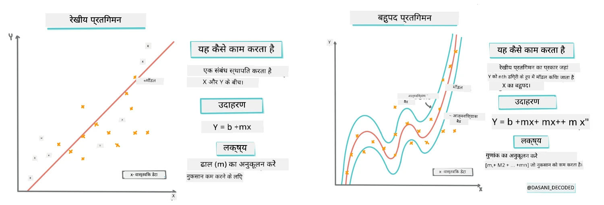
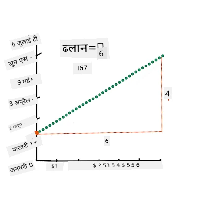
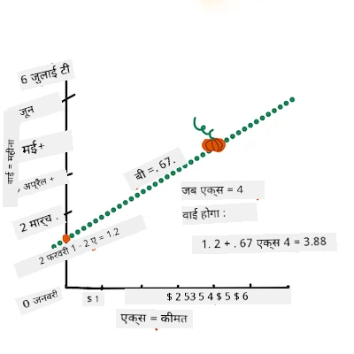
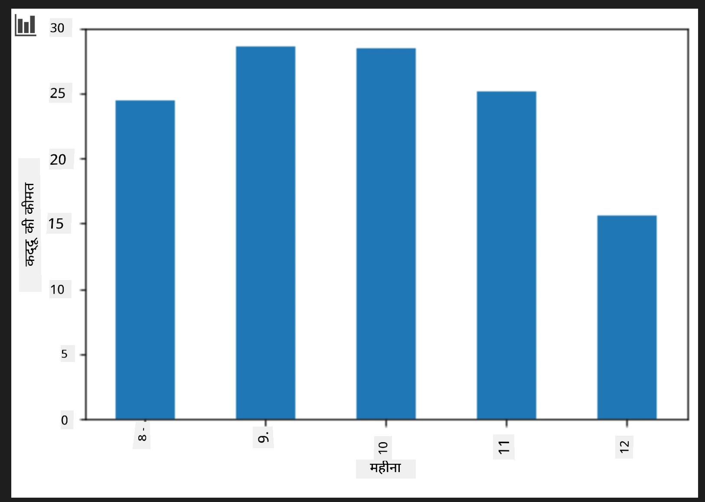
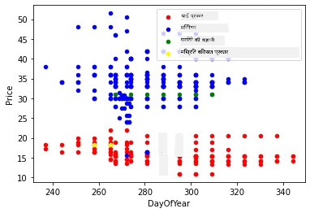

# Scikit-learn का उपयोग करके एक प्रतिगमन मॉडल बनाएं: प्रतिगमन के चार तरीके

## शुरुआती नोट

रैखिक प्रतिगमन का उपयोग तब किया जाता है जब हम एक **संख्यात्मक मान** का पूर्वानुमान लगाना चाहते हैं (उदाहरण के लिए, घर का मूल्य, तापमान, या बिक्री)।
यह इनपुट विशेषताओं और आउटपुट के बीच के संबंध का सबसे अच्छा प्रतिनिधित्व करने वाली एक सीधी रेखा खोजकर काम करता है।

इस पाठ में, हम अधिक उन्नत प्रतिगमन तकनीकों का पता लगाने से पहले अवधारणा को समझने पर ध्यान केंद्रित करते हैं।

> इन्फोग्राफिक [Dasani Madipalli](https://twitter.com/dasani_decoded) द्वारा
## [प्री-लेक्चर क्विज़](https://ff-quizzes.netlify.app/en/ml/)

> ### [यह पाठ R में उपलब्ध है!](../../../../2-Regression/3-Linear/solution/R/lesson_3.html)
### परिचय

अब तक आपने प्रतिगमन क्या है, इसे कद्दू के मूल्य निर्धारण डेटासेट से लिए गए नमूना डेटा के साथ एक्सप्लोर किया है, जिसे हम इस पाठ में लगातार उपयोग करेंगे। आपने इसे Matplotlib का उपयोग करके विज़ुअलाइज़ भी किया है।

अब आप एमएल के लिए प्रतिगमन में गहराई से उतरने के लिए तैयार हैं। जबकि विज़ुअलाइज़ेशन आपको डेटा को समझने में मदद करता है, मशीन लर्निंग की असली ताकत _मॉडल का प्रशिक्षण_ है। मॉडल को ऐतिहासिक डेटा पर प्रशिक्षित किया जाता है ताकि वे स्वतः डेटा की निर्भरताओं को पकड़ सकें, और ये आपको नए डेटा के लिए पूर्वानुमान लगाने की अनुमति देते हैं, जिसे मॉडल ने पहले नहीं देखा होता।

इस पाठ में, आप दो प्रकार के प्रतिगमन के बारे में अधिक सीखेंगे: _मूलभूत रैखिक प्रतिगमन_ और _बहुपद प्रतिगमन_, साथ ही इन तकनीकों के पीछे कुछ गणित। ये मॉडल हमें अलग-अलग इनपुट डेटा पर निर्भर करके कद्दू की कीमतों का पूर्वानुमान लगाने की अनुमति देंगे।

[](https://youtu.be/CRxFT8oTDMg "शुरुआती के लिए ML - रैखिक प्रतिगमन को समझना")

> 🎥 रैखिक प्रतिगमन का संक्षिप्त वीडियो अवलोकन देखने के लिए ऊपर की छवि पर क्लिक करें।

> इस पाठ्यक्रम में, हम न्यूनतम गणितीय ज्ञान की कल्पना करते हैं, और अन्य क्षेत्रों से आने वाले छात्रों के लिए इसे सुलभ बनाने का प्रयास करते हैं, इसलिए नोट्स, 🧮 कॉलआउट्स, आरेख, और अन्य शिक्षण उपकरणों पर ध्यान दें।

### पूर्व आवश्यकताएँ

अब तक आप उस कद्दू डेटा की संरचना से परिचित होनी चाहिए जिसे हम देख रहे हैं। इसे इस पाठ के _notebook.ipynb_ फ़ाइल में प्रीलोडेड और प्री-क्लीन किया गया है। इस फ़ाइल में, कद्दू की कीमत प्रति बुशल नई डेटा फ्रेम में प्रदर्शित है। सुनिश्चित करें कि आप इन नोटबुक्स को Visual Studio Code के कर्नेल्स में चला सकते हैं।

### तैयारी

एक अनुस्मारक के रूप में, आप इस डेटा को लोड कर रहे हैं ताकि आप इससे प्रश्न पूछ सकें।

- कद्दू खरीदने का सबसे अच्छा समय कब है?
- एक केस मिनिएचर कद्दू की कीमत क्या हो सकती है?
- क्या मुझे उन्हें आधे बुशल बास्केट में खरीदना चाहिए या 1 1/9 बुशल बॉक्स के अनुसार?
आइए इस डेटा में और गहराई से जांच करें।

पिछले पाठ में, आपने एक Pandas डेटा फ्रेम बनाया था और मूल डेटासेट के एक हिस्से से इसे भर दिया था, इस प्रकार कीमत को बुशल द्वारा मानकीकृत किया था। हालांकि ऐसा करने के बाद, आप केवल लगभग 400 डेटा पॉइंट्स इकट्ठा कर पाए और वे भी केवल गिरावट के महीनों के लिए।

इस पाठ के साथ आई नोटबुक में हमने जो डेटा प्रीलोड किया है, उस पर एक नज़र डालें। डेटा पूर्व लोडेड है और एक प्रारंभिक स्कैटरप्लॉट बनाया गया है जो महीने के डेटा को दिखाता है। शायद हम इसे और साफ़ करके डेटा की प्रकृति के बारे में थोड़ा अधिक जान सकें।

## एक रैखिक प्रतिगमन रेखा

जैसा कि आपने पाठ 1 में सीखा, रैखिक प्रतिगमन अभ्यास का उद्देश्य एक रेखा को प्लॉट करना है ताकि:

- **चर संबंध दिखाना**। चर के बीच के संबंध को दिखाएं।  
- **पूर्वानुमान बनाना**। यह सही पूर्वानुमान लगाना कि कोई नया डेटा पॉइंट उस रेखा के संबंध में कहां आएगा।

यह **Least-Squares Regression** का सामान्य अभ्यास है कि इस प्रकार की रेखा बनाएं। "Least-Squares" शब्द हमारे मॉडल में कुल त्रुटि को न्यूनतम करने की प्रक्रिया को दर्शाता है। हर डेटा पॉइंट के लिए, हम रेखा और वास्तविक पॉइंट के बीच लंबवत दूरी को मापते हैं (जिसे 'अवशेष' कहा जाता है)।

हम इन दूरीयों को दो मुख्य कारणों से वर्ग करते हैं:

1. **परिमाण दिशा से अधिक महत्वपूर्ण:** हम -5 की त्रुटि को +5 की त्रुटि के समान समझना चाहते हैं। वर्गीकरण सभी मानों को सकारात्मक कर देता है।

2. **आउटलेयर्स को दंडित करना:** वर्ग करने से बड़ी त्रुटियों को अधिक वजन मिलता है, जो रेखा को दूर के पॉइंट्स के करीब बनाए रखता है।

फिर हम इन वर्गीकृत मूल्यों को एक साथ जोड़ते हैं। हमारा लक्ष्य वह विशिष्ट रेखा ढूंढ़ना है जहां यह अंतिम योग सबसे कम (सबसे छोटा संभव मान) होता है—इसीलिए इसे "Least-Squares" कहा जाता है।

> **🧮 मुझे गणित दिखाइए**  
> 
> इस रेखा, जिसे _लाइन ऑफ बेस्ट फिट_ कहा जाता है, को [एक समीकरण](https://en.wikipedia.org/wiki/Simple_linear_regression) द्वारा व्यक्त किया जा सकता है:
> 
> ```
> Y = a + bX
> ```
>
> `X` 'व्याख्यात्मक चर' है। `Y` 'निर्भर चर' है। रेखा का उतार `b` है और `a` y-अवरोध है, जो उस समय `Y` का मान दर्शाता है जब `X = 0` होता है।  
>
>
>
> सबसे पहले, ढलान `b` की गणना करें। इन्फोग्राफिक [Jen Looper](https://twitter.com/jenlooper) द्वारा
>
> दूसरे शब्दों में, और हमारे कद्दू डेटा के मूल प्रश्न की ओर इशारा करते हुए: "महीने के अनुसार प्रति बुशल कद्दू की कीमत का पूर्वानुमान लगाएं", `X` कीमत को संदर्भित करेगा और `Y` बिक्री के महीने को।  
>
>
>
> Y का मान निकालें। यदि आप लगभग $4 दे रहे हैं, तो यह अप्रैल होना चाहिए! इन्फोग्राफिक [Jen Looper](https://twitter.com/jenlooper) द्वारा
>
> गणित जो रेखा की गणना करता है, उस रेखा का ढलान दिखाना होगा, जो अवरोध पर भी निर्भर करता है, या जहां `Y` स्थित होता है जब `X = 0` होता है।
>
> आप इन मानों की गणना की विधि को [Math is Fun](https://www.mathsisfun.com/data/least-squares-regression.html) वेबसाइट पर देख सकते हैं। साथ ही इस [Least-squares कैलक्युलेटर](https://www.mathsisfun.com/data/least-squares-calculator.html) पर जाकर देख सकते हैं कि नंबरों के मान लाइन को कैसे प्रभावित करते हैं।

## सहसंबंध

एक और शब्द जिसे समझना जरूरी है वह है दिया गया X और Y चर के बीच **सहसंबंध गुणांक**। एक स्कैटरप्लॉट का उपयोग करके, आप जल्दी से इस गुणांक को विज़ुअलाइज़ कर सकते हैं। एक ऐसा प्लॉट जिसमें डेटा पॉइंट्स एक साफ रेखा में फैले हों, उसका सहसंबंध उच्च होता है, लेकिन जो प्लॉट सभी जगह फैले डेटा पॉइंट्स दिखाता है, उसका सहसंबंध कम होता है।

एक अच्छा रैखिक प्रतिगमन मॉडल वह होगा जिसका सहसंबंध गुणांक उच्च (0 के बजाय 1 के करीब) हो, और जो Least-Squares Regression पद्धति के साथ प्रतिगमन रेखा रखता हो।

✅ इस पाठ के साथ आई नोटबुक चलाएं और महीने से मूल्य के स्कैटरप्लॉट को देखें। कद्दू बिक्री के लिए महीने और मूल्य को जोड़ने वाला डेटा आपकी स्कैटरप्लॉट की दृश्य व्याख्या के अनुसार उच्च या निम्न सहसंबंध दिखाता है? यदि आप `Month` के बजाय अधिक सूक्ष्म माप जैसे *वर्ष का दिन* (अर्थात वर्ष की शुरुआत से दिनों की संख्या) का उपयोग करते हैं, तो क्या यह परिवर्तन होता है?

नीचे दिए गए कोड में, हम मानते हैं कि हमने डेटा साफ किया है, और `new_pumpkins` नामक एक डेटा फ्रेम प्राप्त किया है, जो निम्नानुसार है:

ID | Month | DayOfYear | Variety | City | Package | Low Price | High Price | Price
---|-------|-----------|---------|------|---------|-----------|------------|-------
70 | 9 | 267 | PIE TYPE | BALTIMORE | 1 1/9 bushel cartons | 15.0 | 15.0 | 13.636364
71 | 9 | 267 | PIE TYPE | BALTIMORE | 1 1/9 bushel cartons | 18.0 | 18.0 | 16.363636
72 | 10 | 274 | PIE TYPE | BALTIMORE | 1 1/9 bushel cartons | 18.0 | 18.0 | 16.363636
73 | 10 | 274 | PIE TYPE | BALTIMORE | 1 1/9 bushel cartons | 17.0 | 17.0 | 15.454545
74 | 10 | 281 | PIE TYPE | BALTIMORE | 1 1/9 bushel cartons | 15.0 | 15.0 | 13.636364

> डेटा साफ करने के लिए कोड [`notebook.ipynb`](notebook.ipynb) में उपलब्ध है। हमने पिछले पाठ की तरह ही सफाई के कदम उठाए हैं, और निम्नलिखित अभिव्यक्ति का उपयोग करके `DayOfYear` कॉलम की गणना की है:

```python
day_of_year = pd.to_datetime(pumpkins['Date']).apply(lambda dt: (dt-datetime(dt.year,1,1)).days)
```

अब जब आपके पास रैखिक प्रतिगमन के पीछे के गणित की समझ है, तो चलिए एक प्रतिगमन मॉडल बनाते हैं ताकि देखें कि क्या हम यह पूर्वानुमान लगा सकते हैं कि कद्दू के किस पैकेज की कीमत सबसे अच्छी होगी। कोई ऐसा व्यक्ति जो छुट्टियों के कद्दू पैच के लिए कद्दू खरीद रहा हो, उसे अपने खरीदारी को अनुकूलित करने के लिए यह जानकारी चाहिए होगी।

## सहसंबंध की तलाश

[](https://youtu.be/uoRq-lW2eQo "शुरुआती के लिए ML - सहसंबंध की तलाश: रैखिक प्रतिगमन की कुंजी")

> 🎥 सहसंबंध का संक्षिप्त वीडियो अवलोकन देखने के लिए ऊपर की छवि पर क्लिक करें।

पिछले पाठ से आपने संभवतः देखा होगा कि अलग-अलग महीनों के लिए औसत कीमत कुछ इस प्रकार दिखती है:



यह सुझाव देता है कि वहाँ कुछ सहसंबंध होना चाहिए, और हम यह प्रयास कर सकते हैं कि `Month` और `Price` या `DayOfYear` और `Price` के बीच संबंध का पूर्वानुमान लगाने के लिए रैखिक प्रतिगमन मॉडल प्रशिक्षण दें। यह रहा वह स्कैटरप्लॉट जो बाद वाले संबंध को दिखाता है:


आइए `corr` फ़ंक्शन का उपयोग करके देखें कि सहसंबंध कितना है:

```python
print(new_pumpkins['Month'].corr(new_pumpkins['Price']))
print(new_pumpkins['DayOfYear'].corr(new_pumpkins['Price']))
```

ऐसा लगता है कि सहसंबंध काफी छोटा है, `Month` के अनुसार -0.15 और `DayOfYear` के अनुसार -0.17, लेकिन एक और महत्वपूर्ण संबंध हो सकता है। ऐसा लगता है कि कीमतों के विभिन्न समूह हैं जो विभिन्न कद्दू किस्मों से संबंधित हैं। इस अनुमान की पुष्टि के लिए, आइए प्रत्येक कद्दू श्रेणी को अलग रंग में प्लॉट करें। `scatter` प्लॉटिंग फ़ंक्शन को एक `ax` पैरामीटर पास करके हम सभी पॉइंट्स को एक ही ग्राफ पर प्लॉट कर सकते हैं:

```python
ax=None
colors = ['red','blue','green','yellow']
for i,var in enumerate(new_pumpkins['Variety'].unique()):
    df = new_pumpkins[new_pumpkins['Variety']==var]
    ax = df.plot.scatter('DayOfYear','Price',ax=ax,c=colors[i],label=var)
```



हमारी जांच से पता चलता है कि किस्म का समग्र कीमत पर वास्तविक बिक्री की तारीख की तुलना में अधिक प्रभाव है। हम इसे बार ग्राफ के साथ देख सकते हैं:

```python
new_pumpkins.groupby('Variety')['Price'].mean().plot(kind='bar')
```


हम इस समय केवल एक कद्दू किस्म, 'pie type' पर ध्यान केंद्रित करते हैं, और देखते हैं कि तारीख का कीमत पर क्या प्रभाव है:

```python
pie_pumpkins = new_pumpkins[new_pumpkins['Variety']=='PIE TYPE']
pie_pumpkins.plot.scatter('DayOfYear','Price') 
```


यदि हम अब `Price` और `DayOfYear` के बीच सहसंबंध की गणना `corr` फ़ंक्शन का उपयोग करके करते हैं, तो मान लगभग `-0.27` होगा - जिसका अर्थ है कि एक पूर्वानुमान मॉडल का प्रशिक्षण करना समझ में आता है।

> एक रैखिक प्रतिगमन मॉडल को प्रशिक्षण देने से पहले, यह सुनिश्चित करना महत्वपूर्ण है कि हमारा डेटा साफ़ है। रैखिक प्रतिगमन गायब मानों के साथ अच्छा काम नहीं करता, इसलिए सभी खाली कोशिकाओं को हटाना समझदारी है:

```python
pie_pumpkins.dropna(inplace=True)
pie_pumpkins.info()
```

एक और तरीका होगा कि उन खाली मूल्यों को संबंधित कॉलम के औसत मान से भर दिया जाए।

## सरल रैखिक प्रतिगमन

[](https://youtu.be/e4c_UP2fSjg "शुरुआती के लिए ML - Scikit-learn का उपयोग करके रैखिक और बहुपद प्रतिगमन")

> 🎥 रैखिक और बहुपद प्रतिगमन का संक्षिप्त वीडियो अवलोकन देखने के लिए ऊपर की छवि पर क्लिक करें।

हमारा रैखिक प्रतिगमन मॉडल प्रशिक्षित करने के लिए, हम **Scikit-learn** पुस्तकालय का उपयोग करेंगे।

```python
from sklearn.linear_model import LinearRegression
from sklearn.metrics import mean_squared_error
from sklearn.model_selection import train_test_split
```

हम इनपुट मानों (विशेषताएँ) और अपेक्षित आउटपुट (लेबल) को अलग-अलग numpy ऐरे में अलग करते हैं:

```python
X = pie_pumpkins['DayOfYear'].to_numpy().reshape(-1,1)
y = pie_pumpkins['Price']
```

> ध्यान दें कि हमें इनपुट डेटा पर `reshape` करने की आवश्यकता पड़ी ताकि Linear Regression पैकेज इसे सही ढंग से समझ सके। Linear Regression 2D ऐरे को इनपुट के रूप में अपेक्षित करता है, जिसमें ऐरे की प्रत्येक पंक्ति एक इनपुट फीचर के वेक्टर के अनुरूप होती है। हमारे मामले में, क्योंकि हमारे पास केवल एक इनपुट है - हमें N×1 आकार का ऐरे चाहिए, जहां N डेटासेट का आकार है।

फिर, हमें मॉडल के प्रशिक्षण के बाद इसे मान्य करने के लिए डेटा को प्रशिक्षण और परीक्षण डेटा सेट में विभाजित करना होगा:

```python
X_train, X_test, y_train, y_test = train_test_split(X, y, test_size=0.2, random_state=0)
```

अंत में, वास्तविक Linear Regression मॉडल को प्रशिक्षित करना केवल दो कोड लाइन लेता है। हम `LinearRegression` ऑब्जेक्ट परिभाषित करते हैं, और `fit` मेथड का उपयोग करके इसे हमारे डेटा पर फिट करते हैं:

```python
lin_reg = LinearRegression()
lin_reg.fit(X_train,y_train)
```

`fit` करने के बाद `LinearRegression` ऑब्जेक्ट में सभी रिग्रेशन के सहगुण होते हैं, जिन्हें `.coef_` प्रॉपर्टी का उपयोग करके एक्सेस किया जा सकता है। हमारे मामले में, केवल एक सहगुण है, जो लगभग `-0.017` होना चाहिए। इसका मतलब है कि कीमतें समय के साथ थोड़ा गिरती दिखती हैं, लेकिन ज्यादा नहीं, लगभग 2 सेंट प्रति दिन। हम रिग्रेशन के Y-अक्ष के साथ मिलने वाले इंटरसेप्शन पॉइंट को भी `lin_reg.intercept_` का उपयोग करके एक्सेस कर सकते हैं - यह हमारे मामले में लगभग `21` होगा, जो वर्ष की शुरुआत में कीमत को दर्शाता है।

देखने के लिए कि हमारा मॉडल कितना सटीक है, हम टेस्ट डेटासेट पर कीमतें अनुमानित कर सकते हैं, और फिर यह माप सकते हैं कि हमारे अनुमान अपेक्षित मूल्यों के कितने करीब हैं। इसे रूट मीन स्क्वायर एरर (RMSE) मीट्रिक का उपयोग करके किया जा सकता है, जो अपेक्षित और अनुमानित मानों के बीच सभी वर्गीकृत अंतरों का माध्य का वर्गमूल होता है।

```python
pred = lin_reg.predict(X_test)

rmse = np.sqrt(mean_squared_error(y_test,pred))
print(f'RMSE: {rmse:3.3} ({rmse/np.mean(pred)*100:3.3}%)')
```

हमारी त्रुटि लगभग 2 पॉइंट के आसपास लगती है, जो लगभग 17% है। यह बहुत अच्छी नहीं है। मॉडल गुणवत्ता का एक अन्य संकेतक है **निर्धारण का सहगुणांक**, जिसे इस तरह से प्राप्त किया जा सकता है:

```python
score = lin_reg.score(X_train,y_train)
print('Model determination: ', score)
```
यदि मान 0 है, तो इसका मतलब है कि मॉडल इनपुट डेटा को ध्यान में नहीं लेता है, और *सबसे खराब रैखिक भविष्यवक्ता* के रूप में कार्य करता है, जो बस परिणाम का औसत मान है। मान 1 का अर्थ है कि हम सभी अपेक्षित आउटपुट को पूरी तरह सही अनुमानित कर सकते हैं। हमारे मामले में, सहगुणांक लगभग 0.06 है, जो काफी कम है।

हम टेस्ट डाटा को रिग्रेशन लाइन के साथ प्लॉट भी कर सकते हैं ताकि बेहतर तरीके से देख सकें कि रिग्रेशन हमारे मामले में कैसे काम करती है:

```python
plt.scatter(X_test,y_test)
plt.plot(X_test,pred)
```


## पॉलीनॉमियल रिग्रेशन

रैखिक रिग्रेशन का एक अन्य प्रकार पॉलीनॉमियल रिग्रेशन है। जबकि कभी-कभी चर के बीच रैखिक संबंध होता है - जैसे कद्दू का आकार बड़ा होने पर कीमत अधिक होती है - कभी-कभी ये संबंध प्लेन या सीधे रेखा के रूप में प्रदर्शित नहीं किए जा सकते।

✅ यहाँ [कुछ और उदाहरण](https://online.stat.psu.edu/stat501/Lesson09#polynomial-regression-examples) हैं जिनमें पॉलीनॉमियल रिग्रेशन का उपयोग किया जा सकता है।

डेट और कीमत के बीच संबंध पर एक बार फिर ध्यान दें। क्या यह स्कैटरप्लॉट ऐसी रेखा से विश्लेषण किया जाना चाहिए? क्या कीमतें स्थिर नहीं रह सकतीं? इस स्थिति में, आप पॉलीनॉमियल रिग्रेशन कोशिश कर सकते हैं।

✅ पॉलीनॉमियल गणितीय अभिव्यक्तियाँ हैं जो एक या अधिक चर और सहगुणों से मिलकर बनती हैं।

पॉलीनॉमियल रिग्रेशन गैर-रैखिक डेटा के लिए बेहतर फिटिंग के लिए एक घुमावदार रेखा बनाता है। हमारे मामले में, यदि हम इनपुट डेटा में `DayOfYear` के वर्ग को शामिल करते हैं, तो हमें अपने डेटा को एक परवलयाकार वक्र से फिट करने में सक्षम होना चाहिए, जिसके वर्ष की एक निश्चित बिंदु पर न्यूनतम होगा।

Scikit-learn में विभिन्न डेटा प्रोसेसिंग चरणों को संयोजित करने के लिए एक सहायक [पाइपलाइन API](https://scikit-learn.org/stable/modules/generated/sklearn.pipeline.make_pipeline.html?highlight=pipeline#sklearn.pipeline.make_pipeline) शामिल है। एक **पाइपलाइन** **एस्टिमेटरों** की श्रृंखला होती है। हमारे मामले में, हम एक पाइपलाइन बनाएंगे जो पहले हमारे मॉडल में पॉलीनॉमियल फीचर्स जोड़ती है, और फिर रिग्रेशन को प्रशिक्षित करती है:

```python
from sklearn.preprocessing import PolynomialFeatures
from sklearn.pipeline import make_pipeline

pipeline = make_pipeline(PolynomialFeatures(2), LinearRegression())

pipeline.fit(X_train,y_train)
```

`PolynomialFeatures(2)` का उपयोग करने का मतलब है कि हम इनपुट डेटा से सभी द्वितीय-डिग्री पॉलीनॉमियल को शामिल करेंगे। हमारे मामले में यह केवल `DayOfYear`<sup>2</sup> होगा, लेकिन यदि हमारे पास दो इनपुट चर X और Y हैं, तो यह X<sup>2</sup>, XY और Y<sup>2</sup> जोड़ेगा। हम यदि चाहें तो उच्च डिग्री पॉलीनॉमियल का भी उपयोग कर सकते हैं।

पाइपलाइनों का उपयोग मूल `LinearRegression` ऑब्जेक्ट की तरह ही किया जा सकता है, यानी हम पाइपलाइन को `fit` कर सकते हैं, और फिर `predict` का उपयोग करके पूर्वानुमान परिणाम प्राप्त कर सकते हैं:

```python
pred = pipeline.predict(X_test)

rmse = np.sqrt(mean_squared_error(y_test,pred))
print(f'RMSE: {rmse:3.3} ({rmse/np.mean(pred)*100:3.3}%)')

score = pipeline.score(X_train,y_train)
print('Model determination: ', score)
```

स्मूद अप्रोक्सिमेशन कर्व को प्लॉट करने के लिए, हम `np.linspace` का उपयोग करते हैं ताकि इनपुट मानों की एक समान श्रेणी बनाई जा सके, बजाय सीधे अनऑर्डर किए गए टेस्ट डेटा पर प्लॉट करने के (जो एक ज़िगज़ैग रेखा उत्पन्न करेगा):

```python
X_range = np.linspace(X_test.min(), X_test.max(), 100).reshape(-1,1)
y_range = pipeline.predict(X_range)

plt.scatter(X_test, y_test)
plt.plot(X_range, y_range)
```

यहाँ ग्राफ दिखा रहा है टेस्ट डेटा और अपरोक्ष कर्व:


पॉलीनॉमियल रिग्रेशन का उपयोग करते हुए, हम थोड़ा कम RMSE और उच्च निर्धारण प्राप्त कर सकते हैं, लेकिन काफी हद तक नहीं। हमें अन्य विशेषताओं को ध्यान में रखना होगा!

> आप देख सकते हैं कि न्यूनतम कद्दू की कीमतें कहीं हैलोवीन के आसपास देखी गई हैं। आप इसे कैसे समझाएंगे?

🎃 बधाई हो, आपने एक ऐसा मॉडल बनाया है जो पाई कद्दू की कीमत अनुमानित करने में मदद कर सकता है। आप शायद सभी कद्दू प्रकारों के लिए वही प्रक्रिया दोहरा सकते हैं, लेकिन यह थकाऊ हो सकता है। अब चलिए सीखते हैं कि हमारी मॉडल में कद्दू की किस्म को कैसे ध्यान में रखा जाए!

## श्रेणीगत विशेषताएँ

आदर्श दुनिया में, हम चाहते हैं कि हम एक ही मॉडल का उपयोग करके विभिन्न कद्दू किस्मों के लिए कीमतें अनुमानित कर सकें। हालांकि, `Variety` कॉलम `Month` जैसे कॉलम से थोड़ा अलग है, क्योंकि यह गैर-सांख्यिक मान होते हैं। ऐसे कॉलम को **श्रेणीगत** कहा जाता है।

[](https://youtu.be/DYGliioIAE0 "ML for beginners - Categorical Feature Predictions with Linear Regression")

> 🎥 ऊपर की छवि पर क्लिक करें श्रेणीगत विशेषताओं के उपयोग पर संक्षिप्त वीडियो अवलोकन के लिए।

यहाँ आप देख सकते हैं कि औसत कीमत किस्म पर कैसे निर्भर करती है:


किस्म को ध्यान में लेने के लिए, हमें इसे पहले संख्यात्मक रूप में परिवर्तित करना होगा, या इसे **कोडित** करना होगा। इसके कई तरीके हैं:

* सरल **संख्यात्मक कोडिंग** विभिन्न किस्मों की एक तालिका बनाएगी, और फिर किस्म के नाम को उस तालिका में उसके अनुक्रमांक द्वारा बदल देगी। यह रैखिक रिग्रेशन के लिए सबसे अच्छी विधि नहीं है, क्योंकि रैखिक रिग्रेशन अनुक्रमांक के वास्तविक संख्यात्मक मान को लेता है, और इसे कुछ सहगुणक से गुणा करके परिणाम में जोड़ता है। हमारे मामले में, अनुक्रमांक संख्या और कीमत के बीच संबंध स्पष्ट रूप से गैर-रैखिक है, भले ही हम यह सुनिश्चित करें कि अनुक्रमांक किसी विशिष्ट तरीके से क्रमबद्ध हों।
* **वन-हॉट एन्कोडिंग** `Variety` कॉलम को 4 अलग-अलग कॉलम में बदल देगा, हर एक किस्म के लिए एक। प्रत्येक कॉलम में `1` होगा यदि संबंधित पंक्ति उस किस्म की है, और अन्यथा `0` होगा। इसका मतलब है कि रैखिक रिग्रेशन में चार सहगुण होंगे, हर कद्दू किस्म के लिए एक, जो उस विशेष किस्म के "शुरुआती मूल्य" (या बल्कि "अतिरिक्त मूल्य") के लिए जिम्मेदार होगा।

निम्नलिखित कोड दिखाता है कि हम किस तरह वन-हॉट एन्कोडिंग कर सकते हैं:

```python
pd.get_dummies(new_pumpkins['Variety'])
```

 ID | FAIRYTALE | MINIATURE | MIXED HEIRLOOM VARIETIES | PIE TYPE
----|-----------|-----------|--------------------------|----------
70 | 0 | 0 | 0 | 1
71 | 0 | 0 | 0 | 1
... | ... | ... | ... | ...
1738 | 0 | 1 | 0 | 0
1739 | 0 | 1 | 0 | 0
1740 | 0 | 1 | 0 | 0
1741 | 0 | 1 | 0 | 0
1742 | 0 | 1 | 0 | 0

वन-हॉट एन्कोडेड किस्म का उपयोग करके रैखिक रिग्रेशन को प्रशिक्षित करने के लिए, हमें केवल `X` और `y` डेटा को सही तरीके से इनीशियलाइज करना होगा:

```python
X = pd.get_dummies(new_pumpkins['Variety'])
y = new_pumpkins['Price']
```

बाकी कोड वही है जो हमने ऊपर रैखिक रिग्रेशन को प्रशिक्षित करने के लिए उपयोग किया। अगर आप इसे आजमाएंगे, तो आप देखेंगे कि मीन स्क्वायर्ड एरर लगभग समान है, लेकिन हामी अधिक उच्च निर्धारण (लगभग 77%) प्राप्त कर लेते हैं। और अधिक सटीक पूर्वानुमान प्राप्त करने के लिए, हम और श्रेणीगत विशेषताओं के साथ-साथ संख्यात्मक विशेषताओं, जैसे `Month` या `DayOfYear` को भी ध्यान में ले सकते हैं। एक बड़ा फीचर्स ऐरे बनाने के लिए, हम `join` का उपयोग कर सकते हैं:

```python
X = pd.get_dummies(new_pumpkins['Variety']) \
        .join(new_pumpkins['Month']) \
        .join(pd.get_dummies(new_pumpkins['City'])) \
        .join(pd.get_dummies(new_pumpkins['Package']))
y = new_pumpkins['Price']
```

यहाँ हम `City` और `Package` प्रकार को भी ध्यान में लेते हैं, जो हमें RMSE 2.84 (10.5%) और निर्धारण 0.94 देता है!

## सब कुछ एक साथ रखना

सबसे अच्छा मॉडल बनाने के लिए, हम ऊपर के उदाहरण से मिले संयुक्त (वन-हॉट एन्कोडेड श्रेणीगत + संख्यात्मक) डेटा का उपयोग पॉलीनॉमियल रिग्रेशन के साथ कर सकते हैं। आपकी सुविधा के लिए यहां पूर्ण कोड है:

```python
# प्रशिक्षण डेटा सेट करें
X = pd.get_dummies(new_pumpkins['Variety']) \
        .join(new_pumpkins['Month']) \
        .join(pd.get_dummies(new_pumpkins['City'])) \
        .join(pd.get_dummies(new_pumpkins['Package']))
y = new_pumpkins['Price']

# ट्रेन-टेस्ट स्प्लिट करें
X_train, X_test, y_train, y_test = train_test_split(X, y, test_size=0.2, random_state=0)

# पाइपलाइन सेटअप और प्रशिक्षण करें
pipeline = make_pipeline(PolynomialFeatures(2), LinearRegression())
pipeline.fit(X_train,y_train)

# परीक्षण डेटा के लिए परिणाम अनुमानित करें
pred = pipeline.predict(X_test)

# RMSE और निर्धारण गणना करें
rmse = mean_squared_error(y_test, pred, squared=False)
print(f'RMSE: {rmse:3.3} ({rmse/pred.mean()*100:3.3}%)')

score = pipeline.score(X_train,y_train)
print('Model determination: ', score)
```

यह हमें लगभग 97% का सर्वोत्तम निर्धारण सहगुण और RMSE=2.23 (~8% पूर्वानुमान त्रुटि) देगा।

| Model | RMSE | Determination |
|-------|-----|---------------|
| `DayOfYear` Linear | 2.77 (17.2%) | 0.07 |
| `DayOfYear` Polynomial | 2.73 (17.0%) | 0.08 |
| `Variety` Linear | 5.24 (19.7%) | 0.77 |
| All features Linear | 2.84 (10.5%) | 0.94 |
| All features Polynomial | 2.23 (8.25%) | 0.97 |

🏆 बहुत बढ़िया! आपने एक पाठ में चार रिग्रेशन मॉडल बनाए, और मॉडल गुणवत्ता को 97% तक सुधार दिया। अंतिम खंड में, आप वर्ग निर्धारित करने के लिए लॉजिस्टिक रिग्रेशन के बारे में जानेंगे।

---
## 🚀चुनौती

इस नोटबुक में कई अलग-अलग चर का परीक्षण करें ताकि देखें कि सहसंबंध मॉडल की सटीकता से कैसे मेल खाता है।

## [पाठ के बाद क्विज़](https://ff-quizzes.netlify.app/en/ml/)

## समीक्षा एवं स्वअध्ययन

इस पाठ में हमने रैखिक रिग्रेशन के बारे में जाना। अन्य महत्वपूर्ण प्रकार के रिग्रेशन भी हैं। स्टेपवाइज, रिज, लैसो और इलास्टिकनेट तकनीकों के बारे में पढ़ें। अधिक जानने के लिए एक अच्छा कोर्स है [Stanford Statistical Learning course](https://online.stanford.edu/courses/sohs-ystatslearning-statistical-learning)

## असाइनमेंट

[मॉडल बनाएँ](assignment.md)

---

<!-- CO-OP TRANSLATOR DISCLAIMER START -->
**अस्वीकरण**:  
इस दस्तावेज़ का अनुवाद AI अनुवाद सेवा [Co-op Translator](https://github.com/Azure/co-op-translator) का उपयोग करके किया गया है। जबकि हम सटीकता के लिए प्रयासरत हैं, कृपया ध्यान दें कि स्वचालित अनुवादों में त्रुटियां या असंगतियाँ हो सकती हैं। मूल दस्तावेज़ अपनी मातृ भाषा में ही प्रामाणिक स्रोत माना जाना चाहिए। महत्वपूर्ण जानकारी के लिए, पेशेवर मानव अनुवाद की सिफारिश की जाती है। इस अनुवाद के उपयोग से उत्पन्न किसी भी गलतफहमी या गलत व्याख्या के लिए हम जिम्मेदार नहीं हैं।
<!-- CO-OP TRANSLATOR DISCLAIMER END -->