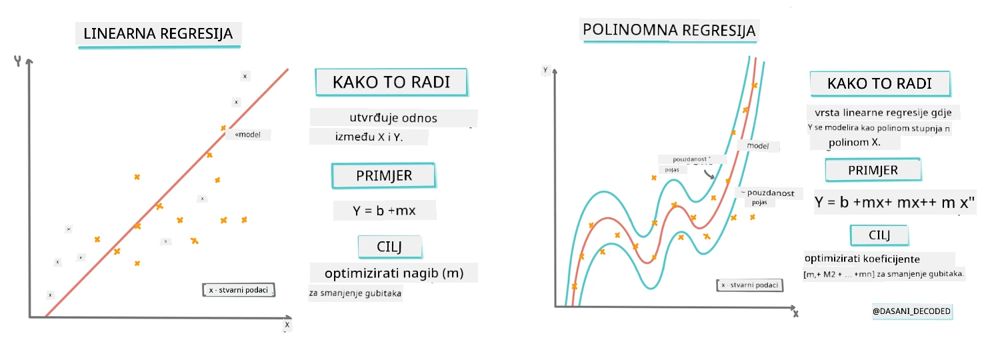
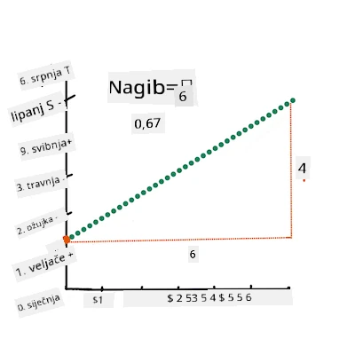
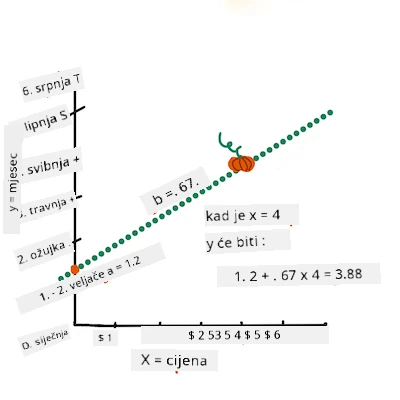
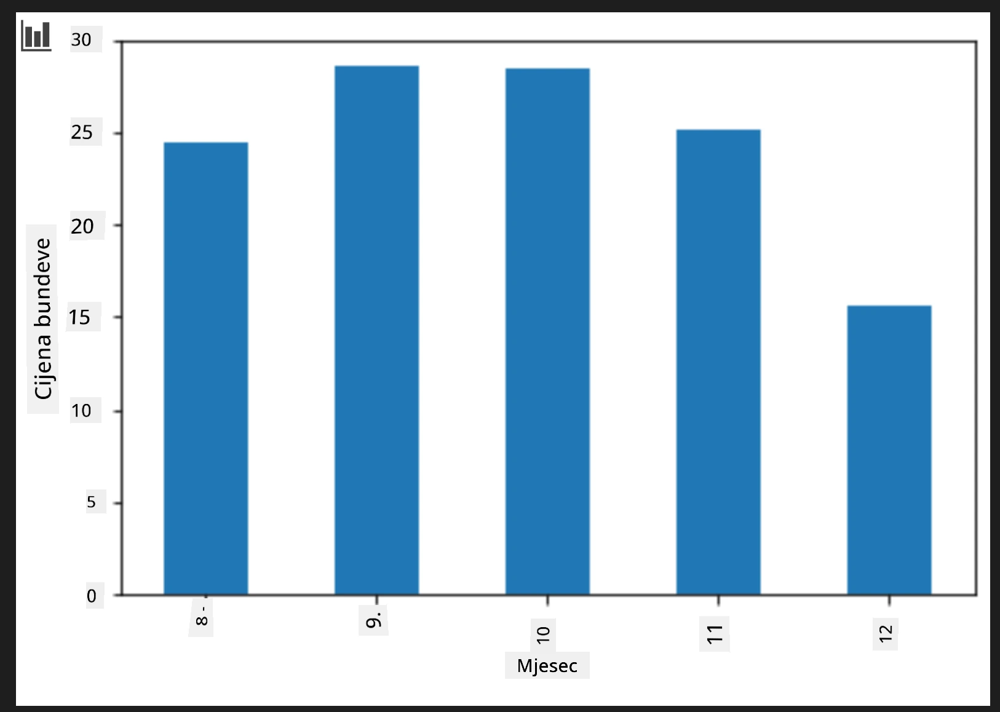
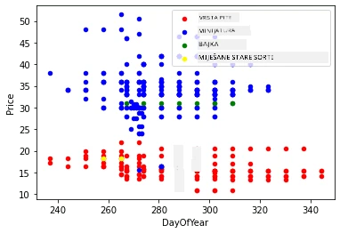

# Izrada regresijskog modela pomoću Scikit-learn: regresija na četiri načina

## Napomena za početnike

Linearna regresija se koristi kada želimo predvidjeti **numeričku vrijednost** (na primjer, cijenu kuće, temperaturu ili prodaju).
Radi pronalaženjem pravca koji najbolje predstavlja odnos između ulaznih značajki i izlaza.

U ovoj lekciji fokusiramo se na razumijevanje koncepta prije nego što istražimo naprednije tehnike regresije.

> Infografika autora [Dasani Madipalli](https://twitter.com/dasani_decoded)
## [Kviz prije predavanja](https://ff-quizzes.netlify.app/en/ml/)

> ### [Ova lekcija dostupna je i na R!](../../../../2-Regression/3-Linear/solution/R/lesson_3.html)
### Uvod

Do sada ste istraživali što je regresija na primjeru podataka iz skupa podataka o cijenama bundeva koje ćemo koristiti kroz ovu lekciju. Također ste ih vizualizirali koristeći Matplotlib.

Sada ste spremni za dublje razumijevanje regresije za strojno učenje. Dok vizualizacija pomaže da razumijete podatke, prava moć strojnog učenja dolazi iz _treniranja modela_. Modeli se treniraju na povijesnim podacima kako bi automatski uhvatili ovisnosti u podacima, a omogućuju vam predviđanje ishoda za nove podatke koje model još nije vidio.

U ovoj lekciji naučit ćete više o dvije vrste regresije: _osnovnoj linearnoj regresiji_ i _polinomnoj regresiji_, zajedno s matematikom koja stoji iza ovih tehnika. Ti modeli će nam omogućiti predviđanje cijena bundeva ovisno o različitim ulaznim podacima.

[](https://youtu.be/CRxFT8oTDMg "ML for beginners - Understanding Linear Regression")

> 🎥 Kliknite na sliku iznad za kratak video pregled linearne regresije.

> Tijekom ovog kurikuluma pretpostavljamo minimalno matematičko znanje i nastojimo ga učiniti dostupnim studentima iz drugih područja, pa obratite pozornost na bilješke, 🧮 istaknute kutke, dijagrame i druge alate za učenje koji pomažu u razumijevanju.

### Preduvjeti

Trebao bi biti upoznat sa strukturom podataka o bundevama koje proučavamo. Možete ih pronaći unaprijed učitane i očišćene u datoteci _notebook.ipynb_ koja prati ovu lekciju. U toj datoteci cijena bundeve je prikazana po šokcu u novom DataFrameu. Pobrinite se da možete pokretati ove bilježnice u kernelima unutar Visual Studio Codea.

### Priprema

Kao podsjetnik, učitavate ove podatke da biste mogli postavljati pitanja o njima.

- Kada je najbolje vrijeme za kupiti bundeve? 
- Koju cijenu mogu očekivati za kutiju malih bundeva?
- Trebam li kupovati u polušokcima ili po kutiji od 1 1/9 šokca?
Nastavimo dalje istraživati ove podatke.

U prethodnoj lekciji ste kreirali Pandas DataFrame i popunili ga dijelom izvornog skupa podataka, standardizirajući cijenu po šokcu. Međutim, tako ste uspjeli prikupiti oko 400 podataka i to samo za jesenske mjesece.

Pogledajte podatke koje smo unaprijed učitali u bilježnici ove lekcije. Podaci su već učitani i prikazan je početni scatterplot koji pokazuje podatke po mjesecu. Možda možemo dobiti malo više detalja o prirodi podataka njihovim dodatnim čišćenjem.

## Linija linearne regresije

Kao što ste naučili u Lekciji 1, cilj vježbe linearne regresije je moći nacrtati liniju koja će:

- **Prikazati odnose između varijabli**. Pokazati odnos između varijabli
- **Napraviti predviđanja**. Točno predvidjeti gdje bi novi podatak pao u odnosu na tu liniju.
 
Tipično za **Least-Squares regresiju** je crtanje ovakve linije. Pojam "Least-Squares" odnosi se na proces minimizacije ukupne pogreške u našem modelu. Za svaki podatak mjerimo okomitu udaljenost (nazvanu ostatak) između stvarne točke i naše regresijske linije.

Te udaljenosti kvadriramo iz dva glavna razloga:

1. **Veličina a ne smjer:** Želimo tretirati pogrešku -5 jednako kao i pogrešku +5. Kvadriranjem sve vrijednosti postaju pozitivne.

2. **Kazna za outliere:** Kvadriranjem veće pogreške dobivaju veću težinu, prisiljavajući liniju da bude bliže udaljenim točkama.

Zatim zbrajamo sve kvadrirane vrijednosti. Cilj je pronaći točnu liniju za koju je taj konačni zbroj najmanji (najmanja moguća vrijednost) — po čemu je naziv "Least-Squares".

> **🧮 Pokaži mi matematiku**
> 
> Ova linija, nazvana _linija najboljeg pristajanja_ može se izraziti [jednadžbom](https://en.wikipedia.org/wiki/Simple_linear_regression): 
> 
> ```
> Y = a + bX
> ```
>
> `X` je 'objašnjavajuća varijabla'. `Y` je 'ovisna varijabla'. Nagib linije je `b`, a `a` je presjek na y-osi, što označava vrijednost `Y` kada je `X = 0`.
>
>
>
> Prvo izračunajte nagib `b`. Infografika autora [Jen Looper](https://twitter.com/jenlooper)
>
> Drugim riječima, i imajući na umu naše izvorišno pitanje o podacima o bundevama: "predvidjeti cijenu bundeve po šokcu prema mjesecu", `X` bi označavalo cijenu, a `Y` mjesec prodaje.
>
>
>
> Izračunajte vrijednost Y. Ako plaćate oko 4 dolara, mora biti travanj! Infografika autora [Jen Looper](https://twitter.com/jenlooper)
>
> Matematika koja izračunava liniju mora prikazati nagib linije, koji ovisi i o presjeku, odnosno gdje se `Y` nalazi kada je `X = 0`.
>
> Metodu izračuna za ove vrijednosti možete vidjeti na [Math is Fun](https://www.mathsisfun.com/data/least-squares-regression.html). Posjetite i [ovaj kalkulator najmanjih kvadrata](https://www.mathsisfun.com/data/least-squares-calculator.html) da vidite kako vrijednosti brojeva utječu na liniju.

## Korelacija

Još jedan pojam za razumjeti je **Koeficijent korelacije** između danih varijabli X i Y. Korištenjem scatterplota možete brzo vizualizirati ovaj koeficijent. Grafikon s točkama razbacanim duž pravilne linije ima visoku korelaciju, dok grafikon s točkama rasprostranjenim posvuda između X i Y ima nisku korelaciju.

Dobar linearni regresijski model bit će onaj koji ima visok (bliži 1 nego 0) Koeficijent korelacije koristeći metodu najmanjih kvadrata s regresijskom linijom.

✅ Pokrenite bilježnicu koja prati ovu lekciju i pogledajte scatterplot Mjesec prema Cijeni. Čini li se da podaci koji povezuju Mjesec i Cijenu za prodaju bundeva imaju visoku ili nisku korelaciju prema vašoj vizualnoj interpretaciji scatterplota? Mijenja li to ako koristite detaljniju mjeru umjesto `Mjesec`, npr. *dan u godini* (tj. broj dana od početka godine)?

U sljedećem kodu pretpostavit ćemo da smo očistili podatke i dobili DataFrame nazvan `new_pumpkins`, sličan sljedećem:

ID | Mjesec | DaniUGodini | Vrsta | Grad | Pakiranje | Najniža cijena | Najviša cijena | Cijena
---|-------|-----------|---------|------|---------|-----------|------------|-------
70 | 9 | 267 | TIP ZA PITU | BALTIMORE | kutije od 1 1/9 šokca | 15.0 | 15.0 | 13.636364
71 | 9 | 267 | TIP ZA PITU | BALTIMORE | kutije od 1 1/9 šokca | 18.0 | 18.0 | 16.363636
72 | 10 | 274 | TIP ZA PITU | BALTIMORE | kutije od 1 1/9 šokca | 18.0 | 18.0 | 16.363636
73 | 10 | 274 | TIP ZA PITU | BALTIMORE | kutije od 1 1/9 šokca | 17.0 | 17.0 | 15.454545
74 | 10 | 281 | TIP ZA PITU | BALTIMORE | kutije od 1 1/9 šokca | 15.0 | 15.0 | 13.636364

> Kod za čišćenje podataka dostupan je u [`notebook.ipynb`](notebook.ipynb). Proveli smo iste korake čišćenja kao u prethodnoj lekciji, a stupac `DaniUGodini` izračunat je sljedećim izrazom:

```python
day_of_year = pd.to_datetime(pumpkins['Date']).apply(lambda dt: (dt-datetime(dt.year,1,1)).days)
```

Sada kad imate razumijevanje matematike iza linearne regresije, kreirajmo regresijski model da vidimo možemo li predvidjeti koje pakiranje bundeva ima najbolje cijene. Netko tko kupuje bundeve za jesensku sadnju može htjeti te informacije kako bi optimizirao svoje kupnje pakiranja bundeva za sadnju.

## Traženje korelacije

[](https://youtu.be/uoRq-lW2eQo "ML for beginners - Looking for Correlation: The Key to Linear Regression")

> 🎥 Kliknite na sliku iznad za kratak video pregled korelacije.

Iz prethodne lekcije vjerojatno ste vidjeli da prosječna cijena za različite mjesece izgleda ovako:



To sugerira da postoje neke korelacije, i možemo pokušati trenirati linearan regresijski model da predvidi odnos između `Mjesec` i `Cijena`, ili između `DaniUGodini` i `Cijena`. Evo scatterplota koji prikazuje ovaj zadnji odnos:

 

Pogledajmo postoji li korelacija koristeći funkciju `corr`:

```python
print(new_pumpkins['Month'].corr(new_pumpkins['Price']))
print(new_pumpkins['DayOfYear'].corr(new_pumpkins['Price']))
```

Izgleda da je korelacija prilično mala, -0.15 po `Mjesec` i -0.17 po `DaniUGodini`, ali može postojati još neki važniji odnos. Izgleda da postoje različite skupine cijena koje odgovaraju različitim sortama bundeva. Za potvrdu ove hipoteze nacrtajmo svaku kategoriju bundeva u različitoj boji. Prosljeđivanjem parametra `ax` funkciji `scatter` možemo nacrtati sve točke na istom grafikonu:

```python
ax=None
colors = ['red','blue','green','yellow']
for i,var in enumerate(new_pumpkins['Variety'].unique()):
    df = new_pumpkins[new_pumpkins['Variety']==var]
    ax = df.plot.scatter('DayOfYear','Price',ax=ax,c=colors[i],label=var)
```

 

Naše istraživanje sugerira da vrsta bundeve ima veći utjecaj na ukupnu cijenu nego stvarni dan prodaje. To možemo vidjeti i na stupčastom grafikonu:

```python
new_pumpkins.groupby('Variety')['Price'].mean().plot(kind='bar')
```

 

Za sada se usredotočimo samo na jednu sortu bundeve, tip 'za pitu', i pogledajmo kakav utjecaj datum ima na cijenu:

```python
pie_pumpkins = new_pumpkins[new_pumpkins['Variety']=='PIE TYPE']
pie_pumpkins.plot.scatter('DayOfYear','Price') 
```
 

Ako sada izračunamo korelaciju između `Cijene` i `DaniUGodini` koristeći `corr` funkciju, dobit ćemo vrijednost oko `-0.27` - što znači da ima smisla trenirati prediktivni model.

> Prije treniranja linearnog regresijskog modela važan je uvjet da su podaci čisti. Linearna regresija ne radi dobro s nedostajućim vrijednostima, stoga ima smisla ukloniti sve prazne ćelije:

```python
pie_pumpkins.dropna(inplace=True)
pie_pumpkins.info()
```

Drugi pristup bi bio popuniti te prazne vrijednosti srednjom vrijednosti odgovarajućeg stupca.

## Jednostavna linearna regresija

[](https://youtu.be/e4c_UP2fSjg "ML for beginners - Linear and Polynomial Regression using Scikit-learn")

> 🎥 Kliknite na sliku iznad za kratak video pregled linearne i polinomne regresije.

Za treniranje našeg Linear Regression modela koristit ćemo **Scikit-learn** biblioteku.

```python
from sklearn.linear_model import LinearRegression
from sklearn.metrics import mean_squared_error
from sklearn.model_selection import train_test_split
```

Počinjemo odvajanjem ulaznih vrijednosti (značajki) i očekivanog izlaza (oznake) u zasebne numpy nizove:

```python
X = pie_pumpkins['DayOfYear'].to_numpy().reshape(-1,1)
y = pie_pumpkins['Price']
```

> Primijetite da smo morali izvesti `reshape` na ulaznim podacima kako bi Linearna regresija ispravno razumjela podatke. Linearna regresija očekuje 2D-niz kao ulaz, gdje svaki redak niza predstavlja vektor ulaznih značajki. U našem slučaju, jer imamo samo jednu ulaznu značajku, trebamo niz oblika N×1, gdje je N veličina skupa podataka.

Zatim trebamo podijeliti podatke u skupove za treniranje i testiranje, kako bismo mogli validirati model nakon treniranja:

```python
X_train, X_test, y_train, y_test = train_test_split(X, y, test_size=0.2, random_state=0)
```

Na kraju, treniranje stvarnog linearnog regresijskog modela traje samo dvije linije koda. Definiramo objekt `LinearRegression` i prilagođavamo ga našim podacima pomoću metode `fit`:

```python
lin_reg = LinearRegression()
lin_reg.fit(X_train,y_train)
```

Objekt `LinearRegression` nakon treniranja (`fit`) sadrži sve koeficijente regresije, kojima se može pristupiti putem svojstva `.coef_`. U našem slučaju postoji samo jedan koeficijent, koji bi trebao biti oko `-0.017`. To znači da cijene nekako padaju s vremenom, ali ne previše, oko 2 centa dnevno. Također možemo pristupiti presjeku regresije s Y-osi koristeći `lin_reg.intercept_` - u našem slučaju bit će oko `21`, što označava cijenu na početku godine.

Da bismo vidjeli koliko je naš model točan, možemo predvidjeti cijene na testnom skupu podataka, a zatim izmjeriti koliko su naša predviđanja bliska očekivanim vrijednostima. To se može napraviti korištenjem metrike korijenskog srednjeg kvadratnog odstupanja (RMSE), koja je korijen prosjeka svih kvadrata razlika između očekivane i predviđene vrijednosti.

```python
pred = lin_reg.predict(X_test)

rmse = np.sqrt(mean_squared_error(y_test,pred))
print(f'RMSE: {rmse:3.3} ({rmse/np.mean(pred)*100:3.3}%)')
```

Naša pogreška čini se da je oko 2 boda, što je ~17%. Nije baš dobro. Drugi pokazatelj kvalitete modela je **koeficijent determinacije**, koji se može dobiti ovako:

```python
score = lin_reg.score(X_train,y_train)
print('Model determination: ', score)
```
Ako je vrijednost 0, to znači da model ne uzima u obzir ulazne podatke i ponaša se kao *najgori linearni prediktor*, što je jednostavno srednja vrijednost rezultata. Vrijednost 1 znači da možemo savršeno predvidjeti sve očekivane izlaze. U našem slučaju, koeficijent je oko 0.06, što je prilično nisko.

Također možemo nacrtati testne podatke zajedno s regresijskom linijom da bolje vidimo kako regresija funkcionira u našem slučaju:

```python
plt.scatter(X_test,y_test)
plt.plot(X_test,pred)
```


## Polinomska regresija

Druga vrsta linearne regresije je polinomska regresija. Iako ponekad postoji linearna veza između varijabli - što je bundeva veća po volumenu, to je cijena viša - ponekad se te veze ne mogu prikazati kao ravnina ili prava linija.

✅ Evo [nekoliko dodatnih primjera](https://online.stat.psu.edu/stat501/Lesson09#polynomial-regression-examples) podataka za koje bi se mogla koristiti polinomska regresija.

Pogledajte ponovno odnos između datuma i cijene. Čini li vam se da ovaj scatterplot nužno treba analizirati pravom linijom? Zar cijene ne mogu varirati? U tom slučaju možete pokušati polinomsku regresiju.

✅ Polinomi su matematički izrazi koji mogu sadržavati jednu ili više varijabli i koeficijenata.

Polinomska regresija stvara zakrivljenu liniju koja bolje pristaje nelinearnim podacima. U našem slučaju, ako uključimo kvadratnu varijablu `DayOfYear` u ulazne podatke, trebali bismo moći prilagoditi podatke parabolnom krivuljom koja će imati minimum u nekoj točki unutar godine.

Scikit-learn uključuje korisno [pipeline API](https://scikit-learn.org/stable/modules/generated/sklearn.pipeline.make_pipeline.html?highlight=pipeline#sklearn.pipeline.make_pipeline) za kombiniranje različitih koraka obrade podataka. **Pipeline** je lanac **procjenitelja (estimators)**. U našem slučaju, kreirat ćemo pipeline koji najprije dodaje polinomske značajke našem modelu, a zatim trenira regresiju:

```python
from sklearn.preprocessing import PolynomialFeatures
from sklearn.pipeline import make_pipeline

pipeline = make_pipeline(PolynomialFeatures(2), LinearRegression())

pipeline.fit(X_train,y_train)
```

Korištenje `PolynomialFeatures(2)` znači da ćemo uključiti sve polinome drugog stupnja iz ulaznih podataka. U našem slučaju to znači samo `DayOfYear`<sup>2</sup>, ali za dvije ulazne varijable X i Y, to će dodati X<sup>2</sup>, XY i Y<sup>2</sup>. Možemo koristiti i polinome višeg stupnja ako želimo.

Pipelines se mogu koristiti na isti način kao i originalni objekt `LinearRegression`, tj. možemo `fit`-ati pipeline, a zatim koristiti `predict` da dobijemo rezultate predikcije:

```python
pred = pipeline.predict(X_test)

rmse = np.sqrt(mean_squared_error(y_test,pred))
print(f'RMSE: {rmse:3.3} ({rmse/np.mean(pred)*100:3.3}%)')

score = pipeline.score(X_train,y_train)
print('Model determination: ', score)
```

Za crtanje glatke krivulje aproksimacije koristimo `np.linspace` da stvorimo ujednačenu raspodjelu ulaznih vrijednosti, umjesto crtanja izravno na neuređene test podatke (što bi proizvelo cik-cak liniju):

```python
X_range = np.linspace(X_test.min(), X_test.max(), 100).reshape(-1,1)
y_range = pipeline.predict(X_range)

plt.scatter(X_test, y_test)
plt.plot(X_range, y_range)
```

Evo grafikona koji prikazuje testne podatke i krivulju aproksimacije:


Korištenjem polinomske regresije možemo dobiti nešto niži RMSE i viši koeficijent determinacije, ali ne značajno. Trebamo uzeti u obzir i druge značajke!

> Možete primijetiti da se minimalne cijene bundeva javljaju negdje oko Noći vještica. Kako to možete objasniti?

🎃 Čestitamo, upravo ste stvorili model koji može pomoći u predviđanju cijene bundeva za pite. Vjerojatno možete ponoviti isti postupak za sve vrste bundeva, ali to bi bilo naporno. Sada naučimo kako uzeti u obzir sortu bundeve u našem modelu!

## Kategorizirane značajke

U idealnom svijetu želimo moći predvidjeti cijene za različite sorte bundeva koristeći isti model. Međutim, stupac `Variety` je donekle drugačiji od stupaca poput `Month`, jer sadrži nenumeričke vrijednosti. Takvi stupci se nazivaju **kategorizirani**.

[](https://youtu.be/DYGliioIAE0 "ML for beginners - Categorical Feature Predictions with Linear Regression")

> 🎥 Kliknite sliku za kratki video pregled korištenja kategoriziranih značajki.

Ovdje možete vidjeti kako prosječna cijena ovisi o sorti:


Da bismo uzeli sortu u obzir, prvo ju moramo pretvoriti u numerički oblik, tj. **kodirati**. Postoji nekoliko načina kako to možemo učiniti:

* Jednostavno **numeričko kodiranje** izgradi tablicu različitih sorti, a zatim zamijeni naziv sorte indeksom u toj tablici. Ovo nije najbolja ideja za linearnu regresiju, jer linearna regresija koristi stvarnu numeričku vrijednost indeksa i dodaje je u rezultat množeći s nekim koeficijentom. U našem slučaju, odnos između broja indeksa i cijene je jasno nelinearan, čak i ako se pobrinemo da indeksi budu poredani na određeni način.
* **One-hot kodiranje** zamijenit će stupac `Variety` s 4 različita stupca, po jednim za svaku sortu. Svaki stupac će sadržavati `1` ako je odgovarajući redak te sorte, a `0` inače. To znači da će u linearnoj regresiji biti četiri koeficijenta, po jedan za svaku sortu bundeve, odgovoran za "početnu cijenu" (ili bolje rečeno "dodatnu cijenu") za tu sortu.

Kod ispod prikazuje kako možemo napraviti one-hot kodiranje sorte:

```python
pd.get_dummies(new_pumpkins['Variety'])
```

 ID | FAIRYTALE | MINIATURE | MIXED HEIRLOOM VARIETIES | PIE TYPE
----|-----------|-----------|--------------------------|----------
70 | 0 | 0 | 0 | 1
71 | 0 | 0 | 0 | 1
... | ... | ... | ... | ...
1738 | 0 | 1 | 0 | 0
1739 | 0 | 1 | 0 | 0
1740 | 0 | 1 | 0 | 0
1741 | 0 | 1 | 0 | 0
1742 | 0 | 1 | 0 | 0

Za treniranje linearne regresije koristeći one-hot kodiranu sortu kao ulaz, samo trebamo pravilno inicijalizirati podatke `X` i `y`:

```python
X = pd.get_dummies(new_pumpkins['Variety'])
y = new_pumpkins['Price']
```

Ostatak koda je isti kao onaj koji smo koristili gore za treniranje linearne regresije. Ako probate, vidjet ćete da je srednja kvadratna pogreška otprilike ista, ali dobivamo znatno viši koeficijent determinacije (~77%). Da bismo dobili još točnije predikcije, možemo uzeti u obzir i druge kategorizirane značajke, kao i numeričke, poput `Month` ili `DayOfYear`. Da bismo dobili jedan veliki niz značajki, možemo koristiti `join`:

```python
X = pd.get_dummies(new_pumpkins['Variety']) \
        .join(new_pumpkins['Month']) \
        .join(pd.get_dummies(new_pumpkins['City'])) \
        .join(pd.get_dummies(new_pumpkins['Package']))
y = new_pumpkins['Price']
```

Ovdje također uzimamo u obzir `City` i vrstu `Package`, što nam daje RMSE 2.84 (10.5%) i determinaciju 0.94!

## Sve zajedno

Da bismo napravili najbolji model, možemo koristiti kombinirane (one-hot kodirane kategorizirane + numeričke) podatke iz gornjeg primjera zajedno s polinomskom regresijom. Evo kompletan kod radi vaše udobnosti:

```python
# postavi podatke za treniranje
X = pd.get_dummies(new_pumpkins['Variety']) \
        .join(new_pumpkins['Month']) \
        .join(pd.get_dummies(new_pumpkins['City'])) \
        .join(pd.get_dummies(new_pumpkins['Package']))
y = new_pumpkins['Price']

# napravi podjelu na trening i test
X_train, X_test, y_train, y_test = train_test_split(X, y, test_size=0.2, random_state=0)

# postavi i treniraj pipeline
pipeline = make_pipeline(PolynomialFeatures(2), LinearRegression())
pipeline.fit(X_train,y_train)

# predvidi rezultate za test podatke
pred = pipeline.predict(X_test)

# izračunaj RMSE i koeficijent determinacije
rmse = mean_squared_error(y_test, pred, squared=False)
print(f'RMSE: {rmse:3.3} ({rmse/pred.mean()*100:3.3}%)')

score = pipeline.score(X_train,y_train)
print('Model determination: ', score)
```

Ovo bi nam trebalo dati najbolji koeficijent determinacije od gotovo 97%, i RMSE=2.23 (~8% pogreška predikcije).

| Model | RMSE | Determination |
|-------|-----|---------------|
| Linearni `DayOfYear` | 2.77 (17.2%) | 0.07 |
| Polinomski `DayOfYear` | 2.73 (17.0%) | 0.08 |
| Linearni `Variety` | 5.24 (19.7%) | 0.77 |
| Linearni svi feature-i | 2.84 (10.5%) | 0.94 |
| Polinomski svi feature-i | 2.23 (8.25%) | 0.97 |

🏆 Svaka čast! Stvorili ste četiri regresijska modela u jednoj lekciji, i poboljšali kvalitetu modela do 97%. U završnom dijelu o regresiji naučit ćete o logističkoj regresiji za određivanje kategorija.

---
## 🚀Izazov

Testirajte nekoliko različitih varijabli u ovom bilježniku da vidite kako korelacija korespondira s točnošću modela.

## [Kviz nakon predavanja](https://ff-quizzes.netlify.app/en/ml/)

## Pregled & Samostalno učenje

U ovoj lekciji smo naučili o linearnoj regresiji. Postoje i drugi važni tipovi regresije. Pročitajte o tehnikama Stepwise, Ridge, Lasso i Elasticnet. Dobar tečaj za daljnje učenje je [Stanford Statistical Learning course](https://online.stanford.edu/courses/sohs-ystatslearning-statistical-learning)

## Zadatak

[Izradite model](assignment.md)

---

<!-- CO-OP TRANSLATOR DISCLAIMER START -->
**Odricanje od odgovornosti**:
Ovaj dokument je preveden pomoću AI usluge prevođenja [Co-op Translator](https://github.com/Azure/co-op-translator). Iako nastojimo postići točnost, imajte na umu da automatski prijevodi mogu sadržavati pogreške ili netočnosti. Izvorni dokument na izvornom jeziku treba smatrati autoritativnim izvorom. Za kritične informacije preporučuje se profesionalni ljudski prijevod. Ne snosimo odgovornost za bilo kakva nesporazumevanja ili kriva tumačenja proizašla iz korištenja ovog prijevoda.
<!-- CO-OP TRANSLATOR DISCLAIMER END -->