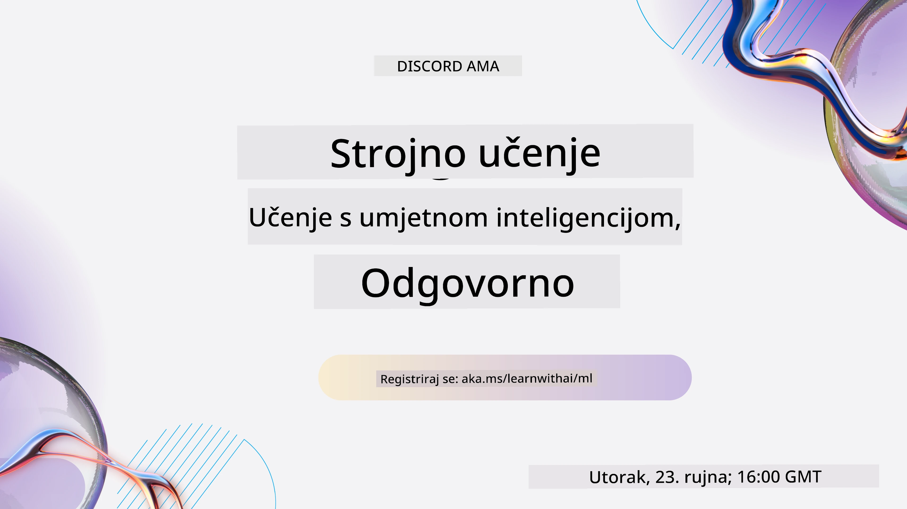
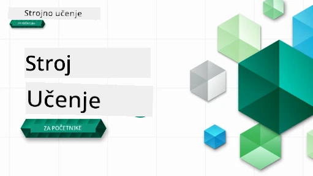

[](https://github.com/microsoft/ML-For-Beginners/blob/master/LICENSE)
[](https://GitHub.com/microsoft/ML-For-Beginners/graphs/contributors/)
[](https://GitHub.com/microsoft/ML-For-Beginners/issues/)
[](https://GitHub.com/microsoft/ML-For-Beginners/pulls/)
[](http://makeapullrequest.com)

[](https://GitHub.com/microsoft/ML-For-Beginners/watchers/)
[](https://GitHub.com/microsoft/ML-For-Beginners/network/)
[](https://GitHub.com/microsoft/ML-For-Beginners/stargazers/)

### 🌐 Podrška za više jezika

#### Prijevodi održavani s [Co-op Translator](https://github.com/Azure/co-op-translator)

<!-- CO-OP TRANSLATOR LANGUAGES TABLE START -->
[Arapski](../ar/README.md) | [Bengalski](../bn/README.md) | [Bugarski](../bg/README.md) | [Burmanski (Myanmar)](../my/README.md) | [Kineski (pojednostavljeni)](../zh-CN/README.md) | [Kineski (tradicionalni, Hong Kong)](../zh-HK/README.md) | [Kineski (tradicionalni, Makao)](../zh-MO/README.md) | [Kineski (tradicionalni, Tajvan)](../zh-TW/README.md) | [Hrvatski](./README.md) | [Češki](../cs/README.md) | [Danski](../da/README.md) | [Nizozemski](../nl/README.md) | [Estonski](../et/README.md) | [Finski](../fi/README.md) | [Francuski](../fr/README.md) | [Njemački](../de/README.md) | [Grčki](../el/README.md) | [Hebrejski](../he/README.md) | [Hindi](../hi/README.md) | [Mađarski](../hu/README.md) | [Indonezijski](../id/README.md) | [Talijanski](../it/README.md) | [Japanski](../ja/README.md) | [Kannada](../kn/README.md) | [Khmer](../km/README.md) | [Korejski](../ko/README.md) | [Litvanski](../lt/README.md) | [Malajski](../ms/README.md) | [Malajalamski](../ml/README.md) | [Manipuri (Meitei Mayek)](../mni/README.md) | [Marathi](../mr/README.md) | [Nepalski](../ne/README.md) | [Nigerijski Pidgin](../pcm/README.md) | [Norveški](../no/README.md) | [Persijski (Farsi)](../fa/README.md) | [Poljski](../pl/README.md) | [Portugalski (Brazil)](../pt-BR/README.md) | [Portugalski (Portugal)](../pt-PT/README.md) | [Punjabi (Gurmukhi)](../pa/README.md) | [Rumunjski](../ro/README.md) | [Ruski](../ru/README.md) | [Srpski (ćirilica)](../sr/README.md) | [Slovački](../sk/README.md) | [Slovenski](../sl/README.md) | [Španjolski](../es/README.md) | [Svahili](../sw/README.md) | [Švedski](../sv/README.md) | [Tagalog (Filipinski)](../tl/README.md) | [Tamilski](../ta/README.md) | [Telugu](../te/README.md) | [Tajlandski](../th/README.md) | [Turski](../tr/README.md) | [Ukrajinski](../uk/README.md) | [Urdu](../ur/README.md) | [Vijetnamski](../vi/README.md)

> **Preferirate li lokalni klon?**
>
> Ovo spremište uključuje više od 50 prijevoda jezika što znatno povećava veličinu preuzimanja. Za kloniranje bez prijevoda, koristite sparse checkout:
>
> **Bash / macOS / Linux:**
> ```bash
> git clone --filter=blob:none --sparse https://github.com/microsoft/ML-For-Beginners.git
> cd ML-For-Beginners
> git sparse-checkout set --no-cone '/*' '!translations' '!translated_images'
> ```
>
> **CMD (Windows):**
> ```cmd
> git clone --filter=blob:none --sparse https://github.com/microsoft/ML-For-Beginners.git
> cd ML-For-Beginners
> git sparse-checkout set --no-cone "/*" "!translations" "!translated_images"
> ```
>
> Ovo vam daje sve što vam treba za završetak tečaja uz znatno brže preuzimanje.
<!-- CO-OP TRANSLATOR LANGUAGES TABLE END -->

#### Pridružite se našoj zajednici

[](https://discord.gg/nTYy5BXMWG)

Imamo tekuću Discord seriju 'učimo s AI', saznajte više i pridružite nam se na [Learn with AI Series](https://aka.ms/learnwithai/discord) od 18. do 30. rujna 2025. Dobit ćete savjete i trikove korištenja GitHub Copilot za Data Science.



# Strojno učenje za početnike - Kurikulum

> 🌍 Putujte svijetom dok istražujemo strojno učenje kroz svjetske kulture 🌍

Cloud zagovornici u Microsoftu s radošću nude dvanaestotjedni kurikulum od 26 lekcija o **strojnom učenju**. U ovom kurikulumu naučit ćete o onome što se ponekad naziva **klasičnim strojnim učenjem**, koristeći primarno Scikit-learn kao biblioteku i izbjegavajući duboko učenje, koje je pokriveno u našem [kurikulumu AI za početnike](https://aka.ms/ai4beginners). Također uskladite ove lekcije s našim ['Data Science za početnike' kurikulumom](https://aka.ms/ds4beginners)!

Putujte s nama svijetom dok ove klasične tehnike primjenjujemo na podatke iz različitih dijelova svijeta. Svaka lekcija uključuje pre i post kvizove, pisane upute za izvođenje lekcije, rješenje, zadatak i još mnogo toga. Naša pedagoška metoda temeljena na projektima omogućava učenje kroz izgradnju, što je dokazani način da nove vještine ostanu usvojene.

**✍️ Iskrene zahvale našim autorima** Jen Looper, Stephen Howell, Francesca Lazzeri, Tomomi Imura, Cassie Breviu, Dmitry Soshnikov, Chris Noring, Anirban Mukherjee, Ornella Altunyan, Ruth Yakubu i Amy Boyd

**🎨 Zahvaljujemo također našim ilustratorima** Tomomi Imura, Dasani Madipalli i Jen Looper

**🙏 Posebna zahvala 🙏 našim Microsoft Student Ambassador autorima, recenzentima i suradnicima sadržaja**, posebno Rishit Dagli, Muhammad Sakib Khan Inan, Rohan Raj, Alexandru Petrescu, Abhishek Jaiswal, Nawrin Tabassum, Ioan Samuila i Snigdha Agarwal

**🤩 Isto tako zahvaljujemo Microsoft Student Ambassadors Eric Wanjau, Jasleen Sondhi i Vidushi Gupta za naše R lekcije!**

# Početak rada

Slijedite ove korake:
1. **Forkajte spremište**: Kliknite na gumb "Fork" u gornjem desnom kutu ove stranice.
2. **Klonirajte spremište**:   `git clone https://github.com/microsoft/ML-For-Beginners.git`

> 💡 **Brzi početni savjet:** Želite započeti u pregledniku bez lokalnog postavljanja Pythona? Koristite [GitHub Codespaces](https://github.com/features/codespaces) za kreiranje razvojne cloud okoline za vaš fork. Otvorite zeleni izbornik **Code**, odaberite **Codespaces** i kreirajte codespace; instalirajte potrebne ovisnosti za svaku lekciju po potrebi.

> [pronađite sve dodatne resurse za ovaj tečaj u našoj Microsoft Learn kolekciji](https://learn.microsoft.com/en-us/collections/qrqzamz1nn2wx3?WT.mc_id=academic-77952-bethanycheum)

> 🔧 **Trebate pomoć?** Pogledajte naš [Vodič za rješavanje problema](TROUBLESHOOTING.md) za rješenja uobičajenih poteškoća pri instalaciji, postavljanju i izvođenju lekcija.


**[Studenti](https://aka.ms/student-page)**, za korištenje ovog kurikuluma, forkajte cijeli repo na vaš GitHub račun i dovršite zadatke samostalno ili u grupi:

- Počnite s pre-lezionim kvizom.
- Pročitajte lekciju i dovršite aktivnosti, pritom se zaustavljajte i razmatrajte na svakom provjeravanju znanja.
- Pokušajte sami kreirati projekte shvaćajući lekcije umjesto pokretanja rješenja; rješenja su dostupna u `/solution` mapama u svakoj projektno orijentiranoj lekciji.
- Riješite post-lekcijski kviz.
- Dovršite izazov.
- Dovršite zadatak.
- Nakon završetka skupine lekcija, posjetite [Discussion Board](https://github.com/microsoft/ML-For-Beginners/discussions) i "učite naglas" ispunjavajući odgovarajuću PAT rubricu. PAT je alat za procjenu napretka koji ispunjavate za daljnje učenje. Također možete reagirati na druge PATove kako bismo učili zajedno.

> Za daljnje učenje preporučamo praćenje ovih [Microsoft Learn](https://docs.microsoft.com/en-us/users/jenlooper-2911/collections/k7o7tg1gp306q4?WT.mc_id=academic-77952-leestott) modula i putova učenja.

**Nastavnici**, dali smo [neke prijedloge](for-teachers.md) kako koristiti ovaj kurikulum.

---

## Video vodiči

Neke su lekcije dostupne kao kratki video. Sve ih možete pronaći u lekcijama ili na [ML for Beginners playlisti na Microsoft Developer YouTube kanalu](https://aka.ms/ml-beginners-videos) klikom na sliku ispod.

[](https://aka.ms/ml-beginners-videos)

---

## Upoznajte tim

[](https://youtu.be/Tj1XWrDSYJU)

**Gif autora** [Mohit Jaisal](https://linkedin.com/in/mohitjaisal)

> 🎥 Kliknite sliku gore za video o projektu i ljudima koji su ga stvorili!

---

## Pedagogija

Izabrali smo dva pedagoška principa pri izradi ovog kurikuluma: osiguranje da je praktičan i **projektno orijentiran** te da uključuje **česte kvizove**. Osim toga, ovaj kurikulum ima zajedničku **temu** za koheziju.

Osiguravajući da je sadržaj usklađen s projektima, proces učenja postaje zanimljiviji studentima i povećava zadržavanje koncepata. Također, niskorizični kviz prije predavanja postavlja namjeru studenta prema učenju teme, dok drugi kviz nakon predavanja osigurava dodatno zadržavanje. Ovaj je kurikulum dizajniran da bude fleksibilan i zabavan te se može koristiti u cijelosti ili djelomično. Projekti počinju mali i postupno postaju složeniji do kraja dvanaestotjednog ciklusa. Kurikulum uključuje i postscript o stvarnim primjenama strojnog učenja, koji može služiti kao dodatni bod ili kao tema za raspravu.

> Pronađite naše smjernice za [Kodeks ponašanja](CODE_OF_CONDUCT.md), [Doprinos](CONTRIBUTING.md), [Prijevode](..) i [Rješavanje problema](TROUBLESHOOTING.md). Veselimo se vašoj konstruktivnoj povratnoj informaciji!

## Svaka lekcija uključuje

- opcionalnu skicu
- opcionalni dodatni video
- video vodič (samo neke lekcije)
- [pre-lezioni pripremni kviz](https://ff-quizzes.netlify.app/en/ml/)
- pisanu lekciju
- za projektno orijentirane lekcije, korak-po-korak vodič kako izgraditi projekt
- provjere znanja
- izazov
- dodatnu literaturu
- zadatak
- [post-lezioni kviz](https://ff-quizzes.netlify.app/en/ml/)

> **Napomena o jezicima**: Ove lekcije su primarno napisane u Pythonu, ali mnoge su dostupne i u R-u. Za dovršetak R lekcije, posjetite `/solution` mapu i potražite R lekcije. One imaju nastavak .rmd što predstavlja **R Markdown** datoteku, koja se jednostavno definira kao ugradnja `code chunks` (R-a ili drugih jezika) i `YAML header` (koji vodi kako formatirati izlaz kao PDF) u `Markdown document`. Kao takav, služi kao primjeran okvir za autorstvo za podatkovnu znanost jer omogućuje kombiniranje koda, njegovog izlaza i vaših misli pisanjem u Markdownu. Osim toga, R Markdown dokumenti mogu se prikazivati u formatima poput PDF, HTML ili Word.

> **Napomena o kvizovima**: Svi kvizovi su sadržani u [Quiz App folderu](../../quiz-app), ukupno 52 kviza s po tri pitanja. Povezani su iz lekcija, ali aplikaciju za kviz možete pokrenuti lokalno; slijedite upute u `quiz-app` mapi za lokalno postavljanje ili implementaciju na Azure.

| Broj lekcije |                             Tema                              |                   Grupiranje lekcija                   | Ciljevi učenja                                                                                                             |                                                              Povezana lekcija                                                               |                        Autor                        |
| :-----------: | :------------------------------------------------------------: | :-------------------------------------------------: | ------------------------------------------------------------------------------------------------------------------------------- | :--------------------------------------------------------------------------------------------------------------------------------------: | :--------------------------------------------------: |
|      01       |                Uvod u strojno učenje                |      [Uvod](1-Introduction/README.md)       | Naučite osnovne pojmove strojnog učenja                                                                                |                                             [Lekcija](1-Introduction/1-intro-to-ML/README.md)                                             |                       Muhammad                       |
|      02       |                Povijest strojnog učenja                 |      [Uvod](1-Introduction/README.md)       | Naučite povijest ovog područja                                                                                         |                                            [Lekcija](1-Introduction/2-history-of-ML/README.md)                                            |                     Jen i Amy                      |
|      03       |                 Pravednost i strojno učenje                  |      [Uvod](1-Introduction/README.md)       | Koja su važna filozofska pitanja oko pravednosti koja bi studenti trebali uzeti u obzir pri izgradnji i primjeni ML modela? |                                              [Lekcija](1-Introduction/3-fairness/README.md)                                               |                        Tomomi                        |
|      04       |                Tehnike strojnog učenja                 |      [Uvod](1-Introduction/README.md)       | Koje tehnike istraživači ML koriste za izgradnju ML modela?                                                                       |                                          [Lekcija](1-Introduction/4-techniques-of-ML/README.md)                                           |                    Chris i Jen                     |
|      05       |                   Uvod u regresiju                   |        [Regresija](2-Regression/README.md)         | Počnite s Pythonom i Scikit-learn za regresijske modele                                                                  |         [Python](2-Regression/1-Tools/README.md) • [R](../../2-Regression/1-Tools/solution/R/lesson_1.html)         |      Jen • Eric Wanjau       |
|      06       |                Cijene bundeva u Sjevernoj Americi 🎃                |        [Regresija](2-Regression/README.md)         | Vizualizirajte i očistite podatke u pripremi za ML                                                                                  |          [Python](2-Regression/2-Data/README.md) • [R](../../2-Regression/2-Data/solution/R/lesson_2.html)          |      Jen • Eric Wanjau       |
|      07       |                Cijene bundeva u Sjevernoj Americi 🎃                |        [Regresija](2-Regression/README.md)         | Izgradite linearne i polinomne regresijske modele                                                                                   |        [Python](2-Regression/3-Linear/README.md) • [R](../../2-Regression/3-Linear/solution/R/lesson_3.html)        |      Jen i Dmitry • Eric Wanjau       |
|      08       |                Cijene bundeva u Sjevernoj Americi 🎃                |        [Regresija](2-Regression/README.md)         | Izgradite logistički regresijski model                                                                                               |     [Python](2-Regression/4-Logistic/README.md) • [R](../../2-Regression/4-Logistic/solution/R/lesson_4.html)      |      Jen • Eric Wanjau       |
|      09       |                          Web aplikacija 🔌                          |           [Web aplikacija](3-Web-App/README.md)            | Izgradite web aplikaciju za korištenje svog istreniranog modela                                                                                       |                                                 [Python](3-Web-App/1-Web-App/README.md)                                                  |                         Jen                          |
|      10       |                 Uvod u klasifikaciju                 |    [Klasifikacija](4-Classification/README.md)     | Očistite, pripremite i vizualizirajte svoje podatke; uvod u klasifikaciju                                                            | [Python](4-Classification/1-Introduction/README.md) • [R](../../4-Classification/1-Introduction/solution/R/lesson_10.html)  | Jen i Cassie • Eric Wanjau |
|      11       |             Ukusna azijska i indijska kuhinja 🍜             |    [Klasifikacija](4-Classification/README.md)     | Uvod u klasifikatore                                                                                                     | [Python](4-Classification/2-Classifiers-1/README.md) • [R](../../4-Classification/2-Classifiers-1/solution/R/lesson_11.html) | Jen i Cassie • Eric Wanjau |
|      12       |             Ukusna azijska i indijska kuhinja 🍜             |    [Klasifikacija](4-Classification/README.md)     | Više klasifikatora                                                                                                                | [Python](4-Classification/3-Classifiers-2/README.md) • [R](../../4-Classification/3-Classifiers-2/solution/R/lesson_12.html) | Jen i Cassie • Eric Wanjau |
|      13       |             Ukusna azijska i indijska kuhinja 🍜             |    [Klasifikacija](4-Classification/README.md)     | Izgradite preporučiteljsku web aplikaciju koristeći svoj model                                                                                    |                                              [Python](4-Classification/4-Applied/README.md)                                              |                         Jen                          |
|      14       |                   Uvod u klasteriranje                   |        [Klasteriranje](5-Clustering/README.md)         | Očistite, pripremite i vizualizirajte svoje podatke; Uvod u klasteriranje                                                                |         [Python](5-Clustering/1-Visualize/README.md) • [R](../../5-Clustering/1-Visualize/solution/R/lesson_14.html)         |      Jen • Eric Wanjau       |
|      15       |              Istraživanje glazbenih ukusa Nigerije 🎧              |        [Klasteriranje](5-Clustering/README.md)         | Istražite K-Means metodu klasteriranja                                                                                           |           [Python](5-Clustering/2-K-Means/README.md) • [R](../../5-Clustering/2-K-Means/solution/R/lesson_15.html)           |      Jen • Eric Wanjau       |
|      16       |        Uvod u obradu prirodnog jezika ☕️         |   [Obrada prirodnog jezika](6-NLP/README.md)    | Naučite osnove NLP-a izradom jednostavnog bota                                                                             |                                             [Python](6-NLP/1-Introduction-to-NLP/README.md)                                              |                       Stephen                        |
|      17       |                      Uobičajeni zadaci NLP-a ☕️                      |   [Obrada prirodnog jezika](6-NLP/README.md)    | Produbite svoje znanje NLP-a razumijevanjem uobičajenih zadataka potrebnih za rad sa strukturama jezika                          |                                                    [Python](6-NLP/2-Tasks/README.md)                                                     |                       Stephen                        |
|      18       |             Prevođenje i analiza sentimenta ♥️              |   [Obrada prirodnog jezika](6-NLP/README.md)    | Prevođenje i analiza sentimenta uz Jane Austen                                                                             |                                            [Python](6-NLP/3-Translation-Sentiment/README.md)                                             |                       Stephen                        |
|      19       |                  Romantični hoteli Europe ♥️                  |   [Obrada prirodnog jezika](6-NLP/README.md)    | Analiza sentimenta na osnovu recenzija hotela 1                                                                                         |                                               [Python](6-NLP/4-Hotel-Reviews-1/README.md)                                                |                       Stephen                        |
|      20       |                  Romantični hoteli Europe ♥️                  |   [Obrada prirodnog jezika](6-NLP/README.md)    | Analiza sentimenta na osnovu recenzija hotela 2                                                                                         |                                               [Python](6-NLP/5-Hotel-Reviews-2/README.md)                                                |                       Stephen                        |
|      21       |            Uvod u vremenske serije i prognoziranje             |        [Vremenske serije](7-TimeSeries/README.md)        | Uvod u prognoziranje vremenskih serija                                                                                         |                                             [Python](7-TimeSeries/1-Introduction/README.md)                                              |                      Francesca                       |
|      22       | ⚡️ Potrošnja električne energije u svijetu ⚡️ - prognoziranje vremenskih serija s ARIMA |        [Vremenske serije](7-TimeSeries/README.md)        | Prognoziranje vremenskih serija pomoću ARIMA                                                                                              |                                                 [Python](7-TimeSeries/2-ARIMA/README.md)                                                 |                      Francesca                       |
|      23       |  ⚡️ Potrošnja električne energije u svijetu ⚡️ - prognoziranje vremenskih serija s SVR  |        [Vremenske serije](7-TimeSeries/README.md)        | Prognoziranje vremenskih serija pomoću podrške vektorskim regresorom                                                                           |                                                  [Python](7-TimeSeries/3-SVR/README.md)                                                  |                       Anirban                        |
|      24       |             Uvod u potkrepljujuće učenje             | [Potkrepljujuće učenje](8-Reinforcement/README.md) | Uvod u potkrepljujuće učenje korištenjem Q-Learninga                                                                          |                                             [Python](8-Reinforcement/1-QLearning/README.md)                                              |                        Dmitry                        |
|      25       |                 Pomozite Peteru izbjeći vuka! 🐺                  | [Potkrepljujuće učenje](8-Reinforcement/README.md) | Potkrepljujuće učenje u Gim-u                                                                                                      |                                                [Python](8-Reinforcement/2-Gym/README.md)                                                 |                        Dmitry                        |
|  Postscript   |            Praktični scenariji i primjene ML            |      [ML u divljini](9-Real-World/README.md)       | Zanimljive i otkrivajuće stvarne primjene klasičnog ML-a                                                               |                                             [Lekcija](9-Real-World/1-Applications/README.md)                                              |                         Tim                         |
|  Postscript   |            Otklanjanje pogrešaka modela u ML koristeći RAI nadzornu ploču            |      [ML u divljini](9-Real-World/README.md)       | Otklanjanje pogrešaka modela u strojnog učenju koristeći komponente Responsible AI nadzorne ploče                                                              |                                             [Lekcija](9-Real-World/2-Debugging-ML-Models/README.md)                                              |                     Ruth Yakubu                      |

> [pronađite sve dodatne resurse za ovaj tečaj u našoj Microsoft Learn kolekciji](https://learn.microsoft.com/en-us/collections/qrqzamz1nn2wx3?WT.mc_id=academic-77952-bethanycheum)

## Pristup bez mreže

Dokumentaciju možete pokrenuti i offline koristeći [Docsify](https://docsify.js.org/#/). Forkajte ovaj repozitorij, [instalirajte Docsify](https://docsify.js.org/#/quickstart) na svom lokalnom računalu, zatim upišite u korijenskom folderu ovog repozitorija `docsify serve`. Web stranica će biti dostupna na portu 3000 na vašem localhostu: `localhost:3000`.

## PDF-ovi

Pronađite pdf nastavnog plana sa linkovima [ovdje](https://microsoft.github.io/ML-For-Beginners/pdf/readme.pdf).


## 🎒 Ostali tečajevi

Naš tim proizvodi i ostale tečajeve! Pogledajte:

<!-- CO-OP TRANSLATOR OTHER COURSES START -->
### LangChain
[](https://aka.ms/langchain4j-for-beginners)
[](https://aka.ms/langchainjs-for-beginners?WT.mc_id=m365-94501-dwahlin)
[](https://github.com/microsoft/langchain-for-beginners?WT.mc_id=m365-94501-dwahlin)
---

### Azure / Edge / MCP / Agenti
[](https://github.com/microsoft/AZD-for-beginners?WT.mc_id=academic-105485-koreyst)
[](https://github.com/microsoft/edgeai-for-beginners?WT.mc_id=academic-105485-koreyst)
[](https://github.com/microsoft/mcp-for-beginners?WT.mc_id=academic-105485-koreyst)
[](https://github.com/microsoft/ai-agents-for-beginners?WT.mc_id=academic-105485-koreyst)

---
 
### Series generativne AI
[](https://github.com/microsoft/generative-ai-for-beginners?WT.mc_id=academic-105485-koreyst)
[-9333EA?style=for-the-badge&labelColor=E5E7EB&color=9333EA)](https://github.com/microsoft/Generative-AI-for-beginners-dotnet?WT.mc_id=academic-105485-koreyst)
[-C084FC?style=for-the-badge&labelColor=E5E7EB&color=C084FC)](https://github.com/microsoft/generative-ai-for-beginners-java?WT.mc_id=academic-105485-koreyst)
[-E879F9?style=for-the-badge&labelColor=E5E7EB&color=E879F9)](https://github.com/microsoft/generative-ai-with-javascript?WT.mc_id=academic-105485-koreyst)

---
 
### Osnovno učenje
[](https://aka.ms/ml-beginners?WT.mc_id=academic-105485-koreyst)
[](https://aka.ms/datascience-beginners?WT.mc_id=academic-105485-koreyst)
[](https://aka.ms/ai-beginners?WT.mc_id=academic-105485-koreyst)
[](https://github.com/microsoft/Security-101?WT.mc_id=academic-96948-sayoung)
[](https://aka.ms/webdev-beginners?WT.mc_id=academic-105485-koreyst)
[](https://aka.ms/iot-beginners?WT.mc_id=academic-105485-koreyst)
[](https://github.com/microsoft/xr-development-for-beginners?WT.mc_id=academic-105485-koreyst)

---
 
### Copilot serija
[](https://aka.ms/GitHubCopilotAI?WT.mc_id=academic-105485-koreyst)
[](https://github.com/microsoft/mastering-github-copilot-for-dotnet-csharp-developers?WT.mc_id=academic-105485-koreyst)
[](https://github.com/microsoft/CopilotAdventures?WT.mc_id=academic-105485-koreyst)
<!-- CO-OP TRANSLATOR OTHER COURSES END -->

## Dobivanje pomoći

Ako zapnete ili imate pitanja dok učite strojno učenje ili gradite AI aplikacije, ne brinite — pomoć je dostupna.

Možete se pridružiti raspravama s drugim učenicima i programerima, postavljati pitanja i dijeliti svoje ideje sa zajednicom.

- Pridružite se zajednici za postavljanje pitanja i učenje s drugima
- Raspravljajte o konceptima strojnog učenja i idejama za projekte
- Dobijte smjernice od iskusnih programera

Podržavajuća zajednica izvrstan je način za razvijanje vaših vještina i brže rješavanje problema.

[Microsoft Foundry Discord zajednica](https://discord.gg/nTYy5BXMWG)

Ako naiđete na greške, probleme ili imate prijedloge za poboljšanja, također možete otvoriti **Issue** u ovom repozitoriju da prijavite problem.

Za povratne informacije o proizvodu ili pretraživanje postojećih postova u zajednici, posjetite Developer Forum:

[](https://aka.ms/foundry/forum)

## Dodatni savjeti za učenje

- Pregledajte bilježnice nakon svake lekcije za bolje razumijevanje.
- Vježbajte samostalno implementiranje algoritama.
- Istražite stvarne skupove podataka koristeći naučene koncepte.

---

<!-- CO-OP TRANSLATOR DISCLAIMER START -->
**Napomena**:
Ovaj dokument je preveden korištenjem AI prevoditeljskog servisa [Co-op Translator](https://github.com/Azure/co-op-translator). Iako težimo točnosti, imajte na umu da automatski prijevodi mogu sadržavati greške ili netočnosti. Izvorni dokument na izvornom jeziku treba smatrati autoritativnim izvorom. Za važne informacije preporuča se profesionalni ljudski prijevod. Nismo odgovorni za bilo kakva nesporazumevanja ili pogrešne interpretacije koje proizlaze iz korištenja ovog prijevoda.
<!-- CO-OP TRANSLATOR DISCLAIMER END -->