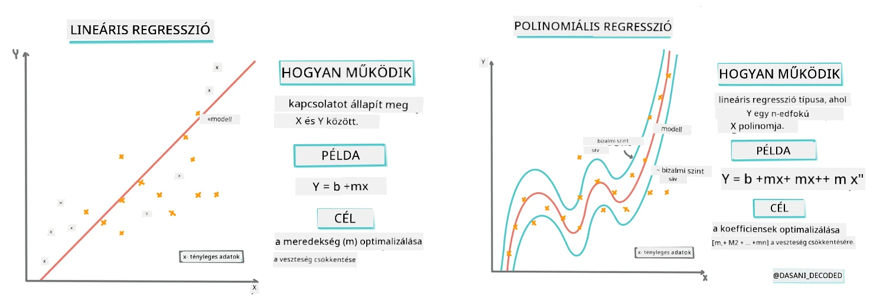
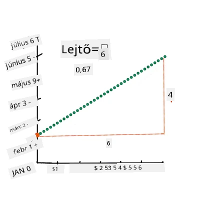
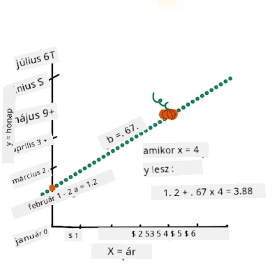
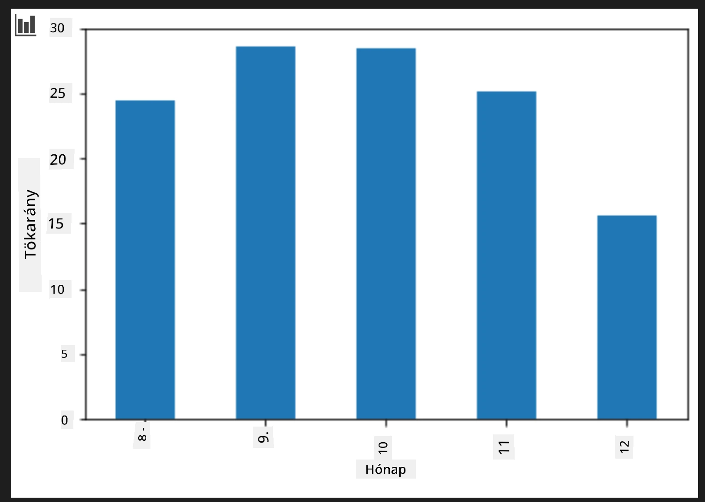
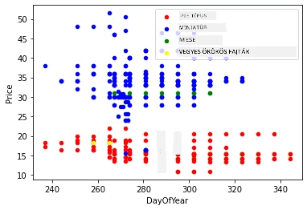

# Regressziós modell készítése Scikit-learn segítségével: regresszió négy módon

## Kezdő megjegyzés

A lineáris regressziót akkor használjuk, ha egy **numerikus értéket** szeretnénk előrejelezni (például házár, hőmérséklet vagy eladás).
Ez úgy működik, hogy megtalálja azt a egyenes vonalat, amely a legjobban reprezentálja a bemeneti jellemzők és a kimenet közötti kapcsolatot.

Ebben az órában arra fókuszálunk, hogy megértsük a fogalmat, mielőtt átfogóbb regressziós technikákat fedeznénk fel.

> Infografika készítője: [Dasani Madipalli](https://twitter.com/dasani_decoded)
## [Előadás előtti kvíz](https://ff-quizzes.netlify.app/en/ml/)

> ### [Ez az óra R nyelven is elérhető!](../../../../2-Regression/3-Linear/solution/R/lesson_3.html)
### Bevezetés

Eddig megtanultad, hogy mi a regresszió a tök árképzési adatain keresztül, amelyeket ezen az órán végig használni fogunk. Ezt Matplotlib segítségével vizualizáltad is.

Most készen állsz arra, hogy mélyebben elmerülj a gépi tanulás regressziójában. Míg a vizualizáció lehetővé teszi az adatok értelmezését, a gépi tanulás valódi ereje az _modellek tanításában_ rejlik. A modelleket történelmi adatokon tanítják, hogy automatikusan felismerjék az adatok közötti összefüggéseket, és lehetővé teszik új adatok (amelyeket a modell korábban nem látott) kimenetének előrejelzését.

Ebben az órában két regressziótípusról tanulsz: _alap lineáris regresszió_ és _polinomiális regresszió_, valamint az ezek mögött álló matematikai háttérről. Ezek a modellek lehetővé teszik, hogy megjósoljuk a tök árát különböző bemeneti adatok alapján.

[](https://youtu.be/CRxFT8oTDMg "Gépi tanulás kezdőknek - Lineáris regresszió megértése")

> 🎥 Kattints a fenti képre egy rövid videós áttekintéshez a lineáris regresszióról.

> Az oktatóanyag során minimális matematikai előzetes tudással számolunk, és a cél, hogy elérhető legyen más területekről érkező diákok számára, ezért figyeld a megjegyzéseket, 🧮 hívásokat, ábrákat és egyéb tanulást segítő eszközöket.

### Előfeltétel

Mostanra ismerned kell a tök adatainak szerkezetét, amelyet vizsgálunk. Ezeket előre betöltve és megtisztítva megtalálod a dolgozat _notebook.ipynb_ fájljában. Ebben a fájlban a tök ára bushelenként jelenik meg egy új adatkeretben. Győződj meg róla, hogy ezek a notebookok futtathatóak Visual Studio Code környezetben.

### Előkészület

Emlékeztetőül: ezt az adatot azért töltöd be, hogy kérdéseket tegyél fel vele kapcsolatban.

- Mikor a legjobb idő tököt vásárolni?
- Milyen árat várhatok egy doboz miniatűr tökre?
- Érdemes fél bushel kosárban vagy 1 1/9 busheles dobozban vásárolni?
Térjünk vissza az adatok mélyebb vizsgálatához.

Az előző órában létrehoztál egy Pandas adatkeretet, és feltöltötted az eredeti adatok egy részével, egységesítve az árakat bushel szerint. Ezáltal azonban csak körülbelül 400 adatpontot gyűjtöttél össze, és csak az őszi hónapokra.

Nézd meg az adatokat, amelyeket előre betöltöttünk ebben az óra jegyzetfüzetében. Az adatok előre betöltöttek, és az első szórt diagram már megmutatja a hónap adatokat. Talán több részletet tudunk kinyerni az adatok természetéről, ha jobban megtisztítjuk őket.

## Lineáris regressziós egyenes

Ahogy az 1. órában megtanultad, a lineáris regresszió célja, hogy képes legyél felrajzolni egy olyan egyenest, amely:

- **Mutatja a változók kapcsolatát**. Megjeleníti a változók közötti kapcsolatot
- **Képes előrejelzésekre**. Pontos előrejelzéseket ad arról, hogy egy új adatpont hol eshet az egyeneshez képest.
 
A **Legkisebb négyzetes regresszió** típusú vonalat szokás így húzni. A "Legkisebb négyzetes" kifejezés azt a folyamatot jelenti, amikor minimalizáljuk a modellünkben az összes hibát. Minden adatpontnál mérjük a függőleges távolságot (reziduális néven ismert) az adott pont és a regressziós vonal között.  

Ezeket a távolságokat négyzetre emeljük két fő okból:  

1. **Nagyobb jelentőség a nagyságra, irány helyett:** Egy -5-ös hibaértéket ugyanolyan fontosnak akarunk kezelni, mint egy +5-öst. A négyzetre emelés miatt minden érték pozitív lesz.  

2. **Kiszámíthatatlan kiugrók megszűrése:** A négyzetre emelés súlyosabb következményeket ad a nagyobb hibáknak, így az egyenes közelebb húzódik a távolabb eső pontokhoz is.  

Ezután összeadjuk az összes négyzetre emelt értéket. A célunk megtalálni azt az egyenest, amelynél az összeg a legalacsonyabb (a lehető legkisebb)—innen ered a "Legkisebb négyzetek" elnevezés.  

> **🧮 Mutasd meg a képletet** 
> 
> Ez az egyenes, amit _legjobb illeszkedő egyenesnek_ hívunk, az alábbi [egyenlettel fejezhető ki](https://en.wikipedia.org/wiki/Simple_linear_regression): 
> 
> ```
> Y = a + bX
> ```
>
> `X` az 'magyarázó változó'. `Y` a 'függő változó'. Az egyenes meredeksége `b`, és `a` az y-tengely metszéspontja, ami `Y` értékét adja `X = 0` esetén.
>
>
>
> Először kiszámoljuk a `b` meredekséget. Infografika készítője: [Jen Looper](https://twitter.com/jenlooper)
>
> Másként fogalmazva, és hivatkozva a tök adataink eredeti kérdésére: "jósoljuk meg a tök árát bushelenként hónap alapján", az `X` lenne az ár és az `Y` az eladás hónapja.
>
>
>
> Számítsuk ki az Y értékét. Ha $4 körül fizetsz, akkor április lehet! Infografika készítője: [Jen Looper](https://twitter.com/jenlooper)
>
> Az egyenes meghatározásának matematikája demonstrálja a meredekséget, amely a metszési ponttól is függ, vagyis attól, hogy `Y` hol helyezkedik el, ha `X = 0`.
>
> Az értékek kiszámítását megfigyelheted a [Math is Fun](https://www.mathsisfun.com/data/least-squares-regression.html) weboldalon. Látogasd meg továbbá ezt a [Legkisebb négyzetes számológépet](https://www.mathsisfun.com/data/least-squares-calculator.html), hogy lásd, hogyan hatnak a számértékek az egyenesre.

## Korreláció

Még egy kifejezést kell megérteni: ez a **Korrelációs együttható** az adott X és Y változók között. Szórt diagram segítségével gyorsan vizualizálhatod ezt az együtthatót. Ha az adatpontok szépen rendezett vonalban helyezkednek el, a korreláció magas, de ha szétszórtan vannak, a korreláció alacsony.

Egy jó lineáris regressziós modell az lesz, amely Legkisebb négyzetes regresszió módszerrel egy magas (inkább 1-hez közel, mint 0-hoz) Korrelációs együtthatót mutat.

✅ Futtasd le az óra kísérő jegyzetfüzetét, és nézd meg a Hónap és Ár szórt diagramját. Úgy tűnik a hónap-ár kapcsolat a tök eladásoknál magas vagy alacsony korrelációt mutat? Ez változik, ha az `Hónap` helyett finomabb felbontást használsz, például az év napját (azaz hányadik napja az évnek)?

A lentebbi kódban feltételezzük, hogy megtisztítottuk az adatokat, és rendelkezünk egy `new_pumpkins` nevű adatkerettel, amely hasonló a következőhöz:

ID | Month | DayOfYear | Variety | City | Package | Low Price | High Price | Price
---|-------|-----------|---------|------|---------|-----------|------------|-------
70 | 9 | 267 | PIE TYPE | BALTIMORE | 1 1/9 bushel cartons | 15.0 | 15.0 | 13.636364
71 | 9 | 267 | PIE TYPE | BALTIMORE | 1 1/9 bushel cartons | 18.0 | 18.0 | 16.363636
72 | 10 | 274 | PIE TYPE | BALTIMORE | 1 1/9 bushel cartons | 18.0 | 18.0 | 16.363636
73 | 10 | 274 | PIE TYPE | BALTIMORE | 1 1/9 bushel cartons | 17.0 | 17.0 | 15.454545
74 | 10 | 281 | PIE TYPE | BALTIMORE | 1 1/9 bushel cartons | 15.0 | 15.0 | 13.636364

> A tisztításhoz használt kód megtalálható a [`notebook.ipynb`](notebook.ipynb) fájlban. Ugyanazokat a tisztítási lépéseket hajtottuk végre, mint az előző órában, és kiszámoltuk a `DayOfYear` oszlopot a következő kifejezéssel:

```python
day_of_year = pd.to_datetime(pumpkins['Date']).apply(lambda dt: (dt-datetime(dt.year,1,1)).days)
```

Most, hogy érted a lineáris regresszió mögötti matematikát, hozzunk létre egy regressziós modellt, hogy megnézzük, tudjuk-e előre jelezni, melyik tökcsomag ára lesz a legjobb. Valaki, aki tököt vásárol farsangi tökkiállításra, ezt az információt felhasználhatja, hogy optimalizálja a vásárlását.

## Korreláció keresése

[](https://youtu.be/uoRq-lW2eQo "Gépi tanulás kezdőknek - Korreláció keresése: a lineáris regresszió kulcsa")

> 🎥 Kattints a fenti képre egy rövid videós áttekintéshez a korrelációról.

Az előző órából valószínűleg láttad, hogy a havi átlagárak így néznek ki:



Ez arra utal, hogy kell lennie némi korrelációnak, és megpróbálhatunk lineáris regressziós modellt tanítani, hogy előre jelezzük a `Hónap` és `Ár` vagy a `DayOfYear` és `Ár` kapcsolatot. Itt egy szórt diagram, amely az utóbbi kapcsolatot mutatja:

 

Nézzük meg, van-e korreláció a `corr` függvénnyel:

```python
print(new_pumpkins['Month'].corr(new_pumpkins['Price']))
print(new_pumpkins['DayOfYear'].corr(new_pumpkins['Price']))
```

Úgy tűnik, a korreláció meglehetősen kicsi, -0,15 a `Hónap` szerint, és -0,17 a `DayOfYear` szerint, de lehet, hogy van egy másik fontos kapcsolat. Úgy tűnik, különböző ár clusteringek vannak, amelyek különböző tökfajtákhoz kapcsolódnak. Ennek megerősítéséhez ábrázoljuk minden tökkategóriát más színnel. Az `ax` paraméter átadásával a `scatter` függvénynek minden pont ugyanazon a grafikonon jelenik meg:

```python
ax=None
colors = ['red','blue','green','yellow']
for i,var in enumerate(new_pumpkins['Variety'].unique()):
    df = new_pumpkins[new_pumpkins['Variety']==var]
    ax = df.plot.scatter('DayOfYear','Price',ax=ax,c=colors[i],label=var)
```

 

A vizsgálatunk arra utal, hogy a tökfajta jobban befolyásolja az árat, mint az eladási időpont. Ezt látjuk egy oszlopdiagramon is:

```python
new_pumpkins.groupby('Variety')['Price'].mean().plot(kind='bar')
```

 

Most fókuszáljunk csak az egyik tökfajtára, az "pie type"-ra, és nézzük meg, milyen hatással van a dátum az árra:

```python
pie_pumpkins = new_pumpkins[new_pumpkins['Variety']=='PIE TYPE']
pie_pumpkins.plot.scatter('DayOfYear','Price') 
```
 

Ha most kiszámoljuk a korrelációt a `Price` és `DayOfYear` között a `corr` függvénnyel, az körülbelül `-0,27` lesz - ami azt jelenti, hogy érdemes prediktív modellt tanítani.

> A lineáris regressziós modell betanítása előtt fontos, hogy az adataink tiszták legyenek. A lineáris regresszió nem működik jól hiányzó értékekkel, ezért érdemes eltávolítani az összes üres cellát:

```python
pie_pumpkins.dropna(inplace=True)
pie_pumpkins.info()
```

Egy másik megközelítés, ha ezeket az üres értékeket az adott oszlop átlagával töltjük ki.

## Egyszerű lineáris regresszió

[](https://youtu.be/e4c_UP2fSjg "Gépi tanulás kezdőknek - Lineáris és polinomiális regresszió Scikit-learn segítségével")

> 🎥 Kattints a fenti képre egy rövid videós összefoglalóhoz a lineáris és polinomiális regresszióról.

A lineáris regressziós modellünk betanításához a **Scikit-learn** könyvtárat használjuk.

```python
from sklearn.linear_model import LinearRegression
from sklearn.metrics import mean_squared_error
from sklearn.model_selection import train_test_split
```

Először szétválasztjuk a bemeneti értékeket (jellemzőket) és a várt kimenetet (címkét) külön-numpy tömbökbe:

```python
X = pie_pumpkins['DayOfYear'].to_numpy().reshape(-1,1)
y = pie_pumpkins['Price']
```

> Figyeljük meg, hogy a bemeneti adatokat át kellett alakítanunk a `reshape` segítségével, hogy a Lineáris Regressziós csomag helyesen értse azokat. A lineáris regresszió 2D tömböt vár bemenetként, ahol a tömb minden sora egy bemeneti jellemző vektort reprezentál. Jelen esetben egyetlen bemenet van, ezért egy N×1 alakú tömböt kell létrehoznunk, ahol N az adatkészlet mérete.

Ezután fel kell osztanunk az adatokat tanító és teszt adatokra, hogy a modellt a tanítás után tudjuk validálni:

```python
X_train, X_test, y_train, y_test = train_test_split(X, y, test_size=0.2, random_state=0)
```

Végül az lineáris regressziós modell tényleges betanítása csak két sor kódot vesz igénybe. Definiáljuk a `LinearRegression` objektumot, és az adatainkra illesztjük a `fit` módszerrel:

```python
lin_reg = LinearRegression()
lin_reg.fit(X_train,y_train)
```

A `LinearRegression` objektum a `fit`-elés után tartalmazza a regresszió összes együtthatóját, amelyek az `.coef_` tulajdonsággal érhetőek el. Esetünkben csak egy együttható van, amely körülbelül `-0.017` körül kell legyen. Ez azt jelenti, hogy az árak idővel valamennyire csökkenni látszanak, de nem túl sokat, körülbelül 2 cent naponta. A regressziós egyenes Y-tengellyel való metszéspontjához az `lin_reg.intercept_` segítségével férhetünk hozzá - ez nálunk körülbelül `21` lesz, amely az év eleji árat jelzi.

Ahhoz, hogy lássuk, mennyire pontos a modellünk, először az árakat megjósolhatjuk egy teszt adathalmazon, majd megmérhetjük, milyen közel vannak a becslések a várt értékekhez. Ezt az úgynevezett gyökös átlagos négyzetes hibával (RMSE) mérjük, ami az elvárt és becsült értékek közötti négyzetes különbségek átlagának gyöke.

```python
pred = lin_reg.predict(X_test)

rmse = np.sqrt(mean_squared_error(y_test,pred))
print(f'RMSE: {rmse:3.3} ({rmse/np.mean(pred)*100:3.3}%)')
```

Hibaértékünk körülbelül 2 pont körül van, ami nagyjából 17%. Nem túl jó. A modell minőségének másik mutatója a **determinációs együttható**, amely így számítható ki:

```python
score = lin_reg.score(X_train,y_train)
print('Model determination: ', score)
```
Ha az érték 0, az azt jelenti, hogy a modell nem veszi figyelembe a bemeneti adatokat, és a *legrosszabb lineáris becslőként* működik, amely egyszerűen az eredmény átlagértéke. Az 1-es érték azt jelenti, hogy tökéletesen meg tudjuk jósolni az összes várt kimenetet. Nálunk az együttható körülbelül 0.06, ami elég alacsony.

Meg is rajzolhatjuk a tesztadatokat a regressziós egyenessel együtt, hogy jobban lássuk a regresszió működését:

```python
plt.scatter(X_test,y_test)
plt.plot(X_test,pred)
```


## Polinomiális regresszió

A lineáris regresszió egy másik típusa a polinomiális regresszió. Bár néha lineáris kapcsolat van a változók között – például minél nagyobb egy tök térfogata, annál magasabb az ára –, néha ezek a kapcsolatok nem ábrázolhatók síkkal vagy egyenes vonallal.

✅ Itt vannak [további példák](https://online.stat.psu.edu/stat501/Lesson09#polynomial-regression-examples) olyan adatokra, amelyek polinomiális regressziót igényelhetnek.

Nézzük meg újra a Dátum és Ár közötti kapcsolatot. Ez a pontfelhő valóban úgy néz ki, hogy feltétlenül egy egyenes vonallal kell elemezni? Nem ingadozhatnak az árak? Ilyen esetben polinomiális regressziót használhatunk.

✅ A polinomok olyan matematikai kifejezések, amelyek egy vagy több változót és együtthatót tartalmazhatnak.

A polinomiális regresszió ívelt görbét hoz létre, hogy jobban illeszkedjen a nemlineáris adatokra. Esetünkben, ha a bemeneti adatok közé beillesztünk egy négyzetes `DayOfYear` változót, akkor egy parabolikus görbét tudunk illeszteni, amelynek lesz minimuma az év egy bizonyos pontján.

A Scikit-learn egy hasznos [pipeline API-t](https://scikit-learn.org/stable/modules/generated/sklearn.pipeline.make_pipeline.html?highlight=pipeline#sklearn.pipeline.make_pipeline) kínál a különböző adatfeldolgozási lépések összekapcsolására. Egy **pipeline** egy láncolata az **estimátoroknak**. Esetünkben egy olyan csővezetéket hozunk létre, amely először polinomiális jellemzőket ad a modellhez, majd megtanítja a regressziót:

```python
from sklearn.preprocessing import PolynomialFeatures
from sklearn.pipeline import make_pipeline

pipeline = make_pipeline(PolynomialFeatures(2), LinearRegression())

pipeline.fit(X_train,y_train)
```

A `PolynomialFeatures(2)` használata azt jelenti, hogy minden másodfokú polinomot belefoglalunk a bemeneti adatokból. Esetünkben ez csak a `DayOfYear`<sup>2</sup> lesz, de ha két bemeneti változónk van X és Y, akkor ez hozzáadja az X<sup>2</sup>, XY és Y<sup>2</sup> kifejezéseket. Szükség esetén magasabb fokú polinomokat is használhatunk.

A pipeline-ok ugyanúgy használhatók, mint az eredeti `LinearRegression` objektum, azaz `fit`-elhetjük őket, és azután `predict`-tel kérhetjük le az előrejelzés eredményét:

```python
pred = pipeline.predict(X_test)

rmse = np.sqrt(mean_squared_error(y_test,pred))
print(f'RMSE: {rmse:3.3} ({rmse/np.mean(pred)*100:3.3}%)')

score = pipeline.score(X_train,y_train)
print('Model determination: ', score)
```

A sima közelítő görbe megrajzolásához a `np.linspace`-t használjuk, hogy egyenletes bemeneti értéktartományt hozzunk létre, nem pedig közvetlenül a rendezetlen tesztadatokra rajzolunk (ami cikcakkos vonalat eredményezne):

```python
X_range = np.linspace(X_test.min(), X_test.max(), 100).reshape(-1,1)
y_range = pipeline.predict(X_range)

plt.scatter(X_test, y_test)
plt.plot(X_range, y_range)
```

Itt látható a grafikon, amely a tesztadatokat és a közelítő görbét mutatja:


A polinomiális regresszió használatával kicsit alacsonyabb RMSE-t és magasabb determinációt érhetünk el, de nem jelentősen. Más jellemzőket is figyelembe kell vennünk!

> Látható, hogy a legkisebb tökárak valahol Halloween környékén fordulnak elő. Hogyan magyaráznád ezt? 

🎃 Gratulálok, most készítettél egy olyan modellt, amely segíthet a pitetök árának előrejelzésében. Valószínűleg ugyanígy megismételheted ugyanezt az eljárást az összes tökfajtára, de az fárasztó lenne. Most tanuljuk meg, hogyan lehet figyelembe venni a tökfajtát a modellünkben!

## Kategóriák jellemzői

Az ideális világban ugyanazzal a modellel szeretnénk képesek lenni az árak előrejelzésére különböző tökfajták esetén is. Azonban a `Variety` oszlop valamiben különbözik az olyan oszlopoktól, mint a `Month`, mert nem numerikus értékeket tartalmaz. Az ilyen oszlopokat **kategóriálisnak** nevezzük.

[](https://youtu.be/DYGliioIAE0 "ML for beginners - Categorical Feature Predictions with Linear Regression")

> 🎥 Kattints a fenti képre egy rövid videós áttekintésért a kategóriális jellemzők használatáról.

Itt láthatod, hogy az átlagár hogyan függ a fajtától:


A fajták figyelembevételéhez először át kell alakítani őket numerikus formára, vagyis **kódolni** kell őket. Többféle módon tehetjük ezt meg:

* Az egyszerű **numerikus kódolás** egy táblázatot épít a különböző fajtákról, majd a fajtanév helyére egy indexet ír. Ez lineáris regresszió esetén nem a legjobb megoldás, mert a lineáris regresszió az index számértékét veszi figyelembe, és valamilyen együtthatóval szorozva adja hozzá az eredményhez. Esetünkben az indexek számszerű értéke és az ár közötti kapcsolat egyértelműen nemlineáris, még akkor is, ha az indexeket valamilyen speciális sorrendbe állítjuk.
* A **one-hot kódolás** a `Variety` oszlopot négy külön oszlopra bontja, egyre minden fajtához. Minden oszlop `1` értéket tartalmaz, ha az adott sor az adott fajtához tartozik, különben `0`-t. Ez azt jelenti, hogy négy együttható lesz a lineáris regresszióban, egy-egy minden tökfajtára, amelyek az adott fajta kezdeti árát (vagy inkább "kiegészítő árát") képviselik.

Az alábbi kód megmutatja, hogyan lehet one-hot kódolni a fajtát:

```python
pd.get_dummies(new_pumpkins['Variety'])
```

 ID | FAIRYTALE | MINIATURE | MIXED HEIRLOOM VARIETIES | PIE TYPE
----|-----------|-----------|--------------------------|----------
70 | 0 | 0 | 0 | 1
71 | 0 | 0 | 0 | 1
... | ... | ... | ... | ...
1738 | 0 | 1 | 0 | 0
1739 | 0 | 1 | 0 | 0
1740 | 0 | 1 | 0 | 0
1741 | 0 | 1 | 0 | 0
1742 | 0 | 1 | 0 | 0

Lineáris regresszió tanításához one-hot kódolt fajta bemenettel, helyesen kell inicializálni az `X` és `y` adatokat:

```python
X = pd.get_dummies(new_pumpkins['Variety'])
y = new_pumpkins['Price']
```

A többi kód ugyanolyan, mint fent a lineáris regresszió tanításánál. Ha kipróbálod, látni fogod, hogy az átlagos négyzetes hiba nagyjából ugyanaz, de a determinációs együttható sokkal magasabb (körülbelül 77%). Még pontosabb előrejelzésekhez több kategóriás jellemzőt és numerikus jellemzőket is figyelembe vehetünk, például a `Month` vagy a `DayOfYear`. Ahhoz, hogy egy nagy jellemzőtömböt kapjunk, használhatjuk a `join`-t:

```python
X = pd.get_dummies(new_pumpkins['Variety']) \
        .join(new_pumpkins['Month']) \
        .join(pd.get_dummies(new_pumpkins['City'])) \
        .join(pd.get_dummies(new_pumpkins['Package']))
y = new_pumpkins['Price']
```

Itt figyelembe vesszük a `City` és a `Package` típust is, ami 2.84-es (10.5%) RMSE-t és 0.94-es determinációs értéket eredményez!

## Mindent egybevetve

A legjobb modellhez az előző példából származó kombinált (one-hot kódolt kategóriás + numerikus) adatokat használhatjuk a polinomiális regresszióval együtt. Íme a teljes kód a kényelmedért:

```python
# tanítóadatok előkészítése
X = pd.get_dummies(new_pumpkins['Variety']) \
        .join(new_pumpkins['Month']) \
        .join(pd.get_dummies(new_pumpkins['City'])) \
        .join(pd.get_dummies(new_pumpkins['Package']))
y = new_pumpkins['Price']

# tanító-teszt felosztás készítése
X_train, X_test, y_train, y_test = train_test_split(X, y, test_size=0.2, random_state=0)

# a folyamat beállítása és betanítása
pipeline = make_pipeline(PolynomialFeatures(2), LinearRegression())
pipeline.fit(X_train,y_train)

# tesztadatokra eredmények előrejelzése
pred = pipeline.predict(X_test)

# RMSE és determináció számítása
rmse = mean_squared_error(y_test, pred, squared=False)
print(f'RMSE: {rmse:3.3} ({rmse/pred.mean()*100:3.3}%)')

score = pipeline.score(X_train,y_train)
print('Model determination: ', score)
```

Ennek a modellnek a determinációs együtthatója majdnem 97% lesz, az RMSE pedig 2.23 (kb. 8% előrejelzési hiba).

| Modell | RMSE | Determináció |
|-------|-----|---------------|
| `DayOfYear` lineáris | 2.77 (17.2%) | 0.07 |
| `DayOfYear` polinomiális | 2.73 (17.0%) | 0.08 |
| `Variety` lineáris | 5.24 (19.7%) | 0.77 |
| Minden jellemző lineáris | 2.84 (10.5%) | 0.94 |
| Minden jellemző polinomiális | 2.23 (8.25%) | 0.97 |

🏆 Szép munka! Egy leckében négy regressziós modellt készítettél, és a modell pontosságát 97%-ra javítottad. A regresszió befejező szakaszában megismerkedhetsz a logisztikus regresszióval kategóriák meghatározásához.

---
## 🚀Kihívás

Tesztelj több különböző változót ebben a jegyzetfüzetben, hogy lásd, hogyan korrelál a változók közötti kapcsolat a modell pontosságával.

## [Előadás utáni kvíz](https://ff-quizzes.netlify.app/en/ml/)

## Áttekintés és önálló tanulás

Ebben a leckében a lineáris regresszióval ismerkedtünk meg. Vannak más fontos regressziótípusok is. Olvass a lépcsőzetes, Ridge, Lasso és Elasticnet technikákról. Jó tanfolyam a témában a [Stanford Statisztikai tanulás kurzus](https://online.stanford.edu/courses/sohs-ystatslearning-statistical-learning).

## Feladat

[Modell készítése](assignment.md)

---

<!-- CO-OP TRANSLATOR DISCLAIMER START -->
**Nyilatkozat**:  
Ezt a dokumentumot az AI fordító szolgáltatás, a [Co-op Translator](https://github.com/Azure/co-op-translator) segítségével fordítottuk le. Bár igyekszünk pontosságra törekedni, kérjük, vegye figyelembe, hogy az automatikus fordítások hibákat vagy pontatlanságokat tartalmazhatnak. Az eredeti dokumentum anyanyelvű változata tekintendő hivatalos forrásnak. Fontos információk esetén professzionális, emberi fordítást javaslunk. Nem vállalunk felelősséget a fordítás használatából eredő félreértésekért vagy félreértelmezésekért.
<!-- CO-OP TRANSLATOR DISCLAIMER END -->