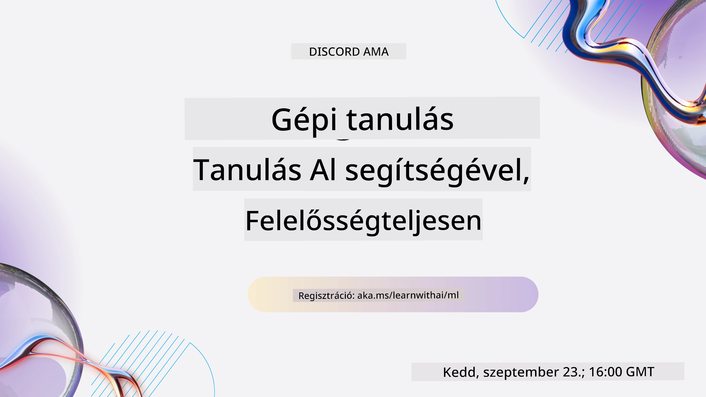
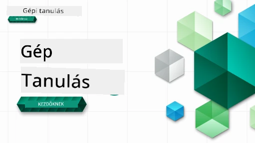

[](https://github.com/microsoft/ML-For-Beginners/blob/master/LICENSE)
[](https://GitHub.com/microsoft/ML-For-Beginners/graphs/contributors/)
[](https://GitHub.com/microsoft/ML-For-Beginners/issues/)
[](https://GitHub.com/microsoft/ML-For-Beginners/pulls/)
[](http://makeapullrequest.com)

[](https://GitHub.com/microsoft/ML-For-Beginners/watchers/)
[](https://GitHub.com/microsoft/ML-For-Beginners/network/)
[](https://GitHub.com/microsoft/ML-For-Beginners/stargazers/)

### 🌐 Többnyelvű támogatás

#### Fordítások karbantartva a [Co-op Translator segítségével](https://github.com/Azure/co-op-translator)

<!-- CO-OP TRANSLATOR LANGUAGES TABLE START -->
[Arab](../ar/README.md) | [Bengáli](../bn/README.md) | [Bolgár](../bg/README.md) | [Burmai (Mianmar)](../my/README.md) | [Kínai (Egyszerűsített)](../zh-CN/README.md) | [Kínai (Hagyományos, Hong Kong)](../zh-HK/README.md) | [Kínai (Hagyományos, Makaó)](../zh-MO/README.md) | [Kínai (Hagyományos, Tajvan)](../zh-TW/README.md) | [Horvát](../hr/README.md) | [Cseh](../cs/README.md) | [Dán](../da/README.md) | [Holland](../nl/README.md) | [Észt](../et/README.md) | [Finn](../fi/README.md) | [Francia](../fr/README.md) | [Német](../de/README.md) | [Görög](../el/README.md) | [Héber](../he/README.md) | [Hindi](../hi/README.md) | [Magyar](./README.md) | [Indonéz](../id/README.md) | [Olasz](../it/README.md) | [Japán](../ja/README.md) | [Kannada](../kn/README.md) | [Khmerr](../km/README.md) | [Koreai](../ko/README.md) | [Litván](../lt/README.md) | [Maláj](../ms/README.md) | [Malajálam](../ml/README.md) | [Manipuri (Meitei Mayek)](../mni/README.md) | [Marathi](../mr/README.md) | [Nepáli](../ne/README.md) | [Nigériai pidgin](../pcm/README.md) | [Norvég](../no/README.md) | [Perzsa (Fárszi)](../fa/README.md) | [Lengyel](../pl/README.md) | [Portugál (Brazília)](../pt-BR/README.md) | [Portugál (Portugália)](../pt-PT/README.md) | [Pandzsábi (Gurmukhi)](../pa/README.md) | [Román](../ro/README.md) | [Orosz](../ru/README.md) | [Szerb (Cirill)](../sr/README.md) | [Szlovák](../sk/README.md) | [Szlovén](../sl/README.md) | [Spanyol](../es/README.md) | [Szuahéli](../sw/README.md) | [Svéd](../sv/README.md) | [Tagalog (Filippínó)](../tl/README.md) | [Tamil](../ta/README.md) | [Telugu](../te/README.md) | [Thai](../th/README.md) | [Török](../tr/README.md) | [Ukrán](../uk/README.md) | [Urdu](../ur/README.md) | [Vietnámi](../vi/README.md)

> **Szeretnéd helyben klónozni?**
>
> Ez a tárhely több mint 50 nyelvi fordítást tartalmaz, ami jelentősen növeli a letöltési méretet. A fordítások nélküli klónozáshoz használd a sparse checkout-ot:
>
> **Bash / macOS / Linux:**
> ```bash
> git clone --filter=blob:none --sparse https://github.com/microsoft/ML-For-Beginners.git
> cd ML-For-Beginners
> git sparse-checkout set --no-cone '/*' '!translations' '!translated_images'
> ```
>
> **CMD (Windows):**
> ```cmd
> git clone --filter=blob:none --sparse https://github.com/microsoft/ML-For-Beginners.git
> cd ML-For-Beginners
> git sparse-checkout set --no-cone "/*" "!translations" "!translated_images"
> ```
>
> Ez mindent megad, amire szükséged van a tanfolyam befejezéséhez, sokkal gyorsabb letöltéssel.
<!-- CO-OP TRANSLATOR LANGUAGES TABLE END -->

#### Csatlakozz közösségünkhöz

[](https://discord.gg/nTYy5BXMWG)

Folyamatban van egy Discord tanulj az AI-val sorozatunk, tudj meg többet, és csatlakozz hozzánk a [Learn with AI Series](https://aka.ms/learnwithai/discord) eseményen 2025. szeptember 18. - 30. között. Tippeket és trükköket kapsz a GitHub Copilot használatához az adat tudományban.



# Gépi tanulás kezdőknek - Egy tananyag

> 🌍 Utazzunk a világ körül miközben a gépi tanulást a világ kultúrái által vizsgáljuk meg 🌍

A Microsoft Cloud Advocates örömmel kínál egy 12 hetes, 26 leckéből álló tananyagot, amely a **Gépi tanulásról** szól. Ebben a tananyagban megtanulod azt, amit néha **klasszikus gépi tanulásnak** neveznek, elsősorban a Scikit-learn könyvtár használatával, elkerülve a mély tanulást, amely az [AI kezdőknek tananyagunkban](https://aka.ms/ai4beginners) kerül ismertetésre. Ezt a tananyagot párosítsd a ['Adattudomány kezdőknek' tananyagunkkal](https://aka.ms/ds4beginners) is!

Utazz velünk a világ körül, miközben ezeket a klasszikus technikákat több világterületről származó adatokra alkalmazzuk. Minden lecke tartalmaz elő- és utóleckés kvízeket, írásos útmutatót a lecke teljesítéséhez, megoldást, feladatot, és még többet. Projekt-alapú pedagógiánk lehetővé teszi, hogy tanulj miközben építesz, ez pedig bevált módja az új készségek megragadásának.

**✍️ Szívből köszönjük szerzőinknek** Jen Looper, Stephen Howell, Francesca Lazzeri, Tomomi Imura, Cassie Breviu, Dmitry Soshnikov, Chris Noring, Anirban Mukherjee, Ornella Altunyan, Ruth Yakubu és Amy Boyd

**🎨 Köszönet illusztrátorainknak is** Tomomi Imura, Dasani Madipalli és Jen Looper

**🙏 Külön köszönet 🙏 Microsoft Hallgatói Nagykövet szerzőinknek, lektorainknak és tartalom közreműködőinknek, különösen Rishit Dagli, Muhammad Sakib Khan Inan, Rohan Raj, Alexandru Petrescu, Abhishek Jaiswal, Nawrin Tabassum, Ioan Samuila és Snigdha Agarwal**

**🤩 Külön hála Microsoft Hallgatói Nagyköveteknek Eric Wanjau, Jasleen Sondhi és Vidushi Gupta részéről R leckéinkért!**

# Kezdés

Kövesd ezeket a lépéseket:
1. **Tároló elágaztatása**: Kattints a "Fork" gombra ennek az oldalnak a jobb felső sarkában.
2. **Tároló klónozása**:   `git clone https://github.com/microsoft/ML-For-Beginners.git`

> 💡 **Gyors kezdési tipp:** Szeretnél böngészőben kezdeni anélkül, hogy helyileg telepítenéd a Pythont? Használd a [GitHub Codespaces](https://github.com/features/codespaces) szolgáltatást, hogy létrehozz egy felhő-alapú fejlesztői környezetet a forkodhoz. Nyisd meg a zöld **Code** menüt, válaszd a **Codespaces** opciót, és hozz létre egy codespace-t; szükség szerint telepítsd bele az egyes leckékhez szükséges függőségeket.

> [minden további tananyagforrást megtalálsz a Microsoft Learn gyűjteményünkben](https://learn.microsoft.com/en-us/collections/qrqzamz1nn2wx3?WT.mc_id=academic-77952-bethanycheum)

> 🔧 **Segítségre van szükséged?** Nézd meg [Hibaelhárítási útmutatónkat](TROUBLESHOOTING.md) a telepítési, beállítási és futtatási problémák megoldásához.


**[Hallgatók](https://aka.ms/student-page)**, hogy használd ezt a tananyagot, forkold le az egész repót saját GitHub fiókodba, majd végezd el a gyakorlatokat egyénileg vagy csoportosan:

- Kezdd egy előadó előtti kvízzel.
- Olvasd el az előadást, és teljesítsd a feladatokat, minden tudásellenőrzésnél állj meg és gondolkodj el.
- Próbáld meg a projekteket megalkotni a leckék megértése alapján, ne pedig a megoldáskód futtatásával; de a kód elérhető az `/solution` könyvtárakban projekt-alapú leckénként.
- Tedd meg az előadó utáni kvízt.
- Teljesítsd a kihívást.
- Teljesítsd a házi feladatot.
- Egy lecke-csoport teljesítése után látogass el a [Vita fórumra](https://github.com/microsoft/ML-For-Beginners/discussions), és "tanulj hangosan" azzal, hogy kitöltöd a megfelelő PAT értékelést. A PAT egy előrehaladási értékelő eszköz, amely egy rubrika, amit kitöltesz a tanulás előrehaladásához. Más PAT-okra is reagálhatsz, így együtt tanulhatunk.

> További tanulmányozáshoz javasoljuk, hogy kövesd ezeket a [Microsoft Learn](https://docs.microsoft.com/en-us/users/jenlooper-2911/collections/k7o7tg1gp306q4?WT.mc_id=academic-77952-leestott) modulokat és tanulási utakat.

**Tanárként** találsz [néhány javaslatot](for-teachers.md) arra, hogyan használd ezt a tananyagot.

---

## Videós bemutatók

Néhány lecke elérhető rövid videó formájában. Ezeket az anyagokban megtalálod, vagy a [ML for Beginners lejátszási listán a Microsoft Developer YouTube csatornán](https://aka.ms/ml-beginners-videos) az alábbi képre kattintva.

[](https://aka.ms/ml-beginners-videos)

---

## Ismerd meg a csapatot

[](https://youtu.be/Tj1XWrDSYJU)

**Gif készítője:** [Mohit Jaisal](https://linkedin.com/in/mohitjaisal)

> 🎥 Kattints a fenti képre egy videóért a projektről és az alkotóiról!

---

## Pedagógia

Két pedagógiai elvet választottunk ennek a tananyagnak az összeállításakor: hogy kézzel fogható, **projekt-alapú** legyen, és hogy tartalmazzon **gyakori kvízeket**. Emellett ez a tananyag egy közös **tematikát** is hordoz az összefüggés biztosítására.

Azáltal, hogy a tartalom projektekkel igazodik egymáshoz, a folyamat élvezetesebb lesz a tanulók számára, és a fogalmak megtartása is javul. Emellett egy alacsony tétű kvíz az óra előtt beállítja a hallgató szándékát egy témakör megtanulására, míg egy második kvíz az óra után további rögzítést biztosít. Ez a tananyag rugalmas és szórakoztató, egészben vagy részben is elvégezhető. A projektek kicsiben kezdődnek és egyre összetettebbek lesznek a 12 hetes ciklus végére. Ez a tananyag egy postscriptumot is tartalmaz a gépi tanulás valós alkalmazásairól, amit extra pontként vagy vitafórumként is használhatsz.

> Találd meg irányelveinket a [Magatartási kódexben](CODE_OF_CONDUCT.md), a [Hozzájárulás-ban](CONTRIBUTING.md), a [Fordításokban](..), és a [Hibaelhárításban](TROUBLESHOOTING.md). Visszajelzésedet szívesen fogadjuk!

## Minden lecke tartalmaz

- opcionális vázlatrajzot
- opcionális kiegészítő videót
- videós bemutatót (néhány leckénél)
- [előadás előtti melegítő kvízt](https://ff-quizzes.netlify.app/en/ml/)
- írott leckét
- projekt-alapú leckékhez lépésenkénti útmutatók a projekt építéséhez
- tudásellenőrzéseket
- egy kihívást
- kiegészítő olvasmányt
- házi feladatot
- [előadás utáni kvízt](https://ff-quizzes.netlify.app/en/ml/)

> **Megjegyzés a nyelvekről**: Ezek a leckék elsősorban Pythonban íródtak, de sok elérhető R-ben is. Egy R lecke teljesítéséhez menj az `/solution` könyvtárba, és keresd az R leckéket. Ezek .rmd kiterjesztéssel rendelkeznek, ami egy **R Markdown** fájlt jelent, amely egyszerűen egy `code chunks` (R vagy más nyelvek) és egy `YAML header` (amely azt irányítja, hogyan formázd az outputokat, például PDF-et) becsomagolása egy `Markdown document` formátumban. Ezáltal példamutató szerzői keretrendszer az adattudományhoz, hiszen lehetővé teszi a kód, annak kimenete és a gondolatok egyidejű rögzítését Markdown-ban. Továbbá az R Markdown dokumentumok PDF, HTML vagy Word kimenetekre is renderelhetők.

> **Megjegyzés a kvízekről**: Az összes kvíz a [Quiz App mappában](../../quiz-app) található, összesen 52 három kérdéses kvízzel. Ezek a leckékből elérhetők, de a kvíz app helyileg is futhat; kövesd az `quiz-app` könyvtárban található utasításokat a helyi hosztoláshoz vagy Azure-ra való telepítéshez.

| Lecke száma |                             Téma                              |                   Lecke csoportosítása                   | Tanulási célok                                                                                                                 |                                                              Kapcsolódó lecke                                                               |                        Szerző                        |
| :-----------: | :------------------------------------------------------------: | :-------------------------------------------------: | ------------------------------------------------------------------------------------------------------------------------------- | :--------------------------------------------------------------------------------------------------------------------------------------: | :--------------------------------------------------: |
|      01       |                Bevezetés a gépi tanulásba                |      [Bevezetés](1-Introduction/README.md)       | Ismerd meg a gépi tanulás alapfogalmait                                                                                |                                             [Lecke](1-Introduction/1-intro-to-ML/README.md)                                             |                       Muhammad                       |
|      02       |                A gépi tanulás története                 |      [Bevezetés](1-Introduction/README.md)       | Tanulj a terület történetéről                                                                                         |                                            [Lecke](1-Introduction/2-history-of-ML/README.md)                                            |                     Jen and Amy                      |
|      03       |                 Méltányosság és gépi tanulás                  |      [Bevezetés](1-Introduction/README.md)       | Melyek a méltányossággal kapcsolatos fontos filozófiai kérdések, amelyeket figyelembe kell venni gépi tanulási modellek építése és alkalmazása során? |                                              [Lecke](1-Introduction/3-fairness/README.md)                                               |                        Tomomi                        |
|      04       |                Módszerek a gépi tanuláshoz                 |      [Bevezetés](1-Introduction/README.md)       | Milyen technikákat használnak a gépi tanulás kutatói, hogy gépi tanulási modelleket építsenek?                                                                       |                                          [Lecke](1-Introduction/4-techniques-of-ML/README.md)                                           |                    Chris and Jen                     |
|      05       |                   Bevezetés a regresszióhoz                   |        [Regresszió](2-Regression/README.md)         | Kezdd el a Pythonnal és a Scikit-learn-nel regressziós modellekhez                                                                  |         [Python](2-Regression/1-Tools/README.md) • [R](../../2-Regression/1-Tools/solution/R/lesson_1.html)         |      Jen • Eric Wanjau       |
|      06       |                Észak-amerikai tökárak 🎃                |        [Regresszió](2-Regression/README.md)         | Vizualizáld és tisztítsd az adatokat a gépi tanulás előkészítéséhez                                                                                  |          [Python](2-Regression/2-Data/README.md) • [R](../../2-Regression/2-Data/solution/R/lesson_2.html)          |      Jen • Eric Wanjau       |
|      07       |                Észak-amerikai tökárak 🎃                |        [Regresszió](2-Regression/README.md)         | Építs lineáris és polinomiális regressziós modelleket                                                                                   |        [Python](2-Regression/3-Linear/README.md) • [R](../../2-Regression/3-Linear/solution/R/lesson_3.html)        |      Jen and Dmitry • Eric Wanjau       |
|      08       |                Észak-amerikai tökárak 🎃                |        [Regresszió](2-Regression/README.md)         | Építs logisztikus regressziós modellt                                                                                               |     [Python](2-Regression/4-Logistic/README.md) • [R](../../2-Regression/4-Logistic/solution/R/lesson_4.html)      |      Jen • Eric Wanjau       |
|      09       |                          Egy Webalkalmazás 🔌                          |           [Webalkalmazás](3-Web-App/README.md)            | Építs egy webalkalmazást a tanult modell használatához                                                                                       |                                                 [Python](3-Web-App/1-Web-App/README.md)                                                  |                         Jen                          |
|      10       |                 Bevezetés az osztályozásba                 |    [Osztályozás](4-Classification/README.md)     | Tisztítsd, készítsd elő, és vizualizáld az adataidat; bevezetés az osztályozásba                                                            | [Python](4-Classification/1-Introduction/README.md) • [R](../../4-Classification/1-Introduction/solution/R/lesson_10.html)  | Jen and Cassie • Eric Wanjau |
|      11       |             Ízletes ázsiai és indiai konyhák 🍜             |    [Osztályozás](4-Classification/README.md)     | Bevezetés az osztályozókba                                                                                                     | [Python](4-Classification/2-Classifiers-1/README.md) • [R](../../4-Classification/2-Classifiers-1/solution/R/lesson_11.html) | Jen and Cassie • Eric Wanjau |
|      12       |             Ízletes ázsiai és indiai konyhák 🍜             |    [Osztályozás](4-Classification/README.md)     | További osztályozók                                                                                                                | [Python](4-Classification/3-Classifiers-2/README.md) • [R](../../4-Classification/3-Classifiers-2/solution/R/lesson_12.html) | Jen and Cassie • Eric Wanjau |
|      13       |             Ízletes ázsiai és indiai konyhák 🍜             |    [Osztályozás](4-Classification/README.md)     | Építs egy ajánló webalkalmazást a modelled segítségével                                                                                    |                                              [Python](4-Classification/4-Applied/README.md)                                              |                         Jen                          |
|      14       |                   Bevezetés a klaszterezésbe                   |        [Klaszterezés](5-Clustering/README.md)         | Tisztítsd, készítsd elő, és vizualizáld az adataidat; bevezetés a klaszterezésbe                                                                |         [Python](5-Clustering/1-Visualize/README.md) • [R](../../5-Clustering/1-Visualize/solution/R/lesson_14.html)         |      Jen • Eric Wanjau       |
|      15       |              Fedezd fel a nigériai zenei ízlést 🎧              |        [Klaszterezés](5-Clustering/README.md)         | Fedezd fel a K-Medoid klaszterezési módszert                                                                                           |           [Python](5-Clustering/2-K-Means/README.md) • [R](../../5-Clustering/2-K-Means/solution/R/lesson_15.html)           |      Jen • Eric Wanjau       |
|      16       |        Bevezetés a természetes nyelvfeldolgozásba ☕️         |   [Természetes nyelvfeldolgozás](6-NLP/README.md)    | Tanuld meg az NLP alapjait egy egyszerű bot építésével                                                                             |                                             [Python](6-NLP/1-Introduction-to-NLP/README.md)                                              |                       Stephen                        |
|      17       |                      Gyakori NLP feladatok ☕️                      |   [Természetes nyelvfeldolgozás](6-NLP/README.md)    | Mélyítsd el NLP ismereteidet a nyelvi struktúrákkal való munka során felmerülő gyakori feladatok megértésével                          |                                                    [Python](6-NLP/2-Tasks/README.md)                                                     |                       Stephen                        |
|      18       |             Fordítás és érzelemelemzés ♥️              |   [Természetes nyelvfeldolgozás](6-NLP/README.md)    | Fordítás és érzelemelemzés Jane Austen műveivel                                                                             |                                            [Python](6-NLP/3-Translation-Sentiment/README.md)                                             |                       Stephen                        |
|      19       |                  Romantikus európai szállodák ♥️                  |   [Természetes nyelvfeldolgozás](6-NLP/README.md)    | Érzelemelemzés szállodai értékelések alapján 1                                                                                         |                                               [Python](6-NLP/4-Hotel-Reviews-1/README.md)                                                |                       Stephen                        |
|      20       |                  Romantikus európai szállodák ♥️                  |   [Természetes nyelvfeldolgozás](6-NLP/README.md)    | Érzelemelemzés szállodai értékelések alapján 2                                                                                         |                                               [Python](6-NLP/5-Hotel-Reviews-2/README.md)                                                |                       Stephen                        |
|      21       |            Bevezetés az idősoros előrejelzésbe             |        [Idősoros](7-TimeSeries/README.md)        | Bevezetés az idősoros előrejelzésbe                                                                                         |                                             [Python](7-TimeSeries/1-Introduction/README.md)                                              |                      Francesca                       |
|      22       | ⚡️ Világ energiafelhasználása ⚡️ - idősoros előrejelzés ARIMA-val |        [Idősoros](7-TimeSeries/README.md)        | Idősoros előrejelzés ARIMA-val                                                                                              |                                                 [Python](7-TimeSeries/2-ARIMA/README.md)                                                 |                      Francesca                       |
|      23       |  ⚡️ Világ energiafelhasználása ⚡️ - idősoros előrejelzés SVR-rel  |        [Idősoros](7-TimeSeries/README.md)        | Idősoros előrejelzés Támogatott Vektor Regresszorral                                                                           |                                                  [Python](7-TimeSeries/3-SVR/README.md)                                                  |                       Anirban                        |
|      24       |             Bevezetés a megerősítéses tanulásba             | [Megerősítéses tanulás](8-Reinforcement/README.md) | Bevezetés a megerősítéses tanulásba Q-learninggel                                                                          |                                             [Python](8-Reinforcement/1-QLearning/README.md)                                              |                        Dmitry                        |
|      25       |                 Segíts Péternek elkerülni a farkast! 🐺                  | [Megerősítéses tanulás](8-Reinforcement/README.md) | Megerősítéses tanulás Gym                                                                                                      |                                                [Python](8-Reinforcement/2-Gym/README.md)                                                 |                        Dmitry                        |
|  Utószó   |            Valódi gépi tanulási forgatókönyvek és alkalmazások            |      [ML a valóságban](9-Real-World/README.md)       | Érdekes és tanulságos valódi alkalmazások a klasszikus gépi tanulásban                                                               |                                             [Lecke](9-Real-World/1-Applications/README.md)                                              |                         Csapat                         |
|  Utószó   |            Modell hibakeresés a gépi tanulásban RAI dashboard használatával            |      [ML a valóságban](9-Real-World/README.md)       | Modellhibakeresés gépi tanulásban a Responsible AI dashboard komponenseit használva                                                              |                                             [Lecke](9-Real-World/2-Debugging-ML-Models/README.md)                                              |                     Ruth Yakubu                      |

> [keresd meg az összes további erőforrást ehhez a tanfolyamhoz a Microsoft Learn gyűjteményünkben](https://learn.microsoft.com/en-us/collections/qrqzamz1nn2wx3?WT.mc_id=academic-77952-bethanycheum)

## Offline elérés

Ezt a dokumentációt offline is futtathatod a [Docsify](https://docsify.js.org/#/) használatával. Forkold ezt a repo-t, [telepítsd a Docsify-t](https://docsify.js.org/#/quickstart) a helyi gépedre, majd a repo gyökérmappájában írd be: `docsify serve`. A weboldal a localhost 3000-es portján fog futni: `localhost:3000`.

## PDF-ek

A tanterv PDF formátumát linkekkel együtt [itt](https://microsoft.github.io/ML-For-Beginners/pdf/readme.pdf) találod.


## 🎒 Egyéb tanfolyamok 

Csapatunk más tanfolyamokat is készít! Nézd meg:

<!-- CO-OP TRANSLATOR OTHER COURSES START -->
### LangChain
[](https://aka.ms/langchain4j-for-beginners)
[](https://aka.ms/langchainjs-for-beginners?WT.mc_id=m365-94501-dwahlin)
[](https://github.com/microsoft/langchain-for-beginners?WT.mc_id=m365-94501-dwahlin)
---

### Azure / Edge / MCP / Ügynökök
[](https://github.com/microsoft/AZD-for-beginners?WT.mc_id=academic-105485-koreyst)
[](https://github.com/microsoft/edgeai-for-beginners?WT.mc_id=academic-105485-koreyst)
[](https://github.com/microsoft/mcp-for-beginners?WT.mc_id=academic-105485-koreyst)
[](https://github.com/microsoft/ai-agents-for-beginners?WT.mc_id=academic-105485-koreyst)

---
 
### Generatív MI sorozat
[](https://github.com/microsoft/generative-ai-for-beginners?WT.mc_id=academic-105485-koreyst)
[-9333EA?style=for-the-badge&labelColor=E5E7EB&color=9333EA)](https://github.com/microsoft/Generative-AI-for-beginners-dotnet?WT.mc_id=academic-105485-koreyst)
[-C084FC?style=for-the-badge&labelColor=E5E7EB&color=C084FC)](https://github.com/microsoft/generative-ai-for-beginners-java?WT.mc_id=academic-105485-koreyst)
[-E879F9?style=for-the-badge&labelColor=E5E7EB&color=E879F9)](https://github.com/microsoft/generative-ai-with-javascript?WT.mc_id=academic-105485-koreyst)

---
 
### Alapvető tanulás
[](https://aka.ms/ml-beginners?WT.mc_id=academic-105485-koreyst)
[](https://aka.ms/datascience-beginners?WT.mc_id=academic-105485-koreyst)
[](https://aka.ms/ai-beginners?WT.mc_id=academic-105485-koreyst)
[](https://github.com/microsoft/Security-101?WT.mc_id=academic-96948-sayoung)
[](https://aka.ms/webdev-beginners?WT.mc_id=academic-105485-koreyst)
[](https://aka.ms/iot-beginners?WT.mc_id=academic-105485-koreyst)
[](https://github.com/microsoft/xr-development-for-beginners?WT.mc_id=academic-105485-koreyst)

---
 
### Copilot sorozat
[](https://aka.ms/GitHubCopilotAI?WT.mc_id=academic-105485-koreyst)
[](https://github.com/microsoft/mastering-github-copilot-for-dotnet-csharp-developers?WT.mc_id=academic-105485-koreyst)
[](https://github.com/microsoft/CopilotAdventures?WT.mc_id=academic-105485-koreyst)
<!-- CO-OP TRANSLATOR OTHER COURSES END -->

## Segítségkérés

Ha elakadsz vagy kérdéseid vannak a gépi tanulás tanulása vagy MI alkalmazások építése közben, ne aggódj — segítség elérhető.

Csatlakozhatsz beszélgetésekhez más tanulókkal és fejlesztőkkel, kérdezhetsz, és megoszthatod ötleteidet a közösséggel.

- Csatlakozz a közösséghez, hogy kérdezhess és tanulhass másoktól
- Beszélj a gépi tanulás fogalmairól és projektötleteiről
- Szerezz iránymutatást tapasztalt fejlesztőktől

Egy támogató közösség nagyszerű módja a képességek fejlesztésének és a problémák gyorsabb megoldásának.

[Microsoft Foundry Discord közösség](https://discord.gg/nTYy5BXMWG)

Ha hibákat észlelsz vagy javaslataid vannak a fejlesztésekhez, ebben a tárházban is nyithatsz egy **Issue**-t, hogy jelezd a problémát.

Termék visszajelzéshez vagy a meglévő közösségi posztok kereséséhez látogasd meg a Fejlesztői Fórumot:

[](https://aka.ms/foundry/forum)

## További tanulási tippek

- Nézd át az egyes leckék után a jegyzetfüzeteket a jobb megértésért.
- Gyakorold algoritmusok önálló megvalósítását.
- Valós adatállományokat fedezz fel tanult fogalmak segítségével.

---

<!-- CO-OP TRANSLATOR DISCLAIMER START -->
**Jogi nyilatkozat**:
Ez a dokumentum az AI fordítási szolgáltatás, a [Co-op Translator](https://github.com/Azure/co-op-translator) segítségével készült. Bár az pontosságra törekszünk, kérjük, vegye figyelembe, hogy az automatikus fordítások hibákat vagy pontatlanságokat tartalmazhatnak. Az eredeti dokumentum az anyanyelvén tekintendő hiteles forrásnak. Fontos információk esetén professzionális emberi fordítást javasolunk. Nem vállalunk felelősséget semmilyen félreértésért vagy téves értelmezésért, amely ebből a fordításból ered.
<!-- CO-OP TRANSLATOR DISCLAIMER END -->