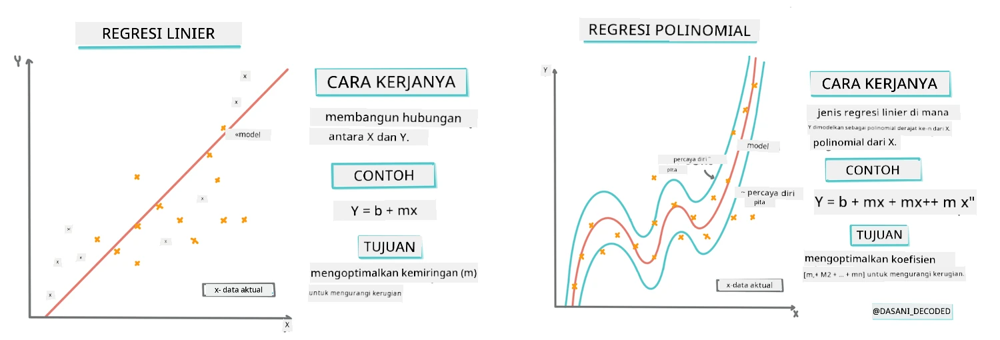
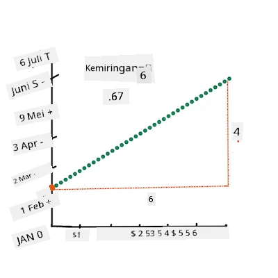
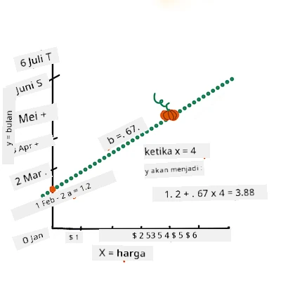
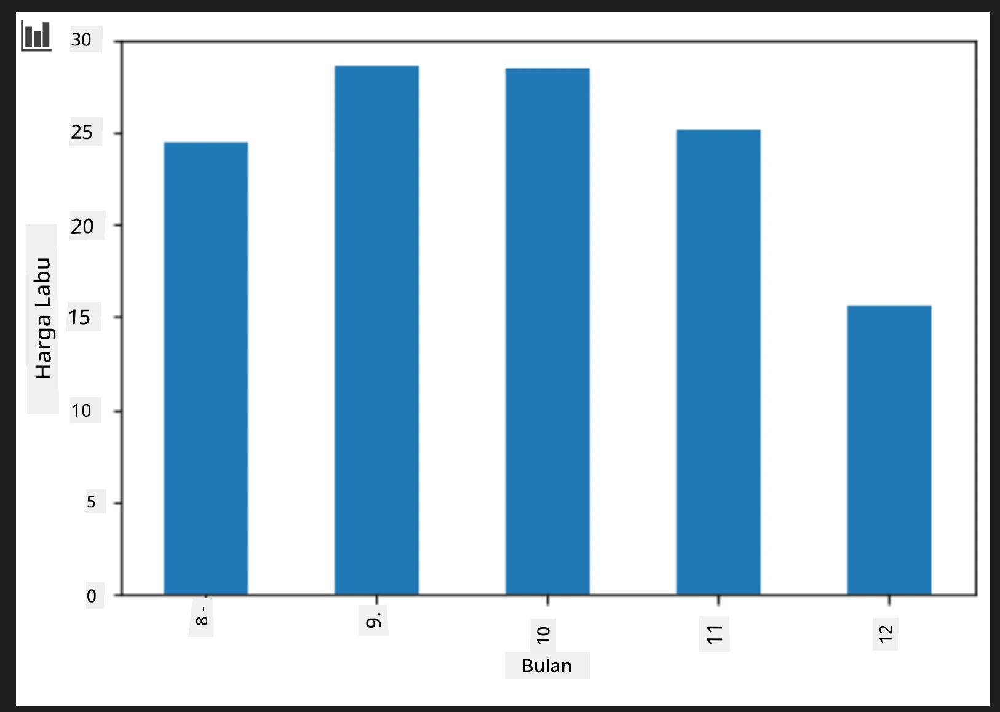
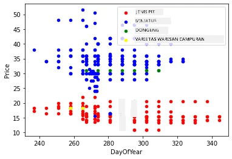

# Membangun model regresi menggunakan Scikit-learn: regresi empat cara

## Catatan Pemula

Regresi linier digunakan ketika kita ingin memprediksi **nilai numerik** (misalnya, harga rumah, suhu, atau penjualan).
Ini bekerja dengan menemukan garis lurus yang paling mewakili hubungan antara fitur input dan output.

Dalam pelajaran ini, kita fokus pada memahami konsep sebelum menjelajahi teknik regresi yang lebih lanjut.

> Infografis oleh [Dasani Madipalli](https://twitter.com/dasani_decoded)
## [Kuis pra-ceramah](https://ff-quizzes.netlify.app/en/ml/)

> ### [Pelajaran ini tersedia dalam R!](../../../../2-Regression/3-Linear/solution/R/lesson_3.html)
### Pendahuluan

Sejauh ini Anda telah mengeksplorasi apa itu regresi dengan data contoh yang diambil dari dataset harga labu yang akan kita gunakan sepanjang pelajaran ini. Anda juga telah memvisualisasikannya menggunakan Matplotlib.

Sekarang Anda siap untuk menyelami lebih dalam regresi untuk ML. Sementara visualisasi memungkinkan Anda memahami data, kekuatan nyata dari Pembelajaran Mesin berasal dari _pelatihan model_. Model dilatih pada data historis untuk secara otomatis menangkap ketergantungan data, dan memungkinkan Anda memprediksi hasil untuk data baru yang belum pernah dilihat model sebelumnya.

Dalam pelajaran ini, Anda akan belajar lebih banyak tentang dua jenis regresi: _regresi linier dasar_ dan _regresi polinomial_, bersama dengan beberapa matematika yang mendasari teknik-teknik ini. Model-model tersebut akan memungkinkan kita memprediksi harga labu tergantung pada data input yang berbeda.

[](https://youtu.be/CRxFT8oTDMg "ML for beginners - Understanding Linear Regression")

> 🎥 Klik gambar di atas untuk video ringkas tentang regresi linier.

> Sepanjang kurikulum ini, kami mengasumsikan pengetahuan matematika minimal, dan berupaya membuatnya dapat diakses bagi siswa yang berasal dari bidang lain, jadi perhatikan catatan, 🧮 penjelasan, diagram, dan alat pembelajaran lain untuk membantu pemahaman.

### Prasyarat

Anda seharusnya sudah familiar dengan struktur data labu yang sedang kita periksa. Anda dapat menemukannya telah dimuat sebelumnya dan sudah dibersihkan dalam file _notebook.ipynb_ pelajaran ini. Dalam file tersebut, harga labu ditampilkan per bushel dalam sebuah data frame baru. Pastikan Anda dapat menjalankan notebook ini di kernel Visual Studio Code.

### Persiapan

Sebagai pengingat, Anda sedang memuat data ini untuk mengajukan pertanyaan terhadapnya.

- Kapan waktu terbaik membeli labu?
- Berapa harga yang bisa saya harapkan untuk satu kotak labu mini?
- Haruskah saya membelinya dalam keranjang setengah bushel atau per kotak 1 1/9 bushel?

Mari kita terus menggali data ini.

Dalam pelajaran sebelumnya, Anda membuat sebuah Pandas data frame dan mengisinya dengan sebagian dataset asli, menstandardisasi harga berdasarkan bushel. Namun dengan melakukan itu, Anda hanya bisa mengumpulkan sekitar 400 titik data dan hanya untuk bulan-bulan musim gugur.

Lihat data yang telah kami muat sebelumnya dalam notebook pelajaran ini. Data tersebut telah dimuat dan sebuah scatterplot awal dibuat untuk menunjukkan data bulan. Mungkin kita bisa mendapatkan sedikit lebih banyak detail tentang karakter data dengan membersihkannya lebih lanjut.

## Garis regresi linier

Seperti yang Anda pelajari di Pelajaran 1, tujuan latihan regresi linier adalah untuk dapat memplot sebuah garis untuk:

- **Menunjukkan hubungan variabel**. Menunjukkan hubungan antar variabel
- **Membuat prediksi**. Membuat prediksi akurat di mana titik data baru akan jatuh terkait garis tersebut.

Biasanya **Regresi Kuadrat Terkecil** menggambar garis seperti ini. Istilah "Kuadrat Terkecil" merujuk pada proses meminimalkan total error pada model kita. Untuk setiap titik data, kita mengukur jarak vertikal (disebut residual) antara titik sesungguhnya dan garis regresi kita.

Jarak ini kita kuadratkan karena dua alasan utama:

1. **Magnitudo bukan Arah:** Kita ingin memperlakukan error -5 sama dengan error +5. Dengan mengkuadratkan, semua nilai menjadi positif.

2. **Menghukum Outlier:** Mengkuadratkan memberi bobot lebih pada error yang lebih besar, memaksa garis lebih dekat ke titik yang jauh.

Kita kemudian menjumlahkan semua nilai kuadrat ini. Tujuan kita adalah menemukan garis spesifik di mana jumlah akhir ini paling kecil (nilai terkecil mungkin)—oleh karena itu nama "Kuadrat Terkecil".

> **🧮 Tunjukkan matematikanya**  
>  
> Garis ini, yang disebut _garis terbaik_ dapat dinyatakan oleh [persamaan](https://en.wikipedia.org/wiki/Simple_linear_regression): 
> 
> ```
> Y = a + bX
> ```
>
> `X` adalah 'variabel penjelas'. `Y` adalah 'variabel terikat'. Kemiringan garis adalah `b` dan `a` adalah titik potong y, yang menunjukkan nilai `Y` saat `X = 0`.
>
>
>
> Pertama, hitung kemiringan `b`. Infografis oleh [Jen Looper](https://twitter.com/jenlooper)
>
> Dengan kata lain, dan merujuk pada pertanyaan asli data labu kita: "prediksi harga labu per bushel berdasarkan bulan", `X` akan merujuk pada harga dan `Y` akan merujuk pada bulan penjualan.
>
>
>
> Hitung nilai Y. Jika Anda membayar sekitar $4, pasti April! Infografis oleh [Jen Looper](https://twitter.com/jenlooper)
>
> Matematika yang menghitung garis harus menunjukkan kemiringan garis, yang juga bergantung pada intercept, atau di mana `Y` berada saat `X = 0`.
>
> Anda dapat melihat metode penghitungan nilai ini di situs [Math is Fun](https://www.mathsisfun.com/data/least-squares-regression.html). Juga kunjungi [Kalkulator Kuadrat Terkecil ini](https://www.mathsisfun.com/data/least-squares-calculator.html) untuk melihat bagaimana nilai angka mempengaruhi garis.

## Korelasi

Satu istilah lagi yang perlu dipahami adalah **Koefisien Korelasi** antara variabel X dan Y tertentu. Dengan menggunakan scatterplot, Anda dapat dengan cepat memvisualisasikan koefisien ini. Plot dengan titik data tersebar dalam garis rapi memiliki korelasi tinggi, tetapi plot dengan titik data tersebar di mana-mana antara X dan Y memiliki korelasi rendah.

Model regresi linier yang baik adalah yang memiliki Koefisien Korelasi tinggi (lebih dekat ke 1 daripada 0) menggunakan metode Regresi Kuadrat Terkecil dengan garis regresi.

✅ Jalankan notebook yang menyertai pelajaran ini dan lihat scatterplot Bulan ke Harga. Apakah data yang menghubungkan Bulan dengan Harga penjualan labu tampak memiliki korelasi tinggi atau rendah, berdasarkan interpretasi visual scatterplot Anda? Apakah berubah jika Anda menggunakan ukuran yang lebih rinci selain `Month`, misalnya *hari dalam tahun* (yakni jumlah hari sejak awal tahun)?

Dalam kode berikut, kita akan berasumsi bahwa kita telah membersihkan data dan memperoleh sebuah data frame bernama `new_pumpkins`, mirip dengan yang berikut:

ID | Month | DayOfYear | Variety | City | Package | Low Price | High Price | Price
---|-------|-----------|---------|------|---------|-----------|------------|-------
70 | 9 | 267 | PIE TYPE | BALTIMORE | 1 1/9 bushel cartons | 15.0 | 15.0 | 13.636364
71 | 9 | 267 | PIE TYPE | BALTIMORE | 1 1/9 bushel cartons | 18.0 | 18.0 | 16.363636
72 | 10 | 274 | PIE TYPE | BALTIMORE | 1 1/9 bushel cartons | 18.0 | 18.0 | 16.363636
73 | 10 | 274 | PIE TYPE | BALTIMORE | 1 1/9 bushel cartons | 17.0 | 17.0 | 15.454545
74 | 10 | 281 | PIE TYPE | BALTIMORE | 1 1/9 bushel cartons | 15.0 | 15.0 | 13.636364

> Kode untuk membersihkan data tersedia di [`notebook.ipynb`](notebook.ipynb). Kami telah melakukan langkah pembersihan yang sama seperti di pelajaran sebelumnya, dan telah menghitung kolom `DayOfYear` menggunakan ekspresi berikut:

```python
day_of_year = pd.to_datetime(pumpkins['Date']).apply(lambda dt: (dt-datetime(dt.year,1,1)).days)
```

Sekarang setelah Anda memahami matematika di balik regresi linier, mari kita buat model Regresi untuk melihat apakah kita dapat memprediksi paket labu mana yang akan memiliki harga labu terbaik. Seseorang yang membeli labu untuk patch labu liburan mungkin ingin informasi ini untuk dapat mengoptimalkan pembelian paket labu untuk patch tersebut.

## Mencari Korelasi

[](https://youtu.be/uoRq-lW2eQo "ML for beginners - Looking for Correlation: The Key to Linear Regression")

> 🎥 Klik gambar di atas untuk video ringkas tentang korelasi.

Dari pelajaran sebelumnya Anda mungkin telah melihat bahwa harga rata-rata untuk bulan-bulan berbeda tampak seperti ini:



Ini menunjukkan bahwa seharusnya ada beberapa korelasi, dan kita dapat mencoba melatih model regresi linier untuk memprediksi hubungan antara `Month` dan `Price`, atau antara `DayOfYear` dan `Price`. Berikut adalah scatter plot yang menunjukkan hubungan yang terakhir:

 

Mari lihat apakah ada korelasi menggunakan fungsi `corr`:

```python
print(new_pumpkins['Month'].corr(new_pumpkins['Price']))
print(new_pumpkins['DayOfYear'].corr(new_pumpkins['Price']))
```

Tampaknya korelasinya cukup kecil, -0.15 berdasarkan `Month` dan -0.17 berdasarkan `DayOfYear`, tapi mungkin ada hubungan penting lain. Tampak ada kelompok harga berbeda yang sesuai dengan varietas labu yang berbeda. Untuk mengonfirmasi hipotesis ini, mari plot setiap kategori labu menggunakan warna berbeda. Dengan melewatkan parameter `ax` ke fungsi plot `scatter` kita dapat plot semua titik di grafik yang sama:

```python
ax=None
colors = ['red','blue','green','yellow']
for i,var in enumerate(new_pumpkins['Variety'].unique()):
    df = new_pumpkins[new_pumpkins['Variety']==var]
    ax = df.plot.scatter('DayOfYear','Price',ax=ax,c=colors[i],label=var)
```

 

Penyelidikan kita menunjukkan bahwa varietas lebih berpengaruh terhadap harga keseluruhan daripada tanggal penjualan sebenarnya. Kita dapat melihat ini dengan grafik batang:

```python
new_pumpkins.groupby('Variety')['Price'].mean().plot(kind='bar')
```

 

Mari kita fokus sejenak hanya pada satu varietas labu, yaitu 'pie type', dan lihat pengaruh tanggal terhadap harga:

```python
pie_pumpkins = new_pumpkins[new_pumpkins['Variety']=='PIE TYPE']
pie_pumpkins.plot.scatter('DayOfYear','Price') 
```
 

Jika sekarang kita hitung korelasi antara `Price` dan `DayOfYear` menggunakan fungsi `corr`, kita akan mendapatkan sesuatu seperti `-0.27` - yang berarti melatih model prediktif masuk akal.

> Sebelum melatih model regresi linier, penting untuk memastikan data kita bersih. Regresi linier tidak bekerja dengan baik dengan nilai yang hilang, jadi masuk akal untuk menghapus semua sel kosong:

```python
pie_pumpkins.dropna(inplace=True)
pie_pumpkins.info()
```

Pendekatan lain adalah mengisi nilai kosong tersebut dengan nilai rata-rata dari kolom yang bersangkutan.

## Regresi Linier Sederhana

[](https://youtu.be/e4c_UP2fSjg "ML for beginners - Linear and Polynomial Regression using Scikit-learn")

> 🎥 Klik gambar di atas untuk video ringkas tentang regresi linier dan polinomial.

Untuk melatih model Regresi Linier kita, kita akan menggunakan perpustakaan **Scikit-learn**.

```python
from sklearn.linear_model import LinearRegression
from sklearn.metrics import mean_squared_error
from sklearn.model_selection import train_test_split
```

Kita mulai dengan memisahkan nilai input (fitur) dan output yang diharapkan (label) ke dalam array numpy terpisah:

```python
X = pie_pumpkins['DayOfYear'].to_numpy().reshape(-1,1)
y = pie_pumpkins['Price']
```

> Perlu dicatat bahwa kita harus melakukan `reshape` pada data input agar paket Regresi Linier dapat memahaminya dengan benar. Regresi Linier mengharapkan array 2D sebagai input, di mana setiap baris array merupakan vektor fitur input. Dalam kasus kita, karena hanya ada satu input - kita memerlukan array dengan bentuk N&times;1, di mana N adalah ukuran dataset.

Kemudian, kita perlu membagi data menjadi dataset train dan test, agar kita dapat memvalidasi model setelah pelatihan:

```python
X_train, X_test, y_train, y_test = train_test_split(X, y, test_size=0.2, random_state=0)
```

Terakhir, training model Regresi Linier sebenarnya hanya butuh dua baris kode. Kita definisikan objek `LinearRegression`, dan fit ke data kita menggunakan method `fit`:

```python
lin_reg = LinearRegression()
lin_reg.fit(X_train,y_train)
```

Objek `LinearRegression` setelah melakukan `fit` mengandung semua koefisien regresi, yang dapat diakses menggunakan properti `.coef_`. Dalam kasus kita, hanya ada satu koefisien, yang seharusnya sekitar `-0.017`. Ini berarti harga tampaknya turun sedikit seiring waktu, tetapi tidak terlalu banyak, sekitar 2 sen per hari. Kita juga dapat mengakses titik potong regresi dengan sumbu Y menggunakan `lin_reg.intercept_` - dalam kasus kita akan sekitar `21`, menunjukkan harga pada awal tahun.

Untuk melihat seberapa akurat model kita, kita dapat memprediksi harga pada dataset uji, dan kemudian mengukur seberapa dekat prediksi kita dengan nilai yang diharapkan. Ini dapat dilakukan menggunakan metrik root mean square error (RMSE), yaitu akar dari rata-rata semua selisih kuadrat antara nilai yang diharapkan dan yang diprediksi.

```python
pred = lin_reg.predict(X_test)

rmse = np.sqrt(mean_squared_error(y_test,pred))
print(f'RMSE: {rmse:3.3} ({rmse/np.mean(pred)*100:3.3}%)')
```

Kesalahan kita tampaknya sekitar 2 poin, yaitu ~17%. Tidak terlalu baik. Indikator lain dari kualitas model adalah **koefisien determinasi**, yang dapat diperoleh seperti ini:

```python
score = lin_reg.score(X_train,y_train)
print('Model determination: ', score)
```

Jika nilainya 0, berarti model tidak mempertimbangkan data input, dan berperilaku sebagai *prediktor linear terburuk*, yang hanya nilai rata-rata hasil. Nilai 1 berarti kita dapat memprediksi semua keluaran yang diharapkan dengan sempurna. Dalam kasus kita, koefisiennya sekitar 0.06, yang cukup rendah.

Kita juga dapat memplot data uji bersama dengan garis regresi untuk melihat lebih baik bagaimana regresi bekerja dalam kasus kita:

```python
plt.scatter(X_test,y_test)
plt.plot(X_test,pred)
```


## Regresi Polinomial

Jenis lain dari Regresi Linear adalah Regresi Polinomial. Kadang-kadang ada hubungan linear antar variabel - semakin besar volume labu, semakin tinggi harganya - namun terkadang hubungan ini tidak bisa diplot sebagai bidang atau garis lurus.

✅ Berikut adalah [beberapa contoh lagi](https://online.stat.psu.edu/stat501/Lesson09#polynomial-regression-examples) data yang dapat menggunakan Regresi Polinomial

Perhatikan kembali hubungan antara Tanggal dan Harga. Apakah scatterplot ini harus dianalisis dengan garis lurus? Apakah harga tidak bisa berfluktuasi? Dalam kasus ini, Anda bisa mencoba regresi polinomial.

✅ Polinomial adalah ekspresi matematika yang mungkin terdiri dari satu atau lebih variabel dan koefisien

Regresi polinomial membuat garis melengkung untuk lebih baik memodelkan data non-linear. Dalam kasus kita, jika kita memasukkan variabel `DayOfYear`^2 ke data input, kita seharusnya bisa memodelkan data dengan kurva parabola, yang akan memiliki titik minimum pada titik tertentu dalam setahun.

Scikit-learn menyertakan API [pipeline](https://scikit-learn.org/stable/modules/generated/sklearn.pipeline.make_pipeline.html?highlight=pipeline#sklearn.pipeline.make_pipeline) yang berguna untuk menggabungkan beberapa langkah pemrosesan data. Sebuah **pipeline** adalah rantai **estimator**. Dalam kasus kita, kita akan membuat pipeline yang pertama-tama menambahkan fitur polinomial ke model kita, kemudian melatih regresi:

```python
from sklearn.preprocessing import PolynomialFeatures
from sklearn.pipeline import make_pipeline

pipeline = make_pipeline(PolynomialFeatures(2), LinearRegression())

pipeline.fit(X_train,y_train)
```

Menggunakan `PolynomialFeatures(2)` berarti kita akan memasukkan semua polinomial derajat dua dari data input. Dalam kasus kita ini hanya berarti `DayOfYear`<sup>2</sup>, tapi jika ada dua variabel input X dan Y, ini akan menambahkan X<sup>2</sup>, XY, dan Y<sup>2</sup>. Kita juga bisa menggunakan polinomial derajat lebih tinggi jika ingin.

Pipeline dapat digunakan dengan cara yang sama seperti objek `LinearRegression` asli, yaitu kita bisa `fit` pipeline, lalu menggunakan `predict` untuk mendapatkan hasil prediksi:

```python
pred = pipeline.predict(X_test)

rmse = np.sqrt(mean_squared_error(y_test,pred))
print(f'RMSE: {rmse:3.3} ({rmse/np.mean(pred)*100:3.3}%)')

score = pipeline.score(X_train,y_train)
print('Model determination: ', score)
```

Untuk memplot kurva aproksimasi yang halus, kita menggunakan `np.linspace` untuk membuat rentang nilai input yang seragam, daripada memplot langsung pada data uji yang tidak terurut (yang akan menghasilkan garis zigzag):

```python
X_range = np.linspace(X_test.min(), X_test.max(), 100).reshape(-1,1)
y_range = pipeline.predict(X_range)

plt.scatter(X_test, y_test)
plt.plot(X_range, y_range)
```

Berikut grafik yang menunjukkan data uji dan kurva aproksimasi:


Dengan Regresi Polinomial, kita bisa mendapatkan RMSE sedikit lebih rendah dan koefisien determinasi lebih tinggi, tapi tidak signifikan. Kita perlu mempertimbangkan fitur lain!

> Anda bisa melihat harga labu terendah diamati di sekitar Halloween. Bagaimana Anda menjelaskannya?

🎃 Selamat, Anda baru saja membuat model yang bisa membantu memprediksi harga labu pie. Anda mungkin bisa mengulangi prosedur yang sama untuk semua jenis labu, tapi itu akan melelahkan. Mari kita pelajari sekarang bagaimana mempertimbangkan varietas labu dalam model kita!

## Fitur Kategorikal

Dalam dunia ideal, kita ingin bisa memprediksi harga untuk berbagai varietas labu menggunakan model yang sama. Namun, kolom `Variety` agak berbeda dari kolom seperti `Month`, karena mengandung nilai non-numerik. Kolom seperti ini disebut **kategorikal**.

[](https://youtu.be/DYGliioIAE0 "ML for beginners - Categorical Feature Predictions with Linear Regression")

> 🎥 Klik gambar di atas untuk video singkat tentang penggunaan fitur kategorikal.

Di sini Anda dapat melihat bagaimana harga rata-rata bergantung pada varietas:


Untuk memasukkan varietas ke dalam pertimbangan, kita harus mengonversi dulu ke bentuk numerik, atau **mengkodekan**. Ada beberapa cara kita bisa melakukannya:

* **Encoding numerik** sederhana akan membuat tabel berbagai varietas, kemudian mengganti nama varietas dengan indeks di tabel tersebut. Ini bukan ide terbaik untuk regresi linear, karena regresi linear menggunakan nilai numerik indeks tersebut dan menambahkannya ke hasil, dikalikan dengan koefisien tertentu. Dalam kasus kita, hubungan antara indeks dan harga jelas tidak linear, sekalipun kita mengurutkan indeks dengan suatu cara khusus.
* **One-hot encoding** akan mengganti kolom `Variety` dengan 4 kolom berbeda, satu untuk setiap varietas. Setiap kolom berisi `1` jika baris terkait adalah varietas tersebut, dan `0` jika tidak. Ini berarti akan ada empat koefisien dalam regresi linear, masing-masing untuk varietas labu tertentu, yang bertanggung jawab untuk "harga awal" (atau tepatnya "harga tambahan") untuk varietas tersebut.

Kode di bawah menunjukkan cara melakukan one-hot encoding pada varietas:

```python
pd.get_dummies(new_pumpkins['Variety'])
```

 ID | FAIRYTALE | MINIATURE | MIXED HEIRLOOM VARIETIES | PIE TYPE
----|-----------|-----------|--------------------------|----------
70 | 0 | 0 | 0 | 1
71 | 0 | 0 | 0 | 1
... | ... | ... | ... | ...
1738 | 0 | 1 | 0 | 0
1739 | 0 | 1 | 0 | 0
1740 | 0 | 1 | 0 | 0
1741 | 0 | 1 | 0 | 0
1742 | 0 | 1 | 0 | 0

Untuk melatih regresi linear menggunakan varietas yang sudah di-one-hot encode sebagai input, kita hanya perlu menginisialisasi data `X` dan `y` dengan benar:

```python
X = pd.get_dummies(new_pumpkins['Variety'])
y = new_pumpkins['Price']
```

Sisa kode sama seperti yang kita gunakan sebelumnya untuk melatih Regresi Linear. Jika Anda mencoba, Anda akan melihat bahwa mean squared error kira-kira sama, tapi kita mendapatkan nilai koefisien determinasi jauh lebih tinggi (~77%). Untuk mendapatkan prediksi yang lebih akurat, kita dapat mempertimbangkan lebih banyak fitur kategorikal, serta fitur numerik, seperti `Month` atau `DayOfYear`. Untuk mendapatkan satu array fitur besar, kita bisa menggunakan `join`:

```python
X = pd.get_dummies(new_pumpkins['Variety']) \
        .join(new_pumpkins['Month']) \
        .join(pd.get_dummies(new_pumpkins['City'])) \
        .join(pd.get_dummies(new_pumpkins['Package']))
y = new_pumpkins['Price']
```

Di sini kita juga mempertimbangkan `City` dan tipe `Package`, yang memberikan RMSE 2.84 (10.5%), dan determinasi 0.94!

## Menggabungkan semuanya

Untuk membuat model terbaik, kita dapat menggunakan data gabungan (kategorikal one-hot encoded + numerik) dari contoh di atas bersama Regresi Polinomial. Berikut kode lengkapnya untuk kemudahan Anda:

```python
# siapkan data pelatihan
X = pd.get_dummies(new_pumpkins['Variety']) \
        .join(new_pumpkins['Month']) \
        .join(pd.get_dummies(new_pumpkins['City'])) \
        .join(pd.get_dummies(new_pumpkins['Package']))
y = new_pumpkins['Price']

# buat pemisahan train-test
X_train, X_test, y_train, y_test = train_test_split(X, y, test_size=0.2, random_state=0)

# siapkan dan latih pipeline
pipeline = make_pipeline(PolynomialFeatures(2), LinearRegression())
pipeline.fit(X_train,y_train)

# prediksi hasil untuk data uji
pred = pipeline.predict(X_test)

# hitung RMSE dan determinasi
rmse = mean_squared_error(y_test, pred, squared=False)
print(f'RMSE: {rmse:3.3} ({rmse/pred.mean()*100:3.3}%)')

score = pipeline.score(X_train,y_train)
print('Model determination: ', score)
```

Ini seharusnya memberi kita nilai koefisien determinasi terbaik hampir 97%, dan RMSE=2.23 (~8% error prediksi).

| Model | RMSE | Determination |
|-------|-----|---------------|
| Linear `DayOfYear` | 2.77 (17.2%) | 0.07 |
| Polinomial `DayOfYear` | 2.73 (17.0%) | 0.08 |
| Linear `Variety` | 5.24 (19.7%) | 0.77 |
| Linear Semua fitur | 2.84 (10.5%) | 0.94 |
| Polinomial Semua fitur | 2.23 (8.25%) | 0.97 |

🏆 Bagus! Anda membuat empat model Regresi dalam satu pelajaran, dan meningkatkan kualitas model hingga 97%. Di bagian akhir tentang Regresi, Anda akan belajar tentang Regresi Logistik untuk menentukan kategori.

---
## 🚀Tantangan

Uji beberapa variabel berbeda dalam notebook ini untuk melihat bagaimana korelasi terkait dengan akurasi model.

## [Kuis pasca kuliah](https://ff-quizzes.netlify.app/en/ml/)

## Ulasan & Belajar Mandiri

Dalam pelajaran ini kita belajar tentang Regresi Linear. Ada tipe Regresi penting lain. Bacalah tentang teknik Stepwise, Ridge, Lasso, dan Elasticnet. Kursus yang bagus untuk belajar lebih lanjut adalah [Stanford Statistical Learning course](https://online.stanford.edu/courses/sohs-ystatslearning-statistical-learning)

## Tugas

[Bangun Model](assignment.md)

---

<!-- CO-OP TRANSLATOR DISCLAIMER START -->
**Penafian**:  
Dokumen ini telah diterjemahkan menggunakan layanan terjemahan AI [Co-op Translator](https://github.com/Azure/co-op-translator). Meskipun kami berusaha untuk akurasi, harap diketahui bahwa terjemahan otomatis mungkin mengandung kesalahan atau ketidaktepatan. Dokumen asli dalam bahasa aslinya harus dianggap sebagai sumber yang berwenang. Untuk informasi yang penting, disarankan menggunakan terjemahan profesional oleh manusia. Kami tidak bertanggung jawab atas kesalahpahaman atau salah tafsir yang timbul dari penggunaan terjemahan ini.
<!-- CO-OP TRANSLATOR DISCLAIMER END -->