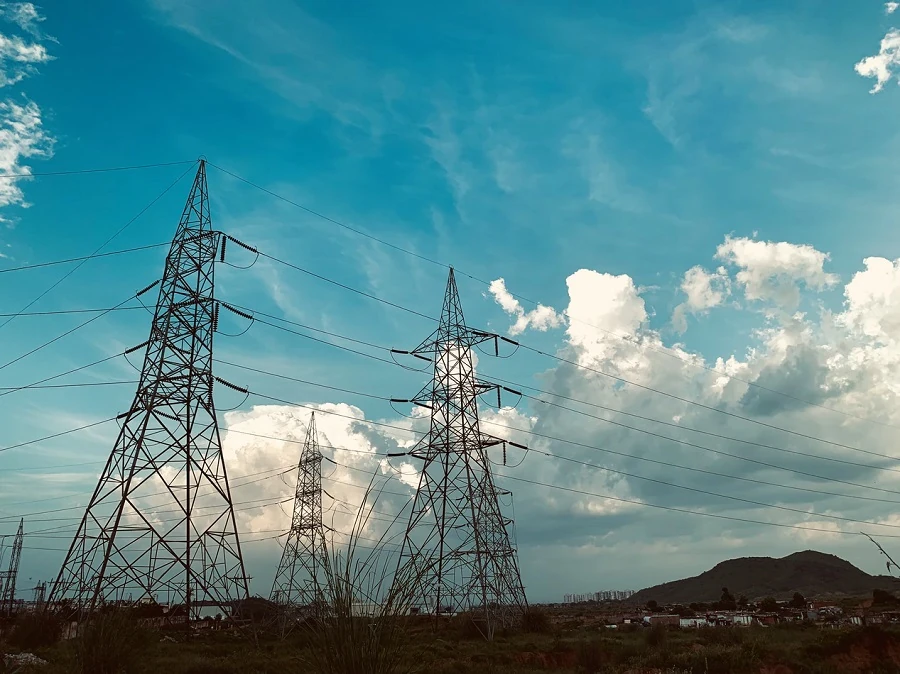

# Pengantar peramalan deret waktu

Apa itu peramalan deret waktu? Ini tentang memprediksi kejadian di masa depan dengan menganalisis tren masa lalu.

## Topik regional: penggunaan listrik di seluruh dunia ✨

Dalam dua pelajaran ini, Anda akan diperkenalkan pada peramalan deret waktu, sebuah area pembelajaran mesin yang agak kurang dikenal namun sangat berharga untuk aplikasi industri dan bisnis, di antara bidang lainnya. Meskipun jaringan saraf dapat digunakan untuk meningkatkan kegunaan model ini, kita akan mempelajarinya dalam konteks pembelajaran mesin klasik karena model membantu memprediksi kinerja masa depan berdasarkan masa lalu.

Fokus regional kami adalah penggunaan listrik di dunia, sebuah dataset menarik untuk mempelajari peramalan penggunaan listrik masa depan berdasarkan pola beban masa lalu. Anda dapat melihat bagaimana peramalan semacam ini dapat sangat membantu dalam lingkungan bisnis.

Foto oleh [Peddi Sai hrithik](https://unsplash.com/@shutter_log?utm_source=unsplash&utm_medium=referral&utm_content=creditCopyText) dari menara listrik di jalan di Rajasthan di [Unsplash](https://unsplash.com/s/photos/electric-india?utm_source=unsplash&utm_medium=referral&utm_content=creditCopyText)

## Pelajaran

1. [Pengantar peramalan deret waktu](1-Introduction/README.md)
2. [Membangun model deret waktu ARIMA](2-ARIMA/README.md)
3. [Membangun Support Vector Regressor untuk peramalan deret waktu](3-SVR/README.md)

## Kredit

"Pengantar peramalan deret waktu" ditulis dengan ⚡️ oleh [Francesca Lazzeri](https://twitter.com/frlazzeri) dan [Jen Looper](https://twitter.com/jenlooper). Notebook pertama kali muncul secara online di [repo "Deep Learning For Time Series" Azure](https://github.com/Azure/DeepLearningForTimeSeriesForecasting) yang awalnya ditulis oleh Francesca Lazzeri. Pelajaran SVR ditulis oleh [Anirban Mukherjee](https://github.com/AnirbanMukherjeeXD)

---

<!-- CO-OP TRANSLATOR DISCLAIMER START -->
**Penafian**:
Dokumen ini telah diterjemahkan menggunakan layanan terjemahan AI [Co-op Translator](https://github.com/Azure/co-op-translator). Meskipun kami berupaya untuk mencapai akurasi, harap diketahui bahwa terjemahan otomatis mungkin mengandung kesalahan atau ketidakakuratan. Dokumen asli dalam bahasa aslinya harus dianggap sebagai sumber yang sah. Untuk informasi penting, disarankan menggunakan terjemahan profesional oleh manusia. Kami tidak bertanggung jawab atas kesalahpahaman atau penafsiran yang keliru yang timbul dari penggunaan terjemahan ini.
<!-- CO-OP TRANSLATOR DISCLAIMER END -->