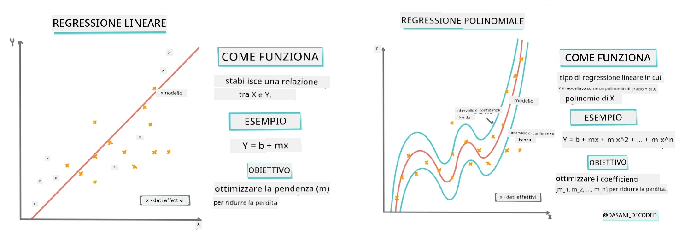
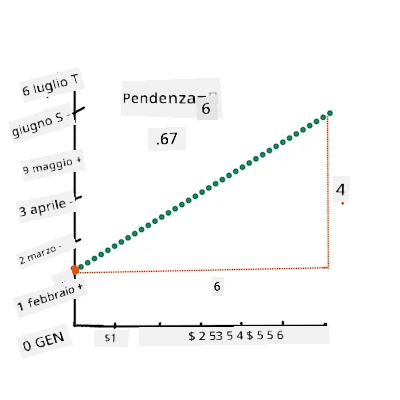
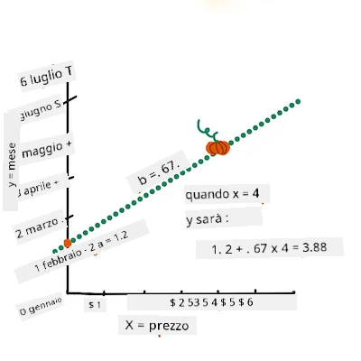
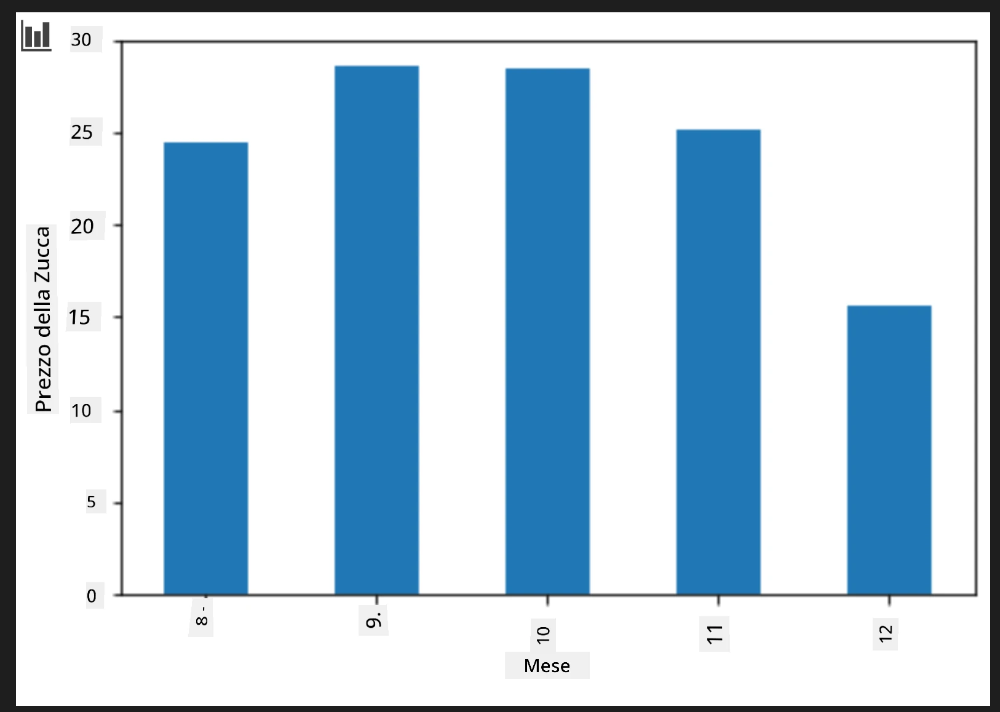
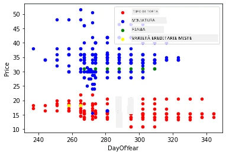

# Costruire un modello di regressione usando Scikit-learn: regressione in quattro modi

## Nota per principianti

La regressione lineare è usata quando vogliamo prevedere un **valore numerico** (per esempio, il prezzo di una casa, la temperatura o le vendite).  
Funziona trovando una linea retta che rappresenta al meglio la relazione tra le caratteristiche di input e l'output.

In questa lezione, ci concentriamo sulla comprensione del concetto prima di esplorare tecniche di regressione più avanzate.  
  
> Infografica di [Dasani Madipalli](https://twitter.com/dasani_decoded)

## [Quiz pre-lezione](https://ff-quizzes.netlify.app/en/ml/)

> ### [Questa lezione è disponibile in R!](../../../../2-Regression/3-Linear/solution/R/lesson_3.html)  
### Introduzione

Finora hai esplorato cos’è la regressione con dati campione raccolti dal dataset dei prezzi delle zucche che utilizzeremo per tutta la lezione. Hai inoltre visualizzato i dati usando Matplotlib.

Ora sei pronto per approfondire la regressione per ML. Mentre la visualizzazione ti permette di interpretare i dati, il vero potere del Machine Learning deriva dall’_addestramento dei modelli_. I modelli sono addestrati su dati storici per catturare automaticamente le dipendenze dei dati, e ti permettono di prevedere i risultati per dati nuovi, che il modello non ha mai visto prima.

In questa lezione, imparerai di più su due tipi di regressione: _regressione lineare base_ e _regressione polinomiale_, insieme ad alcune delle basi matematiche che supportano queste tecniche. Questi modelli ci permetteranno di prevedere i prezzi delle zucche in base a diversi dati in input.

[](https://youtu.be/CRxFT8oTDMg "ML for beginners - Understanding Linear Regression")

> 🎥 Clicca sull’immagine sopra per un breve video introduttivo sulla regressione lineare.

> Durante tutto il curriculum, assumiamo una conoscenza minima della matematica, e cerchiamo di renderla accessibile a studenti provenienti da altri ambiti, quindi cerca note, 🧮 richiami, diagrammi e altri strumenti didattici per aiutarti nella comprensione.

### Prerequisiti

A questo punto dovresti conoscere la struttura dei dati delle zucche che stiamo analizzando. Puoi trovare questi dati precaricati e puliti nel file _notebook.ipynb_ di questa lezione. Nel file, il prezzo della zucca è mostrato per bushel in un nuovo data frame. Assicurati di poter eseguire questi notebook in kernel in Visual Studio Code.

### Preparazione

Come promemoria, carichi questi dati per porre domande su di essi.

- Qual è il momento migliore per comprare le zucche?  
- Quale prezzo posso aspettarmi per una cassa di zucche miniatura?  
- Dovrei comprarle in cestini da mezzo bushel o in scatole da 1 1/9 bushel?  
Continuiamo a scavare in questi dati.

Nella lezione precedente, hai creato un data frame Pandas e lo hai popolato con parte del dataset originale, standardizzando i prezzi per bushel. Facendo ciò, però, hai ottenuto solo circa 400 punti dati e solo per i mesi autunnali.

Dai un’occhiata ai dati precaricati nel notebook che accompagna questa lezione. I dati sono caricati e un primo scatterplot è tracciato per mostrare i dati del mese. Forse possiamo ottenere qualche dettaglio in più sulla natura dei dati pulendoli ulteriormente.

## Una linea di regressione lineare

Come hai imparato nella Lezione 1, l’obiettivo di un esercizio di regressione lineare è essere in grado di tracciare una linea per:

- **Mostrare le relazioni tra variabili**. Mostrare la relazione tra variabili
- **Fare previsioni**. Effettuare previsioni accurate su dove cadrebbe un nuovo punto dati rispetto a quella linea.

È tipico della **Regressione ai Minimi Quadrati** disegnare questo tipo di linea. Il termine "Minimi Quadrati" si riferisce al processo di minimizzazione dell’errore totale nel nostro modello. Per ogni punto dato, misuriamo la distanza verticale (chiamata residuo) tra il punto reale e la nostra linea di regressione.

Queste distanze vengono elevate al quadrato per due motivi principali:

1. **Magnitudo rispetto alla direzione:** Vogliamo trattare un errore di -5 allo stesso modo di un errore di +5. Elevando al quadrato tutti i valori diventano positivi.

2. **Penalizzare gli outlier:** Elevando al quadrato si dà maggior peso agli errori più grandi, costringendo la linea a stare più vicina ai punti lontani.

Poi sommiamo tutti questi valori al quadrato assieme. Il nostro obiettivo è trovare la linea specifica dove questa somma finale è minima (il valore più piccolo possibile)—da qui il nome "Minimi Quadrati".  

> **🧮 Mostrami la matematica**  
>  
> Questa linea, chiamata _linea di miglior adattamento_, può essere espressa da [un’equazione](https://en.wikipedia.org/wiki/Simple_linear_regression):  
>  
> ```
> Y = a + bX
> ```
>  
> `X` è la 'variabile esplicativa'. `Y` è la 'variabile dipendente'. La pendenza della linea è `b` e `a` è l’intercetta sull’asse y, che si riferisce al valore di `Y` quando `X = 0`.  
>  
>  
>  
> Per prima cosa, calcola la pendenza `b`. Infografica di [Jen Looper](https://twitter.com/jenlooper)  
>  
> In altre parole, e riferendoci alla domanda originale sui dati delle zucche: "prevedere il prezzo di una zucca per bushel in base al mese", `X` si riferirebbe al prezzo e `Y` al mese di vendita.  
>  
>  
>  
> Calcola il valore di Y. Se stai pagando circa 4$, deve essere aprile! Infografica di [Jen Looper](https://twitter.com/jenlooper)  
>  
> La matematica che calcola la linea deve dimostrare la pendenza della linea, che dipende anche dall’intercetta, cioè dove si trova `Y` quando `X = 0`.  
>  
> Puoi osservare il metodo di calcolo di questi valori sul sito [Math is Fun](https://www.mathsisfun.com/data/least-squares-regression.html). Visita anche [questa calcolatrice dei minimi quadrati](https://www.mathsisfun.com/data/least-squares-calculator.html) per vedere come i valori numerici influenzano la linea.

## Correlazione

Un altro termine da comprendere è il **Coefficiente di Correlazione** tra le variabili X e Y date. Usando uno scatterplot, puoi visualizzare rapidamente questo coefficiente. Un grafico con punti dati distribuiti ordinatamente in una linea mostra una forte correlazione, mentre un grafico con punti dati sparsi ovunque tra X e Y mostra una bassa correlazione.

Un buon modello di regressione lineare sarà quello che ha un alto Coefficiente di Correlazione (più vicino a 1 che a 0) usando il metodo dei Minimi Quadrati con una linea di regressione.

✅ Esegui il notebook che accompagna questa lezione e osserva lo scatterplot tra Mese e Prezzo. I dati che associano il Mese al Prezzo per le vendite di zucche sembrano avere alta o bassa correlazione, secondo la tua interpretazione visiva dello scatterplot? Cambia qualcosa se usi una misura più dettagliata invece di `Month`, per esempio *il giorno dell’anno* (cioè numero di giorni dall’inizio dell’anno)?

Nel codice qui sotto, assumiamo che abbiamo pulito i dati e ottenuto un data frame chiamato `new_pumpkins`, simile al seguente:

ID | Month | DayOfYear | Variety | City | Package | Low Price | High Price | Price  
---|-------|-----------|---------|------|---------|-----------|------------|-------  
70 | 9 | 267 | PIE TYPE | BALTIMORE | 1 1/9 bushel cartons | 15.0 | 15.0 | 13.636364  
71 | 9 | 267 | PIE TYPE | BALTIMORE | 1 1/9 bushel cartons | 18.0 | 18.0 | 16.363636  
72 | 10 | 274 | PIE TYPE | BALTIMORE | 1 1/9 bushel cartons | 18.0 | 18.0 | 16.363636  
73 | 10 | 274 | PIE TYPE | BALTIMORE | 1 1/9 bushel cartons | 17.0 | 17.0 | 15.454545  
74 | 10 | 281 | PIE TYPE | BALTIMORE | 1 1/9 bushel cartons | 15.0 | 15.0 | 13.636364  

> Il codice per pulire i dati è disponibile in [`notebook.ipynb`](notebook.ipynb). Abbiamo eseguito gli stessi passaggi di pulizia della lezione precedente, e abbiamo calcolato la colonna `DayOfYear` usando la seguente espressione:  

```python
day_of_year = pd.to_datetime(pumpkins['Date']).apply(lambda dt: (dt-datetime(dt.year,1,1)).days)
```
  
Ora che hai una comprensione della matematica dietro la regressione lineare, creiamo un modello di regressione per vedere se possiamo prevedere quale confezione di zucche avrà i prezzi migliori. Qualcuno che compra zucche per un campo di zucche per le feste potrebbe voler questa informazione per ottimizzare i suoi acquisti di confezioni.

## Cercare la correlazione

[](https://youtu.be/uoRq-lW2eQo "ML for beginners - Looking for Correlation: The Key to Linear Regression")

> 🎥 Clicca sull’immagine sopra per un breve video introduttivo sulla correlazione.

Dalla lezione precedente probabilmente hai visto che il prezzo medio per i diversi mesi somiglia a questo:



Questo suggerisce che ci dovrebbe essere qualche correlazione, e possiamo provare a addestrare un modello di regressione lineare per prevedere la relazione tra `Month` e `Price`, o tra `DayOfYear` e `Price`. Ecco lo scatter plot che mostra quest’ultima relazione:

 

Vediamo se c’è correlazione usando la funzione `corr`:

```python
print(new_pumpkins['Month'].corr(new_pumpkins['Price']))
print(new_pumpkins['DayOfYear'].corr(new_pumpkins['Price']))
```
  
Sembra che la correlazione sia piuttosto bassa, -0.15 per `Month` e -0.17 per `DayOfYear`, ma potrebbe esserci un’altra relazione importante. Sembra che ci siano diversi cluster di prezzi corrispondenti a diverse varietà di zucche. Per confermare questa ipotesi, tracciamo ogni categoria di zucca con un colore differente. Passando un parametro `ax` alla funzione di plot `scatter` possiamo disegnare tutti i punti sullo stesso grafico:

```python
ax=None
colors = ['red','blue','green','yellow']
for i,var in enumerate(new_pumpkins['Variety'].unique()):
    df = new_pumpkins[new_pumpkins['Variety']==var]
    ax = df.plot.scatter('DayOfYear','Price',ax=ax,c=colors[i],label=var)
```
  
 

La nostra indagine suggerisce che la varietà influenza di più il prezzo complessivo rispetto alla data di vendita effettiva. Possiamo vedere questo anche con un grafico a barre:

```python
new_pumpkins.groupby('Variety')['Price'].mean().plot(kind='bar')
```
  
 

Concentriamoci per ora solo su una varietà di zucca, il 'pie type', e vediamo che effetto ha la data sul prezzo:

```python
pie_pumpkins = new_pumpkins[new_pumpkins['Variety']=='PIE TYPE']
pie_pumpkins.plot.scatter('DayOfYear','Price') 
```
 

Se ora calcoliamo la correlazione tra `Price` e `DayOfYear` usando la funzione `corr`, otteniamo qualcosa come `-0.27` – il che significa che addestrare un modello predittivo ha senso.

> Prima di addestrare un modello di regressione lineare, è importante assicurarsi che i dati siano puliti. La regressione lineare non funziona bene con valori mancanti, quindi è sensato eliminare tutte le celle vuote:

```python
pie_pumpkins.dropna(inplace=True)
pie_pumpkins.info()
```
  
Un altro approccio sarebbe riempire quei valori vuoti con la media dei valori nella colonna corrispondente.

## Regressione Lineare Semplice

[](https://youtu.be/e4c_UP2fSjg "ML for beginners - Linear and Polynomial Regression using Scikit-learn")

> 🎥 Clicca sull’immagine sopra per un breve video introduttivo sulla regressione lineare e polinomiale.

Per addestrare il nostro modello di Regressione Lineare, useremo la libreria **Scikit-learn**.

```python
from sklearn.linear_model import LinearRegression
from sklearn.metrics import mean_squared_error
from sklearn.model_selection import train_test_split
```
  
Iniziamo separando i valori di input (caratteristiche) e l’output atteso (etichetta) in array numpy separati:

```python
X = pie_pumpkins['DayOfYear'].to_numpy().reshape(-1,1)
y = pie_pumpkins['Price']
```
  
> Nota che abbiamo dovuto eseguire `reshape` sui dati di input affinché il pacchetto di Regressione Lineare li comprendesse correttamente. La regressione lineare si aspetta un array 2D come input, dove ogni riga dell’array corrisponde a un vettore di caratteristiche in input. Nel nostro caso, dato che abbiamo un solo input, abbiamo bisogno di un array con forma N&times;1, dove N è la dimensione del dataset.

Poi, dobbiamo dividere i dati in dataset di addestramento e di test, così da poter validare il nostro modello dopo l’addestramento:

```python
X_train, X_test, y_train, y_test = train_test_split(X, y, test_size=0.2, random_state=0)
```
  
Infine, addestrare il modello vero e proprio di Regressione Lineare richiede solo due righe di codice. Definiamo l’oggetto `LinearRegression` e lo adattiamo ai nostri dati usando il metodo `fit`:

```python
lin_reg = LinearRegression()
lin_reg.fit(X_train,y_train)
```

L'oggetto `LinearRegression` dopo l'addestramento (`fit`) contiene tutti i coefficienti della regressione, ai quali si può accedere tramite la proprietà `.coef_`. Nel nostro caso, c'è un solo coefficiente, che dovrebbe essere intorno a `-0.017`. Ciò significa che i prezzi sembrano calare un po' con il tempo, ma non troppo, circa 2 centesimi al giorno. Possiamo anche accedere al punto di intersezione della regressione con l'asse Y usando `lin_reg.intercept_` - sarà intorno a `21` nel nostro caso, indicando il prezzo all'inizio dell'anno.

Per vedere quanto è accurato il nostro modello, possiamo prevedere i prezzi su un set di dati di test, e poi misurare quanto le nostre previsioni sono vicine ai valori attesi. Questo può essere fatto usando la metrica dell'errore quadratico medio radice (RMSE), che è la radice della media di tutte le differenze al quadrato tra il valore atteso e quello previsto.

```python
pred = lin_reg.predict(X_test)

rmse = np.sqrt(mean_squared_error(y_test,pred))
print(f'RMSE: {rmse:3.3} ({rmse/np.mean(pred)*100:3.3}%)')
```

Il nostro errore sembra essere intorno a 2 punti, ovvero ~17%. Non troppo buono. Un altro indicatore della qualità del modello è il **coefficiente di determinazione**, che si può ottenere così:

```python
score = lin_reg.score(X_train,y_train)
print('Model determination: ', score)
```
Se il valore è 0, significa che il modello non tiene conto dei dati di input, e agisce come il *peggior predittore lineare*, che è semplicemente il valore medio del risultato. Il valore 1 significa che possiamo prevedere perfettamente tutti gli output attesi. Nel nostro caso, il coefficiente è intorno a 0.06, che è abbastanza basso.

Possiamo anche tracciare i dati di test insieme alla linea di regressione per vedere meglio come funziona la regressione nel nostro caso:

```python
plt.scatter(X_test,y_test)
plt.plot(X_test,pred)
```


## Regressione Polinomiale

Un altro tipo di regressione lineare è la Regressione Polinomiale. Mentre a volte c'è una relazione lineare tra variabili - più grande è la zucca in volume, più alto è il prezzo - a volte queste relazioni non possono essere rappresentate come un piano o linea retta.

✅ Ecco [alcuni esempi in più](https://online.stat.psu.edu/stat501/Lesson09#polynomial-regression-examples) di dati che potrebbero usare la Regressione Polinomiale

Guarda di nuovo la relazione tra Data e Prezzo. Questo scatterplot sembra dover necessariamente essere analizzato con una linea retta? I prezzi non possono fluttuare? In questo caso, puoi provare la regressione polinomiale.

✅ I polinomi sono espressioni matematiche che potrebbero consistere di una o più variabili e coefficienti

La regressione polinomiale crea una linea curva per adattarsi meglio ai dati non lineari. Nel nostro caso, se includiamo una variabile quadratica `DayOfYear` nei dati di input, dovremmo essere in grado di adattare i nostri dati con una curva parabolica, che avrà un minimo in un certo punto dell'anno.

Scikit-learn include una utile [API pipeline](https://scikit-learn.org/stable/modules/generated/sklearn.pipeline.make_pipeline.html?highlight=pipeline#sklearn.pipeline.make_pipeline) per combinare insieme diversi passaggi di elaborazione dei dati. Una **pipeline** è una catena di **stimatori**. Nel nostro caso, creeremo una pipeline che prima aggiunge caratteristiche polinomiali al nostro modello, e poi allena la regressione:

```python
from sklearn.preprocessing import PolynomialFeatures
from sklearn.pipeline import make_pipeline

pipeline = make_pipeline(PolynomialFeatures(2), LinearRegression())

pipeline.fit(X_train,y_train)
```

Usare `PolynomialFeatures(2)` significa che includeremo tutti i polinomi di secondo grado dai dati di input. Nel nostro caso significa solo `DayOfYear`<sup>2</sup>, ma dati due input X e Y, aggiungerà X<sup>2</sup>, XY e Y<sup>2</sup>. Possiamo anche usare polinomi di grado più alto se vogliamo.

Le pipeline possono essere usate nello stesso modo dell'oggetto `LinearRegression` originale, cioè possiamo `fit` la pipeline, e poi usare `predict` per ottenere i risultati delle previsioni:

```python
pred = pipeline.predict(X_test)

rmse = np.sqrt(mean_squared_error(y_test,pred))
print(f'RMSE: {rmse:3.3} ({rmse/np.mean(pred)*100:3.3}%)')

score = pipeline.score(X_train,y_train)
print('Model determination: ', score)
```

Per tracciare la curva di approssimazione liscia, usiamo `np.linspace` per creare un intervallo uniforme di valori di input, invece di tracciare direttamente sui dati di test non ordinati (che produrrebbe una linea a zigzag):

```python
X_range = np.linspace(X_test.min(), X_test.max(), 100).reshape(-1,1)
y_range = pipeline.predict(X_range)

plt.scatter(X_test, y_test)
plt.plot(X_range, y_range)
```

Ecco il grafico che mostra i dati di test e la curva di approssimazione:


Usando la Regressione Polinomiale, possiamo ottenere un RMSE leggermente più basso e una determinazione più alta, ma non in modo significativo. Dobbiamo prendere in considerazione altre caratteristiche!

> Puoi vedere che i prezzi minimi delle zucche si osservano intorno a Halloween. Come puoi spiegare questo?

🎃 Congratulazioni, hai appena creato un modello che può aiutarti a prevedere il prezzo delle zucche da torta. Probabilmente puoi ripetere la stessa procedura per tutti i tipi di zucche, ma sarebbe laborioso. Impariamo ora come tenere conto della varietà di zucca nel nostro modello!

## Caratteristiche Categoricali

Nel mondo ideale, vogliamo essere in grado di prevedere i prezzi per diverse varietà di zucche usando lo stesso modello. Tuttavia, la colonna `Variety` è un po' diversa dalle colonne come `Month`, perché contiene valori non numerici. Queste colonne si chiamano **categoriche**.

[](https://youtu.be/DYGliioIAE0 "ML for beginners - Categorical Feature Predictions with Linear Regression")

> 🎥 Clicca sull'immagine sopra per una breve panoramica video sull'uso delle caratteristiche categoriche.

Qui puoi vedere come il prezzo medio dipende dalla varietà:


Per tenere conto della varietà, dobbiamo prima convertirla in forma numerica, o **codificarla**. Ci sono diversi modi per farlo:

* La semplice **codifica numerica** costruirà una tabella delle varietà diverse, e poi sostituirà il nome della varietà con un indice in quella tabella. Questa non è l'idea migliore per la regressione lineare, perché la regressione lineare prende il valore numerico effettivo dell'indice, e lo aggiunge al risultato, moltiplicandolo per qualche coefficiente. Nel nostro caso, la relazione tra il numero indice e il prezzo è chiaramente non lineare, anche se ci assicurassimo che gli indici siano ordinati in un certo modo.
* La **codifica one-hot** sostituirà la colonna `Variety` con 4 colonne diverse, una per ogni varietà. Ogni colonna conterrà `1` se la riga corrispondente è di quella data varietà, e `0` altrimenti. Questo significa che ci saranno quattro coefficienti nella regressione lineare, uno per ogni varietà di zucca, responsabile del "prezzo di partenza" (o meglio "prezzo aggiuntivo") per quella particolare varietà.

Il codice qui sotto mostra come possiamo codificare con one-hot una varietà:

```python
pd.get_dummies(new_pumpkins['Variety'])
```

 ID | FAIRYTALE | MINIATURE | MIXED HEIRLOOM VARIETIES | PIE TYPE
----|-----------|-----------|--------------------------|----------
70 | 0 | 0 | 0 | 1
71 | 0 | 0 | 0 | 1
... | ... | ... | ... | ...
1738 | 0 | 1 | 0 | 0
1739 | 0 | 1 | 0 | 0
1740 | 0 | 1 | 0 | 0
1741 | 0 | 1 | 0 | 0
1742 | 0 | 1 | 0 | 0

Per addestrare la regressione lineare usando la varietà codificata one-hot come input, dobbiamo solo inizializzare correttamente i dati `X` e `y`:

```python
X = pd.get_dummies(new_pumpkins['Variety'])
y = new_pumpkins['Price']
```

Il resto del codice è lo stesso che abbiamo usato sopra per addestrare la regressione lineare. Se provi, vedrai che l'errore quadratico medio è simile, ma otteniamo un coefficiente di determinazione molto più alto (~77%). Per ottenere previsioni ancora più accurate, possiamo considerare più caratteristiche categoriche, così come caratteristiche numeriche, come `Month` o `DayOfYear`. Per ottenere un unico grande array di caratteristiche, possiamo usare `join`:

```python
X = pd.get_dummies(new_pumpkins['Variety']) \
        .join(new_pumpkins['Month']) \
        .join(pd.get_dummies(new_pumpkins['City'])) \
        .join(pd.get_dummies(new_pumpkins['Package']))
y = new_pumpkins['Price']
```

Qui prendiamo in considerazione anche `City` e `Package`, il che ci dà un RMSE di 2.84 (10.5%), e una determinazione di 0.94!

## Mettere tutto insieme

Per ottenere il miglior modello, possiamo usare dati combinati (caratteristiche categoriche codificate one-hot + numeriche) dall'esempio sopra insieme alla Regressione Polinomiale. Ecco il codice completo per la tua comodità:

```python
# configurare i dati di addestramento
X = pd.get_dummies(new_pumpkins['Variety']) \
        .join(new_pumpkins['Month']) \
        .join(pd.get_dummies(new_pumpkins['City'])) \
        .join(pd.get_dummies(new_pumpkins['Package']))
y = new_pumpkins['Price']

# effettuare la divisione train-test
X_train, X_test, y_train, y_test = train_test_split(X, y, test_size=0.2, random_state=0)

# configurare e addestrare la pipeline
pipeline = make_pipeline(PolynomialFeatures(2), LinearRegression())
pipeline.fit(X_train,y_train)

# prevedere i risultati per i dati di test
pred = pipeline.predict(X_test)

# calcolare RMSE e coefficiente di determinazione
rmse = mean_squared_error(y_test, pred, squared=False)
print(f'RMSE: {rmse:3.3} ({rmse/pred.mean()*100:3.3}%)')

score = pipeline.score(X_train,y_train)
print('Model determination: ', score)
```

Questo dovrebbe darci il miglior coefficiente di determinazione di quasi il 97%, e RMSE=2.23 (~8% di errore di previsione).

| Modello | RMSE | Determinazione |
|---------|------|----------------|
| Lineare `DayOfYear` | 2.77 (17.2%) | 0.07 |
| Polinomiale `DayOfYear` | 2.73 (17.0%) | 0.08 |
| Lineare `Variety` | 5.24 (19.7%) | 0.77 |
| Lineare Tutte le caratteristiche | 2.84 (10.5%) | 0.94 |
| Polinomiale Tutte le caratteristiche | 2.23 (8.25%) | 0.97 |

🏆 Ben fatto! Hai creato quattro modelli di Regressione in una lezione, e migliorato la qualità del modello al 97%. Nella sezione finale sulla Regressione, imparerai la Regressione Logistica per determinare le categorie.

---
## 🚀Sfida

Prova diverse variabili in questo notebook per vedere come la correlazione corrisponde alla precisione del modello.

## [Quiz post-lezione](https://ff-quizzes.netlify.app/en/ml/)

## Revisione & Autoapprendimento

In questa lezione abbiamo imparato la Regressione Lineare. Ci sono altri tipi importanti di regressione. Leggi delle tecniche Stepwise, Ridge, Lasso ed Elasticnet. Un buon corso per approfondire è il [corso Stanford Statistical Learning](https://online.stanford.edu/courses/sohs-ystatslearning-statistical-learning)

## Compito

[Costruisci un Modello](assignment.md)

---

<!-- CO-OP TRANSLATOR DISCLAIMER START -->
**Disclaimer**:
Questo documento è stato tradotto utilizzando il servizio di traduzione AI [Co-op Translator](https://github.com/Azure/co-op-translator). Pur impegnandoci per l'accuratezza, si prega di considerare che le traduzioni automatiche possono contenere errori o imprecisioni. Il documento originale nella sua lingua nativa deve essere considerato la fonte autorevole. Per informazioni critiche, si raccomanda una traduzione professionale umana. Non siamo responsabili per eventuali incomprensioni o interpretazioni errate derivanti dall'uso di questa traduzione.
<!-- CO-OP TRANSLATOR DISCLAIMER END -->