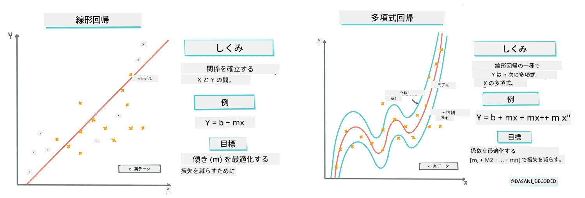
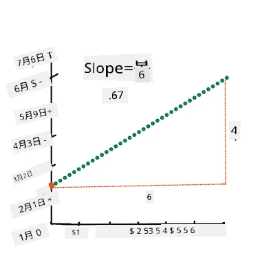
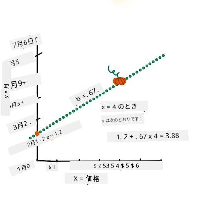
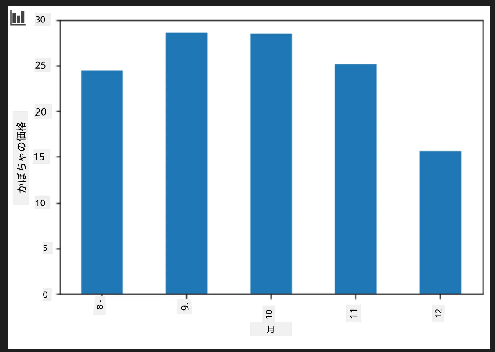
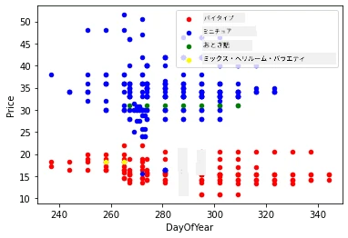

# Scikit-learnを使って回帰モデルを構築する：回帰の4つの方法

## 初心者向けノート

線形回帰は、<strong>数値的な値</strong>（例えば、家の価格、気温、売上など）を予測したいときに使用します。  
これは、入力特徴量と出力の関係を最もよく表す直線を見つけることで機能します。

このレッスンでは、高度な回帰手法を探る前に、概念の理解に焦点を当てます。  
  
> インフォグラフィック作成者：[Dasani Madipalli](https://twitter.com/dasani_decoded)

## [事前クイズ](https://ff-quizzes.netlify.app/en/ml/)

> ### [このレッスンはRでも利用可能です！](../../../../2-Regression/3-Linear/solution/R/lesson_3.html)

### はじめに

これまでに、パンプキンプライシングのデータセットから収集したサンプルデータで回帰について探ってきました。このレッスン全体で使うデータセットです。またMatplotlibを使ってそれを視覚化もしました。

今度はMLの回帰についてより深く掘り下げる準備ができました。視覚化はデータを理解するのに役立ちますが、機械学習の真の力は_モデルを訓練すること_にあります。モデルは過去のデータで訓練され、データの依存関係を自動的に捉え、新しいデータ（モデルが見たことのない）に対して結果を予測できるようになります。

このレッスンでは、_基本的な線形回帰_ と _多項式回帰_ の2種類の回帰と、それらの技術の基礎となる数学について学びます。これらのモデルを使って、入力データに応じたパンプキンの価格を予測できるようになります。

[](https://youtu.be/CRxFT8oTDMg "初心者向けML - 線形回帰の理解")

> 🎥 上の画像をクリックすると、線形回帰の短いビデオ概要が視聴できます。

> このカリキュラム全体では、数学の知識は最小限に抑え、他分野から来た学生でも理解しやすいようにしています。理解に役立つノートや🧮解説、図、その他学習ツールにも注目してください。

### 前提条件

これまでに、調査しているパンプキンデータの構造に慣れているはずです。このレッスンの_notebook.ipynb_ファイルには、データが事前に読み込まれ、クリーニング済みで含まれています。パンプキンの価格はバッシェル単位で新しいデータフレームに表示されています。Visual Studio Codeのカーネル上でこれらのノートブックを実行できるようにしてください。

### 準備

改めて言いますが、あなたはこのデータを読み込んで、そこから質問をしていきます。

- パンプキンを買うのに最適な時期はいつか？  
- ミニチュアパンプキンのケースはどのくらいの価格になるのか？  
- 半バッシェルのバスケットで買うべきか、1 1/9 バッシェルの箱で買うべきか？  

このデータをさらに掘り下げていきましょう。

前のレッスンで、Pandasのデータフレームを作成し、元のデータセットの一部を取り込み、価格をバッシェルで標準化しました。しかし、この方法では約400のデータポイントと秋の月のみしか集められていませんでした。

このレッスンに付属のノートブックに事前に読み込まれたデータを見てみましょう。データは事前読み込みされ、初期の散布図も作成されていて、月データが表示されています。もっと詳細にデータの性質を調べるために、さらにクリーニングしてみましょう。

## 線形回帰線

レッスン1で学んだ通り、線形回帰の目的は次のような直線を描くことです：

- **変数間の関係を示す。** 変数同士の関係性を示す。  
- **予測を行う。** 新しいデータ点が線上のどこに位置するかを正確に予測する。  

このような線を引く代表的な方法は<strong>最小二乗法回帰</strong>です。「最小二乗」はモデルの全体的な誤差を最小化するプロセスを指します。すべてのデータ点に対し、実際の点と回帰線の縦方向の距離（残差と呼ばれます）を測ります。

これらの距離を二乗する理由は主に2つあります：

1. **大きさは方向に優先。** -5の誤差と+5の誤差を同じ扱いにしたいためです。二乗することで全ての値が正になります。  
2. **外れ値の罰則。** 二乗すると大きな誤差がより重要視され、線が遠い点に近づくように調整されます。  

これらの二乗誤差を全て合計し、その合計が最小になる線を見つけるのが「最小二乗法」です。

> **🧮 数学を見てみよう**  
> 
> この線は_最良適合直線_ と呼ばれ、[以下の式](https://en.wikipedia.org/wiki/Simple_linear_regression)で表されます：  
> 
> ```
> Y = a + bX
> ```
>  
> `X` は「説明変数」、`Y` は「従属変数」を表します。傾きは `b`、切片は `a` で、`X=0` の時の `Y` の値を指します。  
>  
>  
> 
> まず傾き `b` を計算します。インフォグラフィック作成者：[Jen Looper](https://twitter.com/jenlooper)  
> 
> 言い換えると、パンプキンデータの元の問い「月ごとにパンプキンのバッシェル単価を予測する」に対して、`X` が価格を、`Y` が販売月を表します。  
> 
>  
>  
> `Y` の値を計算します。4ドル程度支払うなら4月に違いありません！インフォグラフィック作成者：[Jen Looper](https://twitter.com/jenlooper)  
>  
> この式は傾きを算出し、それは切片、つまり `X=0` のときの `Y` の場所にも依存します。  
> 
> [Math is Fun](https://www.mathsisfun.com/data/least-squares-regression.html) のサイトで計算方法を確認できます。また、[この最小二乗法計算機](https://www.mathsisfun.com/data/least-squares-calculator.html)も見て、数字の値が線にどう影響するかを観察してみてください。

## 相関

もう一つ理解しておきたい用語は、与えられたXとYの変数間の<strong>相関係数</strong>です。散布図を使うと、この係数を簡単に視覚化できます。点がきれいな直線上に並んでいる散布図は相関が高く、点がXとYの間にばらけている散布図は相関が低いことを示します。

良い線形回帰モデルは、最小二乗法回帰での相関係数が高い（0に近いより1に近い）ものです。

✅ このレッスンに付属のノートブックを実行し、月と価格の散布図を見てみましょう。パンプキン販売の月と価格のデータは、散布図の視覚的解釈に基づくと相関は高そうですか、それとも低そうですか？`Month` ではなく、もっと細かい尺度（例えば、年始からの日数＝ *day of the year*）を使うとどう変わりますか？

以下のコードでは、データをクリーニングしたうえで、以下のようなデータフレーム `new_pumpkins` が得られていると仮定します：

ID | Month | DayOfYear | Variety | City | Package | Low Price | High Price | Price
---|-------|-----------|---------|------|---------|-----------|------------|-------
70 | 9 | 267 | PIE TYPE | BALTIMORE | 1 1/9 bushel cartons | 15.0 | 15.0 | 13.636364
71 | 9 | 267 | PIE TYPE | BALTIMORE | 1 1/9 bushel cartons | 18.0 | 18.0 | 16.363636
72 | 10 | 274 | PIE TYPE | BALTIMORE | 1 1/9 bushel cartons | 18.0 | 18.0 | 16.363636
73 | 10 | 274 | PIE TYPE | BALTIMORE | 1 1/9 bushel cartons | 17.0 | 17.0 | 15.454545
74 | 10 | 281 | PIE TYPE | BALTIMORE | 1 1/9 bushel cartons | 15.0 | 15.0 | 13.636364  

> データをクリーニングするコードは [`notebook.ipynb`](notebook.ipynb) にあります。前のレッスンと同様のクリーニング処理を行い、以下の式で `DayOfYear` 列を算出しています：

```python
day_of_year = pd.to_datetime(pumpkins['Date']).apply(lambda dt: (dt-datetime(dt.year,1,1)).days)
```
  
線形回帰の数学的背景が分かったところで、パンプキンの最適なパッケージ価格を予測できるか試すために、回帰モデルを作成しましょう。ホリデーパンプキンパッチ向けにパンプキンを買う人が、購入パッケージの選択を最適化するための情報が必要かもしれません。

## 相関を探る

[](https://youtu.be/uoRq-lW2eQo "初心者向けML - 相関の探し方：線形回帰の鍵")

> 🎥 上の画像をクリックすると、相関の短いビデオ概要が視聴できます。

前のレッスンで見たように、月ごとの平均価格は以下のようになっています：



これは、相関が存在するはずだと示唆しています。`Month` と `Price` の関係、または `DayOfYear` と `Price` の関係を線形回帰モデルで予測することができます。以下は後者の散布図です：

 

`corr` 関数で相関があるか見てみましょう：

```python
print(new_pumpkins['Month'].corr(new_pumpkins['Price']))
print(new_pumpkins['DayOfYear'].corr(new_pumpkins['Price']))
```
  
月単位では約-0.15、年初からの日数単位では約-0.17と相関は低めに見えますが、別の重要な関係があるかもしれません。異なるパンプキンの品種によって価格のクラスターができているように見えます。この仮説を確かめるために、品種ごとに異なる色でプロットしてみましょう。`scatter` プロット関数に `ax` パラメータを渡してすべての点を同じグラフ上に描画できます：

```python
ax=None
colors = ['red','blue','green','yellow']
for i,var in enumerate(new_pumpkins['Variety'].unique()):
    df = new_pumpkins[new_pumpkins['Variety']==var]
    ax = df.plot.scatter('DayOfYear','Price',ax=ax,c=colors[i],label=var)
```
  
 

調査の結果、品種の方が販売日よりも全体の価格に影響を与えていることが分かりました。棒グラフでも確認できます：

```python
new_pumpkins.groupby('Variety')['Price'].mean().plot(kind='bar')
```
  
 

今は「pie type」というパンプキン品種にだけ注目して、日付が価格に及ぼす影響を見てみましょう：

```python
pie_pumpkins = new_pumpkins[new_pumpkins['Variety']=='PIE TYPE']
pie_pumpkins.plot.scatter('DayOfYear','Price') 
```
  
 

`Price` と `DayOfYear` の相関を `corr` で計算すると `-0.27` 程度になるので、予測モデルを訓練する意味があると判断できます。

> 線形回帰モデルを訓練する前に、データが綺麗であることを確認することが重要です。線形回帰は欠損値に弱いため、空のセルは除去しておくのが良いでしょう：

```python
pie_pumpkins.dropna(inplace=True)
pie_pumpkins.info()
```
  
欠損値を、その列の平均値で埋めるアプローチもあります。

## 単純線形回帰

[](https://youtu.be/e4c_UP2fSjg "初心者向けML - Scikit-learnを使った線形回帰と多項式回帰")

> 🎥 上の画像をクリックすると、線形回帰と多項式回帰の短いビデオ概要が視聴できます。

線形回帰モデルの訓練には、**Scikit-learn** ライブラリを使います。

```python
from sklearn.linear_model import LinearRegression
from sklearn.metrics import mean_squared_error
from sklearn.model_selection import train_test_split
```
  
まず、入力値（特徴量）と予測したい出力（ラベル）を別々のNumPy配列に分けます：

```python
X = pie_pumpkins['DayOfYear'].to_numpy().reshape(-1,1)
y = pie_pumpkins['Price']
```
  
> 入力データに`reshape`を用いた点に注意してください。Linear Regressionは2次元配列を入力と想定しており、配列の各行が特徴量ベクトルに対応します。今回は特徴量が1つだけなので、データセットサイズNに対して形状N×1の配列が必要になります。

次に、データを訓練用と検証用に分割します。訓練後にモデルの評価ができるようにするためです：

```python
X_train, X_test, y_train, y_test = train_test_split(X, y, test_size=0.2, random_state=0)
```
  
最後に、線形回帰モデルの実際の訓練は2行のコードで済みます。`LinearRegression` オブジェクトを定義し、`fit` メソッドでデータに適合させます：

```python
lin_reg = LinearRegression()
lin_reg.fit(X_train,y_train)
```

`fit` 後の `LinearRegression` オブジェクトには回帰のすべての係数が含まれており、これは `.coef_` プロパティを使ってアクセスできます。今回の場合、係数は1つだけで、約 `-0.017` であるはずです。これは、価格が時間の経過とともに少しずつ下がっているように見えますが、1日あたり約2セントとそれほど大きくないことを意味します。また、回帰のY軸との交点には `lin_reg.intercept_` を使ってアクセスでき、今回の場合は約 `21` となり、年の初めの価格を示しています。

モデルの精度を確認するために、テストデータセット上で価格を予測し、それから予測値が期待値にどれだけ近いかを測定できます。これは平方根平均二乗誤差（RMSE）という指標を使って行われ、期待値と予測値のすべての二乗差の平均の平方根です。

```python
pred = lin_reg.predict(X_test)

rmse = np.sqrt(mean_squared_error(y_test,pred))
print(f'RMSE: {rmse:3.3} ({rmse/np.mean(pred)*100:3.3}%)')
```
  
誤差は約2ポイント（約17%）で、あまり良くありません。モデル品質の別の指標として、<strong>決定係数</strong> があり、これは次のようにして得られます:

```python
score = lin_reg.score(X_train,y_train)
print('Model determination: ', score)
```
  
値が0の場合、モデルは入力データを考慮しておらず、結果の平均値を返すだけの最悪の線形予測器として機能していることを意味します。値が1の場合は、すべての期待される出力を完全に予測できることを意味します。今回の場合、決定係数は約0.06と低い値です。

回帰線とテストデータを一緒にプロットして、回帰がどのように機能しているかをよりよく確認することもできます:

```python
plt.scatter(X_test,y_test)
plt.plot(X_test,pred)
```
  


## 多項式回帰

線形回帰の別のタイプが多項式回帰です。変数間の関係が線形であることもあります — 例えば体積が大きいパンプキンは価格が高い — が、時にはこれらの関係を平面や直線としてプロットできないこともあります。

✅ こちらは多項式回帰を使うことができる [他のいくつかの例](https://online.stat.psu.edu/stat501/Lesson09#polynomial-regression-examples) です。

Date と Price の関係をもう一度見てみましょう。この散布図は必ずしも直線で解析すべきものに見えますか？価格は変動してもよいのではありませんか？このような場合には多項式回帰を試すことができます。

✅ 多項式は1つ以上の変数と係数から成る数学的な式です。

多項式回帰は非線形データにうまく適合するために曲線を作ります。今回の場合、入力データに2乗の `DayOfYear` 変数を含めるなら、1年内のある点で極小となる放物線でデータをフィットさせることができるはずです。

Scikit-learn にはデータ処理の複数のステップを1つにまとめるのに便利な [パイプラインAPI](https://scikit-learn.org/stable/modules/generated/sklearn.pipeline.make_pipeline.html?highlight=pipeline#sklearn.pipeline.make_pipeline) があります。<strong>パイプライン</strong> は <strong>推定器のチェーン</strong> です。今回の場合、最初に多項式特徴を追加し、その後回帰をトレーニングするパイプラインを作成します:

```python
from sklearn.preprocessing import PolynomialFeatures
from sklearn.pipeline import make_pipeline

pipeline = make_pipeline(PolynomialFeatures(2), LinearRegression())

pipeline.fit(X_train,y_train)
```
  
`PolynomialFeatures(2)` を使うことで、入力データのすべての2次多項式を含めることができます。今回の場合は単に `DayOfYear`<sup>2</sup> を意味しますが、2つの入力変数 X と Y がある場合は X<sup>2</sup>、XY、Y<sup>2</sup> が追加されます。必要に応じてより高い次数の多項式も使えます。

パイプラインは元の `LinearRegression` オブジェクトと同じ方法で使えます。すなわちパイプラインを `fit` し、`predict` を使って予測結果を得られます:

```python
pred = pipeline.predict(X_test)

rmse = np.sqrt(mean_squared_error(y_test,pred))
print(f'RMSE: {rmse:3.3} ({rmse/np.mean(pred)*100:3.3}%)')

score = pipeline.score(X_train,y_train)
print('Model determination: ', score)
```
  
滑らかな近似曲線をプロットするために、`np.linspace` を使って均一な入力範囲を作成します。これは無秩序なテストデータ上に直接プロットする（ジグザグ線になる）より良い方法です:

```python
X_range = np.linspace(X_test.min(), X_test.max(), 100).reshape(-1,1)
y_range = pipeline.predict(X_range)

plt.scatter(X_test, y_test)
plt.plot(X_range, y_range)
```
  
こちらがテストデータと近似曲線を示すグラフです:


多項式回帰を使うと、RMSEが僅かに下がり決定係数が高くなりますが、大幅な改善はありません。他の特徴量を考慮する必要があります！

> パンプキンの最低価格がハロウィンあたりで観察されることに気づきましたか？これはどう説明できますか？ 

🎃 おめでとうございます、これでパイパンプキンの価格を予測するモデルを作成できました。おそらく同じ手順を他のパンプキン種別にも繰り返せますが、それは面倒です。次にモデルにパンプキンの品種を取り込む方法を学びましょう！

## カテゴリ特徴

理想的には、同じモデルを使って異なるパンプキン品種の価格を予測したいです。しかし、`Variety` 列は `Month` などの数値列とは異なり、数値以外の値を含むため、<strong>カテゴリ特徴</strong> と呼ばれます。

[](https://youtu.be/DYGliioIAE0 "ML for beginners - Categorical Feature Predictions with Linear Regression")

> 🎥 上の画像をクリックすると、カテゴリ特徴の使用方法に関する簡単なビデオ概要が見られます。

ここでは品種による平均価格の違いを示しています:


品種を考慮するためには、まず数値形式に変換、すなわち<strong>エンコード</strong>する必要があります。エンコード方法は複数あります:

* 単純な<strong>数値エンコード</strong>は異なる品種をリストにし、品種名をそのリストのインデックスに置き換えます。これは線形回帰にはあまり適していません。線形回帰はインデックスの数値をそのまま取り扱い、係数と乗算して結果に加えるためです。インデックス番号と価格の関係が明らかに非線形であっても、この方法ではその非線形性を反映できません。
* <strong>ワンホットエンコーディング</strong> は `Variety` 列を4つの別々の列に置き換えます。各列は対応する品種に対して `1`、そうでなければ `0` となります。これにより、線形回帰においてパンプキンの品種ごとに4つの係数ができ、その品種の「基本価格」（または「価格への追加分」）を表すことになります。

以下のコードはワンホットエンコードの例を示しています:

```python
pd.get_dummies(new_pumpkins['Variety'])
```
  
 ID | FAIRYTALE | MINIATURE | MIXED HEIRLOOM VARIETIES | PIE TYPE  
----|-----------|-----------|--------------------------|----------  
70  | 0         | 0         | 0                        | 1  
71  | 0         | 0         | 0                        | 1  
... | ...       | ...       | ...                      | ...  
1738| 0         | 1         | 0                        | 0  
1739| 0         | 1         | 0                        | 0  
1740| 0         | 1         | 0                        | 0  
1741| 0         | 1         | 0                        | 0  
1742| 0         | 1         | 0                        | 0  

ワンホットエンコードした品種を入力として線形回帰をトレーニングするためには、`X` と `y` のデータを正しく初期化するだけで十分です:

```python
X = pd.get_dummies(new_pumpkins['Variety'])
y = new_pumpkins['Price']
```
  
残りのコードは上で使った線形回帰のトレーニングと同じです。実際に試すと、平均二乗誤差はほぼ同じですが、決定係数ははるかに高くなり (約77%)、さらに正確な予測が可能になります。他のカテゴリ特徴や `Month` や `DayOfYear` などの数値特徴も考慮し、特徴量を1つの大きな配列にまとめるために `join` を使うことができます:

```python
X = pd.get_dummies(new_pumpkins['Variety']) \
        .join(new_pumpkins['Month']) \
        .join(pd.get_dummies(new_pumpkins['City'])) \
        .join(pd.get_dummies(new_pumpkins['Package']))
y = new_pumpkins['Price']
```
  
ここでは `City` と `Package` タイプも加味しており、RMSE は2.84（10.5%）、決定係数は0.94となっています！

## まとめて使う

最良のモデルを作成するには、上述の結合された（ワンホットエンコードされたカテゴリ + 数値）特徴量と多項式回帰を一緒に使います。便宜上、完全なコードを載せます:

```python
# トレーニングデータを設定する
X = pd.get_dummies(new_pumpkins['Variety']) \
        .join(new_pumpkins['Month']) \
        .join(pd.get_dummies(new_pumpkins['City'])) \
        .join(pd.get_dummies(new_pumpkins['Package']))
y = new_pumpkins['Price']

# トレイン・テスト分割を行う
X_train, X_test, y_train, y_test = train_test_split(X, y, test_size=0.2, random_state=0)

# パイプラインの設定とトレーニングを行う
pipeline = make_pipeline(PolynomialFeatures(2), LinearRegression())
pipeline.fit(X_train,y_train)

# テストデータの結果を予測する
pred = pipeline.predict(X_test)

# RMSEと決定係数を計算する
rmse = mean_squared_error(y_test, pred, squared=False)
print(f'RMSE: {rmse:3.3} ({rmse/pred.mean()*100:3.3}%)')

score = pipeline.score(X_train,y_train)
print('Model determination: ', score)
```
  
これで、決定係数はほぼ97%、RMSE=2.23（予測誤差約8%）の最良モデルが得られるはずです。

| モデル | RMSE | 決定係数 |
|--------|------|----------|
| `DayOfYear` 線形 | 2.77 (17.2%) | 0.07 |
| `DayOfYear` 多項式 | 2.73 (17.0%) | 0.08 |
| `Variety` 線形 | 5.24 (19.7%) | 0.77 |
| すべての特徴 線形 | 2.84 (10.5%) | 0.94 |
| すべての特徴 多項式 | 2.23 (8.25%) | 0.97 |

🏆 お見事です！このレッスンで4つの回帰モデルを作成し、モデルの精度を97%まで高めました。回帰の最終セクションでは、カテゴリを判別するためのロジスティック回帰について学びます。

---
## 🚀チャレンジ

このノートブックでいくつかの異なる変数を試してみて、相関とモデル精度の関係を調べてみてください。

## [講義後クイズ](https://ff-quizzes.netlify.app/en/ml/)

## 復習＆自習

このレッスンでは線形回帰について学びました。他にも重要な種類の回帰があります。Stepwise, Ridge, Lasso, Elasticnet の手法について読んでみましょう。詳しく学びたい方には [スタンフォード統計学習コース](https://online.stanford.edu/courses/sohs-ystatslearning-statistical-learning) が良い教材です。

## 課題

[モデルを作る](assignment.md)

---

<!-- CO-OP TRANSLATOR DISCLAIMER START -->
**免責事項**:  
本書類は AI 翻訳サービス [Co-op Translator](https://github.com/Azure/co-op-translator) を使用して翻訳されています。正確さを期していますが、自動翻訳には誤りや不正確な部分が含まれる可能性があることをご承知ください。原文は原語の書類が権威ある情報源とみなされます。重要な情報については専門の人間による翻訳を推奨します。本翻訳の使用により生じたいかなる誤解や誤訳についても一切の責任を負いかねます。
<!-- CO-OP TRANSLATOR DISCLAIMER END -->