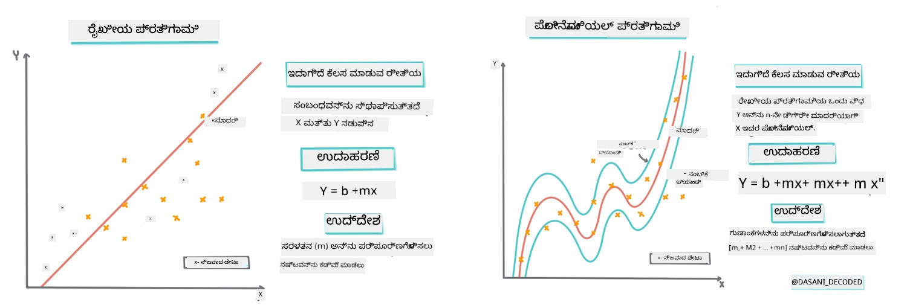
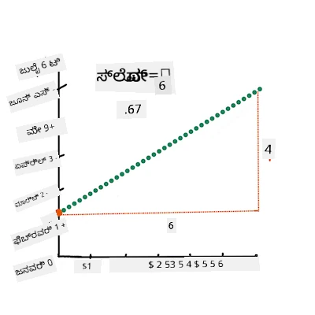
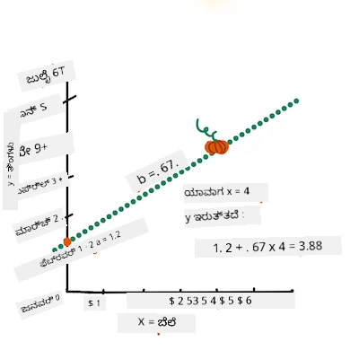
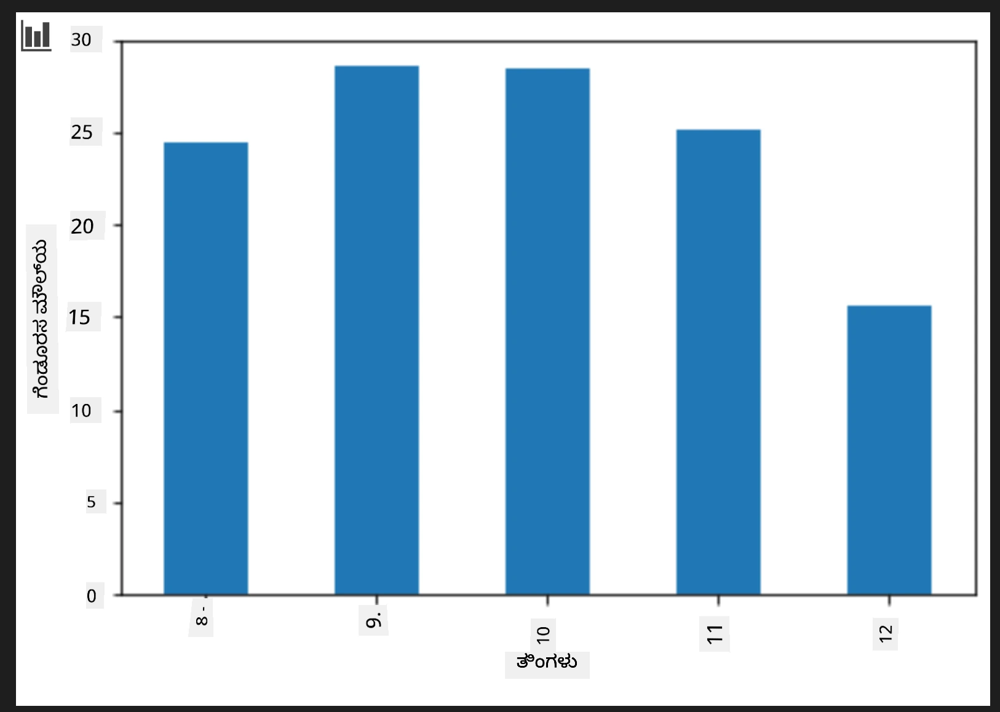
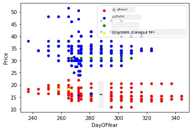
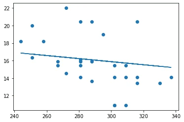

# Scikit-learn ಬಳಸಿ ರೆಗ್ರೆಷನ್ ಮಾದರಿ ರಚಿಸಿ: ನಾಲವಾರು ರೆಗ್ರೆಷನ್ ರೀತೆಗಳು

## ಆರಂಭಿಕ ಗಮನಿಕೆ

ಲೀನಿಯರ್ ರೆಗ್ರೆಷನ್ ಅನ್ನು ನಮಗೆ **ಸಂಖ್ಯಾತ್ಮಕ ಮೌಲ್ಯವನ್ನು** (ಉದಾಹರಣೆಗೆ, ಮನೆಯ ಬೆಲೆ, ತಾಪಮಾನ, ಅಥವಾ ಮಾರಾಟ) ಮೊತ್ತ предಿಕ್ಟ್ ಮಾಡಲು ಬಳಸದಾಗ ಬಳಸಲಾಗುತ್ತದೆ. 
ಇದು ಇನ್ಪುಟ್ ವೈಶಿಷ್ಟ್ಯಗಳ ಮತ್ತು ಔಟ್‌ಪುಟ್ ನಡುವಿನ ಸಂಬಂಧವನ್ನು ಅತ್ಯುತ್ತಮವಾಗಿ ಪ್ರತಿನಿಧಿಸುವ ಸರಳ ರೇಖೆಯನ್ನು ಕಂಡುಹಿಡಿಯುವುದರ ಮೂಲಕ ಕೆಲಸ ಮಾಡುತ್ತದೆ.

ಈ ಪಾಠದಲ್ಲಿ, ನಾವು ಹೆಚ್ಚು ಪ್ರಗತಿಶೀಲ ರೆಗ್ರೆಷನ್ ತಂತ್ರಗಳ ಅನ್ವೇಷಣೆಗೆ ಮೊದಲು ಆ ಕಲ್ಪನೆಯನ್ನು ಅರ್ಥಮಾಡಿಕೊಳ್ಳಲು ಕೇಂದ್ರಿತವಾಗಿದ್ದೇವೆ.

> ಇನ್ಫೋಗ್ರಾಫಿಕ್: [ದಾಸನಿ ಮಡಿಪಳ್ಳಿ](https://twitter.com/dasani_decoded)
## [ಪೂರ್ವ-ವರ್ಗ ಪ್ರಶ್ನೋತ್ತರ](https://ff-quizzes.netlify.app/en/ml/)

> ### [ಈ ಪಾಠವು R ನಲ್ಲಿ ಲಭ್ಯವಿದೆ!](../../../../2-Regression/3-Linear/solution/R/lesson_3.html)
### ಪರಿಚಯ 

ಈವರೆಗೂ ನೀವು ರೆಗ್ರೆಷನ್ ಎಂದರೇನು ಎಂದು ಪಂಪ್‌ಕಿನ್ ಬೆಲೆ ನಿಗಧಿ ಡೇಟಾ ಸೆಟ್‌ನ ಮಾದರಿ ಡೇಟಾವನ್ನು ಬಳಸಿಕೊಂಡು ಅನ್ವೇಷಿಸಿದ್ದು, ಅದನ್ನು Matplotlib ಬಳಸಿ ದೃಶ್ಯೀಕರಿಸಿರುವಿರಿ.

ಈಗ ನೀವು ಮೆಷಿನ್ ಲರ್ನಿಂಗ್‌ಗಾಗಿ ರೆಗ್ರೆಷ್ನ್ ಮಾಡಲು ಇನ್ನಷ್ಟು ಆಳಕ್ಕೆ ಹೋಗಲು ಸಿದ್ಧರಿದ್ದು. ದೃಶ್ಯೀಕರಣದಿಂದ ಡೇಟಾವನ್ನು ಅರ್ಥಮಾಡಿಕೊಳ್ಳಬಹುದು, ಆದರೆ ಮೆಷಿನ್ ಲರ್ನಿಂಗ್‌ನ ನಿಜವಾದ ಶಕ್ತಿ _ಮಾದರಿಗಳನ್ನು ತರಬೇತಿಮಾಡುವುದರಿಂದ_ ಬರುತ್ತದೆ. ಮಾದರಿಗಳನ್ನು ಇತಿಹಾಸದ ಡೇಟಾಬನ್ನ ಮೇಲೆ ತರಬೇತಿಮಾಡಲಾಗುತ್ತದೆ, ಇದು ಸ್ವಯಂಕ್ರಿಯವಾಗಿ ಡೇಟಾ ಅವಲಂಬನೆಗಳನ್ನು ಹಿಡಿದುಕೊಳ್ಳಲು ಸಹಾಯ ಮಾಡುತ್ತದೆ ಮತ್ತು ಮಾದರಿ ಇತ್ತೀಚೆಗೆ ಕಾಣದ ಹೊಸ ಡೇಟಾ ಬಗ್ಗೆ ಭವಿಷ್ಯ ನುಡಿಸುವುದಕ್ಕೆ ಅನುಮತಿಸುತ್ತದೆ.

ಈ ಪಾಠದಲ್ಲಿ, ನೀವು ಎರಡು ವಿಧದ ರೆಗ್ರೆಷನ್‌ಗಳಿಗೆ ಹೆಚ್ಚಿನ ಅರಿವು ಪಡೆಯುತ್ತೀರಿ: _ಮೂಲ ಲೀನಿಯರ್ ರೆಗ್ರೆಷನ್_ ಮತ್ತು _ಪಾಲಿನೋಮಿಯಲ್ ರೆಗ್ರೆಷನ್_, ಮತ್ತು ಈ ತಂತ್ರಗಳ ಅಡಿಯಲ್ಲಿ ಕೆಲವು ಗಣಿತ ಸಹ ತಿಳಿಯಲಿದ್ದೀರಿ. ಆ ಮಾದರಿಗಳು ನಮಗೆ ಬಗೆಬಗೆಯ ಇನ್ಪುಟ್ ಡೇಟಾ ಆಧರಿಸಿ ಪಂಪ್‌ಕಿನ್ ಬೆಲೆಗಳನ್ನು ಭವಿಷ್ಯ ನುಡಿಸಲು ಸಹಾಯ ಮಾಡುವುದಾಗಿದೆ.

[](https://youtu.be/CRxFT8oTDMg "ಬಿಗ್ನರ್ಸ್‌ಗಾಗಿ ML - ಲೀನಿಯರ್ ರೆಗ್ರೆಷನ್ ಅರ್ಥಮಾಡಿಕೊಳ್ಳುವುದು")

> 🎥 ಮೇಲಿನ ಚಿತ್ರವನ್ನು ಕ್ಲಿಕ್ ಮಾಡಿ ಲೀನಿಯರ್ ರೆಗ್ರೆಷನ್‌ ಬಗ್ಗೆ ಚಿಕ್ಕ ವಿಡಿಯೋ ನೋಡಿ.

> ಈ ಪಠ್ಯಕ್ರಮದಾದ್ಯಾಂತ, ನಾವು ಗಣಿತದ ಅಲ್ಪ ಕೌಶಲ್ಯAssume ಮಾಡುತ್ತೇವೆ, ಮತ್ತು ಇತರ ಕ್ಷೇತ್ರಗಳಿಂದ ಬರುವ ವಿದ್ಯಾರ್ಥಿಗಳಿಗೆ ಈ ವಿಷಯವನ್ನು ಸುಲಭಗೊಳಿಸಲು ಟಿಪ್ಪಣಿಗಳು, 🧮 ಪ್ರಶ್ನೆಗಳು, ಚಿತ್ರ, ಮತ್ತು ಇತರ ಅಧ್ಯಯನ ಸಾಧನಗಳನ್ನು ನೀಡುತ್ತೇವೆ.

### ಪೂರ್ವಾಪೇಕ್ಷಿತ

ಈಗವರೆಗೆ ನೀವು ಪರಿಶೀಲಿಸುತ್ತಿರುವ ಪಂಪ್‌ಕಿನ್ ಡೇಟಾದ ರಚನೆಗೆ ಪರಿಚಿತರಾಗಿರಬೇಕು. ಈ ಪಾಠದ _notebook.ipynb_ ಫೈಲ್ ಒಳಗೆ ಈ ಡೇಟಾವನ್ನು ಪೂರ್ವಲೋಡ್ ಮತ್ತು ಪೂರ್ವ-ಶುದ್ಧೀಕರಣ ಮಾಡಲಾಗಿದೆ. ಫೈಲ್‌ನಲ್ಲಿ ಪಂಪ್‌ಕಿನ್ ಬೆಲೆ ಪ್ರತಿಬುಷೆಲ್ ಪ್ರದರ್ಶನ ಮಾಡಲಾಗಿದೆ. Visual Studio Code ಕಫ್ kernel ಕ್ಕೆ ಈ ನೋಟ್ಬುಕ್ ರನ್ನಿಂಗ್ ಮಾಡಬಹುದಾಗಿದೆ ಎಂದು ಖಚಿತಪಡಿಸಿಕೊಳ್ಳಿ.

### ತಯಾರಿ

ಮತ್ತೆ ಸ್ಮರಣೆಗಾಗಿ, ನೀವು ಈ ಡೇಟಾವನ್ನು ಲೋಡ್ ಮಾಡಿದ್ದೀರಿ ಅದರಿಂದ ಪ್ರಶ್ನೆಗಳನ್ನು ಕೇಳಲು.

- ಯಾವ ಸಮಯದಲ್ಲಿ ಪಂಪ್‌ಕಿನ್‌ಗಳನ್ನು ಖರೀದಿಸುವುದು ಉತ್ತಮ?
- ಚಿಕ್ಕ ಪಂಪ್‌ಕಿನ್‌ಗಳ ಒಂದು ಕೇಸ್ ಬೆಲೆ ಯಾವಾಗನು ನಿರೀಕ್ಷಿಸಬಹುದು?
- ನಾನು ಅವುಗಳನ್ನು ಅರ್ಧ-ಬುಷೆಲ್ ಟೋಕರೆಗಳಲ್ಲಿಯೇ ಅಥವಾ 1 1/9 ಬುಷೆಲ್ ಬಾಕ್ಸ್‌ನಲ್ಲಿ ಖರೀದಿಸಬೇಕೇ?
ನಾವು ಈ ಡೇಟಾದನ್ನು ಮತ್ತಷ್ಟು ವಿಚಾರಿಸೋಣ.

ಹಿಂದಿನ ಪಾಠದಲ್ಲಿ ನೀವು ಪ್ಯಾಂಡಾಸ್ ಡೇಟಾ ಫ್ರೇಮ್ ಸೃಷ್ಟಿಸಿ ಮೂಲ ಡೇಟಾಸೆಟ್‌ನ ಭಾಗದಿಂದ ಮೆಷ್‌ಮಾಡುವಂತೆ ಮಾಡಿದ್ದಿರಿ, ಬೆಲೆಯನ್ನಿಂದು ಬುಷೆಲ್ ಮೂಲಕ ಮಾನಕೀಕೃತ ಮಾಡಲಾಗಿತ್ತು. ಆದರೆ, ಇದರ ಮೂಲಕ ನೀವು ಸುಮಾರು 400 ಡೇಟಾಪಾಯಿಂಟ್ ಮಾತ್ರ ಸಂಗ್ರಹಿಸಿದ್ದೀರಿ ಮತ್ತು ಕೇವಲ ಅದು ಸರ್ಫ್ ಹಂತದ ತಿಂಗಳುಗಳಿಗೆ ಸಂಬಂಧಿಸಿದೆ.

ಈ ಪಾಠದ ಸಹಾಯಕ ನೋಟ್ಬುಕ್‌ನಲ್ಲಿ ನಾವು ಪೂರ್ವತಃ ಲೋಡ್ ಮಾಡಿರುವ ಡೇಟಾವನ್ನೂ ನೋಡಿ. ಡೇಟಾ ಪೂರ್ವಲೋಡ್ ಆಗಿದೆ ಮತ್ತು ಪ್ರಾಥಮಿಕ ಸ್ಕ್ಯಾಟರ್‌ಪ್ಲಾಟ್ ತಿಂಗಳ ಡೇಟಾವನ್ನು ತೋರಿಸಲು ಚಾರ್ಟ್ ಮಾಡಲಾಗಿದೆ. ಡೇಟಾದ ಸ್ವರೂಪವನ್ನು ಇನ್ನಷ್ಟು ವಿವರವಾಗಿ ತಿಳಿಯಲು ಇದನ್ನು ಮತ್ತಷ್ಟು ಶುದ್ಧೀಕರಿಸಿಕೊಂಡು ನೋಡಬಹುದು.

## ಲೀನಿಯರ್ ರೆಗ್ರೆಷನ್ ರೇಖೆ

ಪಾಠ 1 ರಲ್ಲಿ ಕಲಿತಂತೆ, ಲೀನಿಯರ್ ರೆಗ್ರೆಷನ್ ವ್ಯಾಯಾಮದ ಗುರಿ ಬರಿ:

- **ಚರ ವೈಶಿಷ್ಟ್ಯಗಳ ಸಂಬಂಧ ತೋರಿಸುವುದು**. ವ್ಯತ್ಯಾಸಗಳಿಗೆ ಸಂಬಂಧವನ್ನು ತೋರಿಸುವುದು
- **ಭವಿಷ್ಯ ನುಡಿಸುವುದು**. ಹೊಸ ಡೇಟಾಪಾಯಿಂಟ್ ಲಭ್ಯವಾದಾಗ ಅದರ ಸ್ಥಾನವನ್ನು ಸರಿಯಾದ ರೀತಿಯಲ್ಲಿ ಕಂಡುಹಿಡಿಯುವುದು

**ಕನಿಷ್ಠ ವৰ্ঘ ರೇಖಾ ರೆಗ್ರೆಷನ್**ಗೆ ಈ ರೇಖೆಯನ್ನು ನಡೆಸುವುದು ವಿಶೇಷ. "ಕನಿಷ್ಠ ವರ್ಗ" ಪದಗಳು ನಮ್ಮ ಮಾದರಿಯ ಒಟ್ಟು ತಪ್ಪನ್ನು ಕನಿಷ್ಠಗೊಳಿಸುವ ಪ್ರಕ್ರಿಯೆಯನ್ನು ಸೂಚಿಸುತ್ತವೆ. ಪ್ರತಿಯೊಂದು ಡೇಟಾ ಪಾಯಿಂಟ್‌ಗಾಗಿ, ನಾವು ಲೆಕ್ಕ ಹಿಮ್ಮುಖ (ಅಗಲದ ದೂರ) ಅನ್ನು ಮಾಪಿಸಿಕೊಂಡು, ರೇಖೆಯ ಬಳಿ ಇರುವ ಅಕ್ಷಮತೆ (residual) ಅನ್ನು ಪರಿಗಣಿಸುತ್ತೇವೆ.

ಈ ದೂರಗಳನ್ನು ನಾವು ಎರಡು ಮುಖ್ಯ ಕಾರಣಗಳಿಗಾಗಿ ವರ್ಗಮಾಡುತ್ತೇವೆ:

1. **ದಿಕ್ಕಿನ ಮೇಲ್ಪಟ್ಟ ಮೆಚ್ಚುಗೆಯ ಪರಿಗಣನೆ:** -5 ಎಂಬ ತಪ್ಪು ಮತ್ತು +5 ಎಂಬ ತಪ್ಪು ಒಂದೇ ರೀತಿಯಾಗಿ ಪರಿಗಣಿಸಬೇಕಾಗಿದೆ. ವರ್ಗಮಾಡುವ ಮೂಲಕ ಎಲ್ಲ ಮೌಲ್ಯಗಳನ್ನು ಧನಾತ್ಮಕವೆಂದು ಮಾಡುವುದು.

2. **ಅತಿರಿಕ್ತ ದೂರಗಳ ದಂಡನೆ:** ವರ್ಗಘಾ ತುಟುಗಳಿಂದ ದೊಡ್ಡ ತಪ್ಪುಗಳಿಗೆ ಹೆಚ್ಚಿನ ತೂಕಂಬಿದಷ್ಟು, ರೇಖೆಯನ್ನು ದೂರ ಇರುವ ಅಂಕೆಗಳಿಗೆ ಹತ್ತಿರ ಇರಿಸಲು ಈ ಕ್ರಮ ಪ್ರೇರೇಪಿಸುತ್ತದೆ.

ನಾವು ನಂತರ ಎಲ್ಲಾ ಇವುಗಳನ್ನು ಜೋಡಿಸುತ್ತೇವೆ. ನಮ್ಮ ಗುರಿ ಈ ಕೊನೆಗೂಡು ಕನಿಷ್ಟವಾಗಿದೆ ಎಂದು ಕಂಡುಹಿಡಿಯುವುದು — ಆದ್ದರಿಂದ "ಕನಿಷ್ಠ ವರ್ಗಗಳು" ಎಂದು ಹೆಸರಾಗಿದೆ.

> **🧮 ಗಣಿತ ತೋರಿಸಿ**
> 
> ಈ ರೇಖೆಯನ್ನು _ಉತ್ತಮ ಹೊಂದಾಣಿಕೆಯ ರೇಖೆ_ ಎಂದು ಕರೆಯಲಾಗುತ್ತದೆ ಮತ್ತು ಅದನ್ನು [ಒಂದು ಸಮೀಕರಣದಿಂದ](https://en.wikipedia.org/wiki/Simple_linear_regression) ನಿರೂಪಿಸಬಹುದು: 
> 
> ```
> Y = a + bX
> ```
>
> `X` ಎಂಬುದು 'ವಿವರಣೆ ನಿರೂಪಿಸುವ ಚರ' ಮತ್ತು `Y` ಎಂಬುದು 'ಆಧಾರಿತ ಚರ'. ರೇಖೆಯ ತಿರುವು `b` ಆಗಿದ್ದು, `a` ಯ ಇತರ ಮೇಲೆ ಭೇದಾರ್ಹ. ಇದು `X = 0` ಆಗಿರುವಾಗ `Y` ಯ ಮೌಲ್ಯವನ್ನು ಸೂಚಿಸುತ್ತದೆ.
>
>
>
> ಮೊದಲು ತಿರುವು `b` ಲೆಕ್ಕಿಸಿ. ಇನ್ಫೋಗ್ರಾಫಿಕ್: [ಜೆನ್ ಲೂಪರ್](https://twitter.com/jenlooper)
>
> ಇನ್ನೊಂದು ಅರ್ಥದಲ್ಲಿ, ನಾವು ಪಡೆಯುತ್ತಿರುವ ಪಂಪ್‌ಕಿನ್ ಅಂಕಿ ನಿರೀಕ್ಷೆಯ ಪರಿಚಯ: "ತಿಂಗಳ ಪ್ರಕಾರ ಪ್ರಸಕ್ತ ಬೆಲೆ ಭವಿಷ್ಯ ನುಡಿಸಿ", ಇಲ್ಲಿ `X` ಬೆಲೆ ಮತ್ತು `Y` ಮಾರಾಟ ತಿಂಗಳವರಿಗೆ ಸೂಚಿಸುತ್ತದೆ.
>
>
>
> `Y` ಮೌಲ್ಯವನ್ನು ಲೆಕ್ಕಿಸಿ. ನೀವು ಸುಮಾರು $4 ಕ್ಕಿಂತ ಪಾವತಿಸುತ್ತಿದ್ದರೆ ಅದು ಎಪ್ರಿಲ್ ಎಂದು ತಿಳಿದುಕೊಳ್ಳಿ! ಇನ್ಫೋಗ್ರಾಫಿಕ್: [ಜೆನ್ ಲೂಪರ್](https://twitter.com/jenlooper)
>
> ರೇಖೆಯ ಗಣಿತವು ರೇಖೆಯ ತಿರುವನ್ನು ತೋರಬೇಕು, ಇದು ಸಂಪರ್ಕದ ಮೇಲೆ ಅವಲಂಬಿತರಾಗಿದ್ದು, ಅಂದರೆ `X=0` ಆಗಿರುವಾಗ `Y` ಏಲ್ಲಿ ಇರುತ್ತದೆ ಎಂಬುದನ್ನು ಸೂಚಿಸುತ್ತದೆ.
>
> ಈ ಮೌಲ್ಯಗಳ ಲೆಕ್ಕಾಚಾರ ವಿಧಾನವನ್ನು [Math is Fun](https://www.mathsisfun.com/data/least-squares-regression.html) ವೆಬ್‌ಸೈಟ್‌ನಲ್ಲಿ ಗಮನಿಸಿ. ಇನ್ನೊಂದು ಲಿಂಕ್ [ಕನಿಷ್ಠ ವರ್ಗಗಳ ಕ್ಯಾಲ್ಕುಲೇಟರ್‌](https://www.mathsisfun.com/data/least-squares-calculator.html) ಮೂಲಕ ಸಂಖ್ಯೆಗಳ ಮೌಲ್ಯಗಳು ರೇಖೆಯ ಮೇಲೆ ಹೇಗೆ ಪರಿಣಾಮ ಬೀರುತ್ತವೆ ಎಂಬುದನ್ನು ಗಮಿಸಬಹುದು.

## ಸನ್ದರ್ಭ

ಮತ್ತೊಂದು ಅರ್ಥೈಸಬೇಕಾದ ಪದವು ನೀಡಲಾದ X ಮತ್ತು Y ಚರಗಳ ಮಧ್ಯೆ ಇರುವ **ಸನ್ದರ್ಭ ಗುಣಾಂಕ**. ಸ್ಪಷ್ಟ ಪೋائن್ಟ್ ಮುಖಾಂತರ ಈ ಗುಣಾಂಕವನ್ನು ಸರ್‌ನಾಗಿ ದೃಶ್ಯೀಕರಿಸಬಹುದು. ಡೇಟಾ ಪಾಯಿಂಟ್‌ಗಳು ಚೆನ್ನಾಗಿ ಸರಳ ರೇಖೆಯಲ್ಲಿ ಬಂದರೆ, ಸನ್ದರ್ಭವು ಹೆಚ್ಚಾಗಿದೆ, ಆದರೆ ಪಾಯಿಂಟ್‌ಗಳು ಎಡಬಲಗೊಳ್ಳುವಾಗ ಸ್ವಲ್ಪ ಸನ್ದರ್ಭವಿರುತ್ತದೆ.

ಉತ್ತಮ ಲೀನಿಯರ್ ರೆಗ್ರೆಷನ್ ಮಾದರಿ ಯಾವುದು ಎಂದರೆ, ಕನಿಷ್ಠ ವರ್ಗ ರೇಖಾ ವಿಧಾನ ಬಳಸಿ ರೇಖ ನೀವಿಗ ორგანიზ್ಮುಳ್ಳ ಉತ್ತರ ಶಾಸಣೆ ಹೊಂದಿರುತ್ತದೆ.

✅ ಈ ಪಾಠದೊಂದಿಗೆ ಲಭ್ಯವಿರುವ ನೋಟ್ಬುಕ್ ರನ್ ಮಾಡಿ ಮತ್ತು ತಿಂಗಳಿಂದ ಬೆಲೆಯ ಸ್ಕ್ಯಾಟರ್‌ಪ್ಲಾಟ್ ನೋಡಿ. ಪಂಪ್‌ಕಿನ್ ಮಾರಾಟದ ಚಟುವಟಿಕೆಯಲ್ಲಿ ಸಮಯ-ಬೆಲೆ ಸಂಬಂಧವು ವಿಭಿನ್ನ ಅಥವಾ ದೊಡ್ಡ ಸನ್ದರ್ಭವಿದೆಯೇ? ನೀವು ನಿಮ್ಮ ದೃಶ್ಯ ಇಂಟರ್ಫೆರ್ ಅನುಸರಿಸಿ ಹೇಳುವುದು? ನಿಮ್ಮ ಪ್ರಾತಿನಿಧ್ಯವನ್ನು 'ತಿಂಗಳ' ಬದಲು *वರ್ಷದ ದಿನ* (ಅಂದರೆ ವರ್ಷದ ಆರಂಭದಿಂದ ದಿನಗಳ ಸಂಖ್ಯೆ) ಬಳಸಿದರೆ ಏನಾಗುತ್ತದೆ?

ಕೆಳಗಿನ ಕೋಡ್‌ನಲ್ಲಿ, ನಾವು ಡೇಟಾವನ್ನು ಶುದ್ಧೀಕರಿಸಿದ್ದೇವೆ ಎಂದು ಅಂದುಕೊಂಡು, `new_pumpkins` ಎಂಬ ಡೇಟಾ ಫ್ರೇಮ್ ದೊರೆತಿದೆ, ಹೀಗಿದೆ:

ID | ತಿಂಗಳು | ದಿನಾಂಕ | ಪ್ರಕಾರ | ನಗರ | ಪ್ಯಾಕೇಜ್ | ಕಡಿಮೆ ಬೆಲೆ | ಹೆಚ್ಚಿನ ಬೆಲೆ | ಬೆಲೆ
---|--------|-------|---------|------|---------|----------|------------|-----
70 | 9 | 267 | ಪೈ ಟೈಪ್ | ಬಾಲ್ಟಿಮೋರ್ | 1 1/9 ಬುಷೆಲ್ ಕಾರ್ಟನ್ಸ್ | 15.0 | 15.0 | 13.636364
71 | 9 | 267 | ಪೈ ಟೈಪ್ | ಬಾಲ್ಟಿಮೋರ್ | 1 1/9 ಬುಷೆಲ್ ಕಾರ್ಟನ್ಸ್ | 18.0 | 18.0 | 16.363636
72 | 10 | 274 | ಪೈ ಟೈಪ್ | ಬಾಲ್ಟಿಮೋರ್ | 1 1/9 ಬುಷೆಲ್ ಕಾರ್ಟನ್ಸ್ | 18.0 | 18.0 | 16.363636
73 | 10 | 274 | ಪೈ ಟೈಪ್ | ಬಾಲ್ಟಿಮೋರ್ | 1 1/9 ಬುಷೆಲ್ ಕಾರ್ಟನ್ಸ್ | 17.0 | 17.0 | 15.454545
74 | 10 | 281 | ಪೈ ಟೈಪ್ | ಬಾಲ್ಟಿಮೋರ್ | 1 1/9 ಬುಷೆಲ್ ಕಾರ್ಟನ್ಸ್ | 15.0 | 15.0 | 13.636364

> ಡೇಟಾ ಶುದ್ಧೀಕರಣದ ಕೋಡ್ ಅನ್ನು [`notebook.ipynb`](notebook.ipynb) ನಲ್ಲಿ ನೋಡಬಹುದು. ಹಿಂದಿನ ಪಾಠದಂತೆ ಸ್ಟೆಪ್ಗಳನ್ನು ಮಾಡಿದ್ದೇವೆ, ಮತ್ತು ಕೆಳಗಿನ ಅಭಿವ್ಯಕ್ತಿಯನ್ನು ಬಳಸಿ `DayOfYear` ಕಾಲಮ್ ಲೆಕ್ಕಿಸಿದ್ದೇವೆ:

```python
day_of_year = pd.to_datetime(pumpkins['Date']).apply(lambda dt: (dt-datetime(dt.year,1,1)).days)
```

ಲೀನಿಯರ್ ರೆಗ್ರೆಷನ್ ಹಿಂದೆ ಗಣಿತವನ್ನು ಅರ್ಥಮಾಡಿಕೊಂಡ ನಂತರ, ನಾವು ರೆಗ್ರೆಷನ್ ಮಾದರಿಯನ್ನು ರಚಿಸಿ ಯಾವ ಪಂಪ್‌ಕಿನ್ ಪ್ಯಾಕೇಜ್‌ನಲ್ಲಿ ಉತ್ತಮ ಬೆಲೆಗಳು ಇರಬಹುದೋ ಆನ್ನು ಭವಿಷ್ಯ ನುಡಿಸುವ ಪ್ರಯತ್ನ ಮಾಡೋಣ. ಹಬ್ಬದ ಪಂಪ್‌ಕಿನ್ ಪ್ಯಾಚ್‌ಗಾಗಿ ಖರೀದಿಸುವವರು ಇದನ್ನು ನೋಡಿಕೊಂಡು ಪ್ಯಾಕೇಜ್‌ಗಳನ್ನು ಆಯ್ಕೆ ಮಾಡಬಹುದು.

## ಸನ್ದರ್ಭ ಹುಡುಕುವುದು

[](https://youtu.be/uoRq-lW2eQo "ಬಿಗ್ನರ್ಸ್‌ಗಾಗಿ ML - ಸನ್ದರ್ಭ ಹುಡುಕುವುದು: ಲೀನಿಯರ್ ರೆಗ್ರೆಷನ್‌ಗೆ ಕೀ")

> 🎥 ಮೇಲಿನ ಚಿತ್ರವನ್ನು ಕ್ಲಿಕ್ ಮಾಡಿ ಸನ್ದರ್ಭ ಕುರಿತು ಚಿಕ್ಕ ವಿಡಿಯೋ ನೋಡಿ.

ಹಿಂದಿನ ಪಾಠದಲ್ಲಿ ನೀವು ನೋಡಿರಬಹುದು, ಬೇರೊಂದು ತಿಂಗಳ ಸರಾಸರಿ ಬೆಲೆ ಹೀಗಿದೆ:



ಇದು ಕೆಲವು ಸನ್ದರ್ಭ ಇರುವುದು ತೋರುತ್ತದೆ, ಹೀಗಾಗಿ ನಾವು ಲೀನಿಯರ್ ರೆಗ್ರೆಷನ್ ಮಾದರಿಯನ್ನು ತರಬೇತಿಮಾಡಿ `Month` ಮತ್ತು `Price`, ಅಥವಾ `DayOfYear` ಹಾಗೂ `Price` ನಡುವಿನ ಸಂಬಂಧವನ್ನು ಭವಿಷ್ಯ ನುಡಿಸಲು ಪ್ರಯತ್ನಿಸಬಹುದು. ಕೆಳಗಿನ ಸ್ಕ್ಯಾಟರ್ ಪ್ಲಾಟ್ ನಂತರದ ಸಂಬಂಧವನ್ನು ತೋರಿಸುತ್ತದೆ:

 

`corr` ಫಂಕ್ಷನ್ನಿಂದ ಸನ್ದರ್ಭ ನೋಡೋಣ:

```python
print(new_pumpkins['Month'].corr(new_pumpkins['Price']))
print(new_pumpkins['DayOfYear'].corr(new_pumpkins['Price']))
```

ಸನ್ದರ್ಭವು ಅಷ್ಟೇ ಕಡಿಮೆ (-0.15 ತಿಂಗಳು ಮತ್ತು -0.17 ವರ್ಷದ ದಿನಾಂಕ) ಆಗಿದೆ, ಆದರೆ ಬೇರೆ ಮಹತ್ವದ ಸಂಬಂಧ ಇರಬಹುದು. ವೈವಿಧ್ಯಮಯ ಪಂಪ್‌ಕಿನ್ ಪ್ರಕಾರಗಳಿಗೆ ಸಂಬಂಧಿಸಿದ ಬೆಲೆಗಳ ಗುಂಪುಗಳು ಇವೆ. ಈ ಊಹೆಯನ್ನು ಖಚಿತಪಡಿಸಲು, ಪ್ರತಿಯೊಂದು ವರ್ಗವನ್ನು ಬೇರೆಯ ಬಣ್ಣದಲ್ಲಿ ಚಿತ್ರೀಕರಿಸೋಣ. `scatter` ಫಂಕ್ಷನ್‌ಗೆ `ax` ಪರಾಮಿತಿ ನೀಡುವ ಮೂಲಕ ಎಲ್ಲಾ ಅಂಕೆಗಳನ್ನು ಒಂದೇ ರೇಖೆಯ ಮೇಲೆಯೇ ಬಿಡಬಹುದು:

```python
ax=None
colors = ['red','blue','green','yellow']
for i,var in enumerate(new_pumpkins['Variety'].unique()):
    df = new_pumpkins[new_pumpkins['Variety']==var]
    ax = df.plot.scatter('DayOfYear','Price',ax=ax,c=colors[i],label=var)
```

 

ನಮ್ಮ ಪರಿಶೀಲನೆ ಪ್ರಕಾರ, ವೈವಿಧ್ಯತೆ ಮಾರಾಟ ದಿನಾಂಕಕ್ಕಿಂತ ಬೆಲೆಗೆ ಹೆಚ್ಚು ಪ್ರಭಾವ ಬೀರುತ್ತದೆ. ಇದನ್ನು ಬಾರ್ ಗ್ರಾಫ್ ಮೂಲಕ ನೋಡಬಹುದು:

```python
new_pumpkins.groupby('Variety')['Price'].mean().plot(kind='bar')
```

 

ನಾವು ಈಗ 'ಪೈ ಟೈಪ್' ಎನ್ನುವ ಒಂದೇ ಪಂಪ್‌ಕಿನ್ ಪ್ರಕಾರದ ಮೇಲೆ ಗಮನ ಹರಿಸಿ, ದಿನಾಂಕ ಬೆಲೆಗೆ ಹೇಗೆ ಪರಿಣಾಮ ಬೀರುತ್ತದೆ ನೋಡಿ:

```python
pie_pumpkins = new_pumpkins[new_pumpkins['Variety']=='PIE TYPE']
pie_pumpkins.plot.scatter('DayOfYear','Price') 
```
 

`Price` ಮತ್ತು `DayOfYear` ನಡುವಿನ ಸನ್ದರ್ಭವನ್ನು `corr` ಫಂಕ್ಷನ್ ಅನುಷ್ಠಾನ ಮಾಡಬಹುದು, ಇದು ಇದ್ದಕ್ಕಿದ್ದಂತೆ `-0.27` ಅನ್ನು ನೀಡುತ್ತದೆ — ಇದು ಭವಿಷ್ಯ ರೂಪರೇಷೆಯ ತರಬೇತಿ ಉಚಿತವನ್ನಾಗಿಸುತ್ತದೆ.

> ಲೀನಿಯರ್ ರೆಗ್ರೆಷನ್ ತರಬೇতি ಮುಂಚೆ, ಡೇಟಾ ಸ್ವಚ್ಛವಾಗಿದೆ ಎಂಬುದನ್ನು ಖಚಿತಪಡಿಸಿಕೊಳ್ಳುವುದು ಪ್ರಕೃತಿ. ಲೀನಿಯರ್ ರೆಗ್ರೆಷನ್ ಖಾಲಿ ಮೌಲ್ಯಗಳೊಂದಿಗೆ ಚೆನ್ನಾಗಿಲ್ಲ, ಆದ್ದರಿಂದ ಖಾಲಿ ಸೆಲ್‌ಗಳನ್ನು ತೆಗೆದುಹಾಕುವುದು ಸೂಕ್ತ.

```python
pie_pumpkins.dropna(inplace=True)
pie_pumpkins.info()
```

ಇನ್ನೊಂದು ಮಾರ್ಗವು ಅವುಗಳ ಶೂನ್ಯ ಮೌಲ್ಯಗಳನ್ನು ಅವುಗಳ ಕಾಲಮ್‌ನ ಸರಾಸರಿ ಮೌಲ್ಯಗಳಿಂದ ತುಂಬುವುದಾಗಿದೆ.

## ಸರಳ ಲೀನಿಯರ್ ರೆಗ್ರೆಷನ್

[](https://youtu.be/e4c_UP2fSjg "ಬಿಗ್ನರ್ಸ್‌ಗಾಗಿ ML - Scikit-learn ಬಳಸಿ ಲೀನಿಯರ್ ಮತ್ತು ಪಾಲಿನೋಮಿಯಲ್ ರೆಗ್ರೆಷನ್")

> 🎥 ಮೇಲಿನ ಚಿತ್ರವನ್ನು ಕ್ಲಿಕ್ ಮಾಡಿ ಲೀನಿಯರ್ ಮತ್ತು ಪಾಲಿನೋಮಿಯಲ್ ರೆಘ್ರೆಷನ್ ಸಂಕ್ಷಿಪ್ತ ವಿಡಿಯೋ ನೋಡಿ.

ನಮ್ಮ ಲೀನಿಯರ್ ರೆಗ್ರೆಷನ್ ಮಾದರಿಯನ್ನು ತರಬೇತಿ ಮಾಡಲು, ನಾವು **Scikit-learn** ಲೈಬ್ರರಿ ಬಳಸದಿದ್ದೇವೆ.

```python
from sklearn.linear_model import LinearRegression
from sklearn.metrics import mean_squared_error
from sklearn.model_selection import train_test_split
```

ಇನ್ಪುಟ್ ಮೌಲ್ಯಗಳು (ಫೀಚರ್ಸ್) ಮತ್ತು ನಿರೀಕ್ಷಿತ ಔಟ್‌ಪುಟ್ (ಲೇಬಲ್) ಅನ್ನು ವಿಭಜಿಸಿ numpy ಅರೆಗಳಾಗಿಸೋಣ:

```python
X = pie_pumpkins['DayOfYear'].to_numpy().reshape(-1,1)
y = pie_pumpkins['Price']
```

> ಲೀನಿಯರ್ ರೆಗ್ರೆಷನ್ ಪ್ಯಾಕೇಜ್ ಸರಿಯಾಗಿ ಅರ್ಥಮಾಡಿಕೊಳ್ಳಲು ಇನ್ಪುಟ್ ಡೇಟಾಗೆ `reshape` ಮಾಡಬೇಕಾಯಿತು. ಲೀನಿಯರ್ ರೆಗ್ರೆಷನ್ 2D ಅರೆ (array) ಅನ್ನು ಇನ್ಪುಟ್ ಆಗಿರಬೇಕೆಂದು ನಿರೀಕ್ಷಿಸುತ್ತದೆ, ಇಲ್ಲಿ ಪ್ರತಿ ಸಾಲು ಇನ್ಪುಟ್ ಫೀಚರ್‌ಗಳ ಒಂದು ವೆಕ್ಟರ್ ಆಗಿರುತ್ತದೆ. ನಮ್ಮ केस್ನಲ್ಲಿ, ಒಂದು ಇನ್ಪುಟ್ ಮಾತ್ರ ಇದರಿಂದ, N×1 ಗಾತ್ರದ ಅರೆ ಅಗತ್ಯವಿದೆ, ಇಲ್ಲಿ N ಡೇಟಾಸೆಟ್ ಗಾತ್ರ.

ನಂತರ,ಡೇಟಾವನ್ನು ತರಬೇತಿ ಮತ್ತು ಪರೀಕ್ಷಾ ಗುಂಪುಗಳಲ್ಲಿ ವಿಭಜಿಸಿ ಮಾದರಿಯನ್ನು ತರಬೇತಿ ಬಳಿಕ ಮೌಲ್ಯಮಾಪನ ಮಾಡಲು ಸಿದ್ಧರಾಗಿ:

```python
X_train, X_test, y_train, y_test = train_test_split(X, y, test_size=0.2, random_state=0)
```

ಕೊನೆಯದಾಗಿ, ಲೀನಿಯರ್ ರೆಗ್ರೆಷನ್ ಮಾದರಿಯನ್ನು ತರಬೇತಿ ಮಾಡುವುದು ಕೇವಲ ಎರಡು ಸಾಲು ಕೋಡ್ ಅಗತ್ಯವಿದೆ. `LinearRegression` ಆಬ್ಜೆಕ್ಟ್ ಅನ್ನು นิರ್ಭರಿಸಿ, ಮತ್ತು `fit` ವಿಧಾನದ ಮೂಲಕ ಅದನ್ನು ನಮ್ಮ ಡೇಟಾದ ಮೇಲೆ ಹೊಂದಿಸಿ:

```python
lin_reg = LinearRegression()
lin_reg.fit(X_train,y_train)
```

`LinearRegression` ಆಬ್ಜೆಕ್ಟ್ `fit` ಮಾಡಿದ ನಂತರ ರೀಗ್ರೆಷನ್‌ನ ಎಲ್ಲಾ коэффициಗಳನ್ನೂ ಹೊಂದಿರುತ್ತದೆ, ಅವುಗಳನ್ನು `.coef_` ಪ್ರಾಪರ್ಟಿ ಮೂಲಕ ಪ್ರವೇಶಿಸಬಹುದು. ನಮ್ಮ ಸಂದರ್ಭದಲ್ಲಿ, ಒಂದೇ коэффици ಇದೆ, ಅದು ಸುಮಾರು `-0.017` ಆಗಿರಬೇಕು. ಇದರ ಅರ್ಥ, ಬೆಲೆಗಳು ಸ್ವಲ್ಪ ಕಾಲಾನುಕ್ರಮದಲ್ಲಿ ಕಡಿಮೆಯಾಗುತ್ತಿರುವಂತೆ ಕಾಣುತ್ತದೆ, ಆದರೆ ಹೆಚ್ಚು ಅಲ್ಲ, ಪ್ರತಿದಿನಕ್ಕೆ ಸುಮಾರು 2 ಸೆಂಟ್. ನಾವು Y-ಅಕ್ಷದ ರೀಗ್ರೆಷನ್‌ನ ಇಂಟರ್ಸೆಕ್ಷನ್ ಪಾಯಿಂಟ್ ಅನ್ನು `lin_reg.intercept_` ಮೂಲಕ ಕೂಡ ಆಗಬಹುದು - ಅದು ನಮ್ಮ ಸಂದರ್ಭದಲ್ಲಿ ಸುಮಾರು `21` ಆಗಿರುತ್ತದೆ, ವರ್ಷ ಶುರುವಾದಾಗಿನ ಬೆಲೆಯನ್ನು ಸೂಚಿಸುತ್ತಿದೆ.

ನಮ್ಮ ಮಾದರಿ ಎಷ್ಟು ಖಚಿತವೋ ನೋಡಲು, ನಾವು ಪರೀಕ್ಷಾ ಡೇಟಾಸೆಟ್‌ನಲ್ಲಿ ಬೆಲೆಗಳನ್ನು ಭವಿಷ್ಯದಲ್ಲಿ ಊಹಿಸಿ, ನಂತರ ನಮ್ಮ ಊಹಿಸುವುದನ್ನು ನಿರೀಕ್ಷಿತ ಮೌಲ್ಯಗಳ ಜೊತೆ ಹತ್ತಿಕೊಳ್ಳುವುದನ್ನು ಅಳೆಯಬಹುದು. ಇದನ್ನು ರೂಟ್ ಮೀನ್ ಸ್ಕ್ವೇರ್ ಎರ್ರರ್ (RMSE) ಮೇಟ್ರಿಕ್ ಬಳಸಿ ಮಾಡಬಹುದು, ಇದು ನಿರೀಕ್ಷಿತ ಮತ್ತು ಊಹಿತ ಮೌಲ್ಯಗಳ ನಡುವಿನ ಎಲ್ಲಾ ಚದರ ವ್ಯತ್ಯಾಸಗಳ ಸರಾಸರಿ ರೂಟ್.

```python
pred = lin_reg.predict(X_test)

rmse = np.sqrt(mean_squared_error(y_test,pred))
print(f'RMSE: {rmse:3.3} ({rmse/np.mean(pred)*100:3.3}%)')
```

ನಮ್ಮ ಎರ್ರರ್ ಸುಮಾರು 2 ಪಾಯಿಂಟ್ ಆಗಿದೆ, ಇದು ~17%. ತುಂಬಾ ಚೆನ್ನಾಗಿಲ್ಲ. ಮಾದರಿ ಗುಣಮಟ್ಟದ ಇನ್ನೊಂದು ಸೂಚ್ಯಂಕ **ನಿರ್ಧಾರ коэффици೦ಟ್** ಆಗಿದೆ, ಇದನ್ನು ಹೀಗಾಗಿ ಪಡೆಯಬಹುದು:

```python
score = lin_reg.score(X_train,y_train)
print('Model determination: ', score)
```
 ಮೌಲ್ಯ 0 ಅಂದರೆ, ಮಾದರಿ ಇನ್‌ಪುಟ್ ಡೇಟಾ ಅನ್ನು ಪರಿಗಣಿಸುವುದಿಲ್ಲ ಮತ್ತು *ಅತ್ಯಂತ ಕೆಟ್ಟ ರೇಖೀಯ ಭವಿಷ್ಯಕಾರ* ಆಗಿದ್ದು, ಅದು ಫಲಿತಾಂಶದ ಸರಾಸರಿಯಷ್ಟೇ ಆಗಿರುತ್ತದೆ. ಮೌಲ್ಯ 1 ಎಂದರೆ ನಾವು ಎಲ್ಲಾ ನಿರೀಕ್ಷಿತ ಔಟ್ಪುಟ್‌ಗಳನ್ನು ಸಂಪೂರ್ಣವಾಗಿ ಭವಿಷ್ಯದಲ್ಲಿ ಊಹಿಸಬಲ್ಲೆವೆವು. ನಮ್ಮಲ್ಲಿ коэффици೦ಟ್ ಸುಮಾರು 0.06 ಆಗಿದ್ದು, ಇದು ಕಡಿಮೆ ಮಟ್ಟವಾಗಿದೆ.

ನಾವು ಪರೀಕ್ಷಾ ಡೇಟಾಗಳನ್ನು ರೀಗ್ರೆಷನ್ ಲೈನ್ ಜೊತೆಗೆ ಚಿತ್ರಿಸಬಹುದು, ನಮ್ಮ ಪ್ರಕರಣದಲ್ಲಿ ರೀಗ್ರೆಷನ್ ಹೇಗೆ ಕಾರ್ಯನಿರ್ವಹಿಸುತ್ತದೆ ಎಂದು ಚೆನ್ನಾಗಿ ನೋಡಲು:

```python
plt.scatter(X_test,y_test)
plt.plot(X_test,pred)
```



## ಪಾಲಿನೋಮಿಯಲ್ ರೀಗ್ರೆಷನ್

ಮತ್ತೊಂದು ರೀಗ್ರೆಷನ್ ಪ್ರಕಾರ ಪಾಲಿನೋಮಿಯಲ್ ರೀಗ್ರೆಷನ್. ಕೆಲವೊಮ್ಮೆ, ವೈಶಿಷ್ಟ್ಯಗಳ ನಡುವೆ ರೇಖೀಯ ಸಂಬಂಧ ಇರುತ್ತದೆ - ಘನಮಾನದ ಬಗ್ಗೆ ದೊಡ್ಡ ದಾ, ದರ ಹೆಚ್ಚಾಗುತ್ತದೆ - ಆದರೆ ಕೆಲವೊಮ್ಮೆ ಈ ಸಂಬಂಧಗಳನ್ನು ರೇಖೆ ರೂಪದಲ್ಲಿ ಅಥವಾ ಪ್ಲೇನ್ ರೇಖೆಯಾಗಿ ಚಿತ್ರಿಸಲು ಸಾಧ್ಯವಿಲ್ಲ.

✅ ಇಲ್ಲಿ [ಹೆಚ್ಚಿನ ಉದಾಹರಣೆಗಳು](https://online.stat.psu.edu/stat501/Lesson09#polynomial-regression-examples) ಇವೆ, ಅವು ಪಾಲಿನೋಮಿಯಲ್ ರೀಗ್ರೆಷನ್ ಬಳಸಬಹುದು

ದಿನಾಂಕ ಮತ್ತು ಬೆಲೆಯ ಸಂಬಂಧವನ್ನು ಮತ್ತೊಮ್ಮೆ ನೋಡಿ. ಈ ಸ್ಕ್ಯಾಟರ್‌ಪ್ಲಾಟ್ ರೇಖೆಯ ಮೂಲಕ ಹೇಗಾದರೂ ವಿಶ್ಲೇಷಿಸಬೇಕೆಂದು ನೀವು ಭಾವಿಸುತ್ತೀರಾ? ಬೆಲೆಗಳು ಅಸ್ಥಿರವಾಗುವುದಿಲ್ಲವೇ? ಈ ಸಂದರ್ಭದಲ್ಲಿ, ನೀವು ಪಾಲಿನೋಮಿಯಲ್ ರೀಗ್ರೆಷನ್ ಪ್ರಯತ್ನಿಸಬಹುದಾಗಿದೆ.

✅ ಪಾಲಿನೋಮೀಯಲ್ ಗಳು ಗಣಿತೀಯ ಸೂಚನೆಗಳು, ಅವು ಒಂದೋ ಹೆಚ್ಚು variables ಮತ್ತು коэффициಗಳನ್ನೂ ಹೊಂದಿರಬಹುದು

ಪಾಲಿನೋಮಿಯಲ್ ರೀಗ್ರೆಷನ್ ಕರ್ತೃವಜ್ರಾಕಾರ ಲೈನ್ ಅನ್ನು ರಚಿಸುತ್ತದೆ, ಇದು ರೇಖೇಯಲ್ಲದ (ನಾನ್‌-ಲೀನಿಯರ್) ಡೇಟಾ ಮೇಲೆ ಉತ್ತಮವಾಗಿ ಹೊಂದಿಕೊಳ್ಳುತ್ತದೆ. ನಮ್ಮ ಸಂದರ್ಭದಲ್ಲಿ, ನಾವು `DayOfYear` ಚದರ ಅಂಶವನ್ನು ಇನ್‌ಪುಟ್ ಡೇಟಾಗೆ ಸೇರಿಸಿದ್ದರೆ, ಯಾವುದೋ ವರ್ಷದ ಒಳಗಿನ ನಿರ್ದಿಷ್ಟ ಬಿಂದುವಿನಲ್ಲಿ ಕನಿಷ್ಠ ಸ್ಥಾನವಿರುವ ಪ್ಯಾರಬೊಲಿಕ್ ವಕ್ರವನ್ನು ಹೊಂದಿಸಲು ಸಾಧ್ಯವಾಗುವ ಸಂಭವವೆ ಇದೆ.

ಸ್ಕೈಕಿಟ್-ಲರ್ನ್ ಒಂದು ಸಹಾಯಕ [ಪೈಪ್‌ಲೈನ್ API](https://scikit-learn.org/stable/modules/generated/sklearn.pipeline.make_pipeline.html?highlight=pipeline#sklearn.pipeline.make_pipeline) ಅನ್ನು ಒಳಗೊಂಡಿದೆ, ಇದು ಡೇಟಾ ಪ್ರಕ್ರಿಯೆಯ ವಿಭಿನ್ನ ಹಂತಗಳನ್ನು ಸಮೇತಗೊಳಿಸಲು ಉಪಯುಕ್ತ. **ಪೈಪ್‌ಲೈನ್** ಎಂದರೆ **ಎಸ್ಟಿಮೇಟರ್‌ಗಳ** ಸರಪಳಿ. ನಮ್ಮಲ್ಲಿ, ನಾವು ಮೊದಲಿಗೆ ಪಾಲಿನೋಮಿಯಲ್ ವೈಶಿಷ್ಟ್ಯಗಳನ್ನು ಸೇರಿಸುವ ಪೈಪ್‌ಲೈನ್ ರಚಿಸಿ ನಂತರ ರೀಗ್ರೆಷನ್ ತರಬೇತಿ ಮಾಡುತ್ತೇವೆ:

```python
from sklearn.preprocessing import PolynomialFeatures
from sklearn.pipeline import make_pipeline

pipeline = make_pipeline(PolynomialFeatures(2), LinearRegression())

pipeline.fit(X_train,y_train)
```

`PolynomialFeatures(2)` ಬಳಸಿ ಎಲ್ಲಾ ರೆಂಡು-ಡಿಗ್ರಿ ಪಾಲಿನೋಮಿಯಲ್‌ಗಳನ್ನು ಇನ್‌ಪುಟ್ ಡೇಟಾದಿಂದ ಒಳಗೊಂಡಿರುತ್ತೇವೆ. ನಮ್ಮ ಸಂದರ್ಭದಲ್ಲಿ ಅದು ಕೇವಲ `DayOfYear`<sup>2</sup> ಅಂದರೆ, ಆದರೆ ಎರಡು ಇನ್‌ಪುಟ್ ವೆರೀಯಬಲ್ಗಳಾದ X ಮತ್ತು Y ಇದ್ದರೆ, ಇದರಿಂದ X<sup>2</sup>, XY ಮತ್ತು Y<sup>2</sup> ಸೇರುತ್ತವೆ. ಅಗತ್ಯವಿದ್ದರೆ ಉಚ್ಛ ಮಟ್ಟದ ಪಾಲಿನೋಮಿಯಲ್ ಗಳನ್ನು ಕೂಡ ಬಳಸಿ ಪ್ರಭಾವ ಬೀಳಬಹುದು.

ಪೈಪ್‌ಲೈನ್‍ನ್ನು ಮೂಲ `LinearRegression` ಆಬ್ಜೆಕ್ಟ್‌ನಂತೆ ಸಹ ಉಪಯೋಗಿಸಬಹುದು, ಅಂದರೆ ನಾವು ಪೈಪ್‌ಲೈನ್‍ನ್ನು `fit` ಮಾಡಿ ನಂತರ `predict` ಬಳಸಿ ಊಹಿಸಬಹುದಾಗಿದೆ:

```python
pred = pipeline.predict(X_test)

rmse = np.sqrt(mean_squared_error(y_test,pred))
print(f'RMSE: {rmse:3.3} ({rmse/np.mean(pred)*100:3.3}%)')

score = pipeline.score(X_train,y_train)
print('Model determination: ', score)
```

ಸರಳ ವಕ್ರ ರೇಖೆಯನ್ನು ಚಿತ್ರಿಸಲು, ನಾವೇನು ನಿರ್ಬಂಧವಿಲ್ಲದ ಪರೀಕ್ಷಾ ಡೇಟಾ ಮೇಲೆ ಬೆಳೆವ ಬದಲು, `np.linspace` ಬಳಸಿ ಪಡೆಯುವ ಇನ್‌ಪುಟ್ ಮೌಲ್ಯಗಳ ಸಮನಿಯೋಜಿತ ಶ್ರೇಣಿಯನ್ನು ಸೃಷ್ಟಿಸುತ್ತೇವೆ ( ಅದರಿಂದ ಜಿಗ್ज़ಾಗ್ ಲೈನ್ ಬರುವುದಿಲ್ಲ):

```python
X_range = np.linspace(X_test.min(), X_test.max(), 100).reshape(-1,1)
y_range = pipeline.predict(X_range)

plt.scatter(X_test, y_test)
plt.plot(X_range, y_range)
```

ಪರೀಕ್ಷಾ ಡೇಟಾ ಮತ್ತು ಅನುಮಾನಿತ ವಕ್ರವನ್ನು ತೋರಿಸುವ ಗ್ರಾಫ್ ಇಲ್ಲಿಗೆ:


ಪಾಲಿನೋಮಿಯಲ್ ರೀಗ್ರೆಷನ್ ಬಳಸಿ, ನಾವು ಸ್ವಲ್ಪ ಕಡಿಮೆ RMSE ಮತ್ತು ಹೆಚ್ಚು ನಿಧಾನ коэффици೦ಟ್ ಅನ್ನು ಪಡೆಯಬಹುದು, ಆದರೆ ಬಹುಶಃ ಮಾತ್ರ. ಇನ್ನಷ್ಟು ವೈಶಿಷ್ಟ್ಯಗಳನ್ನು ಪರಿಗಣಿಸಬೇಕು!

> ನೀವು ಗಮನಿಸಬಹುದು ಅತಿ ಕಡಿಮೆ ದಾ ಬೆಲೆಗಳು ಸುಮಾರು ಹ್ಯಾಲೋವೀನ್ ಸಮಯದಲ್ಲಿ." ಇದನ್ನು ಹೇಗೆ ವಿವರಣೆ ಮಾಡಬಹುದು?

🎃 ಅಭಿನಂದನೆಗಳು, ನೀವು ಪೈ ದಾ ಬೆಲೆಯನ್ನು ಊಹಿಸುವ ಮಾದರಿಯನ್ನು ರಚಿಸಿದ್ದೀರಿ. ಎಲ್ಲಾ ದಾ ಪ್ರಕಾರಗಳಿಗೂ ಇದೇ ಪ್ರಕ್ರಿಯೆಯನ್ನು ಮಾಡಬಹುದು, ಆದರೆ ಅದು ಕುಂಜಿ ಕೊಡುವುದು. ಈಗ ನಾವು ಮಾದರಿಯಲ್ಲಿ ದಾ ಪ್ರಭೇಧವನ್ನು ಹೇಗೆ ಪರಿಗಣಿಸುವುದು ಎಂದು ಕಲಿಯೋಣ!

## ವರ್ಗೀಕರಣ ವೈಶಿಷ್ಟ್ಯಗಳು

ಆದರ್ಶ ಲೋಕದಲ್ಲಿ, ನಾವು ಬೇರೆ ಬೇರೆ ದಾ ಪ್ರಭೇಧಗಳ ಬೆಲೆಗಳನ್ನು ಒಂದೇ ಮಾದರಿಯಲ್ಲಿ ಊಹಿಸಬಯಸುತ್ತೇವೆ. ಆದರೆ, `Variety` ಕಾಲಮ್ `Month` ಹೋಲಿಸಿಕೊಂಡರೆ ವಿಭಿನ್ನವಾಗಿದೆ ಏಕೆಂದರೆ ಅದು ಸಂಖ್ಯೆಗಳಿಗೆ ಸೇರಿದ ಮೌಲ್ಯಗಳನ್ನು ಹೊಂದಿಲ್ಲ. ಇಂಥ ಕಾಲಮ್ ಗಳನ್ನು **ವರ್ಗೀಕರಣ ವೈಶಿಷ್ಟ್ಯಗಳು** ಎನ್ನಲಾಗುತ್ತದೆ.

[](https://youtu.be/DYGliioIAE0 "ML for beginners - Categorical Feature Predictions with Linear Regression")

> 🎥 ವರ್ಗೀಕರಣ ವೈಶಿಷ್ಟ್ಯಗಳನ್ನು ಬಳಸುವ ಬಗ್ಗೆ ಚಿಕ್ಕ ವೀಡಿಯೋವೀಕ್ಷಣೆಗೆ ಮೇಲಿನ ಚಿತ್ರವನ್ನು ಕ್ಲಿಕ್ ಮಾಡಿ.

ಇಲ್ಲಿ ನಿಮ್ಮ ಕೈಗೆ ಸರಿ ಬರುವಂತೆ ಸರಾಸರಿ ಬೆಲೆ ಪ್ರಭೇಧದ ಮೇಲೆ ಅವಲಂಬಿಸಿದೆ:


ದಾ ಪ್ರಭೇಧವನ್ನು ಪರಿಗಣಿಸಲು ಮೊದಲು ಅದು ಸಂಖ್ಯೆ ರೂಪಕ್ಕೆ ಪರಿವರ್ತನೆ ಅಥವಾ **ಎൻಕೋಡಿಂಗ್** ಮಾಡಬೇಕು. ಇದಕ್ಕಾಗಿ ಅನೇಕ ವಿಧಾನಗಳಿವೆ:

* ಸರಳ **ಸಂಖ್ಯೆ ಎನ್‌ಕೋಡಿಂಗ್** ಬೇರೆಯ ಬೇರೆಯ ಪ್ರಭೇಧಗಳ ಪಟ್ಟಿಯನ್ನು ಮಾಡುತ್ತದೆ ಮತ್ತು ಪ್ರಭೇಧ ಹೆಸರನ್ನು ಆ ಪಟ್ಟಿಯ ಸೂಚ್ಯಂಕದಿಂದ ಬದಲಿಸುತ್ತದೆ. ಇದು ಲೀನಿಯರ್ ರೀಗ್ರೆಷನ್‌ಗಾಗಿ ಉತ್ತಮ ಆಯ್ಕೆಯಲ್ಲ, ಏಕೆಂದರೆ ಲೀನಿಯರ್ ರೀಗ್ರೆಷನ್ ಸೂಚ್ಯಂಕದ ನೈಜ ಸಂಖ್ಯಾತ್ಮಕ ಮೌಲ್ಯವನ್ನು ಉಪಯೋಗಿಸಿ коеффициент ಜೊತೆಗೆ ಫಲಿತಾಂಶಕ್ಕೆ ಸೇರಿಸುತ್ತದೆ. ನಮ್ಮ ಪ್ರಕರಣದಲ್ಲಿ, ಸೂಚ್ಯಂಕ ಸಂಖ್ಯೆಯು ಬೆಲೆಯೊಂದಿಗೆ ಸ್ಪಷ್ಟವಾಗಿ ನಾನ್-ಲೀನಿಯರ್ ಸಂಬಂಧ ಹೊಂದಿದೆ, ಸಹ ಸೂಚ್ಯಂಕ ಅಂಶಗಳನ್ನು ನಿರ್ದಿಷ್ಟ ಕ್ರಮದಲ್ಲಿ ಅಳವಡಿಸಿದರೂ ಕೂಡ.
* **ಒನ್-ಹಾಟ್ ಎನ್‌ಕೋಡಿಂಗ್** `Variety` ಕಾಲಮ್ ಅನ್ನು 4 ವಿಭಿನ್ನ ಕಾಲಮ್ ಗಳಲ್ಲಿ ಬದಲಿಸುತ್ತದೆ, ಪ್ರತಿಯೊಂದು ಕಾಲಮ್ ಒಂದು ಪ್ರಭೇಧಕ್ಕೆ. ಪ್ರತಿಯೊಬ್ಬ ಕಾಲಮ್ ಒಳಗೆ, ಆ ಸಾಲಿನ ಪ್ರಭೇಧಕ್ಕೆ `1`, ಇಲ್ಲದಿದ್ದರೆ `0` ಇರುತ್ತದೆ. ಇದರರ್ಥ, ರೇಖೀಯ ರೀಗ್ರೆಷನ್‍ನಲ್ಲಿ ನಾಲ್ಕು коэффициಗಳು, ಪ್ರತಿ ದಾ ಪ್ರಭೇಧಕ್ಕೆ ಒಂದೊಂದು, "ಪ್ರಾರಂಭಿಕ ಬೆಲೆ" (ಅಥವಾ "ಅತಿರಿಕ್ತ ಬೆಲೆ") ಕರ್ತವ್ಯವಿದೆ.

ಕೆಳಗಿನ ಕೋಡ್ ಒನ್-ಹಾಟ್ ಎನ್‌ಕೋಡಿಂಗ್ ಹೇಗೆ ಮಾಡಿಕೊಳ್ಳತಕ್ಕುದೆಂದು ತೋರಿಸುತ್ತದೆ:

```python
pd.get_dummies(new_pumpkins['Variety'])
```

 ID | FAIRYTALE | MINIATURE | MIXED HEIRLOOM VARIETIES | PIE TYPE
----|-----------|-----------|--------------------------|----------
70 | 0 | 0 | 0 | 1
71 | 0 | 0 | 0 | 1
... | ... | ... | ... | ...
1738 | 0 | 1 | 0 | 0
1739 | 0 | 1 | 0 | 0
1740 | 0 | 1 | 0 | 0
1741 | 0 | 1 | 0 | 0
1742 | 0 | 1 | 0 | 0

ಒನ್-ಹಾಟ್ ಎನ್‌ಕೋಡಿಂಗ್ ಮಾಡಿದ್ದ ಪ್ರಭೇಧವನ್ನು ಇನ್‌ಪುಟ್ ಆಗಿ ಬಳಸಿಕೊಂಡು ಲೀನಿಯರ್ ರೀಗ್ರೆಷನ್ ತರಬೇತಿಗಾಗಿ `X` ಮತ್ತು `y` ಡೇಟಾ ಸರಿಯಾಗಿ ಆರಂಭಿಸಬೇಕು:

```python
X = pd.get_dummies(new_pumpkins['Variety'])
y = new_pumpkins['Price']
```

ಬಾ್ಳಿ ಭಾಗದ ಕೋಡ್ ಮೇಲೆ ಲೀನಿಯರ್ ರೀಗ್ರೆಷನ್ ತರಬೇತಿಗೆ ಸಹ ಒಂದೇ ನಡೆ ಇದೆಯೇನು. ಪ್ರಯತ್ನಿಸಿದರೆ, ಸರಾಸರಿ ಚದರ ತಪ್ಪು ಸಣ್ಣದಾಗಿರುತ್ತದೆ, ಆದರೆ ನಾವು ಬಹುಮಟ್ಟಿನ ನಿಧಾನ коэффици೦ಟ್ (~77%) ಪಡೆಯುತ್ತೇವೆ. ಇನ್ನಷ್ಟು ಖಚಿತ ಊಹೆಗಾಗಿ, ಮತ್ತಷ್ಟು ವರ್ಗೀಕರಣ ಮತ್ತು ಸಂಖ್ಯಾತ್ಮಕ ವೈಶಿಷ್ಟ್ಯಗಳನ್ನು ತೆಗೆದುಕೊಳ್ಳಬಹುದು, ಉದಾಹರಣೆಗೆ `Month` ಅಥವಾ `DayOfYear`. ಒಂದು ದೊಡ್ಡ ವೈಶಿಷ್ಟ್ಯ ಮಂದಲಿಯನ್ನು ಪಡೆಯಲು `join` ಬಳಸಬಹುದು:

```python
X = pd.get_dummies(new_pumpkins['Variety']) \
        .join(new_pumpkins['Month']) \
        .join(pd.get_dummies(new_pumpkins['City'])) \
        .join(pd.get_dummies(new_pumpkins['Package']))
y = new_pumpkins['Price']
```

ಇಲ್ಲಿ ನಾವು `City` ಮತ್ತು `Package` ಪ್ರಕಾರಗಳನ್ನೂ ಪರಿಗಣಿಸಿದ್ದೇವೆ, ಇದರ ಬಳಕೆ RMSE 2.84 (10.5%) ಮತ್ತು ನಿಧಾನ коэффици೦ಟ್ 0.94 ಪಡೆದಿದ್ದೇವೆ!

## ಎಲ್ಲವನ್ನೂ ಒಟ್ಟುಗೂಡಿಸಿ

ಅತ್ಯುತ್ತಮ ಮಾದರಿಗಾಗಿ, ನಾವು [ಒನ್-ಹಾಟ್ ಎನ್‌ಕೋಡಿಂಗ್ ವರ್ಗೀಕರಣ + ಸಂಖ್ಯೆ ವೈಶಿಷ್ಟ್ಯ] ಸಂಯೋಜಿತ ಡೇಟಾವನ್ನು ಪಾಲಿನೋಮಿಯಲ್ ರೀಗ್ರೆಷನ್ ಜೊತೆಗೆ ಬಳಸಬಹುದು. ನಿಮ್ಮ ಅನುಕೂಲಕ್ಕಾಗಿ ಸಂಪೂರ್ಣ ಕೋಡ್ ಇಲ್ಲಿದೆ:

```python
# ತರಬೇತಿ ಮಾಹಿತಿ ರಚನೆ ಮಾಡು
X = pd.get_dummies(new_pumpkins['Variety']) \
        .join(new_pumpkins['Month']) \
        .join(pd.get_dummies(new_pumpkins['City'])) \
        .join(pd.get_dummies(new_pumpkins['Package']))
y = new_pumpkins['Price']

# ತರಬೇತಿ-ಪರೀಕ್ಷೆ ಭಾಗವ ನೀಡು
X_train, X_test, y_train, y_test = train_test_split(X, y, test_size=0.2, random_state=0)

# ಪೈಪ್ಲೈನ್ ಅನ್ನು ಸಜ್ಜುಗೊಳಿಸಿ ಮತ್ತು ತರಬೇತಿ ನೀಡಿ
pipeline = make_pipeline(PolynomialFeatures(2), LinearRegression())
pipeline.fit(X_train,y_train)

# ಪರೀಕ್ಷಾ ಮಾಹಿತಿಗಾಗಿ ಫಲಿತಾಂಶಗಳನ್ನು ಭವಿಷ್ಯವಾಣಿ ಮಾಡಿ
pred = pipeline.predict(X_test)

# RMSE ಮತ್ತು ನಿರ್ಧಾರವನ್ನು ಲೆಕ್ಕಿಸಿ
rmse = mean_squared_error(y_test, pred, squared=False)
print(f'RMSE: {rmse:3.3} ({rmse/pred.mean()*100:3.3}%)')

score = pipeline.score(X_train,y_train)
print('Model determination: ', score)
```

ಎದುರುವಿದ್ಯಾರ್ಥಿಗಳಿಗೆ ಇದು ಸುಮಾರು 97% ನಿಧಾನ коэффици೦ಟ್ ಮತ್ತು RMSE=2.23 (~8% ಊಹೆ ತಪ್ಪು) ಕೊಡುವುದು.

| ಮಾದರಿ | RMSE | ನಿಧಾನ коэффици೦ಟ್ |
|-------|-----|---------------|
| `DayOfYear` ಲೀನಿಯರ್ | 2.77 (17.2%) | 0.07 |
| `DayOfYear` ಪಾಲಿನೋಮಿಯಲ್ | 2.73 (17.0%) | 0.08 |
| `Variety` ಲೀನಿಯರ್ | 5.24 (19.7%) | 0.77 |
| ಎಲ್ಲಾ ವೈಶಿಷ್ಟ್ಯಗಳು ಲೀನಿಯರ್ | 2.84 (10.5%) | 0.94 |
| ಎಲ್ಲಾ ವೈಶಿಷ್ಟ್ಯಗಳು ಪಾಲಿನೋಮಿಯಲ್ | 2.23 (8.25%) | 0.97 |

🏆 ಶುಭಾಶಯಗಳು! ನೀವು ಒಂದೇ ಪಾಠದಲ್ಲಿ ನಾಲ್ಕು ರೀಗ್ರೆಷನ್ ಮಾದರಿಗಳನ್ನು ರಚಿಸಿ ಮಾದರಿ ಗುಣಮಟ್ಟವನ್ನು 97% ಗೆ ಸುಧಾರಿಸುತ್ತೀರಿ. ಕೊನೆಯ ರೀಗ್ರೆಷನ್ ವಿಭಾಗದಲ್ಲಿ ವರ್ಗಾವಣೆಗಳನ್ನು ನಿರ್ಧರಿಸಲು ಲಾಜಿಸ್ಟಿಕ್ ರೀಗ್ರೆಷನ್ ಕುರಿತು ಕಲಿಯುತ್ತೀರಿ.

---
## 🚀ಸವಾಲು

ಈ ನೋಟ್ಬುಕ್‌ನಲ್ಲಿ ಹಲವು ವಿಭಿನ್ನ ವೈಶಿಷ್ಟ್ಯಗಳನ್ನು ಪರೀಕ್ಷಿಸಿ, ಸಂಬಂಧವು ಮಾದರಿ ಖಚಿತತೆಗೆ ಹೇಗೆ ಹೊಂದಿಕೆಯಾಗುತ್ತದೆ ನೋಡಿರಿ.

## [ಪಠ್ಯೋತ್ತರ ಕುಶಲತಾ ಪರೀಕ್ಷೆ](https://ff-quizzes.netlify.app/en/ml/)

## ವಿಮರ್ಶೆ ಮತ್ತು ಸ್ವಅಧ್ಯಯನ

ಈ ಪಾಠದಲ್ಲಿ ನಾವು ಲೀನಿಯರ್ ರೀಗ್ರೆಷನ್ ಅನ್ನು ಕಲಿತೆವೆವು. ಇತರ ಪ್ರಮುಖ ರೀಗ್ರೆಷನ್ ಪ್ರಕಾರಗಳೂ ಇವೆ. ಸ್ಟೆಪ್ವೈಸ್, ರಿಡ್, ಲಾಸೋ ಮತ್ತು ಈಲಾಸ್ಟಿಕ್‌ನೆಟ್ ತಂತ್ರಗಳನ್ನು ಓದಿ ಕಲಿಯಿರಿ. ಹೆಚ್ಚಿನ ಮಾಹಿತಿಗಾಗಿ [ಸ್ಟಾನ್ಫರ್ಡ್ ಸ್ಟ್ಯಾಟಿಸ್ಟಿಕಲ್ ಲರ್ನಿಂಗ್ ಕೋರ್ಸ್](https://online.stanford.edu/courses/sohs-ystatslearning-statistical-learning) ಓದಿ.

## ನೇಮಕಾತಿ

[ಮಾದರಿ ರಚಿಸಿ](assignment.md)

---

<!-- CO-OP TRANSLATOR DISCLAIMER START -->
**ಅಸ್ವೀಕಾರ ಪತ್ರ**:  
ಈ ದಾಖಲೆ AI ಅನುವಾದ ಸೇವೆ [Co-op Translator](https://github.com/Azure/co-op-translator) ಬಳಸಿಕೊಂಡು ಅನುವಾದಿಸಲಾಗಿದೆ. ನಾವು ನಿಖರತೆಗಾಗಿ ಪ್ರಯತ್ನಿಸುವಾಗ, ಸ್ವಯಂಚಾಲಿತ ಅನುವಾದಗಳಲ್ಲಿ ದೋಷ ಅಥವಾ ಅನೇಕರೂಪತೆಯುಂಟಾಗಬಹುದು ಎಂದು ದಯವಿಟ್ಟು ಗಮನಿಸಿ. ಮೂಲ ದಾಖಲೆ ಅದರ ಆಧಿಕೃತ ಭಾಷೆಯಲ್ಲಿ ಪ್ರಮಾಣಿಕ ಮೂಲ ಎಂದು ಪರಿಗಣಿಸಬೇಕು. ನಾಜೂಕು ಮಾಹಿತಿಗಾಗಿ ವೃತ್ತಿಪರ ಮಾನವ ಅನುವಾದ ಶಿಫಾರಸು ಮಾಡಲಾಗುತ್ತದೆ. ಈ ಅನುವಾದವನ್ನು ಬಳಸಿಕೊಂಡು ಸಂಭವಿಸುವ ಯಾವುದೇ ತಪ್ಪು ತಿಳಿವುಗಳು ಅಥವಾ ತಪ್ಪು ಅರ್ಥಗಳಿಗಾಗಿ আমরা ಹೊಣೆಗಾರರಲ್ಲ.
<!-- CO-OP TRANSLATOR DISCLAIMER END -->