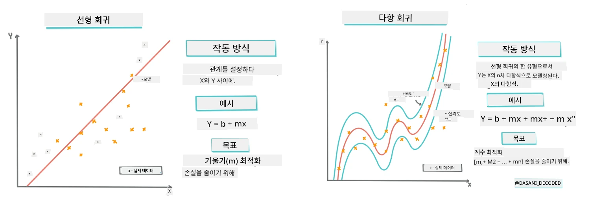
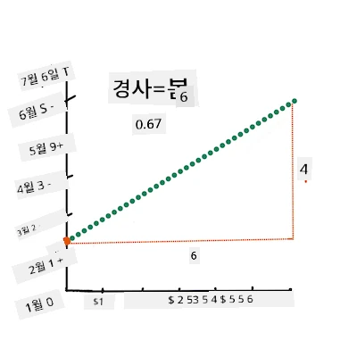
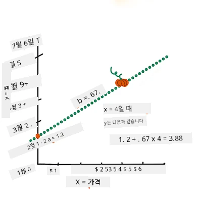
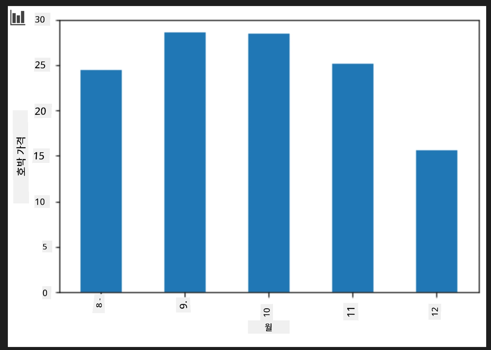
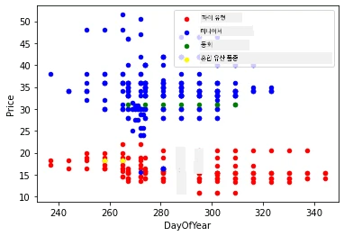
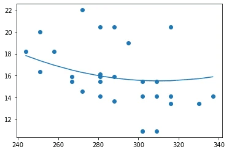

# Scikit-learn을 사용하여 회귀 모델 만들기: 회귀 4가지 방법

## 초보자 노트

선형 회귀는 **수치 값**(예: 주택 가격, 온도, 또는 매출)을 예측하려 할 때 사용됩니다.  
입력 특성과 출력 간의 관계를 가장 잘 나타내는 직선을 찾아 작동합니다.

이 수업에서는 고급 회귀 기법을 탐구하기 전에 개념 이해에 집중합니다.  
  
> 인포그래픽 제공자: [Dasani Madipalli](https://twitter.com/dasani_decoded)  
## [수업 전 퀴즈](https://ff-quizzes.netlify.app/en/ml/)

> ### [이 수업은 R 버전도 제공됩니다!](../../../../2-Regression/3-Linear/solution/R/lesson_3.html)  
### 소개

지금까지 호박 가격 데이터셋으로 수집한 샘플 데이터를 사용해 회귀가 무엇인지 탐구해 보았습니다. 또한 Matplotlib을 사용하여 시각화도 했습니다.  

이제 ML 회귀를 더 깊게 파고들 준비가 되었습니다. 시각화는 데이터를 이해하는 데 도움을 주지만, 머신러닝의 진짜 힘은 _모델 학습_에 있습니다. 모델은 과거 데이터를 기반으로 학습하여 데이터 간 종속 관계를 자동으로 파악하며, 모델이 본 적 없는 새로운 데이터에 대해서도 결과를 예측할 수 있습니다.

이번 수업에서는 _기본 선형 회귀_와 _다항 회귀_ 두 가지 유형과 이 기술들의 수학적 배경을 다룹니다. 이 모델들은 다양한 입력 데이터에 따라 호박 가격을 예측할 수 있게 해줍니다.

[](https://youtu.be/CRxFT8oTDMg "ML 초보자를 위한 - 선형 회귀 이해")

> 🎥 위 이미지를 클릭하여 선형 회귀에 대한 짧은 영상 개요를 시청하세요.

> 이번 커리큘럼 전체에서 수학 지식은 최소한으로 가정하며, 다른 분야 배경의 학생들도 접근하기 쉽도록 노트, 🧮 설명, 도표 등 다양한 학습 도구를 제공합니다.

### 선수 조건

지금쯤이면 우리가 검토 중인 호박 데이터 구조에 익숙해야 합니다. 이 수업의 _notebook.ipynb_ 파일에 사전 로드되고 전처리된 데이터가 들어 있습니다. 해당 파일에서는 호박 가격을 버셜 단위로 나타내는 새 데이터프레임이 있습니다. Visual Studio Code 내 커널에서 이 노트북들을 실행할 수 있어야 합니다.

### 준비

다시 상기시키자면, 이 데이터는 질문을 던지기 위해 로드됩니다.

- 호박을 사기에 가장 좋은 시기는 언제인가요?
- 미니어처 호박 한 상자의 예상 가격은 얼마인가요?
- 반 버셜 바구니로 사야 할까요, 아니면 1 1/9 버셜 박스로 사야 할까요?

계속 이 데이터를 탐구해 봅시다.

이전 수업에서는 Pandas 데이터프레임을 만들고 원본 데이터셋의 일부를 채우면서 가격을 버셜 당 단위로 표준화했습니다. 그러나 그렇게 하면서 약 400개의 데이터 포인트만 수집했고, 가을철 데이터만 다뤘습니다.

이번 수업과 함께 제공되는 노트북에 사전 로드된 데이터를 살펴보세요. 데이터가 로드되어 있고, 월별 데이터를 보여주는 초기 산점도가 그려져 있습니다. 데이터를 좀 더 정제해서 데이터의 성격에 대해 더 자세히 알아볼 수 있을지도 모릅니다.

## 선형 회귀선

수업 1에서 배웠듯, 선형 회귀의 목표는 다음과 같은 선을 그릴 수 있게 하는 것입니다.

- **변수 관계 표시**. 변수들 간의 관계를 보여줍니다.
- <strong>예측하기</strong>. 새 데이터가 그 선과 어떤 관계에 있을지 정확히 예측합니다.

이 선을 그릴 때 보통 **최소 제곱 회귀** 방식을 사용합니다. "최소 제곱"이라는 용어는 모델의 전체 오차를 최소화하는 과정을 의미합니다. 각 데이터 포인트에서 실제 점과 회귀선 사이의 수직 거리를 잔차(residual)라 부르는데요,

이 거리를 제곱하는 이유는 두 가지입니다:

1. **크기는 유지하고 방향은 무시**: -5의 오차를 +5와 동일하게 취급하기 위해 모든 값을 양수로 만듭니다.

2. **이상치에 가중치 부여**: 큰 오차에 더 많은 페널티를 줘서 선이 멀리 떨어진 점들에 가까이 머무르도록 합니다.

이 제곱 거리들을 모두 합산하고, 그 합이 가장 작은 특정 선을 찾는 것이 목표입니다. 그래서 "최소 제곱"이라는 이름이 붙었습니다.

> **🧮 수학적으로 보기**  
> 이 선은 _최적 적합선_이라 불리며, 다음과 같은 [방정식](https://en.wikipedia.org/wiki/Simple_linear_regression)으로 표현됩니다:  
> 
> ```
> Y = a + bX
> ```
>
> 여기서 `X`는 설명 변수이며, `Y`는 종속 변수입니다. 선의 기울기는 `b`, y절편은 `a`로, `X=0`일 때 `Y`의 값을 의미합니다.  
>
>
>
> 우선 기울기 `b`를 계산합니다. 인포그래픽 제공: [Jen Looper](https://twitter.com/jenlooper)
>
> 다시 말해, 호박 데이터 질문 "월별 버셜당 호박 가격 예측"에서 `X`는 가격을, `Y`는 판매 월을 나타냅니다.
>
>
>
> `Y` 값을 계산합니다. 가격이 약 $4라면 아마도 4월일 것입니다! 인포그래픽 제공: [Jen Looper](https://twitter.com/jenlooper)
>
> 이 선을 계산하는 수학은 기울기를 기준으로 하며, 절편 또는 `X=0`일 때 `Y`가 어디에 위치하는지를 반영합니다.
>
> 계산 방법은 [Math is Fun](https://www.mathsisfun.com/data/least-squares-regression.html) 사이트를 참고하세요. 또한 [이 최소제곱 계산기](https://www.mathsisfun.com/data/least-squares-calculator.html)에서 숫자 값이 선에 어떻게 영향을 미치는지 시각적으로 보실 수 있습니다.

## 상관관계

한 가지 더 이해해야 할 용어는 주어진 X와 Y 변수 간의 <strong>상관계수</strong>입니다. 산점도를 사용하면 이 계수를 빠르게 시각화할 수 있습니다. 점들이 깔끔한 직선상에 흩어져 있으면 높은 상관관계이고, 점들이 X와 Y 사이에 무작위로 분포하면 상관관계가 낮다고 볼 수 있습니다.

좋은 선형 회귀 모델은 최소제곱 회귀법을 적용했을 때 상관계수가 높게(0보다는 1에 가까운 값) 나와야 합니다.

✅ 이 수업과 함께 제공되는 노트북을 실행하여 월별-가격 산점도를 확인해 보세요. 월별과 가격 사이의 호박 판매 데이터가 산점도 시각적 해석에 따라 상관관계가 높아 보이나요, 아니면 낮아 보이나요? 만약 `Month` 대신 연중 며칠째인지(*day of the year*)와 같은 상세한 측정치를 사용하면 결과가 달라지나요?

아래 코드에서는 데이터가 깨끗이 전처리되어, `new_pumpkins`라는 이름의 데이터프레임이 생성된 것으로 가정하겠습니다. 해당 데이터프레임 예시는 다음과 같습니다:

ID | Month | DayOfYear | Variety | City | Package | Low Price | High Price | Price
---|-------|-----------|---------|------|---------|-----------|------------|-------
70 | 9 | 267 | PIE TYPE | BALTIMORE | 1 1/9 bushel cartons | 15.0 | 15.0 | 13.636364
71 | 9 | 267 | PIE TYPE | BALTIMORE | 1 1/9 bushel cartons | 18.0 | 18.0 | 16.363636
72 | 10 | 274 | PIE TYPE | BALTIMORE | 1 1/9 bushel cartons | 18.0 | 18.0 | 16.363636
73 | 10 | 274 | PIE TYPE | BALTIMORE | 1 1/9 bushel cartons | 17.0 | 17.0 | 15.454545
74 | 10 | 281 | PIE TYPE | BALTIMORE | 1 1/9 bushel cartons | 15.0 | 15.0 | 13.636364

> 데이터 정리 코드는 [`notebook.ipynb`](notebook.ipynb)에 있습니다. 이전 수업과 같은 클리닝 단계를 거쳤으며, `DayOfYear` 컬럼은 다음 표현식을 사용해 계산했습니다:  
> 
```python
day_of_year = pd.to_datetime(pumpkins['Date']).apply(lambda dt: (dt-datetime(dt.year,1,1)).days)
```
  
이제 선형 회귀의 수학적 배경을 이해했으니, 어느 호박 패키지가 가장 좋은 가격을 제공할지 예측하는 회귀 모델을 만들어 봅시다. 명절 호박 농장 주인은 이 정보를 활용해 호박 구매를 최적화할 수 있을 것입니다.

## 상관관계 찾기

[](https://youtu.be/uoRq-lW2eQo "ML 초보자를 위한 - 상관관계 찾기: 선형 회귀의 핵심")

> 🎥 위 이미지를 클릭해 상관관계에 대한 짧은 영상 개요를 시청하세요.

이전 수업에서 월별 평균 가격이 대략 다음과 같다는 걸 보았습니다:



이로 보아 상관관계가 있을 것으로 예상되며, `Month`와 `Price` 사이, 혹은 `DayOfYear`와 `Price` 사이의 관계를 예측하기 위해 선형 회귀 모델을 시도할 수 있습니다. 아래는 후자의 관계를 보여주는 산점도입니다:

 

`corr` 함수를 사용해 상관관계를 살펴보면:

```python
print(new_pumpkins['Month'].corr(new_pumpkins['Price']))
print(new_pumpkins['DayOfYear'].corr(new_pumpkins['Price']))
```
  
상관관계는 `Month` 기준으로 -0.15, `DayOfYear` 기준으로 -0.17로 꽤 작지만, 중요한 또 다른 관계가 있을 수 있습니다. 가격이 서로 다른 호박 품종별로 군집을 이루는 것처럼 보이기 때문입니다. 이 가설을 확인하려면 호박 카테고리별로 다른 색상을 사용하는 산점도를 함께 그려 봅니다. `scatter` 함수에 `ax` 매개변수를 전달해서 모든 점을 하나의 그래프에 그릴 수 있습니다:

```python
ax=None
colors = ['red','blue','green','yellow']
for i,var in enumerate(new_pumpkins['Variety'].unique()):
    df = new_pumpkins[new_pumpkins['Variety']==var]
    ax = df.plot.scatter('DayOfYear','Price',ax=ax,c=colors[i],label=var)
```
  
 

조사 결과 품종이 실제 판매 날짜보다 가격에 더 큰 영향을 미치는 것으로 보입니다. 막대 그래프로도 볼 수 있습니다:

```python
new_pumpkins.groupby('Variety')['Price'].mean().plot(kind='bar')
```
  
 

지금은 '파이 타입' 품종 하나에만 집중하여 날짜가 가격에 미치는 영향을 살펴봅시다:

```python
pie_pumpkins = new_pumpkins[new_pumpkins['Variety']=='PIE TYPE']
pie_pumpkins.plot.scatter('DayOfYear','Price') 
```
  
 

`corr` 함수를 이용해 `Price`와 `DayOfYear` 간의 상관관계를 계산하면 약 `-0.27`이 나와 예측 모델 학습에 의미가 있음을 알 수 있습니다.

> 선형 회귀 모델을 학습시키기 전에 데이터가 깨끗한지 확인하는 것이 중요합니다. 선형 회귀는 결측값에 취약하기 때문에 빈 셀을 모두 제거하는 것이 좋습니다:

```python
pie_pumpkins.dropna(inplace=True)
pie_pumpkins.info()
```
  
또는 해당 열의 평균값으로 빈 값을 채우는 방법도 있습니다.

## 단순 선형 회귀

[](https://youtu.be/e4c_UP2fSjg "ML 초보자를 위한 - Scikit-learn을 사용한 선형 및 다항 회귀")

> 🎥 위 이미지를 클릭하여 선형 및 다항 회귀에 대한 짧은 영상 개요를 시청하세요.

선형 회귀 모델 학습에는 **Scikit-learn** 라이브러리를 사용합니다.

```python
from sklearn.linear_model import LinearRegression
from sklearn.metrics import mean_squared_error
from sklearn.model_selection import train_test_split
```
  
입력값(특징)과 출력값(레이블)을 별개의 numpy 배열로 분리합니다:

```python
X = pie_pumpkins['DayOfYear'].to_numpy().reshape(-1,1)
y = pie_pumpkins['Price']
```
  
> 선형 회귀 패키지가 데이터를 제대로 인식하도록 입력 데이터를 `reshape` 했다는 점에 유의하세요. 선형 회귀는 2차원 배열을 입력으로 받으며, 배열의 각 행은 하나의 입력 벡터입니다. 여기서는 입력이 하나뿐이므로 배열의 형태는 N×1이어야 하며, N은 데이터셋 크기입니다.

그 다음, 데이터를 훈련용과 테스트용으로 분리하여 학습 후 모델을 검증할 수 있게 합니다:

```python
X_train, X_test, y_train, y_test = train_test_split(X, y, test_size=0.2, random_state=0)
```
  
마지막으로 실제 선형 회귀 모델을 학습시키는 코드는 아주 간단합니다. `LinearRegression` 객체를 정의하고, `fit` 메서드로 데이터를 학습시킵니다:

```python
lin_reg = LinearRegression()
lin_reg.fit(X_train,y_train)
```

`LinearRegression` 객체는 `fit` 후에 회귀 계수를 모두 포함하며, `.coef_` 속성을 통해 접근할 수 있습니다. 우리의 경우, 계수는 하나이고 대략 `-0.017` 정도일 것입니다. 이는 가격이 시간이 지남에 따라 약간 떨어지는 경향이 있음을 의미하며, 하루에 약 2센트 정도 하락하는 것으로 해석할 수 있습니다. 또한 `lin_reg.intercept_`를 사용하여 회귀선이 Y축과 만나는 교차점을 확인할 수 있는데, 이 값은 우리 예제에서 대략 `21` 정도로 연초 가격을 나타냅니다.

모델이 얼마나 정확한지 확인하려면, 테스트 데이터셋에 대해 가격을 예측하고, 예측 값과 실제 값이 얼마나 가까운지 측정할 수 있습니다. 이는 RMSE(root mean square error) 지표를 사용해 할 수 있는데, RMSE는 예상 값과 예측 값의 모든 제곱 차이의 평균의 제곱근입니다.

```python
pred = lin_reg.predict(X_test)

rmse = np.sqrt(mean_squared_error(y_test,pred))
print(f'RMSE: {rmse:3.3} ({rmse/np.mean(pred)*100:3.3}%)')
```

우리의 오류는 대략 2점 정도로, 약 17% 정도입니다. 그렇게 좋지 않네요. 모델 품질의 또 다른 지표는 **결정 계수(coefficient of determination)** 로, 다음과 같이 구할 수 있습니다:

```python
score = lin_reg.score(X_train,y_train)
print('Model determination: ', score)
```
값이 0이라면, 모델이 입력 데이터를 전혀 반영하지 않고 결과의 단순 평균으로만 작동하는 <em>최악의 선형 예측기</em>임을 의미합니다. 값이 1이면 모든 예상 결과를 완벽히 예측할 수 있다는 뜻입니다. 우리 경우 결정 계수는 약 0.06으로, 상당히 낮은 편입니다.

회귀가 어떻게 작동하는지 더 잘 보기 위해 테스트 데이터와 회귀선을 함께 그려봅시다:

```python
plt.scatter(X_test,y_test)
plt.plot(X_test,pred)
```


## 다항 회귀(Polynomial Regression)

선형 회귀의 또 다른 유형은 다항 회귀입니다. 변수들 사이에 선형 관계가 있을 때도 있지만, 예를 들어 호박 부피가 클수록 가격이 높아지는 것처럼, 어떤 경우는 이러한 관계가 평면이나 직선으로 표현되지 않을 수도 있습니다.

✅ 다항 회귀가 필요한 [더 많은 예시](https://online.stat.psu.edu/stat501/Lesson09#polynomial-regression-examples)를 확인해보세요.

Date와 Price 사이 관계를 다시 보세요. 이 산점도가 꼭 직선으로 분석되어야 할까요? 가격이 오르락내리락 할 수도 있지 않을까요? 이런 경우 다항 회귀를 시도해볼 수 있습니다.

✅ 다항식은 하나 이상의 변수와 계수로 구성될 수 있는 수학 표현식입니다.

다항 회귀는 곡선을 만들어 비선형 데이터에 더 잘 맞춥니다. 우리 경우, 입력 데이터에 제곱된 `DayOfYear` 변수를 포함하면, 연도 내 특정 지점에 최소값을 갖는 포물선 형태를 데이터에 맞출 수 있습니다.

Scikit-learn에는 여러 데이터 처리 단계를 결합하는 유용한 [pipeline API](https://scikit-learn.org/stable/modules/generated/sklearn.pipeline.make_pipeline.html?highlight=pipeline#sklearn.pipeline.make_pipeline)가 포함되어 있습니다. <strong>파이프라인</strong>은 **추정기(estimator)** 체인입니다. 우리 경우에는 먼저 다항 특성을 추가하고 회귀를 학습하는 파이프라인을 만들 것입니다:

```python
from sklearn.preprocessing import PolynomialFeatures
from sklearn.pipeline import make_pipeline

pipeline = make_pipeline(PolynomialFeatures(2), LinearRegression())

pipeline.fit(X_train,y_train)
```

`PolynomialFeatures(2)`를 사용하면 입력 데이터에서 모든 2차 다항식을 포함하겠다는 뜻입니다. 우리 예에서는 `DayOfYear`<sup>2</sup>뿐이지만, 두 변수 X와 Y가 있다면 X<sup>2</sup>, XY, Y<sup>2</sup>를 포함할 것입니다. 더 높은 차수 다항식도 사용할 수 있습니다.

파이프라인은 원래의 `LinearRegression` 객체처럼 사용할 수 있습니다. 즉, 파이프라인을 `fit`한 뒤 `predict`를 통해 예측값을 얻을 수 있습니다:

```python
pred = pipeline.predict(X_test)

rmse = np.sqrt(mean_squared_error(y_test,pred))
print(f'RMSE: {rmse:3.3} ({rmse/np.mean(pred)*100:3.3}%)')

score = pipeline.score(X_train,y_train)
print('Model determination: ', score)
```

부드러운 근사 곡선을 그리기 위해 `np.linspace`로 균등한 입력 값 범위를 생성합니다. 이는 무작위로 배열된 테스트 데이터 위에 바로 그릴 경우 지그재그 모양이 되기 때문입니다:

```python
X_range = np.linspace(X_test.min(), X_test.max(), 100).reshape(-1,1)
y_range = pipeline.predict(X_range)

plt.scatter(X_test, y_test)
plt.plot(X_range, y_range)
```

다음은 테스트 데이터와 근사 곡선을 보여주는 그래프입니다:



다항 회귀를 사용하면 RMSE는 약간 낮아지고 결정 계수는 약간 올라가지만 큰 차이는 없습니다. 다른 특성들도 고려할 필요가 있습니다!

> 최소 호박 가격이 할로윈 즈음에 관찰되는 것을 볼 수 있네요. 이를 어떻게 설명할 수 있을까요?

🎃 축하합니다! 여러분은 파이 호박 가격 예측에 도움이 되는 모델을 만들었습니다. 모든 호박 종류에 대해 같은 과정을 반복할 수 있지만, 그것은 번거로울 수 있습니다. 이제 호박 품종을 모델에 반영하는 방법을 배워봅시다!

## 범주형 특성(Categorical Features)

이상적인 세계에서는 같은 모델로 다양한 호박 품종의 가격을 예측할 수 있길 원합니다. 하지만 `Variety` 열은 `Month` 같은 숫자형 열과 달리 비숫자 값을 포함하고 있어 <strong>범주형</strong> 열로 불립니다.

[](https://youtu.be/DYGliioIAE0 "ML for beginners - Categorical Feature Predictions with Linear Regression")

> 🎥 위 이미지 클릭하면 범주형 특성 사용에 관한 짧은 영상 개요를 볼 수 있습니다.

다음은 품종별 평균 가격입니다:


품종을 반영하려면 먼저 숫자 형태로 변환하거나, 즉 <strong>인코딩</strong> 해야 합니다. 여러 인코딩 방법이 있습니다:

* 간단한 <strong>숫자 인코딩</strong>은 서로 다른 품종 테이블을 만들고, 품종 이름을 테이블 내 인덱스로 대체합니다. 하지만 선형 회귀에는 최적의 방법이 아닙니다. 선형 회귀는 인덱스의 숫자 값을 실제 수치로 받아들이고 계수를 곱해 결과에 더하기 때문입니다. 인덱스와 가격 사이의 관계는 비선형적일 가능성이 큽니다.
* <strong>원-핫 인코딩</strong>은 `Variety` 열을 4개 열로 나누고, 각 품종마다 한 열씩 만듭니다. 해당 행이 특정 품종이면 1, 아니면 0을 넣습니다. 이렇게 하면 각 품종마다 계수가 하나씩 생겨, 각기 다른 "기본 가격"(정확히는 각각 품종의 "추가 가격")을 나타내는 계수가 생깁니다.

다음은 품종을 원-핫 인코딩하는 예입니다:

```python
pd.get_dummies(new_pumpkins['Variety'])
```

 ID | FAIRYTALE | MINIATURE | MIXED HEIRLOOM VARIETIES | PIE TYPE
----|-----------|-----------|--------------------------|----------
70 | 0 | 0 | 0 | 1
71 | 0 | 0 | 0 | 1
... | ... | ... | ... | ...
1738 | 0 | 1 | 0 | 0
1739 | 0 | 1 | 0 | 0
1740 | 0 | 1 | 0 | 0
1741 | 0 | 1 | 0 | 0
1742 | 0 | 1 | 0 | 0

원-핫 인코딩한 품종을 입력으로 하여 선형 회귀를 훈련하려면, `X`와 `y` 데이터를 올바르게 초기화하기만 하면 됩니다:

```python
X = pd.get_dummies(new_pumpkins['Variety'])
y = new_pumpkins['Price']
```

나머지 코드는 위에서 쓴 선형 회귀 학습 코드와 같습니다. 실행해 보면 평균 제곱 오차는 비슷하지만 결정 계수가 훨씬 높아진 것을 볼 수 있습니다 (~77%). 더 정확한 예측을 위해서는 더 많은 범주형 특성과 `Month` 혹은 `DayOfYear` 같은 숫자형 특성도 함께 고려해야 합니다. 하나의 큰 특성 배열로 만들려면 `join`을 사용할 수 있습니다:

```python
X = pd.get_dummies(new_pumpkins['Variety']) \
        .join(new_pumpkins['Month']) \
        .join(pd.get_dummies(new_pumpkins['City'])) \
        .join(pd.get_dummies(new_pumpkins['Package']))
y = new_pumpkins['Price']
```

여기서는 `City`와 `Package` 타입도 반영해 RMSE는 2.84 (10.5%), 결정 계수는 0.94가 되었습니다!

## 모두 합치기

가장 좋은 모델을 만들기 위해 위 예시에서처럼 (원-핫 인코딩된 범주형 + 숫자형) 데이터를 다항 회귀와 함께 사용할 수 있습니다. 아래는 편의를 위한 완전한 코드입니다:

```python
# 훈련 데이터 설정
X = pd.get_dummies(new_pumpkins['Variety']) \
        .join(new_pumpkins['Month']) \
        .join(pd.get_dummies(new_pumpkins['City'])) \
        .join(pd.get_dummies(new_pumpkins['Package']))
y = new_pumpkins['Price']

# 학습-테스트 분할 수행
X_train, X_test, y_train, y_test = train_test_split(X, y, test_size=0.2, random_state=0)

# 파이프라인 설정 및 훈련
pipeline = make_pipeline(PolynomialFeatures(2), LinearRegression())
pipeline.fit(X_train,y_train)

# 테스트 데이터에 대한 결과 예측
pred = pipeline.predict(X_test)

# RMSE 및 결정 계수 계산
rmse = mean_squared_error(y_test, pred, squared=False)
print(f'RMSE: {rmse:3.3} ({rmse/pred.mean()*100:3.3}%)')

score = pipeline.score(X_train,y_train)
print('Model determination: ', score)
```

이렇게 하면 결정 계수가 거의 97%에 도달하고, RMSE는 2.23 (예측 오류 약 8%)이 됩니다.

| 모델 | RMSE | 결정 계수 |
|-------|-----|---------------|
| `DayOfYear` 선형 | 2.77 (17.2%) | 0.07 |
| `DayOfYear` 다항 | 2.73 (17.0%) | 0.08 |
| `Variety` 선형 | 5.24 (19.7%) | 0.77 |
| 모든 특성 선형 | 2.84 (10.5%) | 0.94 |
| 모든 특성 다항 | 2.23 (8.25%) | 0.97 |

🏆 잘했습니다! 한 강의에서 네 가지 회귀 모델을 만들고 모델 품질을 97% 수준으로 끌어올렸습니다. 회귀의 마지막 부분에서는 분류를 위한 로지스틱 회귀를 배울 것입니다.

---
## 🚀도전 과제

이 노트북에서 여러 변수를 테스트하여 상관관계가 모델 정확도와 어떻게 연결되는지 확인해보세요.

## [강의 후 퀴즈](https://ff-quizzes.netlify.app/en/ml/)

## 복습 및 자습

이번 강의에서는 선형 회귀를 배웠습니다. 회귀에는 다른 중요한 유형들도 있습니다. 단계별, 릿지, 라쏘, 엘라스틱넷 기법에 대해 공부해보세요. 더 배우고 싶다면 [스탠포드 통계학습 과정](https://online.stanford.edu/courses/sohs-ystatslearning-statistical-learning)을 추천합니다.

## 과제

[모델 만들기](assignment.md)

---

<!-- CO-OP TRANSLATOR DISCLAIMER START -->
**면책 조항**:  
이 문서는 AI 번역 서비스 [Co-op Translator](https://github.com/Azure/co-op-translator)를 사용하여 번역되었습니다. 정확성을 위해 최선을 다하고 있으나, 자동 번역에는 오류나 부정확성이 포함될 수 있음을 양지하시기 바랍니다. 원본 문서는 원어로 된 원본 문서를 권위 있는 출처로 간주해야 합니다. 중요한 정보에 대해서는 전문 인간 번역을 권장합니다. 본 번역 사용으로 인해 발생하는 오해나 잘못된 해석에 대해 당사는 책임을 지지 않습니다.
<!-- CO-OP TRANSLATOR DISCLAIMER END -->