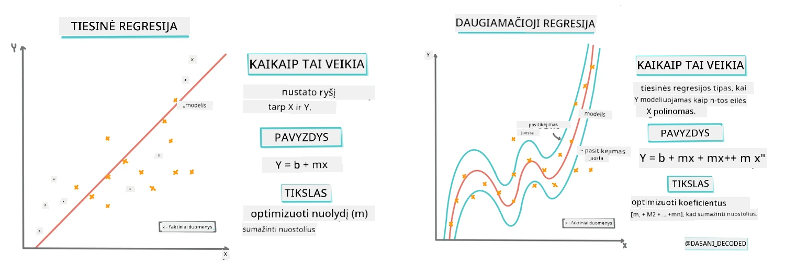
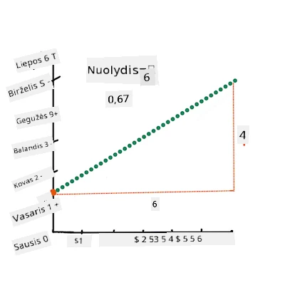
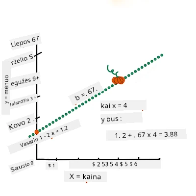
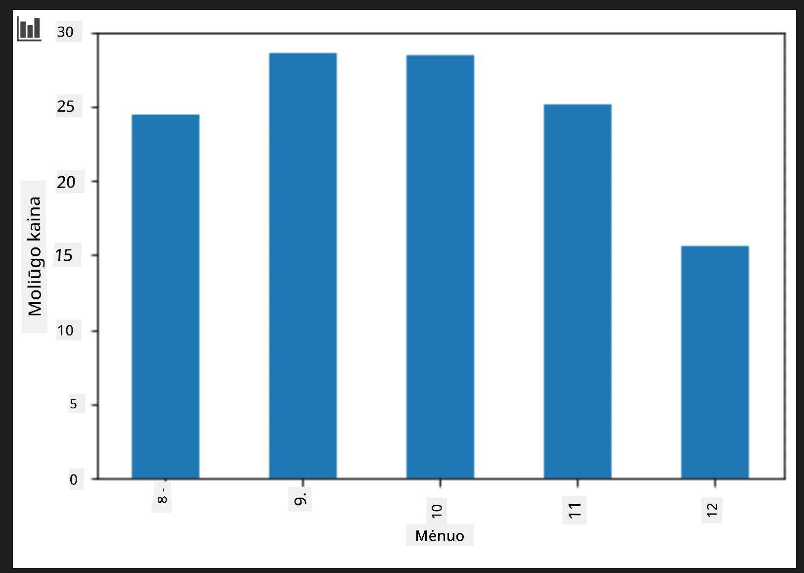
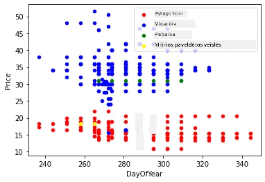

# Sukurkite regresijos modelį naudodami Scikit-learn: regresija keturiais būdais

## Pradedančiojo pastaba

Linijinė regresija naudojama, kai norime prognozuoti **skaitinę reikšmę** (pavyzdžiui, namo kainą, temperatūrą ar pardavimus). Ji veikia radusi tiesią liniją, kuri geriausiai atspindi ryšį tarp įvesties požymių ir išvesties.

Šioje pamokoje sutelkiame dėmesį į koncepcijos supratimą prieš pradedant tyrinėti pažangesnes regresijos technikas.  
  
> Infografika autoriaus [Dasani Madipalli](https://twitter.com/dasani_decoded)

## [Priešpaskaitos testas](https://ff-quizzes.netlify.app/en/ml/)

> ### [Ši pamoka prieinama ir R kalba!](../../../../2-Regression/3-Linear/solution/R/lesson_3.html)  

### Įvadas  

Iki šiol tyrinėjote, kas yra regresija, su pavyzdiniais duomenimis iš moliūgų kainų duomenų rinkinio, kurį naudosime per visą šią pamoką. Taip pat ją vizualizavote naudodami Matplotlib.

Dabar esate pasiruošę gilintis į regresiją mašininio mokymosi kontekste. Nors vizualizacija leidžia geriau suprasti duomenis, tikroji Mašininio Mokymosi galia atsiskleidžia mokant modelius. Modeliai yra mokomi remiantis istoriniais duomenimis, automatiškai fiksuoja duomenų priklausomybes ir leidžia prognozuoti rezultatus naujiems, iki tol nematytiems duomenims.

Šioje pamokoje sužinosite daugiau apie du regresijos tipus: _pagrindinę tiesinę regresiją_ ir _polilinę regresiją_ bei susipažinsite su kai kuriais matematiniais pagrindais, slypinčiais už šių technikų. Šie modeliai leis mums prognozuoti moliūgų kainas priklausomai nuo skirtingų įvesties duomenų.

[](https://youtu.be/CRxFT8oTDMg "ML pradedantiesiems - Linijinės regresijos supratimas")

> 🎥 Spustelėkite aukščiau esantį paveikslėlį trumpam linijinės regresijos apžvalgos vaizdo įrašui.  

> Visos šio mokymo programos metu laikome minimalias matematikos žinias ir siekiame, kad ji būtų suprantama studentams iš kitų sričių, todėl stebėkite pastabas, 🧮 užrašus, diagramas ir kitas mokymosi priemones, kurios padės suprasti medžiagą.

### Išankstinės sąlygos

Turėtumėte būti susipažinę su moliūgų duomenų struktūra, kurią nagrinėjame. Šiame pamokos _notebook.ipynb_ faile duomenys yra iš anksto įkelti ir išvalyti. Faile moliūgų kaina pateikiama už skerdeną naujame duomenų rinkinyje. Įsitikinkite, kad galite vykdyti šiuos užrašų knygelių (notebook) failus Visual Studio Code aplinkoje.

### Pasiruošimas

Primename, kad šiuos duomenis įkelsite, kad galėtumėte užduoti klausimus.

- Kada geriausias laikas pirkti moliūgus?  
- Kokią kainą galiu tikėtis už dėžę mini moliūgų?  
- Ar juos geriau pirkti pusės skerdenos krepšiuose, ar 1 1/9 skerdenos dėžėse?  
Toliau gilinsimės į šiuos duomenis.  

Praėjusioje pamokoje sukūrėte Pandas duomenų rėmelį ir užpildėte jį dalimi originalių duomenų rinkinio, standartizuodami kainas pagal skerdeną. Tačiau tai leido surinkti tik apie 400 duomenų taškų ir tik rudens mėnesiams.

Pažiūrėkite duomenis, kuriuos iš anksto įkėlėme šios pamokos užrašų knygelėje. Duomenys yra iš anksto įkelti ir pateikiamas pradinio sklaidos grafiko vaizdas, rodantis mėnesių duomenis. Gal galime gauti šiek tiek daugiau informacijos, jei duomenis išvalysime labiau.

## Linijinės regresijos linija

Kaip išmokote 1 pamokoje, linijinės regresijos tikslas yra nubrėžti liniją, kuri:

- **Rodo kintamųjų tarpusavio ryšį**. Rodo ryšį tarp kintamųjų  
- **Atlieka prognozes**. Tiksliai prognozuoja, kur naujas duomenų taškas bus linijos atžvilgiu  

Įprasta, kad tokia linija nubrėžiama naudojant **mažiausių kvadratų regresiją**. Terminas „Mažiausių kvadratų“ reiškia procesą, kai siekiama sumažinti bendrą klaidą mūsų modelyje. Kiekvienam duomenų taškui matuojame vertikalią atstumą (vadinamą liekana) tarp tikros reikšmės ir regresijos linijos.

Šiuos atstumus kvadratuojame dėl dviejų pagrindinių priežasčių:

1. **Dydis viršija kryptį:** Klaida -5 turi būti vertinama taip pat kaip klaida +5. Kvadratuojant visos reikšmės tampa teigiamos.

2. **Didesnių paklaidų penalizavimas:** Kvadratuojant didesnės klaidos turi didesnį svorį, verčiant liniją labiau artėti prie tolimų taškų.

Tuomet sudedame visas šias kvadratuotas reikšmes. Mūsų tikslas yra rasti liniją, kurioje šių reikšmių suma yra mažiausia (mažiausia įmanoma vertė) – todėl modelis vadinamas „mažiausių kvadratų“.

> **🧮 Rodyk matematiką**  
>  
> Ši linija, vadinama _geriausiai pritaikoma linija_, gali būti išreikšta [lygtimi](https://en.wikipedia.org/wiki/Simple_linear_regression):  
>  
> ```
> Y = a + bX
> ```
  
> `X` yra „aiškinamasis kintamasis“. `Y` yra „priklausomas kintamasis“. Linijos nuolydis yra `b`, o `a` – y sankirta, reiškianti `Y` reikšmę, kai `X = 0`.  
>  
>  
>  
> Pirmiausia apskaičiuojame nuolydį `b`. Infografika autoriaus [Jen Looper](https://twitter.com/jenlooper)  
>  
> Kitaip tariant, ir referuodamiesi moliūgų duomenų pradiniu klausimu: „prognozuoti moliūgų kainą pagal mėnesį už skerdeną“, `X` reiškia kainą, o `Y` – pardavimo mėnesį.  
>  
>  
>  
> Apskaičiuokite Y reikšmę. Jei mokate apie 4 dolerius, tikriausiai yra balandis! Infografika autoriaus [Jen Looper](https://twitter.com/jenlooper)  
>  
> Matematika, kuri apskaičiuoja liniją, turi parodyti linijos nuolydį, kuris taip pat priklauso nuo sankirtos, t. y. kur yra `Y`, kai `X = 0`.  
>  
> Šį skaičiavimo metodą galite pamatyti svetainėje [Math is Fun](https://www.mathsisfun.com/data/least-squares-regression.html). Taip pat apsilankykite [šiame mažiausių kvadratų skaičiuoklyje](https://www.mathsisfun.com/data/least-squares-calculator.html) ir sekite, kaip skaičių reikšmės veikia liniją.

## Koreliacija

Dar vienas svarbus terminas – **koreliacijos koeficientas** tarp nurodytų X ir Y kintamųjų. Naudodamiesi sklaidos grafiku, galite greitai įvertinti šį koeficientą. Taškai išdėstyti lygiagrečioje linijoje reiškia aukštą koreliaciją, o išmėtyti po visą plokštumą – žemą.

Geras linijinės regresijos modelis yra tas, kurio koreliacijos koeficientas yra aukštas (artimas 1, o ne 0), naudojant mažiausių kvadratų regresijos metodą su regresijos linija.

✅ Vykdykite šios pamokos užrašų knygelę ir pažiūrėkite į „Mėnuo vs Kaina“ sklaidos grafiką. Ar šiame grafike matote didelę ar mažą koreliaciją tarp mėnesio ir moliūgų kainos? O ar pasikeistų, jei panaudotumėte smulkesnį rodiklį, pvz., *metų dieną* (skaičius dienų nuo metų pradžios)?

Toliau pateiktame kode laikysimės, kad turime išvalytus duomenis pagrindiniame duomenų rėmelyje `new_pumpkins`, panašų į šį:

ID | Mėnuo | MetųDiena | Veislė | Miestas | Pakuotė | Mažesnė kaina | Didžiausia kaina | Kaina
---|-------|-----------|---------|--------|---------|---------------|------------------|-------
70 | 9 | 267 | PIE TYPE | BALTIMORE | 1 1/9 skerdenos dėžutės | 15.0 | 15.0 | 13.636364
71 | 9 | 267 | PIE TYPE | BALTIMORE | 1 1/9 skerdenos dėžutės | 18.0 | 18.0 | 16.363636
72 | 10 | 274 | PIE TYPE | BALTIMORE | 1 1/9 skerdenos dėžutės | 18.0 | 18.0 | 16.363636
73 | 10 | 274 | PIE TYPE | BALTIMORE | 1 1/9 skerdenos dėžutės | 17.0 | 17.0 | 15.454545
74 | 10 | 281 | PIE TYPE | BALTIMORE | 1 1/9 skerdenos dėžutės | 15.0 | 15.0 | 13.636364

> Duomenų išvalymo kodas pateiktas faile [`notebook.ipynb`](notebook.ipynb). Atlikome tuos pačius išvalymo veiksmus kaip ir ankstesnėje pamokoje bei apskaičiavome stulpelį `DayOfYear` pagal šią išraišką:

```python
day_of_year = pd.to_datetime(pumpkins['Date']).apply(lambda dt: (dt-datetime(dt.year,1,1)).days)
```
  
Dabar, kai suprantate linijinės regresijos matematiką, sukurkime regresijos modelį, kuris prognozuotų, kuri moliūgų pakuotė turės geriausias kainas. Pavyzdžiui, kas nors, kas perka moliūgus rudens moliūgų šventei, norėtų šios informacijos optimizuoti pakuočių pirkimą.

## Koreliacijos paieška

[](https://youtu.be/uoRq-lW2eQo "ML pradedantiesiems - Koreliacijos paieška: raktas į linijinę regresiją")

> 🎥 Spustelėkite aukščiau esantį paveikslėlį trumpam vaizdo įrašui apie koreliaciją.

Iš ankstesnės pamokos galbūt matėte, kad vidutinė kaina skirtingais mėnesiais atrodo taip:



Tai rodo, kad turėtų būti tam tikra koreliacija, ir galime pabandyti apmokyti linijinės regresijos modelį, prognozuoti ryšį tarp `Mėnuo` ir `Kaina` arba tarp `MetųDiena` ir `Kaina`. Čia pateikiamas sklaidos grafikas, rodantis pastarąjį ryšį:

 

Patikrinkime koreliaciją naudodami funkciją `corr`:

```python
print(new_pumpkins['Month'].corr(new_pumpkins['Price']))
print(new_pumpkins['DayOfYear'].corr(new_pumpkins['Price']))
```
  
Atrodo, kad koreliacija gana maža, -0.15 pagal `Mėnesį` ir -0.17 pagal `MetųDieną`, bet gali būti kita svarbi priklausomybė. Atrodo, kad yra skirtingų kainų grupių, atitinkančių skirtingas moliūgų veisles. Norėdami patvirtinti hipotezę, pavaizduokime kiekvieną moliūgų kategoriją skirtinga spalva. Perdami parametru `ax` į `scatter` funkciją, galime pavaizduoti visus taškus viename grafike:

```python
ax=None
colors = ['red','blue','green','yellow']
for i,var in enumerate(new_pumpkins['Variety'].unique()):
    df = new_pumpkins[new_pumpkins['Variety']==var]
    ax = df.plot.scatter('DayOfYear','Price',ax=ax,c=colors[i],label=var)
```
  
 

Mūsų tyrimas rodo, kad veislė turi didesnį poveikį kainai nei faktinė pardavimo data. Tai matyti ir juostiniame grafike:

```python
new_pumpkins.groupby('Variety')['Price'].mean().plot(kind='bar')
```
  
 

Kol kas susikoncentruokime tik į vieną moliūgų veislę – 'pie type', ir pažiūrėkime, koks poveikis kainai turi data:

```python
pie_pumpkins = new_pumpkins[new_pumpkins['Variety']=='PIE TYPE']
pie_pumpkins.plot.scatter('DayOfYear','Price') 
```
 

Jeigu dabar apskaičiuosime koreliaciją tarp `Kainos` ir `MetųDienos` naudojant funkciją `corr`, gausime apie `-0.27` – tai reiškia, kad verta apmokyti prognozuojamą modelį.

> Prieš apmokant linijinį regresijos modelį svarbu įsitikinti, kad mūsų duomenys yra švarūs. Linijinė regresija blogai veikia su trūkstamomis reikšmėmis, todėl verta pašalinti visas tuščias langelius:

```python
pie_pumpkins.dropna(inplace=True)
pie_pumpkins.info()
```
  
Kita galimybė – trūkstamas reikšmes užpildyti atitinkamo stulpelio vidurkiu.

## Paprasta linijinė regresija

[](https://youtu.be/e4c_UP2fSjg "ML pradedantiesiems - Linijinė ir polilinė regresija naudojant Scikit-learn")

> 🎥 Spustelėkite aukščiau esantį paveikslėlį trumpam linijinės ir polilinės regresijos apžvalgos vaizdo įrašui.

Norėdami apmokyti linijinės regresijos modelį, naudosime **Scikit-learn** biblioteką.

```python
from sklearn.linear_model import LinearRegression
from sklearn.metrics import mean_squared_error
from sklearn.model_selection import train_test_split
```
  
Pradėjome atskirdami įvesties reikšmes (ypatybes) ir numatytas išvestis (etiketes) į atskirus numpy masyvus:

```python
X = pie_pumpkins['DayOfYear'].to_numpy().reshape(-1,1)
y = pie_pumpkins['Price']
```
  
> Atkreipkite dėmesį, kad turėjome atlikti `reshape` operaciją su įvesties duomenimis, kad Linear Regression paketas juos teisingai suprastų. Linijinė regresija laukia 2D masyvo, kuriame kiekviena eilutė atitinka vieną įvesties požymių vektorių. Mūsų atveju, tai yra masyvas su N×1 matmenimis, kur N – duomenų kiekis.

Toliau padalinsime duomenis į mokymo ir testavimo rinkinius, kad galėtume modelio kokybę patikrinti po apmokymo:

```python
X_train, X_test, y_train, y_test = train_test_split(X, y, test_size=0.2, random_state=0)
```
  
Galiausiai, modelio apmokymas užtrunka tik dviem kodo eilutėmis. Apibrėžiame `LinearRegression` objektą ir pritaikome jį duomenims su `fit` metodu:

```python
lin_reg = LinearRegression()
lin_reg.fit(X_train,y_train)
```

`LinearRegression` objektas, atlikus `fit` pritaikymą, turi visus regresijos koeficientus, kuriuos galima pasiekti naudojant `.coef_` savybę. Mūsų atveju yra tik vienas koeficientas, kuris turėtų būti apie `-0.017`. Tai reiškia, kad kainos, atrodo, šiek tiek krinta su laiku, bet ne per daug, apie 2 centus per dieną. Taip pat galime pasiekti regresijos sandūros tašką su Y ašimi naudojant `lin_reg.intercept_` - jis bus apie `21` mūsų atveju, nurodydamas kainą metų pradžioje.

Norėdami pamatyti, kaip tikslus mūsų modelis, galime prognozuoti kainas testiniame duomenų rinkinyje ir tada išmatuoti, kiek prognozės artimos tikėtoms reikšmėms. Tai galima padaryti naudojant kvadratinės vidutinės šaknies klaidos (RMSE) metriką, kuri yra kvadratinės reikšmės vidurkio šaknis iš visų kvadratinių skirtumų tarp tikėtinų ir prognozuotų reikšmių.

```python
pred = lin_reg.predict(X_test)

rmse = np.sqrt(mean_squared_error(y_test,pred))
print(f'RMSE: {rmse:3.3} ({rmse/np.mean(pred)*100:3.3}%)')
```

Mūsų klaida atrodo apie 2 taškus, tai yra ~17%. Ne per gera. Kitas modelio kokybės rodiklis yra **determinacijos koeficientas**, kurį galima gauti taip:

```python
score = lin_reg.score(X_train,y_train)
print('Model determination: ', score)
```
Jei reikšmė yra 0, tai reiškia, kad modelis neatkreipia dėmesio į įvesties duomenis ir veikia kaip *blogiausias tiesinis prognozuotojas*, kuris yra tiesiog rezultato vidurkis. 1 reikšmė reiškia, kad galime tobulai prognozuoti visus tikėtinus rezultatus. Mūsų atveju koeficientas yra apie 0.06, kas yra gana žema.

Taip pat galime nubraižyti testinius duomenis kartu su regresijos linija, kad geriau matytume, kaip mums sekasi regresija:

```python
plt.scatter(X_test,y_test)
plt.plot(X_test,pred)
```


## Polinominė regresija

Kita linijinės regresijos rūšis yra polinominė regresija. Nors kartais tarp kintamųjų yra tiesinė priklausomybė – kuo didesnė moliūgo apimtis, tuo didesnė kaina – kartais šių priklausomybių negalima pavaizduoti kaip plokštumos ar tiesės.

✅ Čia yra [dar keli pavyzdžiai](https://online.stat.psu.edu/stat501/Lesson09#polynomial-regression-examples) duomenų, kuriems galima pritaikyti polinominę regresiją

Dar kartą pažvelkite į priklausomybę tarp Datos ir Kainos. Ar šis sklaidos diagrama atrodo, kad būtinai turėtų būti analizuojama tiesės būdu? Negali kainos svyruoti? Tokiu atveju galite išbandyti polinominę regresiją.

✅ Polinomai yra matematiniai reiškiniai, kurie gali susidėti iš vieno ar kelių kintamųjų ir koeficientų

Polinominė regresija sukuria kreivę liniją, kad geriau pritaikytųsi prie netiesinių duomenų. Mūsų atveju, jei įvedame kvadratinį `DayOfYear` kintamąjį į įvesties duomenis, turėtume galėti pritaikyti duomenis paraboliniam kreiviui, kuris turės minimumą tam tikru punktu metų viduje.

Scikit-learn turi naudingą [pipeline API](https://scikit-learn.org/stable/modules/generated/sklearn.pipeline.make_pipeline.html?highlight=pipeline#sklearn.pipeline.make_pipeline), leidžiančią sujungti skirtingus duomenų apdorojimo žingsnius. **Pipeline** yra **estimatorių** grandinė. Mūsų atveju sukursime pipeline, kuris pirmiausia prideda polinominius požymius prie modelio, o tada treniruoja regresiją:

```python
from sklearn.preprocessing import PolynomialFeatures
from sklearn.pipeline import make_pipeline

pipeline = make_pipeline(PolynomialFeatures(2), LinearRegression())

pipeline.fit(X_train,y_train)
```

Naudojant `PolynomialFeatures(2)` reiškia, kad įtrauksime visus antrinės eilės polinomius iš įvesties duomenų. Mūsų atveju tai reikš tik `DayOfYear`<sup>2</sup>, bet turint du kintamuosius X ir Y, tai pridės X<sup>2</sup>, XY ir Y<sup>2</sup>. Taip pat galime naudoti aukštesnės eilės polinomus, jei norime.

Pipeline galima naudoti tokiu pačiu būdu kaip originalų `LinearRegression` objektą, t.y. galime `fit` pritaikyti pipeline ir tada naudoti `predict`, kad gautume prognozes:

```python
pred = pipeline.predict(X_test)

rmse = np.sqrt(mean_squared_error(y_test,pred))
print(f'RMSE: {rmse:3.3} ({rmse/np.mean(pred)*100:3.3}%)')

score = pipeline.score(X_train,y_train)
print('Model determination: ', score)
```

Kad nubraižytume sklandžią aproksimacijos kreivę, naudojame `np.linspace` sukurti vienodai paskirstytą įvesties reikšmių intervalą, o ne piešti tiesiogiai neorganizuotus testinius duomenis (kas būtų zigzaginė linija):

```python
X_range = np.linspace(X_test.min(), X_test.max(), 100).reshape(-1,1)
y_range = pipeline.predict(X_range)

plt.scatter(X_test, y_test)
plt.plot(X_range, y_range)
```

Čia grafikas, rodantis testinius duomenis ir aproksimacijos kreivę:


Naudodami polinominę regresiją galime gauti šiek tiek mažesnį RMSE ir didesnį determinacijos koeficientą, bet ne ženkliai. Turime atsižvelgti į kitas ypatybes!

> Galite pastebėti, kad minimalios moliūgų kainos stebimos maždaug Helovino metu. Kaip tai paaiškintumėte?

🎃 Sveikiname, ką tik sukūrėte modelį, kuris gali padėti prognozuoti moliūgų pyrago kainą. Tikriausiai tą patį procesą galite pakartoti visoms moliūgų rūšims, tačiau tai būtų varginanti užduotis. Dabar išmokime, kaip į modelį įtraukti moliūgų įvairovę!

## Kategoriniai požymiai

Idealiame pasaulyje norime galėti prognozuoti kainas skirtingoms moliūgų rūšims naudojant tą patį modelį. Tačiau `Variety` stulpelis skiriasi nuo tokių stulpelių kaip `Month`, nes jis turi ne skaitines reikšmes. Tokie stulpeliai vadinami **kategoriniais**.

[](https://youtu.be/DYGliioIAE0 "ML pradedantiesiems - Kategorinių požymių prognozės su linijine regresija")

> 🎥 Spustelėkite paveikslėlį aukščiau, kad peržiūrėtumėte trumpą vaizdo pristatymą apie kategorinių požymių naudojimą.

Čia matote, kaip vidutinė kaina priklauso nuo rūšies:


Norėdami atsižvelgti į rūšį, pirmiausia turime ją paversti skaitine forma, arba **užkoduoti**. Yra keli būdai tai padaryti:

* Paprastas **skaitinis kodavimas** sudarys lentelę su skirtingomis rūšimis, o tada pakeis rūšies pavadinimą indeksu šioje lentelėje. Tai nėra geriausia idėja linijinei regresijai, nes ji naudoja faktinę indekso skaitinę reikšmę ir prideda ją prie rezultato, dauginama pagal koeficientą. Mūsų atveju priklausomybė tarp indekso numerio ir kainos aiškiai nėra tiesinė, net jei užtikrinsime, kad indeksai būtų tam tikra tvarka.
* **Vieneto kodavimas (one-hot encoding)** pakeis `Variety` stulpelį keturiais atskirais stulpeliais, po vieną kiekvienai rūšiai. Kiekviename stulpelyje bus `1`, jeigu atitinkamas įrašas priklauso tai rūšiai, ir `0` kitu atveju. Tai reiškia, kad linijinėje regresijoje bus keturi koeficientai, po vieną kiekvienai moliūgų rūšiai, atsakingi už "pradinę kainą" (arba tiksliau "papildomą kainą") tai konkrečiai rūšiai.

Žemiau pateiktas kodas, kaip galima vieneto kodavimu užkoduoti rūšį:

```python
pd.get_dummies(new_pumpkins['Variety'])
```

 ID | FAIRYTALE | MINIATURE | MIXED HEIRLOOM VARIETIES | PIE TYPE
----|-----------|-----------|--------------------------|----------
70 | 0 | 0 | 0 | 1
71 | 0 | 0 | 0 | 1
... | ... | ... | ... | ...
1738 | 0 | 1 | 0 | 0
1739 | 0 | 1 | 0 | 0
1740 | 0 | 1 | 0 | 0
1741 | 0 | 1 | 0 | 0
1742 | 0 | 1 | 0 | 0

Norėdami apmokyti linijinę regresiją naudodami vieneto koduotą rūšį kaip įvestį, tiesiog tinkamai nustatome `X` ir `y` duomenis:

```python
X = pd.get_dummies(new_pumpkins['Variety'])
y = new_pumpkins['Price']
```

Likusi dalis kodo tokia pati, kaip naudojome aukščiau treniruojant linijinę regresiją. Jei išbandysite, pamatysite, kad vidutinė kvadratinė klaida beveik tokia pati, bet gauname daug aukštesnį determinacijos koeficientą (~77%). Norėdami gauti dar tikslesnes prognozes, galime įtraukti daugiau kategorinių požymių, taip pat skaitinių požymių, tokių kaip `Month` ar `DayOfYear`. Norėdami sudaryti vieną didelį požymių masyvą, galime naudoti `join`:

```python
X = pd.get_dummies(new_pumpkins['Variety']) \
        .join(new_pumpkins['Month']) \
        .join(pd.get_dummies(new_pumpkins['City'])) \
        .join(pd.get_dummies(new_pumpkins['Package']))
y = new_pumpkins['Price']
```

Čia taip pat atsižvelgiame į `City` ir `Package` tipus, kas duoda RMSE 2.84 (10.5%) ir determinaciją 0.94!

## Viskas kartu

Kad sukurtume geriausią modelį, galime naudoti sujungtus (vieneto koduotus kategorinius + skaitinius) duomenis aukščiau esančiame pavyzdyje kartu su polinomine regresija. Štai patogiam naudojimui pilnas kodas:

```python
# paruošti mokymo duomenis
X = pd.get_dummies(new_pumpkins['Variety']) \
        .join(new_pumpkins['Month']) \
        .join(pd.get_dummies(new_pumpkins['City'])) \
        .join(pd.get_dummies(new_pumpkins['Package']))
y = new_pumpkins['Price']

# atlikti mokymo ir testavimo duomenų padalijimą
X_train, X_test, y_train, y_test = train_test_split(X, y, test_size=0.2, random_state=0)

# sukonfigūruoti ir apmokyti vamzdelį
pipeline = make_pipeline(PolynomialFeatures(2), LinearRegression())
pipeline.fit(X_train,y_train)

# prognozuoti rezultatus testavimo duomenims
pred = pipeline.predict(X_test)

# apskaičiuoti RMSE ir determinacijos koeficientą
rmse = mean_squared_error(y_test, pred, squared=False)
print(f'RMSE: {rmse:3.3} ({rmse/pred.mean()*100:3.3}%)')

score = pipeline.score(X_train,y_train)
print('Model determination: ', score)
```

Tai turėtų duoti geriausią determinacijos koeficientą beveik 97% ir RMSE=2.23 (~8% prognozės klaida).

| Modelis | RMSE | Determinacija |
|---------|------|--------------|
| `DayOfYear` linijinė | 2.77 (17.2%) | 0.07 |
| `DayOfYear` polinominė | 2.73 (17.0%) | 0.08 |
| `Variety` linijinė | 5.24 (19.7%) | 0.77 |
| Visi požymiai linijinis | 2.84 (10.5%) | 0.94 |
| Visi požymiai polinominis | 2.23 (8.25%) | 0.97 |

🏆 Puikiai! Šioje pamokoje sukūrėte keturis regresijos modelius ir pagerinote modelio kokybę iki 97%. Paskutiniame regresijos skyriuje sužinosite apie logistinės regresijos taikymą kategorijų nustatymui.

---
## 🚀Iššūkis

Išbandykite kelis skirtingus kintamuosius šiame užrašų knygoje, kad sužinotumėte, kaip koreliacija atitinka modelio tikslumą.

## [Po paskaitos testas](https://ff-quizzes.netlify.app/en/ml/)

## Apžvalga ir savarankiškas mokymasis

Šioje pamokoje išmokome apie linijinę regresiją. Yra ir kitų svarbių regresijos rūšių. Perskaitykite apie žingsninę, Ridge, Lasso ir Elasticnet metodikas. Geras kursas gilintis yra [Stanford statistinio mokymosi kursas](https://online.stanford.edu/courses/sohs-ystatslearning-statistical-learning)

## Namų darbas

[Statykite modelį](assignment.md)

---

<!-- CO-OP TRANSLATOR DISCLAIMER START -->
**Atsakomybės apribojimas**:
Šis dokumentas buvo išverstas naudojant AI vertimo paslaugą [Co-op Translator](https://github.com/Azure/co-op-translator). Nors stengiamės užtikrinti tikslumą, prašome atkreipti dėmesį, kad automatiniai vertimai gali turėti klaidų arba netikslumų. Originalus dokumentas gimtąja kalba turi būti laikomas autoritetingu šaltiniu. Kritinei informacijai rekomenduojama naudoti profesionalų žmogaus vertimą. Mes neatsakome už jokią painiavą ar neteisingą interpretaciją, kylančią dėl šio vertimo naudojimo.
<!-- CO-OP TRANSLATOR DISCLAIMER END -->