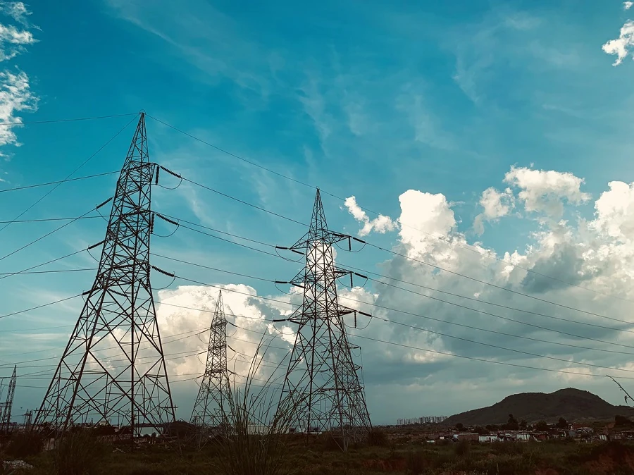

# Laiko eilučių prognozavimo įvadas

Kas yra laiko eilučių prognozavimas? Tai yra būsimų įvykių numatymas analizuojant praeities tendencijas.

## Regioninė tema: pasaulinis elektros vartojimas ✨

Šiuose dviejuose pamokose būsite supažindinti su laiko eilučių prognozavimu, santykinai mažiau žinoma mašininio mokymosi sritimi, kuri vis dėlto yra labai vertinga pramonės ir verslo taikymuose bei kituose sektoriuose. Nors neuroniniai tinklai gali būti naudojami šių modelių naudingumui didinti, mes juos studijuosime klasikiniame mašininio mokymosi kontekste, nes modeliai padeda numatyti būsimą našumą remiantis praeitimi.

Mūsų regioninis dėmesys skiriamas pasauliniam elektros naudojimui, įdomi duomenų rinkinio tema, leidžianti mokytis prognozuojant būsimą elektros vartojimą remiantis praeities apkrovos modeliais. Matote, kaip tokio tipo prognozavimas gali būti itin naudingas verslo aplinkoje.

Nuotrauka: [Peddi Sai hrithik](https://unsplash.com/@shutter_log?utm_source=unsplash&utm_medium=referral&utm_content=creditCopyText) elektros bokštų keliame Rajasthane [Unsplash](https://unsplash.com/s/photos/electric-india?utm_source=unsplash&utm_medium=referral&utm_content=creditCopyText)

## Pamokos

1. [Laiko eilučių prognozavimo įvadas](1-Introduction/README.md)
2. [ARIMA laiko eilučių modelių kūrimas](2-ARIMA/README.md)
3. [Vektorinės atramos regresoriaus kūrimas laiko eilučių prognozavimui](3-SVR/README.md)

## Autoriai

„Laiko eilučių prognozavimo įvadas“ buvo sukurtas ⚡️ kartu su [Francesca Lazzeri](https://twitter.com/frlazzeri) ir [Jen Looper](https://twitter.com/jenlooper). Užrašų knygelės pirmą kartą pasirodė internete [Azure „Giluminis mokymasis laiko eilutėms“ repozitorijoje](https://github.com/Azure/DeepLearningForTimeSeriesForecasting), originaliai parašyto Francesca Lazzeri. SVR pamoką parengė [Anirban Mukherjee](https://github.com/AnirbanMukherjeeXD)

---

<!-- CO-OP TRANSLATOR DISCLAIMER START -->
**Atsakomybės apribojimas**:
Šis dokumentas buvo išverstas naudojant dirbtinio intelekto vertimo paslaugą [Co-op Translator](https://github.com/Azure/co-op-translator). Nors siekiame tikslumo, prašome atkreipti dėmesį, kad automatiniai vertimai gali turėti klaidų ar netikslumų. Originalus dokumentas jo gimtąja kalba laikomas autoritetingu šaltiniu. Svarbiai informacijai rekomenduojama naudoti profesionalų žmogiškąjį vertimą. Mes neatsakome už jokius nesusipratimus ar neteisingą interpretaciją, kilusią naudojantis šiuo vertimu.
<!-- CO-OP TRANSLATOR DISCLAIMER END -->