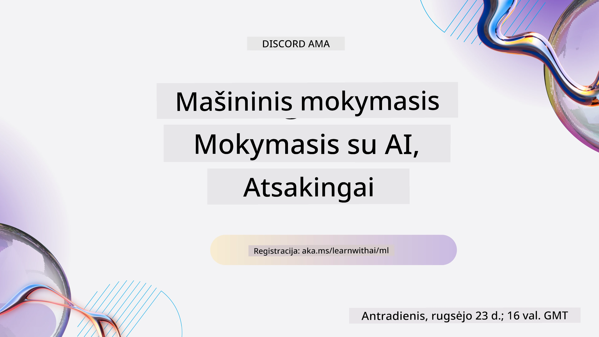
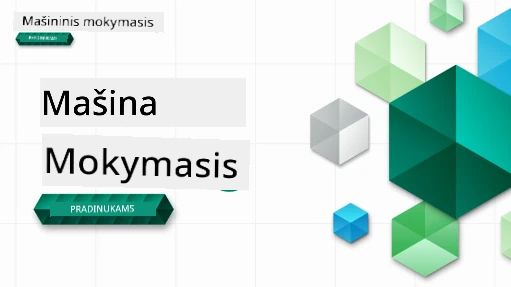

[](https://github.com/microsoft/ML-For-Beginners/blob/master/LICENSE)
[](https://GitHub.com/microsoft/ML-For-Beginners/graphs/contributors/)
[](https://GitHub.com/microsoft/ML-For-Beginners/issues/)
[](https://GitHub.com/microsoft/ML-For-Beginners/pulls/)
[](http://makeapullrequest.com)

[](https://GitHub.com/microsoft/ML-For-Beginners/watchers/)
[](https://GitHub.com/microsoft/ML-For-Beginners/network/)
[](https://GitHub.com/microsoft/ML-For-Beginners/stargazers/)

### 🌐 Daugiakalbė palaikymas

#### Vertimus palaiko [Co-op Translator](https://github.com/Azure/co-op-translator)

<!-- CO-OP TRANSLATOR LANGUAGES TABLE START -->
[Arabų](../ar/README.md) | [Bengalų](../bn/README.md) | [Bulgarų](../bg/README.md) | [Birmos (Mjanmaras)](../my/README.md) | [Kinų (supaprastinta)](../zh-CN/README.md) | [Kinų (tradicinė, Honkongas)](../zh-HK/README.md) | [Kinų (tradicinė, Makao)](../zh-MO/README.md) | [Kinų (tradicinė, Taivanas)](../zh-TW/README.md) | [Kroatų](../hr/README.md) | [Čekų](../cs/README.md) | [Danų](../da/README.md) | [Olandų](../nl/README.md) | [Estų](../et/README.md) | [Suomių](../fi/README.md) | [Prancūzų](../fr/README.md) | [Vokiečių](../de/README.md) | [Graikų](../el/README.md) | [Hebrajų](../he/README.md) | [Hindi](../hi/README.md) | [Vengrų](../hu/README.md) | [Indoneziečių](../id/README.md) | [Italų](../it/README.md) | [Japonų](../ja/README.md) | [Kannadų](../kn/README.md) | [Chmerų](../km/README.md) | [Korėjiečių](../ko/README.md) | [Lietuvių](./README.md) | [Malajų](../ms/README.md) | [Malajalų](../ml/README.md) | [Manipuri (Meitei Mayek)](../mni/README.md) | [Maratų](../mr/README.md) | [Nepalo](../ne/README.md) | [Nigerijos pidžinas](../pcm/README.md) | [Norvegų](../no/README.md) | [Persų (Farsi)](../fa/README.md) | [Lenkų](../pl/README.md) | [Portugalų (Brazilija)](../pt-BR/README.md) | [Portugalų (Portugalija)](../pt-PT/README.md) | [Pandžabių (Gurmukhi)](../pa/README.md) | [Rumunų](../ro/README.md) | [Rusų](../ru/README.md) | [Serbų (Kirilica)](../sr/README.md) | [Slovakų](../sk/README.md) | [Slovėnų](../sl/README.md) | [Ispanų](../es/README.md) | [Suahelio](../sw/README.md) | [Švedų](../sv/README.md) | [Tagalogų (Filipinų)](../tl/README.md) | [Tamilų](../ta/README.md) | [Telugų](../te/README.md) | [Tailando](../th/README.md) | [Turkų](../tr/README.md) | [Ukrainiečių](../uk/README.md) | [Urdu](../ur/README.md) | [Vietnamiečių](../vi/README.md)

> **Norite klonuoti lokaliai?**
>
> Ši saugykla apima daugiau nei 50 kalbų vertimus, kas žymiai padidina atsisiuntimo dydį. Norėdami klonuoti be vertimų, naudokite ribotą atsisiuntimą:
>
> **Bash / macOS / Linux:**
> ```bash
> git clone --filter=blob:none --sparse https://github.com/microsoft/ML-For-Beginners.git
> cd ML-For-Beginners
> git sparse-checkout set --no-cone '/*' '!translations' '!translated_images'
> ```
>
> **CMD (Windows):**
> ```cmd
> git clone --filter=blob:none --sparse https://github.com/microsoft/ML-For-Beginners.git
> cd ML-For-Beginners
> git sparse-checkout set --no-cone "/*" "!translations" "!translated_images"
> ```
>
> Tai suteiks jums viską, ko reikia kursui užbaigti, su daug greitesniu atsisiuntimu.
<!-- CO-OP TRANSLATOR LANGUAGES TABLE END -->

#### Prisijunkite prie mūsų bendruomenės

[](https://discord.gg/nTYy5BXMWG)

Mes vykdome Discord mokymosi su DI seriją, sužinokite daugiau ir prisijunkite prie mūsų [Mokymosi su DI serijoje](https://aka.ms/learnwithai/discord) nuo 2025 m. rugsėjo 18 iki 30 d. Gausite patarimų ir gudrybių, kaip naudoti GitHub Copilot duomenų mokslui.



# Mašininis mokymasis pradedantiesiems - curriculum

> 🌍 Keliaukime po pasaulį ir tyrinėkime mašininį mokymąsi per pasaulio kultūras 🌍

„Microsoft“ debesies ambasadoriai džiaugiasi galėdami pasiūlyti 12 savaičių, 26 pamokų kursą, skirtą **Mašininiam mokymuisi**. Šiame kurse sužinosite apie tai, kas kartais vadinama **klasikiniu mašininiu mokymusi**, daugiausia naudojant Scikit-learn biblioteką ir vengiant giluminio mokymosi, kuris aprėpiamas mūsų [DI pradedantiesiems kurse](https://aka.ms/ai4beginners). Taip pat derinkite šias pamokas su mūsų ['Duomenų mokslas pradedantiesiems' kursu](https://aka.ms/ds4beginners)!

Keliaukite su mumis po pasaulį, taikydami klasikines technikas duomenims iš įvairių pasaulio vietų. Kiekviena pamoka apima priešpamokinius ir popamokinius testus, rašytines pamokos užduotis, sprendimą, užduotį ir daugiau. Mūsų projektinis mokymo metodas leidžia mokytis statant, tai įrodyta kaip efektyvus naujų įgūdžių įsisavinimo būdas.

**✍️ Nuoširdus ačiū mūsų autoriams** Jen Looper, Stephen Howell, Francesca Lazzeri, Tomomi Imura, Cassie Breviu, Dmitry Soshnikov, Chris Noring, Anirban Mukherjee, Ornella Altunyan, Ruth Yakubu ir Amy Boyd

**🎨 Taip pat dėkojame iliustratoriams** Tomomi Imura, Dasani Madipalli ir Jen Looper

**🙏 Specialus ačiū mūsų Microsoft Studentų Ambasadoriams autoriams, recenzentams ir turinio prisidėjusiems**, ypač Rishit Dagli, Muhammad Sakib Khan Inan, Rohan Raj, Alexandru Petrescu, Abhishek Jaiswal, Nawrin Tabassum, Ioan Samuila ir Snigdha Agarwal

**🤩 Papildomas dėkingumas Microsoft Studentų Ambasadoriams Eric Wanjau, Jasleen Sondhi ir Vidushi Gupta už mūsų R pamokas!**

# Pradžia

Atlikite šiuos žingsnius:
1. **Padarykite šaką („Fork“) saugyklos**: Paspauskite mygtuką „Fork“ šio puslapio viršutiniame dešiniajame kampe.
2. **Klonuokite saugyklą**:   `git clone https://github.com/microsoft/ML-For-Beginners.git`

> 💡 **Greito pradžios patarimas:** Norite pradėti naršyklėje be vietinio Python diegimo? Naudokite [GitHub Codespaces](https://github.com/features/codespaces) norėdami sukurti debesų vystymo aplinką savo šakai. Atidarykite žalią **Code** meniu, pasirinkite **Codespaces** ir sukurkite codespace; įdiekite kiekvienos pamokos reikiamas priklausomybes, kai reikia.

> [Raskite visus papildomus šio kurso išteklius mūsų Microsoft Learn kolekcijoje](https://learn.microsoft.com/en-us/collections/qrqzamz1nn2wx3?WT.mc_id=academic-77952-bethanycheum)

> 🔧 **Reikia pagalbos?** Patikrinkite mūsų [Trikčių šalinimo gidą](TROUBLESHOOTING.md) sprendimams dažnoms diegimo, nustatymo ir pamokų vykdymo problemoms.


**[Studentai](https://aka.ms/student-page)**, norėdami naudoti šį kursą, padarykite visos saugyklos šaką į savo GitHub paskyrą ir atlikite pratimus savarankiškai arba grupėje:

- Pradėkite nuo priešpaskaitinio testo.
- Perskaitykite paskaitą ir atlikite veiklas, sustodami ir suvokdami kiekvieną žinių patikrinimą.
- Bandykite sukurti projektus suprasdami pamokas, o ne paleisdami sprendimo kodą; tačiau šis kodas yra prieinamas `/solution` aplankuose kiekvienoje projektinėje pamokoje.
- Atlikite popaskaitinį testą.
- Atlikite iššūkį.
- Atlikite užduotį.
- Baigę pamokų grupę apsilankykite [Diskusijų lentoje](https://github.com/microsoft/ML-For-Beginners/discussions) ir „mokykitės garsiai“ užpildydami atitinkamą PAT vertinimo rubriką. 'PAT' yra pažangos vertinimo įrankis, tai rubrika, kurią užpildote siekdami toliau mokytis. Taip pat galite reaguoti į kitų PAT'us, kad mokytumėmės kartu.

> Tolimesniam mokymuisi rekomenduojame sekti šias [Microsoft Learn](https://docs.microsoft.com/en-us/users/jenlooper-2911/collections/k7o7tg1gp306q4?WT.mc_id=academic-77952-leestott) modulius ir mokymosi kelius.

**Mokytojai**, mes pateikėme [keletą pasiūlymų](for-teachers.md), kaip naudoti šį kursą.

---

## Vaizdo įrašų vadovai

Kai kurios pamokos pateiktos kaip trumpi vaizdo įrašai. Juos rasite tiesiogiai pamokose arba [ML pradedantiesiems grojaraštyje Microsoft Developer YouTube kanale](https://aka.ms/ml-beginners-videos), spustelėję žemiau esančią nuotrauką.

[](https://aka.ms/ml-beginners-videos)

---

## Susipažinkite su komanda

[](https://youtu.be/Tj1XWrDSYJU)

**Gif sukūrė** [Mohit Jaisal](https://linkedin.com/in/mohitjaisal)

> 🎥 Paspauskite aukščiau esantį paveikslėlį, kad pamatytumėte vaizdo įrašą apie projektą ir jo kūrėjus!

---

## Pedagogika

Kuriant šį kursą pasirinkome du pedagoginius principus: siekti, kad jis būtų praktinis **projektinis** ir kad apimtų **dažnus testus**. Be to, šio kurso turinys turi bendrą **temą**, suteikiančią vientisumą.

Užtikrinant, kad turinys atitiktų projektus, procesas tampa patrauklesnis studentams, o koncepcijų įsisavinimas sustiprinamas. Be to, mažo rizikos testo prieš paskaitą tikslas yra nukreipti studentą į tam tikros temos mokymąsi, o antras testas po paskaitos užtikrina dar didesnį įsisavinimą. Šis kursas sukurtas būti lankstus ir smagus, jį galima atlikti visą arba dalį. Projektai prasideda nuo mažų užduočių ir pamažu sudėtingėja iki 12 savaičių ciklo pabaigos. Kursas taip pat apima poskriptą apie realius ML pritaikymus, kurį galima naudoti kaip papildomą kreditą arba diskusijų pagrindą.

> Raskite mūsų [Elgesio kodeksą](CODE_OF_CONDUCT.md), [Prisidėjimo taisykles](CONTRIBUTING.md), [Vertimus](..) ir [Trikčių šalinimą](TROUBLESHOOTING.md). Laukiame jūsų konstruktyvios kritikos!

## Kiekviena pamoka apima

- pasirenkamą užrašų santrauką (sketchnote)
- pasirenkamą papildomą vaizdo įrašą
- vaizdo įrašų vadovas (tik kai kurios pamokos)
- [priešpaskaitinis šildymo testas](https://ff-quizzes.netlify.app/en/ml/)
- rašytinė pamoka
- projektinėse pamokose – žingsnis po žingsnio vadovai, kaip sukurti projektą
- žinių patikrinimai
- iššūkis
- papildomas skaitymas
- užduotis
- [popaskaitinis testas](https://ff-quizzes.netlify.app/en/ml/)

> **Pastaba apie kalbas**: Šios pamokos daugiausia parašytos Python kalba, bet daugelis taip pat prieinamos R kalba. Norėdami užbaigti R pamoką, eikite į `/solution` aplanką ir ieškokite R pamokų. Jos turi .rmd plėtinį, kuris reiškia **R Markdown** failą, kuris paprasčiausiai apibrėžiamas kaip `code chunks` (R ar kitų kalbų) ir `YAML header` (vedlys, kaip formatuoti išvestis, pvz., PDF) įdėjimas į `Markdown document`. Taip jis tarnauja kaip pavyzdinė autorystės sistema duomenų mokslui, leidžianti kartu sujungti kodą, jo išvestį ir jūsų mintis, rašant jas Markdown formatu. Be to, R Markdown dokumentus galima konvertuoti į tokias išvesties formas kaip PDF, HTML ar Word.

> **Pastaba apie testus**: Visi testai yra [Quiz App aplanke](../../quiz-app), iš viso 52 testai po tris klausimus kiekviename. Jie susieti su pamokomis, bet testo programą galima paleisti vietoje; vadovaukitės `quiz-app` aplanko instrukcijomis, kaip ją vietoje paleisti ar diegti į Azure.

| Pamokos numeris |                             Tema                               |                   Pamokų grupavimas                   | Mokymosi tikslai                                                                                                                |                                                              Susieta pamoka                                                                |                        Autorius                        |
| :-----------: | :------------------------------------------------------------: | :-------------------------------------------------: | ------------------------------------------------------------------------------------------------------------------------------- | :--------------------------------------------------------------------------------------------------------------------------------------: | :--------------------------------------------------: |
|      01       |                Įvadas į mašininį mokymąsi                   |      [Įvadas](1-Introduction/README.md)       | Sužinokite pagrindines mašininio mokymosi koncepcijas                                                                          |                                             [Pamoka](1-Introduction/1-intro-to-ML/README.md)                                              |                       Muhammad                       |
|      02       |                Mašininio mokymosi istorija                   |      [Įvadas](1-Introduction/README.md)       | Sužinokite šios srities istoriją                                                                                                |                                            [Pamoka](1-Introduction/2-history-of-ML/README.md)                                             |                     Jen ir Amy                       |
|      03       |                 Teisingumas ir mašininis mokymasis           |      [Įvadas](1-Introduction/README.md)       | Kokie svarbūs filosofiniai klausimai apie teisingumą, kuriuos studentai turėtų apsvarstyti kurdami ir taikydami MM modelius?     |                                              [Pamoka](1-Introduction/3-fairness/README.md)                                               |                        Tomomi                        |
|      04       |                Mašininio mokymosi technikos                  |      [Įvadas](1-Introduction/README.md)       | Kokias technikas MM tyrėjai naudoja kuriant MM modelius?                                                                      |                                          [Pamoka](1-Introduction/4-techniques-of-ML/README.md)                                            |                    Chris ir Jen                      |
|      05       |                   Įvadas į regresiją                         |        [Regresija](2-Regression/README.md)         | Pradėkite dirbti su Python ir Scikit-learn regresijos modeliams                                                                |         [Python](2-Regression/1-Tools/README.md) • [R](../../2-Regression/1-Tools/solution/R/lesson_1.html)         |      Jen • Eric Wanjau       |
|      06       |                Šiaurės Amerikos moliūgų kainos 🎃             |        [Regresija](2-Regression/README.md)         | Vizualizuokite ir išvalykite duomenis pasiruošimui MM                                                                          |          [Python](2-Regression/2-Data/README.md) • [R](../../2-Regression/2-Data/solution/R/lesson_2.html)          |      Jen • Eric Wanjau       |
|      07       |                Šiaurės Amerikos moliūgų kainos 🎃             |        [Regresija](2-Regression/README.md)         | Kurkite linijinius ir polinominius regresijos modelius                                                                          |        [Python](2-Regression/3-Linear/README.md) • [R](../../2-Regression/3-Linear/solution/R/lesson_3.html)        |      Jen ir Dmitry • Eric Wanjau       |
|      08       |                Šiaurės Amerikos moliūgų kainos 🎃             |        [Regresija](2-Regression/README.md)         | Kurkite logistinį regresijos modelį                                                                                             |     [Python](2-Regression/4-Logistic/README.md) • [R](../../2-Regression/4-Logistic/solution/R/lesson_4.html)      |      Jen • Eric Wanjau       |
|      09       |                          Interneto programėlė 🔌             |           [Internetinė programėlė](3-Web-App/README.md)           | Sukurkite interneto programėlę, kad naudotumėte paruoštą modelį                                                                  |                                                 [Python](3-Web-App/1-Web-App/README.md)                                                  |                         Jen                          |
|      10       |                 Įvadas į klasifikaciją                       |    [Klasifikacija](4-Classification/README.md)     | Išvalykite, paruoškite ir vizualizuokite savo duomenis; įvadas į klasifikaciją                                                  | [Python](4-Classification/1-Introduction/README.md) • [R](../../4-Classification/1-Introduction/solution/R/lesson_10.html)  | Jen ir Cassie • Eric Wanjau |
|      11       |             Gardūs Azijos ir Indijos patiekalai 🍜            |    [Klasifikacija](4-Classification/README.md)     | Įvadas į klasifikatorius                                                                                                       | [Python](4-Classification/2-Classifiers-1/README.md) • [R](../../4-Classification/2-Classifiers-1/solution/R/lesson_11.html) | Jen ir Cassie • Eric Wanjau |
|      12       |             Gardūs Azijos ir Indijos patiekalai 🍜            |    [Klasifikacija](4-Classification/README.md)     | Daugiau klasifikatorių                                                                                                         | [Python](4-Classification/3-Classifiers-2/README.md) • [R](../../4-Classification/3-Classifiers-2/solution/R/lesson_12.html) | Jen ir Cassie • Eric Wanjau |
|      13       |             Gardūs Azijos ir Indijos patiekalai 🍜            |    [Klasifikacija](4-Classification/README.md)     | Sukurkite rekomendacinę interneto programėlę naudodami savo modelį                                                              |                                              [Python](4-Classification/4-Applied/README.md)                                              |                         Jen                          |
|      14       |                   Įvadas į klasterizavimą                     |        [Klasterizavimas](5-Clustering/README.md)         | Išvalykite, paruoškite ir vizualizuokite savo duomenis; Įvadas į klasterizavimą                                                  |         [Python](5-Clustering/1-Visualize/README.md) • [R](../../5-Clustering/1-Visualize/solution/R/lesson_14.html)         |      Jen • Eric Wanjau       |
|      15       |              Nigerijos muzikinių skonių tyrinėjimas 🎧       |        [Klasterizavimas](5-Clustering/README.md)         | Išnagrinėkite K-vidurkių klasterizavimo metodą                                                                                   |           [Python](5-Clustering/2-K-Means/README.md) • [R](../../5-Clustering/2-K-Means/solution/R/lesson_15.html)           |      Jen • Eric Wanjau       |
|      16       |        Įvadas į natūralios kalbos apdorojimą ☕️               |   [Natūros kalbos apdorojimas](6-NLP/README.md)    | Sužinokite NLP pagrindus kuriant paprastą botą                                                                                  |                                             [Python](6-NLP/1-Introduction-to-NLP/README.md)                                              |                       Stephen                        |
|      17       |                      Įprasti NLP uždaviniai ☕️                 |   [Natūros kalbos apdorojimas](6-NLP/README.md)    | Gilinkite NLP žinias suprasdami dažnai vykstančius uždavinius, susijusius su kalbos struktūromis                                  |                                                    [Python](6-NLP/2-Tasks/README.md)                                                     |                       Stephen                        |
|      18       |             Vertimas ir nuostatų analizė ♥️                   |   [Natūros kalbos apdorojimas](6-NLP/README.md)    | Vertimas ir nuostatų analizė naudojant Jane Austen                                                                              |                                            [Python](6-NLP/3-Translation-Sentiment/README.md)                                             |                       Stephen                        |
|      19       |                  Romantiški viešbučiai Europoje ♥️            |   [Natūros kalbos apdorojimas](6-NLP/README.md)    | Nuostatų analizė naudojant viešbučių atsiliepimus 1                                                                             |                                               [Python](6-NLP/4-Hotel-Reviews-1/README.md)                                                |                       Stephen                        |
|      20       |                  Romantiški viešbučiai Europoje ♥️            |   [Natūros kalbos apdorojimas](6-NLP/README.md)    | Nuostatų analizė naudojant viešbučių atsiliepimus 2                                                                             |                                               [Python](6-NLP/5-Hotel-Reviews-2/README.md)                                                |                       Stephen                        |
|      21       |            Įvadas į laiko eilučių prognozavimą               |        [Laiko eilutės](7-TimeSeries/README.md)        | Įvadas į laiko eilučių prognozavimą                                                                                            |                                             [Python](7-TimeSeries/1-Introduction/README.md)                                              |                      Francesca                       |
|      22       | ⚡️ Pasaulio energijos naudojimas ⚡️ - laiko eilučių prognozavimas su ARIMA |        [Laiko eilutės](7-TimeSeries/README.md)        | Laiko eilučių prognozavimas su ARIMA                                                                                           |                                                 [Python](7-TimeSeries/2-ARIMA/README.md)                                                 |                      Francesca                       |
|      23       |  ⚡️ Pasaulio energijos naudojimas ⚡️ - laiko eilučių prognozavimas su SVR  |        [Laiko eilutės](7-TimeSeries/README.md)        | Laiko eilučių prognozavimas su paramos vektorių regresoriumi                                                                   |                                                  [Python](7-TimeSeries/3-SVR/README.md)                                                  |                       Anirban                        |
|      24       |             Įvadas į sustiprintą mokymąsi                    | [Sustiprintas mokymasis](8-Reinforcement/README.md) | Įvadas į sustiprintą mokymąsi su Q-mokymusi                                                                                    |                                             [Python](8-Reinforcement/1-QLearning/README.md)                                              |                        Dmitry                        |
|      25       |                 Padėkite Petrui išvengti vilko! 🐺           | [Sustiprintas mokymasis](8-Reinforcement/README.md) | Sustiprinto mokymosi sporto salės simuliacija                                                                                   |                                                [Python](8-Reinforcement/2-Gym/README.md)                                                 |                        Dmitry                        |
|  Priedas      |            Tikrosios ML situacijos ir taikymai               |      [ML laukinėje gamtoje](9-Real-World/README.md)       | Įdomūs ir atskleidžiantys tikrų pasaulio klasikinio ML panaudojimai                                                          |                                             [Pamoka](9-Real-World/1-Applications/README.md)                                              |                         Komanda                        |
|  Priedas      |            Modelio derinimas ML naudojant RAI prietaisų skydelį |      [ML laukinėje gamtoje](9-Real-World/README.md)       | Modelio derinimas mašininiame mokymesi naudojant atsakingos AI prietaisų skydo komponentus                                            |                                             [Pamoka](9-Real-World/2-Debugging-ML-Models/README.md)                                              |                     Ruth Yakubu                      |

> [raskite visas papildomas šio kurso medžiagas mūsų Microsoft Learn kolekcijoje](https://learn.microsoft.com/en-us/collections/qrqzamz1nn2wx3?WT.mc_id=academic-77952-bethanycheum)

## Offline prieiga

Šią dokumentaciją galite naudoti neprisijungę naudodami [Docsify](https://docsify.js.org/#/). Atšakokite šį repo, [įdiekite Docsify](https://docsify.js.org/#/quickstart) savo vietinėje mašinoje, tada šiame repo šakniniame aplanke įveskite `docsify serve`. Svetainė bus pasiekiama prie 3000 prievado jūsų localhost: `localhost:3000`.

## PDF failai

Curriculum pdf su nuorodomis rasite [čia](https://microsoft.github.io/ML-For-Beginners/pdf/readme.pdf).


## 🎒 Kiti kursai

Mūsų komanda kuria ir kitus kursus! Pažiūrėkite:

<!-- CO-OP TRANSLATOR OTHER COURSES START -->
### LangChain
[](https://aka.ms/langchain4j-for-beginners)
[](https://aka.ms/langchainjs-for-beginners?WT.mc_id=m365-94501-dwahlin)
[](https://github.com/microsoft/langchain-for-beginners?WT.mc_id=m365-94501-dwahlin)
---

### Azure / Edge / MCP / Agentai
[](https://github.com/microsoft/AZD-for-beginners?WT.mc_id=academic-105485-koreyst)
[](https://github.com/microsoft/edgeai-for-beginners?WT.mc_id=academic-105485-koreyst)
[](https://github.com/microsoft/mcp-for-beginners?WT.mc_id=academic-105485-koreyst)
[](https://github.com/microsoft/ai-agents-for-beginners?WT.mc_id=academic-105485-koreyst)

---
 
### Generatyvinis AI serijos kursai
[](https://github.com/microsoft/generative-ai-for-beginners?WT.mc_id=academic-105485-koreyst)
[-9333EA?style=for-the-badge&labelColor=E5E7EB&color=9333EA)](https://github.com/microsoft/Generative-AI-for-beginners-dotnet?WT.mc_id=academic-105485-koreyst)
[-C084FC?style=for-the-badge&labelColor=E5E7EB&color=C084FC)](https://github.com/microsoft/generative-ai-for-beginners-java?WT.mc_id=academic-105485-koreyst)
[-E879F9?style=for-the-badge&labelColor=E5E7EB&color=E879F9)](https://github.com/microsoft/generative-ai-with-javascript?WT.mc_id=academic-105485-koreyst)

---
 
### Pagrindinis mokymasis
[](https://aka.ms/ml-beginners?WT.mc_id=academic-105485-koreyst)
[](https://aka.ms/datascience-beginners?WT.mc_id=academic-105485-koreyst)
[](https://aka.ms/ai-beginners?WT.mc_id=academic-105485-koreyst)
[](https://github.com/microsoft/Security-101?WT.mc_id=academic-96948-sayoung)
[](https://aka.ms/webdev-beginners?WT.mc_id=academic-105485-koreyst)
[](https://aka.ms/iot-beginners?WT.mc_id=academic-105485-koreyst)
[](https://github.com/microsoft/xr-development-for-beginners?WT.mc_id=academic-105485-koreyst)

---
 
### Copilot serijos kursai
[](https://aka.ms/GitHubCopilotAI?WT.mc_id=academic-105485-koreyst)
[](https://github.com/microsoft/mastering-github-copilot-for-dotnet-csharp-developers?WT.mc_id=academic-105485-koreyst)
[](https://github.com/microsoft/CopilotAdventures?WT.mc_id=academic-105485-koreyst)
<!-- CO-OP TRANSLATOR OTHER COURSES END -->

## Pagalbos gavimas

Jei įstringate arba turite klausimų mokydamiesi Mašininio mokymosi ar kurdami DI programas, nesijaudinkite – pagalba yra prieinama.

Galite prisijungti prie diskusijų su kitais mokytojais ir kūrėjais, užduoti klausimus ir dalintis savo idėjomis su bendruomene.

- Prisijunkite prie bendruomenės, kad užduotumėte klausimus ir mokytumėtės kartu
- Diskutuokite apie mašininio mokymosi koncepcijas ir projektų idėjas
- Gaukite patarimų iš patyrusių kūrėjų

Palaikanti bendruomenė yra puikus būdas tobulinti įgūdžius ir greičiau spręsti problemas.

[Microsoft Foundry Discord bendruomenė](https://discord.gg/nTYy5BXMWG)

Jei susiduriate su klaidomis, klaidomis ar turite patarimų tobulinimui, galite taip pat atidaryti **Problemas** šiame saugykloje, kad praneštumėte apie problemą.

Produktų atsiliepimams arba paieškai esamų bendruomenės pranešimų apsilankykite Kūrėjų forume:

[](https://aka.ms/foundry/forum)

## Papildomi mokymosi patarimai

- Peržiūrėkite užrašų knygeles po kiekvienos pamokos geresniam supratimui.
- Praktikuokite algoritmų įgyvendinimą savarankiškai.
- Tyrinėkite realius duomenų rinkinius naudodami išmoktus konceptus.

---

<!-- CO-OP TRANSLATOR DISCLAIMER START -->
**Atsakomybės apribojimas**:
Šis dokumentas buvo išverstas naudojant dirbtinio intelekto vertimo paslaugą [Co-op Translator](https://github.com/Azure/co-op-translator). Nors siekiame tikslumo, prašome atkreipti dėmesį, kad automatiniai vertimai gali turėti klaidų ar netikslumų. Originalus dokumentas jo gimtąja kalba laikomas autoritetingu šaltiniu. Svarbiai informacijai rekomenduojama naudoti profesionalų žmogiškąjį vertimą. Mes neatsakome už jokius nesusipratimus ar neteisingą interpretaciją, kilusią naudojantis šiuo vertimu.
<!-- CO-OP TRANSLATOR DISCLAIMER END -->