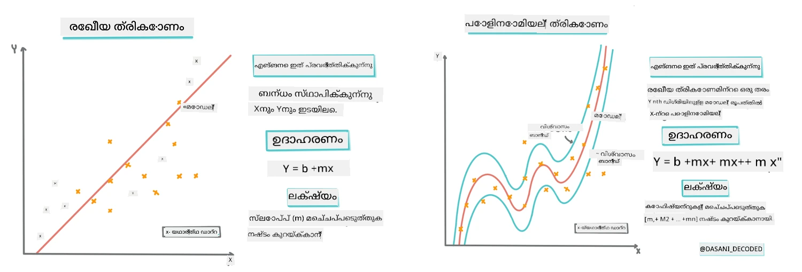
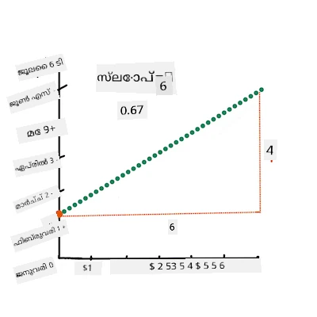
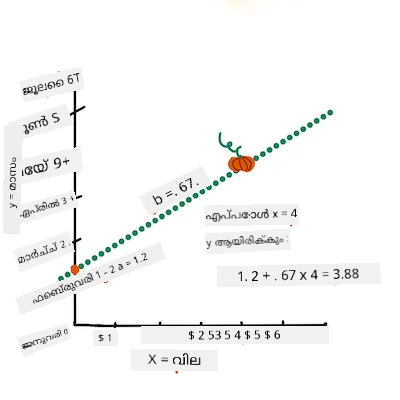
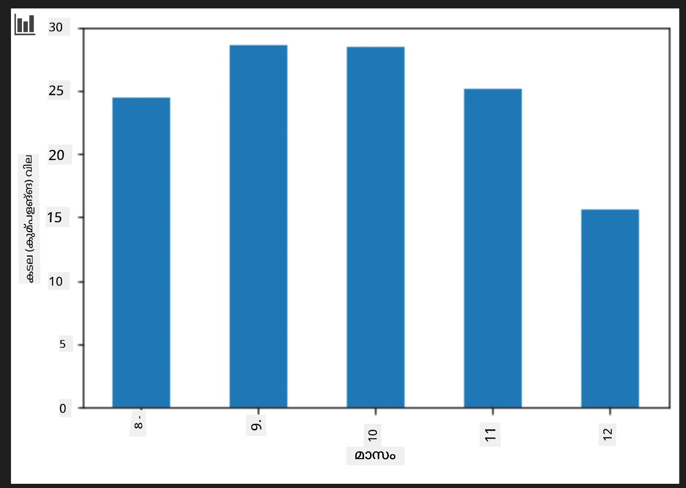
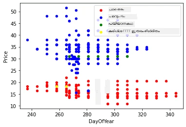

# Scikit-learn ഉപയോഗിച്ച് റഗ്രഷൻ മോഡൽ നിർമ്മിക്കുക: റഗ്രഷൻ നാല് വഴികൾ

## ആരംഭകർക്കുള്ള കുറിപ്പ്

ലീനിയർ റഗ്രഷൻ ആണ് നമ്മൾ ഒരു **സംഖ്യാമൂല്യത്തെ** (ഉദാഹരണത്തിന്, വീടിന്റെ വില, താപനില, അല്ലെങ്കിൽ വിൽപ്പന) പ്രവചിക്കുമ്പോൾ ഉപയോഗിക്കുന്നത്.  
ഇത് ഇൻപുട്ട് ഫീച്ചറുകളും ഔട്ട്‌പുട്ടിനിടയിലുള്ള ബന്ധം മികച്ച രീതിയിൽ പ്രതിനിധാനം ചെയ്യുന്ന ഒരു നേര直ലേഖം കണ്ടെത്തി പ്രവർത്തിക്കുന്നു.

ഈ പാഠത്തിൽ, കൂടുതൽ ആഡ്‌വാൻസ്ഡ് റഗ്രഷൻ സാങ്കേതികവിദ്യകൾ പരീക്ഷിക്കാൻ മുൻപ് ആശയം മനസിലാക്കുന്നതിലേക്ക് ശ്രദ്ധ ചെലുത്തുന്നു.  

> ഇൻഫോഗ്രാഫിക് - [Dasani Madipalli](https://twitter.com/dasani_decoded)
## [പ്രീ-ലെക്‌ച്ചർ ക്വിസ്](https://ff-quizzes.netlify.app/en/ml/)

> ### [ഈ പാഠം R-യിൽ ലഭ്യമാണ്!](../../../../2-Regression/3-Linear/solution/R/lesson_3.html)
### പരിചയം

ഇതുവരെ നിങ്ങളിവിടെ റഗ്രഷൻ എന്താണെന്ന് പംകിൻ വിലനിർണക്ക ഡാറ്റായിൽ നിന്നുള്ള ഉദാഹരണ ഡാറ്റ ഉപയോഗിച്ച് പരിശോധിച്ചിരുന്നു. Matplotlib ഉപയോഗിച്ച് ഇത് ദൃശ്യീകരിച്ചു.

ഇപ്പോൾ ML-വിനായി റഗ്രഷനിൽ കൂടുതൽ ആഴത്തിൽ പ്രവേശിക്കാൻ തയാറാണ്. ദൃശ്യീകരണം ഡാറ്റ മനസ്സിലാക്കാൻ സഹായിക്കുന്നതിനാൽ, യഥാർത്ഥ ശക്തി _മോഡലുകൾ പരിശീലിപ്പിക്കുന്നതിൽ_ നിന്നും വരുന്നു.  
മോഡലുകൾ ചരിത്ര ഡാറ്റയിൽ പരിശീലനം നൽകപ്പെടുന്നു, ഡാറ്റ ആശ്രിതത്വങ്ങൾ സ്വയം പിടിച്ചെടുത്തു, മോഡൽ മുമ്പ് കണ്ടിട്ടില്ലാത്ത പുതിയ ഡാറ്റയ്ക്ക് ഫലം പ്രവചിക്കാൻ കഴിയും.

ഈ പാഠത്തിൽ, നിങ്ങൾക്ക് രണ്ട് തരം റഗ്രഷനുകൾ — _മൂലഭൂത ലീനിയർ റഗ്രഷൻ_യും _പൊളിനോമിയൽ റഗ്രഷൻ_യും — അവരുടെ തളിർവുസഭൂത ഗണിതശാസ്ത്രത്തോടൊപ്പം പഠിപ്പിക്കും. ഈ മോഡലുകൾ വിവിധ ഇൻപുട്ട് ഡാറ്റയുടെ അടിസ്ഥാനത്തിൽ പംകിൻ വിലകൾ പ്രവചിക്കാൻ സഹായിക്കും.

[](https://youtu.be/CRxFT8oTDMg "ML for beginners - Understanding Linear Regression")

> 🎥 ലീനിയർ റഗ്രഷന്റെ ചെറു വീഡിയോ അവലോകനത്തിന് മുകളിൽ ചിത്രത്തിൽ ക്ലിക്ക് ചെയ്യുക.

> ഈ പാഠ്യപദ്ധതിയിൽ, ഗണിതം കുറവായ അറിവിൽ നിന്ന് ആരംഭിക്കുന്നവർക്കായി നിർദ്ദേശിക്കുന്നു, അതുകൊണ്ട് കുറിപ്പുകൾ, 🧮 ഗണിത്യോജിപ്പുകൾ, ചിത്രങ്ങൾ എന്നിവ ഉപയോഗിച്ച് മനസ്സിലാക്കൽ സഹായിക്കുന്നു.

### മുൻകൂർ അറിവ്

നിങ്ങൾ പരിശോധിക്കുന്ന പംകിൻ ഡാറ്റയുടെ ഘടന ഇതുവരെ പരിചയപ്പെട്ടിരിക്കണം. ഈ പാഠത്തിലെ _notebook.ipynb_ ഫയലിൽ ഇത് പ്രീ ലോഡ് ചെയ്തും പ്രീ ക്ലീൻ ചെയ്തും കാണാം. ഈ ഫയലിൽ പംകിൻ വില ബശ്യേൽപ്രതി പുതിയ ഡാറ്റാഫ്രെയിമിൽ പ്രദർശിപ്പിച്ചിരിക്കുന്നു. Visual Studio Code-ൽ ഈ നോട്ട് ബുക്കുകൾ നടത്താൻ ആസൂത്രണം ചെയ്യുക.

### തയ്യാറെടുപ്പ്

ഒരു ഓർമ്മപ്പെടുത്തൽ: ഈ ഡാറ്റ നിങ്ങൾക്കു ചോദ്യങ്ങൾ ചോദിക്കുന്നതിനായി ലോഡ് ചെയ്യുകയാണ്.

- പംകിനുകൾ വാങ്ങാനുള്ള ഏറ്റവും നല്ല സമയം ಯಾವതാണ്?  
- മിനിയേച്ചർ പംകിനുകളുടെ ഒരു കേസ് വില എത്ര പ്രതീക്ഷിക്കാം?  
- അവയെ പകുതി-ബശ്യേൽ ബാസ്കറ്റുകളിൽ വാങ്ങണോ അല്ലെങ്കിൽ 1 1/9 ബശ്യേൽ ബോക്സിൽ?  
ഈ ഡാറ്റയിൽ കൂടുതൽ അവലോകനം ചെയ്യാമെങ്കില്‍.

മുന്നത്തെ പാഠത്തിൽ, നിങ്ങൾ Pandas ഡാറ്റാഫ്രെയിം സൃഷ്ടിച്ച്, ഒറിജിനൽ ഡാറ്റാസെറ്റിന്റെ ഭാഗം ഉപയോഗിച്ച് വിലയെ ബശ്യേൽപ്ര്ക്ക് സ്റ്റാൻഡേർഡൈസ് ചെയ്തു. പക്ഷേ അപ്പോൾ വെറും ഏകദേശം 400 ഡാറ്റാപോയിന്റുകളും അതും മഴകാല മാസങ്ങളിലേക്കും പരിമിതമായി మాత్రమే ലഭിച്ചു.

ഈ പാഠത്തിലെ അനുബന്ധ നോട്ട് ബുക്കിൽ ഇതിനകം ലോഡ് ചെയ്ത ഡാറ്റ കാണുക. പ്രാരംഭ സ്‌കാറ്റർപ്ലോട്ട് മാസ ഡാറ്റയെ ചിത്രീകരിക്കുന്നു. കൂടുതൽ ശുചിത്വണമെന്നും വിശദാംശങ്ങൾ അന്വേഷിക്കാം.

## ഒരു ലീനിയർ റഗ്രഷൻ ലൈൻ

പാഠം 1-ൽ പഠിച്ചതുപോലെ, ലീനിയർ റഗ്രഷൻ അഭ്യാസത്തിന് വേണ്ടത് ഒരു രേഖ വയ്ക്കുക എന്നതാണ്, ഇത്:

- **ഭദ്രമായ വാഹ്യതകൾ കാണിക്കുക**: വ്യത്യസ്ത വെരിയബിളുകളിലുണ്ടായ ബന്ധം കാണിക്കുക  
- **പ്രവചനങ്ങൾ നടത്തുക**: ഒരു പുതിയ ഡാറ്റാപോയന്റ് ആ രേഖയുടെ സാന്നിധ്യത്തിലുണ്ടാകാനിടയായ സ്ഥലം കൃത്യമായി പ്രവചിക്കുക

**ലിസ്റ്റ്-സ്‌ക്വയർസ് റഗ്രഷൻ** ഈ തരം രേഖ വരയ്ക്കുന്നതിന് സാധാരണമാണ്. "ലിസ്റ്റ്-സ്‌ക്വയറ്സ്" എന്നത് മോഡലിലെ മൊത്തം പിഴവ് കുറഞ്ഞതാക്കാനുള്ള പ്രക്രിയയെയാണ് സൂചിപ്പിക്കുന്നത്. ഓരോ ഡാറ്റാപോയിന്റിനും, യഥാർത്ഥ പോയിന്റും ഞങ്ങളുടെ റഗ്രഷൻ രേഖയും ഇടയിൽ ഉള്ള വെർട്ടിക്കൽ ദൂരം (റെസിഡുവൽ) അളക്കുന്നു.

ഈ ദൂരം സ്ക്വയർ ചെയ്യുന്നതിന് രണ്ട് പ്രധാന കാരണങ്ങൾ ഉണ്ട്:

1. **മാനദണ്ഡം ദിശയെച്ചേർക്കാതെ**: -5 എന്ന പിഴവിനെ +5 എന്ന പിഴവുപോലെ പരിഗണിക്കാൻ ആവശ്യമുണ്ട്. സ്‌ക്വയർ ചെയ്യുന്നതോടെ എല്ലാ മൂല്യങ്ങളും പോസിറ്റിവായി മാറുന്നു.

2. **ഔട്ട്‌ലൈയർമാരെ ശിക്ഷിക്കുക**: വലിയ പിഴവുകൾക്ക് കൂടുതൽ ഭാരം നൽകാൻ സ്‌ക്വയർ ചെയ്യുന്നത് സഹായിക്കുന്നു, ഇതുവഴി രേഖ ഉൾക്കൂട്ടലുകൾക്കു അടുക്കുന്നത് ഉറപ്പാക്കുന്നു.

ഈ സ്ക്വെയ്‌ർ ചെയ്തത് ചേർത്ത് മൊത്തം നഷ്ടം മിനിമം ആകുന്ന രേഖ കണ്ടെത്തുകയാണ് ലക്ഷ്യം — അതിനാല്‍ പേര് "ലിസ്റ്റ്-സ്‌ക്വയർസ്".

> **🧮 ഗണിതം കാണിക്കൂ**  
>  
> ഈ രേഖ, _ബെസ്റ്റ്-ഫിറ്റ് ലൈൻ_ എന്നറിയപ്പെടുന്നു, [ഒരു സമവാക്യത്തോടെ](https://en.wikipedia.org/wiki/Simple_linear_regression) പ്രകടിപ്പിക്കാം:  
>  
> ```
> Y = a + bX
> ```
>  
> `X` ആണ് ‘വ്യാഖ്യാനപരമായ വ്യത്യാസം’. `Y` ആണ് ‘നിലവാര വ്യത്യാസം’. രേഖയുടെ നിഷ്പാതം `b` ആണ്, `a` ആണ് y-ഇന്റർസെප්്റ്റ്; അതായത് `X=0` ആയപ്പോൾ `Y` ന്റെ മൂല്യം.  
>  
>  
>  
> ആദ്യം, നിഷ്പാതം `b` ഗണിക്കുക. ഇൻഫോഗ്രാഫിക് - [Jen Looper](https://twitter.com/jenlooper)  
>  
> മറ്റൊരു രീതിയിൽ പറയുമ്പോൾ, പംകിൻ ഡാറ്റയുടെ യഥാർത്ഥ ചോദ്യം “മാസംപ്രതി ബശ്യേലിന് പംകിന്റെ വില പ്രവചിക്കുക” എന്ന് ആയാൽ, `X` വിലക്കു സൂചകം, `Y` വിൽപ്പന മാസത്തെ സൂചകം ആകും.  
>  
>  
>  
> Y ന്റെ മൂല്യം കണക്കുക. കരുതുക നിങ്ങൾ $4 ചുറ്റുപടുത്ത് തുകയോ, ആപ്രിൽ ആയിരിക്കണം! ഇൻഫോഗ്രാഫിക് - [Jen Looper](https://twitter.com/jenlooper)  
>  
> രേഖയുടെ നിഷ്പാതവും ഇന്റർസെപ്റ്റും ഉപയോഗിച്ച് ഇന്ത്യൻറെഗ്ശൻ രേഖയുടെ ഗണിതം ഫലപ്രദമായി കാണിക്കണം.  
>  
> ഈ മൂല്യങ്ങൾ കണക്കാക്കുന്ന രീതി [Math is Fun](https://www.mathsisfun.com/data/least-squares-regression.html) വെബ്സൈറ്റിൽ കാണാം. കൂടാതെ [ഈ ലിസ്റ്റ്-സ്‌ക്വയർസ് കാൽക്കുലേറ്റർ](https://www.mathsisfun.com/data/least-squares-calculator.html) സന്ദർശിച്ച് എങ്ങനെ സംഖ്യകൾ രേഖയെ ബാധിക്കുന്നുവെന്ന് കാണാം.

## സഹസംവാദം (Correlation)

മറ്റൊരു പരിചയപ്പെടുത്തേണ്ട പദം **സഹസംവാദ ഘടകം** ആണ്, നൽകിയ `X` ഉം `Y` ഉം തമ്മിലുള്ള. സ്‌കാറ്റർപ്ലോട്ടിൽ ഈ ഘടകം എളുപ്പത്തിൽ മനസ്സിലാക്കാം. ഒരു നല്ല താളത്തിൽ പുള്ളികളോടുകൂടിയ പ്ലോട്ട് ഉയർന്ന സഹസംവാദം കാണിക്കും, പുള്ളികൾ വ്യാപകമായി പടർന്നാൽ കുറവ് സഹസംവാദം കാണും.

നല്ല ലീനിയർ റഗ്രഷൻ മോഡൽ ഏറ്റവും ഉയർന്ന (0-ൽ നിന്നും അടുത്ത് 1) സഹസംവാദ ഘടകമുള്ള ലിസ്റ്റ്-സ്‌ക്വയർസ് റഗ്രഷൻ രേഖയോട് അനുയോജ്യമായതാണ്.

✅ ഈ പാഠവുമായി അനുബന്ധമുള്ള നോട്ട് ബുക്ക് ഓടിച്ച് Month to Price സ്‌കാറ്റർപ്ലോട്ട് നോക്കുക. പംകിൻ വിൽപ്പനയ്ക്ക് മാസം-വില ബന്ധം നിങ്ങളുടെ സമീപന പ്രകാരം ഉയർന്നതോ കുറവോ സഹസംവാദം കാണിക്കുന്നുണ്ടോ? `Month`-നുവേണ്ടി finer granularity ഉപയോഗിച്ചാൽ (ഉദാ., *വത്സരത്തിലെ ദിവസം*, ജനുവരി 1 മുതൽ നാളുകൾ എണ്ണം) മാറുമോയെന്ന് പരിശോധിക്കുക.

താഴെയുള്ള കോഡിൽ, ഡാറ്റ ശുദ്ധീകരിച്ച് ഞങ്ങൾക്ക് `new_pumpkins` എന്ന ഡാറ്റാഫ്രെയിം ലഭിച്ചിരിക്കുന്നു എന്ന فرضദ്ധയത്തിൽ പോകുന്നു, ഇത് തികഞ്ഞിരിക്കുന്നു:

ID | Month | DayOfYear | Variety | City | Package | Low Price | High Price | Price
---|-------|-----------|---------|------|---------|-----------|------------|-------
70 | 9 | 267 | PIE TYPE | BALTIMORE | 1 1/9 bushel cartons | 15.0 | 15.0 | 13.636364
71 | 9 | 267 | PIE TYPE | BALTIMORE | 1 1/9 bushel cartons | 18.0 | 18.0 | 16.363636
72 | 10 | 274 | PIE TYPE | BALTIMORE | 1 1/9 bushel cartons | 18.0 | 18.0 | 16.363636
73 | 10 | 274 | PIE TYPE | BALTIMORE | 1 1/9 bushel cartons | 17.0 | 17.0 | 15.454545
74 | 10 | 281 | PIE TYPE | BALTIMORE | 1 1/9 bushel cartons | 15.0 | 15.0 | 13.636364

> ഡാറ്റ ശുദ്ധീകരിക്കുന്ന കോഡ് [`notebook.ipynb`](notebook.ipynb) ൽ ലഭ്യമാണ്. മുൻപത്തെ പാഠത്തിലുള്ളതുപോലെ ശുദ്ധീകരണം നടത്തി, `DayOfYear` തലവരി താഴെ കാണുന്ന പ്രകാരം കണക്കാക്കി:  

```python
day_of_year = pd.to_datetime(pumpkins['Date']).apply(lambda dt: (dt-datetime(dt.year,1,1)).days)
```
  
ലീനിയർ റഗ്രഷന്റെ ഗണിതം മനസ്സിലാക്കിയതിനുശേഷം, പംകിൻ പാക്കേജുകളുടെ വിലക്ക് ഏറ്റവും അനുയോജ്യമായ പാക്കേജ് ഏതെന്ന് പ്രവചിക്കാൻ റഗ്രഷൻ മോഡൽ സൃഷ്‌ടിക്കാം. ഒരു ഹോളിഡേ പംകിൻ പാച്ചിന് വേണ്ടി പംകിനുകൾ വാങ്ങുന്നവർക്കിന്ന് പാക്കേജുകളുടെ വിലയെ അടിസ്ഥാനമാക്കി ഏറ്റവും മികച്ച ഒപ്ഷൻ എത് എന്നറിയാൻ ഇത് സഹായിക്കും.

## സഹസംവാദം അന്വേഷിക്കൽ

[](https://youtu.be/uoRq-lW2eQo "ML for beginners - Looking for Correlation: The Key to Linear Regression")

> 🎥 സഹസംവാദത്തെ കുറിച്ചുള്ള ചെറിയ വീഡിയോ അവലോകനത്തിന് മുകളിൽ ചിത്രത്തിൽ ക്ലിക്ക്ചെയ്യുക.

മുൻപത്തെ പാഠത്തിൽ നിങ്ങൾ കണ്ടതുപോലെ, വ്യത്യസ്ത മാസങ്ങളിൽ ശരാശരി വില ഇങ്ങനെ കാണപ്പെടും:



ഇത് ഏതാനും സഹസംവാദം ഉണ്ട് എന്നു സൂചിപ്പിക്കുന്നു, ഒപ്പം `Month`-ഉം `Price`-ഉം അല്ലെങ്കിൽ `DayOfYear`-ഉം `Price`-ഉം തമ്മിലുള്ള ബന്ധം കാണാൻ ലീനിയർ റഗ്രഷൻ പരിശീലിപ്പിക്കാൻ ശ്രമിക്കാം. താഴെ കാണുന്ന സ്‌കാറ്റർ പ്ലോട്ട് രണ്ടാമത്തെ ബന്ധം കാണിക്കുന്നു:

 

`corr` ഫംഗ്ഷൻ ഉപയോഗിച്ച് സഹസംവാദം പരിശോധിക്കാം:

```python
print(new_pumpkins['Month'].corr(new_pumpkins['Price']))
print(new_pumpkins['DayOfYear'].corr(new_pumpkins['Price']))
```
  
സഹസംവാദം വളരെ ചെറിയതാണ്, `Month`-നുവേണ്ടി -0.15, `DayOfYear`-നുവേണ്ടി -0.17; പക്ഷേ മറ്റൊരു പ്രധാനപ്പെട്ട ബന്ധം ഉണ്ടാകാം. വില വ്യത്യാസങ്ങൾ പംകിൻ വെരൈറ്റിക്കുകൾക്കിടയിൽ വ്യത്യാസപ്പെടുന്നു. ഈ സിദ്ധാന്തം സ്ഥിരീകരിക്കാൻ, ഓരോ പംകിൻ വർഗ്ഗവും വ്യത്യസ്ത നിറത്തിൽ പ്ലോട്ടുചെയ്യാം. `scatter` ഫംഗ്ഷനിൽ `ax` പാരാമീറ്റർ നൽകി എല്ലാം ഒരേ ഗ്രാഫിൽ ചിത്രീകരിക്കാൻ കഴിയും:

```python
ax=None
colors = ['red','blue','green','yellow']
for i,var in enumerate(new_pumpkins['Variety'].unique()):
    df = new_pumpkins[new_pumpkins['Variety']==var]
    ax = df.plot.scatter('DayOfYear','Price',ax=ax,c=colors[i],label=var)
```
  
 

പാങ്ങൽ സൂചന പ്രകാരം വിലക്ക് വിൽപ്പന തീയതിക്കാൾ പംകിൻ വർഗ്ഗം കൂടുതൽ സ്വാധീനം ചെലുത്തുന്നു. ഇത് ഒരു ബാർ ഗ്രാഫിലും കാണാം:

```python
new_pumpkins.groupby('Variety')['Price'].mean().plot(kind='bar')
```
  
 

ഇപ്പോൾ 'പൈ ടൈപ്പ്' എന്ന ഒറ്റ പംകിൻ വർഗ്ഗത്തിൽ മാത്രം ശ്രദ്ധ കേന്ദ്രീകരിച്ച് തീയതി വിലയ്ക്ക് എങ്ങനെയാണ് സ്വാധീനം കാണിക്കുന്നത് എന്ന് പരിശോധിക്കാം:

```python
pie_pumpkins = new_pumpkins[new_pumpkins['Variety']=='PIE TYPE']
pie_pumpkins.plot.scatter('DayOfYear','Price') 
```
  

ഇപ്പോൾ `Price`-നും `DayOfYear`-നും തമ്മിലുള്ള സഹസംവാദം `corr` ഉപയോഗിച്ച് കണക്കാക്കിയാൽ `-0.27` കിട്ടും — അഥവാ പ്രവചന മാതൃക പരിശീലിപ്പിക്കുന്നത് ബുദ്ധിമുട്ടില്ല.

> ലീനിയർ റഗ്രഷൻ മോഡൽ പരിശീലിപ്പിക്കുന്നതിന് മുൻപ്, ഡാറ്റ ശുദ്ധമായിരിക്കണം. ലീനിയർ റഗ്രഷൻ നഷ്ടപ്പെട്ട മൂല്യങ്ങളോടു പൊരുത്തപ്പെടാനായില്ല. ഡാറ്റയിൽ ശൂന്യമായ സെലുകൾ നീക്കം ചെയ്യുന്നത് ഉചിതം:

```python
pie_pumpkins.dropna(inplace=True)
pie_pumpkins.info()
```
  
ഒരു ബദൽ വഴിയാണ് ശൂന്യമായ മൂല്യങ്ങൾ അനുയോജ്യമായ കോളത്തിന്റ മീനിലുള്ള മൂല്യങ്ങൾ ഉപയോഗിച്ച് പൂരിപ്പിക്കൽ.

## ലളിതമായ ലീനിയർ റഗ്രഷൻ

[](https://youtu.be/e4c_UP2fSjg "ML for beginners - Linear and Polynomial Regression using Scikit-learn")

> 🎥 ലീനിയർ, പൊളിനോമിയൽ റഗ്രഷൻ ലഘുചിത്ര അവലോകനത്തിന് മുകളിൽ ചിത്രത്തിൽ ക്ലിക്കുക.

ലീനിയർ റഗ്രഷൻ മോഡൽ പരിശീലിപ്പിക്കാൻ **Scikit-learn** ലൈബ്രറി ഉപയോഗിക്കും.

```python
from sklearn.linear_model import LinearRegression
from sklearn.metrics import mean_squared_error
from sklearn.model_selection import train_test_split
```
  
ആദ്യമായി ഇൻപുട്ട് മൂല്യങ്ങൾ (ഫീച്ചറുകൾ) ഔട്ട്‌പുട്ട് (ലെബിൾ) അവിടെ വിഭജിച്ച് numpy ആരേസായി വേർതിരിക്കും:

```python
X = pie_pumpkins['DayOfYear'].to_numpy().reshape(-1,1)
y = pie_pumpkins['Price']
```
  
> ലീനിയർ റഗ്രഷൻ പാക്കേജ് ശരിയായി മനസ്സിലാക്കാൻ ഇൻപുട്ട് ഡാറ്റ reshaping നടത്തേണ്ടി വന്നു. ലീനിയർ റഗ്രഷൻ 2D-ആണെന്നും ചിലവിൽ ആയുള്ള വീതി N×1 ആയി വേണം. (N dataset വലിപ്പം)

അടുത്തത്, മോഡലിനെ‌ പരിശീലിപ്പിക്കുന്നതിന് മുമ്പ്, ഡാറ്റ ട്രെയിൻ, ടെസ്റ്റ് സെറ്റായി വിഭജിക്കണം:

```python
X_train, X_test, y_train, y_test = train_test_split(X, y, test_size=0.2, random_state=0)
```
  
അവസാനമായി, ലീനിയർ റഗ്രഷൻ മോഡൽ പരിശീലിപ്പിക്കാൻ രണ്ട് കോഡ് ലൈനുകൾ മാത്രം വേണ്ടിവരും. `LinearRegression` объек്റ്റ് നിർവചിച്ച്, `fit` മെത്തഡ് ഉപയോഗിച്ച് ഡാറ്റയ്ക്ക് ഫിറ്റ് ചെയ്യുക:

```python
lin_reg = LinearRegression()
lin_reg.fit(X_train,y_train)
```

`fit`-ചെയ്ത ശേഷമുള്ള `LinearRegression` വസ്തുവിൽ എല്ലാ റെഗ്രഷൻ കോഫീഷൻറുകളും അടങ്ങിയിരിക്കുന്നു, ഇവക്ക് `.coef_` പ്രോപ്പർട്ടി ഉപയോഗിച്ച് പ്രവേശിക്കാം. നമ്മുടെ കേസിൽ, ഒരു കോഫീഷൻറുമാത്രം ഉണ്ട്, അത് ഏകദേശം `-0.017` ആയിരിക്കണം. ഇത് വർഷകാലക്രമേണ വിലകൾ കുറയുന്നുണ്ടെന്ന് സൂചിപ്പിക്കുന്നു, പക്ഷേ ഏറെ കൂടെ അല്ല, ദിവസానికి ഏകദേശം 2 സെന്റ്. റെഗ്രഷൻ Y-അക്ഷം കൂടിയിടുന്ന ബിന്ദു `lin_reg.intercept_` ഉപയോഗിച്ച് ലഭിക്കാം - ഇത് നമ്മുടെ പ്രശ്നത്തിൽ ഏകദേശം `21` ആയിരിക്കും, വർഷത്തിന്റെ തുടക്കത്തിലെ വില സൂചിപ്പിക്കുന്നു.

നമ്മുടെ മോഡൽ എത്രത്തോളം കൃത്യമാണ് എന്ന് കാണാൻ, ടെസ്റ്റ് ഡാറ്റാസെറ്റിൽ വിലകൾ പ്രവചിച്ച്, പ്രവചനങ്ങളും പ്രതീക്ഷിച്ച മൂല്യങ്ങളും തമ്മിലുള്ള ഏകീകൃതത കാണാം. ഇത് ചെയ്യാൻ മോഡൽ പ്രവചനവും യഥാർത്ഥ മൂല്യങ്ങളും തമ്മിലുള്ള സമസ്ത ചതുരം വ്യത്യാസങ്ങളുടെ ശരാശരി മൂല്യത്തിന്റെ മൂലകത്തിൽ നിന്നുള്ള യഥാർത്ഥ മൂല്യം, അതായത് root mean square error (RMSE) ഉപയോഗിക്കാം.

```python
pred = lin_reg.predict(X_test)

rmse = np.sqrt(mean_squared_error(y_test,pred))
print(f'RMSE: {rmse:3.3} ({rmse/np.mean(pred)*100:3.3}%)')
```
  
നമ്മുടെ പിശക് ഏകദേശം 2 പോയിന്റുകൾ ആണ്, ഇത് ഏകദേശം 17% ആണ്. അത്ര മികച്ചത് അല്ല. മോഡൽ ഗുണനിലവാരം അറിയാൻ മറ്റൊരു സൂചിക **coefficient of determination** ആണ്, ഇത് ഇങ്ങനെ ലഭിക്കും:

```python
score = lin_reg.score(X_train,y_train)
print('Model determination: ', score)
```
  
മൂല്യം 0 ആണെങ്കിൽ, മോഡൽ ഇന്‍പുട്ട് ഡാറ്റ ശ്രദ്ധിക്കാതെ, എല്ലാ ഫലത്തിലും ശരാശരിയായ മൂല്യം പ്രവചിക്കുന്ന *കഴിവില്ലാത്ത ലിനിയർ പ്രവചകമായ* പ്രവർത്തിക്കുന്നു. മൂല്യം 1 ആണെങ്കിൽ, എല്ലാ പ്രതീക്ഷിച്ച ഫലങ്ങളും പൂർണ്ണമായി പ്രവചിക്കാനാകും. നമ്മുടെ കേസിൽ, കോഫീഷൻറിന്റെ മൂല്യം ഏകദേശം 0.06 ആണ്, ഇത് വളരെ കുറവാണ്.

റെഗ്രഷൻ ലൈൻ ടെസ്റ്റ് ഡാറ്റയുമായി ചേർന്ന് പ്ലോട്ട് ചെയ്താൽ, നമ്മുടെ കേസിൽ റെഗ്രഷൻ എങ്ങനെ പ്രവർത്തിക്കുന്നു എന്ന് നന്നായി കാണാം:

```python
plt.scatter(X_test,y_test)
plt.plot(X_test,pred)
```
  


## പോളിനോമിയൽ റെഗ്രഷൻ

മറ്റൊരു തരം ലിനിയർ റെഗ്രഷൻ ആണ് പോളിനോമിയൽ റെഗ്രഷൻ. ചിലപ്പോൾ വേരിയബിളുകൾക്ക് ലിനിയർ ബന്ധമുണ്ടാകാം - അളവിൽ വലിയ പംപ്കിൻ വില ഉയർന്നതായിരുന്നു - എന്നാൽ ചിലപ്പോൾ ഈ ബന്ധങ്ങൾ ഒരു തിട്ടത്തെയോ നേരിയ രേഖയെയോ പോലെ പ്രത്യക്ഷപ്പെടുന്നില്ല.

✅ ഇവിടെ ചില അധിക ഉദാഹരണങ്ങൾ ഉണ്ട് [Polynomial Regression](https://online.stat.psu.edu/stat501/Lesson09#polynomial-regression-examples) ഉപയോഗിക്കാനുള്ള ഡാറ്റ.

തീയതി, വില എന്നിവയുടെ ബന്ധം വീണ്ടും നോക്കൂ. ഈ സ്കാറ്റർ പ്ലോട്ട് അവശ്യം നേരിയ രേഖ ഉപയോഗിച്ച് വിശകലനം ചെയ്യേണ്ടതുണ്ടോ? വിലകൾ മാറിവരുമോ? ഈ രൂപത്തിൽ, പോളിനോമിയൽ റെഗ്രഷൻ പരീക്ഷിക്കാം.

✅ പോളിനോമിയലുകൾ ഒരു അല്ലെങ്കിൽ കൂടുതൽ വേരിയബിളുകളും കോഫീഷൻറുകളും ഉള്ള ഗണിത വർഷണങ്ങൾ ആണ്.

പോൾവളിയേർ റെഗ്രഷൻ nonlinear ഡാറ്റയ്ക്കായി അഭ്രാന്ത രേഖകൾ ഉപയോഗിച്ച് കൂടുതൽ മികച്ച फिटിംഗ് നൽകുന്നു. നമ്മുടെ വിഷയം പരിശോധിച്ചാൽ, input ഡാറ്റയിൽ `DayOfYear`-ന്റെ വർഗ്ഗം ഉൾപ്പെടുത്തുന്നത്, ഒരു പരബോളിക് കർവ് പോലുള്ള ഘടനയിൽ ഡാറ്റ ഫിറ്റ് ചെയ്യാൻ സഹായിക്കും, വർഷത്തിന്റെ ഏതെങ്കിലും ഭാഗത്ത് കുറഞ്ഞ മൂല്യം ഉണ്ടാകുന്നു.

Scikit-learn ല് ഒരു സഹായകമായ [pipeline API](https://scikit-learn.org/stable/modules/generated/sklearn.pipeline.make_pipeline.html?highlight=pipeline#sklearn.pipeline.make_pipeline) ഉണ്ട് ഡാറ്റ പ്രോസസിങ് ഘടകങ്ങൾ കൂട്ടി കൈകാര്യം ചെയ്യാൻ. **pipeline** ധാരാളം **estimators**-ന്റെ ഒരുശൃംഖലയാണ്. നാം ആദ്യം പോളിനോമിയൽ ഫീച്ചറുകൾ ചേർക്കുകയും തുടർന്ന് റെഗ്രഷൻ പരിശീലിപ്പിക്കുകയും ചെയ്യുന്ന pipeline സൃഷ്ടിക്കുന്നു:

```python
from sklearn.preprocessing import PolynomialFeatures
from sklearn.pipeline import make_pipeline

pipeline = make_pipeline(PolynomialFeatures(2), LinearRegression())

pipeline.fit(X_train,y_train)
```
  
`PolynomialFeatures(2)` ഉപയോഗിക്കുന്നത് ഇൻപുട്ട് ഡാറ്റയിലെ എല്ലാ രണ്ടാം-ഡിഗ്രി പോളിനോമിയലുകളും ഉൾപ്പെടുത്തും. നമ്മുടെ കേസിൽ ഇത് `DayOfYear`<sup>2</sup> എന്നത് മാത്രം ആയിരിക്കും, പക്ഷേ രണ്ട് ഇൻപുട്ട് വേരിയബിളുകൾ X, Y ഉണ്ട് എങ്കിൽ, ഇത് X<sup>2</sup>, XY, Y<sup>2</sup> ഉൾപ്പെടും. കൂടുതൽ ഡിഗ്രി പോളിനോമിയലുകൾ കൂടി ഉപയോഗിക്കാം.

pipeline-കൾ പൊതുവും `LinearRegression` വസ്തുവുപോലെ `fit` ചെയ്ത്, `predict` ഉപയോഗിച്ച് പ്രവചന ഫലങ്ങൾ കിട്ടും:

```python
pred = pipeline.predict(X_test)

rmse = np.sqrt(mean_squared_error(y_test,pred))
print(f'RMSE: {rmse:3.3} ({rmse/np.mean(pred)*100:3.3}%)')

score = pipeline.score(X_train,y_train)
print('Model determination: ', score)
```
  
മമനിണ്ണിതമായ സംവരണമായ കർവ് പ്ലോട്ട് ചെയ്യാൻ, `np.linspace` ഉപയോഗിച്ച് ഒരു ഏകരം മാറ്റങ്ങളുള്ള ഇൻപുട്ട് റേഞ്ച് സൃഷ്ടിക്കുന്നു, unordered ടെസ്റ്റ് ഡാറ്റയിൽ നേരിട്ട് പ്ലോട്ട് ചെയ്യുന്നത് ഒഴിവാക്കുന്നു (zigzag ലൈൻ ഉണ്ടാകാനുള്ള സാധ്യത):

```python
X_range = np.linspace(X_test.min(), X_test.max(), 100).reshape(-1,1)
y_range = pipeline.predict(X_range)

plt.scatter(X_test, y_test)
plt.plot(X_range, y_range)
```
  
ടെസ്റ്റ് ഡാറ്റയും അനുയോജ്യമായ കർവും ചേർന്ന് ഒരു ഗ്രാഫ് ഇതാണ്:


Polynomial Regression ഉപയോഗിച്ച് RMSE കുറവും നിർണ്ണായകത കൂടുതലുമായിരിക്കും, പക്ഷേ ഗണ്യമായ മികവുണ്ടാകില്ല. മറ്റു ഫീച്ചറുകളും പരിഗണിക്കണം!

> പംപ്കിൻ വിലകളുടെ ഏറ്റവും കുറഞ്ഞ വില ഹാലോവീൻ സമയത്ത് ഉണ്ടാകുന്നുണ്ടെന്ന് നിങ്ങൾ കാണാമോ? എങ്ങനെ ഇതിനെ വിശദീകരിക്കാം?

🎃 അഭിനന്ദനങ്ങൾ, പൈ പംപ്കിൻ വില പ്രവചിക്കാൻ സഹായിക്കുന്ന ഒരു മോഡൽ നിങ്ങൾ സൃഷ്ടിച്ചു. സർവ്വവിധ പംപ്കിൻ തരങ്ങൾക്കും നിങ്ങളത് ആവർത്തിക്കാം, പക്ഷേ അത് ബുദ്ധിമുട്ടുണ്ട്. ഇപ്പോൾ മോഡലിൽ പംപ്കിൻ വിഭാഗം പരിഗണിക്കുന്നത് പഠിക്കാം!

## വർഗ്ഗീയ പീച്ചറുകൾ

ആദർശലോകത്ത്, വ്യത്യസ്ത പംപ്കിൻ തരങ്ങളുടെ വില നിശ്ചയിക്കാൻ ഒരേ മോഡലിനെ ഉപയോഗിക്കാനാകണം. പക്ഷേ `Variety` കോളം `Month` പോലുള്ള കോളങ്ങളിൽ നിന്ന് വ്യത്യസ്തമാണ്, കാരണം അതിൽ അക്കമില്ലാത്ത മൂല്യങ്ങൾ ഉണ്ടാകാം. ഇത്തരമുള്ള കോളങ്ങൾ **വർഗ്ഗീയമായ** (categorical) എന്ന് വിളിക്കുന്നു.

[](https://youtu.be/DYGliioIAE0 "ML for beginners - Categorical Feature Predictions with Linear Regression")

> 🎥 മുകളിൽ കാണുന്ന ചിത്രത്തില്‍ ക്ലിക്ക് ചെയ്ത് വർഗ്ഗീയ പീച്ചറുകൾ ഉപയോഗിക്കുന്നതിൻറെ ലഘു വീഡിയൊ കാണാം.

ഇവിടെ വർഗ്ഗത്തിൽ ആശ്രയിച്ചുള്ള ശരാശരി വില കാണാം:


വ്യത്യസ്തത പരിഗണിക്കാൻ, ആദ്യം അക്കമില്ലാത്ത മൂല്യങ്ങളെ അക്കങ്ങളാക്കി മാറ്റണം, അതായത് **എൻകോഡ്** ചെയ്യണം. ഇതിന് വിവിധ രീതികളുണ്ട്:

* ലളിതമായ **ന്യുമറിക് എൻകോഡിംഗ്** വ്യത്യസ്ത തരങ്ങളുടെ പട്ടിക നിർമ്മിച്ച്, ഓരോ തരം പേരിനും പട്ടികയിലെ സൂചിക നൽകിയ ശേഷം അതേ സൂചികയുടെ സംഖ്യത്തോടെ (ഇൻഡക്സ് ത്തിൽ ഉള്ള സംഖ്യയായി) മാറ്റുന്നു. ഇത് ലിനിയർ റെഗ്രഷനിൽ നല്ലത് അല്ല, കാരണം ലിനിയർ റെഗ്രഷൻ ആ സൂചികയുടെ മൂല്യത്തെ എടുത്ത് ചില കൂട്ടിച്ചേർക്കലുകൾ നടത്തുമ്പോൾ ഈ എൻഡക്സ്-വിലകളും വിലയും നേരിയ ബന്ധത്തിലല്ല.
* **വൺ-ഹോട്ട് എൻകോഡിംഗ്** `Variety` കോളം നാലു വ്യത്യസ്ത കോളം ആയി മാറ്റുന്നു, ഓരോ തരത്തിനും ഒരു കോളം. ഓരോ കോളത്തിനും ഒരു വരി ആ ടൈപ്പിന്റെ വരി ആണെങ്കിൽ `1` , അല്ലെങ്കിൽ `0` ന് നൽകിയിരിക്കും. ഇതിലൂടെ നാലു കോഫീഷൻറുകൾ ഉണ്ടാകും, ഓരോ പംപ്കിൻ തരത്തിനും ചേർന്ന "ആരംഭ വില" (അഥവാ "അധിക വില") കാണിക്കുന്നതിനു.

നമ്മൾ ഒന്ന്-ഹോട്ട് എൻകോഡ് ഒരു variety ഇങ്ങനെ ചെയ്യാം:

```python
pd.get_dummies(new_pumpkins['Variety'])
```
  
 ID | FAIRYTALE | MINIATURE | MIXED HEIRLOOM VARIETIES | PIE TYPE  
----|-----------|-----------|--------------------------|----------  
70 | 0 | 0 | 0 | 1  
71 | 0 | 0 | 0 | 1  
... | ... | ... | ... | ...  
1738 | 0 | 1 | 0 | 0  
1739 | 0 | 1 | 0 | 0  
1740 | 0 | 1 | 0 | 0  
1741 | 0 | 1 | 0 | 0  
1742 | 0 | 1 | 0 | 0  

ഒന്ന്-ഹോട്ട് എൻകോഡ് ചെയ്ത variety ഉപയോഗിച്ച് ലിനിയർ റെഗ്രഷൻ പരിശീലിപ്പിക്കാൻ, `X` , `y` ഡാറ്റ ശരിയായി നിർവഹിക്കണം:

```python
X = pd.get_dummies(new_pumpkins['Variety'])
y = new_pumpkins['Price']
```
  
ഇനി ലിനിയർ റെഗ്രഷൻ പരിശീലിപ്പിക്കാൻ മുമ്പത്തെ പോലെയ്‌ക്കോഡ് ഉപയോഗിക്കാം. നിങ്ങൾ പരീക്ഷിച്ചാൽ ശരാശരി ചതുരഘടിത പിശക് ഒരുപോലെയായിരിക്കും, പക്ഷേ coefficient of determination (~77%) കൂടുതലായി കാണും. കൃത്യത കൂടുതൽ വർദ്ധിപ്പിക്കാൻ, മറ്റ് വർഗ്ഗീയ പീച്ചറുകളും അക്കമാറ്റം ചെയ്ത പീച്ചറും (ഉദാഹരണത്തിന് `Month` അല്ലെങ്കിൽ `DayOfYear`) കൂടി ഉപയോഗിക്കാം. അക്കമാറ്റം ചെയ്ത പീച്ചറുകളെ ഒന്നിച്ച് ചേർക്കാൻ `join` ഉപയോഗിക്കുന്നു:

```python
X = pd.get_dummies(new_pumpkins['Variety']) \
        .join(new_pumpkins['Month']) \
        .join(pd.get_dummies(new_pumpkins['City'])) \
        .join(pd.get_dummies(new_pumpkins['Package']))
y = new_pumpkins['Price']
```
  
ഇവിടെയാണ് `City` , `Package` തരം പരിഗണിക്കുന്നു, ഇത് RMSE 2.84 (10.5%) , determination 0.94 ലേക്ക് വർദ്ധിക്കുന്നു!

## ഒടുക്കം എല്ലാം ചേർക്കൽ

ഉത്തരവാദിത്തമുള്ള ഏറ്റവും നല്ല മോഡൽ പുൾവളിയേർ റെഗ്രഷനുമായി ഒന്നിച്ച് ( ഒന്ന്-ഹോട്ട് എൻകോഡ് വർഗ്ഗീയ + അക്കമാറ്റ പീച്ചറുകൾ ) ഡാറ്റ ഉപയോഗിക്കാം. സൗകര്യത്തിനായി പൂർണ്ണ കോഡ് ഇതാണ്:

```python
# പരിശീലന ഡാറ്റ സജ്ജമാക്കുക
X = pd.get_dummies(new_pumpkins['Variety']) \
        .join(new_pumpkins['Month']) \
        .join(pd.get_dummies(new_pumpkins['City'])) \
        .join(pd.get_dummies(new_pumpkins['Package']))
y = new_pumpkins['Price']

# ട്രെയിൻ-ടെസ്റ്റ് വിഭജനം നടത്തുക
X_train, X_test, y_train, y_test = train_test_split(X, y, test_size=0.2, random_state=0)

# പൈപ്പ്‌ലൈൻ സജ്ജമാക്കി പരിശീലിപ്പിക്കുക
pipeline = make_pipeline(PolynomialFeatures(2), LinearRegression())
pipeline.fit(X_train,y_train)

# ടെസ്റ്റ് ഡാറ്റയ്ക്ക് ഫലം പ്രവചിക്കുക
pred = pipeline.predict(X_test)

# RMSEയും നിശ്ചയകാംശവും കണക്കാക്കുക
rmse = mean_squared_error(y_test, pred, squared=False)
print(f'RMSE: {rmse:3.3} ({rmse/pred.mean()*100:3.3}%)')

score = pipeline.score(X_train,y_train)
print('Model determination: ', score)
```
  
ഇതിലൂടെ ഏകദേശം 97% ഡിറ്റർമിനേഷൻ കോഫീഷൻറ്, RMSE=2.23 (~8% പ്രവചന പിശക്) ലഭിക്കും.

| മോഡൽ | RMSE | ഡിറ്റർമിനേഷൻ |  
|-------|-----|---------------|  
| `DayOfYear` ലിനിയർ | 2.77 (17.2%) | 0.07 |  
| `DayOfYear` പോളിനോമിയൽ | 2.73 (17.0%) | 0.08 |  
| `Variety` ലിനിയർ | 5.24 (19.7%) | 0.77 |  
| എല്ലാ പീച്ചറുകളും ലിനിയർ | 2.84 (10.5%) | 0.94 |  
| എല്ലാ പീച്ചറുകളും പോളിനോമിയൽ | 2.23 (8.25%) | 0.97 |  

🏆 നല്ലതാണ്! നിങ്ങൾ ഒരു പാഠത്തിൽ നാല് റെഗ്രഷൻ മോഡലുകളും സൃഷ്ടിച്ചു, മോഡൽ ഗുണനിലവാരം 97% വരെ മെച്ചപ്പെടുത്തി. റെഗ്രഷൻയുടെ അവസാന വിഭാഗത്തിൽ, വർഗ്ഗീയീകരണ നിശ്ചയിക്കാൻ ലോജിസ്റ്റിക് റെഗ്രഷൻ പഠിക്കും.

---  
## 🚀പതിൻകല

ഈ നോട്ട്‌ബുക്കിൽ വിവിധ വേരിയബിളുകൾ പരീക്ഷിച്ച് അവയുടെ മോഡൽ കൃത്യതയോടുള്ള ബന്ധം പരിശോധിക്കുക.

## [പാഠാനന്തര ക്വിസ്](https://ff-quizzes.netlify.app/en/ml/)

## പുനപരിശോധന & സ്വയം പഠനം

ഈ പാഠത്തിൽ ലിനിയർ റെഗ്രഷൻ പഠിച്ചു. മറ്റ് പ്രധാന റെഗ്രഷൻ തരംകൾ ഉണ്ട്. Stepwise, Ridge, Lasso, Elasticnet സാങ്കേതികതകൾ പഠിക്കുക. കൂടുതൽ പഠനത്തിനായി മികച്ച കോഴ്സ് [Stanford Statistical Learning course](https://online.stanford.edu/courses/sohs-ystatslearning-statistical-learning) ആണ്.

## അസൈന്മെന്റ്

[ഒരു മോഡൽ നിർമ്മിക്കുക](assignment.md)

---

<!-- CO-OP TRANSLATOR DISCLAIMER START -->
**അക്കറപ്പ്**:  
ഈ രേഖ [Co-op Translator](https://github.com/Azure/co-op-translator) എന്ന AI തർജ്ജമ സർവീസ് ഉപയോഗിച്ച് വിവർത്തനം ചെയ്തതാണ്. നാം കൃത്യതയ്ക്കായി ശ്രമിച്ചാലും, ഓട്ടോമേറ്റഡ് തർജ്ജമകളിൽ പിശകുകൾ അല്ലെങ്കിൽ അസംബന്ധതകൾ ഉണ്ടാകാവുന്നതാണ് എന്നതു ദയവായി അറിയുക. ഉറപ്പായ ഉറവിടമായി ആ ഇന്ത്യി ഭാഷയിലെ പ്രമാണം പരിഗണിക്കേണ്ടതാണ്. നിർണായക വിവരങ്ങൾക്കായി പ്രൊഫഷണൽ മാന്‍വീയം തർജ്ജമ ശുപാർശ ചെയ്യുന്നു. ഈ തർജ്ജമ ഉപയോഗിച്ചതിനാൽ ഉണ്ടാകാവുന്ന തെറ്റിദ്ധാരണകൾക്കും തെറ്റായ വ്യാഖ്യാനങ്ങൾക്കും ഞങ്ങൾ ഉത്തരവാദിത്വം ഏറ്റെടുക്കുന്നില്ല.
<!-- CO-OP TRANSLATOR DISCLAIMER END -->