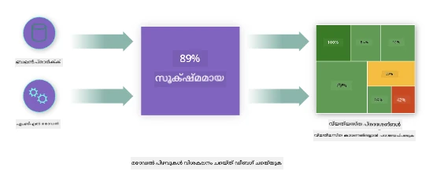
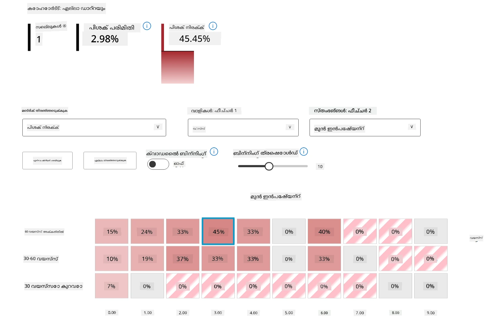
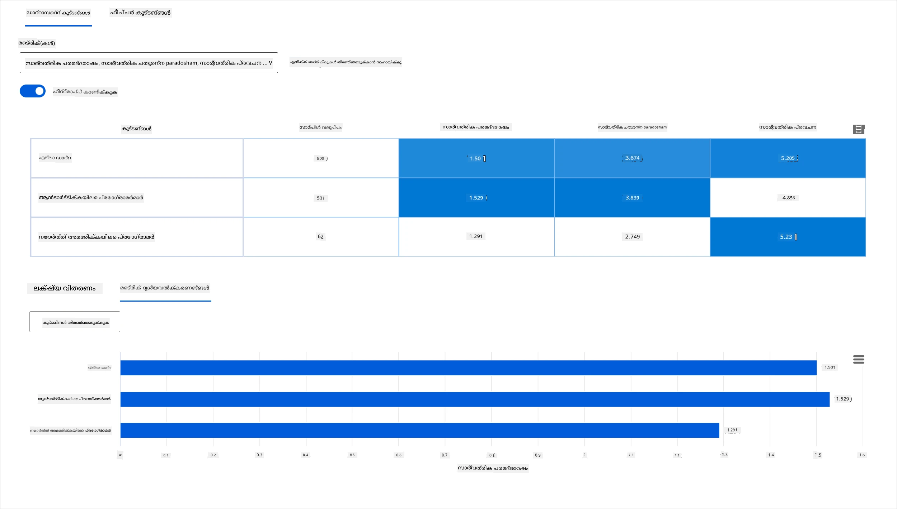
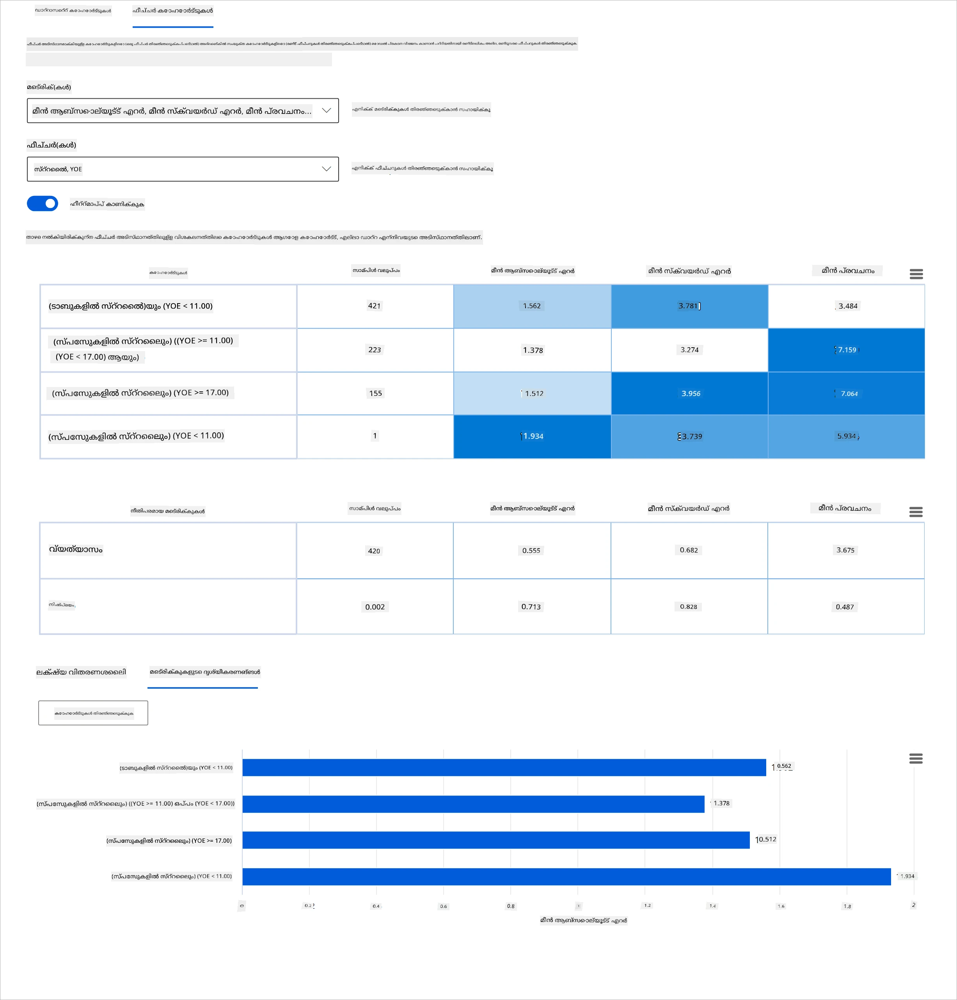
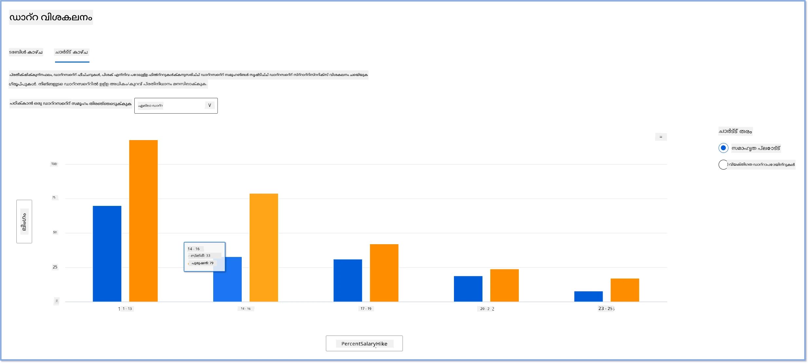
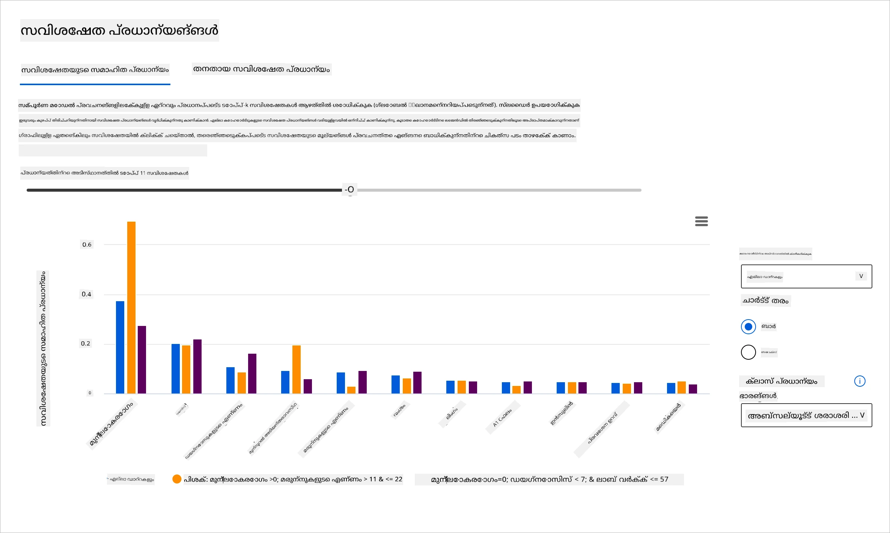
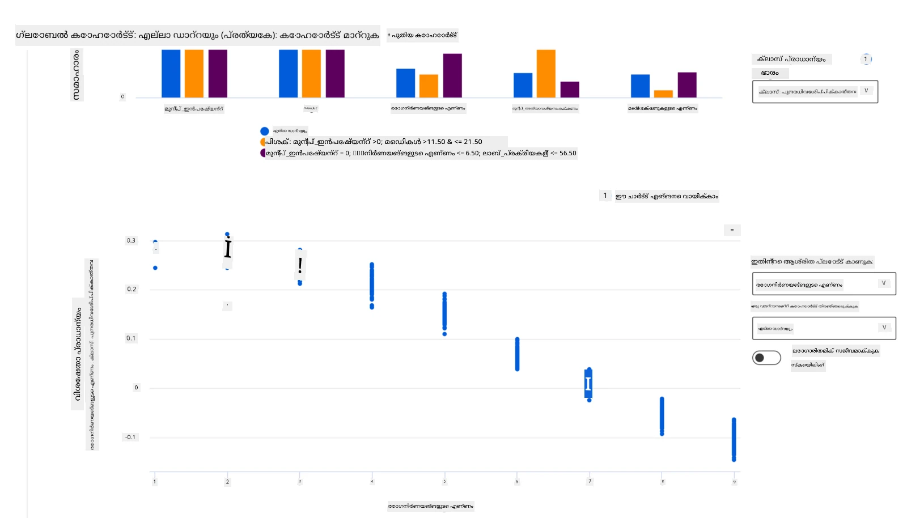

# പോസ്റ്റ്‌സ്‌ക്രിപ്റ്റ്: ഉത്തരവാദിത്വമുള്ള AI ഡാഷ്ബോർഡ് ഘടകങ്ങൾ ഉപയോഗിച്ച് മെഷീൻ ലേണിങ്ങിൽ മോഡൽ ഡീബഗ്ഗിംഗ്

## [പ്രീ-ലെക്ചർ ക്വിസ്](https://ff-quizzes.netlify.app/en/ml/)

## പരിചയം

മെഷീൻ ലേണിംഗ് നമ്മുടെ ദൈനംദിന ജീവിതത്തെ ബാധിക്കുന്നു. AI നമ്മുടെ വ്യക്തിഗത ജീവിതത്തെയും സമൂഹത്തെയും ബാധിക്കുന്ന ആരോഗ്യസംരക്ഷണം, ധനകാര്യ, വിദ്യാഭ്യാസം, തൊഴിൽ തുടങ്ങിയ ഏറ്റവും പ്രധാനപ്പെട്ട ചില സംവിധാനങ്ങളിൽ ഇടംപിടിക്കുന്നു. ഉദാഹരണത്തിന്, ആരോഗ്യപരിശോധനകൾ നടത്തുന്നതോ തട്ടിപ്പുകൾ കണ്ടെത്തുന്നതോ പോലുള്ള ദൈനംദിന തീരുമാനമെടുക്കൽ പ്രവർത്തനങ്ങളിൽ സിസ്റ്റങ്ങളും മോഡലുകളും പങ്കാളികളാണ്. അതിനാൽ, AI യിലെ പുരോഗതികളും അതിന്റെ വേഗത്തിലുള്ള സ്വീകരണവും സാമൂഹിക പ്രതീക്ഷകളുടെയും വളരുന്ന നിയന്ത്രണങ്ങളുടെയും പ്രതികരണമായി വരുന്നു. AI സിസ്റ്റങ്ങൾ പ്രതീക്ഷകൾ പാലിക്കാത്ത മേഖലകൾ നാം നിരന്തരം കാണുന്നു; അവ പുതിയ വെല്ലുവിളികൾ തുറന്നുകാട്ടുന്നു; സർക്കാറുകൾ AI പരിഹാരങ്ങളെ നിയന്ത്രിക്കാൻ തുടങ്ങുന്നു. അതിനാൽ, ഈ മോഡലുകൾ എല്ലാവർക്കും നീതിപൂർണവും വിശ്വസനീയവുമായ, ഉൾക്കൊള്ളുന്ന, പാരദർശകവും ഉത്തരവാദിത്വമുള്ള ഫലങ്ങൾ നൽകുന്നുവെന്ന് വിശകലനം ചെയ്യുന്നത് പ്രധാനമാണ്.

ഈ പാഠ്യപദ്ധതിയിൽ, മോഡലിന് ഉത്തരവാദിത്വമുള്ള AI പ്രശ്നങ്ങളുണ്ടോ എന്ന് വിലയിരുത്താൻ ഉപയോഗിക്കാവുന്ന പ്രായോഗിക ഉപകരണങ്ങൾ നോക്കാം. പരമ്പരാഗത മെഷീൻ ലേണിംഗ് ഡീബഗ്ഗിംഗ് സാങ്കേതികവിദ്യകൾ സാധാരണയായി സംഖ്യാത്മക കണക്കുകളായ ഏകീകരിച്ച കൃത്യത അല്ലെങ്കിൽ ശരാശരി പിശക് നഷ്ടം എന്നിവയുടെ അടിസ്ഥാനത്തിലാണ്. നിങ്ങൾ ഈ മോഡലുകൾ നിർമ്മിക്കാൻ ഉപയോഗിക്കുന്ന ഡാറ്റയിൽ ജാതി, ലിംഗം, രാഷ്ട്രീയ കാഴ്ചപ്പാട്, മതം പോലുള്ള ചില ജനസംഖ്യാ വിഭാഗങ്ങൾ ഇല്ലെങ്കിൽ എന്ത് സംഭവിക്കും എന്ന് ചിന്തിക്കുക. മോഡലിന്റെ ഔട്ട്പുട്ട് ചില ജനസംഖ്യാ വിഭാഗങ്ങളെ അനുകൂലിക്കുന്നതായി വ്യാഖ്യാനിക്കപ്പെടുമ്പോൾ എന്ത് സംഭവിക്കും? ഇത് ഈ സങ്കീർണ്ണമായ സവിശേഷതാ ഗ്രൂപ്പുകളുടെ അധികം അല്ലെങ്കിൽ കുറവ് പ്രതിനിധാനത്തെ പരിചയപ്പെടുത്താം, ഫെയർ‌നസ്, ഉൾക്കൊള്ളൽ, വിശ്വസനീയത സംബന്ധിച്ച പ്രശ്നങ്ങൾ മോഡലിൽ ഉണ്ടാകാം. മറ്റൊരു കാര്യം, മെഷീൻ ലേണിംഗ് മോഡലുകൾ ബ്ലാക്ക് ബോക്സുകളായി കണക്കാക്കപ്പെടുന്നു, അതിനാൽ മോഡലിന്റെ പ്രവചനത്തെ എന്താണ് പ്രേരിപ്പിക്കുന്നത് എന്ന് മനസ്സിലാക്കാനും വിശദീകരിക്കാനും ബുദ്ധിമുട്ടാണ്. ഈ എല്ലാ വെല്ലുവിളികളും ഡാറ്റാ ശാസ്ത്രജ്ഞരും AI വികസനക്കാരും അനുഭവിക്കുന്നതാണ്, കാരണം മോഡലിന്റെ ഫെയർ‌നസും വിശ്വസനീയതയും ഡീബഗ് ചെയ്യാനും വിലയിരുത്താനും ആവശ്യമായ ഉപകരണങ്ങൾ അവർക്കില്ല.

ഈ പാഠത്തിൽ, നിങ്ങൾ നിങ്ങളുടെ മോഡലുകൾ ഡീബഗ് ചെയ്യുന്നത് പഠിക്കും:

- **പിശക് വിശകലനം**: നിങ്ങളുടെ ഡാറ്റാ വിതരണത്തിൽ മോഡലിന് ഉയർന്ന പിശക് നിരക്കുകൾ എവിടെയാണ് എന്ന് കണ്ടെത്തുക.
- **മോഡൽ അവലോകനം**: വ്യത്യസ്ത ഡാറ്റാ കോഹോർട്ടുകൾക്കിടയിൽ താരതമ്യ വിശകലനം നടത്തുക, മോഡലിന്റെ പ്രകടന മെട്രിക്‌സുകളിൽ വ്യത്യാസങ്ങൾ കണ്ടെത്താൻ.
- **ഡാറ്റാ വിശകലനം**: നിങ്ങളുടെ ഡാറ്റയിൽ ഒരു ജനസംഖ്യാ വിഭാഗം മറ്റൊന്നിനെ അപേക്ഷിച്ച് അധികം അല്ലെങ്കിൽ കുറവായി പ്രതിനിധാനം ചെയ്യപ്പെടുന്നിടങ്ങൾ പരിശോധിക്കുക, ഇത് മോഡലിനെ ഒരു വിഭാഗത്തെ അനുകൂലിക്കാൻ ഇടയാക്കാം.
- **സവിശേഷതാ പ്രാധാന്യം**: ആഗോള തലത്തിൽ അല്ലെങ്കിൽ പ്രാദേശിക തലത്തിൽ മോഡലിന്റെ പ്രവചനങ്ങളെ പ്രേരിപ്പിക്കുന്ന സവിശേഷതകൾ മനസ്സിലാക്കുക.

## മുൻകൂർ ആവശ്യകത

മുൻകൂർ ആവശ്യകതയായി, ദയവായി [ഉത്തരവാദിത്വമുള്ള AI ഉപകരണങ്ങൾ ഡെവലപ്പർമാർക്കായി](https://www.microsoft.com/ai/ai-lab-responsible-ai-dashboard) എന്ന അവലോകനം ചെയ്യുക.

> 

## പിശക് വിശകലനം

കൃത്യത അളക്കാൻ ഉപയോഗിക്കുന്ന പരമ്പരാഗത മോഡൽ പ്രകടന മെട്രിക്‌സുകൾ സാധാരണയായി ശരിയായ പ്രവചനങ്ങൾക്കും തെറ്റായ പ്രവചനങ്ങൾക്കും അടിസ്ഥാനമായ കണക്കുകളാണ്. ഉദാഹരണത്തിന്, ഒരു മോഡൽ 89% കൃത്യതയുള്ളതാണെന്ന് 0.001 പിശക് നഷ്ടത്തോടെ നിശ്ചയിക്കുന്നത് നല്ല പ്രകടനമായി കണക്കാക്കാം. പിശകുകൾ സാധാരണയായി നിങ്ങളുടെ അടിസ്ഥാന ഡാറ്റാസെറ്റിൽ സമാനമായി വിതരണം ചെയ്തിട്ടില്ല. നിങ്ങൾക്ക് 89% കൃത്യതയുള്ള മോഡൽ സ്കോർ ലഭിച്ചാലും, മോഡൽ 42% തവണ പരാജയപ്പെടുന്ന ഡാറ്റാ മേഖലകൾ വ്യത്യസ്തമായി ഉണ്ടാകാം. ഈ പരാജയ മാതൃകകൾ ചില ഡാറ്റാ ഗ്രൂപ്പുകളിൽ ഫെയർ‌നസോ വിശ്വസനീയതയോ സംബന്ധിച്ച പ്രശ്നങ്ങൾ ഉണ്ടാക്കാം. മോഡൽ എവിടെ നല്ല പ്രകടനം കാഴ്ചവെക്കുന്നു അല്ലെങ്കിൽ പരാജയപ്പെടുന്നു എന്ന് മനസ്സിലാക്കുന്നത് അനിവാര്യമാണ്. മോഡലിൽ പിശകുകൾ കൂടുതലുള്ള ഡാറ്റാ മേഖലകൾ ഒരു പ്രധാന ഡാറ്റാ ജനസംഖ്യയായി മാറാം.

RAI ഡാഷ്ബോർഡിലെ പിശക് വിശകലന ഘടകം വിവിധ കോഹോർട്ടുകളിൽ മോഡൽ പരാജയം എങ്ങനെ വിതരണം ചെയ്തിട്ടുള്ളതെന്ന് ഒരു ട്രീ വിസ്വലൈസേഷനിലൂടെ കാണിക്കുന്നു. ഇത് നിങ്ങളുടെ ഡാറ്റാസെറ്റിൽ ഉയർന്ന പിശക് നിരക്കുള്ള സവിശേഷതകൾ അല്ലെങ്കിൽ മേഖലകൾ കണ്ടെത്താൻ സഹായിക്കുന്നു. മോഡലിന്റെ പിശകുകൾ എവിടെ നിന്നാണ് വരുന്നത് എന്ന് കാണുമ്പോൾ, നിങ്ങൾ മൂലകാരണം അന്വേഷിക്കാൻ തുടങ്ങാം. ഡാറ്റാ കോഹോർട്ടുകൾ സൃഷ്ടിച്ച് അവയിൽ വിശകലനം നടത്താനും കഴിയും. ഈ ഡാറ്റാ കോഹോർട്ടുകൾ ഡീബഗ്ഗിംഗ് പ്രക്രിയയിൽ സഹായിക്കുന്നു, ഒരു കോഹോർട്ടിൽ മോഡൽ പ്രകടനം നല്ലതായിരിക്കുമ്പോൾ മറ്റൊന്നിൽ പിശകുള്ളതെന്തുകൊണ്ടെന്ന് കണ്ടെത്താൻ.

ട്രീ മാപ്പിലെ ദൃശ്യ സൂചകങ്ങൾ പ്രശ്നമേഖലകൾ വേഗത്തിൽ കണ്ടെത്താൻ സഹായിക്കുന്നു. ഉദാഹരണത്തിന്, ട്രീ നോഡിന് ഇരുണ്ട ചുവപ്പ് നിറം കൂടുതലായിരിക്കുമ്പോൾ പിശക് നിരക്ക് ഉയർന്നതാണ്.

ഹീറ്റ് മാപ്പ് മറ്റൊരു വിസ്വലൈസേഷൻ ഫംഗ്ഷണാലിറ്റിയാണ്, ഇത് ഒരു അല്ലെങ്കിൽ രണ്ട് സവിശേഷതകൾ ഉപയോഗിച്ച് പിശക് നിരക്ക് പരിശോധിക്കാൻ സഹായിക്കുന്നു, മുഴുവൻ ഡാറ്റാസെറ്റിലോ കോഹോർട്ടുകളിലോ മോഡൽ പിശകുകൾക്ക് കാരണമായ ഘടകങ്ങൾ കണ്ടെത്താൻ.

പിശക് വിശകലനം ഉപയോഗിക്കേണ്ടത്:

* മോഡൽ പരാജയങ്ങൾ ഡാറ്റാസെറ്റിലും വിവിധ ഇൻപുട്ട്, സവിശേഷതാ അളവുകളിലും എങ്ങനെ വിതരണം ചെയ്തിട്ടുള്ളതെന്ന് ആഴത്തിൽ മനസ്സിലാക്കാൻ.
* ഏകീകരിച്ച പ്രകടന മെട്രിക്‌സുകൾ വിഭജിച്ച് പിശകുള്ള കോഹോർട്ടുകൾ സ്വയം കണ്ടെത്തി ലക്ഷ്യമിട്ട പരിഹാര നടപടികൾക്ക് സഹായിക്കാൻ.

## മോഡൽ അവലോകനം

മെഷീൻ ലേണിംഗ് മോഡലിന്റെ പ്രകടനം വിലയിരുത്താൻ അതിന്റെ പെരുമാറ്റത്തെ സമഗ്രമായി മനസ്സിലാക്കേണ്ടതുണ്ട്. പിശക് നിരക്ക്, കൃത്യത, റിക്കാൾ, പ്രിസിഷൻ, MAE (Mean Absolute Error) പോലുള്ള metrics ഒന്നിലധികം പരിശോധിച്ച് പ്രകടന വ്യത്യാസങ്ങൾ കണ്ടെത്താം. ഒരു മെട്രിക് മികച്ചതായിരിക്കാം, പക്ഷേ മറ്റൊന്നിൽ പിശകുകൾ കാണാം. കൂടാതെ, മുഴുവൻ ഡാറ്റാസെറ്റിലോ കോഹോർട്ടുകളിലോ metrics താരതമ്യം ചെയ്യുന്നത് മോഡൽ എവിടെ നല്ലതും എവിടെ മോശമെന്നും വ്യക്തമാക്കുന്നു. പ്രത്യേകിച്ച്, സെൻസിറ്റീവ് സവിശേഷതകളുള്ള (ഉദാ: രോഗിയുടെ ജാതി, ലിംഗം, പ്രായം) കോഹോർട്ടുകളിൽ മോഡൽ പ്രകടനം പരിശോധിക്കുന്നത് മോഡലിൽ ഉണ്ടാകാവുന്ന അനീതിയെ കണ്ടെത്താൻ സഹായിക്കുന്നു. ഉദാഹരണത്തിന്, സെൻസിറ്റീവ് സവിശേഷതകളുള്ള ഒരു കോഹോർട്ടിൽ മോഡൽ കൂടുതൽ പിശകുള്ളതായി കണ്ടെത്തുന്നത് മോഡലിൽ അനീതിയുണ്ടെന്ന് സൂചിപ്പിക്കാം.

RAI ഡാഷ്ബോർഡിലെ മോഡൽ അവലോകന ഘടകം ഡാറ്റാ പ്രതിനിധാനമുള്ള കോഹോർട്ടുകളുടെ പ്രകടന മെട്രിക്‌സുകൾ വിശകലനം ചെയ്യുന്നതിൽ മാത്രമല്ല, വ്യത്യസ്ത കോഹോർട്ടുകളിലുടനീളം മോഡലിന്റെ പെരുമാറ്റം താരതമ്യം ചെയ്യാനുള്ള കഴിവും നൽകുന്നു.

ഘടകത്തിന്റെ സവിശേഷതാ അടിസ്ഥാനത്തിലുള്ള വിശകലന ഫംഗ്ഷണാലിറ്റി ഉപയോക്താക്കളെ ഒരു പ്രത്യേക സവിശേഷതയിലുള്ള ഡാറ്റാ ഉപഗ്രൂപ്പുകൾ കുറയ്ക്കാൻ സഹായിക്കുന്നു, സൂക്ഷ്മതയിൽ അനോമലികൾ കണ്ടെത്താൻ. ഉദാഹരണത്തിന്, ഡാഷ്ബോർഡിൽ ഒരു ഉപയോക്താവ് തിരഞ്ഞെടുക്കുന്ന സവിശേഷതയ്ക്ക് (ഉദാ: *"time_in_hospital < 3"* അല്ലെങ്കിൽ *"time_in_hospital >= 7"*) സ്വയം കോഹോർട്ടുകൾ സൃഷ്ടിക്കുന്ന ബുദ്ധിമുട്ട് ഉണ്ട്. ഇത് വലിയ ഡാറ്റാ ഗ്രൂപ്പിൽ നിന്നൊരു പ്രത്യേക സവിശേഷത വേർതിരിച്ച് മോഡലിന്റെ പിശകുള്ള ഫലങ്ങൾക്ക് പ്രധാന കാരണമാണോ എന്ന് പരിശോധിക്കാൻ സഹായിക്കുന്നു.

മോഡൽ അവലോകന ഘടകം രണ്ട് തരത്തിലുള്ള വ്യത്യാസ മെട്രിക്‌സുകൾ പിന്തുണയ്ക്കുന്നു:

**മോഡൽ പ്രകടനത്തിലെ വ്യത്യാസം**: തിരഞ്ഞെടുക്കപ്പെട്ട പ്രകടന മെട്രിക്‌സിന്റെ മൂല്യങ്ങളിൽ ഡാറ്റാ ഉപഗ്രൂപ്പുകൾക്കിടയിലെ വ്യത്യാസം (വ്യത്യാസം) കണക്കാക്കുന്നു. ഉദാഹരണങ്ങൾ:

* കൃത്യത നിരക്കിലെ വ്യത്യാസം
* പിശക് നിരക്കിലെ വ്യത്യാസം
* പ്രിസിഷനിലെ വ്യത്യാസം
* റിക്കാളിലെ വ്യത്യാസം
* ശരാശരി ആബ്സല്യൂട്ട് പിശക് (MAE) ൽ വ്യത്യാസം

**തിരഞ്ഞെടുപ്പ് നിരക്കിലെ വ്യത്യാസം**: ഉപഗ്രൂപ്പുകൾക്കിടയിലെ തിരഞ്ഞെടുപ്പ് നിരക്കിലെ (നന്മയുള്ള പ്രവചന) വ്യത്യാസം. ഉദാഹരണത്തിന് വായ്പ അംഗീകാരം നിരക്കിലെ വ്യത്യാസം. തിരഞ്ഞെടുപ്പ് നിരക്ക് എന്നത് ഓരോ ക്ലാസിലെയും ഡാറ്റാ പോയിന്റുകളുടെ 1 ആയി (ബൈനറി ക്ലാസിഫിക്കേഷനിൽ) വർഗ്ഗീകരിച്ച അളവോ, പ്രവചന മൂല്യങ്ങളുടെ വിതരണമോ (റെഗ്രഷനിൽ) ആണ്.

## ഡാറ്റാ വിശകലനം

> "നിങ്ങൾ ഡാറ്റയെ മതിയായ സമയം പീഡിപ്പിച്ചാൽ, അത് എന്തും സമ്മതിക്കും" - റൊണാൾഡ് കോസ്

ഈ പ്രസ്താവന അതീവമായിരിക്കും തോന്നുക, പക്ഷേ ഡാറ്റയെ ഏതൊരു നിഗമനത്തെയും പിന്തുണയ്ക്കാൻ മാനിപ്പുലേറ്റ് ചെയ്യാമെന്നത് സത്യമാണെന്ന് പറയാം. ഇത്തരം മാനിപ്പുലേഷൻ ചിലപ്പോൾ അനായാസം സംഭവിക്കാം. മനുഷ്യരായി, നമ്മളെല്ലാവർക്കും പക്ഷപാതം ഉണ്ട്, ഡാറ്റയിൽ നിങ്ങൾ ബോധപൂർവ്വം പക്ഷപാതം ചേർക്കുമ്പോൾ അത് അറിയുക പ്രയാസമാണ്. AI യിലും മെഷീൻ ലേണിംഗിലും നീതിപൂർണത ഉറപ്പാക്കുന്നത് സങ്കീർണ്ണമായ വെല്ലുവിളിയാണ്.

ഡാറ്റ പരമ്പരാഗത മോഡൽ പ്രകടന മെട്രിക്‌സുകൾക്ക് വലിയ അന്ധസ്ഥലമാണ്. നിങ്ങൾക്ക് ഉയർന്ന കൃത്യത സ്കോറുകൾ ഉണ്ടാകാം, പക്ഷേ ഇത് നിങ്ങളുടെ ഡാറ്റാസെറ്റിൽ ഉള്ള അടിസ്ഥാനം പക്ഷപാതം പ്രതിഫലിപ്പിക്കണമെന്നില്ല. ഉദാഹരണത്തിന്, ഒരു കമ്പനിയിലെ ജീവനക്കാരുടെ ഡാറ്റാസെറ്റിൽ 27% സ്ത്രീകൾ എക്സിക്യൂട്ടീവ് സ്ഥാനങ്ങളിൽ ഉണ്ടെങ്കിൽ, 73% പുരുഷന്മാർ അതേ നിലയിൽ ഉണ്ടെങ്കിൽ, ഈ ഡാറ്റയിൽ പരിശീലിപ്പിച്ച ജോബ് പരസ്യ AI മോഡൽ മുതിർന്ന ജോബ് സ്ഥാനങ്ങൾക്ക് പ്രധാനമായും പുരുഷ പ്രേക്ഷകരെ ലക്ഷ്യമിടാം. ഈ ഡാറ്റ അസമത്വം മോഡലിന്റെ പ്രവചനത്തെ ഒരു ലിംഗത്തെ അനുകൂലിക്കാൻ ഇടയാക്കുന്നു. ഇത് AI മോഡലിൽ ലിംഗഭേദം എന്ന നീതിപൂർണത പ്രശ്നം തുറന്നുകാട്ടുന്നു.

RAI ഡാഷ്ബോർഡിലെ ഡാറ്റാ വിശകലന ഘടകം ഡാറ്റാസെറ്റിൽ അധികം അല്ലെങ്കിൽ കുറവായി പ്രതിനിധാനം ചെയ്യുന്ന മേഖലകൾ കണ്ടെത്താൻ സഹായിക്കുന്നു. ഡാറ്റ അസമത്വങ്ങൾ അല്ലെങ്കിൽ ഒരു പ്രത്യേക ഡാറ്റാ ഗ്രൂപ്പിന്റെ പ്രതിനിധാനക്കുറവ് മൂലം ഉണ്ടാകുന്ന പിശകുകളും നീതിപൂർണത പ്രശ്നങ്ങളും കണ്ടെത്താൻ ഉപയോക്താക്കളെ സഹായിക്കുന്നു. പ്രവചിച്ച ഫലങ്ങളും യഥാർത്ഥ ഫലങ്ങളും, പിശക് ഗ്രൂപ്പുകളും, പ്രത്യേക സവിശേഷതകളും അടിസ്ഥാനമാക്കി ഡാറ്റാസെറ്റുകൾ ദൃശ്യവൽക്കരിക്കാൻ കഴിയും. ചിലപ്പോൾ കുറവായി പ്രതിനിധാനം ചെയ്യുന്ന ഡാറ്റാ ഗ്രൂപ്പ് കണ്ടെത്തുന്നത് മോഡൽ നന്നായി പഠിക്കുന്നില്ലെന്ന് വെളിപ്പെടുത്താം, അതിനാൽ പിശകുകൾ കൂടുതലാണ്. ഡാറ്റാ പക്ഷപാതമുള്ള മോഡൽ ഫെയർ‌നസിന്റെ പ്രശ്നമല്ല, അത് ഉൾക്കൊള്ളലില്ലായ്മയും വിശ്വസനീയതയില്ലായ്മയും കാണിക്കുന്നു.

ഡാറ്റാ വിശകലനം ഉപയോഗിക്കേണ്ടത്:

* വ്യത്യസ്ത ഫിൽട്ടറുകൾ തിരഞ്ഞെടുക്കി നിങ്ങളുടെ ഡാറ്റ വിവിധ അളവുകളായി (കോഹോർട്ടുകൾ എന്നും അറിയപ്പെടുന്നു) വിഭജിച്ച് ഡാറ്റാസെറ്റ് സ്ഥിതിവിവരക്കണക്കുകൾ പരിശോധിക്കാൻ.
* വ്യത്യസ്ത കോഹോർട്ടുകളിലെയും സവിശേഷതാ ഗ്രൂപ്പുകളിലെയും ഡാറ്റാ വിതരണത്തെ മനസ്സിലാക്കാൻ.
* നീതിപൂർണത, പിശക് വിശകലനം, കാരണപരമായ കണ്ടെത്തലുകൾ (മറ്റു ഡാഷ്ബോർഡ് ഘടകങ്ങളിൽ നിന്നുള്ള) നിങ്ങളുടെ ഡാറ്റാസെറ്റിന്റെ വിതരണത്തിന്റെ ഫലമാണോ എന്ന് നിർണയിക്കാൻ.
* പ്രതിനിധാന പ്രശ്നങ്ങൾ, ലേബൽ ശബ്ദം, സവിശേഷത ശബ്ദം, ലേബൽ പക്ഷപാതം തുടങ്ങിയവയിൽ നിന്നുള്ള പിശകുകൾ കുറയ്ക്കാൻ കൂടുതൽ ഡാറ്റ എവിടെ ശേഖരിക്കണമെന്ന് തീരുമാനിക്കാൻ.

## മോഡൽ വ്യാഖ്യാനം

മെഷീൻ ലേണിംഗ് മോഡലുകൾ സാധാരണയായി ബ്ലാക്ക് ബോക്സുകളാണ്. ഒരു മോഡലിന്റെ പ്രവചനത്തെ പ്രേരിപ്പിക്കുന്ന പ്രധാന ഡാറ്റാ സവിശേഷതകൾ മനസ്സിലാക്കുന്നത് വെല്ലുവിളിയാണ്. ഒരു മോഡൽ എന്തുകൊണ്ട് ഒരു പ്രവചനമുണ്ടാക്കുന്നു എന്ന് പാരദർശകത നൽകുന്നത് പ്രധാനമാണ്. ഉദാഹരണത്തിന്, ഒരു AI സിസ്റ്റം ഒരു ഡയബറ്റിക് രോഗി 30 ദിവസത്തിനുള്ളിൽ ആശുപത്രിയിൽ വീണ്ടും പ്രവേശിക്കാനുള്ള അപകടത്തിൽ ആണെന്ന് പ്രവചിച്ചാൽ, അതിന്റെ പ്രവചനത്തിന് കാരണമായ പിന്തുണയുള്ള ഡാറ്റ നൽകാൻ കഴിയണം. പിന്തുണയുള്ള ഡാറ്റ സൂചകങ്ങൾ ക്ലിനീഷ്യന്മാരെ അല്ലെങ്കിൽ ആശുപത്രികളെ നന്നായി അറിയപ്പെട്ട തീരുമാനങ്ങൾ എടുക്കാൻ സഹായിക്കുന്നു. കൂടാതെ, വ്യക്തിഗത രോഗിക്ക് മോഡൽ എന്തുകൊണ്ട് ഒരു പ്രവചനമുണ്ടാക്കി എന്ന് വിശദീകരിക്കാൻ കഴിയുന്നത് ആരോഗ്യനിയമങ്ങളോടുള്ള ഉത്തരവാദിത്വം ഉറപ്പാക്കുന്നു. മനുഷ്യരുടെ ജീവിതത്തെ ബാധിക്കുന്ന രീതിയിൽ മെഷീൻ ലേണിംഗ് മോഡലുകൾ ഉപയോഗിക്കുമ്പോൾ, മോഡലിന്റെ പെരുമാറ്റത്തെ എന്താണ് സ്വാധീനിക്കുന്നത് എന്ന് മനസ്സിലാക്കുകയും വിശദീകരിക്കുകയും ചെയ്യുന്നത് അത്യന്താപേക്ഷിതമാണ്. മോഡൽ വിശദീകരണവും വ്യാഖ്യാനവും താഴെപ്പറയുന്ന സാഹചര്യങ്ങളിൽ ചോദ്യങ്ങൾക്ക് ഉത്തരം നൽകുന്നു:

* മോഡൽ ഡീബഗ്ഗിംഗ്: എന്റെ മോഡൽ ഈ പിശക് എന്തുകൊണ്ട് ചെയ്തു? എങ്ങനെ മെച്ചപ്പെടുത്താം?
* മനുഷ്യ- AI സഹകരണം: മോഡലിന്റെ തീരുമാനങ്ങൾ എങ്ങനെ മനസ്സിലാക്കാം, വിശ്വസിക്കാം?
* നിയമാനുസൃത പാലനം: എന്റെ മോഡൽ നിയമ ആവശ്യകതകൾ പാലിക്കുന്നുണ്ടോ?

RAI ഡാഷ്ബോർഡിലെ സവിശേഷതാ പ്രാധാന്യം ഘടകം മോഡൽ ഡീബഗ് ചെയ്യാനും മോഡൽ പ്രവചനങ്ങൾ എങ്ങനെ ഉണ്ടാകുന്നു എന്ന് സമഗ്രമായി മനസ്സിലാക്കാനും സഹായിക്കുന്നു. ഇത് മെഷീൻ ലേണിംഗ് പ്രൊഫഷണലുകൾക്കും തീരുമാനമെടുക്കുന്നവർക്കും മോഡലിന്റെ പെരുമാറ്റത്തെ സ്വാധീനിക്കുന്ന സവിശേഷതകൾ വിശദീകരിക്കാനും തെളിവുകൾ കാണിക്കാനും സഹായിക്കുന്ന ഉപകരണമാണ്, നിയമാനുസൃത പാലനത്തിനായി. ഉപയോക്താക്കൾ ആഗോളവും പ്രാദേശികവുമായ വിശദീകരണങ്ങൾ പരിശോധിച്ച് മോഡലിന്റെ പ്രവചനത്തെ സ്വാധീനിക്കുന്ന സവിശേഷതകൾ സ്ഥിരീകരിക്കാം. ആഗോള വിശദീകരണങ്ങൾ മോഡലിന്റെ മൊത്തം പ്രവചനത്തെ സ്വാധീനിച്ച പ്രധാന സവിശേഷതകൾ പട്ടികപ്പെടുത്തുന്നു. പ്രാദേശിക വിശദീകരണങ്ങൾ വ്യക്തിഗത കേസിനുള്ള മോഡൽ പ്രവചനത്തിന് കാരണമായ സവിശേഷതകൾ കാണിക്കുന്നു. പ്രാദേശിക വിശദീകരണങ്ങൾ വിലയിരുത്തുന്നത് ഒരു പ്രത്യേക കേസ് ഡീബഗ് ചെയ്യാനും ഓഡിറ്റ് ചെയ്യാനും സഹായിക്കുന്നു, മോഡൽ ശരിയായോ തെറ്റായോ പ്രവചനമുണ്ടാക്കിയത് എന്തുകൊണ്ടെന്ന് മനസ്സിലാക്കാൻ.

* ആഗോള വിശദീകരണങ്ങൾ: ഉദാഹരണത്തിന്, ഒരു ഡയബറ്റിക് ആശുപത്രി വീണ്ടും പ്രവേശന മോഡലിന്റെ മൊത്തം പെരുമാറ്റത്തെ സ്വാധീനിക്കുന്ന സവിശേഷതകൾ എന്തൊക്കെയാണ്?
* പ്രാദേശിക വിശദീകരണങ്ങൾ: ഉദാഹരണത്തിന്, 60 വയസ്സിന് മുകളിൽ മുൻപ് ആശുപത്രിയിൽ പ്രവേശനമുണ്ടായ ഒരു ഡയബറ്റിക് രോഗിയെ 30 ദിവസത്തിനുള്ളിൽ വീണ്ടും പ്രവേശിപ്പിക്കുമോ ഇല്ലയോ എന്ന് മോഡൽ പ്രവചിച്ചത് എന്തുകൊണ്ടാണ്?

വിവിധ കോഹോർട്ടുകളിലുടനീളം മോഡലിന്റെ പ്രകടനം പരിശോധിക്കുന്ന ഡീബഗ്ഗിംഗ് പ്രക്രിയയിൽ, സവിശേഷതാ പ്രാധാന്യം ഘടകം ഒരു സവിശേഷതയ്ക്ക് കോഹോർട്ടുകളിൽ എത്ര സ്വാധീനം ഉണ്ടെന്ന് കാണിക്കുന്നു. മോഡലിന്റെ പിശകുള്ള പ്രവചനങ്ങളെ പ്രേരിപ്പിക്കുന്ന സവിശേഷതയുടെ സ്വാധീനം താരതമ്യം ചെയ്യുമ്പോൾ അനോമലികൾ കണ്ടെത്താൻ ഇത് സഹായിക്കുന്നു. ഒരു മോഡൽ തെറ്റായ പ്രവചനമുണ്ടാക്കിയാൽ, ഈ ഘടകം നിങ്ങൾക്ക് ആ പ്രവചനത്തെ പ്രേരിപ്പിച്ച സവിശേഷതകൾ അല്ലെങ്കിൽ സവിശേഷതാ മൂല്യങ്ങൾ കണ്ടെത്താൻ സഹായിക്കുന്നു. ഈ വിശദാംശം ഡീബഗ്ഗിംഗിനും പാരദർശകതക്കും ഉത്തരവാദിത്വത്തിനും സഹായിക്കുന്നു. അവസാനം, ഈ ഘടകം നീതിപൂർണത പ്രശ്നങ്ങൾ കണ്ടെത്താനും സഹായിക്കുന്നു. ഉദാഹരണത്തിന്, ജാതി അല്ലെങ്കിൽ ലിംഗം പോലുള്ള സെൻസിറ്റീവ് സവിശേഷത മോഡലിന്റെ പ്രവചനത്തെ വളരെ സ്വാധീനിക്കുന്നുവെങ്കിൽ, ഇത് മോഡലിൽ ജാതി അല്ലെങ്കിൽ ലിംഗഭേദം ഉണ്ടാകാമെന്ന സൂചനയാണ്.

വ്യാഖ്യാനം ഉപയോഗിക്കേണ്ടത്:

* നിങ്ങളുടെ AI സിസ്റ്റത്തിന്റെ പ്രവചനങ്ങൾ എത്രത്തോളം വിശ്വസനീയമാണെന്ന് നിർണയിക്കാൻ, പ്രവചനങ്ങൾക്ക് ഏറ്റവും പ്രധാനപ്പെട്ട സവിശേഷതകൾ മനസ്സിലാക്കുക.
* മോഡൽ ആദ്യം മനസ്സിലാക്കി, അത് ആരോഗ്യകരമായ സവിശേഷതകൾ ഉപയോഗിക്കുന്നുണ്ടോ അല്ലെങ്കിൽ തെറ്റായ ബന്ധങ്ങളാണോ എന്ന് തിരിച്ചറിയുക, അതിലൂടെ ഡീബഗ് ചെയ്യുക.
* മോഡൽ സെൻസിറ്റീവ് സവിശേഷതകളിൽ അല്ലെങ്കിൽ അവയുമായി ശക്തമായി ബന്ധപ്പെട്ട സവിശേഷതകളിൽ അടിസ്ഥാനമാക്കി പ്രവചനങ്ങൾ നടത്തുകയാണോ എന്ന് മനസ്സിലാക്കി അനീതിയുടെ സാധ്യത കണ്ടെത്തുക.
* പ്രാദേശിക വിശദീകരണങ്ങൾ സൃഷ്ടിച്ച് ഉപയോക്തൃ വിശ്വാസം വളർത്തുക.
* AI സിസ്റ്റത്തിന്റെ നിയമാനുസൃത ഓഡിറ്റ് പൂർത്തിയാക്കുക, മോഡലുകൾ സ്ഥിരീകരിക്കുകയും മനുഷ്യരിൽ മോഡൽ തീരുമാനങ്ങളുടെ സ്വാധീനം നിരീക്ഷിക്കുകയും ചെയ്യുക.

## സമാപനം

എല്ലാ RAI ഡാഷ്ബോർഡ് ഘടകങ്ങളും സമൂഹത്തിന് കുറവു ഹാനികരവും കൂടുതൽ വിശ്വസനീയവുമായ മെഷീൻ ലേണിംഗ് മോഡലുകൾ നിർമ്മിക്കാൻ സഹായിക്കുന്ന പ്രായോഗിക ഉപകരണങ്ങളാണ്. ഇത് മനുഷ്യാവകാശങ്ങൾക്ക് ഭീഷണി സൃഷ്ടിക്കുന്നത് തടയുന്നു; ചില ഗ്രൂപ്പുകളെ ജീവിത അവസരങ്ങളിൽ നിന്ന് വിവേചനം ചെയ്യുകയോ ഒഴിവാക്കുകയോ ചെയ്യുന്നത് തടയുന്നു; ശാരീരികമോ മാനസികമോ പരിക്കിന്റെ അപകടം കുറയ്ക്കുന്നു. കൂടാതെ, പ്രാദേശിക വിശദീകരണങ്ങൾ സൃഷ്ടിച്ച് മോഡലിന്റെ തീരുമാനങ്ങളിൽ വിശ്വാസം വളർത്താൻ സഹായിക്കുന്നു. ചില സാധ്യതയുള്ള ഹാനികൾ:

- **വിതരണം**: ഉദാഹരണത്തിന്, ഒരു ലിംഗം അല്ലെങ്കിൽ ജാതി മറ്റൊന്നിനെ അപേക്ഷിച്ച് മുൻഗണന ലഭിക്കുന്നത്.
- **സേവന ഗുണമേന്മ**: ഒരു പ്രത്യേക സാഹചര്യത്തിനായി ഡാറ്റ പരിശീലിപ്പിച്ചാൽ, എന്നാൽ യാഥാർത്ഥ്യം അതിനേക്കാൾ സങ്കീർണ്ണമായിരിക്കുമ്പോൾ, സേവനം മോശമായി പ്രവർത്തിക്കും.
- **സ്റ്റീരിയോടൈപ്പിംഗ്**: ഒരു ഗ്രൂപ്പിനെ മുൻകൂട്ടി നിശ്ചയിച്ച ഗുണങ്ങളുമായി ബന്ധിപ്പിക്കൽ.
- **നിന്ദനം**. അന്യായമായി എന്തെങ്കിലും അല്ലെങ്കിൽ ആരെയെങ്കിലും വിമർശിക്കുകയും ലേബൽ ചെയ്യുകയും ചെയ്യുക.
- **അധികം അല്ലെങ്കിൽ കുറവ് പ്രതിനിധാനം**. ഒരു പ്രത്യേക ഗ്രൂപ്പ് ഒരു പ്രത്യേക തൊഴിൽ മേഖലയിൽ കാണപ്പെടുന്നില്ലെന്ന ആശയമാണ്, ആ സേവനം അല്ലെങ്കിൽ ഫംഗ്ഷൻ അത് പ്രോത്സാഹിപ്പിക്കുന്നത് ഹാനികരമാണെന്ന് കരുതുന്നു.

### Azure RAI ഡാഷ്ബോർഡ്

[Azure RAI ഡാഷ്ബോർഡ്](https://learn.microsoft.com/en-us/azure/machine-learning/concept-responsible-ai-dashboard?WT.mc_id=aiml-90525-ruyakubu) മൈക്രോസോഫ്റ്റ് ഉൾപ്പെടെയുള്ള പ്രമുഖ അക്കാദമിക് സ്ഥാപനങ്ങളും സംഘടനകളും വികസിപ്പിച്ചെടുത്ത ഓപ്പൺ-സോഴ്‌സ് ടൂളുകളിൽ നിർമ്മിച്ചിരിക്കുന്നു, ഇത് ഡാറ്റാ സയന്റിസ്റ്റുകൾക്കും AI ഡെവലപ്പർമാർക്കും മോഡൽ പെരുമാറ്റം മെച്ചമായി മനസിലാക്കാനും AI മോഡലുകളിൽ നിന്നുള്ള അനിഷ്ടമായ പ്രശ്നങ്ങൾ കണ്ടെത്താനും പരിഹരിക്കാനും സഹായിക്കുന്നു.

- RAI ഡാഷ്ബോർഡിന്റെ വിവിധ ഘടകങ്ങൾ എങ്ങനെ ഉപയോഗിക്കാമെന്ന് അറിയാൻ RAI ഡാഷ്ബോർഡ് [ഡോക്യുമെന്റേഷൻ](https://learn.microsoft.com/en-us/azure/machine-learning/how-to-responsible-ai-dashboard?WT.mc_id=aiml-90525-ruyakubu) പരിശോധിക്കുക.

- Azure Machine Learning-ൽ കൂടുതൽ ഉത്തരവാദിത്വമുള്ള AI സീനാരിയോകൾ ഡീബഗ് ചെയ്യാൻ ചില RAI ഡാഷ്ബോർഡ് [സാമ്പിൾ നോട്ട്‌ബുക്കുകൾ](https://github.com/Azure/RAI-vNext-Preview/tree/main/examples/notebooks) പരിശോധിക്കുക.

---
## 🚀 വെല്ലുവിളി

സांഖ്യിക അല്ലെങ്കിൽ ഡാറ്റാ പാകം ആദ്യഘട്ടത്തിൽ തന്നെ വരാതിരിക്കാൻ, നമുക്ക് ചെയ്യേണ്ടത്:

- സിസ്റ്റങ്ങളിൽ ജോലി ചെയ്യുന്ന ആളുകൾക്ക് വ്യത്യസ്ത പശ്ചാത്തലങ്ങളും കാഴ്ചപ്പാടുകളും ഉണ്ടായിരിക്കണം
- നമ്മുടെ സമൂഹത്തിന്റെ വൈവിധ്യം പ്രതിഫലിപ്പിക്കുന്ന ഡാറ്റാസെറ്റുകളിൽ നിക്ഷേപം നടത്തണം
- പാകം സംഭവിക്കുമ്പോൾ അത് കണ്ടെത്താനും ശരിയാക്കാനും മികച്ച രീതികൾ വികസിപ്പിക്കണം

മോഡൽ നിർമ്മാണത്തിലും ഉപയോഗത്തിലും അന്യായത വ്യക്തമായ യഥാർത്ഥ ജീവിത സാഹചര്യങ്ങളെക്കുറിച്ച് ചിന്തിക്കുക. മറ്റെന്തെല്ലാം പരിഗണിക്കണം?

## [പോസ്റ്റ്-ലെക്ചർ ക്വിസ്](https://ff-quizzes.netlify.app/en/ml/)
## അവലോകനം & സ്വയം പഠനം

ഈ പാഠത്തിൽ, നിങ്ങൾ ഉത്തരവാദിത്വമുള്ള AI യെ മെഷീൻ ലേണിങ്ങിൽ ഉൾപ്പെടുത്താനുള്ള ചില പ്രായോഗിക ഉപകരണങ്ങൾ പഠിച്ചു.

ഈ വർക്ക്‌ഷോപ്പ് കാണുക വിഷയങ്ങളിൽ കൂടുതൽ ആഴത്തിൽ പ്രവേശിക്കാൻ:

- Responsible AI Dashboard: One-stop shop for operationalizing RAI in practice by Besmira Nushi and Mehrnoosh Sameki

> 🎥 വീഡിയോക്കായി മുകളിൽ കാണുന്ന ചിത്രം ക്ലിക്ക് ചെയ്യുക: Responsible AI Dashboard: One-stop shop for operationalizing RAI in practice by Besmira Nushi and Mehrnoosh Sameki

ഉത്തരവാദിത്വമുള്ള AI യെക്കുറിച്ച് കൂടുതൽ അറിയാനും കൂടുതൽ വിശ്വസനീയമായ മോഡലുകൾ നിർമ്മിക്കാനും താഴെപ്പറയുന്ന വസ്തുക്കൾ കാണുക:

- ML മോഡലുകൾ ഡീബഗ് ചെയ്യുന്നതിനുള്ള മൈക്രോസോഫ്റ്റിന്റെ RAI ഡാഷ്ബോർഡ് ടൂളുകൾ: [Responsible AI tools resources](https://aka.ms/rai-dashboard)

- Responsible AI ടൂൾകിറ്റ് പരിശോധിക്കുക: [Github](https://github.com/microsoft/responsible-ai-toolbox)

- മൈക്രോസോഫ്റ്റിന്റെ RAI റിസോഴ്‌സ് സെന്റർ: [Responsible AI Resources – Microsoft AI](https://www.microsoft.com/en-us/ai/tools-practices)

- മൈക്രോസോഫ്റ്റിന്റെ FATE ഗവേഷണ സംഘം: [FATE: Fairness, Accountability, Transparency, and Ethics in AI - Microsoft Research](https://www.microsoft.com/research/theme/fate/)

## അസൈൻമെന്റ്

[RAI ഡാഷ്ബോർഡ് പരിശോധിക്കുക](assignment.md)

---

<!-- CO-OP TRANSLATOR DISCLAIMER START -->
**അസൂയാപത്രം**:  
ഈ രേഖ AI വിവർത്തന സേവനം [Co-op Translator](https://github.com/Azure/co-op-translator) ഉപയോഗിച്ച് വിവർത്തനം ചെയ്തതാണ്. നാം കൃത്യതയ്ക്ക് ശ്രമിച്ചിട്ടുണ്ടെങ്കിലും, യന്ത്രം ചെയ്ത വിവർത്തനങ്ങളിൽ പിശകുകൾ അല്ലെങ്കിൽ തെറ്റുകൾ ഉണ്ടാകാമെന്ന് ദയവായി ശ്രദ്ധിക്കുക. അതിന്റെ മാതൃഭാഷയിലുള്ള യഥാർത്ഥ രേഖ അധികാരപരമായ ഉറവിടമായി കണക്കാക്കപ്പെടണം. നിർണായകമായ വിവരങ്ങൾക്ക്, പ്രൊഫഷണൽ മനുഷ്യ വിവർത്തനം ശുപാർശ ചെയ്യപ്പെടുന്നു. ഈ വിവർത്തനം ഉപയോഗിക്കുന്നതിൽ നിന്നുണ്ടാകുന്ന ഏതെങ്കിലും തെറ്റിദ്ധാരണകൾക്കോ തെറ്റായ വ്യാഖ്യാനങ്ങൾക്കോ ഞങ്ങൾ ഉത്തരവാദികളല്ല.
<!-- CO-OP TRANSLATOR DISCLAIMER END -->