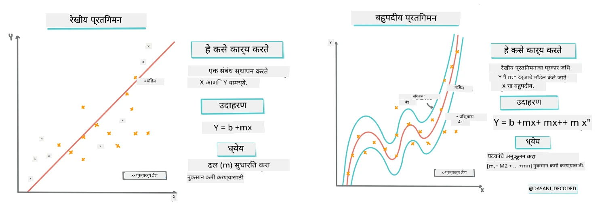
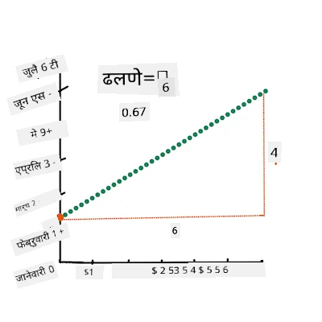
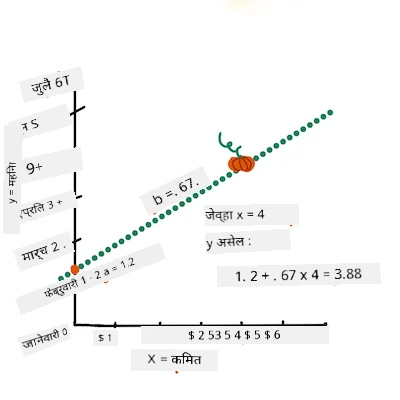
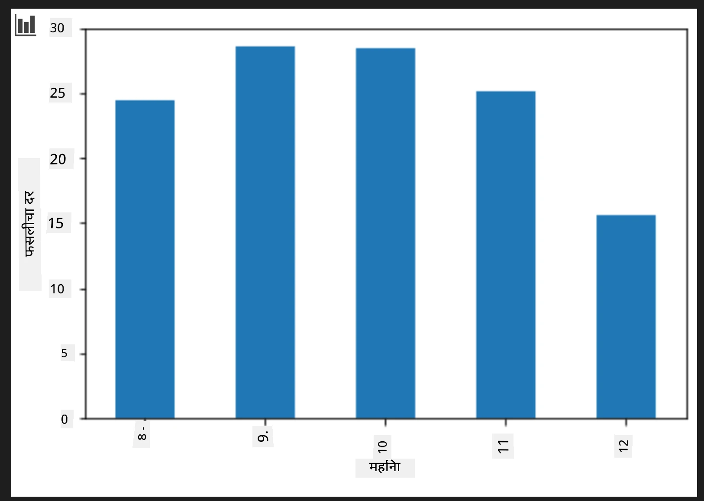
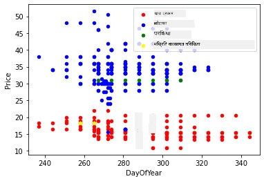

# Scikit-learn वापरून एक रिग्रेशन मॉडेल तयार करा: रिग्रेशन चार पद्धतींचा अभ्यास

## प्रारंभिक टीप

लिनीयर रिग्रेशन तेव्हा वापरले जाते जेव्हा आपल्याला एखादा **संख्यात्मक मूल्य** (उदाहरणार्थ, घराची किंमत, तापमान किंवा विक्री) भाकीत करायचा असतो.  
हे इनपुट फिचर्स आणि आउटपुट या नात्याचे उत्तम प्रतिनिधित्व करणारी सरळ रेषा शोधून काम करते.

या धड्यात, आपण अधिक प्रगत रिग्रेशन तंत्रे पाहण्यापूर्वी संकल्पना समजण्यावर लक्ष केंद्रित करू.  

> इन्फोग्राफिक [दासानी माडिपल्ली](https://twitter.com/dasani_decoded) यांनी तयार केले आहे
## [पूर्व-व्याख्यान क्विझ](https://ff-quizzes.netlify.app/en/ml/)

> ### [हा धडा R मध्ये उपलब्ध आहे!](../../../../2-Regression/3-Linear/solution/R/lesson_3.html)
### परिचय

आत्तापर्यंत आपण रिग्रेशन म्हणजे काय हे पाहिले आहे, आणि संपूर्ण धड्यात वापरणार्‍या कद्दू किमतींच्या डेटासेटमधून घेतलेल्या नमुना डेटाचा अभ्यास केला आहे. आपण याला Matplotlib वापरून व्हिज्युअलाइजही केलं आहे.

आता आपण ML साठी रिग्रेशन मध्ये अधिक खोलात जाण्यास तयार आहात. व्हिज्युअलायझेशन डेटा समजण्यासाठी मदत करते, पण मशीन लर्निंग ची खरी ताकद _मॉडेल्सची ट्रेनिंग_ मध्ये आहे.  
मॉडेल्स ऐतिहासिक डेटावर प्रशिक्षित केल्या जातात जेणेकरून ते डेटाच्या अवलंबित्वांना स्वयंचलितपणे टिपू शकतील, आणि आपल्याला नवीन डेटासाठी, ज्याला मॉडेलने कधी पाहिले नाही, भविष्यातील परिणाम भाकीत करण्याची परवानगी मिळते.

या धड्यात, आपण दोन प्रकारच्या रिग्रेशनबद्दल अधिक जाणून घेणार आहोत: _मूलभूत लिनीयर रिग्रेशन_ आणि _बहुपद रिग्रेशन_, तसेच या तंत्रज्ञानामागील काही गणित. हे मॉडेल्स आपल्याला विविध इनपुट डेटानुसार कद्दूच्या किमती भाकीत करू देतील.

[](https://youtu.be/CRxFT8oTDMg "ML for beginners - Understanding Linear Regression")

> 🎥 खालील प्रतिमा क्लिक करा लिनीयर रिग्रेशनचा संक्षिप्त व्हिडिओ विहंगावलोकन पाहण्यासाठी.

> संपूर्ण अभ्यासक्रमात, आम्ही गणिताचे न्यूनतम ज्ञान मानतो, आणि विद्यारंभिक विद्यार्थी ज्यांना इतर क्षेत्रातून येत आहेत त्यांच्यासाठी सुलभ करण्याचा प्रयत्न करीत आहोत, त्यामुळे लक्ष ठेवा टीपा, 🧮 गणितीय सूचना, आकृत्या आणि इतर शिकवणी साधनांवर.

### पूर्वशर्ती

आपण आता पाहत असलेल्या कद्दू डेटाची रचना परिचित असावी. हा डेटा हा या धड्याच्या _notebook.ipynb_ फाईलमध्ये आधीच लोड आणि स्वच्छ केला आहे. त्या फाईलमध्ये कद्दूची किंमत प्रति बुशेल नवीन डेटा फ्रेममध्ये प्रदर्शित केली आहे.  
ध्यान ठेवा की आपण Visual Studio Code चे कर्नल्समध्ये हे नोटबुक्स चालवू शकता.

### तयारी

स्मरण म्हणून, आपण हा डेटा लोड करत आहात जेणेकरून त्याबाबत प्रश्न विचारू शकता.

- कधी कद्दू विकत घेण्याचा सर्वोत्तम वेळ आहे?
- लहान कद्दूंच्या एका पान्याच्या बाबतीत किंमती किती असतील याची अपेक्षा करू शकतो का?
- मी त्यांना अर्ध्या बुशेलच्या टोपल्या मध्ये घेतले पाहिजेत की 1 1/9 बुशेल बॉक्सने?
चला हा डेटा आणखी तपासून पाहू.

मागील धड्यात, आपण पँडास डेटा फ्रेम तयार केला आणि त्यामध्ये मूळ डेटासेटचा एक भाग भरला, किंमती बुशेलनुसार प्रमाणित केल्या. पण त्याद्वारे आपल्याला फक्त सुमारे 400 डेटा पॉईंट्स मिळाले आणि फक्त हिवाळी महिन्यांसाठी.

या धड्याच्या नोटबुकमध्ये आपण पूर्वलोड केलेला डेटा पहा. डेटा पूर्वलोड आणि प्राथमिक स्कॅटरप्लॉट तयार केला आहे ज्यात महिना डेटा दर्शविला आहे. कदाचित आपण अजून स्वच्छ करून डेटा अधिक तपशीलवार करू शकू.

## लिनीयर रिग्रेशन लाईन

आपल्याला धडा 1 मध्ये शिकवले होते की, लिनीयर रिग्रेशनचा उद्देश असा लाईन काढणे आहे जिचा उपयोग:

- **चल (variables) यांचे नाते दाखविण्यासाठी**: चलांमधील संबंध दिखविणे
- **भाकीत करण्यासाठी**: नवीन डेटा पॉईंट लाइनशी कुठे सापडेल हे अचूक भाकीत करणे

सर्वसामान्यत: **लीस्ट-स्क्वेअर्स रिग्रेशन** या प्रकारच्या रेषा काढण्यात येतात. "लीस्ट-स्क्वेअर्स" शब्द याचा अर्थ आहे की आपला मॉडेल एकंदर त्रुटी (एरर) कमी करण्याचा प्रयत्न करतो. प्रत्येक डेटा पॉईंटसाठी, आपण वास्तविक पॉईंट आणि आपली रिग्रेशन लाईन या दरम्यानच्या उभ्या अंतराची (ज्याला रेसिड्युअल म्हणतात) मोजणी करतो.

आपण या अंतरांचे वर्ग (square) काढतो दोन प्रमुख कारणांमुळे:

1. **प्रमाण महत्त्वाचे, दिशा नाही:** -5 चा त्रुटी आणि +5 चा त्रुटी दोन्ही सारखे वागवायचे आहे. वर्गाकाराने सर्व मूल्ये सकारात्मक होतात.

2. **आउटलाईअर्सचा दंड:** मोठ्या त्रुटीला अधिक वजन देतो, जेणेकरून रेषा दूरच्या पॉईंटजवळ राहणे बळकट होते.

यानंतर आपण सर्व वर्गाकार नावे एकत्र करतो. आपला उद्देश असे रेषा शोधणे आहे ज्यासाठी हा एकूण योग लहान (किमान) असेल, म्हणूनच त्याला "लीस्ट-स्क्वेअर्स" असे म्हणतात.

> **🧮 गणित दाखवा**  
>  
> या रेषेला _line of best fit_ म्हणतात आणि ते [समीकरणाने](https://en.wikipedia.org/wiki/Simple_linear_regression) दर्शवता येते:  
>  
> ```
> Y = a + bX
> ```
  
> `X` हा 'स्पष्टीकरण चल' आहे. `Y` हा 'आश्रित चल' आहे. लाईनचा उतार `b` आहे आणि `a` हा y-अडकवटा (y-intercept) आहे, जो `X = 0` असताना `Y` चे मूल्य आहे.  
>
>
>
> पहिले, उतार `b` मोजा. इन्फोग्राफिक [जेन लूपर](https://twitter.com/jenlooper) यांनी तयार केला.
>
> दुसऱ्या शब्दांत आणि आपल्या कद्दू डेटाच्या मूळ प्रश्नाला संदर्भ देत: "महिन्यानुसार प्रति बुशेल कद्दूची किंमत भाकीत करा", `X` म्हणजे किंमत आणि `Y` म्हणजे विक्रीचा महिना आहे.
>
>
>
> `Y` चे मूल्य मोजा. जर आपण सुमारे $4 देत असाल, तर तो नक्की एप्रिल महिना आहे! इन्फोग्राफिक [जेन लूपर](https://twitter.com/jenlooper) यांनी तयार केले.
>
> गणिताने 'लाईनचा उतार' प्रदर्शित करणे आवश्यक आहे, जो intercept वर अवलंबून आहे, म्हणजे जेव्हा `X = 0` तेव्हा `Y` कुठे स्थित आहे.
>
> या मूल्यांचे गणिती मोजमाप [Math is Fun](https://www.mathsisfun.com/data/least-squares-regression.html) या संकेतस्थळावर तपासा. तसेच [ही लीस्ट-स्क्वेअर कॅल्क्युलेटर](https://www.mathsisfun.com/data/least-squares-calculator.html) बघा ज्यात संख्यांचे मूल्य कसे रेषेवर परिणाम करतात ते दिसेल.

## सहसंबंध (Correlation)

आणखी एक संज्ञा समजून घेणे गरजेचे आहे ती म्हणजे दिलेल्या X आणि Y चलांमधील **सहसंबंध गुणांक**. स्कॅटरप्लॉट वापरून आपण ही संख्या पटकन पाहू शकता. जर स्कॅटरप्लॉटमध्ये डेटा पॉईंट्स एक सरळ रेषेत असतील तर सहसंबंध उच्च (उच्च स्पष्टता) असतो, पण जर सर्वत्र विखुरलेले असतील तर तो कमी असतो.

एक चांगला लिनीयर रिग्रेशन मॉडेल तोच असेल ज्याचा सहसंबंध गुणांक (0 पेक्षा 1 जवळ अधिक) लीस्ट-स्क्वेअर्स पद्धतीने काढलेला असेल.

✅ या धड्यासोबत असलेल्या नोटबुक चालवा आणि महिना आणि किंमतीच्या स्कॅटरप्लॉटचे निरीक्षण करा. कद्दू विक्रीसाठी महिना आणि किंमतीतील डेटाचा सहसंबंध तुमच्या अभिप्रेतानुसार उच्च आहे की कमी? जर तुम्ही `Month` ऐवजी अधिक तपशीलवार मोजदाड वापरली (उदा. *वर्षाचा दिवस* म्हणजे वर्षाच्या सुरुवातीपासून किती दिवस झाले?), तर सहसंबंध बदलतो का?

खाली दिलेल्या कोडमध्ये, आपण गृहित धरतो की डेटाची स्वच्छता केली आहे आणि आपल्याकडे `new_pumpkins` नावाचा डेटा फ्रेम आहे, ज्यात पुढील सारखी माहिती आहे:

ID | Month | DayOfYear | Variety | City | Package | Low Price | High Price | Price  
---|-------|-----------|---------|------|---------|-----------|------------|-------  
70 | 9 | 267 | PIE TYPE | BALTIMORE | 1 1/9 bushel cartons | 15.0 | 15.0 | 13.636364  
71 | 9 | 267 | PIE TYPE | BALTIMORE | 1 1/9 bushel cartons | 18.0 | 18.0 | 16.363636  
72 | 10 | 274 | PIE TYPE | BALTIMORE | 1 1/9 bushel cartons | 18.0 | 18.0 | 16.363636  
73 | 10 | 274 | PIE TYPE | BALTIMORE | 1 1/9 bushel cartons | 17.0 | 17.0 | 15.454545  
74 | 10 | 281 | PIE TYPE | BALTIMORE | 1 1/9 bushel cartons | 15.0 | 15.0 | 13.636364  

> स्वच्छता करणारा कोड [`notebook.ipynb`](notebook.ipynb) मध्ये उपलब्ध आहे. आपण मागील धड्यातील स्वच्छता पद्धती केली आणि `DayOfYear` स्तंभ खालील अभिव्यक्तीने काढला:

```python
day_of_year = pd.to_datetime(pumpkins['Date']).apply(lambda dt: (dt-datetime(dt.year,1,1)).days)
```
  
आपण आता लिनीयर रिग्रेशन मागील गणित समजल्यामुळे, चला एक रिग्रेशन मॉडेल तयार करू, जे कद्दूच्या पॅकेजेसपैकी कोणत्या मध्ये सर्वोत्तम किंमती येतील, भाकीत करू शकेल. कोणीतरी कद्दू विक्रीसाठी हा डेटा वापरून खरेदी अधिक प्रभावी करू शकेल.

## सहसंबंध शोधत आहोत

[](https://youtu.be/uoRq-lW2eQo "ML for beginners - Looking for Correlation: The Key to Linear Regression")

> 🎥 वरची प्रतिमा क्लिक करा सहसंबंधाचा संक्षिप्त व्हिडिओ पाहण्यासाठी.

मागील धड्यात आपल्याला कदाचित दिसले असेल की वेगवेगळ्या महिन्यांच्या सरासरी किंमती अशा प्रकारे आहेत:



हे सूचित करते की काही सहसंबंध आहे, आणि आपण लिनीयर रिग्रेशन मॉडेल ट्रेन करू शकतो जे `Month` आणि `Price` यांच्यातील नाते भाकीत करेल, किंवा `DayOfYear` आणि `Price` यांच्यातील नाते भाकीत करेल. खाली दिलेला स्कॅटरप्लॉट पोस्टरर संबंध दर्शवितो:

  

आता `corr` फंक्शन वापरून आहे का ते पाहूया:

```python
print(new_pumpkins['Month'].corr(new_pumpkins['Price']))
print(new_pumpkins['DayOfYear'].corr(new_pumpkins['Price']))
```
  
असे दिसते की सहसंबंध त्यामुळे फार काही जास्त नाही, -0.15 `Month` नुसार आणि -0.17 `DayOfYear` नुसार आहे, पण कदाचित आणखी एक महत्त्वाचा संबंध असू शकतो. वेगवेगळे कद्दू प्रकार वेगवेगळ्या किंमतींचे गट तयार करतात. ही कल्पना पुष्टी करण्यासाठी, चला प्रत्येक कद्दू प्रकार वेगळ्या रंगात स्कॅटर प्लॉट करू. `scatter` फंक्शनला `ax` पॅरामीटर दिल्यास सर्व पॉईंट्स एका ग्राफवर प्लॉट करता येतात:

```python
ax=None
colors = ['red','blue','green','yellow']
for i,var in enumerate(new_pumpkins['Variety'].unique()):
    df = new_pumpkins[new_pumpkins['Variety']==var]
    ax = df.plot.scatter('DayOfYear','Price',ax=ax,c=colors[i],label=var)
```
  
  

आमच्या तपासणीत कद्दूचा प्रकार (Variety) किंमतीवर Verkaufs तारखेच्या पेक्षा अधिक प्रभाव टाकतो हे दिसते. हे बार ग्राफने दर्शविले आहे:

```python
new_pumpkins.groupby('Variety')['Price'].mean().plot(kind='bar')
```
  
  

आता फक्त एका प्रकारावरील, 'pie type' कद्दूवर लक्ष केंद्रित करू आणि पाहू की विक्री तारखेचा किंमतीवर काय परिणाम होतो:

```python
pie_pumpkins = new_pumpkins[new_pumpkins['Variety']=='PIE TYPE']
pie_pumpkins.plot.scatter('DayOfYear','Price') 
```
  

आता जर आपण `corr` फंक्शन वापरून `Price` आणि `DayOfYear` मध्ये सहसंबंध मोजला तर ते सुमारे `-0.27` येईल - म्हणजे predictive मॉडेल तयार करणे योग्य आहे.

> लिनीयर रिग्रेशन मॉडेल train करण्यापूर्वी डेटा स्वच्छ आहे याची खात्री करणे महत्त्वाचे आहे. लिनीयर रिग्रेशन माहीत नसलेल्या (मिसिंग) मूल्यांसह चांगले काम करत नाही, त्यामुळे रिकाम्या सेल्स काढून टाकणे चांगले:

```python
pie_pumpkins.dropna(inplace=True)
pie_pumpkins.info()
```
  
आणखी एक पर्याय म्हणजे त्या रिकाम्या सेल्सना संबंधित स्तंभाच्या सरासरी मूल्यांनी भरणे.

## सोपे लिनीयर रिग्रेशन

[](https://youtu.be/e4c_UP2fSjg "ML for beginners - Linear and Polynomial Regression using Scikit-learn")

> 🎥 वरची प्रतिमा क्लिक करा लिनीयर आणि बहुपदी रिग्रेशनचे संक्षिप्त विडिओ पाहण्यासाठी.

आपल्या लिनीयर रिग्रेशन मॉडेलसाठी आपण **Scikit-learn** लायब्ररी वापरणार आहोत.

```python
from sklearn.linear_model import LinearRegression
from sklearn.metrics import mean_squared_error
from sklearn.model_selection import train_test_split
```
  
आपण इनपुट मूल्ये (फीचर्स) आणि अपेक्षित आउटपुट (लेबल) स्वतंत्र numpy arrays मध्ये वेगळे करतो:

```python
X = pie_pumpkins['DayOfYear'].to_numpy().reshape(-1,1)
y = pie_pumpkins['Price']
```
  
> लक्षात घ्या की लॉजिकल लिनीयर रिग्रेशन पॅकेजला योग्य समजण्यासाठी इनपुट डेटा `reshape` करावा लागतो. लिनीयर रिग्रेशनला 2D-अॅरेची अपेक्षा असते, जेथे प्रत्येक रांग एक फीचर वेक्टर असतो. आपल्याकडे एकच इनपुट असल्यामुळे आपल्याला आकार N&times;1 असला पाहिजे, जिथे N डेटासेटची आकार आहे.

यानंतर, आपल्याला डेटा train आणि test मध्ये विभाजित करावा लागेल जेणेकरून ट्रेनिंगनंतर मॉडेल चाचणी करता येईल:

```python
X_train, X_test, y_train, y_test = train_test_split(X, y, test_size=0.2, random_state=0)
```
  
शेवटी, ऑक्ट्युअल लिनीयर रिग्रेशन मॉडेल ट्रेनिंगसाठी फक्त दोन ओळींचा कोड लागतो. आपण `LinearRegression` ऑब्जेक्ट तयार करतो आणि `fit` मेथडने डेटा फिट करतो:

```python
lin_reg = LinearRegression()
lin_reg.fit(X_train,y_train)
```

`LinearRegression` वस्तूमध्ये `fit` केल्यानंतर सर्व रिग्रेशनचे गुणांक असतात, जे `.coef_` प्रॉपर्टी वापरून प्राप्त करता येतात. आपल्या बाबतीत, केवळ एक गुणांक आहे, जो सुमारे `-0.017` असावा. याचा अर्थ किंमती थोड्या प्रमाणात काळानुसार कमी होत असल्याचे दिसते, सुमारे २ सेंट प्रति दिवस इतके. आपण रिग्रेशनच्या Y-अक्षाशी छेदन बिंदू देखील `lin_reg.intercept_` वापरून प्राप्त करू शकतो - आपल्या बाबतीत ते सुमारे `21` असले पाहिजे, जे वर्षाच्या सुरुवातीला किंमत दर्शविते.

आपल्या मॉडेलचे अचूकता तपासण्यासाठी, आपण चाचणी डेटासेटवर किंमती अंदाजित करू शकतो आणि नंतर आमच्या अंदाजांना अपेक्षित मूल्यांशी किती जवळ आहेत हे मोजू शकतो. हे रूट मीन स्क्वेअर एरर (RMSE) मेट्रिक्स वापरून केले जाऊ शकते, जे अपेक्षित आणि अंदाजित मूल्यांमधील सर्व स्क्वेअर्ड फरकांच्या मध्यम मूळ आहे.

```python
pred = lin_reg.predict(X_test)

rmse = np.sqrt(mean_squared_error(y_test,pred))
print(f'RMSE: {rmse:3.3} ({rmse/np.mean(pred)*100:3.3}%)')
```
  
आमची चूक सुमारे २ पॉइंट आहे, जी ~१७% आहे. फार चांगले नाही. मॉडेलच्या गुणवत्तेचे दुसरे निर्देशांक म्हणजे **निर्धारण गुणांक**, जो असे मिळवला जाऊ शकतो: 

```python
score = lin_reg.score(X_train,y_train)
print('Model determination: ', score)
```
  
जर मूल्य ० असेल तर याचा अर्थ मॉडेल इनपुट डेटाला विचारात घेत नाही आणि *सर्वात वाईट रेखीय अनुमानकार* म्हणून कार्य करते, जे फक्त परिणामीचा सरासरी मूल्य आहे. मूल्य १ असणे म्हणजे आम्ही सर्व अपेक्षित आउटपुट पूर्णपणे अंदाजित करू शकतो. आपल्या बाबतीत, गुणांक सुमारे ०.०६ आहे, जो खूप कमी आहे.

आपण चाचणी डेटा रिग्रेशन रेषेसह प्लॉट करू शकतो जेणेकरून रिग्रेशन आपल्यासाठी कसे कार्य करते हे चांगल्या प्रकारे पाहता येईल:

```python
plt.scatter(X_test,y_test)
plt.plot(X_test,pred)
```
  


## बहुपदीय रिग्रेशन

दुसऱ्या प्रकारचा रेषीय रिग्रेशन हा बहुपदीय रिग्रेशन आहे. कधी कधी चलांमधील रेषीय संबंध असतो - जसे की भोपळ्याचा आयतन जितका मोठा तितकी किंमत जास्त असते - पण कधी कधी हे संबंध समतल किंवा सरळ रेषेत दाखवता येत नाहीत.

✅ येथे [अधिक उदाहरणे](https://online.stat.psu.edu/stat501/Lesson09#polynomial-regression-examples) आहेत ज्यासाठी बहुपदीय रिग्रेशन वापरता येऊ शकतो

दिनांक आणि किंमत यांच्यातील संबंध पुन्हा पाहा. हा स्कॅटरप्लॉट नक्कीच सरळ रेषेने विश्लेषित केला पाहिजे असाच वाटतो का? किंमती चढ-उतार होऊ शकतात ना? या प्रकरणात आपण बहुपदीय रिग्रेशन वापरून पाहू शकता.

✅ बहुपदीय म्हणजे अंकगणिती अभिव्यक्ती ज्यात एक किंवा अधिक चल आणि गुणक असू शकतात

बहुपदीय रिग्रेशन वक्र रेषा तयार करते ज्यामुळे अवरेखीय डेटा चांगल्या प्रकारे बसतो. आपल्या बाबतीत, जर आपण `DayOfYear` या चलाचा वर्ग (square) इनपुटमध्ये समाविष्ट केला, तर आपल्याला पॅराबोलिक वक्र fitting करता येईल, ज्याची किमान बिंदू वर्षात कुठल्यातरी ठिकाणी असू शकतो.

Scikit-learn मध्ये मदतनीसारखे [पाइपलाइन API](https://scikit-learn.org/stable/modules/generated/sklearn.pipeline.make_pipeline.html?highlight=pipeline#sklearn.pipeline.make_pipeline) उपलब्ध आहे जे डेटा प्रक्रियेच्या विविध टप्प्यांना एकत्र जोडू शकते. **पाइपलाइन** म्हणजे **इस्टिमेटर** ची साखळी. आपल्या बाबतीत, आपण अशी पाइपलाइन तयार करू ज्यात प्रथम बहुपदीय वैशिष्ट्ये जोडली जातील आणि नंतर रिग्रेशन प्रशिक्षण दिले जाईल:

```python
from sklearn.preprocessing import PolynomialFeatures
from sklearn.pipeline import make_pipeline

pipeline = make_pipeline(PolynomialFeatures(2), LinearRegression())

pipeline.fit(X_train,y_train)
```
  
`PolynomialFeatures(2)` वापरणे म्हणजे आपण दुसऱ्या-श्रेणीतील सर्व बहुपदीय समाविष्ट करू, आपल्या बाबतीत म्हणजे `DayOfYear`<sup>2</sup>.  पण जर दोन इनपुट वेरिएबल्स X आणि Y असतील तर हे X<sup>2</sup>, XY आणि Y<sup>2</sup> जोडेल. आपण हवे असल्यास अधिक उच्च-श्रेणीचे बहुपदीय देखील वापरू शकतो.

पाइपलाईन्सचा वापर मूळ `LinearRegression` ऑब्जेक्टसारखा केला जाऊ शकतो, म्हणजे आपण `fit` करू शकतो आणि नंतर `predict` करून अंदाजित परिणाम मिळवू शकतो:

```python
pred = pipeline.predict(X_test)

rmse = np.sqrt(mean_squared_error(y_test,pred))
print(f'RMSE: {rmse:3.3} ({rmse/np.mean(pred)*100:3.3}%)')

score = pipeline.score(X_train,y_train)
print('Model determination: ', score)
```
  
सोप्या वक्र कर्वासाठी, आपण `np.linspace` वापरतो जेणेकरून एकसमान इनपुट मूल्यांची श्रेणी तयार होते, थेट अनियोजित चाचणी डेटावर प्लॉट करण्याऐवजी (जे झिगझॅग रेषा तयार करेल):

```python
X_range = np.linspace(X_test.min(), X_test.max(), 100).reshape(-1,1)
y_range = pipeline.predict(X_range)

plt.scatter(X_test, y_test)
plt.plot(X_range, y_range)
```
  
खाली टेस्ट डेटा आणि अंदाज लावणारा वक्र देणारा ग्राफ आहे:


बहुपदीय रिग्रेशन वापरून आपण किंचित कमी RMSE आणि जास्त निर्धारण गुणांक मिळवू शकतो, पण फारसे महत्त्वाचे वाढत नाही. आपल्याला इतर वैशिष्ट्ये विचारात घ्यावी लागतील!

> आपण पाहू शकता की किमान भोपळ्यांच्या किमती काहीसे Halloween च्या आसपास आढळतात. आपण हे कसे स्पष्ट करू शकता?

🎃 अभिनंदन, तुम्ही असा मॉडेल तयार केला आहे जो पाय भोपळ्यांच्या किमतींची भाकित करू शकतो. तुम्ही कदाचित सर्व भोपळ्यांच्या प्रकारांसाठी हा प्रक्रियाही पुनरावृत्ती करू शकता, पण ते tedious होईल. आता आपण शिकू की कसे आपल्या मॉडेलमध्ये भोपळ्याचे प्रकार विचारात घेतले जाऊ शकतात!

## श्रेणी वैशिष्ट्ये

आदर्श जगात, आपल्याला वेगवेगळ्या भोपळ्यांच्या प्रकारांसाठी किंमती एका मॉडेल वापरून भाकित करता याव्यात. मात्र, `Variety` कॉलम थोडा वेगळा आहे जसा `Month` सारखा कॉलम आहे, कारण यात संख्यात्मक नसलेली मूल्ये असतात. अशा कॉलम्सना **श्रेणी** कॉलम म्हणतात.

[](https://youtu.be/DYGliioIAE0 "ML for beginners - Categorical Feature Predictions with Linear Regression")

> 🎥 वरिल प्रतिमा क्लिक करा श्रेणी वैशिष्ट्ये वापरण्याबाबत संक्षिप्त व्हिडिओ पाहण्यासाठी.

येथे तुम्ही पाहू शकता की सरासरी किंमत प्रकारावर कशी अवलंबून आहे:


प्रकार विचारात घेण्यासाठी, प्रथम ते संख्यात्मक स्वरूपात रूपांतरित किंवा **एन्कोड** करणे आवश्यक आहे. यासाठी काही मार्ग आहेत:

* सोपी **संख्यात्मक एन्कोडिंग** वेगवेगळ्या प्रकारांची यादी तयार करेल, आणि नंतर त्या प्रकाराचे नाव त्या यादीतील अनुक्रमांकाने बदलेल. रेषीय रिग्रेशनसाठी हे योग्य नाही कारण रिग्रेशन अनुक्रमांकाची वास्तविक संख्यात्मक किंमत घेतो आणि काही गुणाकाने गुणाकार करून निकालात जोडतो. आपल्या प्रकरणात, अनुक्रमांक आणि किंमत यातील संबंध स्पष्टपणे अवरेखीय आहे, जरी अनुक्रमांक विशिष्ट पद्धतीने क्रमबद्ध असले तरीही.
* **वन-हॉट एन्कोडिंग** `Variety` कॉलमला ४ वेगळ्या कॉलम मध्ये विभागेल, म्हणजे प्रत्येक प्रकारासाठी एक कॉलम. प्रत्येक कॉलममध्ये संबंधित ओळ दिलेल्या प्रकारासाठी `1` आणि इतरांसाठी `0` असेल. म्हणजे रेषीय रिग्रेशनमध्ये चार गुणांक असतील, प्रत्येक भोपळ्याच्या प्रकारासाठी एक, जो त्या प्रकारासाठी "सुरुवातीचा किंमत" (किंवा "अतिरिक्त किंमत") म्हणून जबाबदार असेल.

खालील कोडमध्ये वन-हॉट एन्कोडिंग कसे करायचे ते दाखवले आहे:

```python
pd.get_dummies(new_pumpkins['Variety'])
```
  
 ID | FAIRYTALE | MINIATURE | MIXED HEIRLOOM VARIETIES | PIE TYPE  
----|-----------|-----------|--------------------------|----------  
70 | 0 | 0 | 0 | 1  
71 | 0 | 0 | 0 | 1  
... | ... | ... | ... | ...  
1738 | 0 | 1 | 0 | 0  
1739 | 0 | 1 | 0 | 0  
1740 | 0 | 1 | 0 | 0  
1741 | 0 | 1 | 0 | 0  
1742 | 0 | 1 | 0 | 0

वन-हॉट एन्कोडेड प्रकाराच्या इनपुटसह रेषीय रिग्रेशन प्रशिक्षणासाठी, आपल्याला फक्त `X` आणि `y` डेटास योग्यरित्या प्रारंभ करावा लागेल:

```python
X = pd.get_dummies(new_pumpkins['Variety'])
y = new_pumpkins['Price']
```
  
बाकी कोड वर वापरलेल्या रेषीय रिग्रेशनसारखेच आहे. प्रयत्न केल्यावर तुम्हाला दिसेल की मीन स्क्वेअर एरर जवळजवळ सारखीच आहे, पण आपण बरेच जास्त निर्धारण गुणांक (~७७%) मिळवतो. अधिक अचूक अंदाजासाठी, आपण अधिक श्रेणी वैशिष्ट्ये तसेच संख्यात्मक वैशिष्ट्ये, जसे की `Month` किंवा `DayOfYear` वापरू शकतो. सर्व वैशिष्ट्यांचे एक मोठे एरे तयार करण्यासाठी आपण `join` वापरू शकतो:

```python
X = pd.get_dummies(new_pumpkins['Variety']) \
        .join(new_pumpkins['Month']) \
        .join(pd.get_dummies(new_pumpkins['City'])) \
        .join(pd.get_dummies(new_pumpkins['Package']))
y = new_pumpkins['Price']
```
  
येथे आपण `City` आणि `Package` प्रकार देखील विचारात घेत आहोत, ज्यामुळे RMSE 2.84 (१०.५%), आणि निर्धारण 0.94 आहे!

## सर्व एकत्र करणे

सर्वोत्तम मॉडेल तयार करण्यासाठी, आपण वरील उदाहरणातील संयोजित (वन-हॉट एन्कोड केलेले श्रेणी + संख्यात्मक) डेटा बहुपदीय रिग्रेशनसह वापरू शकतो. येथे पूर्ण कोड दिला आहे:

```python
# प्रशिक्षण डेटा सेट करा
X = pd.get_dummies(new_pumpkins['Variety']) \
        .join(new_pumpkins['Month']) \
        .join(pd.get_dummies(new_pumpkins['City'])) \
        .join(pd.get_dummies(new_pumpkins['Package']))
y = new_pumpkins['Price']

# ट्रेन-टेस्ट विभाजन करा
X_train, X_test, y_train, y_test = train_test_split(X, y, test_size=0.2, random_state=0)

# पाइपलाइन सेटअप आणि प्रशिक्षण द्या
pipeline = make_pipeline(PolynomialFeatures(2), LinearRegression())
pipeline.fit(X_train,y_train)

# चाचणी डेटासाठी परिणाम भाकीत करा
pred = pipeline.predict(X_test)

# RMSE आणि निर्धारण गणना करा
rmse = mean_squared_error(y_test, pred, squared=False)
print(f'RMSE: {rmse:3.3} ({rmse/pred.mean()*100:3.3}%)')

score = pipeline.score(X_train,y_train)
print('Model determination: ', score)
```
  
हे जवळजवळ ९७% चा सर्वोत्तम निर्धारण गुणांक आणि RMSE=2.23 (~८% अंदाज चूक) देईल.

| मॉडेल | RMSE | निर्धारण |  
|-------|-----|---------------|  
| `DayOfYear` Linear | 2.77 (17.2%) | 0.07 |  
| `DayOfYear` Polynomial | 2.73 (17.0%) | 0.08 |  
| `Variety` Linear | 5.24 (19.7%) | 0.77 |  
| सर्व वैशिष्ट्ये Linear | 2.84 (10.5%) | 0.94 |  
| सर्व वैशिष्ट्ये Polynomial | 2.23 (8.25%) | 0.97 |

🏆 छान! तुम्ही एका धड्यात चार रिग्रेशन मॉडेल्स तयार केले आणि मॉडेलची गुणवत्ता ९७% पर्यंत सुधारली. रिग्रेशनच्या अंतिम भागात तुम्ही कॅटेगॉरिकल निर्धारणासाठी Logistic Regression बद्दल शिकलात.

---
## 🚀आव्हान

या नोटबुकमध्ये विविध चलांची चाचणी करा आणि पहा की सहसंबंध मॉडेलच्या अचूकतेशी कसा जुळतो.

## [धडा-नंतर क्विझ](https://ff-quizzes.netlify.app/en/ml/)

## पुनरावलोकन व स्वअभ्यास

या धड्यामध्ये आपण रेषीय रिग्रेशन बद्दल शिकलो. रिग्रेशनचे इतर महत्त्वाचे प्रकारही आहेत. Stepwise, Ridge, Lasso आणि Elasticnet तंत्रज्ञानांची माहिती घ्या. अधिक शिकण्यासाठी Stanford Statistical Learning कोर्स देखील चांगला पर्याय आहे: [Stanford Statistical Learning course](https://online.stanford.edu/courses/sohs-ystatslearning-statistical-learning)

## स्वरूप

[मॉडेल तयार करा](assignment.md)

---

<!-- CO-OP TRANSLATOR DISCLAIMER START -->
**अस्वीकरण**:
हा दस्तऐवज AI अनुवाद सेवा [Co-op Translator](https://github.com/Azure/co-op-translator) चा वापर करून भाषांतरित केला आहे. आम्ही अचूकतेसाठी प्रयत्नशील आहोत, तरी कृपया लक्षात घ्या की स्वयंचलित अनुवादांमध्ये चुका किंवा अचूकतेच्या त्रुटी असू शकतात. मूळ दस्तऐवज त्याच्या मूळ भाषेत अधिकृत स्रोत मानावा. गंभीर माहितीसाठी व्यावसायिक मानवी अनुवादाची शिफारस केली जाते. या अनुवादाच्या वापरामुळे उद्भवणाऱ्या कोणत्याही गैरसमजुती किंवा चुकीच्या अर्थ लावण्याबाबत आम्ही जबाबदार नाही.
<!-- CO-OP TRANSLATOR DISCLAIMER END -->